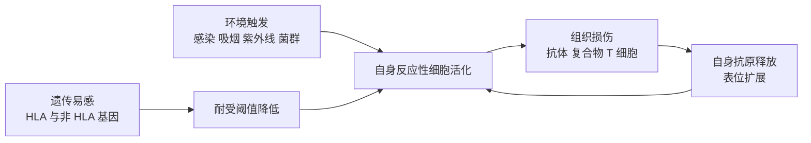

耐受一章（[7.15.24](/7.15.24)）讲免疫系统怎样不攻击自身；本章讲这一原则失败时发生什么。它是 Ⅱ、Ⅲ、Ⅳ 型超敏反应（[7.15.27](/7.15.27)）的一个特例：效应机制没有新东西，新的是靶是自身抗原，而自身抗原不会被清除，所以效应一旦启动就难以停止，疾病呈慢性、进行性。理解它的关键是同时看到两件事：一是耐受在哪些环节上可以失败，二是为什么大多数携带易感基因的人一辈子都不发病。

本章先区分自身免疫与自身免疫病，再讲病因机制和遗传，之后用器官特异性与系统性的几种代表性疾病说明效应机制，最后讲自身抗体、动物模型与治疗的原理。所有内容停留在机制层面。

## 28.1. 自身免疫与自身免疫病

自身免疫是免疫系统对自身成分的应答，它本身是生理现象：正常人血清中有低亲和力的天然自身抗体（对衰老细胞、DNA、免疫球蛋白等），自身反应性的 B 细胞与 T 细胞在外周大量存在（耐受并不要求清除所有自身反应性克隆，见 [7.15.24](/7.15.24)），自身抗原也被用于选择与维持（阳性选择、Treg 的发育）。感染后短暂出现的自身抗体也常见。

**定义 28.1.1（自身免疫病）** 由针对自身抗原的适应性免疫应答（自身抗体或自身反应性 T 细胞）引起的组织损伤或功能紊乱的疾病称为**自身免疫病**。

**定义 28.1.2（自身抗体）** 针对自身组织成分的抗体称为**自身抗体**。

区分"自身免疫"与"自身免疫病"需要证明因果。一个常用的框架（Witebsky 的修订）按证据强度分三级：

| 证据 | 内容 | 例子 |
|---|---|---|
| 直接 | 把抗体或 T 细胞转移给健康受体可以重现疾病 | 母亲的抗乙酰胆碱受体 IgG 经胎盘引起新生儿的暂时性肌无力；抗 TSHR 抗体引起新生儿甲亢；抗体被去除后症状缓解 |
| 间接 | 用自身抗原免疫动物或在动物中发现自发的疾病，可以重现 | EAE、NOD 小鼠 |
| 旁证 | 病灶中有自身反应性细胞与抗体，与 HLA 等遗传因素相关，对免疫抑制反应 | 多数自身免疫病 |

按受累范围，自身免疫病分为器官特异性（针对某个器官的特异抗原，病变限于该器官）与系统性（针对广泛分布的抗原，如核成分，累及多个系统）：

| 类型 | 疾病 | 靶抗原 | 主要效应 | 对应的超敏反应 |
|---|---|---|---|---|
| 器官特异性 | 桥本甲状腺炎 | 甲状腺过氧化物酶、甲状腺球蛋白 | 抗体加 Th1 细胞 | Ⅱ + Ⅳ |
| | Graves 病 | 促甲状腺激素受体 | 刺激性抗体 | Ⅱ（受体刺激） |
| | 重症肌无力 | 乙酰胆碱受体 | 阻断性抗体与补体 | Ⅱ（受体阻断） |
| | 1 型糖尿病 | 胰岛 β 细胞（胰岛素、GAD65、IA-2 等） | CD8⁺ 与 CD4⁺ T 细胞 | Ⅳ |
| | 多发性硬化 | 髓鞘（髓鞘碱性蛋白、蛋白脂蛋白等） | Th1 与 Th17 细胞 | Ⅳ |
| 系统性 | 系统性红斑狼疮 | 核成分（DNA、组蛋白、核糖核蛋白） | 免疫复合物 | Ⅲ（加 Ⅱ） |
| | 类风湿关节炎 | IgG 的 Fc 段、瓜氨酸化蛋白 | 免疫复合物、T 细胞、细胞因子 | Ⅲ + Ⅳ |

## 28.2. 病因的免疫学机制

自身免疫病几乎没有单一病因。机制可以按"耐受的哪一道防线失败了、又是什么把自身反应性细胞点燃了"来组织。

### 28.2.1. 耐受的失败

- 中枢耐受的缺陷：胸腺中的 **AIRE** 使外周组织特异抗原在胸腺髓质上皮细胞中表达，使对应的 T 细胞被清除，并产生 Treg；*AIRE* 突变导致自身免疫性多内分泌腺病综合征 1 型（APS-1），多个内分泌器官受到攻击。B 细胞的中枢耐受（受体编辑、克隆清除）受损会使多反应性与自身反应性的新生 B 细胞进入外周（见 [7.15.19](/7.15.19)）。
- 外周耐受的缺陷：**调节性 T 细胞**的转录因子 FOXP3 突变导致 IPEX 综合征（X 连锁，婴儿期的多器官自身免疫）；*CTLA4* 单倍剂量不足、*FAS* 突变（自身免疫性淋巴增生综合征）与 *IL2RA* 变异都破坏了 25 章所述的刹车；**克隆失能**的信号缺失使弱的自身反应性 T 细胞活化。
- 耐受的阈值：多数自身反应性细胞亲和力低、不被清除，它们的活化被限定在不引起疾病的水平；一旦刺激强度、共刺激或炎症背景改变，阈值被越过。这是下面各种机制的共同背景。

### 28.2.2. 把自身反应性细胞点燃的因素

**定义 28.2.1（分子模拟）** 病原体的抗原表位与自身分子在序列或结构上相似，使针对病原体的 B 细胞或 T 细胞与自身抗原发生**交叉反应**，在炎症的背景下绕过耐受并攻击自身组织的现象称为**分子模拟**。

典型的例子是风湿热：A 组链球菌感染后数周，针对链球菌 M 蛋白等抗原的抗体与心肌、关节等组织的蛋白交叉反应，引起心脏与关节的炎症。分子模拟也被认为与其他疾病相关，但大多缺乏像风湿热那样直接的证据，需要同时有易感的 HLA 单倍型（提呈交叉反应的肽）和炎症的环境（提供第二信号与细胞因子）。仅有相似的序列是不够的；人类的病毒与自身蛋白之间序列相似几乎无处不在，绝大多数时候并不致病。

**定义 28.2.2（表位扩展）** 自身免疫应答随着病程从最初针对的一个表位，扩展到同一分子的其他表位（分子内扩展）或同一组织中的其他分子（分子间扩展）的现象称为**表位扩展**。

机制是组织损伤释放更多自身抗原，由抗原提呈细胞摄取、加工，提呈此前未被提呈的"隐蔽"表位（隐性表位，在正常抗原加工中不产生或产生很少，因而对应的 T 细胞没有被清除），从而募集新的克隆。例如系统性红斑狼疮中，自身抗体先针对核糖核蛋白复合物的一个成分，之后扩展到同一颗粒的其他成分；多发性硬化的动物模型中 T 细胞反应由最初的髓鞘蛋白表位扩展到其他表位。表位扩展使疾病随时间加重，并且使针对单一表位的治疗在晚期效果下降。

其他的触发因素包括：

- 隐蔽抗原的释放：眼的晶状体蛋白、睾丸的抗原、心肌的蛋白在外伤、手术、感染或心肌梗死后进入循环，由于它们没有在胸腺中被充分表达，对应的 T 细胞没有被清除，在"危险"信号的背景下被活化（交感性眼炎是经典的例子；免疫豁免部位，见 [7.15.24](/7.15.24)）。
- 旁观者活化：局部的感染或炎症使抗原提呈细胞上调共刺激分子与细胞因子，使邻近的、特异性无关的自身反应性 T 细胞在 TCR 信号很弱的情况下被活化；EB 病毒等对 B 细胞的多克隆活化，使低亲和力的自身反应性 B 细胞产生自身抗体。
- 固有免疫的持续激活：自身核酸被 TLR7、TLR9 与 cGAS–STING 识别（[7.15.6](/7.15.6)），使浆细胞样树突状细胞持续产生 I 型干扰素，是系统性红斑狼疮的"干扰素特征"的来源；
- 其他环境因素：吸烟（类风湿关节炎中使蛋白瓜氨酸化）、紫外线（使细胞凋亡增多、释放核抗原）、维生素 D 与日照、微生物组的改变、饮食（盐促进 Th17）等；
- 偶然性：V(D)J 重排与肽提呈的随机性使每个人的组库不同，同卵双胞胎的发病也不完全一致。

各因素的关系可以概括为"遗传易感 × 环境触发 × 耐受缺陷 → 自身免疫 → 组织损伤 → 抗原释放与扩展 → 慢性化"的自我放大环：

## 28.3. 遗传易感性

自身免疫病有明显的遗传成分：同卵双胞胎的一致率比异卵双胞胎高很多；以多发性硬化为例，一般人群的终生风险约千分之一，其同胞约二十分之一，同卵双胞胎约四分之一。同时一致率远低于 100%，说明遗传提供倾向、环境起触发。

HLA 基因是最强的遗传因素，因为它决定可以向 T 细胞提呈哪些自身肽（[7.15.13](/7.15.13)）：

| 疾病 | 关联的 HLA | 解释 |
|---|---|---|
| 强直性脊柱炎 | HLA-B27（Ⅰ 类，风险高约 90 倍） | 异常折叠、肽提呈与二聚体形成的假说，机制尚未完全确定 |
| 类风湿关节炎 | HLA-DRB1 的"共享表位"（肽结合槽的一段序列） | 共享表位的等位基因的槽更适合结合瓜氨酸化的肽 |
| 1 型糖尿病 | HLA-DR3、DR4 与 DQ8 | 槽的某些位置影响与胰岛素肽的结合 |
| 多发性硬化 | HLA-DRB1\*15:01 | 与髓鞘碱性蛋白肽结合 |
| 系统性红斑狼疮 | HLA-DR3、DR2 | 与补体早期成分缺陷共同作用 |

HLA 区域的基因高度连锁不平衡（[7.4.8](/7.4.8)、[7.4.22](/7.4.22)），所以关联信号常来自一个单倍型而不是单个等位基因，把因果归于哪一个等位基因需要精细作图（[7.4.25](/7.4.25)）。

非 HLA 基因通过两类途径起作用：改变免疫应答的阈值与改变清除自身物质的能力。*PTPN22*（编码磷酸酶 LYP）的 R620W 变异是多种自身免疫病（1 型糖尿病、类风湿关节炎、系统性红斑狼疮）的共同危险因素，它改变 TCR 与 BCR 信号的强度，使自身反应性细胞在阴性选择与外周被更容易保留。*CTLA4*、*IL2RA*、*STAT4*、*IL23R*（炎症性肠病、银屑病）、补体 C1q 与 C4 的缺陷（引起狼疮：凋亡细胞的碎片不能被补体与巨噬细胞清除，核抗原暴露）各自对应机制中的一环。

### 28.3.1. 关联强度的统计解读

病例对照研究常报告**优势比**（OR），队列研究报告**风险比**（RR，相对危险度）。两者的关系取决于疾病的基线风险：设不具有危险等位基因者的发病概率为 $p_0$，携带者为 $p_1 = \mathrm{RR}\cdot p_0$，则

$$
\mathrm{OR} = \frac{p_1/(1 - p_1)}{p_0/(1 - p_0)},\qquad \mathrm{RR} = \frac{\mathrm{OR}}{1 - p_0 + p_0\,\mathrm{OR}}.
$$

疾病罕见（$p_0$ 很小）时 OR 近似 RR；疾病常见时 OR 高估 RR。这在读文献时很重要：一个"OR = 3"的关联在常见病中可能只对应 RR 约 2（链接 [7.7.9](/7.7.9)）。

**例 28.3.1（HLA 关联的绝对风险）** 设某病例对照研究（教学用的示意数字，量级与强直性脊柱炎和 HLA-B27 的关联相仿）发现，危险等位基因的携带率在病人中是 $90\%$，对照中是 $8\%$，则

$$
\mathrm{OR} = \frac{0.90/0.10}{0.08/0.92} \approx 104.
$$

假设该病在人群中的患病率是 $K = 0.5\%$（再假设对照的携带率就是人群中非病人的携带率），则携带者与非携带者的发病概率为

$$
\mathbb{P}(\text{病}\mid\text{携带}) = \frac{K \times 0.90}{K \times 0.90 + (1 - K) \times 0.08} \approx 5.4\%,\qquad
\mathbb{P}(\text{病}\mid\text{非携带}) = \frac{K \times 0.10}{K \times 0.10 + (1 - K)\times 0.92} \approx 0.05\%,
$$

风险比约为 98，与 OR 接近（疾病罕见）。图 B 显示：风险比近 100，携带者的绝对风险也只有约 5%，95% 的携带者终生不发病。图 A 画出 OR 与 RR 的关系：基线风险越高，二者差距越大。

:::

关联不等于因果，也不等于预测：一个强关联的等位基因在人群水平解释了病因的一部分，却不能用来诊断（携带者的阳性预测值极低），这是第二章已经遇到的灵敏度与特异度问题（[7.7.3](/7.7.3)）。

## 28.4. 器官特异性自身免疫病

桥本甲状腺炎是最早被确认的器官特异性自身免疫病：患者产生抗甲状腺过氧化物酶与甲状腺球蛋白的抗体，同时有 Th1 细胞与 CTL 浸润，甲状腺被淋巴细胞、浆细胞与生发中心样结构浸润（类似的三级淋巴结构，见 [7.15.22](/7.15.22)），腺体逐渐被破坏，甲状腺激素产生减少，最终是甲状腺功能减退。抗体可以激活补体和介导 ADCC，但组织的破坏主要是细胞介导的。

Graves 病的自身抗体结合促甲状腺激素（TSH）受体并像激动剂一样持续激活它，使甲状腺不受下丘脑—垂体—甲状腺轴负反馈的控制，持续地合成与分泌甲状腺激素。这是一个"由抗体的受体刺激而致病、没有细胞被杀死"的例子（[7.15.27](/7.15.27) 的受体刺激），且 IgG 可以经胎盘引起新生儿一过性的甲亢，是直接证据的一例。

**重症肌无力**（myasthenia gravis）的自身抗体针对神经肌肉接头后膜的乙酰胆碱受体，阻断乙酰胆碱的结合，加速受体的内化与降解，激活补体破坏突触后膜的褶皱，使终板电位下降，肌肉无力且随活动加重。患者中胸腺异常（增生或胸腺瘤）较常见，推测与胸腺中肌样细胞表达受体、AIRE 或耐受异常相关。

**1 型糖尿病**由 CD8⁺ 与 CD4⁺ T 细胞选择性破坏胰岛 β 细胞引起（疾病与胰岛素的代谢见 [7.14](/7.14)）。针对胰岛素、GAD65、IA-2 与 ZnT8 的自身抗体在临床发病前几年就可检出，是标志，不是致病因素，因为抗体本身不引起 β 细胞的破坏。

**多发性硬化**（multiple sclerosis）是中枢神经系统的炎症性脱髓鞘疾病：自身反应性的 Th1 与 Th17 细胞（还有 B 细胞与单核细胞）穿过血脑屏障，识别髓鞘抗原，引起髓鞘损伤，使神经冲动的传导受阻；病程常呈复发—缓解。风险因素包括 HLA-DRB1\*15:01、EB 病毒感染史、低日照（低维生素 D）、吸烟与肥胖。穿越血脑屏障依赖黏附分子 α4 整联蛋白（[7.15.4](/7.15.4)），所以阻断它是一种治疗途径。

## 28.5. 系统性自身免疫病

**系统性红斑狼疮**（systemic lupus erythematosus），简称 SLE，是典型的系统性自身免疫病，患者产生针对 DNA、组蛋白、核糖核蛋白等核成分的抗核抗体。机制环环相扣：凋亡细胞的清除缺陷（补体 C1q、C4 缺陷，MFG-E8 等）使核成分暴露；核酸与抗体形成免疫复合物，经 FcγR 进入浆细胞样树突状细胞，激活内体中的 TLR7、TLR9，分泌 I 型干扰素；I 型干扰素使自身反应性 B 细胞与树突状细胞活化，产生更多的自身抗体；复合物沉积在肾小球、皮肤与关节，造成 Ⅲ 型损伤（[7.15.27](/7.15.27)），抗红细胞、血小板抗体造成 Ⅱ 型损伤。这样形成"凋亡碎片—抗体—核酸感受—干扰素—更多抗体"的正反馈。90% 的患者是女性。抗核抗体的检测用患者血清对细胞核做间接免疫荧光（[7.15.34](/7.15.34)），灵敏度高但特异性较低，抗 dsDNA 与抗 Sm 抗体的特异性较高。

**类风湿关节炎**（rheumatoid arthritis）累及关节滑膜。患者血清中有类风湿因子（针对 IgG Fc 的自身抗体）与抗瓜氨酸化蛋白抗体（ACPA），后者在临床症状出现前数年就能检出，且与 HLA-DRB1 共享表位和吸烟相关：精氨酸经肽基精氨酸脱亚胺酶转变为瓜氨酸后，与共享表位的 HLA-DR 槽结合得更好，使修饰后的肽被提呈并打破耐受。滑膜中形成复合物和 T 细胞、B 细胞与巨噬细胞的浸润，TNF-α、IL-6、IL-1 与 IL-17 驱动滑膜增生（血管翳）、软骨与骨的破坏，既有 Ⅲ 型的复合物也有 Ⅳ 型的 T 细胞反应。

## 28.6. 自身抗体的致病与标志作用

自身抗体在两种意义上有用，必须区分：

| 角色 | 含义 | 例子 |
|---|---|---|
| 致病 | 抗体本身引起疾病，转移或去除可以改变病程 | 抗乙酰胆碱受体、抗 TSHR、抗肾小球基底膜、抗桥粒芯糖蛋白（天疱疮） |
| 标志 | 抗体是疾病过程的产物或副产物，用于诊断、分型、预测 | 抗核抗体、类风湿因子、ACPA、1 型糖尿病的胰岛自身抗体 |

标志性抗体的价值取决于检验的灵敏度与特异度，以及疾病的先验概率：抗核抗体在 SLE 中几乎全部阳性（灵敏度高），在健康人和其他疾病中也有一定比例阳性（特异性不高），所以阴性可以帮助排除，阳性要结合临床；诊断是综合的（链接 [7.7.3](/7.7.3)）。致病的 IgG 可以通过去除（血浆置换）、加速降解（阻断 FcRn，使 IgG 的回收减少，见 [7.15.21](/7.15.21)）或清除产生它的 B 细胞来降低。

## 28.7. 动物模型

动物模型回答因果问题，它们的价值与局限都要认清：

- 实验性自身免疫性脑脊髓炎（EAE）：用髓鞘抗原与佐剂免疫动物（或转移髓鞘特异性 CD4⁺ T 细胞），引起中枢神经系统的炎症与脱髓鞘，是 T 细胞介导的疾病模型，是 Th1、Th17 与血脑屏障穿越研究的主要工具；
- NOD 小鼠：自发发生 1 型糖尿病，与特定的 MHC Ⅱ 类分子相关，雌鼠发病更多，用于研究 T 细胞的致病、调节与预防；
- NZB/W F1 小鼠：自发发生类似狼疮的疾病；
- 胶原诱导的关节炎：用 Ⅱ 型胶原免疫，引起关节炎，用于类风湿关节炎。

局限是：模型常由人为的佐剂免疫或近交系的特定遗传背景诱导，小鼠的免疫系统与人有差别（例如 FcγR 与 T 细胞亚群的标记），许多在模型中有效的干预在人体中无效；所以模型用来检验机制假说，不能直接预测疗效。

## 28.8. 治疗的原理

理想的治疗是只抑制自身反应性的应答、保留保护性免疫，这很难做到，现有的方法是由广到窄：

| 层次 | 例子 | 原理 |
|---|---|---|
| 广谱免疫抑制 | 糖皮质激素（25.7）、抗代谢药、钙调磷酸酶抑制剂（[7.15.29](/7.15.29)） | 抑制活化与增殖的所有细胞，代价是感染与肿瘤风险 |
| 清除细胞 | 抗 CD20（清除 B 细胞，但浆细胞不表达 CD20，所以已有的长寿浆细胞继续产生抗体）、抗 CD3 | 去除自身反应性的细胞群，需要等待重建 |
| 阻断细胞因子 | 抗 TNF、抗 IL-6 受体、抗 IL-17、抗 IL-23、抗 IL-1、抗 I 型干扰素受体 | 针对网络中的节点（[7.15.11](/7.15.11)、27.4）；副作用是抑制了相应的防御 |
| 阻断共刺激与迁移 | CTLA-4 的融合蛋白（25.8）、抗 α4 整联蛋白、S1P 受体调节剂（使淋巴细胞滞留于淋巴结） | 降低活化与到达靶组织 |
| 降低致病的 IgG | 阻断 FcRn | 缩短 IgG 的半衰期 |
| 抗原特异性的耐受 | 给予自身抗原的耐受化形式、Treg 治疗、对自身反应性 B 细胞的特异性清除 | 恢复对特定抗原的耐受（[7.15.24](/7.15.24)、[7.15.30](/7.15.30) 的 CAR-T 用于清除 B 细胞） |
| 替代功能 | 胰岛素、甲状腺激素 | 补偿被破坏的器官 |

其中抗原特异性治疗是理想而最难的方向，因为它要求知道致病抗原和表位，并且要在表位扩展之前（疾病的早期）介入。

## 小结

- 自身免疫是生理的，自身免疫病需要因果证据（直接、间接、旁证）；自身抗体（定义 28.1.2）有致病与标志两种角色。
- 耐受的失败可发生在中枢（AIRE）、外周（FOXP3、CTLA4、FAS）与阈值；点燃的因素包括分子模拟（定义 28.2.1）、表位扩展（定义 28.2.2）、隐蔽抗原释放、旁观者活化、核酸的固有感受与环境因素，最终形成自我放大环。
- HLA 是最强的遗传因素，非 HLA 基因（如 *PTPN22*）改变阈值或清除能力；OR 与 RR 的关系取决于基线风险，强关联也不意味着强预测（例 28.3.1）。
- 器官特异性的疾病是抗体（受体刺激或阻断）或 T 细胞造成的，系统性疾病由免疫复合物与核酸感受—干扰素的环造成。
- 治疗由广谱免疫抑制到抗细胞因子、共刺激与迁移、再到抗原特异性耐受，层层变窄，代价是抑制正常的防御。

## 思考题

1. 为什么携带 HLA 危险等位基因的人中绝大多数不发病？这对遗传检测的应用意味着什么？

   **答** HLA 提供的是对某些肽的提呈倾向，还需要耐受机制的其他缺陷、非 HLA 基因的共同作用、环境触发与偶然事件，才会越过发病阈值。例 28.3.1 中即使 OR 约 100，携带者的绝对风险也只有约 5%：阳性预测值低。因此 HLA 分型不能用来预测多数人是否会发病，只能作为辅助证据（疾病的鉴别、药物过敏风险的预测等）。

2. 解释为什么抗 CD20 抗体能降低多种自身抗体，却对已经存在的一些自身抗体水平影响较小。

   **答** CD20 在 pro-B、前 B 到记忆 B 细胞上表达，浆细胞（特别是长寿浆细胞）不表达，所以被清除的是新的抗体产生者与抗原提呈的 B 细胞，不是已经分化的浆细胞，已有的长寿浆细胞继续分泌抗体；因此依赖不断补充浆细胞的自身抗体下降，由长寿浆细胞维持的则变化较少。

3. 设一个自身免疫病的患者针对自身蛋白 X 的抗体早在发病前 5 年就出现。能否据此认为这个抗体引起了疾病？

   **答** 不能。先于疾病出现只说明抗体是病程中早期的事件，可以是原因，也可以是同一个更早的起始过程（组织损伤、抗原释放）的产物。需要进一步的证据：把抗体转移给健康动物是否重现疾病（直接证据），抗原在组织中的位置是否对应病变，清除抗体是否改善病情。类风湿关节炎的 ACPA 与 1 型糖尿病的胰岛自身抗体在不同程度上属于标志。
