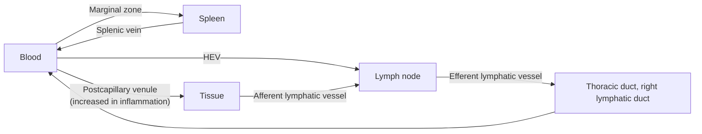

The previous chapter introduced who the immune cells are; this chapter describes where they develop and where they meet. Adaptive immunity faces a spatial problem: naive lymphocytes recognizing a given antigen number only $10^{-6}$–$10^{-5}$ of the repertoire ([7.15.1](/7.15.1)), while antigen may enter at any point in the body. The solution consists of two arrangements: first, concentrating antigen in the fixed compartments of a few "meeting places", the lymph nodes, spleen, and mucosal lymphoid tissues; second, letting lymphocytes circulate continuously among blood, lymph, and these meeting places, so that they "patrol" each of them in turn. This chapter first treats the central organs in which immune cells develop (§3.1–3.3), then the peripheral organs in which responses take place (§3.4–3.6), and finally lymphocyte recirculation, using a random-walk model to estimate how long it takes to "find the right cell" in a lymph node (§3.7). The physiology of lymphatic vessels and lymph is in [7.14.15](/7.14.15); mucosal immunity is developed further in [7.15.23](/7.15.23) and the spatiotemporal course of responses within organs in [7.15.22](/7.15.22); the compartments described here are also the basic coordinates for analyzing tissue sections in spatial omics ([7.9.6](/7.9.6)).

## 3.1. Primary and Secondary Lymphoid Organs

**Definition 3.1.1** The sites where immune cells are generated, differentiate, develop, and mature are called **primary lymphoid organs** (also central lymphoid organs); in humans and other mammals these are the bone marrow and thymus. The sites where mature lymphocytes settle and respond to antigen are called **secondary lymphoid organs** (also peripheral lymphoid organs) and include the lymph nodes, spleen, mucosa-associated lymphoid tissue, and skin-associated lymphoid tissue.

| | Primary lymphoid organs | Secondary lymphoid organs |
|---|---|---|
| Organs | Bone marrow, thymus (in birds also the bursa of Fabricius) | Lymph nodes, spleen, mucosa-associated lymphoid tissue |
| Function | Produce lymphocytes, complete rearrangement and selection of antigen receptors | Collect antigen, bring lymphocytes together with antigen and antigen-presenting cells, and carry out responses |
| Antigen dependence | No: development does not require foreign antigen | Yes: structure (such as germinal centers) changes with antigenic stimulation |
| Self-tolerance | Central tolerance (negative selection) | Peripheral tolerance |
| Time of appearance | Earliest in the embryo | Somewhat later, maturing with the cells exported from the primary organs |

In chronically inflamed tissues (such as the target organs of autoimmune disease and tumors), lymphocyte aggregates resembling lymph nodes can also form de novo; these are called **tertiary lymphoid structures**, and their significance is discussed in [7.15.22](/7.15.22) and [7.15.30](/7.15.30).

## 3.2. Bone Marrow

The bone marrow is the hematopoietic organ of the adult and the birthplace of all immune cells ([7.15.2](/7.15.2)).

- Structure: the marrow is divided into hematopoietic red marrow and yellow marrow consisting mainly of adipose tissue. In children red marrow fills all marrow cavities; in adults red marrow is found mainly in flat bones (ilium, sternum, vertebrae, ribs) and in the proximal ends of long bones; after major blood loss yellow marrow can revert to red marrow. Hematopoietic cells are distributed in a scaffold of reticular connective tissue and sinusoids, and gaps between sinusoidal endothelial cells allow mature blood cells to enter the blood.
- Hematopoietic microenvironment: hematopoietic stem and progenitor cells reside in "niches" around blood vessels and near the endosteum, where stromal cells, endothelial cells, and osteoblasts provide signals such as SCF, CXCL12, and IL-7 that determine their survival, quiescence, and differentiation ([7.3.24](/7.3.24)).
- Function: (1) production of all blood cells and immune cells; (2) B cells and NK cells develop and mature here, and T-cell precursors migrate from here to the thymus; (3) the main residence of long-lived plasma cells, and therefore the main source of serum antibody in secondary responses. The last point means that the bone marrow is both a primary organ and an effector organ: plasma cells generated in lymph node germinal centers migrate back to the marrow and, supported by CXCL12 and survival signals such as IL-6 and APRIL, continue to secrete antibody for decades ([7.15.20](/7.15.20)).

## 3.3. Thymus

**Definition 3.3.1 (Thymus)** The **thymus** is a primary lymphoid organ located behind the sternum in the anterior mediastinum, where T cells develop, undergo selection, and acquire MHC restriction and self-tolerance.

The thymus consists of two lobes, and the capsule extends into the parenchyma to divide it into many lobules. In each lobule the outer layer is the cortex and the inner layer is the medulla, and the medullae of adjacent lobules are continuous.

| Region | Cells | Events |
|---|---|---|
| Subcapsular zone and cortex | Densely packed immature thymocytes (85%–90% of thymocytes); cortical thymic epithelial cells (cTEC); macrophages | Proliferation of T-cell precursors, rearrangement of TCR genes; positive selection |
| Corticomedullary junction | Site of entry and exit of blood vessels | Precursors enter from blood, mature T cells leave |
| Medulla | More mature single-positive thymocytes; medullary thymic epithelial cells (mTEC), dendritic cells; thymic corpuscles (Hassall's corpuscles, concentric structures formed by degenerated epithelial cells) | Negative selection: elimination of cells recognizing tissue-specific self antigens; generation of regulatory T cells |

**Thymic epithelial cells**, together with dendritic cells, macrophages, and fibroblasts, form the stroma of the thymus, and they shape T cells in two ways: by direct contact (MHC–self peptide complexes and the Notch ligand DLL4 expressed by epithelial cells) and by secreting soluble factors (IL-7, SCF, and the chemokines CCL25 and CCL21, among others). The role in T-cell development of the "thymic hormones" such as thymosin and thymopoietin extracted in early studies is unclear, and the modern understanding rests mainly on the contact signals and cytokines above. Medullary epithelial cells express the transcriptional regulator AIRE, which causes many proteins normally expressed only in specific tissues such as the pancreas and thyroid to be expressed in the thymus as well; this is the key that allows central tolerance to cover self antigens of the whole body ([7.15.15](/7.15.15), [7.15.24](/7.15.24)).

The thymus has three functions: differentiation and maturation of T cells; establishment of **MHC restriction** and self-tolerance through positive and negative selection; and production of regulatory T cells, which take part in immune regulation. Selection in the thymus is extremely stringent: precursors entering the thymus proliferate on the order of $10^{7}$ per day, but only about 2%–5% finally mature and are exported, while most of the rest die by apoptosis because the TCR cannot recognize self MHC ("death by neglect") or recognizes it too strongly (negative selection), and are cleared by macrophages.

At birth the thymus weighs about $10$–$15\,\mathrm{g}$, the largest relative to body size; at puberty about $30$–$40\,\mathrm{g}$; thereafter it gradually involutes, the thymic epithelium is replaced by adipose tissue, and adult thymic output declines by about 3% per year. The adult T-cell pool is therefore maintained mainly by homeostatic proliferation of existing peripheral cells ([7.15.2](/7.15.2)), and the weaker response of the elderly to new antigens is partly due to a shortage of new naive T cells. Thymectomy in the neonatal period (or congenital absence of the thymus, as in DiGeorge syndrome) causes severe T-cell deficiency, whereas thymectomy in adulthood has a much smaller effect.

## 3.4. Lymph Nodes

**Definition 3.4.1 (Lymph Node)** **Lymph nodes** are secondary lymphoid organs distributed along lymphatic vessels that filter the lymph draining tissues and in which lymphocytes encounter antigen brought by the lymph.

The human body has about 500–600 lymph nodes, concentrated near sites where antigen readily enters: the neck, axilla, groin, mesentery, and hilum of the lung. Each lymph node drains a fixed region of tissue, so in infection or tumor metastasis the first involved is the "draining lymph node" (sentinel lymph node).

### 3.4.1. Structural Compartments

A lymph node is bean-shaped and enclosed in a connective tissue capsule. Several afferent lymphatic vessels cross the capsule from the convex surface into the subcapsular sinus, and lymph flows along the cortical and medullary sinuses to the hilum on the concave side, leaving through the efferent lymphatic vessel; the artery and vein also enter and leave at the hilum. The parenchyma is divided into three regions:

| Region | Location | Main cells | Dependence | Function |
|---|---|---|---|---|
| Superficial cortex | Beneath the capsule | Lymphoid follicles formed by aggregates of B cells; follicular dendritic cells | Thymus-independent (B-cell zone) | Primary follicles (unstimulated, naive B cells); after antigenic stimulation, secondary follicles containing germinal centers form |
| Paracortex (deep cortex) | Between superficial cortex and medulla | T cells; dendritic cells; fibroblastic reticular cells; high endothelial venules | Thymus-dependent (T-cell zone) | Naive T cells meet dendritic cells; lymphocytes from the blood enter here |
| Medulla | Near the hilum | Medullary cords: B cells, plasma cells, macrophages; medullary sinuses: abundant macrophages | | Plasma cells secrete antibody into the lymph; macrophages filter the lymph |

![Structure of the lymph node and the splenic white pulp (schematic). A: section of a lymph node. Lymph enters the subcapsular sinus from afferent lymphatic vessels (above) and leaves through the cortical and medullary sinuses via the efferent lymphatic vessel at the hilum. The superficial cortex contains B-cell follicles (primary follicles and secondary follicles with germinal centers); beneath them is the paracortex where T cells reside, and the high endothelial venules there (small circles) are the entry points for lymphocytes from the blood; the medulla consists of the medullary cords (plasma cells) and medullary sinuses (macrophages). B: cross-section of the splenic white pulp. Around the central arteriole is the periarteriolar lymphoid sheath where T cells aggregate, beside it are the B-cell follicles (which may contain germinal centers), peripherally the marginal zone (marginal zone B cells and specialized macrophages) and marginal sinus, and outermost the blood-filled red pulp. The spleen has no afferent lymphatic vessels, and antigen enters with the blood](./plots/lymphoid-organs.py)

The compartments of the lymph node are not delineated by septa but are maintained by chemokines secreted by stromal cells: fibroblastic reticular cells in the paracortex secrete CCL19 and CCL21, attracting CCR7-expressing T cells and mature dendritic cells; stromal cells and follicular dendritic cells in the follicles secrete CXCL13, attracting CXCR5-expressing B cells (for the classification and actions of **chemokines**, see [7.15.4](/7.15.4)). Fibroblastic reticular cells also form a network of "conduits" made of collagen fibers that delivers small-molecule antigens and chemokines in the lymph directly from the subcapsular sinus to the vicinity of the high endothelial venules deep in the paracortex; T cells also "crawl" along this network.

**Definition 3.4.2 (High Endothelial Venule)** **High endothelial venules** (HEVs) are postcapillary venules in the lymph node paracortex (and in tissues such as Peyer's patches and tonsils) whose endothelial cells are cuboidal and express specialized adhesion molecules and chemokines; they are the main gateway by which lymphocytes in the blood enter peripheral lymphoid tissue.

The endothelium of ordinary venules is flat; that of HEVs is tall and thick, expresses on its surface the sulfated glycans recognized by L-selectin (peripheral node addressin, PNAd), and displays CCL21. Naive lymphocytes expressing L-selectin and CCR7 roll here, are activated, adhere firmly, and exit the vessel (the **leukocyte adhesion cascade** of [7.15.4](/7.15.4)). A lymph node can admit lymphocytes through HEVs at a rate of the order of $10^{6}$ per hour, of which only very few will meet their own antigen.

**Definition 3.4.3 (Germinal Center)** The region of a secondary lymphoid follicle in which antigen-stimulated B cells, aided by follicular helper T cells, proliferate rapidly, undergo somatic hypermutation, and are subjected to affinity selection is called the **germinal center**.

Germinal centers form about a week after antigen entry; in tissue sections they appear as a lightly stained region of larger cells in the center of the follicle, surrounded by a mantle of displaced resting B cells. The germinal center is divided into a dark zone and a light zone and is where affinity maturation and class switching occur ([7.15.20](/7.15.20)).

### 3.4.2. Functions

The lymph node has four functions: (1) it is the residence of T cells and B cells, and of the lymphocytes in human lymph nodes about 75% are T cells and 25% are B cells; (2) it is the main site of the adaptive response: dendritic cells in tissues carry antigen along afferent lymphatic vessels into the paracortex, while soluble antigen arrives directly with the lymph, is captured by macrophages in the subcapsular sinus, and is handed to B cells in the follicles; (3) it filters lymph: macrophages in the medullary sinuses remove particles, pathogens, and tumor cells from the lymph; (4) it takes part in lymphocyte recirculation. In infection the lymph node enlarges mainly because lymphocytes are retained in it (egress is temporarily shut down) and proliferate there, not because of the pathogen itself.

## 3.5. Spleen

**Definition 3.5.1 (Spleen)** The **spleen** is the largest secondary lymphoid organ in the body, located in the left upper abdomen, not connected to lymphatic channels; it responds to antigen entering with the blood and also filters the blood, clearing senescent erythrocytes and pathogens in the blood.

The parenchyma of the spleen is divided into white pulp and red pulp, enclosed in a capsule that extends inward to form trabeculae.

- The white pulp is lymphoid tissue distributed along the central arteriole: around the artery is the periarteriolar lymphoid sheath (PALS, equivalent to the paracortex of the lymph node), where T cells aggregate, and beside it are the B-cell lymphoid follicles (in which germinal centers appear after stimulation).
- The marginal zone lies at the border between white pulp and red pulp and is the first place blood flows through after entering the splenic parenchyma: the terminal arterioles open into the marginal sinus, and blood passes slowly through the marginal zone before entering the red pulp. Here are specialized marginal zone macrophages and **marginal zone B cells**, the latter rapidly producing IgM against polysaccharide antigens in the blood (such as the capsule of *Streptococcus pneumoniae*) without the help of T cells ([7.15.19](/7.15.19)).
- The red pulp consists of splenic cords and splenic sinuses and is full of blood; macrophages of the red pulp phagocytose senescent and damaged erythrocytes and particles coated with antibody or complement.

In the human spleen B cells make up about 60% of lymphocytes and T cells about 40%. The difference in division of labor between spleen and lymph nodes lies in the route of antigen: lymph nodes respond to tissue antigens brought by lymph, and the spleen responds to antigens in blood. The circulating blood of the whole body passes through the spleen several times a day, so the spleen is the main line of defense against blood-borne infection; people who have had a splenectomy (or have congenital asplenia or functional asplenia due to sickle cell disease) are prone to fulminant sepsis caused by encapsulated bacteria (*Streptococcus pneumoniae*, *Neisseria meningitidis*, *Haemophilus influenzae* type b) and need vaccines against these bacteria. The spleen is also a site of synthesis of complement components and of various cytokines, and in the embryo it is a hematopoietic organ.

## 3.6. Mucosa-Associated Lymphoid Tissue

**Definition 3.6.1 (Mucosa-Associated Lymphoid Tissue)** The lymphoid tissues distributed in the lamina propria and beneath the epithelium of the mucosae of the gastrointestinal, respiratory, and urogenital tracts, including scattered lymphocytes and organized lymphoid follicles (such as the tonsils, the Peyer's patches of the small intestine, and the appendix), are collectively called **mucosa-associated lymphoid tissue** (MALT).

The total area of the human mucosae is about $400\,\mathrm{m^2}$ (mainly the small intestine); they are the main portal of entry for pathogens and also the interface where the body is in continuous contact with food antigens and commensal bacteria. More than half of all lymphocytes in the body are in the mucosae, and the antibody they produce (mainly **secretory IgA**) exceeds 3 g per day, more than the sum of all other antibodies. By site, MALT includes gut-associated lymphoid tissue (GALT), nasal-associated lymphoid tissue (NALT, including the pharyngeal and palatine tonsils), and bronchus-associated lymphoid tissue (BALT).

The structure of gut-associated lymphoid tissue is the best understood:

| Component | Structure and location | Function |
|---|---|---|
| **Peyer's patches** | A group of lymphoid follicles beneath the mucosa of the small intestine (especially the ileum), containing germinal centers, with T-cell zones between the follicles; the epithelium above is called follicle-associated epithelium, and beneath it is the subepithelial dome, rich in dendritic cells | The "meeting place" for inducing mucosal responses; there are no afferent lymphatic vessels, and antigen passes directly through the epithelium |
| **M cells** | Specialized epithelial cells in the follicle-associated epithelium that lack microvilli and secrete neither mucus nor digestive enzymes; the basal surface is invaginated into a "pocket" that holds lymphocytes and dendritic cells | Transport particles and microorganisms from the intestinal lumen to the subepithelium and hand them to dendritic cells |
| Isolated lymphoid follicles, appendix | Scattered follicles; the appendix is a concentrated lymphoid tissue | Same as above |
| **Intraepithelial lymphocytes** | Interspersed among intestinal epithelial cells, mostly CD8⁺ T cells and γδ T cells | Monitor and kill damaged or infected epithelial cells |
| Lamina propria lymphocytes | Plasma cells in the subepithelial connective tissue (mainly secreting IgA), effector and memory T cells, ILCs, macrophages, dendritic cells | Effector site of the mucosa |

A characteristic of MALT is that the inductive sites (Peyer's patches and others) are separate from the effector sites (lamina propria and epithelium): lymphocytes activated in Peyer's patches travel through lymph and blood and, aided by gut-specific homing molecules, return to the mucosal lamina propria throughout the body; the mechanism of this "common mucosal immune system" and oral tolerance are in [7.15.23](/7.15.23). The skin likewise has large numbers of resident T cells, Langerhans cells, and dermal dendritic cells, sometimes called skin-associated lymphoid tissue.

## 3.7. Lymphocyte Recirculation

### 3.7.1. Routes and Significance

**Definition 3.7.1 (Lymphocyte Recirculation)** The process in which lymphocytes pass from the blood into peripheral lymphoid organs and tissues and return to the blood through lymphatic vessels (efferent lymphatic vessels, lymphatic trunks, the thoracic duct or right lymphatic duct), repeating this cycle, is called **lymphocyte recirculation**.

Around 1960 Gowans cannulated the thoracic duct of rats to drain lymph and found that the number of lymphocytes collected over a few days far exceeded the number present in the lymph at any one time, and that labeled lymphocytes injected back into the blood reappeared in thoracic duct lymph, demonstrating that lymphocytes circulate between blood and lymph. There are three main routes of recirculation:

| Route | Entry | Exit | Main cells |
|---|---|---|---|
| Blood–lymph node | HEV of the paracortex | Efferent lymphatic vessel → thoracic duct → blood | Naive T and B cells, central memory T cells |
| Blood–spleen | Marginal sinus and marginal zone | Splenic vein (directly back to blood) | Lymphocytes of all types |
| Blood–tissue–lymph node | Postcapillary venules in tissue | Afferent lymphatic vessel into lymph node | Effector and effector memory T cells, and dendritic cells migrating out of tissues |

A naive T cell usually stays in one lymph node for 6–24 h and then leaves; it stays in the blood for only about half an hour. Exit from the lymph node is guided by the higher concentration of sphingosine-1-phosphate (S1P) in the lymph: T cells that re-express the S1P receptor S1PR1 enter efferent lymphatic vessels along the concentration gradient. Cells activated by antigen temporarily downregulate S1PR1 (mediated by the activation marker CD69) and are therefore retained in the lymph node to proliferate; the drug fingolimod, used to treat multiple sclerosis, internalizes S1PR1 and "locks" lymphocytes in lymph nodes. Which organ or tissue a lymphocyte selectively enters is determined by the homing receptors it expresses and the corresponding ligands (addressins) on vascular endothelium, that is, **lymphocyte homing** ([7.15.4](/7.15.4)).

The significance of recirculation: (1) it continuously renews the distribution of lymphocytes among the secondary lymphoid organs; (2) it gives each lymphocyte the opportunity to "patrol" many lymph nodes, greatly increasing the chance that a naive lymphocyte meets its specific antigen — a specificity has only a few precursors and without recirculation could not be present in every possible draining lymph node; (3) it links the immune organs of the whole body into a single whole, so that effector and memory cells activated in one place are distributed throughout the body.

### 3.7.2. A Model: Searching for Antigen in the Lymph Node

In a lymph node there may be only a few dozen dendritic cells carrying a given antigen, and T cells do not know where they are. Two-photon intravital imaging shows that naive T cells move in the paracortex at about $10$–$15\,\mathrm{\mu m\,min^{-1}}$, changing direction at random every minute or two; after meeting a dendritic cell presenting their specific antigen they "stop" within minutes, their speed falls to $4$–$6\,\mathrm{\mu m\,min^{-1}}$, and they form a contact that lasts hours. This motion can be approximated as a random walk ([3.1](/3.1)), from which we can estimate how long one search takes.

**Example 3.7.1** Suppose a T cell moves with speed $v$ and a direction persistence time $\tau_{\mathrm{p}}$; on long time scales it is three-dimensional Brownian motion with diffusion coefficient

$$
D = \frac{v^2 \tau_{\mathrm{p}}}{3}
$$

(its probability density is described by the heat equation of [2.5.7](/2.5.7)). In a volume $V$, $n$ stationary target dendritic cells are randomly distributed with density $\rho = n/V$, and the T cell counts as having found one when it comes within radius $a$. For sparse stationary targets, Smoluchowski's result gives the rate of finding

$$
k = 4\pi D a \rho ,
$$

so the probability that the T cell has still not found one within time $t$ is approximately $\mathrm{e}^{-kt}$, and the mean search time is $1/k$. Take $v = 12\,\mathrm{\mu m\,min^{-1}}$, $\tau_{\mathrm{p}} = 2\,\mathrm{min}$ ($D \approx 96\,\mathrm{\mu m^2\,min^{-1}}$), contact radius $a = 20\,\mathrm{\mu m}$ (the length of the dendrites), and paracortex volume $V = 0.1\,\mathrm{mm^3} = 10^{8}\,\mathrm{\mu m^3}$:

| Number of target dendritic cells $n$ | $k/\mathrm{min^{-1}}$ | Mean search time | Probability of finding within a 12 h stay (diffusion approximation) |
|---|---|---|---|
| 5 | $1.2 \times 10^{-3}$ | About 14 h | About 58% |
| 20 | $4.8 \times 10^{-3}$ | About 3.5 h | About 97% |
| 80 | $1.9 \times 10^{-2}$ | About 52 min | About 100% |

These values are only order-of-magnitude estimates (the parameters are taken from imaging studies of mouse lymph nodes). The simulation in the figure below shows that the actual rate of finding is about half that of the formula above: the distance a T cell moves in one direction, $v\tau_{\mathrm{p}} \approx 24\,\mathrm{\mu m}$, is comparable to the contact radius, whereas the diffusion approximation requires the former to be much smaller than the latter (in the opposite "straight-line motion" limit, the rate is the swept cross-section times the speed, $k = \pi a^2 v\rho$, which is smaller still). But the conclusion is robust: as long as antigen is presented by a few dozen dendritic cells in the lymph node, a passing specific T cell will almost certainly find one of them during its stay; and when antigen has only just arrived and presenting cells are few, recirculation gives the same T cell (or other precursors of the same specificity) multiple chances.

:::

![Random-walk simulation of T cells searching for antigen in a lymph node. A: projections onto one plane of the persistent random-walk trajectories of three T cells (3 h of motion) in a cube of $10^{8}\,\mathrm{\mu m^3}$ (periodic boundaries); filled circles are antigen-presenting dendritic cells (20 of them, appearing denser than in reality after projection), and crosses at trajectory ends mark contact with a dendritic cell. B: the fraction of T cells that have not found a target as a function of time, for 5, 20, and 80 targets. Solid lines show the results for 400 simulated T cells, and dashed lines show the diffusion approximation $\mathrm{e}^{-kt}$ of Example 3.7.1. The simulated rate of decline is about half that of the approximation, because the persistence length of direction (about 24 µm) is comparable to the contact radius and the diffusion approximation overestimates the rate of finding; the orders of magnitude and the dependence on the number of targets agree. For clarity, the dendritic cell circles in A are drawn larger than the contact radius. The parameters are illustrative values ($v = 12\,\mathrm{\mu m\,min^{-1}}$, $\tau_{\mathrm{p}} = 2\,\mathrm{min}$, $a = 20\,\mathrm{\mu m}$)](./plots/t-cell-search.py)

The real search is not completely random: T cells move along the network of fibroblastic reticular cells, and chemokines secreted by dendritic cells (such as ligands of CCR5) can guide CD8⁺ T cells of the same specificity to dendritic cells that have been "licensed" by CD4⁺ T cells; each dendritic cell can contact thousands of T cells per hour. All these factors make the search faster than the estimate above.

## 3.8. Age-Related Changes and Evolution of the Immune Organs

In the human embryo the primary organs develop first: the thymus appears at weeks 6–8 of gestation, and the fetal liver and bone marrow take over hematopoiesis in succession; the structure of the secondary organs is established before birth, but antigen-dependent structures such as germinal centers appear in large numbers only after birth, on exposure to antigen. In adulthood the thymus involutes (§3.3), and in old age hematopoiesis in the bone marrow shifts toward the myeloid lineage and the generation of B and T cells decreases; together with chronic low-grade inflammation these changes form the basis of "immunosenescence".

Evolutionarily, the thymus and RAG-based adaptive immunity appeared together in jawed vertebrates (cartilaginous fishes already have a thymus, spleen, and IgM); fishes and amphibians lack lymph nodes, and their lymphocytes aggregate in the spleen, kidney, and gut; lymph nodes are found mainly in mammals (in only a few birds). The B cells of birds develop in the bursa of Fabricius, from which "B cell" got its name ([7.15.2](/7.15.2)). Jawless vertebrates (lampreys and hagfishes) have an independently evolved adaptive immune system in which lymphocytes recognize antigen with variable lymphocyte receptors built from leucine-rich repeats, and they also have thymus-like tissue.

## Summary

- Immune organs are divided into **primary lymphoid organs** (bone marrow, thymus: development and selection) and **secondary lymphoid organs** (lymph nodes, spleen, MALT: encounter and response) (Definition 3.1.1).
- Bone marrow: hematopoiesis, maturation of B and NK cells, residence of long-lived plasma cells. **Thymus** (Definition 3.3.1): positive selection in the cortex, negative selection in the medulla (AIRE expresses tissue-specific antigens), only about 2%–5% of thymocytes mature and are exported; involutes after puberty.
- The secondary organs divide the labor according to "where the antigen comes from":

  | Organ | Route of antigen | T-cell zone | B-cell zone | Entry |
  |---|---|---|---|---|
  | **Lymph node** | Afferent lymph (tissue) | Paracortex | Follicles of the superficial cortex | **High endothelial venules**, afferent lymphatic vessels |
  | **Spleen** | Blood | Periarteriolar lymphoid sheath | Follicles, marginal zone | Marginal sinus |
  | **Mucosa-associated lymphoid tissue** | Mucosal surface (via M cells) | Interfollicular zone | Follicles (IgA production) | HEV; M cells |

- Compartments are maintained by chemokines secreted by stromal cells (CCL19/21–CCR7: T-cell zone; CXCL13–CXCR5: follicle); **germinal centers** form in stimulated follicles (Definition 3.4.3).
- **Lymphocyte recirculation** (Definition 3.7.1) follows three routes, blood–lymph node–lymph, blood–spleen, and blood–tissue–lymph; exit from the lymph node is controlled by S1P–S1PR1. It lets the rare precursors patrol the lymph nodes in turn.
- Random-walk estimate (Example 3.7.1): $D = v^2\tau_{\mathrm{p}}/3$, rate of finding a target $k = 4\pi D a\rho$; as long as a few dozen dendritic cells present antigen, a specific T cell almost certainly finds one of them during one stay (about 12 h).

## Questions

1. Why do naive lymphocytes need to recirculate, whereas tissue-resident memory T cells no longer do?

   **Answer** Each specificity of naive lymphocytes has only very few precursors, while antigen may appear in any draining lymph node; only by constantly patrolling the lymph nodes can some precursor be sure to meet the antigen soon after it arrives. Tissue-resident memory cells already "know" where the antigen (pathogen) comes from: they remain in the barrier tissue previously infected and respond directly and rapidly at the entry point of reinfection, which is faster than waiting for circulating memory cells to arrive ([7.15.18](/7.15.18)).

2. Why does a patient whose spleen was removed after trauma especially need pneumococcal vaccination? Explain from the structure of the spleen.

   **Answer** *Streptococcus pneumoniae* has a polysaccharide capsule that resists phagocytosis; clearing such bacteria from the blood depends on two things: rapid IgM production by marginal zone B cells against the capsular polysaccharide (T-cell independent), and phagocytosis of antibody- and complement-opsonized bacteria by macrophages of the red pulp and marginal zone. Both are concentrated in the spleen, which blood passes through several times a day. After splenectomy both are severely impaired, and blood-borne infection with encapsulated bacteria can rapidly progress to fulminant sepsis. Vaccines (especially polysaccharide–protein conjugate vaccines) can induce protective antibodies in other lymphoid tissues.

3. Use the formula of Example 3.7.1 to estimate how the mean search time changes if the speed of T cells is halved (for example by tissue edema or certain drugs) and the other parameters stay the same.

   **Answer** $D = v^2\tau_{\mathrm{p}}/3$ is proportional to $v^2$, so halving the speed reduces $D$ to 1/4; $k = 4\pi D a\rho$ also falls to 1/4, and the mean search time $1/k$ increases 4-fold. For example, with 20 targets it rises from about 3.5 h to about 14 h, close to the duration of one stay, and the probability of finding falls markedly. This shows that the motility of T cells is important for the initiation of the response.

4. Enlarged lymph nodes are a common sign in infection. State the main cause at the cellular level.

   **Answer** There are three main causes: lymphocytes activated by antigen downregulate S1PR1 (the action of CD69), so the exit from the lymph node is temporarily closed while HEVs continue to admit lymphocytes from the blood, increasing the cell number; selected clones proliferate extensively within the node and germinal centers form; inflammation increases blood flow and HEVs in the node and increases tissue fluid. Cases in which the pathogen itself multiplies in the lymph node (as in some suppurative infections) are in the minority.

5. (Open question) In a multiplex immunofluorescence image of tumor tissue you see a round aggregate of CD20⁺ B cells with a CD21⁺ reticular structure in the center, surrounded by CD3⁺ T cells and PNAd⁺ vessels. How would you interpret this structure? What does it mean for understanding the immune response in tumors?

   **Answer** This is a mature tertiary lymphoid structure: a CD20⁺ B-cell follicle, a CD21⁺ follicular dendritic cell network (suggesting a possible germinal center), a surrounding T-cell zone, and PNAd-expressing high endothelial venules, organized like the follicles and paracortex of a lymph node but newly formed in a chronically inflamed tissue. It indicates that the tumor has a local "meeting place" in which responses can be initiated and expanded on site, which in many solid tumors is associated with better prognosis and response to immune checkpoint therapy; for the assessment one should also look for Ki-67⁺ germinal center B cells and markers such as BCL6 ([7.15.22](/7.15.22), [7.15.30](/7.15.30), [7.9.6](/7.9.6)).
