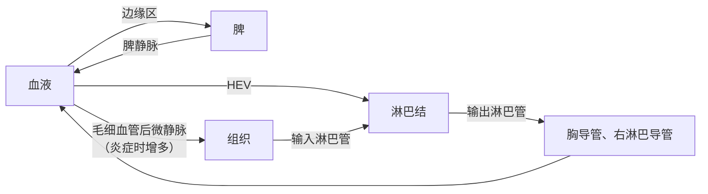

上一章介绍了免疫细胞是谁；本章讲它们在哪里发育、在哪里相遇。适应性免疫有一个空间上的难题：识别某一抗原的初始淋巴细胞只有 $10^{-6}$–$10^{-5}$（[7.15.1](/7.15.1)），而抗原可能从全身任何一处进入。解决办法是两项安排：一是把抗原集中到少数几个"会场"——淋巴结、脾和黏膜淋巴组织——的固定分区里；二是让淋巴细胞不停地在血液、淋巴和这些会场之间循环，轮流"巡视"每一个会场。本章先讲免疫细胞发育的中枢器官（§3.1–3.3），再讲应答发生的外周器官（§3.4–3.6），最后讲淋巴细胞再循环，并用一个随机游走模型估计在淋巴结里"找到对的细胞"需要多久（§3.7）。淋巴管与淋巴液的生理学见 [7.14.15](/7.14.15)；黏膜免疫在 [7.15.23](/7.15.23)、应答在器官中的时空过程在 [7.15.22](/7.15.22) 再展开，这里给出的分区也是空间组学（[7.9.6](/7.9.6)）分析组织切片时的基本坐标。

## 3.1. 中枢与外周免疫器官

**定义 3.1.1** 免疫细胞发生、分化、发育和成熟的场所称为**中枢免疫器官**（又称初级淋巴器官），人和其他哺乳动物的是骨髓与胸腺；成熟淋巴细胞定居、并对抗原产生应答的场所称为**外周免疫器官**（又称次级淋巴器官），包括淋巴结、脾、黏膜相关淋巴组织和皮肤相关淋巴组织。

| | 中枢免疫器官 | 外周免疫器官 |
|---|---|---|
| 器官 | 骨髓、胸腺（鸟类还有法氏囊） | 淋巴结、脾、黏膜相关淋巴组织 |
| 功能 | 产生淋巴细胞，完成抗原受体的重排与选择 | 收集抗原，使淋巴细胞与抗原、抗原提呈细胞相遇，进行应答 |
| 是否依赖抗原 | 否：发育不需要外来抗原 | 是：结构（如生发中心）随抗原刺激而变化 |
| 自身耐受 | 中枢耐受（阴性选择） | 外周耐受 |
| 发生时间 | 胚胎期最早出现 | 稍晚，随中枢器官输出的细胞而成熟 |

慢性炎症的组织（如自身免疫病的靶器官、肿瘤）中还会新形成类似淋巴结的淋巴细胞聚集，称为**三级淋巴结构**，它们的意义在 [7.15.22](/7.15.22)、[7.15.30](/7.15.30) 中讨论。

## 3.2. 骨髓

骨髓是成人的造血器官，也是所有免疫细胞的发源地（[7.15.2](/7.15.2)）。

- 结构：骨髓分为有造血功能的红骨髓和以脂肪组织为主的黄骨髓。儿童的红骨髓充满全部骨髓腔，成人的红骨髓主要在扁骨（髂骨、胸骨、椎骨、肋骨）和长骨的近端；大量失血时黄骨髓可以重新转变为红骨髓。造血细胞分布在由网状结缔组织和血窦构成的支架中，血窦内皮之间的间隙使成熟血细胞得以进入血液。
- 造血微环境：造血干细胞和祖细胞定居在血管周围和骨内膜附近的"龛"中，基质细胞、内皮细胞和成骨细胞提供 SCF、CXCL12、IL-7 等信号，决定它们的存活、静止与分化（[7.3.24](/7.3.24)）。
- 功能：（1）产生全部血细胞与免疫细胞；（2）B 细胞和 NK 细胞在此发育成熟，T 细胞前体由此迁往胸腺；（3）长寿浆细胞的主要居所，因此也是再次应答中血清抗体的主要来源。最后一点意味着骨髓同时是中枢器官和效应器官：在淋巴结生发中心中产生的浆细胞迁回骨髓，在 CXCL12 和 IL-6、APRIL 等存活信号的支持下持续分泌抗体数十年（[7.15.20](/7.15.20)）。

## 3.3. 胸腺

**定义 3.3.1（胸腺）** **胸腺**是位于胸骨后、前纵隔中的中枢免疫器官，是 T 细胞发育、经受选择并获得 MHC 限制性与自身耐受的场所。

胸腺由两叶组成，被膜伸入实质把它分成许多小叶。每个小叶外层是皮质，内层是髓质，相邻小叶的髓质相通。

| 区域 | 细胞 | 发生的事 |
|---|---|---|
| 被膜下与皮质 | 密集的未成熟胸腺细胞（占胸腺细胞的 85%–90%）；皮质胸腺上皮细胞（cTEC）；巨噬细胞 | T 细胞前体增殖、重排 TCR 基因；阳性选择 |
| 皮髓质交界 | 血管出入处 | 前体从血液进入、成熟 T 细胞离开 |
| 髓质 | 较成熟的单阳性胸腺细胞；髓质胸腺上皮细胞（mTEC）、树突状细胞；胸腺小体（Hassall 小体，退化上皮细胞形成的同心圆结构） | 阴性选择：清除识别组织特异性自身抗原的细胞；调节性 T 细胞的产生 |

**胸腺上皮细胞**与树突状细胞、巨噬细胞、成纤维细胞一起构成胸腺的基质，它们通过两种方式塑造 T 细胞：直接接触（上皮细胞表达的 MHC–自身肽复合物和 Notch 配体 DLL4）和分泌可溶性因子（IL-7、SCF、趋化因子 CCL25 与 CCL21 等）。早期研究提取的胸腺素、胸腺生成素等"胸腺激素"在 T 细胞发育中的作用并不清楚，现代的理解以上述接触信号和细胞因子为主。髓质上皮细胞表达转录调节因子 AIRE，使许多本来只在胰腺、甲状腺等特定组织中表达的蛋白质也在胸腺中表达，这是中枢耐受能够覆盖全身自身抗原的关键（[7.15.15](/7.15.15)、[7.15.24](/7.15.24)）。

胸腺的功能是三项：T 细胞的分化与成熟；经阳性与阴性选择建立 **MHC 限制性**与自身耐受；产生调节性 T 细胞，参与免疫调节。胸腺内的筛选极其严格：进入胸腺的前体每天以 $10^{7}$ 量级增殖，但只有约 2%–5% 最终成熟输出，其余大多因 TCR 不能识别自身 MHC（"死亡忽视"）或识别过强（阴性选择）而凋亡，被巨噬细胞清除。

胸腺在出生时约 $10$–$15\,\mathrm{g}$，相对体积最大；青春期约 $30$–$40\,\mathrm{g}$，此后逐渐退化，胸腺上皮被脂肪组织取代，成人的胸腺输出每年下降约 3%。所以成人的 T 细胞池主要靠外周已有细胞的稳态增殖维持（[7.15.2](/7.15.2)），老年人对新抗原的应答减弱，部分原因就在于新的初始 T 细胞不足。新生期切除胸腺（或先天性胸腺缺失，如 DiGeorge 综合征）导致严重的 T 细胞缺陷，成年后切除胸腺的影响则小得多。

## 3.4. 淋巴结

**定义 3.4.1（淋巴结）** **淋巴结**是沿淋巴管分布、过滤引流组织的淋巴并在其中使淋巴细胞遇到由淋巴运来的抗原的外周免疫器官。

人体约有 500–600 个淋巴结，集中在抗原容易进入的部位附近：颈部、腋窝、腹股沟、肠系膜和肺门。每个淋巴结引流一片固定的组织区域，所以感染或肿瘤转移时最先受累的是"引流淋巴结"（前哨淋巴结）。

### 3.4.1. 结构分区

淋巴结呈豆形，外有结缔组织被膜。几条输入淋巴管从凸面穿过被膜进入被膜下窦，淋巴液沿皮质窦和髓窦流向凹面的门部，从输出淋巴管离开；动脉和静脉也在门部出入。实质分为三个区域：

| 区域 | 位置 | 主要细胞 | 依赖 | 功能 |
|---|---|---|---|---|
| 浅皮质区 | 被膜下 | B 细胞聚集成的淋巴滤泡；滤泡树突状细胞 | 不依赖胸腺（B 细胞区） | 初级滤泡（未受刺激，初始 B 细胞）；受抗原刺激后形成含生发中心的次级滤泡 |
| 副皮质区（深皮质区） | 浅皮质与髓质之间 | T 细胞；树突状细胞；成纤维网状细胞；高内皮微静脉 | 依赖胸腺（T 细胞区） | 初始 T 细胞与树突状细胞相遇；血液中的淋巴细胞由此进入 |
| 髓质 | 门部附近 | 髓索：B 细胞、浆细胞、巨噬细胞；髓窦：大量巨噬细胞 | | 浆细胞分泌抗体入淋巴；巨噬细胞过滤淋巴 |

淋巴结的分区不是由隔膜划出来的，而是由基质细胞分泌的趋化因子维持：副皮质区的成纤维网状细胞分泌 CCL19 与 CCL21，吸引表达 CCR7 的 T 细胞和成熟树突状细胞；滤泡中的基质细胞与滤泡树突状细胞分泌 CXCL13，吸引表达 CXCR5 的 B 细胞（**趋化因子**的分类与作用见 [7.15.4](/7.15.4)）。成纤维网状细胞还形成一套由胶原纤维构成的"导管"网络，把淋巴中的小分子抗原和趋化因子从被膜下窦直接输送到副皮质区深处的高内皮微静脉旁；T 细胞也沿着这张网"爬行"。

**定义 3.4.2（高内皮微静脉）** **高内皮微静脉**是淋巴结副皮质区（以及派尔集合淋巴结、扁桃体等组织）中内皮细胞呈立方形、表达特殊黏附分子与趋化因子的毛细血管后微静脉，是血液中的淋巴细胞进入外周淋巴组织的主要通道。

普通的微静脉内皮是扁平的；HEV 的内皮又高又厚，表面表达被 L-选择素识别的硫酸化糖链（外周淋巴结地址素，PNAd）并展示 CCL21。表达 L-选择素与 CCR7 的初始淋巴细胞在这里滚动、被活化、牢固黏附并穿出血管（[7.15.4](/7.15.4) 的**白细胞黏附级联**）。一个淋巴结每小时可以通过 HEV 接纳约 $10^{6}$ 量级的淋巴细胞，其中只有极少数会遇到自己的抗原。

**定义 3.4.3（生发中心）** 次级淋巴滤泡中受抗原刺激的 B 细胞在滤泡辅助性 T 细胞的帮助下迅速增殖、发生体细胞高频突变并接受亲和力选择的区域称为**生发中心**。

生发中心在抗原进入后约一周形成，组织切片上是滤泡中央着色较浅、细胞较大的区域，周围是被推开的静息 B 细胞构成的套区。生发中心分为暗区与明区，是亲和力成熟和类别转换发生的地方（[7.15.20](/7.15.20)）。

### 3.4.2. 功能

淋巴结的功能有四项：（1）T 细胞和 B 细胞的定居场所，人淋巴结中淋巴细胞约 75% 是 T 细胞、25% 是 B 细胞；（2）适应性应答的主要场所：组织中的树突状细胞携带抗原沿输入淋巴管迁入副皮质区，可溶性抗原随淋巴直接到达，被被膜下窦的巨噬细胞捕获并交给滤泡中的 B 细胞；（3）过滤淋巴：髓窦中的巨噬细胞清除淋巴中的颗粒、病原体和肿瘤细胞；（4）参与淋巴细胞再循环。感染时淋巴结肿大，主要是因为淋巴细胞被留在其中（输出暂时关闭）并在其中增殖，而不是因为病原体本身。

## 3.5. 脾

**定义 3.5.1（脾）** **脾**是人体最大的外周免疫器官，位于左上腹，不与淋巴管道相连，对随血液进入的抗原产生应答，并过滤血液、清除衰老的红细胞和血液中的病原体。

脾的实质分为白髓与红髓两部分，外有被膜，被膜伸入形成小梁。

- 白髓是淋巴组织，沿中央动脉分布：动脉周围是 T 细胞聚集的动脉周围淋巴鞘（PALS，相当于淋巴结的副皮质区），旁边是 B 细胞的淋巴滤泡（受刺激后出现生发中心）。
- 边缘区位于白髓与红髓的交界，是血液进入脾实质后最先流经的地方：动脉末梢开口于边缘窦，血液缓慢穿过边缘区再进入红髓。这里有特化的边缘区巨噬细胞和**边缘区 B 细胞**，后者对血液中的多糖抗原（如肺炎链球菌的荚膜）迅速产生 IgM，不需要 T 细胞的帮助（[7.15.19](/7.15.19)）。
- 红髓由脾索和脾血窦组成，充满血液；红髓的巨噬细胞吞噬衰老、受损的红细胞和被抗体或补体包被的颗粒。

人脾中 B 细胞约占淋巴细胞的 60%，T 细胞约 40%。脾与淋巴结在分工上的区别在于抗原的来路：淋巴结应答淋巴带来的组织抗原，脾应答血液中的抗原。全身循环血液每天多次流经脾，脾因此是血源性感染的主要防线；脾切除（或先天无脾、镰状细胞病导致的功能性无脾）的人容易发生由有荚膜细菌（肺炎链球菌、脑膜炎奈瑟菌、b 型流感嗜血杆菌）引起的暴发性败血症，需要接种针对这些细菌的疫苗。脾还是合成补体成分和多种细胞因子的场所，在胚胎期则是造血器官。

## 3.6. 黏膜相关淋巴组织

**定义 3.6.1（黏膜相关淋巴组织）** 分布在胃肠道、呼吸道、泌尿生殖道等黏膜固有层和上皮下的淋巴组织，包括散在的淋巴细胞和有组织结构的淋巴滤泡（如扁桃体、小肠的派尔集合淋巴结和阑尾），统称**黏膜相关淋巴组织**（MALT）。

人体黏膜的总面积达数十平方米（仅消化道就约 $32\,\mathrm{m^2}$，主要是小肠；常被引用的 $400\,\mathrm{m^2}$ 是早年的高估），是病原体入侵的主要门户，也是机体与食物抗原和共生菌持续接触的界面。全身约一半以上的淋巴细胞在黏膜中，产生的抗体（以**分泌型 IgA** 为主）每天超过 3 g，比其他所有抗体的总和还多。按部位，MALT 包括肠相关淋巴组织（GALT）、鼻相关淋巴组织（NALT，含咽扁桃体与腭扁桃体）和支气管相关淋巴组织（BALT）。

肠相关淋巴组织的结构最清楚：

| 组分 | 结构与位置 | 功能 |
|---|---|---|
| **派尔集合淋巴结** | 小肠（尤其回肠）黏膜下的一群淋巴滤泡，含生发中心，滤泡之间是 T 细胞区；上方的上皮称为滤泡相关上皮，其下是富含树突状细胞的上皮下穹窿区 | 诱导黏膜应答的"会场"；没有输入淋巴管，抗原直接穿过上皮进入 |
| **M 细胞** | 滤泡相关上皮中的特化上皮细胞，没有微绒毛，不分泌黏液和消化酶，基底面凹陷成"口袋"，容纳淋巴细胞与树突状细胞 | 把肠腔中的颗粒和微生物转运到上皮下，交给树突状细胞 |
| 孤立淋巴滤泡、阑尾 | 散在的滤泡；阑尾是集中的淋巴组织 | 同上 |
| **上皮内淋巴细胞** | 夹在肠上皮细胞之间，多为 CD8⁺ T 细胞与 γδ T 细胞 | 监视并杀伤受损或被感染的上皮细胞 |
| 固有层淋巴细胞 | 上皮下结缔组织中的浆细胞（主要分泌 IgA）、效应与记忆 T 细胞、ILC、巨噬细胞、树突状细胞 | 黏膜的效应部位 |

MALT 的特点是诱导部位（派尔集合淋巴结等）与效应部位（固有层、上皮）分开：在派尔集合淋巴结中被活化的淋巴细胞经淋巴与血液循环后，借助肠道特异的归巢分子回到全身的黏膜固有层，这一"共同黏膜免疫系统"的机制及口服耐受见 [7.15.23](/7.15.23)。皮肤中同样有大量驻留的 T 细胞、朗格汉斯细胞与真皮树突状细胞，有时称为皮肤相关淋巴组织。

## 3.7. 淋巴细胞再循环

### 3.7.1. 路线与意义

**定义 3.7.1（淋巴细胞再循环）** 淋巴细胞从血液进入外周淋巴器官和组织，又经淋巴管（输出淋巴管、淋巴干、胸导管或右淋巴导管）回到血液，如此反复循环的过程称为**淋巴细胞再循环**。

1960 年前后 Gowans 用插管引流大鼠胸导管的淋巴，发现几天内收集到的淋巴细胞数远多于体内任一时刻淋巴中的数量，而把标记的淋巴细胞注回血液后它们又出现在胸导管淋巴中，证明了淋巴细胞在血液与淋巴之间循环。再循环有三条主要路线：

| 路线 | 进入 | 离开 | 主要细胞 |
|---|---|---|---|
| 血液–淋巴结 | 副皮质区的 HEV | 输出淋巴管 → 胸导管 → 血液 | 初始 T 与 B 细胞、中央记忆 T 细胞 |
| 血液–脾 | 边缘窦与边缘区 | 脾静脉（直接回到血液） | 各类淋巴细胞 |
| 血液–组织–淋巴结 | 组织中的毛细血管后微静脉 | 输入淋巴管进入淋巴结 | 效应与效应记忆 T 细胞，以及从组织迁出的树突状细胞 |

一个初始 T 细胞在一个淋巴结中通常停留 6–24 h，然后离开；在血液中只停留约半小时。离开淋巴结由淋巴中较高浓度的鞘氨醇-1-磷酸（S1P）引导：T 细胞重新表达 S1P 受体 S1PR1 后沿浓度梯度进入输出淋巴管。被抗原活化的细胞暂时下调 S1PR1（由活化标志 CD69 介导），因此被留在淋巴结中增殖；治疗多发性硬化的药物芬戈莫德（fingolimod）就是使 S1PR1 内化、把淋巴细胞"锁"在淋巴结里。淋巴细胞选择性地进入哪一种器官或组织，由它表达的归巢受体与血管内皮上相应的配体（地址素）决定，即**淋巴细胞归巢**（[7.15.4](/7.15.4)）。

再循环的意义：（1）使淋巴细胞在各外周免疫器官中的分布不断更新；（2）使每个淋巴细胞有机会"巡视"许多淋巴结，从而大大增加初始淋巴细胞与其特异抗原相遇的机会——一种特异性只有少数前体，没有再循环就不可能出现在每一个可能的引流淋巴结中；（3）把全身的免疫器官连成一个整体，使在一处被活化的效应与记忆细胞分布到全身。

### 3.7.2. 模型：在淋巴结中寻找抗原

在淋巴结里，携带特定抗原的树突状细胞可能只有几十个，T 细胞又不知道它们在哪里。双光子活体成像显示，初始 T 细胞在副皮质区以约 $10$–$15\,\mathrm{\mu m\,min^{-1}}$ 的速度运动，每隔一两分钟随机改变方向；遇到提呈其特异抗原的树突状细胞后在数分钟内"停住"，速度降到 $4$–$6\,\mathrm{\mu m\,min^{-1}}$，并与之形成持续数小时的接触。这种运动可以近似为随机游走（[3.1](/3.1)），由此估计一次搜索需要多久。

**例 3.7.1** 设 T 细胞以速度 $v$ 运动、方向的持续时间为 $\tau_{\mathrm{p}}$，在长时间尺度上它是扩散系数为

$$
D = \frac{v^2 \tau_{\mathrm{p}}}{3}
$$

的三维布朗运动（[2.5.7](/2.5.7) 的热方程描述其概率密度）。体积 $V$ 中随机分布着 $n$ 个静止的目标树突状细胞，密度 $\rho = n/V$，T 细胞进入其半径 $a$ 以内即算找到。对稀疏的静止目标，Smoluchowski 的结果给出找到的速率

$$
k = 4\pi D a \rho ,
$$

于是 T 细胞在时间 $t$ 内仍未找到的概率近似为 $\mathrm{e}^{-kt}$，平均搜索时间 $1/k$。取 $v = 12\,\mathrm{\mu m\,min^{-1}}$、$\tau_{\mathrm{p}} = 2\,\mathrm{min}$（$D \approx 96\,\mathrm{\mu m^2\,min^{-1}}$），接触半径 $a = 20\,\mathrm{\mu m}$（树突的长度），副皮质区体积 $V = 0.1\,\mathrm{mm^3} = 10^{8}\,\mathrm{\mu m^3}$：

| 目标树突状细胞数 $n$ | $k/\mathrm{min^{-1}}$ | 平均搜索时间 | 在 12 h 的停留中找到的概率（扩散近似） |
|---|---|---|---|
| 5 | $1.2 \times 10^{-3}$ | 约 14 h | 约 58% |
| 20 | $4.8 \times 10^{-3}$ | 约 3.5 h | 约 97% |
| 80 | $1.9 \times 10^{-2}$ | 约 52 min | 约 100% |

这些数值只是数量级估计（参数取自小鼠淋巴结的成像研究）。下图的模拟表明，实际的找到速率约为上式的一半：T 细胞在一个方向上运动的距离 $v\tau_{\mathrm{p}} \approx 24\,\mathrm{\mu m}$ 与接触半径相当，而扩散近似要求前者远小于后者（在相反的"直线运动"极限下，速率是扫过的截面乘速度，$k = \pi a^2 v\rho$，还要更小）。但结论稳健：只要抗原在淋巴结中被几十个树突状细胞提呈，一个经过的特异 T 细胞几乎一定能在它停留期间找到其中之一；而在抗原刚到达、提呈细胞很少时，再循环使同一个 T 细胞（或其他同特异性的前体）有多次机会。

:::

真实的搜索并非完全随机：T 细胞沿成纤维网状细胞的网络运动，树突状细胞分泌的趋化因子（如 CCR5 的配体）可以把同特异性的 CD8⁺ T 细胞引向已被 CD4⁺ T 细胞"授权"的树突状细胞；每个树突状细胞每小时能与数千个 T 细胞接触，这些因素都使搜索比上面的估计更快。

## 3.8. 免疫器官的年龄变化与演化

人在胚胎期先发育中枢器官：胸腺在妊娠第 6–8 周出现，胎肝与骨髓相继承担造血；外周器官的结构在出生前已经建立，但生发中心等抗原依赖的结构要在出生后接触抗原才大量出现。进入成年后胸腺退化（§3.3），老年期骨髓的造血向髓系偏移，B 与 T 细胞的生成减少，这些变化与慢性低度炎症一起构成"免疫衰老"的基础。

在演化上，胸腺和以 RAG 为基础的适应性免疫同时出现在有颌脊椎动物中（软骨鱼已有胸腺、脾和 IgM）；鱼类和两栖类没有淋巴结，淋巴细胞聚集在脾、肾和肠道中；淋巴结主要见于哺乳动物（鸟类中只有少数）。鸟类的 B 细胞在法氏囊中发育，"B 细胞"由此得名（[7.15.2](/7.15.2)）。无颌类（七鳃鳗、盲鳗）有独立演化出的另一套适应性免疫，其淋巴细胞用富含亮氨酸重复序列的可变淋巴细胞受体识别抗原，也有类似胸腺的"胸腺样"组织。

## 小结

- 免疫器官分为**中枢免疫器官**（骨髓、胸腺：发育与选择）和**外周免疫器官**（淋巴结、脾、MALT：相遇与应答）（定义 3.1.1）。
- 骨髓：造血、B 与 NK 细胞成熟、长寿浆细胞的居所。**胸腺**（定义 3.3.1）：皮质中阳性选择、髓质中阴性选择（AIRE 表达组织特异性抗原），只有约 2%–5% 的胸腺细胞成熟输出；青春期后退化。
- 外周器官按"抗原从哪里来"分工：

  | 器官 | 抗原来路 | T 细胞区 | B 细胞区 | 入口 |
  |---|---|---|---|---|
  | **淋巴结** | 输入淋巴（组织） | 副皮质区 | 浅皮质的滤泡 | **高内皮微静脉**、输入淋巴管 |
  | **脾** | 血液 | 动脉周围淋巴鞘 | 滤泡、边缘区 | 边缘窦 |
  | **黏膜相关淋巴组织** | 黏膜表面（经 M 细胞） | 滤泡间区 | 滤泡（产生 IgA） | HEV；M 细胞 |

- 分区由基质细胞分泌的趋化因子维持（CCL19/21–CCR7：T 细胞区；CXCL13–CXCR5：滤泡）；受刺激的滤泡中形成**生发中心**（定义 3.4.3）。
- **淋巴细胞再循环**（定义 3.7.1）经血液–淋巴结–淋巴、血液–脾、血液–组织–淋巴三条路线；离开淋巴结受 S1P–S1PR1 控制。它使稀少的前体轮流巡视各个淋巴结。
- 随机游走估计（例 3.7.1）：$D = v^2\tau_{\mathrm{p}}/3$，找到目标的速率 $k = 4\pi D a\rho$；只要有几十个提呈抗原的树突状细胞，特异 T 细胞在一次停留（约 12 h）中几乎必然找到其中之一。

## 思考题

1. 为什么初始淋巴细胞需要再循环，而组织驻留记忆 T 细胞不再循环？

   **答** 初始淋巴细胞的每种特异性只有极少数前体，而抗原可能出现在任何一个引流淋巴结中；只有让它们不断巡视各个淋巴结，才能保证某个前体在抗原到达后不久遇到它。组织驻留记忆细胞则已经"知道"抗原（病原体）从哪里来——它们留在以前感染过的屏障组织中，在再次感染的入口处直接迅速应答，这比等待循环的记忆细胞到达更快（[7.15.18](/7.15.18)）。

2. 一位因外伤切除脾的患者，为什么特别需要接种肺炎链球菌疫苗？从脾的结构解释。

   **答** 肺炎链球菌有多糖荚膜，抵抗吞噬；清除血液中的这类细菌依赖两件事：边缘区 B 细胞对荚膜多糖迅速产生 IgM（不依赖 T 细胞），以及脾红髓与边缘区的巨噬细胞吞噬被抗体和补体调理的细菌。这两项都集中在脾中，血液每天多次流经脾。脾切除后两者都严重受损，血源性的有荚膜细菌感染可迅速发展为暴发性败血症。疫苗（尤其是多糖与蛋白结合的结合疫苗）可以在其他淋巴组织中诱导保护性抗体。

3. 用例 3.7.1 的公式估计：如果 T 细胞的运动速度减半（如组织水肿或某些药物使其变慢），而其他参数不变，平均搜索时间怎样变化？

   **答** $D = v^2\tau_{\mathrm{p}}/3$ 与 $v^2$ 成正比，速度减半使 $D$ 变为 1/4；$k = 4\pi D a\rho$ 也变为 1/4，平均搜索时间 $1/k$ 增加到 4 倍。例如目标为 20 个时由约 3.5 h 增加到约 14 h，接近一次停留的时间，找到的概率显著下降。这说明 T 细胞的运动性对应答的启动很重要。

4. 淋巴结肿大是感染时常见的体征。说明它在细胞层面上的主要原因。

   **答** 主要有三点：被抗原活化的淋巴细胞下调 S1PR1（CD69 的作用），离开淋巴结的出口暂时关闭，而 HEV 继续接纳血液中的淋巴细胞，细胞数量增加；被选中的克隆在其中大量增殖，生发中心形成；炎症使淋巴结中的血流与 HEV 增多、组织液增加。病原体本身在淋巴结中繁殖的情况（如某些化脓性感染）只占少数。

5. （开放题）在一张肿瘤组织的多重免疫荧光图像中，你看到一个由 CD20⁺ B 细胞组成的圆形聚集，中心有 CD21⁺ 的网状结构，周围有 CD3⁺ T 细胞和 PNAd⁺ 的血管。你会怎样解释这个结构？它对理解肿瘤中的免疫应答有什么意义？

   **答** 这是一个成熟的三级淋巴结构：CD20⁺ B 细胞滤泡、CD21⁺ 的滤泡树突状细胞网络（提示可能有生发中心）、周围的 T 细胞区以及表达 PNAd 的高内皮微静脉，组织形式与淋巴结的滤泡和副皮质区相同，但是在慢性炎症的组织中新生的。它表明肿瘤局部有一个可以就地启动和扩增应答的"会场"，在许多实体瘤中与较好的预后和对免疫检查点治疗的响应相关；判断时还需要看是否有 Ki-67⁺ 的生发中心 B 细胞、BCL6 等标志（[7.15.22](/7.15.22)、[7.15.30](/7.15.30)、[7.9.6](/7.9.6)）。
