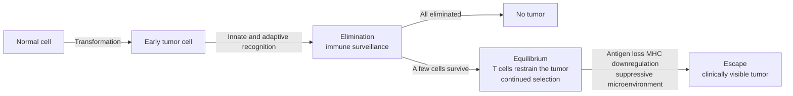

The central problem of immunology is how to distinguish "non-self" from "self". Tumors make this problem awkward: tumor cells come from the self, most of their components are self, but they have accumulated mutations, express molecules they should not express, and actively switch off immune responses. This chapter follows the chapters on effectors and brakes and addresses three questions: whether the immune system can recognize tumors, how tumors evade it, and how the immune system can be used to treat tumors.

It is a confluence of many earlier mechanisms: recognition depends on peptide presentation by MHC class I molecules and on CTLs ([7.15.14](/7.15.14), [7.15.17](/7.15.17)); escape uses checkpoints and Tregs ([7.15.25](/7.15.25)); the two main directions of therapy, checkpoint blockade and CAR-T cells, are respectively removal of a brake and re-engineering of the antigen receptor ([7.15.12](/7.15.12), [7.15.16](/7.15.16)); and the evolution of the tumor itself is treated in [7.4.21](/7.4.21) and [7.9.13](/7.9.13). This chapter writes only the immunological mechanisms and principles and does not deal with specific treatment regimens.

## 30.1. Immune Surveillance and Immunoediting

The hypothesis of **immune surveillance** holds that the immune system continually monitors for and eliminates early transformed cells. The evidence comes from several sources:

- The incidence of tumors is raised in immunodeficient individuals. Transplant recipients on long-term immunosuppressive drugs and patients with AIDS more often develop Epstein–Barr virus-associated lymphoma, Kaposi sarcoma and HPV-associated cancers, which is partly related to viruses; some tumors unrelated to viruses (such as skin cancer) are also increased.
- In mice, animals lacking T cells, NK cells, IFN-γ signaling or perforin have more spontaneous and chemically induced tumors, arising earlier.
- In many tumors, the more infiltrating CD8⁺ T cells, the better the prognosis.
- Some tumors can regress spontaneously through immunity, or enter long-term remission after checkpoint blockade (see 30.5).

But the immune system does not only "eliminate". Experiments of Schreiber and colleagues found that tumors formed in immunodeficient mice were often rejected when transplanted into normal mice, whereas tumors formed in immunocompetent mice grew when transplanted into normal mice. This shows that the immune system not only eliminates tumors but also shapes the surviving tumors.

**Definition 30.1.1 (Immunoediting)** The process in which the immune system, while eliminating tumor cells, lowers the immunogenicity of the tumor through selection pressure and makes surviving tumor cells more resistant to immune attack is called **immunoediting**, and comprises three phases: elimination, equilibrium and escape.

- Elimination: innate and adaptive immunity recognize and eliminate early transformed cells, and the tumor goes unnoticed.
- Equilibrium: a few cells survive, and adaptive immunity (especially IFN-γ and CD8⁺ T cells) restrains their growth but cannot clear them completely; tumor cells accumulate variants under selection pressure, and this phase can last years, corresponding to clinical "dormancy".
- Escape: clones that have acquired variants such as antigen loss, MHC downregulation and a suppressive microenvironment are no longer controlled and grow into clinically visible tumors.

In this model every clinically visible tumor is a product of "escape" and has therefore learned to evade immunity; the aim of immunotherapy is to break the equilibrium again. "Equilibrium" and "escape" can be understood with a simple kinetic model, Example 30.5.1 in Section 30.5.

## 30.2. Tumor Antigens

Tumor cells are self cells, and tolerance has been established to most of their antigens; what the immune system can recognize is a small number of "different" antigens, which by origin fall into two classes:

**Definition 30.2.1 (Tumor-Specific Antigen)** An antigen expressed only in tumor cells and entirely absent from normal cells is called a **tumor-specific antigen** (TSA); it derives from new protein sequences produced by somatic mutation or from proteins of oncogenic viruses.

**Definition 30.2.2 (Tumor-Associated Antigen)** A self antigen expressed abnormally in tumor cells (overexpressed, or expressed at a time when it should not be) but also expressed in normal cells is called a **tumor-associated antigen** (TAA).

**Definition 30.2.3 (Neoantigen)** A peptide produced by a somatic mutation of the tumor (point mutation, insertion or deletion, gene fusion), containing a new amino acid sequence, presented by MHC molecules after processing and recognizable by T cells is called a **neoantigen**.

| Class | Examples | Properties |
|---|---|---|
| Viral antigens (TSA) | E6 and E7 of HPV (cervical cancer), Epstein–Barr virus antigens | Foreign to the host, no tolerance, shared by all tumors caused by the same virus |
| Neoantigens (TSA) | Peptides of mutant proteins (different in each tumor) | No central tolerance, highly immunogenic, but individualized |
| Overexpressed self proteins (TAA) | HER2, MUC1 | Tolerance present, high-affinity T cells already deleted, antibodies can act |
| Differentiation antigens (TAA) | Tyrosinase and gp100 of melanoma; CD19 and CD20 of B-cell tumors | Also expressed by normal cells of the same lineage, which are damaged along with the tumor |
| Oncofetal antigens (TAA) | α-fetoprotein (AFP), carcinoembryonic antigen (CEA) | Expressed in the embryo and reappearing in adults; often used as serum markers |
| Cancer–testis antigens (TAA) | MAGE family | Expressed in many tumors and in testicular germ cells, the testis being an immune-privileged site |

The generation of neoantigens involves a chain of conditions: the gene must be mutated and expressed, the mutant peptide must be processed by the proteasome and TAP ([7.15.14](/7.15.14)), bind the patient's MHC class I molecules with sufficient affinity, and the patient's TCR repertoire must contain a clone that recognizes it. The number of neoantigens is therefore not simply proportional to the number of mutations, but overall the higher the **tumor mutational burden** (as in melanoma, smoking-associated lung cancer and tumors deficient in DNA mismatch repair), the better the response to checkpoint blockade. Prediction of MHC binding is done with sequence models (the machine learning methods of [7.8](/7.8)). Heterogeneity within the tumor divides neoantigens into clonal neoantigens shared by all cells and subclonal neoantigens present only in subclones, the former being better targets; the presence of subclones is also one reason tumors can escape (for clonal evolution of tumors see [7.4.21](/7.4.21)).

## 30.3. Antitumor Immune Effects

Antitumor immunity can be summarized as a cycle called the cancer–immunity cycle (every step can be a point of failure):

| Step | Content | Examples of failure |
|---|---|---|
| 1. Antigen release | Tumor cells die and release antigens and danger signals | Mode of death is nonimmunogenic, danger signals lacking |
| 2. Antigen presentation | Dendritic cells (especially classical DCs, which excel at cross-presentation) take up antigen, mature and migrate to the lymph node ([7.15.14](/7.15.14)) | DCs absent or suppressed, few DCs in the tumor |
| 3. T-cell activation | Naive T cells are activated in the lymph node ([7.15.16](/7.15.16)) | Lack of costimulation, tolerance (TAA), the brake of CTLA-4 |
| 4. Trafficking | Effector T cells enter the tumor by chemokines ([7.15.4](/7.15.4)) | Missing chemokines, abnormal vessels, failure to home |
| 5. Infiltration | Crossing the stroma into tumor nests | Stromal barrier (fibroblasts, collagen), immune-excluded type |
| 6. Recognition | TCR recognizes MHC class I plus peptide on tumor cells | MHC I downregulation, antigen loss |
| 7. Killing | CTLs kill with perforin and granzymes, Fas ligand, IFN-γ and TNF-α | Exhaustion, PD-L1, suppressive cells |

The executors are:

- CD8⁺ T cells (CTLs, [7.15.17](/7.15.17)) are the main killers; CD4⁺ Th1 cells provide IL-2 and IFN-γ and "license" dendritic cells through CD40 so that they prime CD8⁺ T cells more effectively.
- **NK cells** recognize loss of MHC I (**missing self**) and stress-induced ligands (such as binding of MICA and MICB to NKG2D), and are especially important in tumors with MHC I downregulation ([7.15.5](/7.15.5), 25.6).
- **Macrophages**: macrophages not suppressed by polarization can phagocytose tumor cells, but tumor cells express CD47 (a "don't eat me" signal binding SIRPα of macrophages).
- **Antibodies**: antibodies against tumor-associated antigens (naturally produced or used therapeutically) kill tumor cells through ADCC, complement and phagocytosis ([7.15.21](/7.15.21)).
- γδ T cells and NKT cells: recognize stress molecules and lipid antigens independently of classical MHC.
- **Tertiary lymphoid structures**: lymphoid aggregates within the tumor provide local T-cell priming and B-cell responses and are often associated with better prognosis ([7.15.22](/7.15.22)).

## 30.4. The Tumor Microenvironment and Immune Escape

**Definition 30.4.1 (Tumor Microenvironment)** The local environment in which tumor cells reside, composed of immune cells, stromal cells (fibroblasts, endothelial cells), extracellular matrix, vessels, soluble factors, hypoxia and metabolic products, is called the **tumor microenvironment** (TME).

**Definition 30.4.2 (Tumor Immune Escape)** The process in which tumor cells avoid recognition and elimination by the immune system by lowering their visibility, resisting killing and producing a suppressive microenvironment is called **tumor immune escape**, the mechanism of the "escape" phase of cancer immunoediting.

The mechanisms of escape can be classified by why killing fails:

| Class | Mechanism | Result |
|---|---|---|
| Invisible | Antigen loss (immune selection of clones lacking neoantigens); MHC class I downregulation (inactivation of β2-microglobulin, TAP deficiency, loss of heterozygosity of HLA, transcriptional repression); defects of antigen processing and presentation | CD8⁺ T cells cannot recognize (but recognition by NK cells is enhanced) |
| Not responding to IFN-γ | Mutations of the IFN-γ receptor pathway (*JAK1*, *JAK2*) | MHC I and antigen processing are not upregulated; resistance to T-cell killing |
| Checkpoints | Adaptive or innate expression of PD-L1; CTLA-4, TIGIT and others (25.2) | T cells suppressed, exhaustion (25.3) |
| Suppressive cells | Tregs (25.4), myeloid-derived suppressor cells, tumor-associated macrophages | Suppress T-cell activation and function |
| Suppressive factors | TGF-β, IL-10, prostaglandin E₂, adenosine (CD39–CD73), indoleamine 2,3-dioxygenase (tryptophan depletion and kynurenine), VEGF | Suppress T cells and dendritic cells, promote Tregs |
| Metabolic and physical barriers | Hypoxia (HIF), competition by tumor cells for glucose and amino acids, acidification by lactate; abnormal vessel structure; a stromal barrier formed by fibroblasts and collagen | Effector cells cannot enter, and their function is suppressed once inside |
| Resistance to death signals | Upregulation of antiapoptotic proteins, defects of the Fas pathway | Insensitive to killing by CTLs and NK cells |

Two cell types need separate definitions.

**Definition 30.4.3 (Myeloid-Derived Suppressor Cell)** A population of immature myeloid cells derived from bone marrow that expands in tumors and chronic inflammation (including a neutrophil-like and a monocyte-like subset) and suppresses the function of T cells and NK cells through arginase, reactive oxygen and nitrogen species, TGF-β and IL-10 is called a **myeloid-derived suppressor cell** (MDSC).

**Definition 30.4.4 (Tumor-Associated Macrophage)** A macrophage in the tumor microenvironment that, under the action of tumor-produced CSF-1, IL-4, IL-10, TGF-β and hypoxia, is skewed toward a tumor-promoting phenotype (producing IL-10, TGF-β and the angiogenic factor VEGF, suppressing T cells, promoting tissue repair and angiogenesis) is called a **tumor-associated macrophage** (TAM).

TAMs are often described as "M2-like", but this dichotomy is a simplification ([7.15.5](/7.15.5) discusses the limits of **macrophage polarization**): in single-cell data, macrophages within tumors form a continuum, expressing a mixture of proinflammatory and suppressive programs. These cells, together with Tregs, form a suppressive network, and they reinforce one another: TGF-β induces Tregs, and the IL-10 of Tregs suppresses activation of myeloid cells.

## 30.5. Principles of Immunotherapy

Immunotherapy does not kill tumors directly but adjusts the balance between the immune system and the tumor. In terms of the cancer–immunity cycle (30.3), each class of therapy targets a different step:

| Therapy | Step targeted | Principle |
|---|---|---|
| Checkpoint blockade | Activation and killing (steps 3, 7) | Removes inhibitory brakes (25.8, [7.3.27](/7.3.27)) |
| Adoptive cell therapy | Supplies effector cells (steps 6, 7) | Infusion of T cells with antitumor specificity |
| Tumor vaccines | Antigen presentation and priming (steps 1–3) | Supply antigen and adjuvant to induce specific T cells |
| Cytokines | Expansion and activation | IL-2, IFN-α and others |
| Therapeutic antibodies | Recognition and killing | ADCC; bispecific antibodies link T cells to tumor cells |

### 30.5.1. A Tumor–Effector Competition Model

**Example 30.5.1 (Predator–Prey Model)** A model of Kuznetsov type describes the number of tumor cells $T$ and the number of effector (cytotoxic) cells $E$:

$$
\begin{aligned}
\frac{\mathrm{d}T}{\mathrm{d}t} &= aT(1 - bT) - nET,\\
\frac{\mathrm{d}E}{\mathrm{d}t} &= s + \frac{pET}{g + T} - mET - dE.
\end{aligned}
$$

The tumor grows logistically (rate $a$, carrying capacity $1/b$) and is killed by effector cells by mass action (rate $n$). Effector cells have three sources and sinks: a constant supply $s$, antigen-driven recruitment that saturates in $T$, $p\,ET/(g + T)$, inactivation caused by contact with tumor cells, $mET$ (a proxy for exhaustion and inhibitory signals, 25.3), and natural loss $dE$. (For phase-plane analysis of differential equations see [2.4](/2.4).) Taking an illustrative parameter set ($s = 1.3 \times 10^4$, $p = 0.1245$, $g = 2.0 \times 10^7$, $m = 3.4 \times 10^{-10}$, $d = 0.0412$, $a = 0.18$, $b = 2 \times 10^{-9}$, $n = 1.1 \times 10^{-7}$, with time in days and cell numbers), numerical solution gives:

![Tumor–effector competition model (illustrative parameters). A: time courses for different initial tumor burdens $T_0$: smaller tumors settle after damped oscillations into an immune-controlled state of about $10^7$ cells (the "equilibrium" phase), whereas a tumor with $T_0 = 10^8$ overwhelms the effector cells and grows to the carrying capacity $1/b$ ("escape", red line). B: for an escaped tumor ($T_0 = 10^8$), from day 50 (vertical dotted line) the effector inactivation rate $m$ is reduced to 0.3 or 0.1 times its original value, simulating checkpoint blockade; the tumor returns to the immune-controlled state, and without treatment continues to grow.](./plots/tumor-immune-ode.py)

The model captures three qualitative conclusions. First, the system is **bistable**: for the same parameters there is a "control" and an "escape" attractor, and the initial burden and history decide which is reached; this is the mathematical form of equilibrium versus escape. Second, in the "control" state the tumor has not disappeared but fluctuates persistently around $10^7$ cells (of the order of 10 mm³), corresponding to dormancy in the equilibrium phase; the oscillations along the way reflect the lag of predator and prey. Third, checkpoint blockade appears in the model as a reduction of the inactivation term $m$: it adds no new effector cells but gives the same number of effector cells a higher net killing, enough to bring an escaped tumor back into the basin of control. This interpretation agrees with the principle of 25.8: blockade works only when effector cells are present, and the base level of $E$, the antigenicity of $T$ ($n$) and the strength of suppression ($m$) together determine whether the separatrix is crossed. The model is a qualitative illustration: it ignores space, heterogeneity, the evolution of neoantigens and the interactions among many cell types, and its numbers cannot be mapped directly to patients.

### 30.5.2. Adoptive Cell Therapy and CAR-T

**Definition 30.5.1 (Adoptive Cell Therapy)** A treatment in which immune cells with antitumor activity (T cells or NK cells expanded or engineered in vitro) are infused into the patient so that they attack the tumor directly is called **adoptive cell therapy** (ACT).

It takes three forms: tumor-infiltrating lymphocytes (natural antitumor T cells isolated and enriched from the tumor), TCR-engineered T cells (a TCR recognizing a specific pMHC is introduced, requiring a matching HLA), and chimeric antigen receptor T cells.

T cells genetically modified to express a chimeric antigen receptor (CAR) are called **CAR-T cell**s. The CAR fuses the single-chain variable fragment of an antibody (scFv, which recognizes an antigen on the tumor cell surface), through a hinge and a transmembrane region, to the intracellular signaling domains of the T cell (the ITAMs of CD3ζ plus a costimulatory domain of CD28 or 4-1BB).

The design principle of CAR-T is to combine the specificity of antibody with the killing and proliferative capacity of T cells:

- MHC independence: the scFv directly recognizes proteins on the cell surface and needs no MHC presentation, so it works against tumors with MHC I downregulation and in patients of different HLA, and also for carbohydrate and lipid antigens; the cost is that it can recognize only cell-surface antigens and not peptides of intracellular proteins.
- Integration of signals: CD3ζ supplies signal 1 and the costimulatory domain signal 2, so that the T cell completes activation, proliferation and persistence in a single contact ([7.15.16](/7.15.16)); different costimulatory domains affect persistence and exhaustion.
- **Sensitivity**: a natural TCR can be activated by very few pMHC molecules (kinetic proofreading, [7.15.16](/7.15.16)), whereas a CAR generally needs a higher antigen density; tumor cells of low antigen density can therefore escape.

In B-cell tumors, the target antigen CD19 is expressed on both malignant and normal B cells, so effective therapy also depletes normal B cells (B-cell aplasia, an "on-target, off-tumor" toxicity). Limitations include antigen-loss escape (CD19-negative relapse), antigen heterogeneity in solid tumors, difficulty of trafficking and infiltration (steps 4 and 5 of 30.3), and exhaustion of CAR-T cells caused by the suppressive microenvironment (25.3). Another toxicity is the **cytokine storm**: large numbers of activated CAR-T cells and myeloid cells secrete IFN-γ, IL-6, IL-1 and other cytokines, causing fever and hypotension; neurotoxicity also occurs.

### 30.5.3. Tumor Vaccines, Cytokines and Antibodies

- Preventive vaccines target oncogenic viruses (HPV, hepatitis B virus), preventing infection through induction of neutralizing antibodies and thereby preventing virus-associated cancers (for the principle see [7.15.33](/7.15.33)).
- Therapeutic vaccines use tumor antigens (peptides or mRNA of neoantigens, dendritic cells loaded with antigen) plus adjuvant to induce T cells. The main obstacles are the suppressive tumor microenvironment and tolerance to TAAs; used alone the effect is limited, and they are mostly combined with checkpoint blockade.
- **Cytokines**: IL-2 expands T cells and NK cells but also expands Tregs and causes vascular leak; IFN-α upregulates MHC I; these are examples of cytokine pleiotropy ([7.15.11](/7.15.11)), and engineered variants attempt to act selectively on effector cells.
- Therapeutic antibodies: antibodies against tumor antigens kill through ADCC ([7.15.21](/7.15.21)), complement and phagocytosis, or directly block growth factor receptors; **bispecific antibodies** bind a tumor antigen with one arm and CD3 with the other, pulling T cells next to tumor cells and activating them bypassing TCR specificity ([7.15.9](/7.15.9)).

### 30.5.4. Immune-Related Adverse Events

The adverse effects of immunotherapy are mechanistic rather than accidental: removing the brake lets suppressed self-reactive responses appear, so autoimmune-like reactions arise, such as colitis, thyroiditis, hypophysitis, pneumonitis, dermatitis, hepatitis and type 1 diabetes (25.8, [7.15.28](/7.15.28)). Possible mechanisms are: (1) cross-reaction of T cells to antigens shared by tumor and normal tissue (such as differentiation antigens); (2) activation of preexisting self-reactive T cells held down by checkpoints; (3) increase of preexisting autoantibodies; (4) rise of inflammatory cytokines. Reactions are more frequent with anti-CTLA-4 than with anti-PD-1 and most frequent with combination, in agreement with the division of labor of the two (25.2); management requires immunosuppression, but in principle a balance must be kept between maintaining the antitumor effect and controlling autoimmunity.

## 30.6. Tumor Immunity and Spatial Omics

The position and number of infiltrating T cells in a tumor are often divided by spatial distribution into three phenotypes:

![Schematic of the three immune infiltration phenotypes (the red disc is the region of tumor cells and the purple dots are CD8⁺ T cells; positions are schematic, with a fixed random seed). Immune desert: almost no T cells inside or outside the tumor (failure of priming); immune-excluded: T cells remain in the stroma around the tumor and cannot enter the tumor nests (failure of infiltration); inflamed: T cells infiltrate the tumor nests (effector function may be limited by checkpoints and exhaustion).](./plots/infiltration-phenotypes.py)

| Phenotype | Failure point in the cycle | Possible mechanisms | Therapeutic implication |
|---|---|---|---|
| Immune desert | Priming (steps 1–3) | Lack of antigen or antigen presentation, no T cells activated, tumor-intrinsic signaling pathways inhibit recruitment of immune cells | Antigen and priming must be supplied (vaccines, cell therapy); checkpoint blockade alone responds poorly |
| Immune-excluded | Trafficking and infiltration (steps 4, 5) | Barrier of stroma and fibroblasts, abnormal vessels, missing chemokines | Stroma and vessels must be altered, or chemotaxis increased |
| Inflamed | Killing (step 7) | Adaptive expression of PD-L1, exhaustion, Tregs | Checkpoint blockade is most likely to be effective |

Spatial omics can read out these phenotypes because they are in essence spatial problems: the same total number of CD8⁺ T cells means something entirely different inside and around the tumor nests. Common readouts are:

- Density and position of CD8⁺ T cells: the density of CD8⁺ and CD3⁺ cells in the tumor core and the invasive margin (combined into an "immunoscore"), as well as the distance of cells from tumor cells and the cell-type composition of neighborhoods (for cell-type annotation and neighborhood analysis see [7.9.6](/7.9.6)).
- Expression of PD-L1: scored as the proportion of tumor cells or the combined score of tumor and immune cells, used to predict the efficacy of checkpoint blockade; it has important limitations: spatial heterogeneity within the same tumor, sampling bias, change with treatment and time (adaptive expression, 25.2), antibody clones and scoring methods that are not interchangeable, and a negative result that does not exclude response.
- Markers of **tertiary lymphoid structures** (B-cell CD20, follicular dendritic cell CD21, DC-LAMP of mature DCs, PNAd of high endothelial venules) and the chemokine CXCL13 ([7.15.22](/7.15.22)).
- Suppressive cells and exhaustion states: the positions of FOXP3⁺ Tregs, CD163⁺ macrophages, PD-1⁺ TIM-3⁺ TCF-1⁻ exhausted T cells and TCF-1⁺ progenitors (25.3; the choice and limits of markers are in [7.15.35](/7.15.35)).

Other predictors related to the immune phenotype include tumor mutational burden, deficiency of DNA mismatch repair and IFN-γ-related gene expression signatures ([7.3.26](/7.3.26) and [7.9.13](/7.9.13) discuss them from evolutionary and systems perspectives). No single indicator suffices: each reflects one link in the cycle, so they are used in combination, and face the statistical problems of multiple comparisons and reproducibility ([7.7](/7.7)).

## Summary

- Immune surveillance and immunoediting (Definition 30.1.1): tumors are eliminated by the immune system and also shaped by it, and every clinically visible tumor has passed through elimination, equilibrium and escape.
- Tumor antigens are divided into tumor-specific antigens (Definition 30.2.1, including neoantigens, Definition 30.2.3) and tumor-associated antigens (Definition 30.2.2); the former lack tolerance and are strongly immunogenic, while the latter have tolerance and effects on normal tissue must be considered.
- Antitumor immunity is a seven-step cycle; failure at each step corresponds to a class of escape and a class of therapy.
- The tumor microenvironment (Definition 30.4.1) and escape (Definition 30.4.2) include invisibility, checkpoints, suppressive cells (MDSCs and TAMs, Definitions 30.4.3 and 30.4.4), suppressive factors, and metabolic and physical barriers.
- Principles of immunotherapy: checkpoint blockade removes a brake; adoptive cell therapy (Definition 30.5.1) and CAR-T cells supply MHC-independent specific killer cells; vaccines, cytokines and antibodies; immune-related adverse events are a mechanistic consequence of removing the brake.
- The model of Example 30.5.1 shows that equilibrium and escape are bistable, and that lowering the effector inactivation rate, as checkpoint blockade does, can bring an escaped tumor back to the controlled state.
- Infiltration phenotypes (desert, excluded, inflamed) correspond to failure points in the cycle, and spatial omics reads out cell positions, PD-L1 and tertiary lymphoid structures; no single indicator suffices for prediction.

## Questions

1. Why do tumors with a high tumor mutational burden usually respond better to checkpoint blockade, but not always?

   **Answer** More mutations give more chances to generate neoantigens, which lack central tolerance and can be recognized by T cells, so activatable T cells are more likely to exist. But a neoantigen must be expressed, processed, bind the patient's MHC and have a corresponding TCR; clonal neoantigens are more valuable than subclonal ones; and the tumor may also have MHC downregulation, a defect of IFN-γ signaling or an excluded microenvironment, so that mutational burden does not translate into recognizable antigen. Mutational burden is therefore a useful but insufficient predictor.

2. In an immune-excluded tumor, T cells stop around the tumor; why does checkpoint blockade alone often fail?

   **Answer** Checkpoint blockade acts on T cells that have already entered the tumor, contacted tumor cells and been suppressed by signals such as PD-1. The failure point of the excluded type is at the earlier step of infiltration (stromal barrier, abnormal vessels, missing chemokines); T cells do not reach the target cells, and removing the brake is meaningless. The infiltration problem must be solved first.

3. In the model of Example 30.5.1, if the killing rate $n$ is lowered (simulating loss of tumor antigen) while $m$ is unchanged, how does the separatrix of the system change?

   **Answer** A lower killing rate weakens the net action of effector cells on the tumor and raises the number of effector cells needed for control; the basin of attraction of the "control" attractor shrinks (the separatrix moves toward smaller tumor burdens) and may even vanish, leaving the system with only "escape". This corresponds to the selection of antigen-loss clones in immunoediting and the breaking of immune equilibrium; the effect of lowering $m$ alone (checkpoint blockade) is also weakened then, showing that blockade requires the tumor to retain recognizable antigen.
