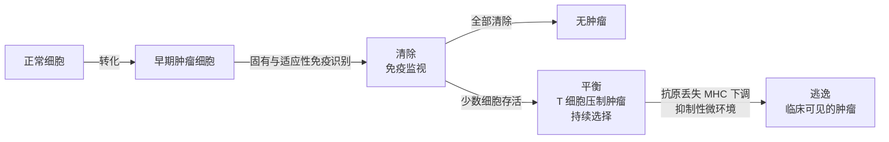

免疫学的核心问题是怎样区分"非己"与"自己"。肿瘤使这一问题变得尴尬：肿瘤细胞来自自身，大多数成分是自身的，但它们积累了突变，表达着不该表达的分子，并且会主动关闭免疫应答。本章接在前面各个效应与刹车的章节之后，回答免疫系统能否识别肿瘤、肿瘤又怎样躲过去、怎样借助免疫系统治疗肿瘤这三个问题。

它是前面许多机制的汇合处：识别依赖 MHC I 类分子的肽提呈与 CTL（[7.15.14](/7.15.14)、[7.15.17](/7.15.17)），逃逸用的是检查点与 Treg（[7.15.25](/7.15.25)），治疗的两个主要方向（检查点阻断与 CAR-T）分别是对刹车的撤除和对抗原受体的改造（[7.15.12](/7.15.12)、[7.15.16](/7.15.16)），而肿瘤本身的演化见 [7.4.21](/7.4.21) 与 [7.9.13](/7.9.13)。本章只写免疫学的机制与原理，不涉及具体的治疗方案。

## 30.1. 免疫监视与免疫编辑

**免疫监视**的假说认为免疫系统持续监视并清除早期的转化细胞。证据来自几个方面：

- 免疫缺陷者的肿瘤发病率升高。器官移植后长期服用免疫抑制药物的受者和艾滋病患者，更容易发生 EB 病毒相关的淋巴瘤、Kaposi 肉瘤、HPV 相关的癌，这一部分与病毒相关；也有一部分与病毒无关的肿瘤（如皮肤癌）增多；
- 小鼠中，缺失 T 细胞、NK 细胞、IFN-γ 信号或穿孔素的小鼠，自发与化学诱导的肿瘤更多、发生更早；
- 许多肿瘤中浸润的 CD8⁺ T 细胞越多，预后越好；
- 一些肿瘤可以被免疫自发消退，或由检查点阻断引起长期缓解（见 30.5）。

但是免疫系统不只是"清除"。Schreiber 等人的实验发现：在免疫缺陷小鼠中形成的肿瘤，移植给正常小鼠时常被排斥；而在免疫功能正常的小鼠中形成的肿瘤，移植给正常小鼠时则能生长。这说明免疫系统不只是清除肿瘤，也塑造了存活的肿瘤。

**定义 30.1.1（免疫编辑）** 免疫系统在清除肿瘤细胞的同时，通过选择压力使肿瘤的免疫原性降低、使存活的肿瘤细胞更能抵抗免疫攻击的过程称为**免疫编辑**，包括清除、平衡与逃逸三个阶段。

- **清除**：固有与适应性免疫识别并清除早期的转化细胞，肿瘤不被察觉；
- 平衡：少数细胞存活，适应性免疫（尤其是 IFN-γ 与 CD8⁺ T 细胞）压制其生长，但不能完全清除；肿瘤细胞在选择压力下积累变异，这一阶段可持续多年，对应临床的"休眠"；
- 逃逸：出现了抗原丢失、MHC 下调、抑制性微环境等变异的克隆不再被控制，生长成临床可见的肿瘤。

这一模型中，所有临床可见的肿瘤都是"逃逸"的产物，因此都已经学会躲避免疫；免疫治疗的目标就是重新打破平衡。"平衡"与"逃逸"可以用一个简单的动力学模型理解，见 30.5 节的例 30.5.1。

## 30.2. 肿瘤抗原

肿瘤细胞是自身细胞，对其大多数抗原已经建立了耐受，能被免疫系统识别的是少数"不同"的抗原，按来源分为两类：

**定义 30.2.1（肿瘤特异性抗原）** 只在肿瘤细胞中表达、正常细胞中完全没有的抗原称为**肿瘤特异性抗原**（TSA），来源于体细胞突变产生的新蛋白序列或致癌病毒的蛋白。

**定义 30.2.2（肿瘤相关抗原）** 在肿瘤细胞中异常表达（过表达、在不该表达的时间表达），但在正常细胞中也有表达的自身抗原称为**肿瘤相关抗原**（TAA）。

**定义 30.2.3（新抗原）** 由肿瘤体细胞突变（点突变、插入缺失、基因融合）产生的、含有新的氨基酸序列、经加工后由 MHC 分子提呈、且能被 T 细胞识别的肽称为**新抗原**。

| 类别 | 例子 | 性质 |
|---|---|---|
| 病毒抗原（TSA） | HPV 的 E6 与 E7（宫颈癌）、EB 病毒抗原 | 对宿主是外来的，没有耐受，所有同一病毒引起的肿瘤共有 |
| 新抗原（TSA） | 突变蛋白的肽（每个肿瘤各不相同） | 没有中枢耐受，免疫原性高，但个体化 |
| 过表达的自身蛋白（TAA） | HER2、MUC1 | 有耐受，高亲和力的 T 细胞已被清除，抗体可以起作用 |
| 分化抗原（TAA） | 黑色素瘤的酪氨酸酶、gp100；B 细胞肿瘤的 CD19、CD20 | 正常的同谱系细胞也表达，攻击时一并损伤 |
| 癌胚抗原（TAA） | 甲胎蛋白（AFP）、癌胚抗原（CEA） | 胚胎期表达，成人中重新出现；常用作血清标志物 |
| 癌—睾丸抗原（TAA） | MAGE 家族 | 在多种肿瘤与睾丸生殖细胞中表达，睾丸是免疫豁免部位 |

新抗原的产生有一连串条件：基因必须发生突变并被表达，突变的肽要经蛋白酶体与 TAP 加工（[7.15.14](/7.15.14)），与该患者的 MHC I 类分子有足够的亲和力，并且患者的 TCR 库中有识别它的克隆。因此新抗原的数目并不简单地正比于突变数，但总体上**肿瘤突变负荷**越高（如黑色素瘤、吸烟相关的肺癌、DNA 错配修复缺陷的肿瘤），对检查点阻断的响应越好。MHC 结合的预测用序列模型完成（[7.8](/7.8) 的机器学习方法）。肿瘤内部的异质性使新抗原分为所有细胞共有的克隆性新抗原与只在亚克隆中的亚克隆性新抗原，前者是更好的靶；亚克隆的存在也是肿瘤能够逃逸的原因之一（肿瘤的克隆演化见 [7.4.21](/7.4.21)）。

## 30.3. 抗肿瘤的免疫效应

抗肿瘤免疫可以概括成一个循环，称为癌症—免疫循环（每一步都可能成为失败点）：

| 步骤 | 内容 | 失败的例子 |
|---|---|---|
| 1. 抗原释放 | 肿瘤细胞死亡，释放抗原与危险信号 | 死亡方式非免疫原性，缺少危险信号 |
| 2. 抗原提呈 | 树突状细胞（尤其是擅长交叉提呈的经典 DC）摄取抗原，成熟，迁移到淋巴结（[7.15.14](/7.15.14)） | DC 缺乏或被抑制，肿瘤内 DC 少 |
| 3. T 细胞活化 | 在淋巴结中初始 T 细胞被活化（[7.15.16](/7.15.16)） | 缺少共刺激、耐受（TAA）、CTLA-4 的刹车 |
| 4. 迁移 | 效应 T 细胞经趋化因子进入肿瘤（[7.15.4](/7.15.4)） | 趋化因子缺失，血管异常，不能归巢 |
| 5. 浸润 | 穿过基质，进入肿瘤巢 | 基质屏障（成纤维细胞、胶原），免疫排斥型 |
| 6. 识别 | TCR 识别肿瘤细胞的 MHC I 类分子加肽 | MHC I 下调，抗原丢失 |
| 7. 杀伤 | CTL 以穿孔素和颗粒酶、Fas 配体、IFN-γ 与 TNF-α 杀伤 | 耗竭、PD-L1、抑制性细胞 |

执行者有：

- CD8⁺ T 细胞（CTL，[7.15.17](/7.15.17)）是主要的杀伤者；CD4⁺ Th1 细胞提供 IL-2、IFN-γ，并通过 CD40 "许可"树突状细胞，使其更有效地启动 CD8⁺ T 细胞；
- **NK 细胞**识别 MHC I 的缺失（**丢失自我**）与由应激诱导的配体（如 MICA、MICB 与 NKG2D 的结合），在 MHC I 下调的肿瘤上尤其重要（[7.15.5](/7.15.5)、25.6）；
- **巨噬细胞**：未被极化抑制的巨噬细胞可以吞噬肿瘤细胞，但肿瘤细胞表达 CD47（"别吃我"信号，与巨噬细胞的 SIRPα 结合）；
- **抗体**：针对肿瘤相关抗原的抗体（天然产生或治疗性使用）经 ADCC、补体与吞噬杀伤肿瘤细胞（[7.15.21](/7.15.21)）；
- γδ T 细胞与 NKT 细胞：识别应激分子与脂质抗原，不依赖经典的 MHC；
- **三级淋巴结构**：肿瘤内的淋巴样聚集提供局部的 T 细胞启动与 B 细胞应答，常与更好的预后相关（[7.15.22](/7.15.22)）。

## 30.4. 肿瘤微环境与免疫逃逸

**定义 30.4.1（肿瘤微环境）** 肿瘤细胞所处的由免疫细胞、基质细胞（成纤维细胞、内皮细胞）、细胞外基质、血管、可溶性因子以及低氧与代谢产物构成的局部环境称为**肿瘤微环境**（TME）。

**定义 30.4.2（肿瘤免疫逃逸）** 肿瘤细胞通过降低可见度、抵抗杀伤、产生抑制性微环境等方式避开免疫系统的识别与清除的过程称为**肿瘤免疫逃逸**，是肿瘤免疫编辑中"逃逸"阶段的机制。

逃逸的机制可以按"为什么杀伤失败"分为：

| 类别 | 机制 | 结果 |
|---|---|---|
| 看不见 | 抗原丢失（免疫选择出缺少新抗原的克隆）；MHC I 类分子下调（β2 微球蛋白的失活、TAP 缺陷、HLA 的杂合性丢失、转录抑制）；抗原加工与提呈的缺陷 | CD8⁺ T 细胞不能识别（但 NK 细胞识别增强） |
| 不响应 IFN-γ | IFN-γ 受体通路的突变（*JAK1*、*JAK2*） | 不上调 MHC I 与抗原加工，对 T 细胞的杀伤抵抗 |
| 检查点 | PD-L1 的适应性或固有表达；CTLA-4、TIGIT 等（25.2） | T 细胞被抑制，耗竭（25.3） |
| 抑制性细胞 | Treg（25.4）、骨髓来源抑制细胞、肿瘤相关巨噬细胞 | 抑制 T 细胞活化与功能 |
| 抑制性因子 | TGF-β、IL-10、前列腺素 E₂、腺苷（CD39–CD73）、吲哚胺 2,3-双加氧酶（色氨酸耗竭与犬尿氨酸）、VEGF | 抑制 T 细胞与树突状细胞，促进 Treg |
| 代谢与物理屏障 | 低氧（HIF）、葡萄糖与氨基酸被肿瘤细胞竞争、乳酸造成的酸化；血管结构异常；成纤维细胞与胶原形成的基质屏障 | 效应细胞进不去，进去后功能受抑 |
| 死亡信号的抵抗 | 抗凋亡蛋白上调，Fas 通路缺陷 | 对 CTL 与 NK 的杀伤不敏感 |

其中两类细胞需要单独定义。

**定义 30.4.3（骨髓来源抑制细胞）** 在肿瘤与慢性炎症中扩增的、来源于骨髓的未成熟髓系细胞（包括类似中性粒细胞的与类似单核细胞的两个亚群），通过精氨酸酶、活性氧与氮、TGF-β 与 IL-10 等抑制 T 细胞与 NK 细胞功能的细胞群称为**骨髓来源抑制细胞**（MDSC）。

**定义 30.4.4（肿瘤相关巨噬细胞）** 肿瘤微环境中的巨噬细胞，在肿瘤产生的 CSF-1、IL-4、IL-10、TGF-β 与低氧的作用下，偏向于促进肿瘤的表型（产生 IL-10、TGF-β、血管生成因子 VEGF，抑制 T 细胞，促进组织修复与血管生成）的称为**肿瘤相关巨噬细胞**（TAM）。

TAM 常被描述为"M2 样"，但这个二分是简化的（[7.15.5](/7.15.5) 讨论 **巨噬细胞极化**的局限）：在单细胞数据中，肿瘤内的巨噬细胞呈连续谱，表达促炎与抑制性程序的混合。这些细胞与 Treg 一起构成一个抑制网络，而且互相强化：TGF-β 诱导 Treg，Treg 的 IL-10 抑制髓系细胞的活化。

## 30.5. 免疫治疗的原理

免疫治疗不是直接杀死肿瘤，而是调整免疫系统与肿瘤之间的平衡。按照癌症—免疫循环（30.3），各类疗法针对不同步骤：

| 疗法 | 针对的步骤 | 原理 |
|---|---|---|
| 检查点阻断 | 活化与杀伤（步骤 3、7） | 撤去抑制性刹车（25.8，[7.3.27](/7.3.27)） |
| 过继细胞治疗 | 提供效应细胞（步骤 6、7） | 回输有抗肿瘤特异性的 T 细胞 |
| 肿瘤疫苗 | 抗原提呈与启动（步骤 1–3） | 提供抗原与佐剂，诱导特异性 T 细胞 |
| 细胞因子 | 扩增与活化 | IL-2、IFN-α 等 |
| 治疗性抗体 | 识别与杀伤 | ADCC、双特异性抗体连接 T 细胞与肿瘤细胞 |

### 30.5.1. 肿瘤—效应细胞的竞争模型

**例 30.5.1（捕食者—被捕食者模型）** 用 Kuznetsov 型的模型描述肿瘤细胞数 $T$ 与效应（杀伤性）细胞数 $E$：

$$
\begin{aligned}
\frac{\mathrm{d}T}{\mathrm{d}t} &= aT(1 - bT) - nET,\\
\frac{\mathrm{d}E}{\mathrm{d}t} &= s + \frac{pET}{g + T} - mET - dE.
\end{aligned}
$$

肿瘤按 logistic 增长（速率 $a$，承载量 $1/b$），被效应细胞按质量作用杀伤（速率 $n$）。效应细胞有四项来源与去路：常数的补充 $s$，抗原驱动的、随 $T$ 饱和的募集 $p\,ET/(g + T)$，由肿瘤细胞接触引起的失活 $mET$（耗竭与抑制性信号的代理，25.3），以及自然损失 $dE$。（微分方程的相平面分析见 [2.4](/2.4)。）取一组示意参数（$s = 1.3 \times 10^4$、$p = 0.1245$、$g = 2.0 \times 10^7$、$m = 3.4 \times 10^{-10}$、$d = 0.0412$、$a = 0.18$、$b = 2 \times 10^{-9}$、$n = 1.1 \times 10^{-7}$，时间以天、细胞数计），数值求解：

模型捕捉了三点定性的结论。第一，系统是**双稳态**的：同一套参数下有一个"控制"与一个"逃逸"的吸引子，起始负荷和历史决定落在哪一个，这是平衡与逃逸之间的数学形式。第二，"控制"状态里肿瘤并没有消失，在 $10^7$ 个细胞（约 10 mm³ 级）附近持续波动，这与平衡阶段的休眠相对应，过程中的振荡反映的是捕食者—被捕食者的滞后。第三，检查点阻断在模型中表现为降低失活项 $m$：它不增加新的效应细胞，而是使同样数量的效应细胞有更高的净杀伤，足以使逃逸的肿瘤落回控制的吸引域。这个解释与 25.8 的原理一致：阻断只在效应细胞存在时有效，$E$ 的基数、$T$ 的抗原性（$n$）与抑制强度（$m$）共同决定能否越过分界。模型是定性的示意：忽略了空间、异质性、新抗原的演化与多种细胞的相互作用，数值不能直接对应患者。

### 30.5.2. 过继细胞治疗与 CAR-T

**定义 30.5.1（过继细胞治疗）** 把具有抗肿瘤活性的免疫细胞（经体外扩增或改造的 T 细胞、NK 细胞）输入患者体内，使其直接攻击肿瘤的治疗称为**过继细胞治疗**（ACT）。

它有三种形式：肿瘤浸润淋巴细胞（从肿瘤中分离富集的天然抗肿瘤 T 细胞）、TCR 工程化 T 细胞（导入识别特定 pMHC 的 TCR，需要匹配的 HLA）、以及嵌合抗原受体 T 细胞。

通过基因改造使 T 细胞表达嵌合抗原受体（CAR）的 T 细胞称为 **嵌合抗原受体 T 细胞**，简称 CAR-T。CAR 把抗体的单链可变片段（scFv，识别肿瘤细胞表面抗原）经铰链区与跨膜区，与 T 细胞的胞内信号结构域（CD3ζ 的 ITAM，加 CD28 或 4-1BB 的共刺激结构域）融合在一起。

CAR-T 的设计原理是把抗体的特异性与 T 细胞的杀伤和增殖能力结合：

- 不依赖 MHC：scFv 直接识别细胞表面的蛋白，不需要 MHC 提呈，所以对 MHC I 下调的肿瘤和不同 HLA 的患者都适用，并且适用于糖类、脂类抗原；代价是只能识别细胞表面抗原，不能识别细胞内蛋白的肽；
- 信号的整合：CD3ζ 提供第一信号，共刺激结构域提供第二信号，使 T 细胞在一次接触中完成活化、增殖与持续存在（[7.15.16](/7.15.16)）；不同的共刺激结构域影响持久性与耗竭；
- **灵敏度**：天然 TCR 能被很少几个 pMHC 活化（动力学校对，[7.15.16](/7.15.16)），而 CAR 一般需要更高的抗原密度；因而抗原密度低的肿瘤细胞可以逃过。

在 B 细胞肿瘤中，靶抗原 CD19 在恶性 B 细胞与正常 B 细胞上都有表达，因此有效的同时也清除了正常的 B 细胞（B 细胞缺乏，"靶向、非肿瘤"的毒性）。局限性有：抗原丢失性逃逸（CD19 阴性的复发）、实体瘤中的抗原异质性、迁移与浸润的困难（30.3 的步骤 4、5）、抑制性微环境导致 CAR-T 的耗竭（25.3）。另一类毒性是**细胞因子风暴**：大量活化的 CAR-T 与髓系细胞分泌 IFN-γ、IL-6、IL-1 等，引起发热、低血压；以及神经毒性。

### 30.5.3. 肿瘤疫苗、细胞因子与抗体

- 预防性疫苗针对致癌病毒（HPV、乙型肝炎病毒），通过诱导中和抗体预防感染，从而预防病毒相关的癌（原理见 [7.15.33](/7.15.33)）；
- 治疗性疫苗用肿瘤抗原（新抗原的肽或 mRNA，装载抗原的树突状细胞）加佐剂诱导 T 细胞。主要障碍是肿瘤的抑制性微环境和 TAA 的耐受，单独使用效果有限，多与检查点阻断联合；
- **细胞因子**：IL-2 扩增 T 细胞与 NK 细胞，但同时扩增 Treg，并引起血管渗漏；IFN-α 上调 MHC I；这些是细胞因子多效性的例子（[7.15.11](/7.15.11)），工程化改造的变体试图选择性地作用于效应细胞；
- 治疗性抗体：针对肿瘤抗原的抗体通过 ADCC（[7.15.21](/7.15.21)）、补体与吞噬杀伤，或直接阻断生长因子受体；**双特异性抗体**一臂结合肿瘤抗原、另一臂结合 CD3，把 T 细胞拉到肿瘤细胞旁并绕过 TCR 特异性使其活化（[7.15.9](/7.15.9)）。

### 30.5.4. 免疫相关不良反应

免疫治疗的不良反应是机制性的，而不是偶然：撤去刹车使被压制的自身反应性应答表现出来，所以出现结肠炎、甲状腺炎、垂体炎、肺炎、皮炎、肝炎、1 型糖尿病等自身免疫样的反应（25.8、[7.15.28](/7.15.28)）。可能的机制是：（1）T 细胞对肿瘤与正常组织共有的抗原的交叉反应（如分化抗原）；（2）原有的、被检查点压制的自身反应性 T 细胞活化；（3）原有的自身抗体增多；（4）炎症细胞因子的升高。抗 CTLA-4 的反应多于抗 PD-1，联合使用最多，与它们的分工（25.2）一致；处理时需要免疫抑制，但原则上要在保持抗肿瘤效果与控制自身免疫之间平衡。

## 30.6. 肿瘤免疫与空间组学

肿瘤中浸润的 T 细胞的位置与数量，常按空间分布分为三种表型：

| 表型 | 对应循环中的失败点 | 可能的机制 | 治疗的含义 |
|---|---|---|---|
| 免疫荒漠 | 启动（步骤 1–3） | 缺少抗原或抗原提呈、没有 T 细胞被活化，肿瘤内在的信号通路抑制免疫细胞招募 | 需要提供抗原与启动（疫苗、细胞疗法），单用检查点阻断响应差 |
| 免疫排斥 | 迁移与浸润（步骤 4、5） | 基质与成纤维细胞的屏障、血管异常、趋化因子缺失 | 需要改变基质与血管，或增加趋化 |
| 炎症型 | 杀伤（步骤 7） | PD-L1 的适应性表达、耗竭、Treg | 检查点阻断最可能有效 |

空间组学可以读出这些表型，因为它们本质上是空间的问题：同样的 CD8⁺ T 细胞总数，在肿瘤巢内与巢周的意义完全不同。常用的读出有：

- CD8⁺ T 细胞的密度与位置：肿瘤核心与浸润边缘的 CD8⁺ 与 CD3⁺ 细胞密度（综合成"免疫评分"），以及细胞与肿瘤细胞的距离、邻域内的细胞类型组成（细胞类型注释与邻域分析见 [7.9.6](/7.9.6)）；
- PD-L1 的表达：按肿瘤细胞的比例或按肿瘤与免疫细胞合计的评分，用于预测检查点阻断的疗效；它有重要的局限：在同一个肿瘤中有空间异质性，取样偏差，随治疗与时间变化（适应性表达，25.2），不同抗体克隆与评分方法不可互换，阴性不能排除响应；
- **三级淋巴结构**的标志物（B 细胞 CD20、滤泡树突状细胞 CD21、成熟 DC 的 DC-LAMP、高内皮微静脉的 PNAd）与趋化因子 CXCL13（[7.15.22](/7.15.22)）；
- 抑制性细胞与耗竭状态：FOXP3⁺ Treg、CD163⁺ 巨噬细胞、PD-1⁺ TIM-3⁺ TCF-1⁻ 耗竭 T 细胞与 TCF-1⁺ 前体细胞的位置（25.3，标志物的选择与局限见 [7.15.35](/7.15.35)）。

与免疫表型相关的其他预测因子还有肿瘤突变负荷、DNA 错配修复缺陷、IFN-γ 相关基因表达特征（[7.3.26](/7.3.26) 与 [7.9.13](/7.9.13) 从演化与系统角度讨论）。没有一个单一的指标足够：它们各自反映循环中的一环，所以联合使用，并且面对多重比较与重复性（[7.7](/7.7)）的统计问题。

## 小结

- 免疫监视与免疫编辑（定义 30.1.1）：肿瘤被免疫系统清除，也被塑造，所有临床可见的肿瘤都经历了清除、平衡与逃逸。
- 肿瘤抗原分为肿瘤特异性抗原（定义 30.2.1，包括新抗原，定义 30.2.3）与肿瘤相关抗原（定义 30.2.2）；前者无耐受而免疫原性强，后者有耐受、需要考虑对正常组织的影响。
- 抗肿瘤免疫是一个七步循环；每一步的失败对应一类逃逸与一类治疗。
- 肿瘤微环境（定义 30.4.1）与逃逸（定义 30.4.2）包括看不见、检查点、抑制性细胞（MDSC 与 TAM，定义 30.4.3、30.4.4）、抑制性因子与代谢及物理屏障。
- 免疫治疗的原理：检查点阻断撤去刹车；过继细胞治疗（定义 30.5.1）与 CAR-T 提供不依赖 MHC 的特异性杀伤细胞；疫苗、细胞因子与抗体；免疫相关不良反应是撤去刹车的机制性后果。
- 例 30.5.1 的模型显示平衡与逃逸是双稳态，检查点阻断降低效应细胞的失活率即可使逃逸的肿瘤回到控制态。
- 浸润表型（荒漠、排斥、炎症型）对应循环中的失败点，空间组学读出细胞的位置、PD-L1 与三级淋巴结构；单个指标不足以预测。

## 思考题

1. 为什么肿瘤突变负荷高的肿瘤对检查点阻断的响应通常更好，但并不总是如此？

   **答** 突变多则产生新抗原的机会多，新抗原没有中枢耐受，能够被 T 细胞识别，所以更可能存在可以被活化的 T 细胞。但新抗原需要被表达、加工、与患者的 MHC 结合并有对应的 TCR；克隆性新抗原比亚克隆性的更有价值；肿瘤也可能同时存在 MHC 下调、IFN-γ 信号缺陷或排斥型微环境，使突变负荷不转化为可识别的抗原。所以突变负荷是一个有用但不充分的预测因子。

2. 免疫排斥型肿瘤中，T 细胞停在肿瘤周围，只用检查点阻断为什么常常无效？

   **答** 检查点阻断作用于已经进入肿瘤、与肿瘤细胞接触并被 PD-1 等信号抑制的 T 细胞。排斥型的失败点在更早的浸润步骤（基质屏障、血管异常、趋化因子缺失），T 细胞没有到达靶细胞，撤去刹车没有意义。需要先解决浸润问题。

3. 例 30.5.1 的模型中，如果把杀伤率 $n$ 降低（模拟肿瘤抗原丢失），而 $m$ 不变，系统的分界会怎样变化？

   **答** 杀伤率降低使效应细胞对肿瘤的净作用减弱，控制所需要的效应细胞数量升高，"控制"吸引子的吸引域变小（分界向较小的肿瘤负荷移动），甚至消失，使系统只剩"逃逸"。这对应免疫编辑中抗原丢失的克隆被选择、免疫平衡被打破的过程；此时单独降低 $m$（检查点阻断）的效果也会减弱，说明阻断需要肿瘤保留可识别的抗原。
