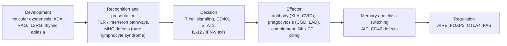

The knowledge pathway keeps asking four questions: who recognizes, how the decision is made after recognition, which effectors clear the threat, and how the response is remembered and then shut off. The preceding chapters explained how each step works; this chapter asks the reverse question: what happens when one link is broken? Immunodeficiency belongs to the "too weak" category on the pathway (the other two being the "too strong" of hypersensitivity and autoimmunity and the "misdirected" of allergy and chronic inflammation, see [7.15.26](/7.15.26) and [7.15.28](/7.15.28)). It deserves a chapter because each single-gene defect is a knockout experiment performed by nature on humans: without RAG there are no lymphocytes, without CD40 ligand there is no class switching, without NADPH oxidase certain bacteria cannot be killed, and without the IFN-γ receptor mycobacteria cannot be held back. Reading backward from a patient's infection spectrum and laboratory phenotype to the damaged link also confirms the mechanisms of the earlier chapters. We first give the classification and diagnostic clues, then take the damaged links in turn: combined immunodeficiency, antibody defects, phagocyte defects, complement and innate signaling defects, and immune regulation defects. We then turn to secondary immunodeficiency and finish, at greater length, with the immunology of HIV infection, which is the best-studied acquired immunodeficiency and the most direct evidence for the central position of CD4⁺ T cells in the immune system. Pathogen biology and antiviral drugs are covered in [7.11.25](/7.11.25) and [7.11.28](/7.11.28); how the host organizes its response according to the site of infection is the subject of [7.15.32](/7.15.32).

## 31.1. Classification and Clues

**Definition 31.1.1 (Primary Immunodeficiency)** An impairment of immune function caused by an inherited defect in a gene encoding a component of the immune system is called **primary immunodeficiency**, also known as an inborn error of immunity.

**Definition 31.1.2 (Secondary Immunodeficiency)** An impairment of immune function caused by external factors such as malnutrition, drugs, tumors, infections or age, without a genetic basis, is called **secondary immunodeficiency**.

Most primary immunodeficiencies are monogenic and each individual disease is rare, but several hundred causative genes have been identified, and the combined incidence is about 1 in 500; severity varies enormously, from lifelong absence of symptoms to death in infancy. Secondary immunodeficiencies are more common: the most common immunodeficiency in the world is in fact severe malnutrition.

### 31.1.1. Classification by Damaged Link

Locating the known defects on the knowledge pathway gives a "disease map". Defects in the same link have similar clinical consequences, whereas defects in different links have characteristic infection spectra; these are the clues followed in the sections below.

| Damaged link | Examples | Main consequence | Susceptible pathogens and presentation |
|---|---|---|---|
| T cell absence or dysfunction | Severe combined immunodeficiency, DiGeorge syndrome | Both cellular immunity and T-dependent antibody responses are impaired | Viruses, fungi (*Candida*, *Pneumocystis jirovecii*), intracellular bacteria (mycobacteria), protozoa; even usually mild viruses can be fatal; live attenuated vaccines can cause disease |
| Antibody defects | X-linked agammaglobulinemia, common variable immunodeficiency, selective IgA deficiency | Lack of opsonization and neutralization | Recurrent ear, sinus and lung infections with encapsulated pyogenic bacteria (*Streptococcus pneumoniae*, *Haemophilus influenzae*); enteroviruses and *Giardia*; often accompanied by autoimmunity |
| Phagocyte defects | Chronic granulomatous disease, leukocyte adhesion deficiency | Failed killing or recruitment | Abscesses of skin, lymph nodes and liver caused by staphylococci, enteric Gram-negative bacteria and fungi |
| Complement defects | C1q, C2, C4 deficiency; C5–C9 deficiency; properdin deficiency | Poor clearance of immune complexes and apoptotic cells; loss of opsonization and lysis | Early-component defects with autoimmunity (systemic lupus erythematosus); late-component and properdin defects with susceptibility to *Neisseria* (sepsis, meningitis) |
| Innate signaling defects | MyD88 / IRAK4, UNC93B1 / TLR3, IL-12 / IFN-γ axis | Failed recognition or activation for particular pathogens | Pyogenic bacteria; herpes simplex virus encephalitis; mycobacteria and *Salmonella* |
| Regulation defects | *AIRE*, *FOXP3*, *CTLA4*, *FAS* | Failed tolerance and contraction | Autoimmunity and lymphoproliferation; sometimes infection |

### 31.1.2. Clinical Clues and Laboratory Investigation

The clue to immunodeficiency is the pattern of infection, not merely the number of infections: whether they recur, whether they are severe, whether they are caused by low-virulence or opportunistic pathogens, whether they respond poorly to standard treatment, and whether there is autoimmunity or a family history. Because maternal IgG crosses the placenta ([7.15.21](/7.15.21)), the humoral immunity of a newborn is masked by maternal antibody for roughly the first 6 months, so antibody defects usually appear only after 6 months; T cell defects produce symptoms earliest, typically viral and fungal infections, chronic diarrhea and failure to thrive.

Laboratory investigation follows the knowledge pathway: measure serum levels of each immunoglobulin class; count T, B and NK cells and their subsets by flow cytometry ([7.15.34](/7.15.34)); test specific antibody after vaccination (to protein antigens, which tests the T-dependent response, and to polysaccharide antigens, which tests the T-independent response, [7.15.8](/7.15.8)); use functional assays for phagocyte killing and complement activity; and finally confirm the diagnosis by gene sequencing.

The most severe defects can be screened for in the neonatal period. When T cells develop in the thymus, rearrangement of the TCR genes excises a circle of DNA, the T cell receptor excision circle (TREC, [7.15.12](/7.15.12)), which is not replicated during cell division and is therefore present only in cells that have recently left the thymus; quantifying TRECs in dried blood spots serves as a measure of thymic output, and infants lacking T cells have extremely low TREC levels. The point of screening is to begin intervention before the infant has received a live attenuated vaccine or developed a severe infection; this is one of the few primary immunodeficiencies that can be "screened out".

## 31.2. Combined Immunodeficiencies

### 31.2.1. Severe Combined Immunodeficiency

**Definition 31.2.1 (Severe Combined Immunodeficiency)** A group of inherited diseases in which absent or severely dysfunctional T cells, accompanied by impaired humoral immunity, cause severe, recurrent, life-threatening infections in infancy is called **severe combined immunodeficiency** (SCID).

SCID is the most severe primary immunodeficiency, and its defects all arise early in lymphocyte development. Because T cells are required for B cell activation, class switching and affinity maturation ([7.15.20](/7.15.20)), the loss of T cells inevitably impairs antibody responses too, hence the word "combined". According to the step that is damaged, SCID falls into five classes:

| Damaged step | Gene | Phenotype (T / B / NK) | Mechanism |
|---|---|---|---|
| Differentiation of hematopoietic stem cells into myeloid and lymphoid lineages | *AK2* (reticular dysgenesis) | T⁻ B⁻ NK⁻, with granulocytopenia | Defective mitochondrial adenylate kinase; myeloid and lymphoid precursors undergo apoptosis |
| Purine metabolism | *ADA*, *PNP* | T⁻ B⁻ NK⁻ | Metabolites (deoxyadenosine, deoxyguanosine and others) accumulate in lymphoid precursors and kill them (see Example 31.2.1) |
| Rearrangement of antigen receptor genes (V(D)J recombination) | *RAG1*, *RAG2*, *DCLRE1C* (Artemis), *PRKDC* | T⁻ B⁻ NK⁺ | Pre-TCR and pre-BCR cannot form; T and B cell development arrests ([7.15.12](/7.15.12)) |
| Cytokine signaling | *IL2RG* (common γ chain, X-linked), *JAK3*, *IL7R* | *IL2RG*, *JAK3*: T⁻ B⁺ NK⁻; *IL7R*: T⁻ B⁺ NK⁺ | The common γ chain is shared by the receptors for IL-2, -4, -7, -9, -15 and -21 ([7.15.11](/7.15.11)); T cell development depends on IL-7 and NK cell development on IL-15 |
| Pre-TCR and TCR signaling | *CD3D*, *CD3E*, *CD3Z* | T⁻ B⁺ NK⁺ | Loss of pre-TCR signaling arrests thymic development ([7.15.15](/7.15.15)) |

This table is an excellent "pathway cross-reference": the presence or absence of B and NK cells in the phenotype directly shows which link is defective. For example, a RAG defect affects only the T and B cells that need rearrangement and spares NK cells, because NK cells do not use rearranged receptors; a defect in the common γ chain or JAK3 loses T and NK cells (IL-7 and IL-15 signaling), but B cell numbers are normal, and the B cells simply cannot make functional antibody for lack of T cell help and IL-21 signaling. There is also a species difference: mouse B cell development requires IL-7 but human B cell development does not, so mouse *Il7r* deletion gives T⁻B⁻ whereas the human phenotype is T⁻B⁺.

**Example 31.2.1 (Adenosine Deaminase Deficiency)** ADA catalyzes the deamination of adenosine and deoxyadenosine. In ADA-deficient individuals deoxyadenosine accumulates and is phosphorylated to dATP in lymphocytes, which inhibits ribonucleotide reductase, unbalances the dNTP pool, blocks DNA synthesis and repair, and induces apoptosis. ADA is a housekeeping enzyme expressed in all cells, but lymphoid precursors are the most sensitive to this toxicity, so the disease presents as lymphocyte depletion accompanied by non-immune neurological, skeletal and hearing manifestations.

:::

The typical course of a SCID infant is therefore as follows: apparently normal at birth, then within months chronic diarrhea, thrush, *Pneumocystis jirovecii* pneumonia, severe infections with common viruses and failure to thrive, very few peripheral blood lymphocytes and a very small thymus; a live attenuated vaccine (such as BCG or rotavirus vaccine) can cause disseminated infection, and transfusion of blood products containing live lymphocytes can cause graft-versus-host disease ([7.15.29](/7.15.29)).

### 31.2.2. Less Severe Combined Immunodeficiencies

When a mutation only partly weakens protein function (a hypomorphic allele), the result is leaky SCID: some T cells are present, but their numbers and diversity are insufficient. The most distinctive form is Omenn syndrome: hypomorphic *RAG* mutations allow a few T cell clones to arise by rearrangement and then expand massively in the periphery as oligoclonal autoreactive T cells, causing erythroderma, enlargement of lymph nodes, liver and spleen, and raised eosinophils and IgE. It shows that a small lymphocyte repertoire and autoimmunity can coexist, because AIRE expression requires sufficient thymocytes and TCR diversity ([7.15.24](/7.15.24)).

The remaining combined immunodeficiencies can be classified by the function that is impaired, and each corresponds to a mechanism from an earlier chapter:

| Defect | Gene | Impaired function | Presentation |
|---|---|---|---|
| Bare lymphocyte syndrome type I | *TAP1/2*, *TAPBP*, *B2M* | MHC class I expression or loading ([7.15.14](/7.15.14)) | Few CD8⁺ T cells, recurrent respiratory viral and bacterial infections; NK cell responses to "missing self" are also affected |
| Bare lymphocyte syndrome type II | *CIITA*, *RFX5*, *RFXAP*, *RFXANK* | Transcription of MHC class II ([7.15.13](/7.15.13)) | Loss of thymic positive selection, few CD4⁺ T cells, poor T-dependent antibody responses |
| DiGeorge syndrome | 22q11.2 deletion (*TBX1*) | Development of the third and fourth pharyngeal pouches; thymic hypoplasia | Reduced T cells of variable degree; accompanied by cardiac malformations and hypoparathyroidism; the complete form requires thymus transplantation |
| Wiskott–Aldrich syndrome | *WAS* (X-linked) | Actin reorganization, immunological synapse formation | Eczema, thrombocytopenia with small platelets, recurrent infections, often complicated by autoimmunity and lymphoma |
| Hyper-IgM syndrome | *CD40LG* (X-linked), *CD40* | T cell help to B cells and dendritic cells ([7.15.16](/7.15.16)) | No class switching, germinal centers or memory B cells; IgM normal or elevated, IgG, IgA and IgE absent; DC maturation and IL-12 production are insufficient, so patients are prone to infection with intracellular pathogens (such as *Pneumocystis jirovecii*) |
| Hyper-IgE syndrome | dominant-negative *STAT3* mutations | IL-6, IL-21 and IL-23 signaling; differentiation of Th17 and Tfh cells ([7.15.17](/7.15.17)) | Staphylococcal abscesses of skin and lung, chronic mucocutaneous candidiasis, very high IgE, skeletal and connective tissue abnormalities |

Two "T cell diseases with a B cell phenotype" deserve emphasis. In hyper-IgM syndrome the B cells themselves are normal, and the defect lies in the CD40L–CD40 signal of T–B contact; in hyper-IgE syndrome, IgE is raised without marked allergy, suggesting that STAT3 also acts in IgE-mediated mast cell activation. The susceptibility of the latter to *Candida* and *Staphylococcus* confirms the defensive role of Th17 cells at mucosae and skin ([7.15.32](/7.15.32)).

## 31.3. Antibody Deficiencies

**Definition 31.3.1 (X-Linked Agammaglobulinemia)** An X-linked recessive disease in which mutation of the *BTK* (Bruton tyrosine kinase) gene arrests B cell development at the pre-B cell stage, so that the peripheral blood contains almost no mature B cells or plasma cells and immunoglobulins of all classes are extremely low, is called **X-linked agammaglobulinemia** (XLA).

BTK transmits signals from the pre-BCR and BCR ([7.15.19](/7.15.19)). Without it, pre-B cells with a rearranged heavy chain receive no signal for survival and further development, and the light chain genes remain in germline configuration. The T cells of these children are normal, so immunity to most viruses and fungi is preserved, but they suffer recurrent infection with encapsulated pyogenic bacteria, whose clearance depends on antibody opsonization of capsular polysaccharide; they are also susceptible to enteroviruses (which can cause chronic meningoencephalitis) because neutralizing antibody is missing. This is the typical example of symptoms that appear only after maternal IgG has been exhausted (around 6 months).

The other antibody deficiencies have defects in progressively later steps:

| Disease | Defect | Immunoglobulin phenotype | Key points |
|---|---|---|---|
| Common variable immunodeficiency (CVID) | Polygenic or unknown; B cell numbers usually normal | IgG, IgA low; IgM often low | The most common symptomatic antibody deficiency in adults; a step in B cell activation or differentiation into plasma cells is defective; often accompanied by autoimmunity and granulomas |
| Selective IgA deficiency | Complex | IgA only is missing | About 1 in 700 (European populations), the most common primary immunodeficiency; about 70% are asymptomatic; increased risk of respiratory, gastrointestinal and genitourinary infections, allergy and autoimmunity; may be partly compensated by IgM |
| Class switch defects | *AICDA* (AID), *UNG*, *CD40*, *CD40LG* | IgM normal or high, others absent | AID and UNG defects are B cell intrinsic, with normal T cell function, unlike CD40L deficiency ([7.15.20](/7.15.20)) |
| Defects in costimulatory and survival signals | *CD19*, *CD81*, *CD21*, *TNFRSF13B* (TACI) and others | IgG and IgA low | The BCR coreceptor complex and the BAFF–APRIL pathway |

The principle of treating antibody deficiency is straightforward: regular replacement of IgG from pooled plasma of many donors (passive immunization, [7.15.33](/7.15.33)) to keep serum IgG at a protective level. The plasma half-life of IgG is about 3 weeks because FcRn rescues endocytosed IgG from lysosomal degradation and returns it to the circulation ([7.15.21](/7.15.21)), so replacement has to be repeated periodically; replaced IgG cannot substitute for mucosal IgA and is ineffective at sites where secretory antibody is lacking.

## 31.4. Defects of Phagocytes, Complement and Innate Pathways

Innate immune defects are characterized by a narrow range of impairment and a narrow, specific infection spectrum, because only the class of pathogens for which the missing component is responsible escapes clearance.

**Definition 31.4.1 (Chronic Granulomatous Disease)** An inherited disease in which a defect in one subunit of the phagocyte NADPH oxidase prevents the phagosome from producing superoxide anion and downstream reactive oxygen species, so that certain ingested pathogens cannot be killed and chronic granulomas form, is called **chronic granulomatous disease** (CGD).

NADPH oxidase consists of the membrane proteins gp91phox and p22phox and the cytosolic p47phox, p67phox, p40phox and others; it assembles on the phagosome membrane during phagocytosis and reduces $\mathrm{O_2}$ to superoxide, which in turn gives rise to $\mathrm{H_2O_2}$ and hypochlorous acid ([7.15.5](/7.15.5), [7.15.7](/7.15.7)). X-linked *CYBB* (gp91phox) mutations account for about 70% of cases and the rest are autosomal recessive. Patients are particularly susceptible to catalase-positive bacteria and fungi (*Staphylococcus aureus*, *Aspergillus*, *Burkholderia cepacia*, *Serratia*) because these microbes can break down the $\mathrm{H_2O_2}$ they produce themselves. The classic explanation is that the $\mathrm{H_2O_2}$ produced by catalase-negative microbes is used by the host, so they can still be cleared when the host lacks the oxidase. Another feature is chronic granuloma formation ([7.15.27](/7.15.27)): phagocytes can neither kill nor clear pathogens and debris, so the granuloma results from persistent activation of T cells and macrophages, and resolution of inflammation is also impaired; CGD is therefore both an immunodeficiency and a disorder of inflammatory regulation. The absence of the respiratory burst can also be tested directly: whether stimulated phagocytes oxidize dihydrorhodamine to a fluorescent product (by flow cytometry) or reduce nitroblue tetrazolium to a colored product; in patients there is no signal.

The remaining phagocyte defects correspond to functional steps discussed earlier:

| Disease | Defect | Damaged step | Features |
|---|---|---|---|
| Leukocyte adhesion deficiency type I | *ITGB2* (integrin β2 chain, CD18) | Firm adhesion in the leukocyte adhesion cascade ([7.15.4](/7.15.4)) | Very high neutrophil counts in peripheral blood, but neutrophils cannot enter infected tissue, so there is no pus at the site of infection; delayed separation of the umbilical cord |
| Leukocyte adhesion deficiency type II | Fucose transport or metabolism | Lack of the selectin ligand sialyl-Lewis X; rolling fails | Similar to type I, with intellectual and growth impairment |
| Chédiak–Higashi syndrome | *LYST* | Trafficking of lysosomes and lysosome-related organelles | Giant granules in phagocytes with poor killing; defective release of cytolytic granules by CTLs and NK cells; albinism and neurological symptoms |
| Defective neutrophil production | *ELANE* and others | Neutropenia | Bacterial and fungal infections |

Complement defects have two different kinds of consequences depending on the position of the defect ([7.15.10](/7.15.10)). Defects of early components (C1q, C1r/s, C2, C4) leave immune complexes and apoptotic cells without opsonic clearance, so that nuclear antigens remain exposed for a long time and induce type I interferon, causing autoimmunity; complete C1q deficiency carries a probability of about 90% of developing systemic lupus erythematosus. C3 deficiency removes the core of opsonization and of the entire cascade, causing severe pyogenic infections. Defects of the late components (C5–C9) and of properdin (which stabilizes the alternative pathway C3 convertase) specifically predispose to *Neisseria* infection, because lysis by the membrane attack complex is critical against Gram-negative diplococci; mannose-binding lectin deficiency is very common and has milder effects.

Defects in innate signaling pathways are the best examples of "one receptor for one class of pathogens". Individuals with MyD88 or IRAK4 deficiency are prone in childhood to severe pyogenic infections with *Streptococcus pneumoniae* and *Staphylococcus aureus*, with feeble fever and acute-phase protein responses, yet have no marked susceptibility to most viruses, fungi or parasites, and infections decrease in adulthood; this shows that the TLR–IL-1R pathway has a limited role in human immunity and can be replaced once adaptive immunity matures ([7.15.6](/7.15.6)). Children with *UNC93B1* or *TLR3* deficiency are prone to encephalitis during primary herpes simplex virus infection, because cells of the central nervous system rely on endosomal TLR3 to trigger the antiviral interferon response. More extensive defects of the type I interferon pathway, or autoantibodies against type I interferons, are associated with severe pneumonia caused by certain viruses (such as influenza virus and SARS-CoV-2) ([7.11.27](/7.11.27)).

There is also a class of Mendelian susceptibility to mycobacteria. On the IL-12–IFN-γ axis, infected macrophages and dendritic cells produce IL-12 and IL-23, which activate T cells and NK cells to produce IFN-γ; IFN-γ then, through JAK–STAT1, activates macrophages, promotes phagosome–lysosome fusion and kills mycobacteria ([7.15.17](/7.15.17)). A defect in any gene on this axis (*IL12B*, *IL12RB1*, *IFNGR1/2*, *STAT1*, *IRF8*, *IKBKG* (NEMO)) renders patients highly susceptible to attenuated BCG, environmental nontuberculous mycobacteria and *Salmonella*, while resistance to other pathogens is largely normal; this is "Mendelian susceptibility to mycobacterial disease" (MSMD). It shows what the core circuit of type 1 immunity is, and it also foreshadows the design of antimycobacterial immunity ([7.15.32](/7.15.32)).

## 31.5. Immune Regulation Defects and Autoimmunity

A too-weak and a too-strong immune system are not contradictory: self-tolerance and immune contraction are the "brakes" of immunity, and when the brakes fail the result is autoimmunity and lymphoproliferation, sometimes accompanied by infection.

| Disease | Gene | Impaired tolerance mechanism | Presentation |
|---|---|---|---|
| APECED (APS-1) | *AIRE* | Medullary thymic epithelial cells express insufficient tissue-restricted antigens; negative selection and thymic Treg generation are impaired ([7.15.24](/7.15.24)) | Autoimmunity of multiple endocrine organs; chronic mucocutaneous candidiasis (patients produce autoantibodies against IL-17 and IL-22) |
| IPEX | *FOXP3* | Absence of Treg cells ([7.15.17](/7.15.17)) | Severe enteropathy beginning in the neonatal period, type 1 diabetes, eczema; often death before age 2 from sepsis and other causes |
| CD25 deficiency, CTLA4 haploinsufficiency | *IL2RA*, *CTLA4* | Treg function (IL-2 signaling, CTLA-4 inhibition) ([7.15.25](/7.15.25)) | IPEX-like autoimmunity; CTLA4 deficiency is often accompanied by hypogammaglobulinemia |
| Autoimmune lymphoproliferative syndrome | *FAS*, *FASLG* | Activation-induced cell death and lymphocyte contraction ([7.15.18](/7.15.18)) | Enlarged lymph nodes and spleen, autoimmune cytopenias, increased double-negative T cells |

Two conclusions follow. First, the "self" in autoimmunity is here taken apart molecularly: AIRE governs the central checkpoint, FOXP3 governs peripheral Treg cells, FAS governs contraction, and CTLA-4 governs the threshold of T cell priming. Second, lymphopenia itself can provoke autoimmunity: in a small lymphoid pool, elevated BAFF allows autoreactive B cells to survive, and restriction of the T cell repertoire lowers AIRE expression; autoimmunity is therefore often a complication of immunodeficiency rather than its opposite. The mechanisms are described in detail in [7.15.24](/7.15.24) and [7.15.28](/7.15.28).

## 31.6. Secondary Immunodeficiency

Secondary immunodeficiency (Definition 31.1.2) usually recovers when the cause is removed, with the exception of HIV infection. Common causes include:

- Malnutrition: protein–energy malnutrition causes thymic atrophy and reduces the number and function of T cells; deficiencies of micronutrients such as zinc, vitamin A and vitamin D weaken barriers and the antimycobacterial function of phagocytes. It is the most common immunodeficiency worldwide and often worsens, and is worsened by, chronic infection.
- Drugs: glucocorticoids, calcineurin inhibitors, antimetabolites, anti-CD20 monoclonal antibodies and cytotoxic antitumor therapy damage T cell activation, lymphocyte proliferation or B cells respectively; this is the price of transplantation and of treatment of autoimmune disease ([7.15.29](/7.15.29), [7.15.33](/7.15.33)).
- **Tumors**: chronic lymphocytic leukemia and multiple myeloma are often accompanied by hypogammaglobulinemia; metastasis or radiotherapy and chemotherapy damage the bone marrow.
- Other infections: measles virus infection can deplete the pool of cells carrying previous immune memory, causing "immune amnesia" lasting months to years, so measles does harm beyond its direct course.
- Splenectomy and hyposplenism: without the spleen's clearance of encapsulated bacteria from the blood, fulminant sepsis is liable to occur ([7.15.3](/7.15.3)).
- Protein loss and metabolic disease: nephrotic syndrome and protein-losing enteropathy cause loss of IgG in urine or the gut; diabetes impairs neutrophil function.
- Age: the immune system of newborns and premature infants is not yet mature, and the elderly show immunosenescence ([7.15.18](/7.15.18)).

## 31.7. Acquired Immunodeficiency Syndrome: The Immunology of HIV Infection

**Definition 31.7.1 (Acquired Immunodeficiency Syndrome)** When infection of CD4⁺ T cells and other cells by human immunodeficiency virus (HIV) causes progressive depletion of CD4⁺ T cells, and the peripheral blood CD4⁺ T cell count falls below 200 per microliter or an indicator opportunistic infection or tumor appears, the condition is called **acquired immunodeficiency syndrome** (AIDS).

Virology and antiviral drugs are covered in [7.11.25](/7.11.25) and [7.11.28](/7.11.28); here we discuss only the host side: which link of the immune system the virus strikes, how the immune system responds, and why the consequences are so severe.

### 31.7.1. Target Cells and Natural History

HIV binds the CD4 molecule through the Env protein and then requires a chemokine receptor as coreceptor: strains at transmission and in early infection use CCR5, and later strains often switch to CXCR4 ([7.15.4](/7.15.4)). Individuals homozygous for the *CCR5Δ32* deletion do not express CCR5 and are almost resistant to R5 virus, which is also genetic evidence for the roles of CD4 and the chemokine receptor in HIV infection. Because the target cell is the helper T cell, the virus strikes the "conductor" of adaptive immunity.

The untreated course falls into three phases:

| Phase | Time | In the blood | Immunological events |
|---|---|---|---|
| Acute | Weeks after infection | Viral load rises rapidly to a peak and CD4⁺ T cells fall sharply; fever and lymphadenopathy are common | The virus replicates massively in CCR5-expressing memory CD4⁺ T cells (especially gut Th17 cells); HIV-specific CD8⁺ T cells (first) and antibodies (seroconversion) appear within about 1–3 months |
| Chronic (asymptomatic) | Years to more than a decade | Viral load is stable at a "set point" and CD4⁺ T cells decline slowly | CTLs and antibody control the virus, but the virus mutates rapidly to escape; about $10^9$ virus particles are produced per day; lymphoid tissue architecture is progressively destroyed |
| AIDS | CD4⁺ < 200 / μl | Viral load rises again and CD4⁺ T cells are very few | Opportunistic infections and tumors; without treatment, death from them usually within a few years |

Individuals with a higher viral load set point progress faster. A few individuals (long-term nonprogressors, elite controllers) control the virus for a long time without treatment; many of them carry alleles such as HLA-B\*57 and HLA-B\*27, which present conserved Gag epitopes that allow CTLs to suppress the virus, so that escape mutations exact a cost in viral fitness ([7.15.13](/7.15.13)).

### 31.7.2. Why CD4⁺ T Cells Are Depleted

The gut is the earliest main battlefield of HIV infection: the intestinal lamina propria holds the largest pool of CCR5⁺ memory CD4⁺ T cells in the body, and within 3 weeks of infection 60–80% of them are eliminated, Th17 cells being especially affected ([7.15.23](/7.15.23)). Th17 cells maintain the intestinal epithelial barrier and homeostasis with commensal bacteria; when they disappear, microbes and their products (lipopolysaccharide) enter the circulation and cause persistent immune activation and inflammation, and activated CD4⁺ T cells are in turn the target cells HIV prefers, forming a positive feedback loop of "inflammation, more target cells, more virus".

CD4⁺ T cells are also lost by several other routes, and both infected and uninfected cells die:

- direct cytopathic effects of viral replication, and killing by HIV-specific CTLs, NK cells and ADCC;
- in CD4⁺ T cells of resting lymphoid tissue, viral DNA produced by abortive infection is recognized by cytosolic DNA sensors, which activate the inflammasome and caspase-1 and cause the cell to undergo pyroptosis ([7.15.6](/7.15.6));
- activation-induced cell death and T cell exhaustion caused by persistent activation ([7.15.25](/7.15.25));
- reduced thymic output and lymph node fibrosis, which impair regeneration of CD4⁺ T cells.

### 31.7.3. Immune Response and Escape

HIV is one of the most thorough immune evaders among human viruses, and it evades every class of effector mechanism: the reverse transcriptase is error-prone, and the variable regions of Env together with dense glycosylation form a "glycan shield", so antibody is always slower than the virus (neutralizing antibody appears months after infection, by which time the virus has already escaped); escape mutations in CTL epitopes (Gag, Nef) are selected within weeks; Nef downregulates MHC I on the surface of infected cells so that CTLs cannot see them; and the virus integrates into the genome and enters latency in resting memory CD4⁺ T cells, where it expresses no viral proteins and so presents no antigen to be recognized. The latent reservoir has a very long half-life, which is the immunological reason why antiretroviral therapy cannot cure. After many years a small fraction of patients produce broadly neutralizing antibodies; these carry extreme somatic hypermutation, the product of long coevolution of B cells and virus ([7.15.20](/7.15.20)), and are one of the targets of vaccine design ([7.15.33](/7.15.33)).

### 31.7.4. The Spectrum of Opportunistic Infections

The CD4⁺ T cell count is a "readout" of the degree of immune impairment, and each class of opportunistic infection requires a different CD4⁺ T cell function, so the appearance of infections can be predicted from the CD4⁺ T cell count:

| CD4⁺ T cell count / μl | Typical opportunistic infection or tumor | Immune function required |
|---|---|---|
| > 500 | Usually no obvious immunodeficiency | — |
| 200–500 | Oropharyngeal candidiasis, herpes zoster, bacterial pneumonia, tuberculosis (can occur at any count) | Mucosal Th17; Th1 against intracellular bacteria |
| < 200 | *Pneumocystis jirovecii* pneumonia | CD4⁺ T cell help for alveolar macrophages; antibody |
| < 100 | Toxoplasma encephalitis, cryptococcal meningitis | Th1 against intracellular pathogens and fungi |
| < 50 | Cytomegalovirus retinitis, disseminated *Mycobacterium avium* complex infection | CTL control of herpesviruses; IFN-γ activation against mycobacteria |
| Any level | Kaposi sarcoma (HHV-8), non-Hodgkin lymphoma | Immune surveillance of oncogenic viruses ([7.15.30](/7.15.30)) |

### 31.7.5. The Target-Cell-Limited Model

The simplest model of HIV infection dynamics divides host cells into three variables: uninfected CD4⁺ T cells $T$, virus-producing infected cells $I$ and free virus $V$, all concentrations per microliter:

$$
\begin{aligned}
\frac{\mathrm{d}T}{\mathrm{d}t} &= \lambda - dT - \beta TV,\\
\frac{\mathrm{d}I}{\mathrm{d}t} &= \beta TV - \delta I,\\
\frac{\mathrm{d}V}{\mathrm{d}t} &= pI - cV.
\end{aligned}
$$

Here $\lambda$ is the production rate of CD4⁺ T cells, $d$ their natural death rate (in the absence of virus the steady state is $T_0 = \lambda/d$), $\beta$ the infection rate, $\delta$ the death rate of infected cells, $p$ the number of virions released per infected cell per day, and $c$ the clearance rate of free virus. This is a typical target-cell-limited model (for differential equation methods see [2.4](/2.4)). Setting the derivatives to zero gives the infected steady state, which exists when the basic reproduction number

$$
R_0 = \frac{\beta p T_0}{\delta c} > 1,
$$

and then $T^* = T_0/R_0$, $I^* = (\lambda - dT^*)/\delta$, $V^* = pI^*/c$. The meaning is that $R_0$ is the number of second-generation infected cells produced by one infected cell in an environment consisting entirely of target cells; the virus persists only if $R_0>1$, and at the steady state the number of uninfected cells is pushed down to $T_0/R_0$, so the better adapted the virus (the larger $R_0$), the lower the steady-state CD4⁺ T cell count.

**Example 31.7.1** Take illustrative parameters $T_0 = 1000\,\mu\mathrm{l}^{-1}$, $d = 0.01\,\mathrm{d}^{-1}$, $\delta = 1\,\mathrm{d}^{-1}$, $c = 23\,\mathrm{d}^{-1}$, $p = 500\,\mathrm{d}^{-1}$, $R_0 = 2.5$, and initial virus $V = 10^{-3}\,\mu\mathrm{l}^{-1}$. The numerical solution gives (panel A): viral load peaks at about day 14 (about $5\times10^3$ per μl) and then falls as target cells decline; the CD4⁺ T cell count reaches its minimum at about day 19 (about $140\,\mu\mathrm{l}^{-1}$) and then oscillates with decay to the steady state $T^*=400\,\mu\mathrm{l}^{-1}$, with a set-point viral load of about $1.5\times10^5$ per ml. This reproduces the acute viral peak, the acute fall in CD4⁺ T cells and the emergence of the set point; the model contains no CTLs, and their clearance of infected cells is absorbed into $\delta$.

To explain the slow decline over years, this model lacks one mechanism. Panel B takes a slow rise of $R_0$ with time as a phenomenological assumption ($R_0(t) = 2.5\,(1 + t/3650\,\mathrm{d})$, corresponding to gradual viral adaptation and the progressive decline of immune control, such as CTL escape and the emergence of CXCR4-tropic strains), so that $T^*(t)=T_0/R_0(t)$ falls slowly from $400$ to about $200\,\mu\mathrm{l}^{-1}$ over 10 years, of the same order as the time to AIDS without treatment, while the set-point viral load rises only slowly. This assumption is not a single mechanism established by data, and the actual decline also includes the immune activation, exhaustion and impaired regeneration described above, but it makes one point: the set point and the CD4⁺ T cell count are two readouts of the same dynamics.

:::

### 31.7.6. Immune Reconstitution and Principles of Therapy

Combination antiretroviral therapy against each step of HIV replication ([7.11.28](/7.11.28)) reduces viral load below the limit of detection. As viral replication is suppressed, immune activation subsides, and the CD4⁺ T cell count first rises quickly because memory cells redistribute from the tissues and then recovers slowly through regeneration in the thymus and periphery; for most people the disease becomes a chronic condition that is controllable for life. Immunologically there are three points: the latent reservoir causes rapid viral rebound after treatment is stopped, so treatment cannot be stopped; gut Th17 cells and lymphoid tissue architecture recover most slowly; and in a few patients the immune response restored by treatment is directed against opportunistic pathogens that were previously latent (*Mycobacterium tuberculosis*, *Cryptococcus*) and causes excessive inflammation, called immune reconstitution inflammatory syndrome, a typical example of "immunopathology": the damage is caused by the response rather than by the pathogen itself ([7.15.32](/7.15.32)).

## 31.8. Principles of Treatment: What to Replace and How

Treatment of primary immunodeficiency is built around "replace what is missing":

1. Prevent infection: targeted antimicrobial prophylaxis, avoidance of live attenuated vaccines, and avoidance of blood products containing live lymphocytes.
2. Replace protein: regular replacement of IgG (antibody deficiencies); modified enzyme can be given in ADA deficiency; IFN-γ can be given in CGD and MSMD to partly restore the microbicidal capacity of macrophages.
3. Replace cells: hematopoietic stem cell transplantation reconstitutes the immune system with HLA-matched or partially matched donor cells. There are two key points: the recipient's hematopoietic niche must be cleared to make room for donor cells (conditioning), and mature donor T cells attack the recipient, so graft-versus-host disease must be controlled ([7.15.29](/7.15.29)); T cells can develop anew from donor stem cells in the recipient thymus, so the new T cells are selected by the MHC of the recipient thymic epithelium. Thymic tissue can be transplanted in thymic aplasia.
4. Replace genes: autologous hematopoietic stem cells are returned after ex vivo introduction of a normal gene, and this has been used in ADA deficiency and X-linked SCID, among others; early γ-retroviral vectors caused leukemia through vector integration activating proto-oncogenes, and safer vector designs are now used. The advantages are that there is no GVHD and no need to find a donor.

## Summary

- Immunodeficiency diseases are divided into primary (Definition 31.1.1, inherited) and secondary (Definition 31.1.2, external causes); each single-gene defect is a "natural knockout experiment" on one link of the knowledge pathway, and its infection spectrum points to the damaged link (the classification table in §31.1).
- The defects of severe combined immunodeficiency (Definition 31.2.1) arise early in lymphocyte development and can be located by the T, B, NK phenotype to purine metabolism, V(D)J recombination, common γ chain and JAK3 signaling, pre-TCR signaling and other steps; defects of MHC, CD40L, STAT3 and WASP correspond to antigen presentation, T–B contact, Th17 and the synapse, respectively.
- Antibody deficiencies (Definition 31.3.1 and others) cause recurrent infections with encapsulated bacteria and enteroviruses, with symptoms delayed until after 6 months by maternal IgG; treatment is periodic IgG replacement.
- Defects of phagocytes, complement and innate signaling have narrow, specific infection spectra: chronic granulomatous disease (Definition 31.4.1) predisposes to catalase-positive microbes, late complement and properdin deficiency to *Neisseria*, early complement deficiency causes autoimmunity, and defects of the IL-12–IFN-γ axis predispose to mycobacteria.
- Immune regulation defects (*AIRE*, *FOXP3*, *CTLA4*, *FAS*) present as autoimmunity and lymphoproliferation, and lymphopenia itself readily causes autoimmunity.
- The most common secondary immunodeficiency is malnutrition; others include drugs, tumors, infections and splenectomy.
- HIV infects through CD4 and CCR5 or CXCR4; gut memory Th17 cells are lost first, followed by persistent immune activation and depletion of CD4⁺ T cells; a CD4⁺ T cell count below 200 / μl is AIDS (Definition 31.7.1), and opportunistic infections appear according to the CD4⁺ T cell count. The target-cell-limited model gives $R_0=\beta p T_0/(\delta c)$ and the steady state $T^*=T_0/R_0$ (Example 31.7.1).
- The principle of treatment is to replace the missing protein, cells or genes while preventing infection.

## Questions

1. A 7-month-old boy has recurrent pneumonia and otitis media caused by *Streptococcus pneumoniae* and *Haemophilus influenzae*; peripheral blood B cells are almost undetectable, and T cell numbers are normal. What is the most likely diagnosis? Why were there no symptoms in the first months after birth? How should he be treated?

   **Answer** The most likely diagnosis is X-linked agammaglobulinemia (Definition 31.3.1): a male infant, absent B cells and recurrent infection with encapsulated bacteria. During the first 6 months, maternal IgG transferred across the placenta provides protection, and symptoms appear as the maternal IgG, with a half-life of about 3 weeks, is exhausted. Treatment is regular IgG replacement, with antibiotics when needed; T cells are normal, so immunization need not be restricted apart from viral vaccines, but live oral poliovirus vaccine should be avoided because enteroviruses readily cause chronic infection. Genetic confirmation is a *BTK* mutation.

2. Two SCID infants: one is T⁻B⁺NK⁻ and the other T⁻B⁻NK⁺. Which class of defect does each correspond to? Why does the presence or absence of NK cells distinguish them?

   **Answer** T⁻B⁺NK⁻ corresponds to a defect of the common γ chain (*IL2RG*) or *JAK3*: loss of IL-7 signaling prevents T cell development and loss of IL-15 signaling prevents NK cell development, while B cells still develop (but lacking T cell help and IL-21 signaling, their antibody is nonfunctional). T⁻B⁻NK⁺ corresponds to a defect of V(D)J recombination (*RAG1/2*, Artemis and others): the development of T and B cells depends on rearrangement to produce the pre-TCR and pre-BCR, whereas NK cells do not depend on rearranged antigen receptors and are therefore preserved. NK cells thus provide the clue that separates a "rearrangement defect" from a "cytokine signaling defect".

3. Why are CGD patients particularly susceptible to *Staphylococcus aureus*, while infections with most pneumococci are relatively little affected?

   **Answer** *Staphylococcus aureus* produces catalase, which breaks down the $\mathrm{H_2O_2}$ produced by its own metabolism, so killing it depends on the reactive oxygen species supplied by the host NADPH oxidase, a mechanism CGD patients lack. *Streptococcus pneumoniae* is catalase-negative: the $\mathrm{H_2O_2}$ it produces itself accumulates in the phagosome and can be exploited by the host to kill it, and it can also be cleared by antibody- and complement-dependent opsonization, so CGD does not markedly increase the risk of its infection. (The explanation is classic but not absolute; other non-oxidative killing mechanisms and neutrophil extracellular traps are also involved.)

4. Use the target-cell-limited model to explain what happens to the steady-state CD4⁺ T cell count if an antiviral treatment halves the virus production rate $p$. To what value must $p$ fall for the virus to be unable to persist?

   **Answer** $R_0 \propto p$ and $T^* = T_0/R_0$, so halving $p$ halves $R_0$ and doubles $T^*$ (as long as $R_0$ is still greater than 1). The virus cannot persist if $R_0 \le 1$, that is, $p \le p_{\mathrm{c}} = \delta c/(\beta T_0)$; with the parameters of Example 31.7.1, $R_0=2.5$, so $p$ must be reduced to below $40\%$ of its original value. This also shows the logic of combination therapy: each of several targets lowers one factor of $R_0$, so that the product falls below 1.

5. (Open question) Autoimmunity and immunodeficiency often occur in the same patient. Use two examples to show that this is not contradictory, and identify the molecular mechanism of each.

   **Answer** Outline: give (a) IPEX, that is, FOXP3 deficiency: Treg cells are absent and peripheral tolerance to self antigens collapses, so autoimmunity is severe, while the functional disorder of these T cells is accompanied by susceptibility to infection; (b) Omenn syndrome of leaky SCID, or hypomorphic *RAG* mutations: the T cell repertoire is very small but clonally expanded, AIRE expression and B cell BAFF homeostasis are disturbed, and autoreactive cells survive; one could also cite C1q deficiency (impaired clearance of apoptotic cells) or CTLA4 haploinsufficiency. What they share is that the defect lies in regulation or repertoire size, not simply in "response strength"; immunodeficiency and autoimmunity are two faces of the same imbalance.
