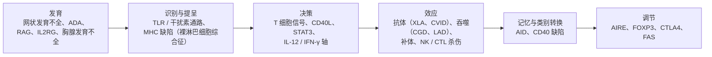

知识路径一直在问：谁在识别、识别之后怎样决定、用什么效应清除、清除后怎样记住与关闭。前面各章回答的是"这些环节怎样工作"，本章倒过来问"某一环断了会怎样"。免疫缺陷病属于路径上的"过弱"一类（另两类是"过强"的超敏反应与自身免疫、"错向"的过敏与慢性炎症，见 [7.15.26](/7.15.26)、[7.15.28](/7.15.28)）。它们之所以值得一章，是因为每一种单基因缺陷都是人类自己完成的敲除实验：缺了 RAG 就没有淋巴细胞，缺了 CD40 配体就没有类别转换，缺了 NADPH 氧化酶就杀不死某些细菌，缺了 IFN-γ 受体就挡不住分枝杆菌。读者从病人的感染谱和实验室表型反推受损环节，同时也印证前面各章的机制。本章先给出分类与诊断线索，再按受损环节依次讲联合免疫缺陷、抗体缺陷、吞噬细胞缺陷、补体与固有信号通路缺陷、免疫调节缺陷，然后讲继发性免疫缺陷，最后用较大篇幅讨论 HIV 感染的免疫学，因为它是后天获得、研究最充分的免疫缺陷，也是 CD4⁺ T 细胞在免疫系统中枢地位的最直接证据。病原体的生物学与抗病毒药物见 [7.11.25](/7.11.25)、[7.11.28](/7.11.28)；宿主如何按感染的位置组织应答见 [7.15.32](/7.15.32)。

## 31.1. 免疫缺陷的分类与线索

**定义 31.1.1（原发性免疫缺陷）** 因编码免疫系统组成分子的基因发生遗传性缺陷而导致的免疫功能缺损称为**原发性免疫缺陷**，又称先天性免疫错误。

**定义 31.1.2（继发性免疫缺陷）** 由营养不良、药物、肿瘤、感染或年龄等外部因素造成、无基因缺陷基础的免疫功能缺损称为**继发性免疫缺陷**。

原发性免疫缺陷大多是单基因病、个别病种罕见，但已确认的致病基因有数百个，合计的发生率约为每 500 人中 1 例；轻重悬殊，从终身无症状到婴儿期致死。继发性免疫缺陷则更常见，全世界最常见的免疫缺陷其实是严重的营养不良。

### 31.1.1. 按受损环节分类

把已知的缺陷定位到知识路径上，可得到一张"疾病图"。同一个环节的缺陷有相同的临床后果，不同环节的缺陷各有特征性的感染谱，这是下面各节的线索。

| 受损环节 | 例子 | 主要后果 | 易感的病原体与表现 |
|---|---|---|---|
| T 细胞缺失或功能缺陷 | 重症联合免疫缺陷、DiGeorge 综合征 | 细胞免疫与 T 依赖的抗体应答都受损 | 病毒、真菌（念珠菌、*Pneumocystis jirovecii*）、胞内细菌（分枝杆菌）、原虫；通常较轻的病毒也可致命；减毒活疫苗可致病 |
| 抗体缺陷 | X 连锁无丙种球蛋白血症、普通变异型免疫缺陷、选择性 IgA 缺陷 | 缺乏调理与中和 | 有荚膜的化脓性细菌（肺炎链球菌、流感嗜血杆菌）导致的反复耳、鼻窦、肺部感染；肠道病毒与贾第虫；常伴自身免疫 |
| 吞噬细胞缺陷 | 慢性肉芽肿病、白细胞黏附缺陷 | 杀菌或募集失败 | 葡萄球菌、肠道革兰氏阴性菌、真菌导致的皮肤、淋巴结、肝的脓肿 |
| 补体缺陷 | C1q、C2、C4 缺陷；C5–C9 缺陷；备解素缺陷 | 免疫复合物与凋亡细胞清除不良；调理与裂解缺失 | 早期成分缺陷伴自身免疫（系统性红斑狼疮）；晚期成分与备解素缺陷易感奈瑟菌（败血症、脑膜炎） |
| 固有免疫信号通路缺陷 | MyD88 / IRAK4、UNC93B1 / TLR3、IL-12 / IFN-γ 轴 | 对特定病原体的识别或活化失败 | 化脓性细菌；单纯疱疹病毒脑炎；分枝杆菌与沙门氏菌 |
| 调节缺陷 | AIRE、FOXP3、CTLA4、FAS | 耐受与收缩失败 | 自身免疫、淋巴增殖；有时伴感染 |

### 31.1.2. 临床线索与实验室检查

免疫缺陷的线索是"感染的模式"而不只是"感染的次数"：感染是否反复、是否严重、是否由低毒力或机会性病原体引起、是否对常规治疗反应不佳、是否伴自身免疫或家族史。因为母体 IgG 经胎盘转运（[7.15.21](/7.15.21)），新生儿的体液免疫在最初约 6 个月内被母源抗体掩盖，所以抗体缺陷常在 6 个月之后才表现出来；T 细胞缺陷则最早出现症状，常表现为病毒与真菌感染、慢性腹泻与发育迟缓。

实验室检查沿着知识路径设计：测血清各类免疫球蛋白的水平；用流式细胞术（[7.15.34](/7.15.34)）数 T、B、NK 细胞及其亚群；检测接种疫苗后特异性抗体（蛋白抗原与多糖抗原两类，前者测 T 依赖应答，后者测 T 非依赖应答，[7.15.8](/7.15.8)）；用功能试验检测吞噬细胞的杀菌能力与补体活性；最后用基因测序确诊。

对最严重的缺陷可以在新生儿期筛查。T 细胞在胸腺发育时，TCR 基因重排会切下一段环状 DNA，称为 T 细胞受体切除环（TREC，[7.15.12](/7.15.12)），它不随细胞分裂复制，只存在于刚从胸腺输出的细胞中；用干血斑中 TREC 的定量作为胸腺输出的指标，缺乏 T 细胞的婴儿 TREC 极低。筛查的意义在于趁婴儿未接种减毒活疫苗、未发生严重感染时就开始干预，这是原发性免疫缺陷中少数能"筛查出来"的病。

## 31.2. 联合免疫缺陷

### 31.2.1. 重症联合免疫缺陷

**定义 31.2.1（重症联合免疫缺陷）** 因 T 细胞缺失或严重功能缺陷、同时伴有体液免疫缺陷而导致婴儿期严重、反复、危及生命的感染的一组遗传病称为**重症联合免疫缺陷**（SCID）。

SCID 是最重的原发性免疫缺陷，缺陷都发生在淋巴细胞发育的早期。因为 T 细胞对 B 细胞的活化、类别转换与亲和力成熟都是必需的（[7.15.20](/7.15.20)），T 细胞缺失必然使抗体应答也受损，所以叫"联合"。按受损的步骤可分为五类：

| 受损的步骤 | 基因 | 表型（T / B / NK） | 机制 |
|---|---|---|---|
| 造血干细胞向髓系与淋巴系分化 | *AK2*（网状发育不全） | T⁻ B⁻ NK⁻，并伴粒细胞减少 | 线粒体腺苷酸激酶缺陷，髓系与淋巴系前体凋亡 |
| 嘌呤代谢 | *ADA*、*PNP* | T⁻ B⁻ NK⁻ | 代谢产物（脱氧腺苷、脱氧鸟苷等）在淋巴前体中积累而致其死亡（见例 31.2.1） |
| 抗原受体基因重排（V(D)J 重组） | *RAG1*、*RAG2*、*DCLRE1C*（Artemis）、*PRKDC* | T⁻ B⁻ NK⁺ | 不能形成前 TCR 与前 BCR，T、B 细胞发育停滞（[7.15.12](/7.15.12)） |
| 细胞因子信号 | *IL2RG*（共同 γ 链，X 连锁）、*JAK3*、*IL7R* | *IL2RG*、*JAK3*：T⁻ B⁺ NK⁻；*IL7R*：T⁻ B⁺ NK⁺ | 共同 γ 链为 IL-2、-4、-7、-9、-15、-21 受体共用（[7.15.11](/7.15.11)）；T 细胞发育依赖 IL-7，NK 细胞发育依赖 IL-15 |
| 前 TCR 与 TCR 信号 | *CD3D*、*CD3E*、*CD3Z* | T⁻ B⁺ NK⁺ | 前 TCR 信号缺失，胸腺发育停滞（[7.15.15](/7.15.15)） |

这张表是一份很好的"路径对照"：表型中 B 与 NK 的有无直接显示了缺陷在哪一环。例如 RAG 缺陷只影响需要重排的 T、B 细胞而保留 NK 细胞，因为 NK 细胞不使用重排的受体；共同 γ 链或 JAK3 缺陷丢失 T 与 NK 细胞（IL-7、IL-15 信号），但 B 细胞数量正常，只是因缺少 T 细胞帮助与 IL-21 信号而不能产生功能性抗体。这里还有物种差异：小鼠 B 细胞发育需要 IL-7，人类则不需要，所以小鼠的 *Il7r* 缺失是 T⁻B⁻，而人是 T⁻B⁺。

**例 31.2.1（腺苷脱氨酶缺陷）** ADA 催化腺苷与脱氧腺苷脱氨。在 ADA 缺陷者体内，脱氧腺苷积累并在淋巴细胞内被磷酸化为 dATP，抑制核糖核苷酸还原酶，使 dNTP 池失衡、DNA 合成与修复受阻，并诱导凋亡；ADA 是在所有细胞中表达的管家酶，但淋巴前体对这种毒性最敏感，所以表现为淋巴细胞缺失，同时伴神经、骨骼与听力的非免疫表现。

:::

所以 SCID 婴儿的典型病程是：出生时看似正常，数月内出现慢性腹泻、鹅口疮、*Pneumocystis jirovecii* 肺炎、对常见病毒的严重感染与发育迟缓，外周血淋巴细胞极少，胸腺很小；接种减毒活疫苗（如卡介苗、轮状病毒疫苗）可导致播散性感染；输入含活淋巴细胞的血制品可引起移植物抗宿主病（[7.15.29](/7.15.29)）。

### 31.2.2. 不那么严重的联合免疫缺陷

基因突变只部分削弱蛋白功能（亚效等位基因）时，得到漏出型 SCID：T 细胞有一些，但数量与多样性不足。其中最特殊的是 Omenn 综合征：*RAG* 亚效突变使少量 T 细胞克隆经重排产生后在外周大量扩增，成为寡克隆的自身反应 T 细胞，引起红皮病、淋巴结与肝脾肿大、嗜酸性粒细胞与 IgE 增高。它说明淋巴细胞库太小与自身免疫可以同时出现，因为 AIRE 的表达需要足够的胸腺细胞与 TCR 多样性（[7.15.24](/7.15.24)）。

其余联合免疫缺陷可按受损的功能归类，每一种都对应前面某一章的机制：

| 缺陷 | 基因 | 受损的功能 | 表现 |
|---|---|---|---|
| 裸淋巴细胞综合征 I 型 | *TAP1/2*、*TAPBP*、*B2M* | MHC I 类表达或装载（[7.15.14](/7.15.14)） | CD8⁺ T 细胞少，反复呼吸道病毒与细菌感染，NK 细胞对"丢失自我"的应答也受影响 |
| 裸淋巴细胞综合征 II 型 | *CIITA*、*RFX5*、*RFXAP*、*RFXANK* | MHC II 类的转录（[7.15.13](/7.15.13)） | 胸腺阳性选择缺失，CD4⁺ T 细胞少，T 依赖的抗体应答差 |
| DiGeorge 综合征 | 22q11.2 缺失（*TBX1*） | 第三、四咽囊发育，胸腺发育不全 | T 细胞减少，程度不一；伴心脏畸形、甲状旁腺功能低下；完全型需胸腺移植 |
| Wiskott–Aldrich 综合征 | *WAS*（X 连锁） | 肌动蛋白重组，免疫突触形成 | 湿疹、血小板减少与体积变小、反复感染，常继发自身免疫与淋巴瘤 |
| 高 IgM 综合征 | *CD40LG*（X 连锁）、*CD40* | T 细胞对 B 细胞与树突状细胞的帮助（[7.15.16](/7.15.16)） | 无类别转换、生发中心与记忆 B 细胞，IgM 正常或升高，IgG、IgA、IgE 缺乏；DC 的成熟与 IL-12 产生不足，易患胞内病原体（如 *Pneumocystis jirovecii*）感染 |
| 高 IgE 综合征 | *STAT3* 显性负性突变 | IL-6、IL-21、IL-23 信号，Th17 与 Tfh 的分化（[7.15.17](/7.15.17)） | 皮肤与肺的葡萄球菌脓肿、慢性皮肤黏膜念珠菌病、IgE 极高、骨骼与结缔组织异常 |

两个"以 B 细胞表型出现的 T 细胞病"值得强调。高 IgM 综合征中 B 细胞本身正常，缺陷在 CD40L–CD40 这条 T–B 接触信号；高 IgE 综合征的 IgE 增高却没有明显的过敏，提示 STAT3 在 IgE 介导的肥大细胞活化中也起作用。后者的念珠菌与葡萄球菌易感，则印证了 Th17 细胞在黏膜与皮肤的防御功能（[7.15.32](/7.15.32)）。

## 31.3. 抗体缺陷

**定义 31.3.1（X 连锁无丙种球蛋白血症）** 因 *BTK*（Bruton 酪氨酸激酶）基因突变，B 细胞发育停滞在前 B 细胞阶段，外周血几乎没有成熟 B 细胞与浆细胞，所有类别的免疫球蛋白极低的 X 连锁隐性遗传病称为 **X 连锁无丙种球蛋白血症**（XLA）。

BTK 传递前 BCR 与 BCR 的信号（[7.15.19](/7.15.19)）。没有它，重链已重排的前 B 细胞得不到存活与继续发育的信号，轻链基因仍处于胚系构型。患儿的 T 细胞正常，所以对大多数病毒与真菌的免疫保持，但是对有荚膜的化脓性细菌——它们的清除依赖抗体对荚膜多糖的调理——反复感染；对肠道病毒（可致慢性脑膜脑炎）也易感，因为中和抗体缺失。这是母体 IgG 耗尽之后（6 个月前后）才出现症状的典型例子。

其他抗体缺陷的缺陷环节依次靠后：

| 疾病 | 缺陷 | 免疫球蛋白表型 | 要点 |
|---|---|---|---|
| 普通变异型免疫缺陷（CVID） | 多基因或未知；B 细胞数通常正常 | IgG、IgA 低，IgM 常低 | 成人最常见的症状性抗体缺陷，B 细胞活化或分化为浆细胞的步骤出问题，常合并自身免疫与肉芽肿 |
| 选择性 IgA 缺陷 | 复杂 | 只缺 IgA | 约 700 人中 1 例（欧洲人群），最常见的原发性免疫缺陷；约七成无症状；呼吸、胃肠和泌尿生殖道感染、过敏与自身免疫的风险增加；可能部分被 IgM 代偿 |
| 类别转换缺陷 | *AICDA*（AID）、*UNG*、*CD40*、*CD40LG* | IgM 正常或高，其他缺乏 | AID 与 UNG 缺陷是 B 细胞内在的，T 细胞功能正常，与 CD40L 缺陷有别（[7.15.20](/7.15.20)） |
| 共刺激与存活信号缺陷 | *CD19*、*CD81*、*CD21*、*TNFRSF13B*（TACI）等 | IgG 与 IgA 低 | BCR 共受体复合物与 BAFF–APRIL 通路 |

抗体缺陷的治疗原理很直接：定期补充来自多个供者血浆的 IgG（被动免疫，[7.15.33](/7.15.33)），使血清 IgG 维持在保护水平。IgG 的血浆半衰期约 3 周，是因为 FcRn 把被内吞的 IgG 从溶酶体降解途径救回循环（[7.15.21](/7.15.21)），所以补充必须周期性重复；补充的 IgG 不能代替黏膜 IgA，对分泌型抗体缺乏的部位无效。

## 31.4. 吞噬细胞、补体与固有免疫通路缺陷

固有免疫缺陷的特点是缺陷的范围小、感染谱窄而特异，因为只有它负责的那一类病原体逃脱了清除。

**定义 31.4.1（慢性肉芽肿病）** 因吞噬细胞 NADPH 氧化酶的某个亚基缺陷，吞噬体内不能产生超氧阴离子及其下游的活性氧，因而不能杀灭被吞噬的某些病原体，并伴有慢性肉芽肿形成的遗传病称为**慢性肉芽肿病**（CGD）。

NADPH 氧化酶由膜上的 gp91phox 与 p22phox 和胞质中的 p47phox、p67phox、p40phox 等组成，吞噬时在吞噬体膜上装配，把 $\mathrm{O_2}$ 还原成超氧阴离子，进而生成 $\mathrm{H_2O_2}$ 与次氯酸（[7.15.5](/7.15.5)、[7.15.7](/7.15.7)）。X 连锁的 *CYBB*（gp91phox）突变约占七成，其余为常染色体隐性。患者特别易感过氧化氢酶阳性的细菌与真菌（金黄色葡萄球菌、曲霉、洋葱伯克霍尔德菌、沙雷氏菌），因为这类微生物能分解自身产生的 $\mathrm{H_2O_2}$，经典的解释是，过氧化氢酶阴性的微生物自己产生的 $\mathrm{H_2O_2}$ 会被宿主利用，所以宿主缺少氧化酶时它们仍可被清除。另一个特征是慢性肉芽肿（[7.15.27](/7.15.27)）：吞噬细胞既杀不死也清除不了病原体与碎片，肉芽肿成为 T 细胞与巨噬细胞持续活化的结果，同时炎症消退也受影响，所以 CGD 既是免疫缺陷，也是炎症失调。呼吸爆发缺失还可以直接检测：吞噬细胞被刺激后能否使二氢罗丹明氧化发荧光（流式细胞术）或使硝基蓝四唑还原变色，缺陷者没有信号。

其余吞噬细胞缺陷对应前面的功能环节：

| 疾病 | 缺陷 | 受损的环节 | 特征 |
|---|---|---|---|
| 白细胞黏附缺陷 I 型 | *ITGB2*（整合素 β2 链，CD18） | 白细胞黏附级联中牢固黏附（[7.15.4](/7.15.4)） | 外周血中性粒细胞极多但不能进入感染组织，感染局部没有脓；脐带脱落延迟 |
| 白细胞黏附缺陷 II 型 | 岩藻糖转运或代谢 | 选择素配体 sialyl-Lewis X 缺乏，滚动失败 | 与 I 型相似，伴智力与生长障碍 |
| Chédiak–Higashi 综合征 | *LYST* | 溶酶体与溶酶体相关细胞器的运输 | 吞噬细胞出现巨大颗粒，杀菌差；CTL 与 NK 的溶细胞颗粒释放缺陷；白化与神经症状 |
| 中性粒细胞生成缺陷 | *ELANE* 等 | 中性粒细胞减少 | 细菌与真菌感染 |

补体缺陷按缺陷的位置给出两类不同的后果（[7.15.10](/7.15.10)）：早期成分（C1q、C1r/s、C2、C4）缺陷使免疫复合物与凋亡细胞得不到调理清除，核抗原长时间暴露并诱导 I 型干扰素，因而引起自身免疫，C1q 完全缺陷者发生系统性红斑狼疮的概率高达 90% 左右；C3 缺陷使调理与整个级联失去核心，重症化脓性感染；晚期成分（C5–C9）与备解素（稳定替代途径 C3 转化酶）缺陷则特异性地易感奈瑟菌，因为膜攻击复合物对革兰氏阴性双球菌的裂解至关重要；甘露糖结合凝集素缺陷很常见，影响较轻。

固有免疫信号通路缺陷是最能显示"一个受体管一类病原体"的例子。MyD88 或 IRAK4 缺陷者在儿童期对肺炎链球菌与金黄色葡萄球菌的严重化脓感染易感，并且发热与急性期蛋白反应微弱，却对多数病毒、真菌和寄生虫没有明显的易感性，成年后感染减少，说明 TLR–IL-1R 通路在人类免疫中的作用有限，在适应性免疫成熟后可被替代（[7.15.6](/7.15.6)）。*UNC93B1* 或 *TLR3* 缺陷的儿童在初次感染单纯疱疹病毒时易发脑炎，因为中枢神经系统的细胞依赖内体 TLR3 触发抗病毒干扰素应答。更广泛的 I 型干扰素通路缺陷或抗 I 型干扰素的自身抗体，则与某些病毒（如流感病毒、SARS-CoV-2）引起的重症肺炎有关（[7.11.27](/7.11.27)）。

此外还有一类以孟德尔方式遗传的分枝杆菌易感：在 IL-12–IFN-γ 轴上，感染的巨噬细胞与树突状细胞产生 IL-12、IL-23，激活 T 细胞与 NK 细胞产生 IFN-γ，IFN-γ 再经 JAK–STAT1 使巨噬细胞活化、促进吞噬体与溶酶体融合并杀灭分枝杆菌（[7.15.17](/7.15.17)）。该轴上任何一个基因的缺陷——*IL12B*、*IL12RB1*、*IFNGR1/2*、*STAT1*、*IRF8*、*IKBKG*（NEMO）——都使患者对减毒卡介苗与环境中的非结核分枝杆菌以及沙门氏菌高度易感，而对其他病原体大体正常，这是"孟德尔式分枝杆菌易感性"（MSMD）。它说明 1 型免疫的核心回路是什么，也预示了抗分枝杆菌免疫的设计（[7.15.32](/7.15.32)）。

## 31.5. 免疫调节缺陷与自身免疫

免疫系统过弱与过强并不矛盾：自身耐受与免疫收缩是免疫的"刹车"，刹车坏了表现为自身免疫与淋巴增殖，有时同时伴感染。

| 疾病 | 基因 | 受损的耐受机制 | 表现 |
|---|---|---|---|
| APECED（APS-1） | *AIRE* | 胸腺髓质上皮细胞表达组织限制性抗原不足，阴性选择与胸腺 Treg 产生受损（[7.15.24](/7.15.24)） | 多个内分泌器官的自身免疫；慢性皮肤黏膜念珠菌病（患者产生抗 IL-17 与 IL-22 的自身抗体） |
| IPEX | FOXP3 | Treg 缺失（[7.15.17](/7.15.17)） | 新生儿期起病的严重肠病、1 型糖尿病、湿疹，常在 2 岁内因败血症等死亡 |
| CD25 缺陷、CTLA4 单倍体不足 | *IL2RA*、*CTLA4* | Treg 功能（IL-2 信号、CTLA-4 抑制）（[7.15.25](/7.15.25)） | 类似 IPEX 的自身免疫，CTLA4 缺陷常伴低丙种球蛋白血症 |
| 自身免疫性淋巴增殖综合征 | *FAS*、*FASLG* | 活化诱导的细胞死亡与淋巴细胞收缩（[7.15.18](/7.15.18)） | 淋巴结与脾肿大、自身免疫性血细胞减少、双阴性 T 细胞增多 |

两条结论。第一，自身免疫中的"自"在这里被分子地拆开：AIRE 管中枢，FOXP3 管外周 Treg，FAS 管收缩，CTLA-4 管 T 细胞启动的阈值。第二，淋巴细胞减少本身可以引发自身免疫：数量少的淋巴库中 BAFF 升高使自身反应 B 细胞存活，T 细胞库的限制使 AIRE 表达降低；所以自身免疫常是免疫缺陷病的并发症，而不是它的对立面。机制的详述见 [7.15.24](/7.15.24)、[7.15.28](/7.15.28)。

## 31.6. 继发性免疫缺陷

继发性免疫缺陷（定义 31.1.2）通常随诱因去除而恢复，其中 HIV 感染不能。常见的原因有：

- 营养不良：蛋白质–能量营养不良使胸腺萎缩，T 细胞数量与功能下降；锌、维生素 A、维生素 D 等微量营养素缺乏削弱屏障与吞噬细胞的抗分枝杆菌功能。它是全球最常见的免疫缺陷，往往与慢性感染相互加重。
- 药物：糖皮质激素、钙调磷酸酶抑制剂、抗代谢药、抗 CD20 单抗与抗肿瘤的细胞毒治疗，分别损害 T 细胞活化、淋巴细胞增殖或 B 细胞，是移植与自身免疫病治疗的代价（[7.15.29](/7.15.29)、[7.15.33](/7.15.33)）。
- **肿瘤**：慢性淋巴细胞白血病与多发性骨髓瘤常伴低丙种球蛋白血症；转移或放化疗伤害骨髓。
- 其他感染：麻疹病毒感染后，可使既往免疫记忆的细胞库被耗损，导致数月至数年的"免疫失忆"，所以麻疹的危害大于其直接病程。
- 脾切除与脾功能低下：缺少脾对血液中有荚膜细菌的清除，易发暴发性败血症（[7.15.3](/7.15.3)）。
- 蛋白丢失与代谢病：肾病综合征和蛋白丢失性肠病使 IgG 从尿或肠道丢失；糖尿病损害中性粒细胞功能。
- 年龄：新生儿与早产儿的免疫尚未成熟，老年人出现免疫衰老（[7.15.18](/7.15.18)）。

## 31.7. 获得性免疫缺陷综合征：HIV 感染的免疫学

**定义 31.7.1（获得性免疫缺陷综合征）** 由人类免疫缺陷病毒（HIV）感染 CD4⁺ T 细胞等细胞，引起 CD4⁺ T 细胞进行性耗竭，当外周血 CD4⁺ T 细胞降到每微升 200 个以下，或出现指征性机会性感染或肿瘤时，称为**获得性免疫缺陷综合征**（AIDS，艾滋病）。

病毒学与抗病毒药物见 [7.11.25](/7.11.25)、[7.11.28](/7.11.28)，这里只讨论宿主一侧：病毒打击了免疫系统的哪一环，免疫系统怎样应答，以及为什么后果如此严重。

### 31.7.1. 靶细胞与自然病程

HIV 经 Env 蛋白与 CD4 分子结合，再需要一个趋化因子受体作为共受体：传播与感染早期的毒株用 CCR5，后期常转向 CXCR4（[7.15.4](/7.15.4)）。携带 *CCR5Δ32* 缺失的纯合个体不表达 CCR5，对 R5 型病毒几乎有抗性，这也是 CD4 与趋化因子受体在 HIV 感染中的遗传学证据。因为靶细胞是辅助性 T 细胞，所以病毒打击的是适应性免疫的"指挥者"。

未经治疗的病程分为三期：

| 阶段 | 时间 | 血液中 | 免疫学事件 |
|---|---|---|---|
| 急性期 | 感染后数周 | 病毒载量迅速升高到高峰，CD4⁺ T 细胞急剧下降；常有发热、淋巴结肿大 | 病毒在表达 CCR5 的记忆 CD4⁺ T 细胞（尤其肠道的 Th17）中大量复制；约 1–3 个月内出现 HIV 特异性 CD8⁺ T 细胞（先出现）与抗体（血清转化） |
| 慢性（无症状）期 | 数年至十余年 | 病毒载量稳定在"设定点"，CD4⁺ T 细胞缓慢下降 | CTL 与抗体控制病毒，但病毒快速突变逃逸；每天产生约 $10^9$ 个病毒颗粒；淋巴组织结构逐渐破坏 |
| AIDS | CD4⁺ < 200 / μl | 病毒载量再度上升，CD4⁺ T 细胞极少 | 机会性感染与肿瘤，不治疗时多在数年内死于机会性感染或肿瘤 |

血液中病毒载量设定点高者进展快。有少数个体（长期不进展者、精英控制者）不经治疗而能长期控制病毒，其中不少人携带 HLA-B\*57、HLA-B\*27 等等位基因，这些等位基因呈递的保守 Gag 表位使 CTL 能压制病毒，逃逸突变要付出病毒适应度代价（[7.15.13](/7.15.13)）。

### 31.7.2. CD4⁺ T 细胞为什么耗竭

肠道是 HIV 感染最早的主战场：肠道固有层有机体最大的 CCR5⁺ 记忆 CD4⁺ T 细胞库，感染后 3 周内其中六至八成即被清除，Th17 细胞尤其受影响（[7.15.23](/7.15.23)）。Th17 细胞维持肠上皮屏障与对共生菌的稳态，它们消失后，微生物及其产物（脂多糖）进入循环，引起持续的免疫活化与炎症；活化的 CD4⁺ T 细胞又是 HIV 最偏爱的靶细胞，于是形成"炎症—更多靶细胞—更多病毒"的正反馈。

CD4⁺ T 细胞的减少还有多条途径，被感染与未被感染的细胞都会死亡：

- 病毒复制引起的直接细胞病变，与被 HIV 特异性 CTL、NK 细胞、ADCC 杀伤；
- 在静息淋巴组织的 CD4⁺ T 细胞中，流产的感染产生的病毒 DNA 被胞质 DNA 传感器识别，激活炎症小体与半胱天冬酶 1，使细胞发生焦亡（[7.15.6](/7.15.6)）；
- 持续活化引起的活化诱导细胞死亡与 T 细胞耗竭（[7.15.25](/7.15.25)）；
- 胸腺输出下降与淋巴结纤维化，使 CD4⁺ T 细胞的再生受损。

### 31.7.3. 免疫应答与逃逸

HIV 是人类病毒中免疫逃逸做得最彻底的之一，它逃避的是每一类效应机制：突变的逆转录酶出错率高，Env 的可变区与密集的糖基化形成"糖盾"，抗体总是慢于病毒（中和抗体出现在感染后数月，而此时病毒已经逃逸）；CTL 表位上的逃逸突变（Gag、Nef）在数周内被选择；Nef 下调感染细胞表面的 MHC I，使 CTL 看不到它；病毒整合入基因组并在静息记忆 CD4⁺ T 细胞中进入潜伏，不表达病毒蛋白，也就无抗原可被识别。潜伏库的半衰期很长，是抗逆转录病毒治疗不能治愈的免疫学原因。大约一小部分患者在多年之后产生广谱中和抗体，它们有极高的体细胞超突变，是 B 细胞与病毒长期共进化的产物（[7.15.20](/7.15.20)），也是疫苗设计的目标之一（[7.15.33](/7.15.33)）。

### 31.7.4. 机会性感染谱

CD4⁺ T 细胞计数是免疫缺损程度的"读数"，而每一类机会性感染需要的是不同的 CD4⁺ T 细胞功能，所以感染的出现是可以按 CD4⁺ T 细胞计数预测的：

| CD4⁺ T 细胞计数 / μl | 典型的机会性感染或肿瘤 | 需要的免疫功能 |
|---|---|---|
| > 500 | 通常无明显免疫缺陷表现 | — |
| 200–500 | 口咽部念珠菌病、带状疱疹、细菌性肺炎、结核（可在任何计数时发生） | 黏膜 Th17、Th1 对胞内菌 |
| < 200 | *Pneumocystis jirovecii* 肺炎 | CD4⁺ T 细胞对肺泡巨噬细胞的辅助；抗体 |
| < 100 | 弓形虫脑炎、隐球菌脑膜炎 | Th1 对胞内病原体与真菌 |
| < 50 | 巨细胞病毒视网膜炎、鸟分枝杆菌复合体播散感染 | 对疱疹病毒的 CTL 控制；IFN-γ 对分枝杆菌的活化 |
| 任意程度 | Kaposi 肉瘤（HHV-8）、非霍奇金淋巴瘤 | 对致癌病毒的免疫监视（[7.15.30](/7.15.30)） |

### 31.7.5. 靶细胞受限模型

最简单的 HIV 感染动力学模型把宿主细胞分成三个变量：未感染的 CD4⁺ T 细胞 $T$、产毒感染细胞 $I$ 和游离病毒 $V$，浓度均以每微升计：

$$
\begin{aligned}
\frac{\mathrm{d}T}{\mathrm{d}t} &= \lambda - dT - \beta TV,\\
\frac{\mathrm{d}I}{\mathrm{d}t} &= \beta TV - \delta I,\\
\frac{\mathrm{d}V}{\mathrm{d}t} &= pI - cV.
\end{aligned}
$$

$\lambda$ 是 CD4⁺ T 细胞的生成速率，$d$ 是其自然死亡率（无病毒时稳态为 $T_0 = \lambda/d$），$\beta$ 是感染率，$\delta$ 是感染细胞的死亡率，$p$ 是每个感染细胞每天释放的病毒数，$c$ 是游离病毒的清除率。这是一个典型的靶细胞受限模型（微分方程方法见 [2.4](/2.4)）。令导数为零得到感染态的稳态，条件是基本再生数

$$
R_0 = \frac{\beta p T_0}{\delta c} > 1,
$$

此时 $T^* = T_0/R_0$，$I^* = (\lambda - dT^*)/\delta$，$V^* = pI^*/c$。含义：$R_0$ 是一个感染细胞在全部是靶细胞的环境中产生的二代感染细胞数；病毒能持续存在的条件是 $R_0>1$，稳态下未感染细胞的数量被压到 $T_0/R_0$，因此病毒越"适应"（$R_0$ 越大），稳态的 CD4⁺ T 细胞数越低。

**例 31.7.1** 取示意参数 $T_0 = 1000\,\mu\mathrm{l}^{-1}$，$d = 0.01\,\mathrm{d}^{-1}$，$\delta = 1\,\mathrm{d}^{-1}$，$c = 23\,\mathrm{d}^{-1}$，$p = 500\,\mathrm{d}^{-1}$，$R_0 = 2.5$，初始病毒 $V = 10^{-3}\,\mu\mathrm{l}^{-1}$。数值解给出（图 A）：病毒载量在约第 14 天达到高峰（约 $5\times10^3$ 个 / μl），随后因靶细胞减少而回落，CD4⁺ T 细胞数在约第 19 天降到最低（约 $140\,\mu\mathrm{l}^{-1}$），然后衰减振荡到稳态 $T^*=400\,\mu\mathrm{l}^{-1}$，设定点病毒载量约 $1.5\times10^5$ 个 / ml。这复现了急性期病毒峰值、急性期 CD4⁺ T 细胞下降与设定点的出现；模型里没有 CTL，它们对感染细胞的清除被并入 $\delta$。

要说明数年尺度的缓慢下降，这个模型还缺少一个机制。图 B 的做法是把 $R_0$ 随时间缓慢上升作为现象学假设（$R_0(t) = 2.5\,(1 + t/3650\,\mathrm{d})$，对应病毒的逐步适应与免疫控制的逐渐衰退，如 CTL 逃逸、嗜 CXCR4 毒株的出现），于是 $T^*(t)=T_0/R_0(t)$ 在 10 年内从 $400$ 缓慢降到约 $200\,\mu\mathrm{l}^{-1}$，与不治疗的 AIDS 发病时间的量级一致，病毒载量设定点只缓慢上升。该假设并不是资料所证实的单一机制，实际下降还包括上述免疫活化、耗竭与再生受损，但它指出了一点：设定点和 CD4⁺ T 细胞数是同一动力学的两个读数。

:::

### 31.7.6. 免疫重建与治疗原理

针对 HIV 复制各步骤的联合抗逆转录病毒治疗（[7.11.28](/7.11.28)）使病毒载量降到检测限以下，随着病毒复制被抑制，免疫活化减轻，CD4⁺ T 细胞数先因记忆细胞从组织重新分布而快速回升，再因胸腺与外周的再生而缓慢恢复；对多数人是终身可控的慢性病。免疫学上有三点：潜伏库使停药后病毒迅速反弹，所以不能停药；肠道 Th17 与淋巴组织的结构恢复得最慢；少数患者在治疗后恢复的免疫应答针对此前潜伏的机会性病原体（结核分枝杆菌、隐球菌），引起过度炎症，称为免疫重建炎症综合征，是"免疫病理"的典型例子：损伤由应答而不是病原体本身造成（[7.15.32](/7.15.32)）。

## 31.8. 治疗原理：补什么，怎样补

原发性免疫缺陷的治疗围绕"缺什么就补什么"：

1. 预防感染：对症的抗微生物预防、避免减毒活疫苗、避免含活淋巴细胞的血制品。
2. 补充蛋白：定期补充 IgG（抗体缺陷）；ADA 缺陷可补充经修饰的酶；CGD 与 MSMD 可补充 IFN-γ，使巨噬细胞的杀菌能力部分恢复。
3. 补充细胞：造血干细胞移植用 HLA 相合或部分相合的供者细胞重建免疫系统。要点有两个：受者的造血龛要为供者细胞腾出位置（预处理），而成熟的供者 T 细胞会攻击受者，所以要控制移植物抗宿主病（[7.15.29](/7.15.29)）；T 细胞可由供者干细胞经受者胸腺重新发育，因此新的 T 细胞由受者胸腺上皮的 MHC 选择。胸腺发育不全可移植胸腺组织。
4. 补充基因：自体造血干细胞经体外导入正常基因后回输，已用于 ADA 缺陷与 X 连锁 SCID 等；早期的 γ 逆转录病毒载体曾因载体整合激活原癌基因而引起白血病，现已改用更安全的载体设计。其优点是没有 GVHD，也不需要寻找供者。

## 小结

- 免疫缺陷病分为原发性（定义 31.1.1，遗传）与继发性（定义 31.1.2，外因）；每一种单基因缺陷都是对知识路径某一环的"自然敲除实验"，其感染谱指向受损环节（§31.1 的分类表）。
- 重症联合免疫缺陷（定义 31.2.1）的缺陷发生在淋巴细胞发育早期，按 T、B、NK 表型可定位到嘌呤代谢、V(D)J 重组、共同 γ 链与 JAK3 信号、前 TCR 信号等步骤；MHC、CD40L、STAT3、WASP 缺陷各自对应抗原提呈、T–B 接触、Th17 与突触的功能。
- 抗体缺陷（定义 31.3.1 及其他）使有荚膜细菌与肠道病毒感染反复发生，母源 IgG 使症状延迟至 6 个月后；以 IgG 周期性补充治疗。
- 吞噬细胞、补体与固有信号通路缺陷的感染谱窄而特异：慢性肉芽肿病（定义 31.4.1）易感过氧化氢酶阳性微生物，晚期补体与备解素缺陷易感奈瑟菌，早期补体缺陷导致自身免疫，IL-12–IFN-γ 轴缺陷易感分枝杆菌。
- 免疫调节缺陷（AIRE、FOXP3、CTLA4、FAS）表现为自身免疫与淋巴增殖，淋巴细胞减少本身也易引起自身免疫。
- 继发性免疫缺陷中最常见的是营养不良；其他有药物、肿瘤、感染与脾切除。
- HIV 经 CD4 与 CCR5 或 CXCR4 感染，肠道记忆 Th17 先被清除，然后是持续的免疫活化与 CD4⁺ T 细胞耗竭；CD4⁺ T 细胞低于 200 / μl 即 AIDS（定义 31.7.1），机会性感染按 CD4⁺ T 细胞计数出现。靶细胞受限模型给出 $R_0=\beta p T_0/(\delta c)$ 与稳态 $T^*=T_0/R_0$（例 31.7.1）。
- 治疗的原则是补充缺失的蛋白、细胞或基因，同时预防感染。

## 思考题

1. 一个 7 个月的男婴反复发生肺炎与中耳炎，病原体为肺炎链球菌和流感嗜血杆菌，外周血 B 细胞几乎测不到，T 细胞数正常。最可能的诊断是什么？为什么在出生后头几个月没有症状？应怎样治疗？

   **答** 最可能是 X 连锁无丙种球蛋白血症（定义 31.3.1）：男婴、B 细胞缺失、有荚膜细菌的反复感染。前 6 个月母体 IgG 经胎盘转运提供保护，随着半衰期约 3 周的母源 IgG 被耗尽，症状才出现。治疗是定期补充 IgG 并在需要时用抗生素；T 细胞正常，所以不必限制病毒疫苗之外的免疫，但应避免接种活的口服脊髓灰质炎疫苗，因为肠道病毒易引起慢性感染。基因确诊是 *BTK* 突变。

2. 两名 SCID 患儿，一个是 T⁻B⁺NK⁻，另一个是 T⁻B⁻NK⁺。分别对应哪类缺陷？为什么 NK 细胞的有无能区分它们？

   **答** T⁻B⁺NK⁻ 对应共同 γ 链（*IL2RG*）或 *JAK3* 缺陷：IL-7 信号缺失使 T 细胞不发育，IL-15 信号缺失使 NK 细胞不发育，B 细胞仍发育（但缺 T 细胞帮助与 IL-21 信号，抗体无功能）。T⁻B⁻NK⁺ 对应 V(D)J 重组缺陷（*RAG1/2*、Artemis 等）：T、B 细胞的发育依赖重排产生前 TCR 与前 BCR，而 NK 细胞不依赖重排的抗原受体，所以保留。NK 细胞因此成为区分"重排缺陷"和"细胞因子信号缺陷"的线索。

3. 为什么 CGD 患者特别易感金黄色葡萄球菌，而对多数肺炎链球菌的感染相对影响较小？

   **答** 金黄色葡萄球菌产生过氧化氢酶，能分解自身代谢产生的 $\mathrm{H_2O_2}$，所以杀灭它必须依赖宿主 NADPH 氧化酶提供的活性氧，CGD 患者缺少这一机制。肺炎链球菌是过氧化氢酶阴性的，自身产生的 $\mathrm{H_2O_2}$ 在吞噬体中积累，足以被宿主利用来杀菌，又可被抗体与补体依赖的调理清除，所以 CGD 并不显著增加它的感染风险。（解释是经典的，但并不绝对；其他非氧化杀菌机制与中性粒细胞胞外陷阱也参与。）

4. 用靶细胞受限模型说明：如果一种抗病毒治疗把病毒产生率 $p$ 降为原来的一半，稳态的 CD4⁺ T 细胞数会怎样变化？$p$ 降到多少时病毒不能持续？

   **答** $R_0 \propto p$，$T^* = T_0/R_0$，所以 $p$ 减半时 $R_0$ 减半，$T^*$ 加倍（只要 $R_0$ 仍大于 1）。病毒不能持续的条件是 $R_0 \le 1$，即 $p \le p_{\mathrm{c}} = \delta c/(\beta T_0)$，在例 31.7.1 的参数下 $R_0=2.5$，需要把 $p$ 降到原来的 $40\%$ 以下。这也说明联合治疗的逻辑：多个靶点各自降低 $R_0$ 的一个因子，使乘积小于 1。

5. （开放题）自身免疫与免疫缺陷常常出现在同一位患者身上。请用两个例子说明这并不矛盾，并指出各自的分子机制。

   **答** 思路：给出 (a) IPEX，即 FOXP3 缺陷：Treg 缺失，对自身抗原的外周耐受崩溃，所以自身免疫严重，而这类 T 细胞的功能紊乱同时伴有感染易感；(b) 漏出型 SCID 的 Omenn 综合征或 *RAG* 亚效突变：T 细胞库很小而克隆扩增，AIRE 表达与 B 细胞的 BAFF 稳态被打乱，自身反应细胞存活；也可以举 C1q 缺陷（凋亡细胞清除受损）或 CTLA4 单倍体不足。共同点：缺陷的是调节或库容，而不是单纯的"反应强度"，免疫缺陷与自身免疫是同一个失衡的两面。
