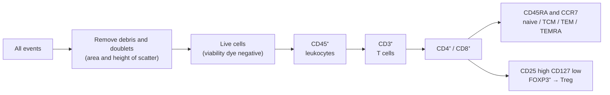

The preceding chapters repeatedly describe cells by the molecules they express: CD4⁺ T cells, CD20⁺ B cells, PD-1⁺ exhausted cells, CD103⁺ resident memory cells. This chapter turns these scattered descriptions into a systematic way of reading cells. It answers three questions: how a combination of surface and intracellular markers tells us what a cell is and what state it is in; how multidimensional data (flow cytometry, mass cytometry, multiplexed imaging) turn these combinations into cell populations; and when markers should not be trusted. In the logic of the course it corresponds to no single question but is the readout end of all of them: every step of recognition, decision, effector function, memory, and regulation is observed, in the laboratory and in pathology, as a change in markers. (CD molecules organized by function are in [7.15.4](/7.15.4), the technical principles in [7.15.34](/7.15.34), the position of cells in tissues in [7.15.22](/7.15.22), the tumor-infiltration readouts in [7.15.30](/7.15.30), and the analysis of spatial omics data in [7.9.6](/7.9.6).) This chapter deals only with meaning and interpretation, not with staining procedures.

## 35.1. How to Read an Immunophenotype

### 35.1.1. Three Layers of Markers

**Definition 35.1.1 (Immunophenotype)** The description of the identity, state, and functional potential of a cell (or a population of cells) by the presence and level of a set of molecular markers is called its **immunophenotype**; the practice of measuring this set of markers is called immunophenotyping.

The markers of a cell fall into three layers, which answer three different questions:

| Layer | Question answered | Typical markers | Stability |
|---|---|---|---|
| Lineage | What kind of cell is it? | CD3, CD19, CD14, CD56 | High: fixed with differentiation |
| State | Which stage of the response is it in? | CD69, Ki-67, CD45RA/RO, PD-1 | Intermediate: changes with stimulation and time |
| Function | What is it doing now, and what can it do? | Cytokines, granzyme B, perforin, transcription factors | Low: changes rapidly with context |

**Definition 35.1.2 (Lineage Marker)** A molecule that is stably expressed on nearly all cells of a given lineage and absent (or markedly lower) on other lineages is called a **lineage marker** of that lineage.

Lineage markers answer "is this a T cell or a macrophage?"; state markers answer which stage a given cell type has reached. Among state markers, the one most often singled out is the **activation marker**: a molecule upregulated after stimulation. Ordered by time of appearance, CD69 comes first (hours), CD25 and HLA-DR somewhat later (one to several days), followed by PD-1, ICOS, and others (for the timeline see [7.15.16](/7.15.16)). Most functional readouts require intracellular staining or detection after stimulation.

The notation for expression levels is the same as in [7.15.4](/7.15.4): CD4⁺ means expressed, CD8⁻ means not expressed, CD56bright and CD56dim mean high and low expression; a combination such as "CD45RA⁺CCR7⁺" is a phenotype. A few rules for reading:

- A marker rarely works alone. A lineage requires at least two markers (one positive, one negative to exclude), and a state must be read together with the lineage (CD69 is an activation marker on T cells, and also on B cells and NK cells, but on resident memory T cells it is a marker of residence).
- Positive and negative are a dichotomy imposed on a continuous signal. Real signals are usually continuous, and the boundaries between "high," "low," and "negative" depend on the instrument, the fluorochrome, the antibody clone, and the negative control (Section 35.4).
- The same molecule has different functions on different lineages: CD45 is a tyrosine phosphatase present on all leukocytes and in a lineage atlas is only a marker of "leukocyte"; CD11c is found on dendritic cells, monocytes, and subsets of NK cells and neutrophils alike.

## 35.2. A Marker Atlas by Lineage

The tables below organize the commonly used markers of human cells by lineage. The "Markers" column lists positive markers (+) and the negative markers needed for exclusion (−); the "Notes" column gives reading rules and cautions. The corresponding mouse markers are given in Section 35.7.

### 35.2.1. T Cells and Their States

| Cell or state | Markers | Notes |
|---|---|---|
| T cells (total) | CD3⁺ (TCR–CD3 complex) | The most reliable T-lineage marker; CD5, CD2, CD7 are supplementary |
| CD4⁺ T | CD3⁺CD4⁺CD8⁻ | Monocytes and some pDCs also express low CD4, so CD3⁺ must be required as well |
| CD8⁺ T | CD3⁺CD8⁺CD4⁻ | A subset of NK cells expresses CD8α, so CD3 is needed for exclusion |
| γδ T cells | CD3⁺, TCRγδ⁺ | May be CD4⁻CD8⁻; TCRαβ⁻ |
| MAIT cells | CD3⁺, Vα7.2⁺, CD161 high, IL-18Rα⁺ | CD161 alone is found on many cell types |
| Naive T cells | CD45RA⁺CCR7⁺CD62L⁺, CD27⁺CD28⁺, CD95⁻ | Have not encountered antigen |
| Stem cell-like memory T (TSCM) | CD45RA⁺CCR7⁺, CD95⁺, CD122⁺ | Distinguished from naive T cells by CD95 |
| Central memory T (TCM) | CD45RA⁻ (CD45RO⁺) CCR7⁺CD62L⁺ | Home to lymphoid organs |
| Effector memory T (TEM) | CD45RA⁻CCR7⁻ | Patrol peripheral tissues |
| TEMRA | CD45RA⁺CCR7⁻, often CD57⁺ | Terminally differentiated with limited proliferative capacity; not "re-activated naive cells" |
| Tissue-resident memory T (TRM) | CD69⁺CD103⁺ (CD8); CD49a, CXCR6 | CD69 alone is not enough: it is also an activation marker (see Section 35.3) |
| Treg | CD4⁺CD25 high CD127 low FOXP3⁺ | FOXP3 is in the nucleus; activated human T cells can transiently express low levels of FOXP3 (Section 35.7) |
| Tfh | CD4⁺CXCR5⁺PD-1 high ICOS⁺, BCL6⁺ | PD-1 high and CXCR5 high within germinal centers |
| Th1, Th2, Th17 | CXCR3⁺ (Th1); CCR4⁺CCR6⁻ (Th2); CCR6⁺CCR4⁺ (Th17); transcription factors T-bet, GATA3, RORγt | Chemokine receptors are used for flow-cytometric subsetting; transcription factors come closer to a "definition" but require intracellular staining |

### 35.2.2. B Cells and Plasma Cells

| Cell or state | Markers | Notes |
|---|---|---|
| B cells (total) | CD19⁺CD20⁺, CD79a⁺, PAX5⁺ (nuclear) | CD19 is expressed from pro-B cells to plasmablasts; CD20 is on mature B cells and lost on plasma cells |
| Naive B cells | IgD⁺CD27⁻ | |
| Memory B cells | CD27⁺, IgD⁻ in class-switched cells | A CD27⁻ memory subset also exists |
| Germinal center B cells | CD10⁺BCL6⁺, Ki-67 high, IgD⁻ | Judged together by position (within the follicle) and the FDC network (CD21⁺CD23⁺) |
| Marginal zone B cells | CD21 high, CD1c⁺, IgM high | In the marginal zone of the spleen |
| Plasmablasts | CD19⁺CD27 high CD38 high, CD20 low | Short-lived, in the circulation |
| Plasma cells | CD138⁺ (syndecan-1), CD38 high, BLIMP-1⁺, IRF4⁺ (MUM1), CD19 low, CD20⁻, cytoplasmic Ig | Light-chain restriction (only κ or only λ) suggests clonal proliferation |

CD20 is particularly important when interpreting post-treatment samples: anti-CD20 antibodies deplete B cells, but plasma cells lack CD20, so after treatment serum antibody often persists while CD19⁺CD20⁺ cells disappear (for long-lived plasma cells see [7.15.20](/7.15.20)).

### 35.2.3. NK Cells and Innate Lymphoid Cells

| Cell | Markers | Notes |
|---|---|---|
| NK cells | CD3⁻CD56⁺, CD16, NKp46; transcription factors T-bet, EOMES | CD3⁻ excludes T cells (CD56 is also found on some T cells and on neuroendocrine cells) |
| CD56dim NK | CD56 low CD16 high | Predominantly cytotoxic; the majority of blood NK cells |
| CD56bright NK | CD56 high CD16 low | Predominantly cytokine-producing; abundant in lymphoid organs and decidua |
| Innate lymphoid cells (total) | Lin⁻ (negative for the lineage markers CD3, CD19, CD14, CD56, etc.), CD127⁺ | Defined by exclusion; requires a cocktail of lineage antibodies |
| ILC1 | CD127⁺CD117⁻CRTH2⁻, T-bet | Overlaps with NK cells in surface markers; distinguished by EOMES and cytotoxicity |
| ILC2 | CRTH2⁺ (human), ST2 (IL-33 receptor) (mouse), GATA3 | |
| ILC3 | CD117⁺, NKp44⁺ (some), RORγt | |

### 35.2.4. Myeloid Cells, Dendritic Cells, and Granulocytes

| Cell | Markers | Notes |
|---|---|---|
| Classical monocytes | CD14 high CD16⁻, CCR2⁺, HLA-DR⁺ | About 85% of blood monocytes; recruited during inflammation |
| Intermediate monocytes | CD14 high CD16⁺ | Associated with inflammation and antigen presentation |
| Nonclassical monocytes | CD14 low CD16 high | Patrol along the vessel wall |
| Macrophages | CD68⁺, CD163, CD206, CD64, HLA-DR; tissue-specific markers | CD68 is a lysosomal protein also found in monocytes, DCs, fibroblasts, and some tumor cells; CD163 is relatively macrophage-biased, but see Section 35.7 |
| Specialized macrophages of lymphoid organs | CD169 (Siglec-1)⁺ | Macrophages of the subcapsular sinus of lymph nodes and the marginal zone of the spleen |
| cDC1 | HLA-DR high CD11c⁺, CD141 (BDCA-3), XCR1, CLEC9A | Cross-presentation; see [7.15.14](/7.15.14) |
| cDC2 | CD1c (BDCA-1), CD172a, CD11b | |
| pDC | CD123⁺, CD303 (BDCA-2), CD304, CD11c low | |
| Mature (migratory) DCs | CCR7, CD83, DC-LAMP (CD208), CD80/CD86 high | DCs migrating from tissue to lymph nodes |
| Langerhans cells | CD207 (langerin), CD1a | Epidermis |
| Neutrophils | CD15, CD66b, CD16b; MPO, neutrophil elastase | Cell morphology (segmented nucleus) often complements markers |
| Eosinophils | Siglec-8, CCR3; eosinophil peroxidase and major basic protein | |
| Basophils | CD123, CD203c, FcεRI; CD63 upregulated on degranulation | |
| Mast cells | KIT (CD117), FcεRI; tryptase, chymase | Tissue-resident, not in blood; tryptase is the most widely used mast cell marker in pathology |
| Myeloid-derived suppressor cells | Human: CD11b⁺CD33⁺HLA-DR low, CD14⁺ (monocytic) or CD15⁺ (granulocytic) | Defined jointly by phenotype and suppressive function; phenotype alone is not conclusive |

### 35.2.5. Hematopoietic Stem and Progenitor Cells and Background Markers

Human hematopoietic stem cells are enriched in the CD34⁺CD38⁻CD90⁺CD45RA⁻ population; common lymphoid progenitors carry CD10; the "exclusion cocktail" of each lineage (Lin) is used to enrich progenitors. These cells rarely appear in pathology sections and are used mostly in flow cytometry and sorting (for the hematopoietic system see [7.15.2](/7.15.2)).

Analysis of tissue sections requires a set of "background markers" that distinguish immune cells from the tissue they sit in:

| Background component | Markers | Use |
|---|---|---|
| Leukocytes (total) | CD45 | Distinguish from non-immune cells |
| Epithelium and most carcinoma cells | PanCK (pan-cytokeratin), E-cadherin | Delineate tumor nests and stroma; but carcinoma cells that have undergone epithelial–mesenchymal transition may lose them |
| Fibroblasts and myofibroblasts | αSMA, vimentin, collagen | Readout of the stromal barrier (immune-excluded phenotype) |
| Vascular endothelium | CD31, CD34 | Localization of vessels and high endothelial venules (PNAd) |
| Lymphatic vessels | podoplanin (D2-40), LYVE-1 | Lymphatic vessels and drainage |

The figure below draws the relationships between commonly used immune markers and cell types as a matrix. It is schematic: each cell of the matrix was assigned by hand by the author as "high, low or subset, none" following the notes in the tables, and is not measured data; in real data the proportions vary with tissue, state, and antibody clone.

## 35.3. State Markers: Activation, Proliferation, Exhaustion, Memory, and Residence

Once the lineage is fixed, cells of the same type move between different states. The table below lists the most commonly used state readouts, each corresponding to a step on the pathway.

| State | Markers | Meaning | Common confusions |
|---|---|---|---|
| Early activation | CD69 | Induced within hours of TCR signaling; inhibits S1PR1, retaining cells in lymphoid organs | Constitutively expressed on resident memory T cells |
| Late activation | CD25, HLA-DR, CD38, ICOS, CD137 (4-1BB) | One to several days after activation; CD25 is also a constitutive marker of Tregs | HLA-DR and CD38 on human T cells also stay high in chronic viral infection and tumors |
| Proliferation | Ki-67 (nuclear protein, expressed from late G1 to M phase of the cell cycle, not in G0) | Recently entered the cycle | Indicates only that the cell is in the cycle, not the speed of division; also high in germinal center B cells and tumor cells |
| Exhaustion (precursor) | PD-1 intermediate, TCF-1⁺ (TCF7), SLAMF6⁺ | Stem cell-like, can proliferate in response to PD-1 blockade | PD-1 alone is not a sufficient marker of exhaustion (transiently elevated after activation) |
| Exhaustion (terminal) | PD-1 high, TIM-3⁺LAG-3⁺TIGIT⁺CD39⁺, TOX high, TCF-1⁻ | Functionally limited, dependent on replenishment from precursor cells | Co-expression of three or more inhibitory receptors is more convincing; for the definition of exhaustion see [7.15.25](/7.15.25) |
| Memory and effector | CD45RA/RO, CCR7, CD62L, CD27, CD28; KLRG1 and CD127 | See Section 35.2.1 and [7.15.18](/7.15.18) | Combinations differ between mouse and human |
| Tissue residence | CD69⁺CD103⁺, CD49a, CXCR6; lack of S1PR1, KLF2 | Do not return to the circulation; reside in epithelia and barrier tissues | Requires several markers and location |
| Cytotoxicity | Granzyme B, perforin; CD107a (LAMP-1) exposed at the surface on degranulation | Killing potential or ongoing killing | The first two reflect storage; only CD107a indicates degranulation that has just occurred |
| Cytokines | IFN-γ, TNF, IL-2; IL-4, IL-5, IL-13; IL-17, IL-22 | Functional layer; see type 1, 2, and 3 immunity (Definition 1.5.1) | Require stimulation and intracellular staining, and reflect "potential" rather than the "current" state |

States are continuous. For example, a CD8⁺ T cell moves along one or several trajectories from naive to activated, effector, and then memory or exhausted (for expansion, contraction, and memory see [7.15.18](/7.15.18); for the exhaustion trajectory see [7.15.25](/7.15.25)). Cutting a continuous trajectory into "categories" with binary marker thresholds is a convenience, not a statement that cells fall into discrete classes; this is discussed again in Section 35.7.

## 35.4. Gating and Clustering

### 35.4.1. The Logic of Gating

Flow, mass cytometry, and imaging data all start in the same form: a matrix with one row per cell and one column per marker. There are two ways to turn this matrix into cell populations: a **gating strategy** in which a person draws gates around populations step by step, and clustering by an algorithm followed by annotation.

**Definition 35.4.1 (Gating Strategy)** A scheme that isolates the target cell population step by step, using thresholds on a series of markers in a fixed order, is called a **gating strategy**: first exclude events that are not objects of the analysis (debris, doublets, dead cells), then define the lineage, and finally resolve subsets and states.

The order of gating follows one principle: exclude first, define afterward; go from broad to narrow. The figure below shows a typical T cell gating scheme:

Each step removes an artifact. Doublets (two cells stuck together) display markers of both T and B lineages and look like "CD3⁺CD19⁺ double-positive cells"; dead cells bind antibodies nonspecifically and are the main source of false positives; the CD45 gate removes non-immune cells (epithelial, stromal, residual red cells). The gate boundaries depend on controls: unstained or FMO (fluorescence minus one: stained with everything except one fluorochrome) controls define the negative range, which is especially important for weakly expressed molecules (for compensation of fluorescence spillover see [7.15.34](/7.15.34)).

**Example 35.4.1** The position of the threshold determines the false positives. Suppose the fluorescence intensity of the negative population is approximately normally distributed with mean $\mu$ and standard deviation $\sigma$, and the threshold is set at $\mu + k\sigma$. The probability that a negative cell is misclassified as positive is then $1 - \Phi(k)$, which is about $1.3\times 10^{-3}$ for $k = 3$ and about $2.9\times 10^{-7}$ for $k = 5$ ($\Phi$ is the standard normal distribution function; see [3.1](/3.1)). Analyze $10^6$ cells, 99.99% of which are negative: for $k=3$ there are about $1.3\times 10^3$ false positives but only about $10^2$ true positives, so most of the result is false positive; for $k = 5$ the expected number of false positives is below one. Hence, to detect a rare population (such as antigen-specific T cells at a frequency below $10^{-4}$), one must either use a bright fluorochrome to push the positive population farther from the negative one, or use two independent markers jointly (the independent false-positive probabilities multiply). The negative population in real data usually has heavier tails than a normal distribution, so these numbers underestimate the false positives and serve only as order-of-magnitude estimates.

### 35.4.2. Imaging Data and Unsupervised Clustering

In multiplexed imaging of tissue sections, gating is no longer applied to "events" but to "segmented cells": the image is first segmented into single cells using a nuclear marker (DAPI) and membrane or cytoplasmic markers, then the mean intensity of each channel in each cell is thresholded or clustered, and finally annotated by hand (for cell type annotation and neighborhood analysis see [7.9.6](/7.9.6)). The advantage of unsupervised clustering (for example, graph-based methods) is that it presupposes no categories; the disadvantage is that each cluster still has to be interpreted by going back to the atlas of this chapter through its markers; and the number and granularity of clusters are choices of the analyst, not a natural number of classes.

The two approaches are complementary: hierarchical gating is transparent, every decision corresponds to a marker rule, and it suits known lineages; clustering can discover states that were not anticipated and suits exploration. Either way, any cell type finally reported must be able to answer "which markers was it called by?"

## 35.5. Reading Tissue Sections

### 35.5.1. Common Pathology Immune Markers and Their Immunological Meaning

Pathology reads markers by immunohistochemistry (IHC; see [7.15.34](/7.15.34)). A single section usually carries only one or two markers, so it relies on a few markers whose meaning is clear and which are reproducible. The table below gives common markers and their immunological meaning; it lists only the reading rules and does not address diagnostic protocols.

| Marker | Staining location | Immunological meaning | Cautions in interpretation |
|---|---|---|---|
| CD3 | Membrane | T cells (total) | Also present in NK/T cell tumors and some T cell tumors; the degree of infiltration should be recorded separately in tumor nests and stroma |
| CD8 | Membrane | Mainly cytotoxic T cells | Also on a few NK cells and in T cell tumors; density and position are equally important |
| FOXP3 | Nucleus | Transcription factor of Tregs | Only cells with nuclear staining count; activated T cells can show weak expression |
| CD20 | Membrane | Mature B cells | Absent on plasma cells; B cells disappear after anti-CD20 therapy |
| PAX5 | Nucleus | B cell lineage (including plasma cell precursors) | Nuclear marker with a sharp boundary |
| CD138 | Membrane | Plasma cells | Epithelial cells and some tumor cells also express syndecan-1; combine with morphology and CD38, IRF4/MUM1, and light-chain restriction |
| CD68 | Cytoplasm (granular) | Macrophages (lysosomes) | Also in monocytes, DCs, mast cells, and fibroblasts; cannot be used alone to subtype macrophages |
| CD163 | Membrane/cytoplasm | Biased toward "scavenger-type" macrophages; often high in tumor-associated macrophages | Not equal to "M2"; many resident macrophages express it intrinsically ([7.15.5](/7.15.5)) |
| CD21, CD23 | Membrane | Follicular dendritic cell network | Structural evidence of mature tertiary lymphoid structures and germinal centers |
| PNAd (MECA-79) | Luminal surface | High endothelial venules | The entrance for lymphocytes into tertiary lymphoid structures |
| BCL6, CD10 | Nucleus, membrane | Germinal center B cells | Meaningful only when located within the follicle |
| Ki-67 | Nucleus | Proliferation | Double staining with a lineage marker is needed to know which cell type is proliferating |
| PD-L1 | Membrane | Checkpoint ligand on tumor and immune cells | See Section 35.5.3 |
| CD117 (KIT), tryptase | Membrane, cytoplasm | Mast cells | Readout of mast cell expansion and activation |
| CD34 | Membrane | Hematopoietic progenitors and vascular endothelium | Distinguish by position |
| PanCK | Cytoplasm | Epithelium and most carcinoma cells | Background marker, used to delineate tumor nests |

The three rules for reading IHC all come from the logic of Section 35.1: every marker must be combined with morphology, location, and another independent marker; the location must fit the known location of the molecule (CD3 on the membrane, FOXP3 in the nucleus; if the location is wrong, suspect the antibody or fixation); and a negative result needs an internal positive control (cells in the same section that should be positive, such as T cells in a lymph node).

### 35.5.2. Marker Combinations for Tertiary Lymphoid Structures and Tumor Infiltration

Structures in tissue must be defined by combinations of markers and their spatial relationships, not by a single marker.

| Structure | Marker combination | Key points of judgment |
|---|---|---|
| Lymphoid aggregate (early TLS) | Clusters of CD20⁺ B cells with adjacent CD3⁺ T cells | Without an FDC network, cannot be called mature |
| Primary follicle-like | The above plus a CD21⁺CD23⁻ FDC network | |
| Secondary follicle-like (mature TLS) | The above plus CD23⁺ FDCs and germinal center B cells that are BCL6⁺CD10⁺ or Ki-67 high | A germinal center indicates local affinity maturation ([7.15.20](/7.15.20)) |
| HEV and chemokine axis | PNAd⁺ vessels; CXCL13, CCL19, CCL21 | Path of lymphocyte entry ([7.15.4](/7.15.4)) |
| Mature DCs | DC-LAMP⁺ or CD208⁺, CCR7⁺ | In the T cell zone, indicating local priming |

The maturity of a tertiary lymphoid structure (Definition 22.7.1) depends mainly on whether an FDC network and germinal centers are present; an aggregate lacking them is merely lymphocyte "infiltration."

Immune infiltration of a tumor is read out in three categories, "position × density × state" (for the three phenotypes see [7.15.30](/7.15.30)):

- Position: density of CD3⁺ and CD8⁺ cells within tumor nests, at the invasive margin, and in distant stroma; distance to tumor cells;
- Density and composition: the ratio of T cells to macrophages and myeloid-derived suppressor cells;
- State: among CD8⁺ cells, the proportion of PD-1⁺TIM-3⁺TCF-1⁻ (terminally exhausted) versus TCF-1⁺ (precursor); the position of FOXP3⁺ cells; the position of CD163⁺ macrophages.

### 35.5.3. Reading PD-L1

PD-L1 (defined in [7.15.25](/7.15.25)) is expressed by tumor cells and by myeloid and lymphoid cells, and is often used as an IHC marker to predict the efficacy of checkpoint blockade. Three kinds of scores are in common use: counting only the proportion of membrane-positive tumor cells (tumor proportion score); counting the sum of positive tumor cells, lymphocytes, and macrophages relative to the number of tumor cells (combined positive score); and counting only the proportion of tumor area occupied by positive immune cells (immune cell score). In interpretation, bear in mind that:

- The antibody clone, staining platform, and scoring method are matched to the drug and tumor type and are not interchangeable;
- It is adaptive expression: it is induced by IFN-γ (derived from CTL recognition), so PD-L1 positivity partly reflects "a recognized response taking place here" rather than a fixed property of the tumor itself;
- Spatial heterogeneity and sampling bias are large, and treatment and time also change it;
- A negative result does not exclude a response.

### 35.5.4. Antibody Validation

The whole marker system rests on a premise: that the antibody truly recognizes only the molecule it claims to.

**Definition 35.5.1 (Antibody Validation)** A set of tests that demonstrate, for a specific application (flow cytometry, IHC, imaging), a specific sample, and specific treatment conditions, that an antibody signal truly comes from the target molecule is called **antibody validation**.

Validation applies to the combination "antibody × application × sample" and is not a permanent property of the antibody itself: the same clone may work in flow cytometry (native conformation, unfixed) yet fail completely in formalin-fixed, paraffin-embedded sections (antigen cross-linked and denatured), and under different antigen retrieval conditions the signal changes again. Five kinds of methods are commonly used:

| Method | Procedure | What it rules out |
|---|---|---|
| Genetic | The signal should vanish in samples with target gene knockout or knockdown | General nonspecific binding |
| Orthogonal | Abundance in different cells should correlate with an antibody-independent method (RNA, mass spectrometry) | Mismatch with a quantity unrelated to the antibody |
| Independent antibody | Two antibodies recognizing different epitopes should give consistent localization and abundance | Idiosyncratic cross-reactivity of a single antibody |
| Overexpression or tagging | Expressing the target in cells that lack it should produce a signal | Insufficient sensitivity |
| Biological plausibility | Positive cells should appear at the expected locations and in the expected cell types (for example, CD20 should not appear on plasma cells) | Systematic mislocalization |

In multiplexed imaging, every antibody must also be revalidated under multiplexing conditions (cyclic staining, metal tagging, fluorophore conjugation): the affinity of an antibody may change after labeling, and the consistency of single and multiple staining before and after conjugation must be checked.

## 35.6. Panel Design and Platform Comparison

### 35.6.1. Design Principles

In designing a marker panel the order should be:

1. Ask the question first, then choose the markers: to answer "do T cells enter the tumor nest?", one needs the tumor nest (PanCK), T cells (CD3, CD8), proliferation or exhaustion (Ki-67, PD-1), and a nuclear marker; there is no need to pursue "the more the better."
2. Confirm each cell type with at least two independent markers: one positive for the lineage, and another that is mutually exclusive or located differently (for example, CD3 on the membrane and FOXP3 in the nucleus together confirm a Treg).
3. Avoid placing markers that may colocalize next to each other on the same cell type, to reduce "lateral spillover" (see Section 35.6.2).
4. Put low-abundance molecules on bright, stable detection channels and high-abundance molecules on dim channels (for the linear algebra of fluorescence spillover see [7.15.34](/7.15.34)).
5. Provide positive and negative internal controls for every key marker, and validate on the target sample (Section 35.5.4).
6. Keep a marker of a "background" component in the panel (PanCK, αSMA, CD31) so that the positions of immune cells have a reference.

### 35.6.2. Platform Comparison and Segmentation Error

| Platform | Sample | Markers per run | Spatial information | Main cautions in reading |
|---|---|---|---|---|
| Flow cytometry | Single-cell suspension | About 10 to 30; more with spectral flow | None | Fluorescence spillover; tissues requiring enzymatic digestion lose some surface molecules; can sort live cells |
| Mass cytometry | Single-cell suspension | About 40 | None | No autofluorescence and little spillover, but isotope oxidation and impurities cause crosstalk; cells are destroyed |
| Conventional IHC | Section | One to two | Yes | Qualitative and semiquantitative, convenient for pathology reading |
| Multiplex immunofluorescence (mIF) | Section | Several (one per round with tyramide signal amplification) to a dozen or more | Yes | Signal amplification across rounds of staining and residual antibody from earlier rounds |
| Cyclic imaging (such as CODEX, CyCIF) | Section | Dozens | Yes, subcellular resolution | Registration of multiple rounds of staining and imaging, tissue loss |
| Imaging mass cytometry (IMC) and multiplexed ion beam imaging (MIBI) | Section | About 40 | Yes, resolution about 1 µm | Lower resolution, requires metal-conjugated antibodies |

The central error of imaging platforms comes from segmentation and lateral spillover: the membrane markers of neighboring cells (such as CD3 and CD20) are enclosed together by a crude cell boundary, producing false "CD3⁺CD20⁺ double-positive" cells; this is especially severe in regions where T and B cells are in close contact (follicle edges, TLS). Countermeasures are: perform internal checks with mutually exclusive markers (truly CD3⁺CD20⁺ cells should be very rare; if many are found, suspect segmentation), judge cells in overlapping regions by the position of membrane markers rather than mean intensity, and spot-check on qualitative images. Flow and imaging data cannot be compared directly: the proportion of a cell type is, in flow cytometry, "the fraction in the suspension," and in imaging, "the density per tissue area contained in the section"; the former is subject to bias from enzymatic digestion, and the latter to section sampling and cell size.

## 35.7. Limitations of Markers

### 35.7.1. Phenotype Is Not Function

Markers are indirect readouts of cell identity and state, not function itself. A PD-1⁺ T cell may be a recently activated cell or an exhausted one; most CD25⁺FOXP3⁺ cells are suppressive, but not all; granzyme B⁺ indicates only storage, not killing. Demonstrating function requires functional assays (proliferation, cytokine production, killing; see [7.15.34](/7.15.34)); in spatial data, position and neighborhood must serve as corroborating evidence of function (for example, CD8⁺ cells in contact with tumor cells). Saying "phenotype" when one means "function" is the most common over-interpretation.

### 35.7.2. Species Differences

The same cell type in mouse and human often uses different markers, and experience with one set cannot be transferred directly:

| Cell | Human | Mouse |
|---|---|---|
| B cells | CD19, CD20 | CD19, B220 (CD45R); mouse B cells also express CD20, but CD19 and B220 are more commonly used for flow-cytometric gating |
| NK cells | CD3⁻CD56⁺ | CD3⁻NK1.1⁺ (some strains), NKp46⁺, CD49b |
| Monocytes and macrophages | CD14, CD16, CD68, CD163 | Ly6C, CD11b, F4/80, CD64 |
| Neutrophils | CD15, CD66b, CD16 | Ly6G, CD11b |
| Treg | CD25 high CD127 low FOXP3⁺ | CD25⁺FOXP3⁺ |
| cDC1 | CD141, XCR1, CLEC9A | CD8α (lymphoid organs), CD103 (tissues), XCR1 |
| Naive/memory T | CD45RA/RO | CD44, CD62L (CD45RA/RO not used) |

### 35.7.3. Plasticity and Technical Effects

- The state of a cell can change. Th17 cells in an inflammatory environment can acquire IFN-γ expression and shift toward a Th1-like state; macrophages in vivo form a continuum, and the M1/M2 dichotomy is only the in vitro extreme (for the definition see macrophage polarization in [7.15.5](/7.15.5)); activated human T cells can transiently express low levels of FOXP3, so "CD4⁺FOXP3⁺" in inflamed tissue is not equivalent to a Treg.
- The signal of a given molecule is affected by sample handling: CD62L can be shed (cleaved off) after enzymatic digestion and stimulation, fixation makes some epitopes unreactive, and tissue dissociation itself induces stress genes.
- Thresholds and continuous signals: with different cutoffs the "percent positive" differs, and percent positive can be compared only within the same protocol.
- False positives for rare populations (Example 35.4.1) and lateral spillover in imaging (Section 35.6.2) can generate "new cell types," so every newly discovered "atypical phenotype" must be examined for a technical cause.

## Summary

- An immunophenotype (Definition 35.1.1) answers questions at three layers: lineage (what it is; lineage markers, Definition 35.1.2), state (activation, proliferation, exhaustion, memory, residence), and function (cytokines, granzymes). Calling a cell type requires at least two markers jointly.
- Notation of the lineage atlas: T cells CD3, with CD4 and CD8 distinguishing subsets; B cells CD19, CD20, plasma cells CD138, CD38; NK cells CD3⁻CD56⁺; monocytes CD14, CD16; cDC1 and cDC2 distinguished by CD141 and CD1c, pDC by CD123; granulocytes and mast cells have CD15, Siglec-8, KIT, and tryptase respectively; tissue background uses PanCK, αSMA, and CD31.
- State readouts: CD69 comes first, CD25 and HLA-DR follow; Ki-67 indicates proliferation; TCF-1⁺ with intermediate PD-1 marks precursor exhaustion, and high PD-1 with TIM-3, LAG-3, TIGIT, and TOX marks terminal exhaustion; CD45RA, CCR7, and CD62L divide naive from memory; CD69⁺CD103⁺ marks residence.
- A gating strategy (Definition 35.4.1) proceeds by excluding first and defining afterward; the position of the threshold determines the false positives (Example 35.4.1), and rare populations require two independent markers jointly. Clustering of imaging data additionally requires segmentation.
- Structures in tissue are defined by combinations and positions: a mature tertiary lymphoid structure (Definition 22.7.1) needs clusters of CD20⁺ B cells, a CD3⁺ T cell zone, a CD21⁺CD23⁺ FDC network, and germinal centers; tumor infiltration is read out in three categories of position, density, and state; PD-L1 scoring depends on clone and method and is adaptive expression.
- Antibody validation (Definition 35.5.1) applies to "antibody × application × sample" and uses genetic, orthogonal, independent-antibody, overexpression, and biological-plausibility tests; every key marker must be validated on the target sample.
- Panel design: ask the question first, use at least two independent markers per cell type, put low-abundance molecules on bright channels, and keep background markers and internal controls; the main errors in imaging are segmentation and lateral spillover.
- Limitations: phenotype is not function; human and mouse markers differ; states are plastic and sample handling changes markers; a single marker is never enough to define a cell type.

## Questions

1. In a colon cancer section, CD68⁺ cells express large amounts of CD163 and HLA-DR. Can they be called "M2-type tumor-associated macrophages"? How should they be described?

   **Answer** No. CD68 is a lysosomal protein not restricted to macrophages; CD163 is also expressed on many tissue-resident macrophages; and the coexpression of CD163 and HLA-DR shows precisely that the state in vivo is not an M1/M2 dichotomy. They should be written as "CD68⁺CD163⁺HLA-DR⁺ macrophages," supplemented with position (within the tumor nest or in the stroma), neighbors (whether near exhausted T cells), and functional evidence (such as expression of IL-10 or arginase), without drawing a conclusion about "polarization."

2. In multiplexed imaging, an analysis shows many CD3⁺CD20⁺ double-positive cells in the tumor stroma. What are the possible explanations? How can they be tested?

   **Answer** The most likely cause is lateral spillover: at follicle edges or in TLS, T and B cells are in close contact, and the segmentation boundary counts the membrane signals of two neighboring cells into one cell. Tests: (1) check whether these cells are concentrated at T–B interfaces, whereas truly double-positive cells should appear anywhere; (2) check whether the membrane markers within the single cell are localized at the same edge or on opposite sides; (3) cross-check with another nuclear marker (such as PAX5 or FOXP3); (4) compare with flow or mass cytometry on the same type of sample, in which truly CD3⁺CD20⁺ cells (such as a few T cell subsets) are very rare.

3. One wants to detect antigen-specific T cells at a frequency of $10^{-5}$ among $10^6$ cells. With a single marker and the threshold at $\mu + 3\sigma$, what are the expected numbers of false and true positives? How can the design be changed to reduce false positives?

   **Answer** True positives number about $10^6\times 10^{-5} = 10$, and false positives about $10^6\times 1.3\times 10^{-3}\approx 1.3\times 10^3$, so the signal-to-noise ratio is extremely poor. One can: (1) require two independent specific markers (for example, two differently fluorescently labeled pMHC tetramers, [7.15.34](/7.15.34)) to be positive simultaneously, so that the false-positive probabilities approximately multiply, to about $10^{-6}$, or about 1 cell; (2) raise the threshold to $\mu + 5\sigma$; (3) exclude dead cells and doublets; (4) collect more events. Real data have heavier tails, so the false-positive rate still has to be measured with negative controls.
