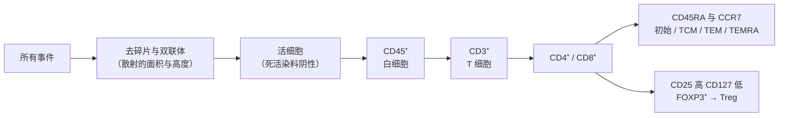

前面的章节反复用"某某细胞表达某某分子"来描述细胞：CD4⁺ T 细胞、CD20⁺ B 细胞、PD-1⁺ 耗竭细胞、CD103⁺ 驻留记忆细胞。本章把这些零散的说法整理成一套读法，回答三个问题：一个细胞表面和胞内的标志物组合怎样告诉我们它是什么、处于什么状态；多维数据（流式、质谱流式、多重成像）怎样把这些组合变成细胞群；以及什么时候不该相信标志物。它在知识路径上不对应某一个问题，而是前面所有问题的"读出端"：识别、决策、效应、记忆与调节的每一步，在实验和病理中都以标志物的变化被观察到（CD 分子按功能的整理见 [7.15.4](/7.15.4)，技术原理见 [7.15.34](/7.15.34)，细胞在组织中的位置见 [7.15.22](/7.15.22)，肿瘤浸润的读出见 [7.15.30](/7.15.30)，空间组学的数据分析见 [7.9.6](/7.9.6)）。本章只讲含义与解读，不讲染色操作。

## 35.1. 怎样读一个免疫表型

### 35.1.1. 三层标志物

**定义 35.1.1（免疫表型）** 用一组分子标志物的有无与高低描述一个细胞（或一群细胞）的身份、状态与功能潜能，称为它的**免疫表型**；测定这组标志物的做法称为免疫表型分析。

一个细胞的标志物可以分成三层，回答三个不同的问题：

| 层次 | 回答的问题 | 典型标志物 | 稳定性 |
|---|---|---|---|
| 谱系 | 它是什么细胞 | CD3、CD19、CD14、CD56 | 高：随分化固定下来 |
| 状态 | 它处于应答的哪个阶段 | CD69、Ki-67、CD45RA/RO、PD-1 | 中：随刺激、时间变化 |
| 功能 | 它此刻在做什么、能做什么 | 细胞因子、颗粒酶 B、穿孔素、转录因子 | 低：随情境快速变化 |

**定义 35.1.2（谱系标志物）** 在某一细胞谱系的几乎所有细胞上稳定表达、而在其他谱系上不表达（或明显较低）的分子，称为该谱系的**谱系标志物**。

谱系标志物回答的是"这是 T 细胞还是巨噬细胞"，状态标志物回答的是同一种细胞所处的阶段。状态标志物之中最常被单独提起的是**活化标志物**：在刺激后上调的分子，按出现时间排列，CD69 最早（数小时），CD25 与 HLA-DR 稍晚（一到数天），随后是 PD-1、ICOS 等（时间线见 [7.15.16](/7.15.16)）。功能层的读出多数需要胞内染色或刺激后检测。

表达水平的记法与 [7.15.4](/7.15.4) 一致：CD4⁺ 表示表达，CD8⁻ 表示不表达，CD56bright 与 CD56dim 表示高、低表达；"CD45RA⁺CCR7⁺"这样的组合就是一个表型。几点读法：

- 一个标志物很少单独起作用：谱系需要至少两个标志物联合判定（一个阳性、一个阴性排除），状态需要与谱系联合读取（CD69 在 T 细胞上是活化标志物，在 B 细胞和 NK 细胞上也是，但在驻留记忆 T 细胞上是定居标志物）。
- 阳性与阴性是对连续信号的二分。实际的信号常是连续的，"高""低""阴性"的分界取决于仪器、荧光团、抗体克隆与阴性对照（35.4）。
- 同一分子在不同谱系上功能不同：CD45 是所有白细胞的酪氨酸磷酸酶，在谱系图谱中只是"白细胞"的标志；CD11c 同时在树突状细胞、单核细胞和一部分 NK 细胞与中性粒细胞上。

## 35.2. 按谱系的标志物图谱

下面的表格按谱系整理人类细胞的常用标志物。"标志物"一列写阳性（+）与需要排除的阴性（−）；"说明"写读法与注意。小鼠的对应写法见 35.7。

### 35.2.1. T 细胞及其状态

| 细胞或状态 | 标志物 | 说明 |
|---|---|---|
| T 细胞（总） | CD3⁺（TCR–CD3 复合物） | 最可靠的 T 谱系标志；CD5、CD2、CD7 辅助 |
| CD4⁺ T | CD3⁺CD4⁺CD8⁻ | 单核细胞、部分 pDC 也低表达 CD4，必须同时要求 CD3⁺ |
| CD8⁺ T | CD3⁺CD8⁺CD4⁻ | NK 细胞的一个亚群表达 CD8α，需要 CD3 排除 |
| γδ T 细胞 | CD3⁺，TCRγδ⁺ | 可以 CD4⁻CD8⁻；TCRαβ⁻ |
| MAIT 细胞 | CD3⁺，Vα7.2⁺，CD161 高，IL-18Rα⁺ | 其中单独的 CD161 在多种细胞上都有 |
| 初始 T 细胞 | CD45RA⁺CCR7⁺CD62L⁺，CD27⁺CD28⁺，CD95⁻ | 未接触抗原 |
| 干细胞样记忆 T（TSCM） | CD45RA⁺CCR7⁺，CD95⁺，CD122⁺ | 与初始 T 细胞的区别在 CD95 |
| 中央记忆 T（TCM） | CD45RA⁻（CD45RO⁺）CCR7⁺CD62L⁺ | 归巢到淋巴器官 |
| 效应记忆 T（TEM） | CD45RA⁻CCR7⁻ | 在外周组织巡逻 |
| TEMRA | CD45RA⁺CCR7⁻，常有 CD57⁺ | 终末分化，增殖能力弱，不是"再活化的初始细胞" |
| 组织驻留记忆 T（TRM） | CD69⁺CD103⁺（CD8）；CD49a、CXCR6 | CD69 单独不够：它也是活化标志物（见 35.3） |
| Treg | CD4⁺CD25 高 CD127 低 FOXP3⁺ | FOXP3 在细胞核内；活化的人类 T 细胞可暂时表达低水平 FOXP3（35.7） |
| Tfh | CD4⁺CXCR5⁺PD-1 高 ICOS⁺，BCL6⁺ | 在生发中心内 PD-1 高、CXCR5 高 |
| Th1、Th2、Th17 | CXCR3⁺（Th1）；CCR4⁺CCR6⁻（Th2）；CCR6⁺CCR4⁺（Th17）；转录因子 T-bet、GATA3、RORγt | 趋化因子受体用于流式分群，转录因子更接近"定义"，但需要胞内染色 |

### 35.2.2. B 细胞与浆细胞

| 细胞或状态 | 标志物 | 说明 |
|---|---|---|
| B 细胞（总） | CD19⁺CD20⁺，CD79a⁺，PAX5⁺（核） | CD19 从祖 B 细胞表达到浆母细胞，CD20 在成熟 B 细胞上、在浆细胞上消失 |
| 初始 B 细胞 | IgD⁺CD27⁻ | |
| 记忆 B 细胞 | CD27⁺，类别转换者 IgD⁻ | 也存在 CD27⁻ 的记忆亚群 |
| 生发中心 B 细胞 | CD10⁺BCL6⁺，Ki-67 高，IgD⁻ | 位置（滤泡内）与 FDC 网络（CD21⁺ CD23⁺）共同判定 |
| 边缘区 B 细胞 | CD21 高，CD1c⁺，IgM 高 | 在脾的边缘区 |
| 浆母细胞 | CD19⁺CD27 高 CD38 高，CD20 低 | 循环中短寿命 |
| 浆细胞 | CD138⁺（syndecan-1），CD38 高，BLIMP-1⁺，IRF4⁺（MUM1），CD19 低、CD20⁻，胞质 Ig | 轻链限制性（κ 或 λ 一种）提示克隆性增生 |

CD20 在读治疗后样本时尤为重要：抗 CD20 抗体清除 B 细胞，但浆细胞没有 CD20，所以治疗后血清抗体常常保持，而 CD19⁺CD20⁺ 细胞消失（长寿浆细胞见 [7.15.20](/7.15.20)）。

### 35.2.3. NK 细胞与固有淋巴细胞

| 细胞 | 标志物 | 说明 |
|---|---|---|
| NK 细胞 | CD3⁻CD56⁺，CD16，NKp46；转录因子 T-bet、EOMES | 以 CD3⁻ 排除 T 细胞（CD56 也出现在部分 T 细胞与神经内分泌细胞上） |
| CD56dim NK | CD56 低 CD16 高 | 细胞毒性为主，占血液 NK 的大多数 |
| CD56bright NK | CD56 高 CD16 低 | 细胞因子产生为主，淋巴器官与蜕膜中多 |
| 固有淋巴细胞（总） | Lin⁻（CD3、CD19、CD14、CD56 等谱系标志均阴性），CD127⁺ | "排除法"定义；需要一组谱系抗体的混合 |
| ILC1 | CD127⁺CD117⁻CRTH2⁻，T-bet | 与 NK 在表面标志上有交叉，靠 EOMES 与细胞毒性区分 |
| ILC2 | CRTH2⁺（人），ST2（IL-33 受体）（小鼠），GATA3 | |
| ILC3 | CD117⁺，NKp44⁺（部分），RORγt | |

### 35.2.4. 髓系细胞、树突状细胞与粒细胞

| 细胞 | 标志物 | 说明 |
|---|---|---|
| 经典单核细胞 | CD14 高 CD16⁻，CCR2⁺，HLA-DR⁺ | 血液中约 85%；炎症时募集 |
| 中间单核细胞 | CD14 高 CD16⁺ | 炎症与抗原提呈相关 |
| 非经典单核细胞 | CD14 低 CD16 高 | 沿血管壁巡逻 |
| 巨噬细胞 | CD68⁺，CD163、CD206、CD64、HLA-DR；组织特异的标志 | CD68 是溶酶体蛋白，在单核细胞、DC、成纤维细胞和部分肿瘤细胞中也有；CD163 比较偏向巨噬细胞，但见 35.7 |
| 淋巴器官特殊的巨噬细胞 | CD169（Siglec-1）⁺ | 淋巴结被膜下窦与脾边缘区的巨噬细胞 |
| cDC1 | HLA-DR 高 CD11c⁺，CD141（BDCA-3）、XCR1、CLEC9A | 交叉提呈；见 [7.15.14](/7.15.14) |
| cDC2 | CD1c（BDCA-1）、CD172a、CD11b | |
| pDC | CD123⁺，CD303（BDCA-2）、CD304，CD11c 低 | |
| 成熟（迁移）DC | CCR7、CD83、DC-LAMP（CD208）、CD80/CD86 高 | 从组织迁往淋巴结的 DC |
| 朗格汉斯细胞 | CD207（langerin）、CD1a | 表皮 |
| 中性粒细胞 | CD15、CD66b、CD16b；MPO、中性粒细胞弹性蛋白酶 | 细胞形态（分叶核）常与标志物互补 |
| 嗜酸性粒细胞 | Siglec-8、CCR3；嗜酸性粒细胞过氧化物酶与主要碱性蛋白 | |
| 嗜碱性粒细胞 | CD123、CD203c、FcεRI；脱颗粒时 CD63 上调 | |
| 肥大细胞 | KIT（CD117）、FcεRI；类胰蛋白酶、糜酶 | 组织驻留，不在血液中；类胰蛋白酶是病理中最常用的肥大细胞标志 |
| 髓系抑制细胞 | 人：CD11b⁺CD33⁺HLA-DR 低，CD14⁺（单核型）或 CD15⁺（粒细胞型） | 由表型与抑制功能共同定义，单靠表型不能确定 |

### 35.2.5. 造血干细胞与祖细胞及背景标志物

人的造血干细胞富集在 CD34⁺CD38⁻CD90⁺CD45RA⁻ 的群体中；共同淋巴系祖细胞带 CD10；各谱系的"排除混合物"（Lin）用于富集祖细胞。这些细胞很少出现在病理切片中，更多用在流式与分选（造血系统见 [7.15.2](/7.15.2)）。

组织切片的分析需要一组"背景标志物"，用来区分免疫细胞与其所处的组织：

| 背景成分 | 标志物 | 用途 |
|---|---|---|
| 白细胞（总） | CD45 | 与非免疫细胞区分 |
| 上皮与多数癌细胞 | PanCK（泛细胞角蛋白）、E-钙黏蛋白 | 划分肿瘤巢与间质；但发生上皮–间质转化的癌细胞可以丢失 |
| 成纤维细胞与肌成纤维细胞 | αSMA、波形蛋白、胶原 | 基质屏障（免疫排斥表型）的读出 |
| 血管内皮 | CD31、CD34 | 血管与高内皮微静脉（PNAd）的定位 |
| 淋巴管 | podoplanin（D2-40）、LYVE-1 | 淋巴管与引流 |

下图把常用的免疫标志物与细胞类型的关系画成矩阵。它是示意性的：每个格子由作者按表中说明手工指定为"高、低或亚群、无"，不是实测数据，实际数据中的比例随组织、状态与抗体克隆而变。

## 35.3. 状态标志物：活化、增殖、耗竭、记忆与定居

谱系固定之后，同一类细胞会在不同状态之间移动。下表列出最常用的状态读出，每个标志物对应路径中的一步。

| 状态 | 标志物 | 含义 | 常见的混淆 |
|---|---|---|---|
| 早期活化 | CD69 | TCR 信号数小时内诱导；抑制 S1PR1，使细胞滞留在淋巴器官 | 在驻留记忆 T 细胞上是组成性表达 |
| 晚期活化 | CD25、HLA-DR、CD38、ICOS、CD137（4-1BB） | 活化后 1–数天；CD25 同时是 Treg 的组成性标志 | 人类 T 细胞的 HLA-DR 与 CD38 也在慢性病毒感染、肿瘤中持续高表达 |
| 增殖 | Ki-67（核蛋白，细胞周期 G1 后期至 M 期表达，G0 不表达） | 近期进入周期 | 只表示在周期中，不表示分裂速度；生发中心 B 细胞与肿瘤细胞也高表达 |
| 耗竭（前体） | PD-1 中等，TCF-1⁺（TCF7），SLAMF6⁺ | 干细胞样、对 PD-1 阻断可增殖 | PD-1 不是耗竭的充分标志（活化后短暂升高） |
| 耗竭（终末） | PD-1 高，TIM-3⁺LAG-3⁺TIGIT⁺CD39⁺，TOX 高，TCF-1⁻ | 功能受限、依赖前体细胞补充 | 联合 3 种及以上抑制性受体更可信；耗竭定义见 [7.15.25](/7.15.25) |
| 记忆与效应 | CD45RA/RO、CCR7、CD62L、CD27、CD28；KLRG1 与 CD127 | 见 35.2.1 与 [7.15.18](/7.15.18) | 小鼠与人的组合不同 |
| 组织驻留 | CD69⁺CD103⁺，CD49a、CXCR6；缺少 S1PR1、KLF2 | 不回到循环，驻留在上皮与屏障组织 | 需要多个标志物与位置 |
| 细胞毒性 | 颗粒酶 B、穿孔素；脱颗粒时 CD107a（LAMP-1）暴露于表面 | 杀伤潜能或正在杀伤 | 前两者是储存，CD107a 才提示刚发生脱颗粒 |
| 细胞因子 | IFN-γ、TNF、IL-2；IL-4、IL-5、IL-13；IL-17、IL-22 | 功能层；见 1、2、3 型免疫（定义 1.5.1） | 需要刺激与胞内染色，与"潜能"而不是"当前"相关 |

状态是连续的。例如 CD8⁺ T 细胞从初始、活化、效应、记忆或耗竭，沿着一条或几条轨迹移动（扩增、收缩与记忆见 [7.15.18](/7.15.18)；耗竭轨迹见 [7.15.25](/7.15.25)）。用标志物的二分阈值把连续的轨迹切成"类别"是为了方便，而不是细胞真的分成几类，这在 35.7 中会再讨论。

## 35.4. 门控与分群

### 35.4.1. 门控的逻辑

流式、质谱流式和成像数据的原始形式都是同一种东西：每个细胞一行、每个标志物一列的矩阵。把这个矩阵变成细胞群，有两条路：由人逐步圈定的**门控策略**，和由算法聚类后再注释。

**定义 35.4.1（门控策略）** 按固定的先后顺序，用一系列标志物的阈值把目标细胞群逐步圈出的方案称为**门控策略**：先排除不属于分析对象的事件（碎片、双联体、死细胞），再确定谱系，最后分出亚群与状态。

门控的顺序遵循一条原则：先排除，后界定；先宽后窄。下图是一条典型的 T 细胞门控：

每一步都有它要排除的伪影：双联体（两个细胞粘在一起）同时显示 T 与 B 谱系的标志物，看起来像"CD3⁺CD19⁺ 双阳性细胞"；死细胞会非特异地吸附抗体，是假阳性的主要来源；CD45 门把非免疫细胞（上皮、基质、红细胞残留）去掉。门的边界依赖对照：未染色或 FMO（除一种荧光团外全染的）对照给出阴性范围，对低表达的分子尤其重要（荧光溢出的补偿见 [7.15.34](/7.15.34)）。

**例 35.4.1** 阈值的位置决定假阳性。设阴性群体的荧光强度近似服从均值 $\mu$、标准差 $\sigma$ 的正态分布，把阈值设在 $\mu + k\sigma$。则每个阴性细胞被误判为阳性的概率为 $1 - \Phi(k)$，$k = 3$ 时约 $1.3\times 10^{-3}$，$k = 5$ 时约 $2.9\times 10^{-7}$（$\Phi$ 为标准正态分布函数，见 [3.1](/3.1)）。分析 $10^6$ 个细胞，若 99.99% 是阴性：$k=3$ 时约有 $1.3\times 10^3$ 个假阳性，而真正的阳性只有约 $10^2$ 个，结果的大部分是假阳性；$k = 5$ 时假阳性不到 1 个。所以检测稀有群体（如抗原特异性 T 细胞，频率 $10^{-4}$ 以下）时，要么用明亮的荧光团把阳性群推得离阴性群更远，要么用两个独立的标志物联合判定（两个独立的假阳性概率相乘）。真实数据的阴性群体通常有比正态更重的尾部，所以这里的数字低估了假阳性，只能当作量级估计。

### 35.4.2. 成像数据与无监督分群

在组织切片的多重成像中，门控不再针对"事件"，而是针对"被分割出来的细胞"：先用核（DAPI）与膜或胞质标志物把图像分割成单个细胞，再对每个细胞的各通道平均强度做阈值或聚类，最后手工注释（细胞类型注释与邻域分析见 [7.9.6](/7.9.6)）。无监督聚类（如图论方法）的优点是不预设类别，缺点是每个簇仍然要靠标志物回到本章的图谱去解释；而聚类的数目与粗细是分析者的选择，不是自然的类别数。

两种做法的关系是互补的：分层门控的逻辑透明，所有判断都对应一条标志物规则，适合已知的谱系；聚类能发现事先没有想到的状态，适合探索。无论哪种，最后报告的细胞类型都必须能回答"凭哪几个标志物判定"。

## 35.5. 组织切片中的读法

### 35.5.1. 常用的病理免疫标志物及其免疫学含义

病理学用免疫组织化学（IHC，见 [7.15.34](/7.15.34)）读取标志物，每张切片通常只有一两种标志物，因此要靠少数意义明确、可重复的标志物。下表给出常见的标志物与它们的免疫学含义，只列读法，不涉及诊断规程。

| 标志物 | 染色定位 | 免疫学含义 | 解读时的注意 |
|---|---|---|---|
| CD3 | 膜 | T 细胞（总） | NK/T 细胞肿瘤与部分 T 细胞肿瘤也有；浸润程度需要在肿瘤巢与间质中分别记录 |
| CD8 | 膜 | 细胞毒性 T 细胞为主 | 少数 NK 细胞与 T 细胞肿瘤也有；密度与位置同样重要 |
| FOXP3 | 核 | Treg 的转录因子 | 核染色的细胞才算；活化 T 细胞可有弱表达 |
| CD20 | 膜 | 成熟 B 细胞 | 浆细胞没有；抗 CD20 治疗后 B 细胞会消失 |
| PAX5 | 核 | B 细胞谱系（包括浆细胞前体） | 核标志，边界清楚 |
| CD138 | 膜 | 浆细胞 | 上皮细胞与某些肿瘤细胞也表达 syndecan-1，要结合形态与 CD38、IRF4/MUM1、轻链限制性 |
| CD68 | 胞质（颗粒状） | 巨噬细胞（溶酶体） | 单核细胞、DC、肥大细胞、成纤维细胞也有；不能单独用来分巨噬细胞亚型 |
| CD163 | 膜/胞质 | 偏向"清道夫型"的巨噬细胞，肿瘤相关巨噬细胞常高 | 不等于"M2"；许多驻留巨噬细胞本来表达（[7.15.5](/7.15.5)） |
| CD21、CD23 | 膜 | 滤泡树突状细胞网络 | 成熟三级淋巴结构与生发中心的结构证据 |
| PNAd（MECA-79） | 管腔面 | 高内皮微静脉 | 淋巴细胞进入三级淋巴结构的入口 |
| BCL6、CD10 | 核、膜 | 生发中心 B 细胞 | 位置在滤泡内才有意义 |
| Ki-67 | 核 | 增殖 | 与谱系标志物双染才知道哪一类细胞在增殖 |
| PD-L1 | 膜 | 肿瘤与免疫细胞上的检查点配体 | 见 35.5.3 |
| CD117（KIT）、类胰蛋白酶 | 膜、胞质 | 肥大细胞 | 肥大细胞增多与活化的读出 |
| CD34 | 膜 | 造血祖细胞与血管内皮 | 看位置区分 |
| PanCK | 胞质 | 上皮与多数癌细胞 | 背景标志，用于划分肿瘤巢 |

读 IHC 的三条规则都来自 35.1 的逻辑：每个标志物都必须结合形态、定位与另一个独立的标志物；定位要符合分子的已知位置（CD3 在膜、FOXP3 在核，位置不对要怀疑抗体或固定）；阴性要有内部阳性对照（同一张切片里本该阳性的细胞，如淋巴结里的 T 细胞）。

### 35.5.2. 三级淋巴结构与肿瘤浸润的标志物组合

组织中的结构需要用标志物的组合与空间关系来定义，而不是单个标志物。

| 结构 | 标志物组合 | 判断要点 |
|---|---|---|
| 淋巴细胞聚集（早期 TLS） | CD20⁺ B 细胞簇与邻近 CD3⁺ T 细胞 | 没有 FDC 网络，不能判为成熟 |
| 初级滤泡样 | 上述加 CD21⁺CD23⁻ FDC 网络 | |
| 次级滤泡样（成熟 TLS） | 上述加 CD23⁺ FDC、BCL6⁺CD10⁺ 或 Ki-67 高的生发中心 B 细胞 | 生发中心提示局部亲和力成熟（[7.15.20](/7.15.20)） |
| HEV 与趋化因子轴 | PNAd⁺ 血管；CXCL13、CCL19、CCL21 | 淋巴细胞进入的路径（[7.15.4](/7.15.4)）|
| 成熟 DC | DC-LAMP⁺ 或 CD208⁺，CCR7⁺ | 在 T 细胞区，提示局部启动 |

三级淋巴结构（定义 22.7.1）的成熟度主要看 FDC 网络与生发中心是否存在；没有它们的聚集只是淋巴细胞的"浸润"。

肿瘤的免疫浸润用"位置 × 密度 × 状态"三类读出（三种表型见 [7.15.30](/7.15.30)）：

- 位置：CD3⁺ 与 CD8⁺ 细胞在肿瘤巢内、浸润边缘与远处基质中的密度；与肿瘤细胞的距离；
- 密度与组成：T 细胞相对于巨噬细胞与髓系抑制细胞的比例；
- 状态：CD8⁺ 细胞中 PD-1⁺ TIM-3⁺ TCF-1⁻（终末耗竭）与 TCF-1⁺（前体）的比例；FOXP3⁺ 细胞的位置；CD163⁺ 巨噬细胞的位置。

### 35.5.3. PD-L1 的读法

PD-L1（定义见 [7.15.25](/7.15.25)）由肿瘤细胞与髓系、淋巴细胞表达，常被用作预测检查点阻断疗效的 IHC 标志。常见的评分有三类：只数肿瘤细胞中膜阳性者的比例（肿瘤比例评分）；数阳性的肿瘤细胞、淋巴细胞与巨噬细胞之和占肿瘤细胞数的比例（联合阳性评分）；只看阳性的免疫细胞占肿瘤面积的比例（免疫细胞评分）。解读时需要记住：

- 抗体克隆、染色平台与评分方法与药物和肿瘤类型配套，不可互换；
- 它是适应性表达：由 IFN-γ 诱导（IFN-γ 来自 CTL 的识别），所以 PD-L1 阳性部分反映"这里正在发生一个被识别的应答"，而不是肿瘤本身的固定属性；
- 空间异质性与取样偏差大，治疗和时间也会改变它；
- 阴性不能排除应答。

### 35.5.4. 抗体验证

整个标志物体系依赖一个前提：抗体真的只识别它声称的分子。

**定义 35.5.1（抗体验证）** 在特定应用（流式、IHC、成像）、特定样品与特定处理条件下，证明某一抗体信号确实来自靶分子的一组检验，称为**抗体验证**。

验证是针对"抗体 × 应用 × 样品"的组合，而不是针对抗体本身的永久属性：同一克隆在流式（天然构象、未固定）中可用，在福尔马林固定、石蜡包埋的切片（抗原被交联、变性）中可以完全失效，在不同的抗原修复条件下信号还会变化。常用的方法有五类：

| 方法 | 做法 | 能排除什么 |
|---|---|---|
| 遗传学 | 靶基因敲除或敲低的样品中信号应消失 | 一般的非特异结合 |
| 正交 | 与不依赖抗体的方法（RNA、质谱）在不同细胞中的丰度比较，应相关 | 与抗体无关的量的错配 |
| 独立抗体 | 识别不同表位的两个抗体应给出一致的定位与丰度 | 单个抗体的特殊交叉反应 |
| 过表达或标签 | 在无表达的细胞中表达靶分子，应出现信号 | 灵敏度不足 |
| 生物学合理性 | 阳性细胞应出现在预期的位置与细胞类型中（如 CD20 不应出现在浆细胞上） | 系统性的定位错误 |

在多重成像中，每个抗体还要在多重的条件下（循环染色、金属标记、荧光偶联）重新验证，标记之后抗体的亲和力可能改变，必须检查偶联前后的单染与多染的一致性。

## 35.6. 面板设计与平台对照

### 35.6.1. 设计原则

设计一个标志物组合时，顺序应该是：

1. 先问问题，再选标志物：要回答"T 细胞是否进入肿瘤巢"，就需要肿瘤巢（PanCK）、T 细胞（CD3、CD8）、增殖或耗竭（Ki-67、PD-1）与一个核标志，不必追求"越多越好"。
2. 每类细胞至少用两个独立的标志物确认：一个谱系阳性，另一个互相排斥的排除或不同定位的标志（例如 CD3 在膜上与 FOXP3 在核内共同确认 Treg）。
3. 避免把可能共定位的标志放在同一类细胞的相邻位置上，以减少"侧向溢出"（见 35.6.2）。
4. 把低丰度的分子放在亮而稳定的检测通道上，高丰度的分子放在暗的通道上（荧光溢出的线性代数见 [7.15.34](/7.15.34)）。
5. 每个关键标志物都有阳性与阴性的内部对照，并在目标样品上验证（35.5.4）。
6. 在面板中保留一个"背景"成分的标志物（PanCK、αSMA、CD31），使免疫细胞的位置有参照。

### 35.6.2. 平台对照与分割误差

| 平台 | 样品 | 一次可测的标志物数 | 空间信息 | 主要的读法注意 |
|---|---|---|---|---|
| 流式 | 单细胞悬液 | 约十到三十，光谱流式更多 | 无 | 荧光溢出；需要酶消化的组织会丢失一些表面分子；能分选活细胞 |
| 质谱流式 | 单细胞悬液 | 约四十 | 无 | 无自发荧光、溢出少，但同位素氧化与杂质造成串扰；细胞被破坏 |
| 常规 IHC | 切片 | 一到两种 | 有 | 定性与半定量，便于病理阅读 |
| 多重免疫荧光，即 mIF | 切片 | 数种（酪胺信号放大法每轮一种）到十余种 | 有 | 多轮染色的信号放大与前轮抗体的残余 |
| 循环成像（如 CODEX、CyCIF） | 切片 | 数十种 | 有，亚细胞分辨率 | 多轮染色与成像的配准、组织的损耗 |
| 成像质谱流式（IMC）与多重离子束成像（MIBI） | 切片 | 约四十 | 有，分辨率约 1 µm | 分辨率较低、需要金属偶联抗体 |

成像平台的核心误差来自分割与侧向溢出：相邻细胞的膜标志物（如 CD3 与 CD20）被一个粗略的细胞边界同时圈进来，得到"CD3⁺CD20⁺ 双阳性"的假细胞；在 T–B 细胞紧密接触的区域（滤泡边缘、TLS）尤其严重。对策是：用互斥的标志物做内部检查（真正的 CD3⁺CD20⁺ 细胞应当极少，若很多，应怀疑分割）、对重叠区域的细胞用膜标志物的位置而不是平均强度判定、并在定性的图像上抽查。流式与成像的数据不能直接比较：同一细胞类型的比例，在流式中是"在悬液中所占的比例"，在成像中是"在切片所含的组织面积中所占的密度"，前者受酶消化的偏差，后者受切片取样与细胞大小的影响。

## 35.7. 标志物的局限

### 35.7.1. 表型不等于功能

标志物是细胞身份与状态的间接读出，不是功能本身。PD-1⁺ 的 T 细胞可以是刚被活化的细胞，也可以是耗竭的细胞；CD25⁺FOXP3⁺ 的细胞多数有抑制功能，但不是全部；颗粒酶 B⁺ 只表示储存，不表示杀伤。要证明功能，需要功能检测（增殖、细胞因子产生、杀伤，见 [7.15.34](/7.15.34)）；在空间数据中，则要用位置与邻域作为功能的旁证（例如与肿瘤细胞接触的 CD8⁺ 细胞）。把"表型"当作"功能"说，是最常见的过度解释。

### 35.7.2. 种属差异

小鼠与人的同一类细胞常用不同的标志物，一套标志物的经验不能直接搬用：

| 细胞 | 人 | 小鼠 |
|---|---|---|
| B 细胞 | CD19、CD20 | CD19、B220（CD45R）；小鼠 B 细胞没有等价于人 CD20 的广泛表达 |
| NK 细胞 | CD3⁻CD56⁺ | CD3⁻NK1.1⁺（部分品系）、NKp46⁺、CD49b |
| 单核细胞与巨噬细胞 | CD14、CD16、CD68、CD163 | Ly6C、CD11b、F4/80、CD64 |
| 中性粒细胞 | CD15、CD66b、CD16 | Ly6G、CD11b |
| Treg | CD25 高 CD127 低 FOXP3⁺ | CD25⁺FOXP3⁺ |
| cDC1 | CD141、XCR1、CLEC9A | CD8α（淋巴器官）、CD103（组织）、XCR1 |
| 初始/记忆 T | CD45RA/RO | CD44、CD62L（CD45RA/RO 不用） |

### 35.7.3. 可塑性与技术效应

- 细胞的状态可以变化。Th17 细胞在炎症环境中可以获得 IFN-γ 的表达，转向 Th1 样；巨噬细胞在体内是连续谱，M1/M2 的二分只是体外极端（定义见 [7.15.5](/7.15.5)的巨噬细胞极化）；活化的人类 T 细胞可暂时表达低水平 FOXP3，因此"CD4⁺FOXP3⁺"在炎症组织中不等同于 Treg。
- 同一个分子的信号受样品处理影响：CD62L 在酶消化与刺激后可被脱落（切掉），固定使某些表位失去反应性，组织解离本身会诱导应激基因。
- 阈值与连续信号：分界不同，"阳性比例"不同，阳性比例只能在同一方案内比较。
- 稀有群体的假阳性（例 35.4.1）与成像的侧向溢出（35.6.2）会生成"新的细胞类型"，所以每一个新发现的"非典型表型"都要追问是否由技术造成。

## 小结

- 免疫表型（定义 35.1.1）回答三层问题：谱系（它是什么，谱系标志物，定义 35.1.2）、状态（活化、增殖、耗竭、记忆、驻留）与功能（细胞因子、颗粒酶）。一个细胞类型至少需要两个标志物联合判定。
- 谱系图谱的记法：T 细胞 CD3，CD4 与 CD8 区分亚群；B 细胞 CD19、CD20，浆细胞 CD138、CD38；NK 细胞 CD3⁻CD56⁺；单核细胞 CD14、CD16；cDC1 与 cDC2 以 CD141 与 CD1c 区分，pDC 为 CD123；粒细胞与肥大细胞各有 CD15、Siglec-8、KIT 与类胰蛋白酶；组织背景用 PanCK、αSMA 与 CD31。
- 状态读出：CD69 最早，CD25、HLA-DR 随后；Ki-67 指示增殖；TCF-1⁺ PD-1 中等为前体耗竭，PD-1 高并伴 TIM-3、LAG-3、TIGIT、TOX 为终末耗竭；CD45RA、CCR7、CD62L 划分初始与记忆；CD69⁺CD103⁺ 为驻留。
- 门控策略（定义 35.4.1）的顺序是先排除、后界定；阈值的位置决定假阳性（例 35.4.1），稀有群体需要两个独立标志物联合判定。成像的分群还需要分割。
- 组织中的结构由组合与位置定义：成熟的三级淋巴结构（定义 22.7.1）要有 CD20⁺ B 细胞簇、CD3⁺ T 细胞区、CD21⁺CD23⁺ FDC 网络与生发中心；肿瘤浸润用位置、密度与状态三类读出；PD-L1 的评分依赖克隆与方法、是适应性表达。
- 抗体验证（定义 35.5.1）针对"抗体 × 应用 × 样品"，用遗传学、正交、独立抗体、过表达与生物学合理性检验；每个关键标志物在目标样品上都要验证。
- 面板设计：先问问题，每类细胞至少两个独立标志物，低丰度分子配亮通道，保留背景标志物与内部对照；成像的主要误差是分割与侧向溢出。
- 局限：表型不等于功能；人与小鼠的标志物不同；状态可塑，样品处理会改变标志物；一个单独的标志物从来不足以定义一种细胞。

## 思考题

1. 一张结肠癌切片中，CD68⁺ 细胞大量表达 CD163 与 HLA-DR。可以把它们称为"M2 型肿瘤相关巨噬细胞"吗？应当怎样描述？

   **答** 不宜。CD68 是溶酶体蛋白，不限于巨噬细胞；CD163 也表达在许多组织驻留巨噬细胞上；CD163 与 HLA-DR 的共表达恰好说明体内状态不是 M1/M2 二分。应写成"CD68⁺CD163⁺HLA-DR⁺ 巨噬细胞"，再补充位置（肿瘤巢内还是基质）、邻居（是否靠近耗竭 T 细胞）与功能证据（如 IL-10 或精氨酸酶的表达），而不下"极化"的结论。

2. 在多重成像中，一个分析显示肿瘤间质中有大量 CD3⁺CD20⁺ 双阳性细胞。可能的解释是什么？怎样检验？

   **答** 最可能是侧向溢出：滤泡边缘或 TLS 中 T、B 细胞紧密接触，分割边界把相邻两个细胞的膜信号都算进了一个细胞。检验：（1）看这些细胞是否集中在 T–B 交界处，真的双阳性细胞应出现在任何位置；（2）看膜标志物在单细胞内的定位是否在同一边缘还是分居两侧；（3）用另一个核标志（PAX5、FOXP3 一类）核对；（4）与流式或质谱流式对同一类样品比较，真实的 CD3⁺CD20⁺ 细胞（如少数 T 细胞亚群）极少。

3. 要在 $10^6$ 个细胞中检测频率 $10^{-5}$ 的抗原特异性 T 细胞。用单一标志物、阈值设在 $\mu + 3\sigma$，期望的假阳性与真阳性各是多少？怎样设计以降低假阳性？

   **答** 真阳性约 $10^6\times 10^{-5} = 10$ 个，假阳性约 $10^6\times 1.3\times 10^{-3}\approx 1.3\times 10^3$ 个，信噪比极差。可以：（1）要求两种独立的特异标志（例如两种荧光标记的 pMHC 四聚体，[7.15.34](/7.15.34)）同时阳性，假阳性概率近似相乘，约 $10^{-6}$ 量级，即约 1 个；（2）把阈值提高到 $\mu + 5\sigma$；（3）排除死细胞与双联体；（4）积累更多事件。真实数据尾部较重，所以仍要用阴性对照实测假阳性率。
