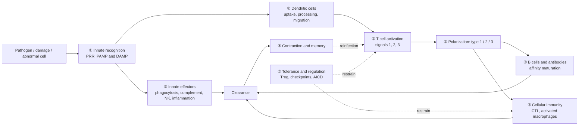

Immunology has many names but few organizing principles. This chapter introduces no new knowledge; it puts the preceding 35 chapters back onto a single map: an immune response answers five questions in turn (who recognizes, how the decision is made after recognition, what effector mechanisms clear the threat, how it is remembered, and how it is switched off and restrained), and the answer to each question unfolds across three effector modules, types 1, 2, and 3. After reading this chapter, the reader should be able to place any newly encountered molecule or cell into a cell of the grid "which question, which module," and know which class of disease its defect corresponds to. Molecule names in the tables are not set in bold, to keep them easy to look up; to return to a definition, follow the numbered objects back to the relevant chapter.

## 36.1. A Pathway of Response

### 36.1.1. Five Questions

| Question | Core of the answer | Main chapters | Key definitions |
|---|---|---|---|
| 1. Who recognizes, and what is recognized? | Innate: germline-encoded pattern recognition receptors recognize pathogen patterns and damage signals; adaptive: BCRs recognize the native conformation of antigen and TCRs recognize peptide presented by MHC, with receptors generated by somatic rearrangement | 5–6, 8–9, 12–14 | Definition 6.2.1, Definition 12.1.1, Definition 12.3.1, Definition 13.6.1 |
| 2. How is the decision made after recognition? | Dendritic cells take up, process, and migrate; naive T cells need three classes of signals; the combination of signals determines the type (types 1, 2, 3) and magnitude of the response, and the absence of signal 2 leads to tolerance | 11, 14, 16–17, 24 | Definition 14.1.2, Definition 16.1.1, Definition 16.5.1, Definition 17.2.2 |
| 3. What effectors clear the threat? | Phagocytosis and killing, complement, antibodies and their Fc receptors, cytotoxic killing, inflammation; the effector is matched to the location of the pathogen | 7, 10, 17, 21, 32 | Definition 5.2.1, Definition 10.2.1, Definition 17.8.1, Definition 21.5.1 |
| 4. How is it remembered? | Contraction after clonal expansion leaves memory T cells; affinity maturation in germinal centers yields long-lived plasma cells and memory B cells | 18, 20 | Definition 18.1.2, Definition 18.5.1, Definition 20.4.1, Definition 20.6.1 |
| 5. How is it switched off and restrained? | Antigen clearance; checkpoints and inhibitory receptors; regulatory T cells; activation-induced cell death; tolerance | 24–25 | Definition 24.3.1, Definition 25.2.2, Definition 25.3.1 |

The spatial and temporal unfolding of this pathway in the body is covered in [7.15.22](/7.15.22): within minutes to hours the response is innate; within days the adaptive response is initiated in the draining lymph node; around one week effector cells home to the site of infection, and memory is left behind; tertiary lymphoid structures (Definition 22.7.1) carry the same logic into nonlymphoid tissue.

### 36.1.2. Innate and Adaptive Immunity

| | Innate immunity (Definition 1.2.2) | Adaptive immunity (Definition 1.2.3) |
|---|---|---|
| Recognition molecules | Germline-encoded PRRs, complement, Fc receptors, NK receptors; limited in number | Somatically rearranged BCRs and TCRs; potential diversity of about $10^{11}$ antibodies |
| What is recognized | Patterns shared by a class of pathogens, damage signals, "missing self" | Specific antigenic epitopes: antibodies recognize conformation, T cells recognize pMHC |
| Onset | Minutes to hours | Days (precursors in a primary response need to expand) |
| Specificity | Low | High |
| Memory | No classical memory; trained immunity | Yes: memory T and B cells, affinity maturation (Definition 1.2.4) |
| Cells | Phagocytes, NK, ILC, mast cells and granulocytes, DCs | T cells, B cells and plasma cells |
| Relationship to the other arm | Provides danger signals, presents antigen, executes the effectors of the adaptive response | Provides specificity and memory, amplifies innate effectors (antibodies and Fc receptors, IFN-γ activation of macrophages) |

The two are not parallel systems but an assembly line: innate immunity detects the problem and decides the type of adaptive response, while adaptive immunity provides specific recognition and memory and hands the effector function back to innate cells to carry out.

## 36.2. Three Effector Modules

The three modules organize the formerly scattered cells and factors into three "matched programs" (Definition 1.5.1). The table below combines innate and adaptive executors, factors, antibodies, and the diseases of dysregulation.

| | Type 1 | Type 2 | Type 3 |
|---|---|---|---|
| Target | Intracellular pathogens, tumors | Helminths, toxins; tissue repair | Extracellular bacteria, fungi |
| Alarm and inducing signals | IL-12, IL-18, type I interferons | IL-25, IL-33, TSLP | IL-1β, IL-6, IL-23, TGF-β |
| Innate lymphoid cells | NK, ILC1 | ILC2 | ILC3 |
| T cells (Definition 17.3.1, Definition 17.3.2, Definition 17.4.1) | Th1, CTL | Th2 | Th17 |
| Master regulator | T-bet (also EOMES in NK and memory cells) | GATA3 | RORγt |
| Signature cytokines | IFN-γ, TNF | IL-4, IL-5, IL-13 | IL-17, IL-22 |
| Antibody class and function | Opsonizing and complement-fixing IgG subclasses | IgE, IgG4 (human) | IgA, IgG |
| Effector cells | Activated macrophages, CTL, NK | Eosinophils, mast cells, basophils | Neutrophils; epithelial antimicrobial peptides |
| Chemotactic signal | CXCL10 (CXCR3) | CCL11 (CCR3) | CXCL8 (CXCR1/2) |
| Diseases of dysregulation | Organ-specific autoimmunity, granulomas | Allergy, asthma (Chapter 26) | Psoriasis, part of inflammatory bowel disease |

Spanning all three are Tfh and Treg: the former bring B cells into the germinal center, and the latter restrain all three kinds of response. The three modules inhibit one another (IFN-γ against IL-4; the TGF-β concentration and IL-6 in the choice between Th17 and Treg), forming "either-or" bistable switches, so a response is usually dominated by one module ([7.15.17](/7.15.17)); the location of each pathogen determines which module is effective ([7.15.32](/7.15.32)).

## 36.3. Who Does What Under Which Signals

### 36.3.1. Decisions of Lymphocytes

| Cell | Input | Decision | Output |
|---|---|---|---|
| Naive T cell | pMHC (signal 1), CD28 costimulation (signal 2), cytokines (signal 3) | All three present: activation and polarization; signal 1 only: anergy (tolerance) | Clonal expansion, effector subsets |
| Activated CD4⁺ T cell | IL-12, IL-4, or IL-1β/IL-6/IL-23 from dendritic cells; TGF-β | Choose Th1, Th2, Th17, Treg (Definition 17.2.2) | Signature cytokines of the subset |
| CD8⁺ T cell | Peptide on MHC I, help from CD4⁺ T cells, IL-2, IL-12 | Expand into CTL; chronic stimulation leads to exhaustion | Perforin and granzymes, IFN-γ, Fas ligand |
| B cell | Antigen cross-linking of BCR; CD40L and IL-21 from Tfh | Extrafollicular plasmablast, early memory, or germinal center | Antibodies, memory B cells, long-lived plasma cells |
| Germinal center B cell | Residual antigen on FDCs; help from Tfh | Those of high affinity survive and return to the dark zone for further mutation, or differentiate into plasma cells and memory cells | Affinity-matured antibodies (Definition 20.3.1) |
| NK cell | Net signal of activating and inhibitory receptors; IL-15, IL-12 | Kill (missing self, stress ligands, ADCC) or not | Granzymes, IFN-γ |
| Treg | Self antigen and IL-2; TGF-β | Suppress the response | IL-2 deprivation, CTLA-4, IL-10, TGF-β, adenosine |

### 36.3.2. Antibodies and Complement: The Division of Labor Between Fab and Fc

The Fab decides what is bound, and the Fc decides what happens next ([7.15.21](/7.15.21)).

| Effect | Depends on | Isotype | Executor |
|---|---|---|---|
| Neutralization | Fab only | High-affinity IgG, IgA | The antibody itself |
| Opsonization and phagocytosis | FcγR, complement receptors | IgG1, IgG3 | Macrophages, neutrophils |
| Complement activation (classical pathway) | C1q | IgM, IgG3 > IgG1 | The complement system: C3 convertase, membrane attack complex (Definition 10.2.3) |
| ADCC | FcγRIIIA (CD16) | IgG1, IgG3 | NK cells |
| Mast cell activation | FcεRI | IgE | Mast cells, basophils (type 2 and allergy) |
| Transport | FcRn; pIgR | IgG; dimeric IgA, pentameric IgM | Placenta, endothelium; mucosal epithelium |

The three pathways of complement (Definition 10.2.1) converge on C3 convertase and C3b; C3b is used for opsonization, and C5 convertase leads to the membrane attack complex; C3a and C5a are anaphylatoxins that recruit and activate inflammatory cells.

## 36.4. Key Quantities

An immune response is a race between orders of magnitude: rare precursors against the exponential growth of the pathogen. The table below collects the estimates from the preceding chapters; the numbers are orders of magnitude, not constants.

| Quantity | Order of magnitude | Source |
|---|---|---|
| Potential diversity of antibodies and TCRs | Combinatorial diversity of antibodies about $10^6$; with junctional diversity the total is counted in $10^{11}$ | 12 |
| Frequency of naive T cell precursors specific for one antigen | $10^{-5}$–$10^{-6}$ | 18 |
| Clonal expansion of T cells in a primary response | On the order of $10^4$-fold, taking one week | 18 |
| Contraction phase | 90%–95% of effector cells undergo apoptosis | 18 |
| Thymic selection | Most thymocytes die; only about 2%–5% are exported | 3, 15 |
| Affinity maturation | Affinity increases 10- to 1000-fold | 20 |
| Half-life of IgG | About 21 days (FcRn recycling) | 21 |
| Binding of IgE to FcεRI | Dissociation constant about $10^{-10}\,\mathrm{M}$; mast cells are "armed" for a long time | 21 |
| Time course of a viral infection | Interferons and NK (hours to 3 days) → CTL (peak at days 7–10) → neutralizing antibodies and memory | 32 |
| Vaccine coverage required to block transmission | $p_{\mathrm{c}} = (1-1/R_0)/E$, where $E$ is vaccine efficacy | 33 |

The three quantitative lessons shared by these are: (1) limited precursors must catch up with the pathogen by exponential expansion, so the speed of initiation of a response matters more than the strength of effectors (the race model of [7.15.22](/7.15.22)); (2) almost all "switches" are bistable, formed from positive feedback plus mutual inhibition, and thresholds and hysteresis explain why responses are "all or none" and why memory can start quickly; (3) numbers and timing decide the outcome of disease: few precursors, slow expansion, and late effectors mean susceptibility.

## 36.5. Quick Reference of Molecule Names

The details of each table are in the original chapters; below we give only "which question this name belongs to."

| Category | Members | Question | See |
|---|---|---|---|
| Alarm and inflammatory cytokines | IL-1β, IL-6, TNF-α, IL-18, IL-33, IFN-α/β | 1–2 | [7.15.11](/7.15.11) |
| Polarization | IL-12 (type 1), IL-4 (type 2), IL-23 and TGF-β, IL-6 (type 3), IL-21 (Tfh) | 2 | [7.15.11](/7.15.11), [7.15.17](/7.15.17) |
| Growth and survival | IL-2, IL-7, IL-15, GM-CSF, M-CSF, G-CSF | 2, 4 | [7.15.11](/7.15.11) |
| Effector | IFN-γ, IL-5, IL-13, IL-17, IL-22 | 3 | [7.15.11](/7.15.11) |
| Regulation | IL-10, TGF-β | 5 | [7.15.25](/7.15.25) |
| Chemokines | CXCL8, CCL2, CXCL10, CCL19/21, CXCL13, CXCL12 | Migration | [7.15.4](/7.15.4) |
| Complement | C1q, C3, C5a, membrane attack complex (C5b–C9), MBL | 1, 3 | [7.15.10](/7.15.10) |
| Fc receptors | CD64 (FcγRI), CD32B (inhibitory), CD16, FcεRI, CD89 | 3 | [7.15.21](/7.15.21) |
| Costimulation and checkpoints | CD28, CD40–CD40L, ICOS; CTLA-4, PD-1, LAG-3, TIM-3, TIGIT | 2, 5 | [7.15.16](/7.15.16), [7.15.25](/7.15.25) |
| MHC and presentation | MHC I (CD8), MHC II (CD4), HLA-E, CD1 | 1 | [7.15.13](/7.15.13), [7.15.14](/7.15.14) |
| Lineage and state CDs | CD3, CD19, CD20, CD14, CD56; CD45RA, CCR7, CD69, CD103 | Readout | [7.15.35](/7.15.35) |

## 36.6. A Disease Map: Where the Pathway Breaks

Every immune-related disease can be located at some point on the pathway (a defect is a naturally occurring "knockout experiment," [7.15.31](/7.15.31)).

| Disease category | Position on the pathway | Mechanism | Chapter |
|---|---|---|---|
| Primary immunodeficiency (Definition 31.1.1) | Varies with the defect | The defective step determines the spectrum of infection: T cell development (SCID), antibodies (XLA), phagocytosis (chronic granulomatous disease), complement | 31 |
| HIV | The hub of questions 2–3 | CD4⁺ T cells are depleted, and help and memory are lost | 31 |
| Hypersensitivity (Definition 26.1.1) | Questions 3, 5 | Type 2 response to harmless antigen (type I); antibodies against self cells (type II) and immune complexes (type III); T cell-mediated (type IV, Definition 27.3.1) | 26–27 |
| Autoimmune disease (Definition 28.1.1) | Question 5: failure of tolerance | Failure of central (AIRE) and peripheral (FOXP3, CTLA4) tolerance, molecular mimicry, and epitope spreading | 24, 28 |
| Transplant rejection (Definition 29.3.1) | Question 1: allorecognition | 1%–10% of the recipient T cell repertoire cross-reacts with allogeneic MHC | 29 |
| Tumors | Questions 1, 3, 5 | Immunoediting (Definition 30.1.1): antigen loss, failed infiltration, checkpoints and exhaustion | 30 |
| Chronic infection and pathogen evasion (Definition 32.5.1) | Questions 1, 3 | Evading recognition, interfering with effectors, modulating the host response | 32 |
| Cytokine storm | Question 5 out of control | Amplification by positive feedback, failure of the brakes | 11, 25 |

Therapy is layered along the pathway: vaccines and passive immunity (Definition 33.1.1) start from questions 1 and 4; antibody drugs, cytokine blockade, and checkpoint blockade target nodes of questions 3 and 5, respectively; immunosuppressants target question 2 (the signal hierarchy of Definition 29.6.1). Every intervention has a corresponding cost: removing the brakes raises autoimmunity, and suppressing activation raises the risk of infection.

## 36.7. Connections to Other Courses

The immune system is the most complete intersection in biology of the molecular, cellular, population, and evolutionary levels:

- Cellular and molecular foundations: receptors and signal transduction, the cytoskeleton and membrane trafficking, antigen processing ([7.3](/7.3)); DNA rearrangement and epigenetics ([7.2](/7.2)); antibodies and protein interactions ([7.1](/7.1));
- Systems and methods: feedback and bistability ([7.9](/7.9)), single-cell and spatial omics ([7.9.6](/7.9.6));
- Evolution and populations: balancing selection and polymorphism of MHC ([7.4](/7.4)), host–pathogen coevolution;
- Epidemiology of pathogens, the microbiome, and vaccines ([7.11](/7.11)).

## Summary

- An immune response answers five questions in turn: recognition, decision, effector, memory, and regulation; every chapter corresponds to one of these steps (Section 36.1.1).
- Innate immunity detects and classifies, and adaptive immunity provides specificity and memory; the two are an assembly line, not two parallel systems (Section 36.1.2).
- The three effector modules (Definition 1.5.1) match cells and factors to the pathogens they address: type 1 (IFN-γ) for intracellular pathogens and tumors, type 2 (IL-4, IL-5, IL-13) for helminths and allergy, and type 3 (IL-17, IL-22) for extracellular bacteria and fungi; Tfh and Treg span all three.
- Decisions are determined by the combination and context of signals: activation requires signals 1, 2, and 3 together, whereas signal 1 alone leads to anergy; cytokines select subsets, and subsets inhibit one another to form bistable switches.
- The effector is matched to the location of the pathogen: the Fab determines recognition, and the Fc and complement determine the consequence; every effector function requires clustering (cross-linking) to be triggered.
- Orders of magnitude: precursors $10^{-5}$–$10^{-6}$, expansion about $10^4$-fold, contraction 90%–95%, affinity maturation 10- to 1000-fold; the time course runs from interferons and NK, to CTL, to antibodies and memory.
- Disease is a "breakpoint" on the pathway: a defect at one step points to its spectrum of infection; at the other end of dysregulation are autoimmunity, allergy, and inflammation; therapy is layered along the pathway, and all of it has a cost.

## Questions

1. A patient has recurrent otitis media and pneumonia caused by *Streptococcus pneumoniae*, but viral infections are mostly normal and the antibody response to vaccines is weak. At which step of the pathway might the defect lie? List two possibilities and explain how to distinguish them.

   **Answer** This is the infection spectrum of "extracellular bacteria + humoral immunity": encapsulated bacteria are cleared by antibodies, complement, and neutrophils (type 3 and opsonization). Possible defects: (1) a defect of antibody production, such as X-linked agammaglobulinemia (BTK deficiency, absence of B cells); (2) a complement defect (C3 or early complement). To distinguish them, measure serum immunoglobulins and peripheral blood CD19⁺ cells (B cells are nearly absent in BTK deficiency), and measure complement levels and function (CH50, AH50). Mostly normal viral infections suggest that T cell and NK cell function is preserved; if the vaccine antibody response is weak but B cell numbers are normal, consider a defect of T cell help or class switching (such as CD40L deficiency).

2. Why is it said that "checkpoint blockade" releases the brakes rather than stepping on the accelerator? From this, infer which tumors and which patients are more likely to benefit, and predict the main side effects.

   **Answer** Checkpoint molecules (CTLA-4, PD-1, etc., Definition 25.2.2) limit the response at the same time as it is activated, and blocking them only removes the limit; it does not create a new response. For the therapy to work, therefore, primed but suppressed tumor-specific T cells must already be present in the tumor: tumors with high antigenicity (many neoantigens), existing T cell infiltration (inflamed), and adaptive PD-L1 expression are more likely to respond; the immune-desert type lacks priming and the immune-excluded type lacks infiltration, so monotherapy is ineffective ([7.15.30](/7.15.30)). Because everything suppressed by checkpoints is released, self-reactive T cells are also released, producing autoimmune-like adverse reactions; anti-CTLA-4 acts at the priming stage and has broader effects than anti-PD-1.

3. Compare "allergy," "autoimmunity," and "transplant rejection" within one framework: at which of the five questions does each go "wrong"?

   **Answer** Allergy: questions 2 and 3, in which a type 2 response is chosen against a harmless antigen; the effectors (IgE, mast cells) are themselves normal, and only the target is wrong, and the brakes are also insufficient at question 5. Autoimmunity: questions 5 and 2, in which tolerance to self antigens fails (central or peripheral); the type and effectors of the response are the same as those used against pathogens. Transplant rejection: question 1, in which recognition itself is not wrong but allogeneic MHC is cross-recognized by a large portion of the recipient's T cell repertoire (1%–10%); the decision and effectors of the response are normal; suppression has to target the signal hierarchy of question 2. Together the three show that the same machinery causes disease when the "target" is wrong, not because the machinery itself is defective.

4. Using the pathway of this course, design a marker panel for analyzing a tumor tissue section that answers "do CD8⁺ T cells enter the tumor nest, and are they exhausted once inside?" Which classes of markers are needed? How should positive and negative results be interpreted?

   **Answer** Needed are: the tumor nest (PanCK) and stroma (αSMA) as positional references; T cell identity (CD3, CD8, two independent markers); exhaustion state (PD-1, TIM-3, LAG-3, TCF-1, to distinguish precursor from terminal exhaustion); proliferation (Ki-67); and optionally PD-L1, FOXP3, and CD163 as microenvironment readouts. Interpretation: first look at position (whether CD8⁺ cells are in the tumor nest, at the margin, or in the stroma, corresponding to the inflamed, immune-excluded, and immune-desert types), then at state: many PD-1 intermediate, TCF-1⁺ cells indicate that a precursor pool exists and there is potential to respond to PD-1 blockade; a predominance of PD-1 high, TIM-3⁺LAG-3⁺, TCF-1⁻ cells indicates terminal exhaustion. No single marker is conclusive; one needs colocalization of multiple markers and checks with internal controls and segmentation quality ([7.15.35](/7.15.35)).
