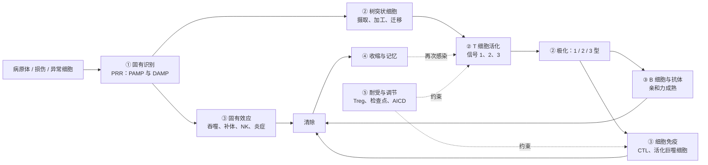

免疫学的名词很多，但组织它们的逻辑很少。本章不引入新的知识，而是把前 35 章放回同一张图：免疫应答依次回答五个问题（谁在识别、识别之后怎样决定、用什么效应清除、怎样记住、怎样关闭与约束），每个问题的答案又按 1、2、3 型三种效应模块展开。读完本章，读者应当能把任何一个新遇到的分子或细胞，放到"哪一个问题、哪一个模块"的格子里，并且知道它的缺陷对应哪一类疾病。表格中的分子名称不加粗，是为了查阅；需要回到定义时，按编号对象回到相应章节。

## 36.1. 一条应答路径

### 36.1.1. 五个问题

| 问题 | 答案的核心 | 主要章 | 关键定义 |
|---|---|---|---|
| 1. 谁在识别、识别什么 | 固有：种系编码的模式识别受体识别病原体模式与损伤信号；适应性：BCR 识别抗原的天然构象，TCR 识别 MHC 提呈的肽，受体由体细胞重排产生 | 5–6、8–9、12–14 | 定义 6.2.1、定义 12.1.1、定义 12.3.1、定义 13.6.1 |
| 2. 识别之后怎样决定 | 树突状细胞摄取、加工并迁移；初始 T 细胞需要三类信号；信号的组合决定应答的类型（1、2、3 型）与规模，缺少信号 2 时走向耐受 | 11、14、16–17、24 | 定义 14.1.2、定义 16.1.1、定义 16.5.1、定义 17.2.2 |
| 3. 用什么效应清除 | 吞噬与杀菌、补体、抗体及其 Fc 受体、细胞毒性杀伤、炎症；效应与病原体的位置相配 | 7、10、17、21、32 | 定义 5.2.1、定义 10.2.1、定义 17.8.1、定义 21.5.1 |
| 4. 怎样记住 | 克隆扩增后的收缩留下记忆 T 细胞；生发中心的亲和力成熟与长寿浆细胞、记忆 B 细胞 | 18、20 | 定义 18.1.2、定义 18.5.1、定义 20.4.1、定义 20.6.1 |
| 5. 怎样关闭与约束 | 抗原清除；检查点与抑制性受体；调节性 T 细胞；活化诱导的细胞死亡；耐受 | 24–25 | 定义 24.3.1、定义 25.2.2、定义 25.3.1 |

这条路径在身体里的空间与时间展开见 [7.15.22](/7.15.22)：数分钟到数小时内是固有应答，数天内适应性应答在引流淋巴结中启动，一周前后效应细胞归巢到感染部位，之后留下记忆；三级淋巴结构（定义 22.7.1）把同样的逻辑搬到了非淋巴组织。

### 36.1.2. 固有免疫与适应性免疫

| | 固有免疫（定义 1.2.2） | 适应性免疫（定义 1.2.3） |
|---|---|---|
| 识别分子 | 种系编码的 PRR、补体、Fc 受体、NK 受体；数量有限 | 体细胞重排的 BCR 与 TCR；约 $10^{11}$ 种抗体的潜在多样性 |
| 识别对象 | 一类病原体共有的模式、损伤信号、"丢失自我" | 特定的抗原表位：抗体识别构象，T 细胞识别 pMHC |
| 起效 | 分钟到小时 | 数天（初次应答的前体需要扩增） |
| 特异性 | 低 | 高 |
| 记忆 | 无经典记忆；有训练免疫 | 有：记忆 T 与 B 细胞，亲和力成熟（定义 1.2.4） |
| 细胞 | 吞噬细胞、NK、ILC、肥大细胞与粒细胞、DC | T 细胞、B 细胞与浆细胞 |
| 与对方的关系 | 提供危险信号、提呈抗原、执行适应性应答的效应 | 提供特异性与记忆，放大固有效应（抗体与 Fc 受体、IFN-γ 活化巨噬细胞） |

二者不是并列的两套系统，而是一条流水线：固有免疫发现问题并决定适应性应答的类型，适应性免疫提供特异的识别与记忆，并把效应交还给固有细胞去执行。

## 36.2. 三种效应模块

三个模块把前面零散的细胞与因子组织成三套"配套的方案"（定义 1.5.1）。下表合并了固有与适应性的执行者、因子、抗体与失调疾病。

| | 1 型 | 2 型 | 3 型 |
|---|---|---|---|
| 对付的对象 | 胞内病原体、肿瘤 | 蠕虫、毒素；组织修复 | 胞外细菌、真菌 |
| 警报与诱导信号 | IL-12、IL-18、I 型干扰素 | IL-25、IL-33、TSLP | IL-1β、IL-6、IL-23、TGF-β |
| 固有淋巴细胞 | NK、ILC1 | ILC2 | ILC3 |
| T 细胞（定义 17.3.1、17.3.2、17.4.1） | Th1、CTL | Th2 | Th17 |
| 主调控因子 | T-bet（NK 与记忆还有 EOMES） | GATA3 | RORγt |
| 特征细胞因子 | IFN-γ、TNF | IL-4、IL-5、IL-13 | IL-17、IL-22 |
| 抗体类别与功能 | 调理与补体结合的 IgG 亚类 | IgE、IgG4（人） | IgA、IgG |
| 效应细胞 | 活化巨噬细胞、CTL、NK | 嗜酸性粒细胞、肥大细胞、嗜碱性粒细胞 | 中性粒细胞；上皮的抗菌肽 |
| 趋化信号 | CXCL10（CXCR3） | CCL11（CCR3） | CXCL8（CXCR1/2） |
| 失调的疾病 | 器官特异性自身免疫、肉芽肿 | 过敏、哮喘（第 26 章） | 银屑病、炎症性肠病的一部分 |

横跨三者的还有 Tfh 与 Treg：前者把 B 细胞带入生发中心，后者约束所有三种应答。三个模块互相抑制（IFN-γ 与 IL-4，TGF-β 浓度与 IL-6 对 Th17 与 Treg 的取舍），形成"二选一"的双稳开关，所以一个应答通常以一种模块为主（[7.15.17](/7.15.17)）；每种病原体的位置决定了哪一个模块有效（[7.15.32](/7.15.32)）。

## 36.3. 谁在什么信号下做什么

### 36.3.1. 淋巴细胞的决策

| 细胞 | 输入 | 决策 | 输出 |
|---|---|---|---|
| 初始 T 细胞 | pMHC（信号 1）、CD28 共刺激（信号 2）、细胞因子（信号 3） | 三者齐备：活化与极化；只有信号 1：失能（耐受） | 克隆扩增、效应亚群 |
| 活化的 CD4⁺ T 细胞 | 树突状细胞的 IL-12、IL-4 或 IL-1β/IL-6/IL-23，TGF-β | 选择 Th1、Th2、Th17、Treg（定义 17.2.2） | 亚群特征的细胞因子 |
| CD8⁺ T 细胞 | MHC I 上的肽、CD4⁺ T 细胞的帮助、IL-2、IL-12 | 扩增为 CTL；慢性刺激导致耗竭 | 穿孔素与颗粒酶、IFN-γ、Fas 配体 |
| B 细胞 | 抗原交联 BCR；Tfh 的 CD40L 与 IL-21 | 滤泡外浆母细胞、早期记忆或生发中心 | 抗体、记忆 B 细胞、长寿浆细胞 |
| 生发中心 B 细胞 | 抗原在 FDC 上的剩余量；Tfh 的帮助 | 亲和力高者存活、回到暗区再突变，或分化为浆细胞与记忆细胞 | 亲和力成熟的抗体（定义 20.3.1） |
| NK 细胞 | 活化性与抑制性受体的净信号；IL-15、IL-12 | 杀伤（丢失自我、应激配体、ADCC）或不杀 | 颗粒酶、IFN-γ |
| Treg | 自身抗原与 IL-2；TGF-β | 抑制应答 | 夺取 IL-2、CTLA-4、IL-10、TGF-β、腺苷 |

### 36.3.2. 抗体与补体：Fab 与 Fc 的分工

Fab 决定结合什么，Fc 决定之后发生什么（[7.15.21](/7.15.21)）。

| 效应 | 依赖 | 同种型 | 执行者 |
|---|---|---|---|
| 中和 | 只用 Fab | 高亲和力 IgG、IgA | 抗体本身 |
| 调理与吞噬 | FcγR、补体受体 | IgG1、IgG3 | 巨噬细胞、中性粒细胞 |
| 补体激活（经典途径） | C1q | IgM、IgG3 > IgG1 | 补体系统：C3 转化酶、攻膜复合体（定义 10.2.3） |
| ADCC | FcγRIIIA（CD16） | IgG1、IgG3 | NK 细胞 |
| 肥大细胞活化 | FcεRI | IgE | 肥大细胞、嗜碱性粒细胞（2 型与过敏） |
| 转运 | FcRn；pIgR | IgG；二聚体 IgA、五聚体 IgM | 胎盘、内皮；黏膜上皮 |

补体的三条途径（定义 10.2.1）汇聚到 C3 转化酶与 C3b，C3b 用于调理，C5 转化酶导向攻膜复合体；C3a、C5a 是过敏毒素，募集与活化炎症细胞。

## 36.4. 关键数量

免疫应答是一场有数量级的竞赛：稀少的前体对病原体的指数增长。下表汇总前面各章的估计，数字为量级，不是常数。

| 量 | 量级 | 来源 |
|---|---|---|
| 抗体与 TCR 的潜在多样性 | 抗体组合多样性约 $10^6$ 种，加连接多样性后总数以 $10^{11}$ 计 | 12 |
| 一个抗原特异的初始 T 细胞前体的频率 | $10^{-5}$–$10^{-6}$ | 18 |
| 初次应答中 T 细胞的克隆扩增 | $10^4$ 倍量级，耗时一周 | 18 |
| 收缩期 | 90%–95% 的效应细胞凋亡 | 18 |
| 胸腺的筛选 | 大多数胸腺细胞死亡，只有约 2%–5% 输出 | 3、15 |
| 亲和力成熟 | 亲和力升高 10–1000 倍 | 20 |
| IgG 的半衰期 | 约 21 天（FcRn 回收） | 21 |
| FcεRI 与 IgE 的结合 | 解离常数约 $10^{-10}\,\mathrm{M}$，肥大细胞长期"武装" | 21 |
| 病毒感染的时间顺序 | 干扰素与 NK（数小时至 3 天）→ CTL（第 7–10 天达峰）→ 中和抗体与记忆 | 32 |
| 疫苗阻断传播所需的覆盖率 | $p_{\mathrm{c}} = (1-1/R_0)/E$，其中 $E$ 为疫苗效力 | 33 |

三条定量的共同教训：（1）有限的前体必须靠指数扩增追上病原体，所以应答的启动速度比效应强度更关键（[7.15.22](/7.15.22) 的竞赛模型）；（2）几乎所有"开关"都是由正反馈加互相抑制形成的双稳态，阈值与滞后解释了为什么应答是"全或无"和为什么记忆能快速启动；（3）数量与时间决定疾病的结局：前体少、扩增慢、效应晚到，就是易感。

## 36.5. 分子名称速查

各表的详细内容在原章，下面只给出"这个名字属于哪个问题"。

| 类别 | 成员 | 问题 | 详见 |
|---|---|---|---|
| 警报与炎症细胞因子 | IL-1β、IL-6、TNF-α、IL-18、IL-33、IFN-α/β | 1–2 | [7.15.11](/7.15.11) |
| 极化 | IL-12（1 型）、IL-4（2 型）、IL-23 与 TGF-β、IL-6（3 型）、IL-21（Tfh） | 2 | [7.15.11](/7.15.11)、[7.15.17](/7.15.17) |
| 生长与存活 | IL-2、IL-7、IL-15、GM-CSF、M-CSF、G-CSF | 2、4 | [7.15.11](/7.15.11) |
| 效应 | IFN-γ、IL-5、IL-13、IL-17、IL-22 | 3 | [7.15.11](/7.15.11) |
| 调节 | IL-10、TGF-β | 5 | [7.15.25](/7.15.25) |
| 趋化因子 | CXCL8、CCL2、CXCL10、CCL19/21、CXCL13、CXCL12 | 迁移 | [7.15.4](/7.15.4) |
| 补体 | C1q、C3、C5a、攻膜复合体（C5b–C9）、MBL | 1、3 | [7.15.10](/7.15.10) |
| Fc 受体 | CD64（FcγRI）、CD32B（抑制）、CD16、FcεRI、CD89 | 3 | [7.15.21](/7.15.21) |
| 共刺激与检查点 | CD28、CD40–CD40L、ICOS；CTLA-4、PD-1、LAG-3、TIM-3、TIGIT | 2、5 | [7.15.16](/7.15.16)、[7.15.25](/7.15.25) |
| MHC 与提呈 | MHC I（CD8）、MHC II（CD4）、HLA-E、CD1 | 1 | [7.15.13](/7.15.13)、[7.15.14](/7.15.14) |
| 谱系与状态 CD | CD3、CD19、CD20、CD14、CD56；CD45RA、CCR7、CD69、CD103 | 读出 | [7.15.35](/7.15.35) |

## 36.6. 疾病对照：断在哪

每种免疫相关疾病都可以定位到路径上的某一处（缺陷是自然发生的"敲除实验"，[7.15.31](/7.15.31)）。

| 疾病类别 | 路径上的位置 | 机制 | 章 |
|---|---|---|---|
| 原发性免疫缺陷（定义 31.1.1） | 视缺陷而异 | 缺陷的环节决定感染谱：T 细胞发育（SCID）、抗体（XLA）、吞噬（慢性肉芽肿病）、补体 | 31 |
| HIV | 问题 2–3 的中枢 | CD4⁺ T 细胞被耗竭，帮助与记忆丧失 | 31 |
| 超敏反应（定义 26.1.1） | 问题 3、5 | 对无害抗原的 2 型应答（Ⅰ 型）；抗体对自身细胞（Ⅱ 型）、免疫复合物（Ⅲ 型）；T 细胞介导（Ⅳ 型，定义 27.3.1） | 26–27 |
| 自身免疫病（定义 28.1.1） | 问题 5：耐受失败 | 中枢（AIRE）与外周（FOXP3、CTLA4）耐受失败，分子模拟与表位扩展 | 24、28 |
| 移植排斥（定义 29.3.1） | 问题 1：同种异体识别 | 受者 T 细胞库中 1%–10% 交叉识别异体 MHC | 29 |
| 肿瘤 | 问题 1、3、5 | 免疫编辑（定义 30.1.1）：抗原缺失、浸润失败、检查点与耗竭 | 30 |
| 慢性感染与病原体逃逸（定义 32.5.1） | 问题 1、3 | 逃避识别，干扰效应，调节宿主应答 | 32 |
| 细胞因子风暴 | 问题 5 失控 | 正反馈放大，刹车失效 | 11、25 |

治疗按路径分层：疫苗与被动免疫（定义 33.1.1）从问题 1 与 4 入手，抗体药物、细胞因子阻断与检查点阻断分别对准问题 3 和 5 的节点，免疫抑制剂对准问题 2（定义 29.6.1 的信号层级）。任何一种干预都有对应的代价：拆掉刹车则自身免疫上升，抑制活化则感染风险上升。

## 36.7. 与其他课程的联系

免疫系统是生物学中分子、细胞、群体与演化各层次最完整的交叉点：

- 细胞与分子基础：受体与信号转导、细胞骨架与膜运输、抗原加工（[7.3](/7.3)）、DNA 重排与表观遗传（[7.2](/7.2)）、抗体与蛋白质相互作用（[7.1](/7.1)）；
- 系统与方法：反馈与双稳态（[7.9](/7.9)），单细胞与空间组学（[7.9.6](/7.9.6)）；
- 演化与群体：MHC 的平衡选择与多态性（[7.4](/7.4)），病原体与宿主的共演化；
- 病原体、微生物组与疫苗的流行病学（[7.11](/7.11)）。

## 小结

- 免疫应答依次回答五个问题：识别、决策、效应、记忆、调节；每章都对应其中一个环节（36.1.1）。
- 固有免疫发现并分类，适应性免疫提供特异性与记忆；二者是一条流水线，而不是两套并列的系统（36.1.2）。
- 三种效应模块（定义 1.5.1）把细胞与因子按所对付的病原体配套：1 型（IFN-γ）对胞内病原体与肿瘤，2 型（IL-4、IL-5、IL-13）对蠕虫与过敏，3 型（IL-17、IL-22）对胞外细菌与真菌；Tfh 与 Treg 横跨三者。
- 决策由信号的组合与背景决定：信号 1、2、3 齐备才活化，只有信号 1 导致失能；细胞因子选择亚群，亚群互相抑制形成双稳开关。
- 效应与病原体的位置相配：Fab 决定识别，Fc 与补体决定后果；每种效应都需要聚集（交联）才触发。
- 数量级：前体 $10^{-5}$–$10^{-6}$，扩增约 $10^4$ 倍，收缩 90%–95%，亲和力成熟 10–1000 倍；时间顺序是干扰素与 NK、CTL、抗体与记忆。
- 疾病是路径的"断点"：缺陷在某一环，感染谱即指向它；失调的另一端是自身免疫、过敏与炎症；治疗按路径分层，且都有代价。

## 思考题

1. 一个患者反复发生由肺炎链球菌引起的中耳炎与肺炎，但病毒感染大多正常，疫苗引起的抗体反应很弱。可能缺陷在路径的哪个环节？列出两种可能，并说明怎样区分。

   **答** 这是一个"胞外细菌 + 体液免疫"的感染谱：有荚膜的细菌靠抗体、补体与中性粒细胞清除（3 型与调理）。可能的缺陷：（1）抗体产生缺陷，如 X 连锁无丙种球蛋白血症（BTK 缺陷，B 细胞缺失）；（2）补体缺陷（C3 或早期补体）。区分的办法：测血清免疫球蛋白与外周血 CD19⁺ 细胞（BTK 缺陷时 B 细胞几乎缺如），测补体水平与功能（CH50、AH50）。病毒感染大多正常提示 T 细胞与 NK 细胞功能保留；若疫苗抗体反应弱而 B 细胞数正常，要考虑 T 细胞帮助或类别转换缺陷（如 CD40L 缺陷）。

2. 为什么说"检查点阻断"撤去的是刹车，而不是加油？由此推出这类治疗对哪些肿瘤、哪些患者更可能有效，并预测它的主要副作用。

   **答** 检查点分子（CTLA-4、PD-1 等，定义 25.2.2）负责在活化的同时限制应答，阻断它们只是移除限制，不会制造新的应答。因此要有效，肿瘤中必须已经存在被启动、但被抑制的肿瘤特异性 T 细胞：抗原性高（新抗原多）、已有 T 细胞浸润（炎症型）、PD-L1 适应性表达的肿瘤更可能响应；免疫荒漠型缺少启动，免疫排斥型缺少浸润，单用无效（[7.15.30](/7.15.30)）。由于被释放的是一切被检查点压制的应答，自身反应性 T 细胞也被释放，出现自身免疫样不良反应，抗 CTLA-4 作用于启动期，影响比抗 PD-1 更广。

3. 把"过敏""自身免疫""移植排斥"三者放在同一个框架里比较：它们各自在五个问题中的哪个环节"错了"？

   **答** 过敏：问题 2 与 3——对无害抗原选择了 2 型应答，效应（IgE、肥大细胞）本身正常，只是对象错误，并且在问题 5 上刹车不足。自身免疫：问题 5 与问题 2——对自身抗原的耐受失败（中枢或外周），应答的类型和效应与对付病原体的机制相同。移植排斥：问题 1——识别本身没有错，而是同种异体的 MHC 被受者的大量 T 细胞库交叉识别（1%–10%），应答的决策与效应是正常的；抑制需要对准问题 2 的信号层级。三者共同说明：同一套机制在"对象"错误时造成疾病，而不是机制本身缺陷。

4. 用本课程的知识路径设计一张分析肿瘤组织切片的标志物面板，要回答"CD8⁺ T 细胞是否进入肿瘤巢，进入后是否耗竭"。需要哪几类标志物？怎样解读阳性与阴性？

   **答** 需要：肿瘤巢（PanCK）与基质（αSMA）作位置参照；T 细胞身份（CD3、CD8，两个独立标志物）；耗竭状态（PD-1、TIM-3、LAG-3、TCF-1，用于区分前体耗竭与终末耗竭）；增殖（Ki-67）；可选 PD-L1、FOXP3、CD163 作微环境读出。解读：先看位置（CD8⁺ 在肿瘤巢内、边缘还是基质，对应炎症型、免疫排斥与免疫荒漠），再看状态：PD-1 中等且 TCF-1⁺ 的细胞多，说明前体池存在，对 PD-1 阻断有响应的潜力；PD-1 高、TIM-3⁺LAG-3⁺、TCF-1⁻ 为主，说明终末耗竭。单个标志物不能定论，需要多标志物共定位并用内部对照与分割质量检查（[7.15.35](/7.15.35)）。
