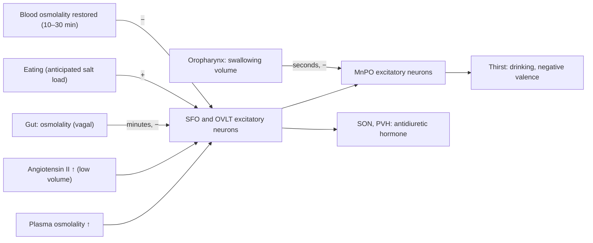

Every animal must keep a few internal variables (energy stores, body water and salt, temperature, blood pressure, blood gases) within narrow limits while it moves through a changing world. The nervous system does this in two ways: reflexively, through the **autonomic nervous system** and the endocrine system, and behaviorally, by generating drives such as hunger and thirst that make the animal seek food and water. This chapter follows the loop from the sensors to the behavior: the interoceptive neurons that report the state of the organs, the hypothalamus that compares this state with what it should be, and the hypothalamic neurons for feeding and drinking whose activity was recorded and manipulated in the last fifteen years. The physiology of the autonomic system, of the pituitary hormones and of energy balance is in 7.14 ([7.14.7](/7.14.7#sec-7.4), [7.14.34](/7.14.34), [7.14.30](/7.14.30)); here we add the cellular identity of the circuits, the experiments that revealed what their neurons encode, and a control-theoretic framework in which drives are teaching signals. That framework leads to the reward-based learning of the following chapters ([7.16.37](/7.16.37), [7.16.39](/7.16.39)).

## 34.1. Interoception

### 34.1.1. The Autonomic Loop

The efferent side of internal regulation is the two-neuron sympathetic and parasympathetic pathway with its transmitters and receptors ([7.14.7](/7.14.7#sec-7.4)). It is controlled at several levels: spinal reflexes; brainstem autonomic centers that run the **baroreceptor reflex**, breathing and digestion; the hypothalamus, which coordinates autonomic, endocrine and behavioral responses; and the **amygdala**, insular and prefrontal cortex, which adjust them to emotional and cognitive context. Feedback reaches every level through visceral sensory neurons, which form the afferent half of the loop.

**Definition 34.1.1 (Interoception)** **Interoception** is the sensing of the physiological state of the body's interior (the mechanical and chemical state of the cardiovascular, respiratory, gastrointestinal and urinary organs, the composition of blood and tissue fluid, and temperature, pain and inflammation of the viscera) by visceral sensory neurons and its representation in the brain.

Two groups of neurons carry interoceptive signals. Spinal visceral afferents have their cell bodies in the dorsal root ganglia, next to somatosensory neurons, and project to the spinal cord, where they drive local autonomic reflexes and ascend to the brainstem. Cranial visceral afferents have their cell bodies in the nodose and jugular ganglia of the vagus nerve and the petrosal ganglion of the glossopharyngeal nerve, and terminate mostly in the nucleus of the solitary tract (NTS) of the caudal medulla. The vagus nerve alone contains about $10^5$ sensory fibers in humans, around 80% of its axons: most of the vagus is afferent.

### 34.1.2. Molecular Types of Vagal Sensory Neurons

The approach that dissected the somatosensory system (molecularly defined neuron types, each with a characteristic ending, receptor and function; [7.16.25](/7.16.25)) has been applied to vagal afferents since about 2015. Single-cell RNA sequencing of the nodose ganglion distinguishes a few dozen types; genetic access to each type (Cre lines under the control of type-specific genes, [7.16.3](/7.16.3)) lets one trace its endings in the organs and activate it with **optogenetics** or **chemogenetics**.

| Organ | Neuron type (marker) | Ending and stimulus | Effect of activation |
|---|---|---|---|
| Aortic arch, carotid sinus | Piezo1/Piezo2 baroreceptors | Stretch of the vessel wall | Fall in blood pressure and heart rate (baroreflex); double knockout abolishes the reflex (Zeng et al., 2018) |
| Lung | NPY2R | Unmyelinated C fibers | Rapid, shallow breathing |
| Lung | P2RY1 | Endings near airway neuroendocrine cells | Apnea, breathing held in expiration (Chang et al., 2015) |
| Lung | Piezo2 | Stretch receptors | Hering–Breuer reflex: inflation terminates inspiration |
| Stomach, intestine | GLP1R | Intraganglionic laminar endings in the muscle layer, stretch | Inhibition of gastric motility and of feeding |
| Intestine | GPR65 | Mucosal endings in the villi, nutrients and serotonin from enteroendocrine cells | Gut motility (Williams et al., 2016) |

The table suggests a design principle: distinct physiological variables are carried by distinct labeled lines, as for the somatic senses, and the NTS is organized viscerotopically, with gut, lung and cardiovascular afferents terminating in different subregions. Some enteroendocrine cells of the gut epithelium form glutamatergic synapses on vagal endings ("neuropod" cells; Kaelberer and colleagues, 2018), which transmit the presence of nutrients to the brain within a second, much faster than hormones. From the NTS, interoceptive information goes to the parabrachial nucleus of the pons, the hypothalamus, the amygdala and, through the thalamus, to the insular cortex, where the body state reaches awareness.

## 34.2. The Hypothalamus

### 34.2.1. Organization

**Definition 34.2.1 (Hypothalamus)** The **hypothalamus** is the ventral part of the diencephalon, below the thalamus and around the third ventricle, a collection of nuclei (about 0.3% of the human brain by volume) that regulate homeostatic variables and the behaviors that serve them (feeding, drinking, thermoregulation, sleep, reproduction, parenting and aggression) by integrating interoceptive, hormonal and sensory information and acting through the pituitary, the autonomic nervous system and projections to motor and motivational circuits.

From the ventricle outward, the hypothalamus has a periventricular zone (neuroendocrine neurons and the arcuate nucleus), a medial zone of well-defined nuclei and a lateral zone traversed by the medial forebrain bundle. Its main nuclei and their functions are:

| Nucleus | Main functions |
|---|---|
| Suprachiasmatic nucleus (SCN) | Master circadian clock ([7.16.35](/7.16.35)) |
| Preoptic area: median preoptic nucleus (MnPO), medial preoptic area (MPOA), ventrolateral preoptic nucleus (VLPO) | Thirst, thermoregulation, parental and sexual behavior, sleep |
| Paraventricular nucleus (PVH) and supraoptic nucleus (SON) | Neuroendocrine output (CRH, TRH; oxytocin and vasopressin), autonomic control, satiety |
| Arcuate nucleus (ARC) | Energy sensing (AgRP and POMC neurons), control of growth hormone, prolactin and GnRH secretion |
| Ventromedial nucleus (VMH) | Glucose regulation, defensive and aggressive behavior, female sexual behavior ([7.16.36](/7.16.36)) |
| Dorsomedial nucleus (DMH) | Thermogenesis, circadian output |
| Lateral hypothalamus (LH) | Arousal (orexin neurons), feeding, reward |
| Mammillary bodies | Memory circuits (Papez circuit) |

### 34.2.2. Neuroendocrine Control

Hypothalamic neurons control the endocrine system in two ways ([7.14.34](/7.14.34#sec-34.1.3)). Magnocellular neurons of the PVH and SON send their axons to the posterior pituitary and release **oxytocin** and **antidiuretic hormone** (vasopressin) into the systemic circulation. Parvocellular neurons release releasing and inhibiting hormones into the portal capillaries of the median eminence, which carry them to the anterior pituitary. Both are **neuropeptide**-secreting neurons ([7.16.11](/7.16.11#sec-11.3)) whose output is set by their firing pattern: like other peptide release, hormone release requires bursts. Magnocellular oxytocin neurons fire synchronized bursts during the milk-ejection reflex, every few minutes, each producing a pulse of hormone, and the pulsatile release of gonadotropin-releasing hormone (one pulse every one to two hours, generated by kisspeptin neurons of the arcuate nucleus) is required for pituitary responsiveness: continuous GnRH desensitizes its receptors and suppresses reproduction, the basis of the use of long-acting GnRH agonists to suppress sex steroids in prostate cancer and precocious puberty. The axes from hypothalamus to pituitary to target gland (the **hypothalamic–pituitary–adrenal axis** and the thyroid and gonadal axes) are closed by hormone feedback on the hypothalamus and pituitary.

The general function of the hypothalamus is thus that of an interface: it reads the internal state and translates deviations into three kinds of output, endocrine, autonomic and behavioral. The behavioral output is the subject of the rest of this chapter.

## 34.3. Feeding

### 34.3.1. Leptin

The existence of a circulating signal from fat stores that suppresses feeding was inferred by Coleman from parabiosis experiments with the obese *ob/ob* and *db/db* mice ([7.14.30](/7.14.30#sec-30.4.5)). Zhang, Friedman and colleagues (1994) cloned the *ob* gene by positional cloning: it encodes a 16-kDa hormone secreted by adipocytes, which they named **leptin**; recombinant leptin reduces food intake and body weight of *ob/ob* mice, and *db* encodes its receptor (LepRb, a cytokine receptor acting through JAK2–STAT3). The rare humans with congenital leptin deficiency are severely obese from infancy and respond to leptin injections with normalized appetite and weight (Farooqi and colleagues, 1999). Plasma leptin is roughly proportional to fat mass; its fall during starvation is a strong signal (hunger, reduced energy expenditure, suppressed reproduction), whereas its rise in obesity has little effect (leptin resistance).

### 34.3.2. AgRP and POMC Neurons

The arcuate nucleus, a region with a leaky blood–brain barrier, contains the two populations of leptin-sensing neurons with opposite effects on feeding that are the entry point of hormonal signals ([7.14.30](/7.14.30#sec-30.4.3)).

**Definition 34.3.1 (AgRP and POMC Neurons)** **AgRP neurons** are GABAergic neurons of the arcuate nucleus that coexpress agouti-related peptide (an inverse agonist of the melanocortin-4 receptor MC4R) and neuropeptide Y; they are activated by energy deficit (low leptin and insulin, high **ghrelin**) and their activity promotes feeding. **POMC neurons** are arcuate neurons that express pro-opiomelanocortin, from which they release α-melanocyte-stimulating hormone, an agonist of MC4R; they are activated by leptin and insulin and their activity suppresses feeding over hours.

The experiments that defined the function of AgRP neurons followed the logic of necessity and sufficiency. Ablating them in adult mice with diphtheria toxin causes complete cessation of feeding and starvation within a week (Luquet and colleagues, 2005), whereas ablation in newborns has little effect, because other pathways compensate during development. Optogenetic activation of AgRP neurons in sated mice evokes voracious feeding within minutes, with the amount eaten increasing with the stimulation frequency (Aponte, Atasoy and Sternson, 2011); chemogenetic activation does the same over hours (Krashes and colleagues, 2011). The neurons act by inhibiting their targets: MC4R-expressing neurons of the PVH, whose silencing mimics AgRP activation and whose activation blocks it; calcitonin gene-related peptide (CGRP) neurons of the parabrachial nucleus, which are activated by large meals and terminate them; and neurons of the lateral hypothalamus and bed nucleus of the stria terminalis. The starvation after adult ablation can be prevented by a few days of GABA agonist infusion into the parabrachial nucleus, after which the mice feed normally: the circuit can reorganize if given time.

### 34.3.3. Anticipation and Valence

The classical view held that AgRP neurons are slow integrators of energy state, active during fasting and silenced as nutrients are absorbed. Recording their population activity in freely behaving mice with fiber photometry and calcium indicators ([7.16.3](/7.16.3)) overturned this view (Chen, Lin, Kuo and Knight, 2015; Betley and colleagues, 2015). In a fasted mouse, AgRP activity drops within seconds of the mouse seeing or smelling food, before it has eaten a bite. The drop is larger for more palatable and more caloric food and for hungrier mice. If the food is then taken away or remains inaccessible, the activity recovers within minutes. POMC neurons show the mirror image. Later work showed that gut signals of absorbed nutrients, carried by vagal afferents and hormones, sustain the inhibition: non-nutritive food produces the sensory drop but not the sustained one (Su and colleagues, 2017; Beutler and colleagues, 2017).

**Formula 34.3.1 (Need Minus Prediction)** A minimal description of these data is that AgRP activity reports the energy deficit $D(t)$ minus a sensory prediction $s(t)$ of the nutrients about to be obtained,
$$
a(t) = \max\bigl(D(t) - s(t),\,0\bigr), \qquad \tau\,\frac{\mathrm{d}s}{\mathrm{d}t} = -s + v\,D(t)\,c(t),
$$
where $c(t) = 1$ while a food cue is present and the prediction has not been disconfirmed, $v \in [0, 1]$ is the learned nutritive value of the cue, and $\tau$ is short (seconds) when the cue appears and long (minutes) when an unconfirmed prediction is withdrawn; ingestion of nutrients lowers $D$ itself over tens of minutes.

![The need-minus-prediction model of AgRP neuron activity (Formula 34.3.1; $v = 0.8$, prediction onset $0.1\,\mathrm{min}$, decay of an unconfirmed prediction $3\,\mathrm{min}$, nutrient absorption reducing the deficit with a time constant of $8\,\mathrm{min}$; arbitrary units, a schematic of the data shapes of Chen and colleagues, 2015). Blue: a fasted mouse sees food and eats; activity falls within seconds and stays low as nutrients are absorbed. Red: food is visible but inaccessible; activity falls and then recovers. Gray: a sated mouse starts from a low level.](./plots/agrp-anticipation.py)

If AgRP neurons fall silent as soon as food appears, how do they drive feeding? Betley and colleagues (2015) showed that their activity is aversive. Mice learned to avoid a flavor or a place paired with optogenetic AgRP stimulation, and conversely preferred cues present when the neurons were inhibited. AgRP activity therefore acts as a negative-valence teaching signal: before food is found, it motivates foraging and teaches the animal which actions and cues reduce it; the sensory drop at food detection reports that the deficit is about to be corrected. Hunger is then an internal state that the animal works to terminate, an old idea ("drive reduction", Hull, 1943) given a cellular form. The same logic recurs for thirst and leads to the homeostatic theory of reward in Section 34.5.3.

## 34.4. Thirst

**Definition 34.4.1 (Lamina Terminalis)** The **lamina terminalis** is the anterior wall of the third ventricle, which contains three nuclei that control body fluid balance: the subfornical organ (SFO) and the organum vasculosum of the lamina terminalis (OVLT), two circumventricular organs that lack a blood–brain barrier and sense plasma osmolality and the hormone angiotensin II, and the median preoptic nucleus (MnPO), which lies inside the barrier and integrates their output.

Dehydration raises plasma osmolality (water loss) or lowers blood volume (hemorrhage, sweating), which raises angiotensin II through the renin–angiotensin system. Osmolality is sensed by **osmoreceptor** neurons of the OVLT and SFO, which also drive release of **antidiuretic hormone** from the SON and PVH ([7.14.24](/7.14.24)); angiotensin II acts on AT1 receptors of SFO neurons. Optogenetic activation of excitatory SFO neurons (marked by *Nos1* or *Etv1*) makes water-sated mice drink avidly and specifically, whereas activation of a separate population of GABAergic SFO neurons suppresses drinking in thirsty mice (Oka, Ye and Zuker, 2015). Excitatory MnPO neurons act downstream: lesions of the MnPO abolish drinking in dehydrated animals, and their activation evokes drinking. As for AgRP neurons, their activity is aversive: thirsty mice work to switch off MnPO thirst neurons (Allen and colleagues, 2017).

The thirst circuit, too, is predictive. Zimmerman and colleagues (2016) recorded SFO thirst neurons in dehydrated mice: their activity fell within a minute of drinking onset, long before water was absorbed and plasma osmolality changed (which takes 10 to 30 minutes). The rapid signal comes from the oropharynx and tracks the volume swallowed, and gut osmolality sensed by vagal afferents later confirms or revises it: water inhibits SFO neurons persistently, whereas hypertonic saline produces only the transient oral inhibition. Conversely, eating activates SFO thirst neurons before any change in plasma osmolality, which explains prandial drinking: the brain anticipates the osmotic load of the meal. Salt appetite, the drive to ingest sodium after sodium depletion, uses a separate circuit (aldosterone-sensitive NTS neurons and PBN neurons), and the taste of salt has a similar rapid satiating effect.

## 34.5. A Quantitative Framework for Homeostatic Control

### 34.5.1. Proportional and Integral Control

A regulated variable $x$ (body mass, plasma osmolality) is disturbed by $d(t)$ and corrected by a control action $u$ (intake), $\dot x = -k x + u - d$ near the set point $x^* = 0$, where $k \ge 0$ describes passive restoring forces. Proportional **negative feedback** $u = -g\,x$ gives a steady state $x_\infty = -d/(k + g)$ for a constant disturbance: the error is reduced by the gain but never eliminated. **Integral feedback** adds a controller variable that accumulates the error, $\dot z = -\kappa\,x$, $u = -g\,x + z$; at any stable steady state $\dot z = 0$ forces $x = 0$ whatever the disturbance ([7.6.35](/7.6.35#sec-35.6)). Integral control is the mechanism of **perfect adaptation** in bacterial chemotaxis and many other systems; in the regulation of body mass the fat store is itself the integral of past energy imbalance, so feedback from leptin, proportional to fat mass, is integral control of the energy imbalance but only proportional control of body mass.

**Example 34.5.1 (Body Mass Under Appetite Feedback)** Use the energy-balance model of [7.14.30](/7.14.30#sec-30.5.2), $\rho\,\dot W = I - E(W)$ with $\rho = 32\,\mathrm{MJ\,kg^{-1}}$ and $E(W) = E_0 + k(W - W_0)$, $k = 0.092\,\mathrm{MJ\,kg^{-1}\,d^{-1}}$, and compare three intake rules: constant intake $I = E_0$ (no appetite feedback); leptin feedback $I = E_0 - g(W - W_0)$ with $g = 0.5\,\mathrm{MJ\,kg^{-1}\,d^{-1}}$ (each kilogram below the set point raises daily intake by $0.5\,\mathrm{MJ}$, about 120 kcal); and the same with an additional integral term, $\dot z = -\kappa(W - W_0)$, $\kappa = 0.002\,\mathrm{MJ\,kg^{-1}\,d^{-2}}$.

After 100 days of intake restricted by $2.1\,\mathrm{MJ\,d^{-1}}$, the mass has fallen by about $5.7\,\mathrm{kg}$. Without appetite feedback it returns with the metabolic time constant $\rho/k \approx 350$ days; with leptin feedback the time constant is $\rho/(k + g) \approx 54$ days. A sustained increase of expenditure by $1\,\mathrm{MJ\,d^{-1}}$ (exercise, cold) lowers the steady state by $1/k \approx 11\,\mathrm{kg}$ without feedback and by $1/(k + g) \approx 1.7\,\mathrm{kg}$ with proportional feedback; only the integral controller returns the mass to $W_0$, over about a year with this small $\kappa$.

:::

![Control of body mass (Example 34.5.1). A: recovery after a 100-day restriction of intake (shaded); without appetite feedback (gray) the mass returns with a time constant of about one year, with leptin feedback (blue) within a few months. B: a sustained rise in energy expenditure of $1\,\mathrm{MJ\,d^{-1}}$ from day 0 leaves a steady-state deficit without feedback (gray, still falling toward $-11\,\mathrm{kg}$) and with proportional feedback (blue, $-1.7\,\mathrm{kg}$); an integral term (red, dashed) returns the mass to the set point.](./plots/body-weight-control.py)

Whether body mass has a set point defended by integral control is debated. In humans, holding body mass 10% below or above the usual value changes energy expenditure in the direction that opposes the change, beyond what the change in tissue mass predicts (Leibel, Rosenbaum and Hirsch, 1995), and weight lost by dieting is usually regained. But the defense is asymmetric (strong against loss, weak against gain), and the long-term rise of average body mass in populations with abundant food fits a "settling point" (a steady state set by the environment and by proportional feedback) better than a fixed set point. The model makes the distinction precise: a proportional system shifts its steady state with every sustained change of food availability or activity, an integral system does not.

### 34.5.2. Predictive Control

The anticipatory responses of AgRP and SFO neurons (Sections 34.3.3 and 34.4) are **feedforward control**: they act on a prediction of the future state instead of waiting for the error. Feedforward control is needed whenever the plant is slow. Water ingested reaches the blood only after 10 to 30 minutes; a controller that waited for plasma osmolality would let the animal drink far too much before stopping. If the controller instead integrates a prediction of the ingested amount, $\hat x(t + \Delta) = x(t) + \int (\text{predicted effect of intake})$, it stops drinking when the predicted future state reaches the set point, and the slower gut and blood signals correct the prediction. Other examples are the cephalic phase of insulin secretion (released at the sight and taste of food, before glucose rises), anticipatory thermoregulation, and the circadian preparation of metabolism for the active phase ([7.16.35](/7.16.35)). Predictions must be learned, and the learning signal is the error between predicted and actual consequences, the same kind of signal that **dopamine** neurons carry for rewards ([7.16.37](/7.16.37)).

### 34.5.3. Homeostatic Reinforcement Learning

Why is food rewarding when one is hungry and not when one is sated? **Reinforcement learning** treats reward as a given scalar signal; homeostatic reinforcement learning (Keramati and Gutkin, 2014) derives it from the internal state.

**Definition 34.5.1 (Drive and Homeostatic Reward)** Let the internal state be $\boldsymbol{h}_t = (h_{1,t}, \dots, h_{N,t})$ with set points $\boldsymbol{h}^*$. The **drive** is a distance from the set point,
$$
D(\boldsymbol{h}_t) = \Bigl(\sum_{i=1}^N \lvert h_i^* - h_{i,t}\rvert^n\Bigr)^{1/m}, \qquad n > m > 1,
$$
and an outcome that changes the state by $\boldsymbol{K}_t$ (a bite of food, a sip of water) yields the **homeostatic reward** $r_t = D(\boldsymbol{h}_t) - D(\boldsymbol{h}_t + \boldsymbol{K}_t)$: reward is drive reduction.

**Proposition 34.5.1** Let $\boldsymbol{h}_{t+1} = \boldsymbol{h}_t + \boldsymbol{K}_t$ and let $0 < \gamma < 1$ be a discount factor. Then
$$
\sum_{t=0}^{T-1} \gamma^t r_t = D(\boldsymbol{h}_0) - \frac{1 - \gamma}{\gamma}\sum_{t=1}^{T-1} \gamma^t D(\boldsymbol{h}_t) - \gamma^{T-1} D(\boldsymbol{h}_T),
$$
so that, for a given initial state and as $T \to \infty$, maximizing the discounted sum of homeostatic rewards is equivalent to minimizing the discounted sum of future drives $\sum_{t \ge 1}\gamma^t D(\boldsymbol{h}_t)$.

**Proof** Write $D_t = D(\boldsymbol{h}_t)$, so $r_t = D_t - D_{t+1}$. Then $\sum_{t=0}^{T-1}\gamma^t (D_t - D_{t+1}) = D_0 + \sum_{t=1}^{T-1}(\gamma^t - \gamma^{t-1})D_t - \gamma^{T-1}D_T$, and $\gamma^t - \gamma^{t-1} = -\frac{1-\gamma}{\gamma}\gamma^t$. Since $D \ge 0$ is bounded on bounded trajectories, the last term vanishes as $T \to \infty$, and $D_0$ does not depend on the actions. $\square$

The proposition says that an agent that learns to maximize reward in the usual sense ([7.16.39](/7.16.39)) automatically learns to keep its internal state near the set point; reward seeking and homeostasis are the same objective. The convexity of the drive ($n > m$) has behavioral consequences. The reward of a fixed outcome is large when the animal is deprived and becomes negative when the outcome would overshoot the set point, which reproduces alliesthesia: after a glucose load, sweet taste is rated unpleasant (Cabanac, 1971). Because the drive grows faster than linearly with the deviation, the agent prefers many small corrections to a few large ones and avoids letting any one variable drift far, which predicts the distribution of meal sizes and the priority of the most deprived need. And because the reward depends on the predicted state change $\boldsymbol{K}_t$, a cue that predicts nutrients is rewarding before the nutrients arrive, as in the anticipatory drop of AgRP activity.

The theory unifies the two views of hunger met above. AgRP activity resembles the drive itself (high when deprived, aversive), and the sensory drop at food detection resembles the predicted drive reduction, which in reinforcement learning would act as a reward prediction ([7.16.37](/7.16.37)). How the hypothalamic drive signal reaches the dopamine system, which carries **reward prediction errors**, is an active question; AgRP and LH neurons project to the VTA region, and hunger increases the dopamine response to food cues.

## 34.6. Brainstem Regulatory Centers

The hypothalamus sets goals, but much of the moment-to-moment regulation runs in the brainstem, which works in decerebrate animals. The main centers are:

| Center | Location | Function |
|---|---|---|
| Nucleus of the solitary tract (NTS) | Dorsal medulla | First relay of vagal and glossopharyngeal afferents (taste in its rostral part); baroreflex, gastrointestinal reflexes, satiety |
| Area postrema | Floor of the fourth ventricle, no blood–brain barrier | Detects toxins and hormones in blood; nausea and vomiting; the GDF15 receptor GFRAL, through which a stress-induced hormone reduces appetite |
| Dorsal motor nucleus of the vagus, nucleus ambiguus | Medulla | Parasympathetic preganglionic output to the gut and heart |
| Rostral ventrolateral medulla (RVLM) | Ventral medulla | Sympathetic premotor neurons setting vascular tone; target of the baroreflex |
| preBötzinger complex and ventral respiratory group | Ventrolateral medulla | Respiratory rhythm generation; central chemoreceptors (retrotrapezoid nucleus) sense $\ce{CO2}$ and pH |
| Parabrachial nucleus (PBN) | Dorsolateral pons | Relay of visceral, taste, pain and temperature information to hypothalamus and amygdala; meal termination (CGRP neurons), alarm and aversion |

The baroreflex illustrates the speed and gain of brainstem control: an increase of arterial pressure stretches baroreceptor endings, which excite NTS neurons; these inhibit the RVLM through GABAergic neurons of the caudal ventrolateral medulla and excite vagal cardiac neurons, so heart rate and vascular resistance fall within one or two heartbeats. Higher centers act by resetting the gain and the operating point of these reflexes: during exercise the baroreflex is reset to a higher pressure, and fear raises pressure and heart rate through the hypothalamus and amygdala ([7.16.37](/7.16.37)).

## Summary

- Interoception (Definition 34.1.1) is carried by spinal and cranial visceral afferents; vagal sensory neurons fall into molecular types, each with its own ending, stimulus and reflex (Piezo baroreceptors; NPY2R, P2RY1 and Piezo2 lung afferents; GLP1R stretch and GPR65 nutrient afferents in the gut), relayed through the NTS and PBN to hypothalamus, amygdala and insula.
- The hypothalamus (Definition 34.2.1) reads internal state and acts through the pituitary (magnocellular and parvocellular, pulsatile peptide release), the autonomic system and motivated behavior.
- Leptin reports fat mass; AgRP and POMC neurons (Definition 34.3.1) promote and suppress feeding. AgRP activity reports need minus a predicted nutrient gain (Formula 34.3.1): it drops within seconds of food detection, is sustained by gut signals, and is aversive, a negative-valence teaching signal.
- Thirst is sensed in the lamina terminalis (Definition 34.4.1): SFO and OVLT neurons detect osmolality and angiotensin II, MnPO neurons integrate and drive drinking; oral and gut signals inhibit them before blood osmolality changes, and eating activates them in anticipation.

| Control mode | Rule | Steady-state error under a sustained disturbance | Biological example |
|---|---|---|---|
| Proportional | $u = -g\,x$ | $d/(k + g)$ | Leptin feedback on body mass |
| Integral | $\dot z = -\kappa x$, $u = z$ | $0$ | Perfect adaptation; possibly defense of body mass |
| Feedforward | Acts on predicted $x(t + \Delta)$ | Depends on the accuracy of the prediction | Anticipatory AgRP and SFO inhibition, cephalic insulin |

- In homeostatic reinforcement learning, reward is drive reduction (Definition 34.5.1), and maximizing discounted reward is equivalent to minimizing future drives (Proposition 34.5.1); the convex drive explains state-dependent reward and alliesthesia.
- Brainstem centers (NTS, area postrema, PBN, RVLM, respiratory nuclei) perform the fast reflex regulation whose gain and operating point the hypothalamus sets.

## Questions

1. In Example 34.5.1 with proportional feedback, derive the time constant of recovery and the steady-state deficit under a sustained increase $\Delta E$ of expenditure. How large must $g$ be for the deficit to be less than $0.5\,\mathrm{kg}$ when $\Delta E = 1\,\mathrm{MJ\,d^{-1}}$?

   **Answer** With $I = E_0 - g(W - W_0)$ and $E = E_0 + k(W - W_0) + \Delta E$, $\rho\,\dot W = -(k + g)(W - W_0) - \Delta E$, a linear equation with time constant $\tau = \rho/(k + g)$ and fixed point $W - W_0 = -\Delta E/(k + g)$. For a deficit below $0.5\,\mathrm{kg}$ we need $k + g > 2\,\mathrm{MJ\,kg^{-1}\,d^{-1}}$, so $g > 1.9\,\mathrm{MJ\,kg^{-1}\,d^{-1}}$: each kilogram lost would have to raise daily intake by about 450 kcal, a gain far higher than observed. Proportional control alone cannot defend body mass precisely; precise defense would require an integral term.

2. Use Formula 34.3.1 to predict AgRP activity when a fasted mouse is given (a) a cue that it has learned predicts food, but no food; (b) a non-caloric, sweet food; (c) an intragastric infusion of nutrients without any sensory cue. Compare with the experimental results.

   **Answer** (a) The learned cue sets $s$ to $v D$, so activity drops; with no ingestion the prediction is withdrawn over minutes and activity returns, as found with inaccessible food. (b) The taste acts as a cue, so activity drops rapidly; but $D$ does not fall, and the prediction is disconfirmed by the absence of post-ingestive nutrient signals, so activity returns over minutes; repeated exposure should reduce $v$ and with it the sensory drop. Experiments show exactly the transient drop with non-nutritive sweeteners. (c) Without a cue there is no rapid drop, but $D$ falls as nutrients are sensed in the gut and absorbed, so activity declines over minutes, in proportion to the calories infused; this slow, calorie-dependent inhibition was observed and shown to require gut–brain signaling.

3. Show directly that for $N = 1$, $n/m = 4/3$ and $h^* = 0$, the reward of an outcome $K > 0$ is positive if and only if $h < -K/2$. Interpret.

   **Answer** $r = \lvert h\rvert^{4/3} - \lvert h + K\rvert^{4/3} > 0$ iff $\lvert h\rvert > \lvert h + K\rvert$, iff $h$ is farther from 0 than $h + K$. For $K > 0$ this holds iff $h < -K/2$ (the midpoint between $h$ and $h + K$ lies below the set point). The outcome is rewarding only if it brings the state closer to the set point; an outcome that overshoots by more than the current deficit is punishing. The criterion does not depend on $n/m$, but the magnitude of reward does: with $n/m > 1$ the same outcome is more rewarding the more deprived the animal.

4. (Open question) Thirst neurons are inhibited by drinking long before the blood is rehydrated. Design an experiment that separates the oral and the gut components of this inhibition, and explain why a purely feedback (non-predictive) controller would be unstable or wasteful for drinking.

   **Answer** Approach: record SFO or MnPO thirst neurons (fiber photometry) in dehydrated mice while (i) letting them lick water that is drained from the esophagus or stomach before absorption (sham drinking: oral signals only), (ii) infusing water directly into the stomach or intestine without licking (gut signals only), and (iii) letting them drink hypertonic saline (oral signal, wrong gut signal). The oral component appears in (i) and (iii) and is transient; the gut component appears in (ii) and is persistent with water but not with saline; plasma osmolality is measured to show that neither depends on it. A pure feedback controller acting on plasma osmolality would see the effect of drinking only after 10 to 30 minutes, so it would keep drinking long after enough water had been taken in, overshoot into overhydration and then oscillate; a delay in a high-gain negative feedback loop is a classic cause of instability. Predicting the consequences of ingestion allows high gain without overshoot, at the cost of having to learn and calibrate the predictions.
