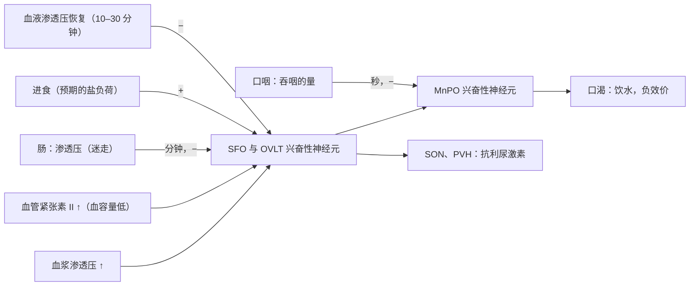

每种动物在变化的环境中活动时，都必须把少数几个内部变量（能量储备、体内水和盐、体温、血压、血气）维持在狭窄的范围内。神经系统通过两种方式做到这一点：一是反射性的，经**自主神经系统**和内分泌系统；二是行为性的，产生饥饿、口渴之类的驱力，促使动物寻找食物和水。本章沿着从传感器到行为的回路展开：报告器官状态的内感受神经元，把这一状态与应有状态相比较的下丘脑，以及近十五年来被记录和操控的、控制摄食与饮水的下丘脑神经元。自主神经系统、垂体激素与能量平衡的生理学见 7.14（[7.14.7](/7.14.7#sec-7.4)、[7.14.34](/7.14.34)、[7.14.30](/7.14.30)）；这里补充回路的细胞身份、揭示这些神经元编码内容的实验，以及一个把驱力视为教学信号的控制论框架。这一框架通向后续各章基于奖赏的学习（[7.16.37](/7.16.37)、[7.16.39](/7.16.39)）。

## 34.1. 内感受

### 34.1.1. 自主神经环路

内部调节的传出一侧是由两级神经元构成的交感与副交感通路及其递质和受体（[7.14.7](/7.14.7#sec-7.4)）。它在多个层次受到控制：脊髓反射；负责**压力感受器反射**、呼吸和消化的脑干自主神经中枢；协调自主、内分泌与行为反应的下丘脑；以及根据情绪和认知背景调整这些反应的**杏仁核**、岛叶和前额叶皮层。反馈经内脏感觉神经元到达每一个层次，它们构成环路的传入一半。

**定义 34.1.1（内感受）** **内感受**（interoception）是指内脏感觉神经元对身体内部生理状态的感知（心血管、呼吸、消化和泌尿器官的力学与化学状态，血液和组织液的成分，以及内脏的温度、疼痛和炎症），以及这种状态在脑中的表征。

有两类神经元传递内感受信号。脊髓内脏传入神经的胞体位于背根神经节，紧邻躯体感觉神经元，投射到脊髓，在那里驱动局部自主反射，并上行到脑干。颅内脏传入神经的胞体位于迷走神经的结状神经节和颈静脉神经节以及舌咽神经的岩神经节，大多终止于延髓尾部的孤束核（NTS）。人的迷走神经仅感觉纤维就约有 $10^5$ 根，约占其轴突的 80%：迷走神经的大部分是传入的。

### 34.1.2. 迷走感觉神经元的分子类型

剖析躯体感觉系统的方法（用分子定义神经元类型，每种类型有特征性的末梢、受体和功能；[7.16.25](/7.16.25)）自 2015 年前后起被用于迷走传入神经。对结状神经节做单细胞 RNA 测序可区分出几十种类型；对每种类型的遗传操控手段（受类型特异基因控制的 Cre 品系，[7.16.3](/7.16.3)）使人能够追踪其在器官中的末梢，并用**光遗传学**或**化学遗传学**激活它。

| 器官 | 神经元类型（标志物） | 末梢与刺激 | 激活的效应 |
|---|---|---|---|
| 主动脉弓、颈动脉窦 | Piezo1/Piezo2 压力感受器 | 血管壁牵张 | 血压与心率下降（压力反射）；双敲除消除该反射（Zeng et al., 2018） |
| 肺 | NPY2R | 无髓 C 纤维 | 快而浅的呼吸 |
| 肺 | P2RY1 | 气道神经内分泌细胞附近的末梢 | 呼吸暂停，呼吸停在呼气相（Chang et al., 2015） |
| 肺 | Piezo2 | 牵张感受器 | Hering–Breuer 反射：肺扩张终止吸气 |
| 胃、肠 | GLP1R | 肌层中的节内层状末梢，牵张 | 抑制胃运动与摄食 |
| 肠 | GPR65 | 绒毛黏膜中的末梢，感受营养物质和肠内分泌细胞释放的 5-羟色胺 | 肠运动（Williams et al., 2016） |

该表提示一条设计原则：不同的生理变量由不同的标记线传递，与躯体感觉相同；NTS 呈内脏拓扑组织，来自肠、肺和心血管的传入神经终止于不同的亚区。肠上皮的一些肠内分泌细胞与迷走神经末梢形成谷氨酸能突触（“神经足”细胞，neuropod cell；Kaelberer 等，2018），在一秒之内把营养物质的存在传给脑，比激素快得多。从 NTS 出发，内感受信息进入脑桥的臂旁核、下丘脑、杏仁核，并经丘脑到达岛叶皮层，身体状态在那里进入意识。

## 34.2. 下丘脑

### 34.2.1. 组织

**定义 34.2.1（下丘脑）** **下丘脑**（hypothalamus）是间脑的腹侧部分，位于丘脑之下、第三脑室周围，是一组核团（约占人脑体积的 0.3%）。它整合内感受、激素和感觉信息，经垂体、自主神经系统以及向运动和动机回路的投射发挥作用，调节稳态变量和为之服务的行为（摄食、饮水、体温调节、睡眠、生殖、育幼和攻击）。

从脑室向外，下丘脑有室周区（神经内分泌神经元和弓状核）、由界限分明的核团构成的内侧区，以及有内侧前脑束穿行的外侧区。主要核团及其功能如下：

| 核团 | 主要功能 |
|---|---|
| 视交叉上核（SCN） | 主生物钟（[7.16.35](/7.16.35)） |
| 视前区：正中视前核（MnPO）、内侧视前区（MPOA）、腹外侧视前核（VLPO） | 口渴、体温调节、育幼与性行为、睡眠 |
| 室旁核（PVH）与视上核（SON） | 神经内分泌输出（CRH、TRH；催产素与血管升压素）、自主控制、饱感 |
| 弓状核（ARC） | 能量感知（AgRP 与 POMC 神经元），控制生长激素、催乳素和 GnRH 的分泌 |
| 腹内侧核（VMH） | 血糖调节、防御与攻击行为、雌性性行为（[7.16.36](/7.16.36)） |
| 背内侧核（DMH） | 产热、昼夜节律输出 |
| 下丘脑外侧区（LH） | 觉醒（食欲素神经元）、摄食、奖赏 |
| 乳头体 | 记忆回路（Papez 环路） |

### 34.2.2. 神经内分泌控制

下丘脑神经元以两种方式控制内分泌系统（[7.14.34](/7.14.34#sec-34.1.3)）。PVH 与 SON 的大细胞神经元把轴突送到垂体后叶，把**催产素**和**抗利尿激素**（血管升压素）释放入体循环。小细胞神经元把释放激素和抑制激素释放到正中隆起的门脉毛细血管中，由其带到垂体前叶。两者都是分泌**神经肽**（[7.16.11](/7.16.11#sec-11.3)）的神经元，其输出由发放模式决定：与其他肽类的释放一样，激素释放需要簇状发放。大细胞催产素神经元在排乳反射时每隔几分钟发出同步的簇状发放，每次产生一个激素脉冲；促性腺激素释放激素的脉冲式释放（每 1 至 2 小时一个脉冲，由弓状核的 kisspeptin 神经元产生）是垂体保持反应性所必需的：持续的 GnRH 会使其受体脱敏并抑制生殖，这就是长效 GnRH 激动剂被用于抑制前列腺癌和性早熟中性类固醇的原理。从下丘脑经垂体到靶腺的轴（**下丘脑–垂体–肾上腺轴**以及甲状腺轴和性腺轴）由激素对下丘脑和垂体的反馈闭合。

因此，下丘脑的一般功能是一个接口：读取内部状态，并把偏差转换为三类输出，即内分泌、自主和行为输出。行为输出是本章其余部分的主题。

## 34.3. 摄食

### 34.3.1. 瘦素

脂肪储存会产生一种抑制摄食的循环信号，这一点是 Coleman 根据肥胖的 *ob/ob* 与 *db/db* 小鼠的联体共生实验推断出来的（[7.14.30](/7.14.30#sec-30.4.5)）。Zhang、Friedman 等（1994）用定位克隆法克隆了 *ob* 基因：它编码一种由脂肪细胞分泌的 16 kDa 激素，他们将其命名为**瘦素**；重组瘦素能降低 *ob/ob* 小鼠的摄食量和体重，*db* 则编码其受体（LepRb，一种经 JAK2–STAT3 起作用的细胞因子受体）。罕见的先天性瘦素缺乏症患者从婴儿期起就严重肥胖，注射瘦素后食欲和体重恢复正常（Farooqi 等，1999）。血浆瘦素大致与脂肪量成正比；它在饥饿时下降是一个强烈的信号（饥饿感、能量消耗降低、生殖被抑制），而在肥胖时上升却几乎没有效应（瘦素抵抗）。

### 34.3.2. AgRP 与 POMC 神经元

弓状核的血脑屏障有渗漏，含有两群对摄食作用相反的感受瘦素的神经元，它们是激素信号的入口（[7.14.30](/7.14.30#sec-30.4.3)）。

**定义 34.3.1（AgRP 与 POMC 神经元）** **AgRP 神经元**是弓状核的 GABA 能神经元，共表达刺鼠相关肽（agouti-related peptide，黑皮质素 4 受体 MC4R 的反向激动剂）和神经肽 Y；它们被能量不足（瘦素和胰岛素低、**胃饥饿素**高）激活，其活动促进摄食。**POMC 神经元**是表达阿黑皮素原（pro-opiomelanocortin）的弓状核神经元，释放 MC4R 的激动剂 α-促黑素细胞激素；它们被瘦素和胰岛素激活，其活动在数小时内抑制摄食。

确定 AgRP 神经元功能的实验遵循必要性与充分性的逻辑。用白喉毒素在成年小鼠中消融它们，会使摄食完全停止，一周内饿死（Luquet 等，2005），而在新生小鼠中消融则影响很小，因为发育过程中其他通路会代偿。在饱足的小鼠中光遗传学激活 AgRP 神经元，几分钟内就引起贪婪的摄食，进食量随刺激频率增加（Aponte、Atasoy 与 Sternson，2011）；化学遗传学激活在数小时内产生同样的效果（Krashes 等，2011）。这些神经元通过抑制靶标起作用：PVH 中表达 MC4R 的神经元，沉默它们模拟 AgRP 激活，激活它们则阻断 AgRP 的作用；臂旁核的降钙素基因相关肽（CGRP）神经元，它们被大餐激活并终止进食；以及下丘脑外侧区和终纹床核的神经元。成年消融后的饥饿可以通过向臂旁核输注几天 GABA 激动剂来预防，此后小鼠进食正常：只要给予时间，回路可以重组。

### 34.3.3. 预期与效价

经典观点认为 AgRP 神经元是能量状态的慢速整合器，禁食时活跃，随着营养物质被吸收而沉默。用光纤光度法和钙指示剂（[7.16.3](/7.16.3)）在自由活动的小鼠中记录其群体活动，推翻了这一观点（Chen、Lin、Kuo 与 Knight，2015；Betley 等，2015）。在禁食的小鼠中，AgRP 活动在小鼠看到或闻到食物的几秒内就下降，此时它还没吃一口。食物越适口、热量越高，小鼠越饥饿，下降幅度越大。如果随后食物被拿走或仍然够不到，活动在几分钟内恢复。POMC 神经元表现出镜像的变化。后来的工作表明，由迷走传入神经和激素传递的、关于营养物质已被吸收的肠道信号维持了这种抑制：无营养的食物产生感觉性下降，但不产生持续的下降（Su 等，2017；Beutler 等，2017）。

**公式 34.3.1（需求减预测）** 对这些数据的最简描述是：AgRP 活动报告能量不足 $D(t)$ 减去对即将获得的营养物质的感觉预测 $s(t)$，
$$
a(t) = \max\bigl(D(t) - s(t),\,0\bigr), \qquad \tau\,\frac{\mathrm{d}s}{\mathrm{d}t} = -s + v\,D(t)\,c(t),
$$
其中 $c(t) = 1$ 表示食物线索存在且预测尚未被证否，$v \in [0, 1]$ 是线索习得的营养价值，$\tau$ 在线索出现时很短（秒量级），在未被证实的预测被撤回时很长（分钟量级）；摄入营养物质会在数十分钟内降低 $D$ 本身。

如果 AgRP 神经元在食物出现的同时就沉默，它们如何驱动摄食？Betley 等（2015）表明，它们的活动是厌恶性的。小鼠学会回避与光遗传学刺激 AgRP 配对的味道或地点，反过来则偏好神经元被抑制时出现的线索。因此，AgRP 活动是一种负效价的教学信号：在找到食物之前，它推动觅食，并教会动物哪些动作和线索能使它降低；发现食物时的感觉性下降则报告不足即将被纠正。于是饥饿是动物努力去终止的内部状态，这一古老的想法（“驱力降低”，Hull，1943）由此有了细胞层面的形式。同样的逻辑在口渴中再次出现，并导向 34.5.3 节的稳态奖赏理论。

## 34.4. 口渴

**定义 34.4.1（终板）** **终板**（lamina terminalis）是第三脑室的前壁，含有三个控制体液平衡的核团：穹隆下器官（SFO）和终板血管器（OVLT）是两个缺乏血脑屏障的室周器官，感受血浆渗透压和血管紧张素 II；正中视前核（MnPO）位于屏障之内，整合它们的输出。

脱水会升高血浆渗透压（失水）或降低血容量（出血、出汗），后者经肾素–血管紧张素系统使血管紧张素 II 升高。渗透压由 OVLT 和 SFO 的**渗透压感受器**神经元感知，它们还驱动 SON 和 PVH 释放**抗利尿激素**（[7.14.24](/7.14.24)）；血管紧张素 II 作用于 SFO 神经元的 AT1 受体。光遗传学激活兴奋性 SFO 神经元（以 *Nos1* 或 *Etv1* 为标志）会使饮水充足的小鼠贪婪而专一地饮水，而激活另一群 GABA 能 SFO 神经元则抑制口渴小鼠的饮水（Oka、Ye 与 Zuker，2015）。兴奋性 MnPO 神经元在下游起作用：损毁 MnPO 会消除脱水动物的饮水，激活它们则引起饮水。与 AgRP 神经元一样，它们的活动是厌恶性的：口渴的小鼠努力关闭 MnPO 口渴神经元（Allen 等，2017）。

口渴回路同样是预测性的。Zimmerman 等（2016）记录了脱水小鼠的 SFO 口渴神经元：它们的活动在开始饮水后一分钟内就下降，远早于水被吸收和血浆渗透压改变（这需要 10 至 30 分钟）。这一快速信号来自口咽，跟踪吞咽的量，之后由迷走传入神经感知的肠道渗透压予以证实或修正：水使 SFO 神经元持续受抑制，而高渗盐水只产生短暂的口腔抑制。反过来，进食在血浆渗透压发生任何变化之前就激活 SFO 口渴神经元，这解释了进餐时的饮水：脑预期了这一餐的渗透负荷。盐欲，即钠耗竭后摄入钠的驱力，使用另一条回路（对醛固酮敏感的 NTS 神经元和 PBN 神经元），咸味也有类似的快速饱足效应。

## 34.5. 稳态控制的定量框架

### 34.5.1. 比例控制与积分控制

被调节的变量 $x$（体重、血浆渗透压）受到扰动 $d(t)$，由控制作用 $u$（摄入）校正。在设定点 $x^* = 0$ 附近有 $\dot x = -k x + u - d$，其中 $k \ge 0$ 描述被动的恢复力。比例**负反馈** $u = -g\,x$ 对恒定扰动给出稳态 $x_\infty = -d/(k + g)$：误差因增益而减小，但永远不会消除。**积分反馈**加入一个累积误差的控制器变量，$\dot z = -\kappa\,x$，$u = -g\,x + z$；在任何稳定稳态下，$\dot z = 0$ 迫使 $x = 0$，与扰动无关（[7.6.35](/7.6.35#sec-35.6)）。积分控制是细菌趋化性和许多其他系统中**完全适应**的机制；在体重调节中，脂肪储存本身就是过去能量失衡的积分，因此与脂肪量成正比的瘦素反馈对能量失衡是积分控制，而对体重只是比例控制。

**例 34.5.1（食欲反馈下的体重）** 采用 [7.14.30](/7.14.30#sec-30.5.2) 的能量平衡模型 $\rho\,\dot W = I - E(W)$，其中 $\rho = 32\,\mathrm{MJ\,kg^{-1}}$，$E(W) = E_0 + k(W - W_0)$，$k = 0.092\,\mathrm{MJ\,kg^{-1}\,d^{-1}}$，比较三种摄入规则：恒定摄入 $I = E_0$（无食欲反馈）；瘦素反馈 $I = E_0 - g(W - W_0)$，$g = 0.5\,\mathrm{MJ\,kg^{-1}\,d^{-1}}$（比设定点每低 1 kg，每日摄入增加 $0.5\,\mathrm{MJ}$，约 120 kcal）；以及在此基础上增加积分项 $\dot z = -\kappa(W - W_0)$，$\kappa = 0.002\,\mathrm{MJ\,kg^{-1}\,d^{-2}}$。

摄入限制 $2.1\,\mathrm{MJ\,d^{-1}}$ 持续 100 天后，体重下降约 $5.7\,\mathrm{kg}$。没有食欲反馈时，体重以代谢时间常数 $\rho/k \approx 350$ 天恢复；有瘦素反馈时，时间常数为 $\rho/(k + g) \approx 54$ 天。能量消耗持续增加 $1\,\mathrm{MJ\,d^{-1}}$（运动、寒冷）会使稳态在无反馈时降低 $1/k \approx 11\,\mathrm{kg}$，在比例反馈下降低 $1/(k + g) \approx 1.7\,\mathrm{kg}$；只有积分控制器能使体重回到 $W_0$，在这个较小的 $\kappa$ 下需要约一年。

:::

体重是否有一个由积分控制捍卫的设定点，尚有争论。在人体中，把体重维持在比平常低或高 10% 的水平，会使能量消耗向抵消这一变化的方向改变，超出组织质量变化所预测的程度（Leibel、Rosenbaum 与 Hirsch，1995），节食减掉的体重通常会反弹。但这种捍卫是不对称的（对抗减少强，对抗增加弱），食物充足的人群平均体重的长期上升，与“落定点”（由环境和比例反馈决定的稳态）比与固定设定点更吻合。模型使这一区别变得精确：比例系统的稳态随食物供应或活动的每一次持续变化而移动，积分系统则不会。

### 34.5.2. 预测控制

AgRP 与 SFO 神经元的预期性反应（34.3.3 与 34.4 节）是**前馈控制**：它们依据对未来状态的预测起作用，而不是等待误差出现。只要被控对象很慢，就需要前馈控制。饮入的水要 10 至 30 分钟才进入血液；等待血浆渗透压的控制器会让动物在停止之前喝得过多。如果控制器改为整合对摄入量的预测，$\hat x(t + \Delta) = x(t) + \int (\text{摄入的预测效应})$，它就在预测的未来状态到达设定点时停止饮水，而较慢的肠道和血液信号则修正预测。其他例子有胰岛素分泌的头期（在看到和尝到食物时释放，早于血糖上升）、预期性体温调节，以及为活动期预先做的代谢昼夜准备（[7.16.35](/7.16.35)）。预测必须学习，学习信号是预测的后果与实际后果之间的误差，这与**多巴胺**神经元为奖赏携带的信号属于同一类（[7.16.37](/7.16.37)）。

### 34.5.3. 稳态强化学习

为什么饥饿时食物有奖赏性，饱足时则没有？**强化学习**把奖赏当作给定的标量信号；稳态强化学习（Keramati 与 Gutkin，2014）则由内部状态推导出奖赏。

**定义 34.5.1（驱力与稳态奖赏）** 设内部状态为 $\boldsymbol{h}_t = (h_{1,t}, \dots, h_{N,t})$，设定点为 $\boldsymbol{h}^*$。**驱力**（drive）是到设定点的距离，
$$
D(\boldsymbol{h}_t) = \Bigl(\sum_{i=1}^N \lvert h_i^* - h_{i,t}\rvert^n\Bigr)^{1/m}, \qquad n > m > 1,
$$
使状态改变 $\boldsymbol{K}_t$ 的结果（一口食物、一口水）带来**稳态奖赏**（homeostatic reward）$r_t = D(\boldsymbol{h}_t) - D(\boldsymbol{h}_t + \boldsymbol{K}_t)$：奖赏就是驱力的降低。

**命题 34.5.1** 设 $\boldsymbol{h}_{t+1} = \boldsymbol{h}_t + \boldsymbol{K}_t$，$0 < \gamma < 1$ 为折扣因子。则
$$
\sum_{t=0}^{T-1} \gamma^t r_t = D(\boldsymbol{h}_0) - \frac{1 - \gamma}{\gamma}\sum_{t=1}^{T-1} \gamma^t D(\boldsymbol{h}_t) - \gamma^{T-1} D(\boldsymbol{h}_T),
$$
因此对给定的初始状态，当 $T \to \infty$ 时，最大化稳态奖赏的折扣和等价于最小化未来驱力的折扣和 $\sum_{t \ge 1}\gamma^t D(\boldsymbol{h}_t)$。

**证明** 记 $D_t = D(\boldsymbol{h}_t)$，则 $r_t = D_t - D_{t+1}$。于是 $\sum_{t=0}^{T-1}\gamma^t (D_t - D_{t+1}) = D_0 + \sum_{t=1}^{T-1}(\gamma^t - \gamma^{t-1})D_t - \gamma^{T-1}D_T$，且 $\gamma^t - \gamma^{t-1} = -\frac{1-\gamma}{\gamma}\gamma^t$。由于 $D \ge 0$ 在有界轨迹上有界，最后一项在 $T \to \infty$ 时消失，而 $D_0$ 与动作无关。$\square$

该命题说明，学会按通常意义（[7.16.39](/7.16.39)）最大化奖赏的智能体，会自动学会把内部状态保持在设定点附近；追求奖赏与稳态是同一个目标。驱力的凸性（$n > m$）有行为上的后果。固定结果的奖赏在动物被剥夺时很大，在该结果会越过设定点时变为负值，这重现了享乐感的状态依赖性（alliesthesia）：摄入葡萄糖负荷后，甜味被评为令人不快（Cabanac，1971）。由于驱力随偏差超线性增长，智能体偏好许多次小的校正而非少数几次大的校正，并避免让任何一个变量漂移得很远，这预测了进餐量的分布和最被剥夺的需求优先的现象。又因为奖赏取决于预测的状态变化 $\boldsymbol{K}_t$，预测营养物质的线索在营养物质到来之前就有奖赏性，如同 AgRP 活动的预期性下降。

该理论统一了上面遇到的关于饥饿的两种观点。AgRP 活动类似于驱力本身（被剥夺时高，厌恶性），发现食物时的感觉性下降类似于预测的驱力降低，在强化学习中它相当于一种奖赏预测（[7.16.37](/7.16.37)）。下丘脑的驱力信号如何到达携带**奖赏预测误差**的多巴胺系统，是一个活跃的问题；AgRP 与 LH 神经元投射到 VTA 区域，饥饿会增强多巴胺对食物线索的反应。

## 34.6. 脑干调节中枢

下丘脑设定目标，但大量逐时逐刻的调节在脑干中进行，去大脑动物仍能完成。主要中枢如下：

| 中枢 | 位置 | 功能 |
|---|---|---|
| 孤束核（NTS） | 延髓背侧 | 迷走与舌咽传入神经的第一站（味觉在其吻侧部）；压力反射、胃肠反射、饱感 |
| 最后区 | 第四脑室底，无血脑屏障 | 检测血液中的毒素和激素；恶心与呕吐；GDF15 受体 GFRAL，应激诱导的激素经由它降低食欲 |
| 迷走神经背运动核、疑核 | 延髓 | 向肠和心脏的副交感节前输出 |
| 延髓头端腹外侧区（RVLM） | 延髓腹侧 | 设定血管张力的交感运动前神经元；压力反射的靶标 |
| preBötzinger 复合体与腹侧呼吸组 | 延髓腹外侧 | 呼吸节律的产生；中枢化学感受器（斜方体后核）感知 $\ce{CO2}$ 和 pH |
| 臂旁核（PBN） | 脑桥背外侧 | 向下丘脑和杏仁核转送内脏、味觉、疼痛和温度信息；终止进餐（CGRP 神经元）、警报与厌恶 |

压力反射说明了脑干控制的速度和增益：动脉压升高会牵张压力感受器末梢，兴奋 NTS 神经元；这些神经元经延髓尾侧腹外侧区的 GABA 能神经元抑制 RVLM，并兴奋迷走心脏神经元，因此心率和血管阻力在一两次心跳内下降。高级中枢通过重设这些反射的增益和工作点起作用：运动时压力反射被重设到较高的压力，恐惧则经下丘脑和杏仁核升高血压和心率（[7.16.37](/7.16.37)）。

## 小结

- 内感受（定义 34.1.1）由脊髓和颅内脏传入神经传递；迷走感觉神经元分为若干分子类型，每种有各自的末梢、刺激和反射（Piezo 压力感受器；NPY2R、P2RY1 与 Piezo2 肺传入神经；肠中的 GLP1R 牵张传入和 GPR65 营养传入），经 NTS 和 PBN 转送到下丘脑、杏仁核和岛叶。
- 下丘脑（定义 34.2.1）读取内部状态，经垂体（大细胞与小细胞，肽类脉冲式释放）、自主系统和动机行为起作用。
- 瘦素报告脂肪量；AgRP 与 POMC 神经元（定义 34.3.1）分别促进和抑制摄食。AgRP 活动报告需求减去预测的营养获得（公式 34.3.1）：它在发现食物的几秒内下降，由肠道信号维持，并且是厌恶性的，即负效价的教学信号。
- 口渴在终板中感知（定义 34.4.1）：SFO 与 OVLT 神经元检测渗透压和血管紧张素 II，MnPO 神经元整合并驱动饮水；口腔和肠道信号在血液渗透压改变之前就抑制它们，进食则预先激活它们。

| 控制方式 | 规则 | 持续扰动下的稳态误差 | 生物学实例 |
|---|---|---|---|
| 比例 | $u = -g\,x$ | $d/(k + g)$ | 瘦素对体重的反馈 |
| 积分 | $\dot z = -\kappa x$，$u = z$ | $0$ | 完全适应；可能是体重的捍卫机制 |
| 前馈 | 依据预测的 $x(t + \Delta)$ 起作用 | 取决于预测的准确性 | 预期性的 AgRP 与 SFO 抑制、头期胰岛素 |

- 在稳态强化学习中，奖赏就是驱力降低（定义 34.5.1），最大化折扣奖赏等价于最小化未来驱力（命题 34.5.1）；凸的驱力解释了状态依赖的奖赏和享乐感的状态依赖性。
- 脑干中枢（NTS、最后区、PBN、RVLM、呼吸核团）完成快速的反射调节，其增益和工作点由下丘脑设定。

## 思考题

1. 在例 34.5.1 的比例反馈下，推导恢复的时间常数，以及能量消耗持续增加 $\Delta E$ 时的稳态亏缺。当 $\Delta E = 1\,\mathrm{MJ\,d^{-1}}$ 时，$g$ 须多大才能使亏缺小于 $0.5\,\mathrm{kg}$？

   **答** 由 $I = E_0 - g(W - W_0)$ 和 $E = E_0 + k(W - W_0) + \Delta E$，得 $\rho\,\dot W = -(k + g)(W - W_0) - \Delta E$，这是一个线性方程，时间常数 $\tau = \rho/(k + g)$，不动点为 $W - W_0 = -\Delta E/(k + g)$。要使亏缺小于 $0.5\,\mathrm{kg}$，需要 $k + g > 2\,\mathrm{MJ\,kg^{-1}\,d^{-1}}$，即 $g > 1.9\,\mathrm{MJ\,kg^{-1}\,d^{-1}}$：每减少 1 kg，每日摄入就得增加约 450 kcal，这一增益远高于实际观察到的值。单靠比例控制无法精确捍卫体重；精确的捍卫需要积分项。

2. 用公式 34.3.1 预测禁食小鼠在下列情形下的 AgRP 活动：(a) 给一个它已学会预示食物的线索，但没有食物；(b) 无热量的甜味食物；(c) 不带任何感觉线索的胃内营养物质输注。与实验结果比较。

   **答** (a) 习得的线索使 $s$ 变为 $v D$，因此活动下降；没有摄入时，预测在几分钟内被撤回，活动恢复，与够不到的食物的结果一致。(b) 味道起线索的作用，因此活动迅速下降；但 $D$ 并未下降，且由于缺少摄入后的营养信号，预测被证否，所以活动在几分钟内恢复；重复暴露应使 $v$ 减小，感觉性下降也随之减小。实验显示，无营养甜味剂恰好产生短暂的下降。(c) 没有线索就没有快速下降，但随着营养物质在肠中被感知和吸收，$D$ 下降，所以活动在几分钟内下降，下降幅度与输注的热量成正比；这种缓慢、依赖热量的抑制已被观察到，并被证明需要肠–脑信号。

3. 直接证明：当 $N = 1$，$n/m = 4/3$，$h^* = 0$ 时，结果 $K > 0$ 的奖赏为正当且仅当 $h < -K/2$。解释其含义。

   **答** $r = \lvert h\rvert^{4/3} - \lvert h + K\rvert^{4/3} > 0$ 当且仅当 $\lvert h\rvert > \lvert h + K\rvert$，即 $h$ 比 $h + K$ 离 0 更远。对 $K > 0$，这当且仅当 $h < -K/2$ 时成立（$h$ 与 $h + K$ 的中点位于设定点之下）。只有当结果使状态更接近设定点时，它才有奖赏性；越过设定点的幅度超过当前亏缺的结果是惩罚性的。该判据不依赖于 $n/m$，但奖赏的大小依赖：当 $n/m > 1$ 时，同一结果在动物越被剥夺时奖赏性越强。

4. （开放题）口渴神经元在血液恢复水合之前很久就被饮水抑制。设计一个实验，把这种抑制的口腔成分与肠道成分分开，并解释为什么纯反馈（非预测）控制器对饮水来说会不稳定或浪费。

   **答** 思路：在脱水小鼠中记录 SFO 或 MnPO 口渴神经元（光纤光度法），同时 (i) 让它们舔水，而水在被吸收前从食管或胃中引流掉（假饮：只有口腔信号），(ii) 把水直接注入胃或肠而不舔（只有肠道信号），(iii) 让它们喝高渗盐水（口腔信号，肠道信号错误）。口腔成分出现在 (i) 和 (iii) 中，是短暂的；肠道成分出现在 (ii) 中，对水是持续的，对盐水则不是；测量血浆渗透压以表明两者都不依赖于它。作用于血浆渗透压的纯反馈控制器要在 10 至 30 分钟后才看到饮水的效果，因此会在摄入足够的水之后很久还继续饮水，过量饮水而导致水过多，然后振荡；高增益负反馈环路中的延迟是不稳定的典型原因。预测摄入的后果使高增益而无过冲成为可能，代价是必须学习并校准这些预测。
