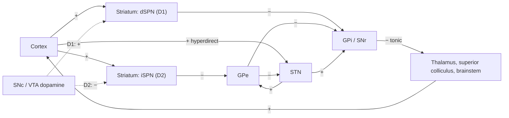

At every moment an animal has many possible actions and can perform only a few: it cannot approach and flee, or look left and right, at the same time. The **basal ganglia**, a set of forebrain and midbrain nuclei conserved from lampreys to primates, are thought to resolve this competition. Their output nuclei hold all motor and cognitive programs under tonic inhibition and release the one that wins, and the strengths that decide the winner are adjusted by **dopamine** according to the outcomes of past choices. The circuit therefore joins two computational problems: selection, deciding which of the currently proposed actions to execute, and reinforcement learning, deciding which actions to prefer in the future. The anatomy, the classical rate model of the direct and indirect pathways and the clinical picture of Parkinson's and Huntington's disease are in [7.14.45](/7.14.45#sec-45.4); this chapter adds the selection mechanism, the synaptic learning rules, their interpretation as an actor–critic algorithm (the algorithms are those of [7.16.39](/7.16.39)), the distinction between goal-directed actions and habits, and the circuit logic of the treatments. Policy-gradient learning and model-based control, which generalize the actor–critic idea, follow in [7.16.41](/7.16.41).

## 40.1. The Cortico-Basal Ganglia Loops

### 40.1.1. Cell Types and Pathways

The striatum (caudate, putamen and, ventrally, the nucleus accumbens) is the input nucleus. About 95% of its neurons in rodents are GABAergic spiny projection neurons (SPNs, also called medium spiny neurons), which receive glutamatergic input from nearly the whole cortex and from the intralaminar thalamus and dopaminergic input from the substantia nigra pars compacta (SNc) and ventral tegmental area (VTA). SPNs have a resting potential near $-85\,\mathrm{mV}$, held by inward-rectifier $\ce{K+}$ channels, and fire only when many coincident cortical inputs drive them into an "up state", so the striatum acts as a threshold filter on cortical activity. The remaining few percent are interneurons: fast-spiking parvalbumin cells that provide feedforward inhibition, and cholinergic interneurons (tonically active neurons) that pause in response to salient and rewarding events together with the dopamine burst.

SPNs fall into two classes of equal number, distinguished by their targets and their molecules ([7.14.45](/7.14.45#sec-45.4.2)):

| | Direct-pathway SPNs (dSPNs) | Indirect-pathway SPNs (iSPNs) |
|---|---|---|
| Dopamine receptor | $\mathrm{D_1}$ ($\mathrm{G_{olf}}$, raises cAMP) | $\mathrm{D_2}$ ($\mathrm{G_i}$, lowers cAMP); also adenosine $\mathrm{A_{2A}}$ |
| Neuropeptides | Substance P, dynorphin | Enkephalin |
| Main target | GPi and SNr (output nuclei) | GPe |
| Net effect on the thalamus | Disinhibition (release) | Increased inhibition (suppression) |

The external globus pallidus (GPe) has two main cell types: prototypic neurons, which inhibit the subthalamic nucleus (STN) and the output nuclei, and arkypallidal neurons, which project back to the striatum and can stop striatal activity globally (Mallet and colleagues, 2012). The STN is the only glutamatergic nucleus of the circuit, and it receives input directly from the frontal cortex.

**Definition 40.1.1 (Hyperdirect Pathway)** The **hyperdirect pathway** is the projection from the frontal cortex to the subthalamic nucleus, whose glutamatergic neurons excite the output nuclei (GPi and SNr) broadly; it bypasses the striatum and is the fastest route by which cortex can increase basal ganglia output and so suppress actions (Nambu, Tokuno and Takada, 2002).

The numbers of neurons converge strongly. In each hemisphere of the rat there are about 2.8 million striatal neurons, 46 000 in GPe, 14 000 in STN, 26 000 in SNr and about 3000 in the entopeduncular nucleus, the rodent GPi (Oorschot, 1996): roughly a hundred SPNs converge on each output neuron. The output neurons fire tonically at $60$–$80\,\mathrm{Hz}$ and inhibit the motor thalamus, the superior colliculus, the pedunculopontine nucleus and other brainstem motor centers.

### 40.1.2. Parallel Loops

The projections are organized as loops: a cortical area projects to a region of the striatum, whose output returns through the thalamus to the same cortical area (Alexander, DeLong and Strick, 1986). A sensorimotor loop runs through the dorsolateral striatum (the putamen in primates), an associative loop through the dorsomedial striatum (caudate), and a limbic loop through the ventral striatum ([7.14.45](/7.14.45#sec-45.4.4)). The loops are partly segregated, which lets each select among its own options (movements, cognitive operations, motivational goals), and partly linked by spiraling projections between dopamine neurons and striatal regions (Haber, Fudge and McFarland, 2000), through which the ventral, limbic loop can influence more dorsal ones. This topography is what makes the distinction between goal-directed and habitual control of Section 40.5 anatomically meaningful.

The direct and indirect pathways were first proposed to have opposite effects on movement, an idea confirmed by optogenetics. Activation of dSPNs in mice increases locomotion and activation of iSPNs causes freezing and bradykinesia (Kravitz and colleagues, 2010); activation of dSPNs is reinforcing (mice return to the place where they received it) and activation of iSPNs is punishing (Kravitz, Tye and Kreitzer, 2012). But **calcium imaging** showed that both classes are active together at movement onset, in spatially clustered ensembles that differ between movements (Cui and colleagues, 2013; Barbera and colleagues, 2016). The two pathways are therefore not a brake and an accelerator for movement in general; they cooperate in selecting particular actions.

## 40.2. Action Selection by Disinhibition

### 40.2.1. The Selection Hypothesis

**Definition 40.2.1 (Action Selection)** **Action selection** is the resolution of a competition among incompatible behavioral options that are proposed in parallel, such that one option (or a compatible set) gains access to the shared motor or cognitive resources and the others are suppressed.

The basal ganglia architecture has the properties a central selector needs (Redgrave, Prescott and Gurney, 1999). Each cortical channel signals the salience of one option to its own striatal territory, in a common currency: the strength of the input. The output nuclei keep every channel under tonic inhibition. In the channel with the strongest input, dSPNs fire and inhibit the corresponding output neurons, which disinhibits the target and lets the action proceed; the diffuse excitation from the STN raises output in all channels and so increases the inhibition of the losers. Selection is thus focused **disinhibition** ([7.14.6](/7.14.6#sec-6.3.3)) on a background of broad excitation, a circuit that implements an approximate winner-take-all. The clearest example is the saccade: SNr neurons that tonically inhibit the superior colliculus pause before a saccade toward the movement field of the collicular neurons they inhibit, and the collicular burst that drives the eye starts when the inhibition is lifted (Hikosaka and Wurtz, 1983).

**Formula 40.2.1 (A Multichannel Selection Model)** Consider $N$ channels with cortical salience $c_i$ and a dopamine modulation $d$ (positive values increase the gain of dSPNs and decrease that of iSPNs). With rectification $F(u) = \max(u, 0)$, the steady-state rates are
$$
\begin{aligned}
x^{\mathrm{D1}}_i &= F\bigl((1 + d)\,c_i - \theta\bigr), \qquad x^{\mathrm{D2}}_i = F\bigl((1 - d)\,c_i - \theta\bigr),\\
s_i &= F\bigl(I_{\mathrm{s}} + w_{\mathrm{h}}\,c_i + w_{\mathrm{i}}\,x^{\mathrm{D2}}_i\bigr), \qquad o_i = F\Bigl(I_{\mathrm{o}} + w_{\mathrm{d}}\,\bar s + w_{\mathrm{f}}\,s_i - w_1\,x^{\mathrm{D1}}_i\Bigr),
\end{aligned}
$$
where $s_i$ is the STN activity of channel $i$ (driven by the hyperdirect input $w_{\mathrm{h}}c_i$ and by the indirect pathway through disinhibition from GPe, folded into the weight $w_{\mathrm{i}}$), $\bar s = \frac1N\sum_j s_j$ its diffuse projection, $o_i$ the output of GPi/SNr in channel $i$, and $\theta$ the SPN threshold. The option with the lowest output is released.

The model is a reduced form of the network of Gurney, Prescott and Redgrave (2001). Its two essential features are the threshold of SPNs, which ignores weak inputs, and the combination of focused striatal inhibition with diffuse subthalamic excitation, which makes the output of a channel depend on the salience of all others: adding a strong competitor raises the output of every other channel. Dopamine sets the gain of selection (figure). With normal dopamine only the most salient channel is released. With depleted dopamine no channel crosses its threshold through the direct pathway while the indirect pathway is enhanced, so all outputs rise above rest and nothing is selected, the akinesia of Parkinson's disease. With excess dopamine several channels are released at once, a picture of the involuntary movements that high doses of L-DOPA produce (Section 40.6).

![Action selection in the multichannel model (Formula 40.2.1; five channels, $\theta = 0.35$, $I_{\mathrm{s}} = 0.2$, $w_{\mathrm{h}} = 0.5$, $w_{\mathrm{i}} = 0.6$, $I_{\mathrm{o}} = 0.6$, $w_{\mathrm{d}} = 0.8$, $w_{\mathrm{f}} = 0.3$, $w_1 = 1.5$; output normalized to the resting output with all saliences $0.1$). A: cortical salience of the five options. B: output of GPi/SNr in each channel for three dopamine levels; low output means the target is released. With normal dopamine ($d = 0.2$, blue) only channel 2 is selected (its output falls to $0.44$ of rest) and channel 3 is partly released; with depleted dopamine ($d = -0.4$, gray) every output rises above rest and nothing is selected; with excess dopamine ($d = 0.6$, red) channel 2 is silenced completely and channels 1 and 3 are released as well.](./plots/action-selection.py)

### 40.2.2. Stopping and Holding

The hyperdirect pathway acts before the others. Cortical stimulation excites STN neurons within about $5\,\mathrm{ms}$, and the resulting excitation of the output nuclei precedes the striatal inhibition (Nambu and colleagues, 2002). It is engaged when an action must be stopped or a choice postponed: in the stop-signal task, the right inferior frontal cortex and the STN are activated when a prepared response is cancelled (Aron and Poldrack, 2006). In decisions between options of similar value, STN activity raises the decision threshold, so that more evidence is accumulated before acting ("hold your horses"; Frank, 2006); patients with STN stimulation for Parkinson's disease lose this slowing and respond impulsively under high conflict (Frank and colleagues, 2007). In the language of [7.16.47](/7.16.47), the STN controls the threshold of **evidence accumulation** and the direct pathway its outcome.

## 40.3. Dopamine and Striatal Plasticity

### 40.3.1. Opposite Rules in D1 and D2 Neurons

Corticostriatal synapses are plastic, and the sign of their plasticity depends on dopamine and on the cell class (Shen and colleagues, 2008). In dSPNs, pairing cortical input with postsynaptic spikes produces LTP that requires $\mathrm{D_1}$ receptor activation; in iSPNs, the same pairing produces LTP that requires adenosine $\mathrm{A_{2A}}$ receptors and is prevented by $\mathrm{D_2}$ activation, while $\mathrm{D_2}$ activation favors LTD through **endocannabinoid** release. The underlying signals are second messengers: $\mathrm{D_1}$ receptors raise cAMP and PKA activity through $\mathrm{G_{olf}}$ ([7.16.11](/7.16.11#sec-11.1)), whereas $\mathrm{D_2}$ receptors lower them through $\mathrm{G_i}$. The timing requirements were measured at single spines: glutamate uncaging paired with spikes enlarged dSPN spines only if dopamine arrived between about $0.3$ and $2\,\mathrm{s}$ later (Yagishita and colleagues, 2014), a **eligibility trace** with the time course that **three-factor learning rules** require ([7.16.14](/7.16.14#sec-14.9)). In iSPNs, the complementary signal is a dip: during discrimination learning, a transient fall of dopamine after an unrewarded cue is detected by the high-affinity $\mathrm{D_2}$ receptors and potentiates the iSPN spines that were active (Iino and colleagues, 2020).

**Formula 40.3.1 (Opponent Three-Factor Rules)** With an eligibility trace $e_{ij}$ of the synapse from cortical input $j$ to an SPN of channel $i$ and a dopamine signal that reports the reward prediction error $\delta$, the weights onto dSPNs and iSPNs change as
$$
\Delta w^{\mathrm{D1}}_{ij} = \eta^+\,[\delta]_+\,e_{ij} - \eta_0^+\,[-\delta]_+\,e_{ij}, \qquad \Delta w^{\mathrm{D2}}_{ij} = \eta^-\,[-\delta]_+\,e_{ij} - \eta_0^-\,[\delta]_+\,e_{ij},
$$
where $[x]_+ = \max(x, 0)$: bursts (positive $\delta$) strengthen the direct-pathway synapses of recently active inputs and weaken the indirect ones, and dips (negative $\delta$) do the opposite. The coefficients $\eta^\pm$ of the dominant terms are set by the affinity of the receptors and by the size of bursts and dips.

### 40.3.2. Go/NoGo Learning

The rule implements reinforcement learning in the selection circuit. An action that leads to more reward than expected strengthens the dSPN synapses of its channel ("Go"), and will be selected more easily; an action followed by a worse outcome strengthens the iSPN synapses ("NoGo"), and will be suppressed. The two pathways thus learn separately from gains and from losses (Frank, 2005). A consequence is a prediction about dopamine disorders: with low tonic dopamine, as in Parkinson's disease, bursts are small but dips are effective, so learning from losses should be spared or enhanced and learning from gains impaired; dopaminergic medication should reverse the pattern.

Frank, Seeberger and O'Reilly (2004) tested this with a probabilistic selection task. Participants choose between pairs of symbols, AB, CD and EF, which are rewarded with probabilities $0.8/0.2$, $0.7/0.3$ and $0.6/0.4$; then, without feedback, they choose between novel pairs. Choosing A over other symbols measures learning from gains, avoiding B measures learning from losses. Patients with Parkinson's disease tested off medication avoided B better than they chose A; on L-DOPA and dopamine agonists they chose A better than they avoided B. The task has since been used to show the same dissociation with genetic variation in striatal $\mathrm{D_1}$ and $\mathrm{D_2}$ receptor function.

**Example 40.3.1 (An Opponent Actor–Critic)** In the opponent actor–critic of Collins and Frank (2014), each stimulus $k$ has a Go weight $G_k$ and a NoGo weight $N_k$, initially 1. The probability of choosing $k$ in a pair $(k, l)$ is a logistic function of $\beta[(G_k - N_k) - (G_l - N_l)]$, a critic learns the expected reward $\hat v$ of each pair with rate $0.1$, and after the outcome $R$ of the chosen stimulus, with $\delta = R - \hat v$,
$$
G_k \leftarrow G_k + \alpha_G\,G_k\,\delta, \qquad N_k \leftarrow N_k - \alpha_N\,N_k\,\delta.
$$
The multiplicative form keeps the weights positive and lets each pathway specialize: Go weights grow for frequently rewarded stimuli, NoGo weights for frequently unrewarded ones. Dopamine levels are modeled by the learning-rate asymmetry: normal $\alpha_G = \alpha_N = 0.1$, low dopamine $\alpha_G = 0.02$, $\alpha_N = 0.2$, high dopamine $\alpha_G = 0.2$, $\alpha_N = 0.02$. After 360 training trials (500 simulated participants, $\beta = 2$), the accuracies in the transfer test are $0.83$ (choose A) and $0.75$ (avoid B) in the normal condition, $0.77$ and $0.80$ with low dopamine and $0.87$ and $0.70$ with high dopamine: the asymmetry between the two measures reverses, as in the patients.

:::

## 40.4. The Actor–Critic Architecture

The Go/NoGo model uses one learned quantity to choose actions (the weights $G - N$) and another to compute the teaching signal (the critic's value). This division is the defining feature of an actor–critic.

**Algorithm 40.4.1 (Tabular Actor–Critic)** An *actor–critic* agent maintains a critic, an estimate $\hat v(s)$ of the state value of its current policy, and an actor, a table of action preferences $h(s, a)$ that defines a softmax policy $\pi(a \mid s) = \mathrm{e}^{h(s, a)}/\sum_b \mathrm{e}^{h(s, b)}$. In each step it chooses $A_t \sim \pi(\cdot \mid S_t)$, observes $R_{t+1}$ and $S_{t+1}$, computes the TD error $\delta_t = R_{t+1} + \gamma\,\hat v(S_{t+1}) - \hat v(S_t)$ and updates both
$$
\hat v(S_t) \leftarrow \hat v(S_t) + \alpha_{\mathrm{c}}\,\delta_t, \qquad h(S_t, A_t) \leftarrow h(S_t, A_t) + \alpha_{\mathrm{a}}\,\delta_t.
$$

The same **TD error** ([Definition 39.2.1](/7.16.39#def-39.2.1)) teaches both: for the critic it is the error of a prediction, for the actor it says whether the action just taken turned out better ($\delta_t > 0$) or worse than the critic expected, and the preference for that action in that state changes accordingly. The actor does not need action values, so the architecture handles large or continuous action spaces, and its policy is stochastic, which supplies exploration. The actor update is a sampled form of the policy gradient, and the critic's value acts as the baseline that reduces its variance; the general derivation, and why $\delta_t$ estimates the advantage of the chosen action, are in [7.16.41](/7.16.41).

The mapping onto the basal ganglia was proposed soon after the dopamine prediction error was discovered (Barto, 1995; Houk, Adams and Barto, 1995). Dopamine neurons compute $\delta_t$; the ventral striatum, with the limbic cortex and **amygdala**, provides the critic's value $\hat v$, because its inputs encode states and their motivational significance; the dorsal striatum is the actor, because its loops control actions, and its corticostriatal synapses store the preferences $h(s, a)$, which three-factor plasticity adjusts with the broadcast $\delta_t$.

| Actor–critic component | Proposed substrate | Evidence |
|---|---|---|
| TD error $\delta_t$ | VTA and SNc dopamine neurons | Prediction error responses ([7.16.37](/7.16.37#sec-37.4)) |
| Critic $\hat v(s)$ | Ventral striatum, orbitofrontal cortex, amygdala | Prediction error–related BOLD signal in ventral striatum in both Pavlovian and instrumental tasks |
| Actor $h(s, a)$ | Dorsal striatum and its cortical inputs | Prediction error–related signal in dorsal striatum only when actions are chosen; action-value coding by dorsal striatal neurons |
| Plasticity | Dopamine-dependent corticostriatal LTP and LTD | Section 40.3.1 |

O'Doherty and colleagues (2004) tested the dissociation with fMRI. When the same cues predicted juice, prediction error signals appeared in the ventral striatum whether the participant chose between actions or merely observed the cues, but in the dorsal striatum only when actions were chosen. Recordings in the monkey caudate and putamen found neurons whose firing before a choice encoded the value of one particular action, independent of which action was then chosen (Samejima and colleagues, 2005), the quantities that an actor or a **Q-learning** agent needs. The mapping is an approximation: dopamine neurons projecting to different striatal regions carry partly different signals ([7.16.37](/7.16.37#sec-37.4)), and value and action signals are found throughout the striatum.

## 40.5. Goal-Directed Behavior and Habits

### 40.5.1. Two Kinds of Instrumental Control

A rat that presses a lever for sucrose could be doing one of two things: pressing because it expects sucrose and currently wants it, or pressing because pressing in this box has been reinforced. The two cannot be distinguished by watching the rat press; they are distinguished by changing the value of the outcome.

**Definition 40.5.1 (Goal-Directed Behavior and Habit)** An instrumental action is **goal-directed** if it is controlled by a representation of its outcome and of the current value of that outcome, so that it is sensitive both to devaluation of the outcome and to degradation of the contingency between action and outcome. It is a **habit** if it is controlled by the stimulus context through a stimulus–response association strengthened by past reinforcement, and is insensitive to both manipulations.

In the outcome-devaluation test, after training the outcome is devalued, by feeding the rat to satiety on it or by pairing it with nausea, and lever pressing is then measured in extinction (no outcome is delivered, so the rat cannot learn the new value through the lever). After limited training, devaluation reduces pressing: the action is goal-directed. After extended training, especially on interval schedules, pressing persists at the same rate although the rat no longer eats the outcome: the action has become a habit (Adams and Dickinson, 1981). Habits are efficient (they free the animal from evaluating consequences) but inflexible.

The two forms of control depend on different loops. Lesions or inactivation of the dorsomedial striatum, part of the associative loop with prefrontal input, make behavior insensitive to devaluation even after limited training; lesions of the dorsolateral striatum, part of the sensorimotor loop, keep behavior goal-directed even after extended training (Yin, Knowlton and Balleine, 2004; Yin and colleagues, 2005). Depleting dopamine in the dorsolateral striatum likewise prevents habit formation. In humans, overtraining shifts activity related to the trained actions toward the posterior putamen, the homolog of the rodent dorsolateral striatum (Tricomi, Balleine and O'Doherty, 2009).

### 40.5.2. An Arbitration Model

The reinforcement learning framework identifies goal-directed control with model-based evaluation, which computes the value of an action from a model of its consequences and the current value of the outcome, and habits with model-free values cached by **TD learning** ([7.16.39](/7.16.39#sec-39.5)) (Daw, Niv and Dayan, 2005). A cached value does not change when the outcome is devalued, until the devalued outcome is experienced again after the action; a model-based value changes immediately, because it is recomputed from the outcome. If both systems are present, which one controls behavior? Daw and colleagues proposed that the brain weights each system by the certainty of its estimates. Early in training the model-free values are still poorly learned and the model-based computation is more reliable; with extended training the cached values become accurate and cheap, while the model-based computation remains limited by the noise of its many steps, so control passes to the habit system.

**Example 40.5.1 (Devaluation in an Arbitration Model)** Let a rat be trained for $n$ sessions to press a lever for food of value 1, and let the weight of the habit system grow with the reliability of its cached value, $w(n) = n/(n + n_{1/2})$ with $n_{1/2} = 6$. The response rate in a test is $20\,[w\,q_{\mathrm{MF}} + (1 - w)\,q_{\mathrm{MB}}]$ presses per minute, where $q_{\mathrm{MF}} = 1$ is the cached value and $q_{\mathrm{MB}}$ the current value of the outcome. If the food is devalued ($q_{\mathrm{MB}} = 0$, while $q_{\mathrm{MF}}$ remains 1 in an extinction test), a rat trained for 2 sessions ($w = 0.25$) presses at 5 per minute instead of 20, whereas a rat trained for 20 sessions ($w \approx 0.77$) still presses at about 15 per minute.

:::

The arbitration model is phenomenological: the weight function stands in for an uncertainty computation, and it says nothing about how the cost of model-based computation is weighed. Its value is that it turns the behavioral distinction into a computational one that can be measured in other tasks, such as the **two-step task** of [7.16.41](/7.16.41), in which humans and animals show a mixture of both forms of control. The shift toward habits is also a candidate mechanism in **addiction** ([7.16.37](/7.16.37#sec-37.5)) and in obsessive–compulsive disorder, in which patients show excessive habit formation in devaluation tests (Gillan and colleagues, 2011).

## 40.6. Disorders of the Basal Ganglia

### 40.6.1. Parkinson's Disease

The motor signs of **Parkinson's disease** (bradykinesia, rigidity, resting tremor) appear when about half of the SNc dopamine neurons and about 80% of striatal dopamine have been lost ([7.14.45](/7.14.45#sec-45.4.5); its molecular pathology is in [7.16.51](/7.16.51)). The classical rate model explains the akinesia: loss of dopamine weakens the direct pathway and strengthens the indirect one, so that the output nuclei inhibit the thalamus too strongly (Albin, Young and Penney, 1989; DeLong, 1990). Formula 40.2.1 adds that the failure is one of selection: with low dopamine no option wins clearly. The model predicted that lesions of the STN or GPi should relieve parkinsonism, which was confirmed in monkeys made parkinsonian by the toxin MPTP (Bergman, Wichmann and DeLong, 1990) and led to the surgical treatments below.

Rate changes are only part of the picture. In patients and in parkinsonian animals, neurons of the STN and GPi fire in bursts and synchronize in the beta band ($13$–$30\,\mathrm{Hz}$); the power of beta oscillations in the STN local field potential correlates with bradykinesia and rigidity and falls with L-DOPA treatment and before voluntary movements. Beta activity in the healthy motor system signals maintenance of the current state; its excess in Parkinson's disease can be read as an excessive bias against change.

Treatments act on the circuit at different points:

| Treatment | Action | Circuit interpretation |
|---|---|---|
| L-DOPA (with a peripheral decarboxylase inhibitor) | Converted to dopamine in surviving terminals | Restores direct-pathway gain and selection; with disease progression the buffering of release is lost, plasma fluctuations reach the striatum, and dyskinesias appear at peak doses (excess release, Formula 40.2.1 with large $d$) |
| Dopamine agonists ($\mathrm{D_2}$/$\mathrm{D_3}$) | Tonic receptor stimulation | Prevents the dips that drive NoGo learning; impulse control disorders (gambling, compulsive shopping) in about 14% of treated patients (Weintraub and colleagues, 2010) |
| Deep brain stimulation of STN or GPi ($130$–$180\,\mathrm{Hz}$) | High-frequency electrical stimulation | Disrupts the pathological bursting and beta synchrony; acts like a reversible lesion |
| Adaptive (closed-loop) DBS | Stimulates only when beta power exceeds a threshold | Targets the pathological signal, with less stimulation and fewer side effects (Little and colleagues, 2013) |

How deep brain stimulation works is still debated: it inhibits the somata near the electrode, excites their axons and those passing nearby, and replaces irregular, bursty firing by regular firing locked to the stimulus, which carries no information ("informational lesion"). Optogenetic dissection in parkinsonian rodents gave a surprising answer: inhibiting or exciting STN neurons themselves had little therapeutic effect, whereas high-frequency optogenetic stimulation of cortical axons in the STN, the hyperdirect pathway, relieved the motor symptoms (Gradinaru and colleagues, 2009). Part of the effect of STN stimulation may therefore be antidromic activation of the motor cortex.

### 40.6.2. Huntington's Disease

In **Huntington's disease**, caused by an expanded CAG repeat in *HTT* ([7.14.45](/7.14.45#sec-45.4.5)), the enkephalin-expressing iSPNs projecting to GPe degenerate first. The indirect pathway weakens, the output nuclei are inhibited too much by the direct pathway in the channels of weakly salient options, and options that should have been suppressed escape: chorea, involuntary movements that flow from one body part to another. In terms of Formula 40.2.1, losing iSPNs removes the surround suppression that keeps the winner unique. Treatment of chorea uses drugs that reduce dopamine signaling (the VMAT2 inhibitor tetrabenazine, which depletes vesicular dopamine, or $\mathrm{D_2}$ antagonists), consistent with the circuit picture. As the disease progresses, dSPNs also degenerate and the motor picture turns to bradykinesia and rigidity, while cortical degeneration causes dementia.

Other disorders have been interpreted as failures of selection in nonmotor loops: tics in Tourette syndrome as the escape of motor programs that should be suppressed, compulsions in obsessive–compulsive disorder as an imbalance in the orbitofrontal–ventromedial striatal loop, and the psychiatric effects of DBS (hypomania, impulsivity) as the spread of stimulation to limbic territories of the STN. The common thread is the dual function of the circuit established in this chapter: it selects, and it learns what to select.

## Summary

- The striatum receives cortical, thalamic and dopaminergic input; its $\mathrm{D_1}$-expressing dSPNs release (direct pathway) and its $\mathrm{D_2}$-expressing iSPNs suppress (indirect pathway) targets of the tonically active output nuclei GPi and SNr; the hyperdirect pathway (Definition 40.1.1) from cortex to STN excites the output nuclei broadly and quickly. The circuit forms parallel, partly segregated sensorimotor, associative and limbic loops.
- Action selection (Definition 40.2.1) arises from focused striatal inhibition and diffuse subthalamic excitation of the output nuclei (Formula 40.2.1): the most salient channel is disinhibited and the others suppressed; dopamine sets the gain of selection (no selection when depleted, multiple selections when excessive). The STN pauses or stops actions and raises decision thresholds under conflict.
- Dopamine controls plasticity in opposite directions in the two pathways: bursts potentiate active corticostriatal synapses on dSPNs, dips potentiate those on iSPNs (Formula 40.3.1), with eligibility traces of about a second. The direct pathway learns from gains and the indirect from losses (Go/NoGo learning), with the predicted reversal in Parkinson's patients on and off medication (Example 40.3.1).
- The basal ganglia resemble an actor–critic (Algorithm 40.4.1): dopamine as TD error, ventral striatum as critic, dorsal striatum as actor.
- Goal-directed actions are sensitive and habits insensitive to outcome devaluation (Definition 40.5.1); they depend on dorsomedial and dorsolateral striatum and correspond to model-based and model-free control, arbitrated by their relative certainty (Example 40.5.1).

| Condition | Circuit change | Effect on selection | Treatment logic |
|---|---|---|---|
| Parkinson's disease | Loss of SNc dopamine; direct pathway weak, indirect strong; beta synchrony | No option released (akinesia) | Restore dopamine (L-DOPA); disrupt STN/GPi output (DBS) |
| L-DOPA-induced dyskinesia | Excess, pulsatile dopamine | Several options released | Smooth dopamine delivery; reduce dose |
| Huntington's disease (early) | Loss of iSPNs | Competing options escape suppression (chorea) | Reduce dopamine signaling (tetrabenazine) |
| Habit-dominated disorders | Shift to dorsolateral, model-free control | Actions persist despite devaluation | Behavioral therapy; experimental neuromodulation |

## Questions

1. In Formula 40.2.1 with $d = 0$ and two channels, show that increasing the salience of channel 2 increases the output of channel 1 even if channel 1's own input is unchanged. Which connection is responsible, and what would happen without it?

   **Answer** With $d = 0$, $o_1 = F(I_{\mathrm{o}} + w_{\mathrm{d}}(s_1 + s_2)/2 + w_{\mathrm{f}}s_1 - w_1 x^{\mathrm{D1}}_1)$. Raising $c_2$ raises $s_2 = F(I_{\mathrm{s}} + w_{\mathrm{h}}c_2 + w_{\mathrm{i}}x^{\mathrm{D2}}_2)$ through the hyperdirect term and, above threshold, through the indirect pathway, and so raises $o_1$ by $\frac12 w_{\mathrm{d}}\,\Delta s_2$, while $x^{\mathrm{D1}}_1$ is unchanged. The responsible connection is the diffuse STN projection ($w_{\mathrm{d}}$). Without it ($w_{\mathrm{d}} = 0$) each channel would be released or not according to its own input alone: several sufficiently salient options could be selected at once, and a weak option would not be suppressed more strongly when a strong competitor appears. The diffuse excitation turns independent thresholds into a competition.

2. Explain, with the Go/NoGo model, why patients with Parkinson's disease off medication learn to avoid the low-reward stimulus better than healthy controls, and why dopamine agonists might promote pathological gambling.

   **Answer** With reduced dopamine, bursts after unexpectedly good outcomes are small, so Go weights grow slowly; dips after bad outcomes are still detected by the high-affinity $\mathrm{D_2}$ receptors, whose occupancy is low at baseline, so NoGo weights grow normally or faster. The stimulus that is mostly unrewarded accumulates strong NoGo weights and is avoided. Dopamine agonists stimulate $\mathrm{D_2}$ receptors tonically, so dips no longer reduce their activation: NoGo learning from losses is blunted while Go learning from occasional wins proceeds. In gambling, where losses are frequent and wins occasional, the balance is shifted toward continuing to choose the risky option, which is the reported pattern of impulse control disorders on agonist therapy.

3. In the actor–critic (Algorithm 40.4.1), consider one state with two actions that give rewards 1 and 0 deterministically and end the episode. Show that, with a correct critic, the expected change of the preference difference $h(a_1) - h(a_2)$ per trial is positive whenever $\pi(a_1) < 1$, and find the critic's fixed point.

   **Answer** The critic converges to the expected reward of the policy, $\hat v = \pi(a_1)\cdot 1 + \pi(a_2)\cdot 0 = \pi_1$. When $a_1$ is chosen (probability $\pi_1$), $\delta = 1 - \pi_1 > 0$ and $h(a_1)$ increases by $\alpha_{\mathrm{a}}(1 - \pi_1)$; when $a_2$ is chosen (probability $1 - \pi_1$), $\delta = -\pi_1$ and $h(a_2)$ decreases by $\alpha_{\mathrm{a}}\pi_1$. The expected change of $h(a_1) - h(a_2)$ is $\alpha_{\mathrm{a}}[\pi_1(1 - \pi_1) + (1 - \pi_1)\pi_1] = 2\alpha_{\mathrm{a}}\pi_1(1 - \pi_1) > 0$ for $0 < \pi_1 < 1$. The policy approaches choosing $a_1$ always, and the critic's fixed point moves with it toward $\hat v = 1$; learning slows as $\pi_1(1 - \pi_1) \to 0$.

4. After extended training, a rat's lever pressing is insensitive to devaluation. Predict the effect of (a) inactivating the dorsolateral striatum during the test, (b) inactivating the dorsomedial striatum during the test, and (c) letting the rat press the lever and receive the devalued outcome a few times before the test. Explain with the arbitration model.

   **Answer** (a) Removing the habit system leaves the goal-directed system in control, so pressing becomes sensitive to devaluation again; this is the result of dorsolateral inactivation experiments. (b) The habit system already dominates, so inactivating the goal-directed system changes little; pressing stays high. (c) The cached model-free value is updated by the TD error when the devalued outcome follows the action ($\delta = 0 - q_{\mathrm{MF}} < 0$), so after a few such experiences $q_{\mathrm{MF}}$ falls and pressing declines even under habitual control. Habits are insensitive to devaluation only as long as the new value has not been experienced after the action; this is why devaluation tests are run in extinction.

5. (Open question) Deep brain stimulation of the STN relieves parkinsonism, yet the selection model assigns the STN the role of suppressing competing actions. Propose experiments that would decide between the hypotheses that DBS works by silencing STN output, by regularizing it, or by antidromic activation of the cortex.

   **Answer** Approach: in parkinsonian rodents or primates, compare the behavioral effect of manipulations that separate the three mechanisms. (i) Silencing: optogenetic or chemogenetic inhibition of STN neurons alone, at the cell bodies, should reproduce the benefit if silencing is the mechanism; it largely does not in rodents. (ii) Regularization: stimulation patterns with the same mean rate but irregular timing should lose efficacy if regularity is what matters; in patients, irregular high-frequency stimulation is indeed less effective than regular stimulation. (iii) Antidromic activation: selectively stimulating hyperdirect axon terminals in the STN (optogenetics in cortical projection neurons), and recording antidromic spikes and changes of beta activity in motor cortex, tests the cortical route; blocking the cortical response (for example by local inhibition of motor cortex) during DBS should abolish the benefit if this route is necessary. Combining recordings of GPi output and beta power with each manipulation would show whether all effective manipulations converge on reduced beta synchrony in the output nuclei.
