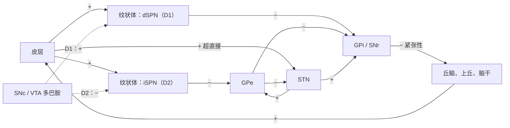

每一刻，动物都有许多可能的行动，却只能执行其中少数几个：它不能同时靠近和逃离，也不能同时向左看和向右看。**基底神经节**是一组前脑与中脑的核团，从七鳃鳗到灵长类都很保守，被认为负责解决这种竞争。它的输出核团使所有运动与认知程序处于紧张性抑制之下，只释放胜出的那一个，而决定胜者的强度由**多巴胺**根据过去选择的结果来调整。因此这一环路联结了两个计算问题：选择，即决定执行当前提出的哪些行动；以及强化学习，即决定将来偏好哪些行动。解剖结构、直接与间接通路的经典率模型以及 Parkinson 病与 Huntington 病的临床表现见 [7.14.45](/7.14.45#sec-45.4)；本章补充选择机制、突触学习规则、把它们解释为行动者–评价者算法（算法见 [7.16.39](/7.16.39)）、目标导向行动与习惯的区分，以及治疗的环路逻辑。推广了行动者–评价者思想的策略梯度学习与基于模型的控制见 [7.16.41](/7.16.41)。

## 40.1. 皮层–基底神经节环路

### 40.1.1. 细胞类型与通路

纹状体（尾状核、壳核，腹侧为伏隔核）是输入核团。在啮齿类中，约 95% 的纹状体神经元是 GABA 能的多棘投射神经元（SPN，也称中型多棘神经元），它们接受来自几乎整个皮层和丘脑板内核的谷氨酸能输入，以及来自黑质致密部（SNc）与腹侧被盖区（VTA）的多巴胺能输入。SPN 的静息电位接近 $-85\,\mathrm{mV}$，由内向整流 $\ce{K+}$ 通道维持，只有许多同时到达的皮层输入把它们驱动进“上升态”时才会放电，所以纹状体对皮层活动起阈值滤波器的作用。其余百分之几是中间神经元：提供前馈抑制的快速放电的小白蛋白细胞，以及胆碱能中间神经元（紧张性活动神经元），后者在显著与奖赏性事件出现时随多巴胺爆发一起发放暂停。

SPN 分为数目相等的两类，以其靶标和分子来区分（[7.14.45](/7.14.45#sec-45.4.2)）：

| | 直接通路 SPN（dSPN） | 间接通路 SPN（iSPN） |
|---|---|---|
| 多巴胺受体 | $\mathrm{D_1}$（$\mathrm{G_{olf}}$，升高 cAMP） | $\mathrm{D_2}$（$\mathrm{G_i}$，降低 cAMP）；还有腺苷 $\mathrm{A_{2A}}$ 受体 |
| 神经肽 | P 物质、强啡肽 | 脑啡肽 |
| 主要靶标 | GPi 与 SNr（输出核团） | GPe |
| 对丘脑的净效应 | 去抑制（释放） | 增强抑制（压制） |

苍白球外侧部（GPe）有两种主要细胞：原型神经元，抑制底丘脑核（STN）与输出核团；以及拱形神经元，投射回纹状体，能整体上终止纹状体的活动（Mallet 等，2012）。STN 是该环路中唯一的谷氨酸能核团，并直接接受来自额叶皮层的输入。

**定义 40.1.1（超直接通路）** **超直接通路**是从额叶皮层到底丘脑核的投射，底丘脑核的谷氨酸能神经元广泛兴奋输出核团（GPi 与 SNr）；它绕过纹状体，是皮层增强基底神经节输出、从而压制动作的最快途径（Nambu、Tokuno 与 Takada，2002）。

神经元数目强烈汇聚。大鼠每侧大脑半球约有 280 万个纹状体神经元，GPe 中有 4.6 万个，STN 中有 1.4 万个，SNr 中有 2.6 万个，以及约 3000 个脚内核（啮齿类的 GPi）神经元（Oorschot，1996）：大约一百个 SPN 汇聚到每个输出神经元上。输出神经元以 $60$–$80\,\mathrm{Hz}$ 紧张性放电，抑制运动丘脑、上丘、脚桥核以及其他脑干运动中枢。

### 40.1.2. 平行环路

这些投射被组织成环路：一个皮层区域投射到纹状体的一个区域，其输出经丘脑回到同一个皮层区域（Alexander、DeLong 与 Strick，1986）。感觉运动环路经过背外侧纹状体（灵长类的壳核），联合环路经过背内侧纹状体（尾状核），边缘环路经过腹侧纹状体（[7.14.45](/7.14.45#sec-45.4.4)）。这些环路一部分相互分离，使每个环路可以在自己的选项（运动、认知操作、动机目标）之间进行选择，一部分由多巴胺神经元与纹状体各区之间的螺旋式投射相联（Haber、Fudge 与 McFarland，2000），腹侧的边缘环路借此影响更靠背侧的环路。这种拓扑结构使 40.5 节中目标导向控制与习惯控制的区别在解剖上有意义。

直接与间接通路最初被认为对运动有相反的效应，光遗传学证实了这一想法。在小鼠中激活 dSPN 增加运动，激活 iSPN 引起僵住与运动迟缓（Kravitz 等，2010）；激活 dSPN 有强化作用（小鼠会回到它受到激活的地点），激活 iSPN 则有惩罚作用（Kravitz、Tye 与 Kreitzer，2012）。但**钙成像**显示，两类细胞在运动起始时同时活动，形成空间上成簇、随运动而异的集合（Cui 等，2013；Barbera 等，2016）。所以这两条通路并不是普遍意义上运动的刹车与油门；它们协同选择特定的动作。

## 40.2. 通过去抑制进行动作选择

### 40.2.1. 选择假说

**定义 40.2.1（动作选择）** **动作选择**是对并行提出的互不相容的行为选项之间竞争的解决，其结果是一个选项（或一组相容的选项）获得共用的运动或认知资源的使用权，其余选项被压制。

基底神经节的结构具备中央选择器所需的性质（Redgrave、Prescott 与 Gurney，1999）。每个皮层通道以共同的“货币”，即输入的强度，向它自己的纹状体区域传递一个选项的显著性。输出核团使每个通道都处于紧张性抑制之下。在输入最强的通道中，dSPN 放电并抑制相应的输出神经元，从而使靶标去抑制，让动作得以进行；来自 STN 的弥散兴奋提高所有通道的输出，于是增强对落选者的抑制。因此选择就是在广泛兴奋的背景上进行的聚焦**去抑制**（[7.14.6](/7.14.6#sec-6.3.3)），这一回路实现了近似的胜者全得。最清楚的例子是扫视：紧张性抑制上丘的 SNr 神经元，在朝向其所抑制的上丘神经元运动野的扫视之前发放暂停，而驱动眼动的上丘爆发在抑制解除时开始（Hikosaka 与 Wurtz，1983）。

**公式 40.2.1（多通道选择模型）** 考虑 $N$ 个通道，皮层显著性为 $c_i$，多巴胺调制为 $d$（正值增加 dSPN 的增益、降低 iSPN 的增益）。取整流函数 $F(u) = \max(u, 0)$，稳态发放率为
$$
\begin{aligned}
x^{\mathrm{D1}}_i &= F\bigl((1 + d)\,c_i - \theta\bigr), \qquad x^{\mathrm{D2}}_i = F\bigl((1 - d)\,c_i - \theta\bigr),\\
s_i &= F\bigl(I_{\mathrm{s}} + w_{\mathrm{h}}\,c_i + w_{\mathrm{i}}\,x^{\mathrm{D2}}_i\bigr), \qquad o_i = F\Bigl(I_{\mathrm{o}} + w_{\mathrm{d}}\,\bar s + w_{\mathrm{f}}\,s_i - w_1\,x^{\mathrm{D1}}_i\Bigr),
\end{aligned}
$$
其中 $s_i$ 是通道 $i$ 的 STN 活动（由超直接输入 $w_{\mathrm{h}}c_i$ 和经 GPe 去抑制的间接通路驱动，后者折合进权重 $w_{\mathrm{i}}$），$\bar s = \frac1N\sum_j s_j$ 是其弥散投射，$o_i$ 是通道 $i$ 中 GPi/SNr 的输出，$\theta$ 是 SPN 的阈值。输出最低的选项被释放。

该模型是 Gurney、Prescott 与 Redgrave（2001）网络的简化形式。它有两个本质特征：SPN 的阈值，使微弱输入被忽略；以及聚焦的纹状体抑制与弥散的底丘脑兴奋的结合，使一个通道的输出依赖于所有其他通道的显著性：加入一个强的竞争者，会升高其他每个通道的输出。多巴胺决定选择的增益（见图）。多巴胺正常时只有最显著的通道被释放。多巴胺耗竭时，没有通道能通过直接通路越过其阈值，而间接通路被增强，所以所有输出都升到静息水平之上，什么也没有被选中，这就是 Parkinson 病的运动不能。多巴胺过多时，几个通道同时被释放，这相当于高剂量 L-DOPA 所产生的不自主运动（40.6 节）。

### 40.2.2. 停止与保持

超直接通路先于其他通路起作用。皮层刺激在约 $5\,\mathrm{ms}$ 内兴奋 STN 神经元，由此产生的对输出核团的兴奋先于纹状体的抑制（Nambu 等，2002）。当一个动作必须被停止或一项选择必须推迟时，它就被调用：在停止信号任务中，当已准备好的反应被取消时，右侧额下回皮层与 STN 被激活（Aron 与 Poldrack，2006）。在价值相近的选项之间做决策时，STN 的活动提高决策阈值，使行动之前累积更多证据（“勒住你的马”；Frank，2006）；接受 STN 刺激治疗 Parkinson 病的患者失去了这种减速，在高冲突下冲动地作出反应（Frank 等，2007）。用 [7.16.47](/7.16.47) 的话说，STN 控制**证据累积**的阈值，直接通路控制其结果。

## 40.3. 多巴胺与纹状体可塑性

### 40.3.1. D1 与 D2 神经元中相反的规则

皮层–纹状体突触是可塑的，其可塑性的符号取决于多巴胺与细胞类别（Shen 等，2008）。在 dSPN 中，把皮层输入与突触后放电配对会产生 LTP，它需要 $\mathrm{D_1}$ 受体的激活；在 iSPN 中，同样的配对产生的 LTP 需要腺苷 $\mathrm{A_{2A}}$ 受体，并被 $\mathrm{D_2}$ 的激活所阻止，而 $\mathrm{D_2}$ 的激活通过**内源性大麻素**的释放促进 LTD。底层的信号是第二信使：$\mathrm{D_1}$ 受体通过 $\mathrm{G_{olf}}$ 升高 cAMP 与 PKA 活性（[7.16.11](/7.16.11#sec-11.1)），而 $\mathrm{D_2}$ 受体通过 $\mathrm{G_i}$ 降低它们。时间要求在单个树突棘上测得：谷氨酸解笼与放电配对，只有当多巴胺在约 $0.3$ 到 $2\,\mathrm{s}$ 之后到达时才使 dSPN 的树突棘增大（Yagishita 等，2014），这是一种具有**三因子学习规则**所要求的时间进程的**资格迹**（[7.16.14](/7.16.14#sec-14.9)）。在 iSPN 中，互补的信号是一次下降：辨别学习中，无奖赏线索之后多巴胺的短暂下降被高亲和力的 $\mathrm{D_2}$ 受体检测到，并增强当时活动的 iSPN 树突棘（Iino 等，2020）。

**公式 40.3.1（对立的三因子规则）** 设从皮层输入 $j$ 到通道 $i$ 的某个 SPN 的突触有资格迹 $e_{ij}$，并有报告奖赏预测误差 $\delta$ 的多巴胺信号，则指向 dSPN 与 iSPN 的权重变化为
$$
\Delta w^{\mathrm{D1}}_{ij} = \eta^+\,[\delta]_+\,e_{ij} - \eta_0^+\,[-\delta]_+\,e_{ij}, \qquad \Delta w^{\mathrm{D2}}_{ij} = \eta^-\,[-\delta]_+\,e_{ij} - \eta_0^-\,[\delta]_+\,e_{ij},
$$
其中 $[x]_+ = \max(x, 0)$：爆发（$\delta$ 为正）增强近期活动输入的直接通路突触、削弱间接通路突触，下降（$\delta$ 为负）则相反。起主导作用的项的系数 $\eta^\pm$ 由受体的亲和力以及爆发与下降的大小决定。

### 40.3.2. Go/NoGo 学习

这条规则在选择回路中实现了强化学习。一个带来比预期更多奖赏的行动，会增强其通道的 dSPN 突触（“Go”），今后更容易被选中；一个之后结果更差的行动，会增强 iSPN 突触（“NoGo”），将被压制。两条通路由此分别从收益和损失中学习（Frank，2005）。由此得到关于多巴胺障碍的一个预测：紧张性多巴胺水平低时，如在 Parkinson 病中，爆发很小但下降依然有效，所以从损失中学习应当被保留或增强，而从收益中学习受损；多巴胺类药物应当逆转这一模式。

Frank、Seeberger 与 O'Reilly（2004）用一个概率性选择任务检验了这一点。被试在符号对 AB、CD 与 EF 之间做选择，它们得到奖赏的概率分别为 $0.8/0.2$、$0.7/0.3$ 与 $0.6/0.4$；然后在没有反馈的情况下，在新的符号对之间选择。选择 A 而非其他符号衡量从收益中学习，避开 B 衡量从损失中学习。未服药测试的 Parkinson 病患者避开 B 比选择 A 做得更好；服用 L-DOPA 与多巴胺激动剂时，他们选择 A 比避开 B 做得更好。此后这一任务被用来在纹状体 $\mathrm{D_1}$ 与 $\mathrm{D_2}$ 受体功能的遗传变异中显示同样的分离。

**例 40.3.1（对立的行动者–评价者）** 在 Collins 与 Frank（2014）的对立行动者–评价者中，每个刺激 $k$ 有一个 Go 权重 $G_k$ 与一个 NoGo 权重 $N_k$，初值均为 1。在刺激对 $(k, l)$ 中选择 $k$ 的概率是 $\beta[(G_k - N_k) - (G_l - N_l)]$ 的 logistic 函数，评价者以速率 $0.1$ 学习每个刺激对的期望奖赏 $\hat v$，在所选刺激得到结果 $R$ 之后，令 $\delta = R - \hat v$，
$$
G_k \leftarrow G_k + \alpha_G\,G_k\,\delta, \qquad N_k \leftarrow N_k - \alpha_N\,N_k\,\delta.
$$
乘性形式使权重保持为正，并使每条通路各有专长：经常得到奖赏的刺激其 Go 权重增长，经常得不到奖赏的刺激其 NoGo 权重增长。多巴胺水平用学习率的不对称来建模：正常 $\alpha_G = \alpha_N = 0.1$，低多巴胺 $\alpha_G = 0.02$、$\alpha_N = 0.2$，高多巴胺 $\alpha_G = 0.2$、$\alpha_N = 0.02$。经过 360 次训练试验（500 个模拟被试，$\beta = 2$），迁移测试中的正确率在正常条件下为 $0.83$（选 A）与 $0.75$（避 B），低多巴胺时为 $0.77$ 与 $0.80$，高多巴胺时为 $0.87$ 与 $0.70$：两种测量之间的不对称发生逆转，与患者相同。

:::

## 40.4. 行动者–评价者架构

Go/NoGo 模型用一个学得的量来选择行动（权重 $G - N$），用另一个来计算教学信号（评价者的价值）。这种分工正是行动者–评价者的决定性特征。

**算法 40.4.1（表格式行动者–评价者）** 行动者–评价者（actor–critic）智能体维护一个评价者，即对其当前策略的状态价值的估计 $\hat v(s)$，以及一个行动者，即定义 softmax 策略 $\pi(a \mid s) = \mathrm{e}^{h(s, a)}/\sum_b \mathrm{e}^{h(s, b)}$ 的行动偏好表 $h(s, a)$。每一步，它选择 $A_t \sim \pi(\cdot \mid S_t)$，观察 $R_{t+1}$ 与 $S_{t+1}$，计算 TD 误差 $\delta_t = R_{t+1} + \gamma\,\hat v(S_{t+1}) - \hat v(S_t)$，并同时更新二者
$$
\hat v(S_t) \leftarrow \hat v(S_t) + \alpha_{\mathrm{c}}\,\delta_t, \qquad h(S_t, A_t) \leftarrow h(S_t, A_t) + \alpha_{\mathrm{a}}\,\delta_t.
$$

同一个 **TD 误差**（[定义 39.2.1](/7.16.39#def-39.2.1)）同时教导二者：对评价者它是预测的误差，对行动者它说明刚采取的行动结果比评价者预期的更好（$\delta_t > 0$）还是更差，该状态下对该行动的偏好随之改变。行动者不需要动作价值，所以这一架构可以处理大的或连续的行动空间，而且它的策略是随机的，这提供了探索。行动者的更新是策略梯度的采样形式，评价者的价值充当降低其方差的基线；一般的推导，以及为什么 $\delta_t$ 估计所选行动的优势，见 [7.16.41](/7.16.41)。

与基底神经节的对应在发现多巴胺预测误差后不久就被提出（Barto，1995；Houk、Adams 与 Barto，1995）。多巴胺神经元计算 $\delta_t$；腹侧纹状体连同边缘皮层与**杏仁核**提供评价者的价值 $\hat v$，因为它的输入编码状态及其动机意义；背侧纹状体是行动者，因为它的环路控制行动，其皮层–纹状体突触存储偏好 $h(s, a)$，由三因子可塑性借助广播的 $\delta_t$ 来调整。

| 行动者–评价者的成分 | 提出的基质 | 证据 |
|---|---|---|
| TD 误差 $\delta_t$ | VTA 与 SNc 多巴胺神经元 | 预测误差反应（[7.16.37](/7.16.37#sec-37.4)） |
| 评价者 $\hat v(s)$ | 腹侧纹状体、眶额皮层、杏仁核 | 腹侧纹状体中与预测误差相关的 BOLD 信号，在 Pavlov 与工具性任务中都有 |
| 行动者 $h(s, a)$ | 背侧纹状体及其皮层输入 | 背侧纹状体中与预测误差相关的信号仅在需要选择行动时出现；背侧纹状体神经元的动作价值编码 |
| 可塑性 | 依赖多巴胺的皮层–纹状体 LTP 与 LTD | 40.3.1 节 |

O'Doherty 等（2004）用 fMRI 检验了这一分离。当同样的线索预示果汁时，无论被试是在行动之间做选择还是仅仅观察线索，腹侧纹状体中都出现预测误差信号，而背侧纹状体中只有在选择行动时才出现。对猴尾状核与壳核的记录发现，有些神经元在选择之前的发放编码某个特定行动的价值，而与随后实际选择了哪个行动无关（Samejima 等，2005），这正是行动者或 **Q 学习**智能体所需要的量。这种对应是近似的：投射到不同纹状体区域的多巴胺神经元携带部分不同的信号（[7.16.37](/7.16.37#sec-37.4)），价值与动作信号在整个纹状体中都能找到。

## 40.5. 目标导向行为与习惯

### 40.5.1. 两种工具性控制

一只为蔗糖而按杠杆的大鼠可能在做两件事之一：因为预期会得到蔗糖并且当前想要它而按压，或者因为在这个箱子里按压一直得到强化而按压。仅看大鼠按压无法区分二者；要通过改变结果的价值来区分。

**定义 40.5.1（目标导向行为与习惯）** 一个工具性行动，若受其结果及该结果当前价值的表征所控制，因而既对结果贬值敏感、也对行动与结果之间关联的退化敏感，则称为**目标导向**的。若它受刺激情境通过由以往强化所增强的刺激–反应联结所控制，并对这两种操作都不敏感，则称为**习惯**。

在结果贬值测试中，训练之后结果被贬值，办法是让大鼠对它吃到饱，或把它与恶心配对，然后在消退条件下测量按杠杆（不给予结果，所以大鼠无法通过杠杆学到新的价值）。训练有限时，贬值会减少按压：行动是目标导向的。训练延长之后，特别是在间隔程序下，尽管大鼠已不再吃这种结果，按压的速率依然不变：行动已成为习惯（Adams 与 Dickinson，1981）。习惯是高效的（它使动物不必评估后果），却缺乏灵活性。

两种控制形式依赖不同的环路。损毁或抑制背内侧纹状体，即带有前额叶输入的联合环路的一部分，即使在训练有限之后也使行为对贬值不敏感；损毁背外侧纹状体，即感觉运动环路的一部分，则即使在训练延长之后也使行为保持目标导向（Yin、Knowlton 与 Balleine，2004；Yin 等，2005）。耗竭背外侧纹状体的多巴胺同样阻止习惯形成。在人类中，过度训练使与所训练行动相关的活动向后壳核转移，后者是啮齿类背外侧纹状体的同源结构（Tricomi、Balleine 与 O'Doherty，2009）。

### 40.5.2. 仲裁模型

强化学习框架把目标导向控制等同于基于模型的评估，它根据行动后果的模型和结果的当前价值来计算行动的价值；把习惯等同于由 **TD 学习**缓存的无模型价值（[7.16.39](/7.16.39#sec-39.5)）（Daw、Niv 与 Dayan，2005）。缓存的价值在结果被贬值时不会改变，直到行动之后再次经历被贬值的结果；基于模型的价值则立即改变，因为它根据结果重新计算。如果两个系统都存在，哪一个控制行为？Daw 等提出，脑按各系统估计的确定性对其加权。训练早期，无模型价值学得还很差，基于模型的计算更可靠；随着训练延长，缓存的价值变得准确且廉价，而基于模型的计算仍受其众多步骤的噪声所限，于是控制权转交给习惯系统。

**例 40.5.1（仲裁模型中的贬值）** 设大鼠训练 $n$ 个训练日，按杠杆获得价值为 1 的食物，并设习惯系统的权重随其缓存价值的可靠性增长，$w(n) = n/(n + n_{1/2})$，$n_{1/2} = 6$。测试中的反应速率为每分钟 $20\,[w\,q_{\mathrm{MF}} + (1 - w)\,q_{\mathrm{MB}}]$ 次按压，其中 $q_{\mathrm{MF}} = 1$ 是缓存价值，$q_{\mathrm{MB}}$ 是结果的当前价值。若食物被贬值（$q_{\mathrm{MB}} = 0$，而在消退测试中 $q_{\mathrm{MF}}$ 仍为 1），训练 2 个训练日（$w = 0.25$）的大鼠每分钟按压 5 次而不是 20 次，而训练 20 个训练日（$w \approx 0.77$）的大鼠仍然每分钟按压约 15 次。

:::

仲裁模型是唯象的：权重函数代表一个不确定性的计算，而它没有说明如何权衡基于模型计算的代价。它的价值在于把行为上的区分变成可在其他任务中测量的计算上的区分，例如 [7.16.41](/7.16.41) 的**两步任务**，人和动物在其中表现出两种控制形式的混合。向习惯的转移也是**成瘾**（[7.16.37](/7.16.37#sec-37.5)）和强迫症中的一种候选机制，强迫症患者在贬值测试中表现出过度的习惯形成（Gillan 等，2011）。

## 40.6. 基底神经节疾病

### 40.6.1. Parkinson 病

**Parkinson 病**的运动体征（运动迟缓、僵直、静止性震颤）出现时，约一半的 SNc 多巴胺神经元和约 80% 的纹状体多巴胺已经丧失（[7.14.45](/7.14.45#sec-45.4.5)；其分子病理见 [7.16.51](/7.16.51)）。经典的率模型解释运动不能：多巴胺丧失削弱直接通路、增强间接通路，使输出核团对丘脑的抑制过强（Albin、Young 与 Penney，1989；DeLong，1990）。公式 40.2.1 补充说明，失败在于选择：多巴胺低时没有哪个选项明显胜出。该模型预言损毁 STN 或 GPi 应当缓解帕金森症状，这在被毒素 MPTP 致成帕金森症的猴子中得到证实（Bergman、Wichmann 与 DeLong，1990），并导致了下面的手术治疗。

发放率的变化只是图景的一部分。在患者和帕金森症动物中，STN 与 GPi 的神经元成簇放电，并在 beta 频段（$13$–$30\,\mathrm{Hz}$）同步；STN 局部场电位中 beta 振荡的功率与运动迟缓和僵直相关，并在 L-DOPA 治疗后和随意运动之前下降。健康运动系统中的 beta 活动标志着对当前状态的维持；它在 Parkinson 病中的过度，可以解读为对改变的过度偏置。

各种治疗作用于环路的不同位置：

| 治疗 | 作用 | 环路解释 |
|---|---|---|
| L-DOPA（配合外周脱羧酶抑制剂） | 在存活的终末中转化为多巴胺 | 恢复直接通路的增益与选择；随病情进展，释放的缓冲能力丧失，血浆波动传到纹状体，在峰值剂量时出现异动症（释放过多，公式 40.2.1 中 $d$ 很大） |
| 多巴胺激动剂（$\mathrm{D_2}$/$\mathrm{D_3}$） | 持续的受体刺激 | 阻止驱动 NoGo 学习的下降；约 14% 的受治疗患者出现冲动控制障碍（赌博、强迫性购物）（Weintraub 等，2010） |
| STN 或 GPi 的深部脑刺激（$130$–$180\,\mathrm{Hz}$） | 高频电刺激 | 破坏病理性成簇放电与 beta 同步；作用如同可逆的损毁 |
| 适应性（闭环）DBS | 仅在 beta 功率超过阈值时刺激 | 针对病理信号，刺激更少、副作用更小（Little 等，2013） |

深部脑刺激如何起作用仍有争论：它抑制电极附近的胞体，兴奋其轴突和附近经过的轴突，并把不规则、成簇的放电换成与刺激锁定的规则放电，后者不携带信息（“信息性损毁”）。对帕金森症啮齿类的光遗传学剖析给出了令人意外的回答：抑制或兴奋 STN 神经元本身几乎没有治疗效果，而对 STN 中皮层轴突，即超直接通路，作高频光遗传刺激则缓解了运动症状（Gradinaru 等，2009）。因此 STN 刺激的部分效应可能是对运动皮层的逆向激活。

### 40.6.2. Huntington 病

**Huntington 病**由 *HTT* 中 CAG 重复序列的扩增引起（[7.14.45](/7.14.45#sec-45.4.5)），首先退化的是投射到 GPe、表达脑啡肽的 iSPN。间接通路减弱，输出核团在弱显著选项的通道中受到直接通路过度的抑制，本应被压制的选项逃脱出来：舞蹈症，即从身体一个部位流向另一个部位的不自主运动。以公式 40.2.1 的语言说，丧失 iSPN 就去掉了使胜者唯一的周边抑制。舞蹈症的治疗使用降低多巴胺信号的药物（VMAT2 抑制剂丁苯那嗪，它耗竭囊泡中的多巴胺，或 $\mathrm{D_2}$ 拮抗剂），与环路图景一致。随着疾病进展，dSPN 也退化，运动表现转为运动迟缓与僵直，而皮层退化导致痴呆。

其他疾病被解释为非运动环路中选择的失败：Tourette 综合征的抽动是本应被压制的运动程序的逃逸，强迫症的强迫行为是眶额–腹内侧纹状体环路中的失衡，DBS 的精神效应（轻躁狂、冲动）是刺激扩散到 STN 的边缘区域。共同的线索是本章确立的这一环路的双重功能：它进行选择，并学习选择什么。

## 小结

- 纹状体接受皮层、丘脑与多巴胺能输入；其表达 $\mathrm{D_1}$ 的 dSPN 释放（直接通路）、表达 $\mathrm{D_2}$ 的 iSPN 压制（间接通路）紧张性活动的输出核团 GPi 与 SNr 的靶标；从皮层到 STN 的超直接通路（定义 40.1.1）广泛而快速地兴奋输出核团。该环路形成平行的、部分分离的感觉运动、联合与边缘环路。
- 动作选择（定义 40.2.1）来自聚焦的纹状体抑制与弥散的底丘脑对输出核团的兴奋（公式 40.2.1）：最显著的通道被去抑制，其余被压制；多巴胺决定选择的增益（耗竭时无选择，过多时多重选择）。STN 暂停或停止动作，并在冲突下提高决策阈值。
- 多巴胺在两条通路中沿相反方向控制可塑性：爆发增强 dSPN 上活动的皮层–纹状体突触，下降增强 iSPN 上的这些突触（公式 40.3.1），资格迹约为一秒。直接通路从收益中学习，间接通路从损失中学习（Go/NoGo 学习），Parkinson 病患者服药与否出现预测的逆转（例 40.3.1）。
- 基底神经节类似一个行动者–评价者（算法 40.4.1）：多巴胺是 TD 误差，腹侧纹状体是评价者，背侧纹状体是行动者。
- 目标导向行动对结果贬值敏感，习惯则不敏感（定义 40.5.1）；它们依赖背内侧与背外侧纹状体，对应于基于模型与无模型的控制，由二者相对的确定性仲裁（例 40.5.1）。

| 状况 | 环路变化 | 对选择的影响 | 治疗逻辑 |
|---|---|---|---|
| Parkinson 病 | SNc 多巴胺丧失；直接通路弱、间接通路强；beta 同步 | 没有选项被释放（运动不能） | 恢复多巴胺（L-DOPA）；破坏 STN/GPi 输出（DBS） |
| L-DOPA 诱发的异动症 | 多巴胺过多且呈脉冲式 | 多个选项被释放 | 平稳给药；减量 |
| Huntington 病（早期） | iSPN 丧失 | 竞争选项逃脱压制（舞蹈症） | 降低多巴胺信号（丁苯那嗪） |
| 习惯主导的疾病 | 转向背外侧、无模型控制 | 尽管贬值，行动仍持续 | 行为治疗；实验性神经调控 |

## 思考题

1. 在公式 40.2.1 中取 $d = 0$ 和两个通道，证明即使通道 1 自己的输入不变，增大通道 2 的显著性也会增大通道 1 的输出。哪个连接起了这个作用？没有它会怎样？

   **答** 取 $d = 0$，$o_1 = F(I_{\mathrm{o}} + w_{\mathrm{d}}(s_1 + s_2)/2 + w_{\mathrm{f}}s_1 - w_1 x^{\mathrm{D1}}_1)$。增大 $c_2$ 会通过超直接项、并在越过阈值后通过间接通路升高 $s_2 = F(I_{\mathrm{s}} + w_{\mathrm{h}}c_2 + w_{\mathrm{i}}x^{\mathrm{D2}}_2)$，从而使 $o_1$ 升高 $\frac12 w_{\mathrm{d}}\,\Delta s_2$，而 $x^{\mathrm{D1}}_1$ 不变。起作用的连接是弥散的 STN 投射（$w_{\mathrm{d}}$）。没有它（$w_{\mathrm{d}} = 0$），每个通道是否被释放只取决于它自己的输入：几个足够显著的选项可能同时被选中，当强竞争者出现时，弱选项也不会被更强地压制。弥散的兴奋把相互独立的阈值变成了竞争。

2. 用 Go/NoGo 模型解释，为什么未服药的 Parkinson 病患者比健康对照更善于学会避开低奖赏刺激，以及多巴胺激动剂为什么可能促成病理性赌博。

   **答** 多巴胺减少时，出乎意料的好结果之后的爆发很小，所以 Go 权重增长缓慢；坏结果之后的下降仍能被高亲和力的 $\mathrm{D_2}$ 受体检测到（其基线占据率低），所以 NoGo 权重正常增长或增长更快。大多得不到奖赏的刺激积累起强的 NoGo 权重而被避开。多巴胺激动剂持续刺激 $\mathrm{D_2}$ 受体，于是下降不再降低它们的激活：从损失中的 NoGo 学习被钝化，而从偶尔获胜中的 Go 学习照常进行。在损失频繁、偶尔获胜的赌博中，平衡偏向继续选择有风险的选项，这正是激动剂治疗时冲动控制障碍的报告模式。

3. 在行动者–评价者（算法 40.4.1）中，考虑一个状态和两个行动，二者分别确定地给出奖赏 1 和 0 并结束回合。证明在评价者正确时，只要 $\pi(a_1) < 1$，每次试验偏好差 $h(a_1) - h(a_2)$ 的期望变化就为正，并求评价者的不动点。

   **答** 评价者收敛到该策略的期望奖赏 $\hat v = \pi(a_1)\cdot 1 + \pi(a_2)\cdot 0 = \pi_1$。选择 $a_1$（概率 $\pi_1$）时，$\delta = 1 - \pi_1 > 0$，$h(a_1)$ 增加 $\alpha_{\mathrm{a}}(1 - \pi_1)$；选择 $a_2$（概率 $1 - \pi_1$）时，$\delta = -\pi_1$，$h(a_2)$ 减少 $\alpha_{\mathrm{a}}\pi_1$。$h(a_1) - h(a_2)$ 的期望变化为 $\alpha_{\mathrm{a}}[\pi_1(1 - \pi_1) + (1 - \pi_1)\pi_1] = 2\alpha_{\mathrm{a}}\pi_1(1 - \pi_1)$，当 $0 < \pi_1 < 1$ 时为正。策略趋向于总是选择 $a_1$，评价者的不动点随之移向 $\hat v = 1$；当 $\pi_1(1 - \pi_1) \to 0$ 时学习减慢。

4. 经过延长的训练之后，大鼠按杠杆对贬值不敏感。预测以下操作的效果：(a) 测试时抑制背外侧纹状体，(b) 测试时抑制背内侧纹状体，(c) 测试前让大鼠按杠杆并几次得到被贬值的结果。用仲裁模型解释。

   **答** (a) 去掉习惯系统后由目标导向系统控制，所以按压再次对贬值敏感；这是背外侧抑制实验的结果。(b) 习惯系统已经占主导，所以抑制目标导向系统几乎不改变什么；按压仍保持较高。(c) 当被贬值的结果跟在行动之后时，缓存的无模型价值被 TD 误差更新（$\delta = 0 - q_{\mathrm{MF}} < 0$），所以经历几次之后 $q_{\mathrm{MF}}$ 下降，即使在习惯控制下按压也减少。习惯只有在新价值尚未在行动之后被经历时才对贬值不敏感；这就是贬值测试要在消退条件下进行的原因。

5. （开放题）STN 的深部脑刺激缓解帕金森症状，但选择模型赋予 STN 压制竞争行动的作用。提出实验来判定以下假说：DBS 通过沉默 STN 输出、通过使其规则化、还是通过逆向激活皮层起作用。

   **答** 思路：在帕金森症啮齿类或灵长类中，比较能区分这三种机制的操作的行为效应。(i) 沉默：仅在胞体处对 STN 神经元作光遗传或化学遗传抑制，若沉默是机制，就应当重现疗效；在啮齿类中它基本不能。(ii) 规则化：平均速率相同而时间不规则的刺激模式，若规则性才是关键，就应丧失疗效；在患者中，不规则的高频刺激确实不如规则刺激有效。(iii) 逆向激活：选择性刺激 STN 中超直接通路轴突终末（对皮层投射神经元作光遗传），并记录运动皮层中的逆向放电与 beta 活动的变化，检验皮层途径；若该途径是必需的，则在 DBS 期间阻断皮层反应（例如局部抑制运动皮层）应当取消疗效。把对 GPi 输出和 beta 功率的记录与每种操作结合起来，可以显示所有有效的操作是否都汇聚到输出核团中 beta 同步的降低。
