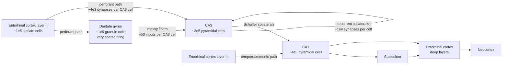
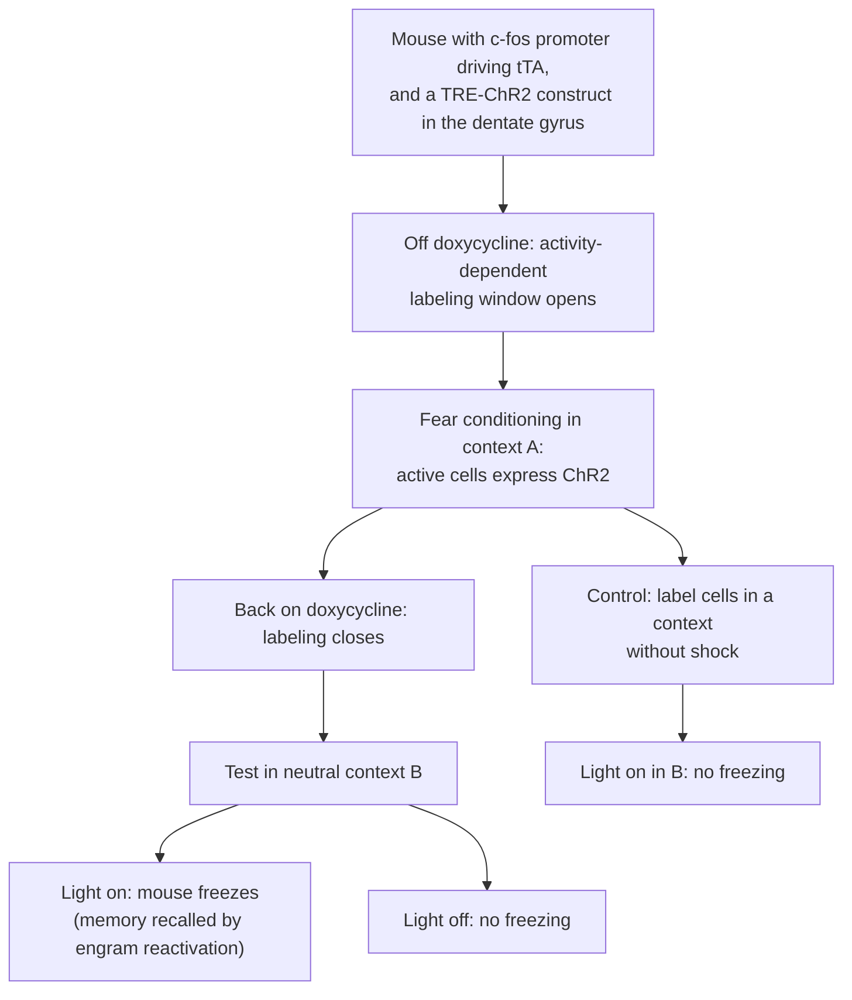

Memories of facts and events, the kind we can report, depend on a set of structures in the medial temporal lobe centered on the hippocampus. This chapter follows the hippocampus from the clinical observation that first revealed its role to the cellular and circuit level: the anatomy of its loop, the computational ideas of pattern separation and pattern completion that this anatomy suggests, the neurons that represent where an animal is, the oscillations and replay events that organize their firing in time, the cells that hold a particular memory, and the processes by which memories become stable and are later modified. The behavioral classification of memory and the basic facts on H.M. and consolidation are given in [7.14.46](/7.14.46#sec-46.5.3); the nondeclarative forms, habituation, sensitization and conditioning, are the subject of [7.16.38](/7.16.38). The synaptic mechanisms used here, **long-term potentiation** and its dependence on the **NMDA receptor**, are developed in [7.16.14](/7.16.14). The chapter prepares the models of the following chapters: the attractor networks of [7.16.43](/7.16.43) formalize pattern completion, the continuous attractors of [7.16.44](/7.16.44) explain the head direction and grid systems, and the **successor representation** of [7.16.46](/7.16.46) reinterprets place fields as predictions.

## 42.1. The Medial Temporal Lobe Memory System

### 42.1.1. H.M. and the Dissociation of Memory Systems

In 1953 William Scoville removed the medial temporal lobes on both sides, including the anterior two thirds of the hippocampus, the **amygdala** and most of the entorhinal cortex, from the patient Henry Molaison (H.M.) to treat intractable epilepsy. Brenda Milner's testing (Scoville and Milner, 1957) established a pattern that later patients confirmed. H.M.'s intelligence, perception, language and short-term memory were normal: he could hold a number in mind for minutes by rehearsal. He could not form new long-term memories of facts or events (anterograde amnesia), and he had lost memories from the years before the operation, while his childhood memories were intact (temporally graded retrograde amnesia). Yet he learned the motor skill of drawing a star seen only in a mirror, improving over three days, without remembering that he had practiced (Milner, 1962).

Three conclusions follow, and they define the field. Memory is a function separable from perception and intelligence. Short-term memory and long-term memory are distinct, and the medial temporal lobe is needed for the transfer into the second. And there are several long-term memory systems, only one of which depends on the medial temporal lobe.

**Definition 42.1.1 (Declarative Memory)** **Declarative memory** (explicit memory) is long-term memory for facts and events that can be consciously recalled and reported; it comprises **episodic memory**, the memory of personally experienced events located in time and place, and **semantic memory**, general knowledge independent of the occasion on which it was acquired. It depends on the hippocampus and the surrounding medial temporal lobe cortex for its acquisition and initial storage. Memory expressed through performance without conscious recollection, such as skills, habits, priming and conditioning, is nondeclarative ([7.16.38](/7.16.38)).

### 42.1.2. Anatomy and the Division of Labor

The medial temporal lobe system consists of the hippocampus proper (the fields CA1–CA3, from *cornu Ammonis*), the dentate gyrus and the subiculum, together called the hippocampal formation, and the adjacent entorhinal, perirhinal and parahippocampal cortices. The entorhinal cortex is the interface: it receives highly processed input from all association cortices, through the perirhinal cortex (mainly object information, the "what" stream) and the parahippocampal cortex (postrhinal in rodents; mainly spatial context, the "where" stream), and it is also the main output target of the hippocampus.

Lesion studies in monkeys and patients sharpened the anatomy. The patient R.B., whose damage after an ischemic episode was confined to the CA1 field of both hippocampi, had a clear though milder anterograde amnesia (Zola-Morgan, Squire and Amaral, 1986): damage to a single hippocampal field suffices. Larger lesions including the surrounding cortex produce more severe deficits. A widely held division assigns *familiarity*, the sense that an item has been seen before, to the perirhinal cortex, and *recollection*, retrieval of the item together with its context, to the hippocampus; recognition memory then has two components with different neural bases, a view supported by imaging and by patients with selective hippocampal damage who recognize items but cannot recall their context. The hippocampus binds the elements of an experience, objects, place, time and order, into one retrievable record; this binding role is what links its function in episodic memory to its function in spatial navigation, the topic of Sections 42.3–42.5.

## 42.2. The Hippocampal Circuit

### 42.2.1. The Trisynaptic Loop

The cellular anatomy of the hippocampus, described by Ramón y Cajal and Lorente de Nó, is a largely unidirectional loop that can be summarized with approximate cell numbers for one hemisphere of the rat (Amaral and colleagues):

The classical trisynaptic path runs from entorhinal layer II to the dentate granule cells (synapse 1), from the granule cells through the mossy fibers to CA3 (synapse 2) and from CA3 through the Schaffer collaterals to CA1 (synapse 3). Direct entorhinal inputs reach CA3 and, from layer III, CA1. Three features of the numbers matter for computation. The dentate gyrus has about ten times more cells than its entorhinal input, and only a few percent of granule cells are active in any environment: it expands the representation and makes it sparse. Each mossy fiber makes few but very large synapses (about 15 CA3 targets per granule cell, each CA3 cell receiving only about 50 mossy fibers), strong enough that a burst in one granule cell can make its target fire, which is why they are called "detonator" synapses. And CA3 is unusual among brain regions for its dense excitatory recurrent connections: each pyramidal cell receives about 12 000 synapses from other CA3 cells, a connection probability of a few percent, far more than from its extrinsic inputs.

### 42.2.2. Pattern Separation and Pattern Completion

Marr (1971) proposed that a network with recurrent excitatory connections modified by Hebbian plasticity can store an event as a pattern of co-active cells and later reconstruct the whole pattern from a part. McNaughton and Morris (1987), Treves and Rolls (1994) and others mapped this idea onto CA3, with the dentate gyrus providing a preprocessing step.

**Definition 42.2.1 (Pattern Separation and Pattern Completion)** **Pattern separation** is the transformation of similar input patterns into output patterns that overlap less than the inputs, so that similar experiences are stored as distinct memories. **Pattern completion** is the retrieval of a complete stored pattern from a partial or degraded version of it, so that a fragment of an experience reinstates the whole.

The two operations pull in opposite directions: completion maps similar inputs onto the same output, separation maps them onto different ones. A system that stores many similar episodes needs both, and the hippocampal circuit is thought to divide them. Pattern separation arises naturally from sparse expansion. When a pattern is projected through random connections onto a much larger population and only the most strongly driven cells are allowed to fire (by feedback inhibition, a winner-take-all operation), two inputs that share most of their active elements still select partly different winners, because the identity of the winners depends sensitively on small differences in the summed input. The sparser the output, the stronger the decorrelation (figure below). The same motif, a random expansion followed by sparse thresholding, appears in the cerebellar granule layer ([7.16.33](/7.16.33)) and in the **Kenyon cells** of the insect **mushroom body**, where it implements a form of **locality-sensitive hashing** ([7.16.23](/7.16.23)).

![Pattern separation by sparse expansion. Binary input patterns of 400 "entorhinal" units (10% active) are projected through random excitatory connections (40 inputs per output unit) onto 4000 "dentate" units, and the fraction $f$ of output units with the largest input is kept active (k-winners-take-all, a model of feedback inhibition). A: correlation between the output patterns against the correlation between the inputs for $f = 0.5$, $0.1$ and $0.02$; the dashed identity line marks no change. All curves lie below it, and the sparsest code separates most: inputs with correlation 0.55 give output correlations of about 0.36, 0.30 and 0.19. B: output correlation for input pairs with correlation 0.75 as a function of $f$: it falls from about 0.5 for dense codes to about 0.33 for $f = 0.01$.](./plots/pattern-separation.py)

The genetic evidence matches the division. Mice lacking **NMDA receptors** only in dentate granule cells learned to fear a context normally but could not learn to distinguish it from a similar context (McHugh et al., 2007), a deficit in separation. Mice lacking NMDA receptors only in CA3 pyramidal cells learned the water maze normally and recalled the platform location with the full set of cues, but their recall failed when most of the distal cues were removed, while that of controls did not (Nakazawa et al., 2002), a deficit in completion. Recordings show the same contrast: when the shape of an enclosure is morphed step by step between a square and a circle, dentate cells change their firing patterns even for small changes, whereas CA3 representations change only when the shape is altered more strongly (Leutgeb, Leutgeb, Moser and Moser, 2007). The theory of how recurrent networks store and complete patterns, and how many they can hold, is the subject of [7.16.43](/7.16.43).

## 42.3. Spatial Memory

### 42.3.1. The Water Maze

Rodents with hippocampal lesions are impaired in spatial navigation, which gave a tractable behavioral assay of hippocampal function. In the Morris water maze (Morris, 1981), a rat or mouse swims in a pool of opaque water and learns to find a platform hidden just below the surface, using cues around the room. Over days the escape latency falls. In a probe trial with the platform removed, a trained animal searches mostly in the quadrant where the platform was, which shows that it has learned the location in relation to distal cues rather than a fixed sequence of movements. Hippocampal lesions abolish this place learning, but not learning to swim to a visible platform, a dissociation analogous to the declarative–nondeclarative dissociation in humans.

### 42.3.2. Testing the LTP Hypothesis

The water maze became the main test of the hypothesis that memories are stored by **long-term potentiation** ([Definition 14.2.1](/7.16.14#def-14.2.1)). Infusing the **NMDA receptor** antagonist AP5 into the brain at concentrations that blocked hippocampal LTP in vivo impaired place learning but not visible-platform learning (Morris, Anderson, Lynch and Baudry, 1986). Genetic methods made the manipulation regionally specific. Mice in which the NR1 subunit, required for all NMDA receptors, was deleted only in CA1 pyramidal cells after development (with the Cre–*loxP* system and a promoter active in CA1 in the adult) lacked LTP at the Schaffer collateral synapse and were impaired in the water maze (Tsien, Huerta and Tonegawa, 1996). Their place cells still had place fields, but the fields were larger and the firing of cells with overlapping fields was less coordinated (McHugh et al., 1996), so the deficit was in the formation of a precise and coherent map. Conversely, mice overexpressing the NR2B subunit, which prolongs NMDA receptor currents, had enhanced LTP and learned some tasks faster (Tang et al., 1999).

These experiments show that NMDA-receptor-dependent plasticity in the hippocampus is necessary for spatial learning; they do not show that the potentiated synapses are the memory. The strongest evidence for sufficiency comes from the engram experiments of Section 42.6. Two caveats keep the question open. Rats pretrained in one water maze can learn a second maze under NMDA receptor blockade (Bannerman et al., 1995), so part of the impairment reflects learning the general strategy rather than the location; and NMDA receptors have roles beyond plasticity in ongoing synaptic transmission.

## 42.4. The Neural Representation of Space

### 42.4.1. Place Cells

Recording single neurons in freely moving rats, O'Keefe and Dostrovsky (1971) found pyramidal cells in CA1 that fired when the rat was in one part of its environment and were nearly silent elsewhere. O'Keefe and Nadel (1978) proposed that these cells form the substrate of a *cognitive map* in Tolman's sense ([7.16.46](/7.16.46)), an allocentric representation of space, independent of the animal's orientation.

**Definition 42.4.1 (Place Cell)** A **place cell** is a hippocampal principal neuron (a pyramidal cell of CA1 or CA3, or a granule or mossy cell of the dentate gyrus) whose firing rate depends on the animal's location: it fires at up to tens of hertz within a restricted region of the environment, its *place field*, and is nearly silent elsewhere.

In the dorsal hippocampus of the rat, place fields have diameters of about 20–50 cm in a laboratory enclosure, and they grow along the dorsoventral axis to several meters at the ventral pole (Kjelstrup et al., 2008). A given environment is represented by a sparse subset of cells, a few tens of percent of CA1 cells in a typical enclosure, and the fields of the active cells tile the environment. The population is therefore a **population code** for position: from the **spike trains** of a few tens of simultaneously recorded place cells, a Bayesian decoder ([7.16.26](/7.16.26)) estimates the position of the rat to within a few centimeters (Wilson and McNaughton, 1993; Zhang, Ginzburg, McNaughton and Sejnowski, 1998).

Place fields are not fixed attributes of the cells. When an animal is moved to a different environment, the cells *remap*: each cell may acquire a field at an unrelated location or become silent, so that the two environments are represented by nearly independent maps (global remapping). Smaller changes, for example of the color of the walls in the same location, change the firing rates within fields while leaving their positions unchanged (rate remapping; Leutgeb et al., 2005). Place fields also respond to nonspatial variables: in a task, some cells fire at the same place depending on where the animal came from or is going to ("splitter" cells), and in time-bridging tasks hippocampal "time cells" fire at successive moments of a delay (MacDonald, Lepage, Eden and Eichenbaum, 2011). The hippocampus thus encodes locations together with the events and contingencies that occur there.

How does a place field form? Cells receive inputs from the entorhinal cortex with spatial information, and a field appears when a subset of these synapses is potentiated. Intracellular recordings in mice running on a treadmill showed that a single dendritic plateau potential, spontaneous or evoked, is enough to create a place field at the position where it occurred within one lap, by **behavioral timescale synaptic plasticity** that potentiates inputs active seconds before and after the plateau ([Definition 14.8.1](/7.16.14#def-14.8.1); Bittner et al., 2017). Such one-shot plasticity explains why new fields appear abruptly and why they cluster near rewards, where plateau potentials are frequent.

### 42.4.2. Head Direction, Grid and Border Cells

The hippocampus receives its spatial information from a set of neighboring structures, each with its own cell type.

**Definition 42.4.2 (Head Direction Cell)** A **head direction cell** is a neuron whose firing rate depends on the direction in which the animal's head points in the horizontal plane, independent of its location and of the direction of motion: each cell fires maximally at one preferred direction, with a tuning width of about $60^\circ$–$120^\circ$.

Head direction cells were found by Ranck (1984) in the postsubiculum (dorsal presubiculum) and characterized by Taube, Muller and Ranck (1990); they occur in a circuit that includes the dorsal tegmental nucleus, the lateral mammillary nucleus, the anterodorsal thalamus, the retrosplenial cortex and the entorhinal cortex. Their preferred directions are anchored to visual landmarks, but the system continues to update direction in the dark by integrating the angular velocity signals of the vestibular system. When a landmark is rotated, the preferred directions of all cells rotate together, keeping their relative offsets: the population behaves as a single coherent variable. This is the defining signature of a **ring attractor**, a continuous attractor on a circle, and the head direction system is the clearest case of one in the brain; its model and its direct observation in the fly are the subject of [7.16.44](/7.16.44).

**Definition 42.4.3 (Grid Cell)** A **grid cell** is a neuron, found mainly in layer II of the medial entorhinal cortex, whose firing fields form a regular triangular (hexagonal) lattice that covers the whole environment; the lattice is characterized by its spacing, its orientation and its spatial phase (the offset of the vertices).

Grid cells were discovered by Fyhn, Molden, Witter, Moser and Moser (2004) and Hafting, Fyhn, Molden, Moser and Moser (2005), and the 2014 Nobel Prize in Physiology or Medicine was awarded to O'Keefe and to May-Britt and Edvard Moser. Neighboring grid cells share spacing and orientation but differ in phase, so that a small set of cells covers all positions. The spacing increases along the dorsoventral axis of the entorhinal cortex from about $30\,\mathrm{cm}$ to several meters, and it does so in steps: cells fall into a few discrete modules, with spacings increasing by a roughly constant ratio of about $1.4$ between successive modules (Stensola et al., 2012). Within a module, cells keep their phase relations across environments and in sleep, and the population activity lies on a torus ([7.16.28](/7.16.28#sec-28.5)), another signature of a continuous attractor ([7.16.44](/7.16.44)). An idealized grid map is obtained by superposing three plane waves.

**Formula 42.4.1 (Grid Pattern as Three Plane Waves)** With unit vectors $\boldsymbol{e}_k$ at angles $\theta_0 + k\cdot 60^\circ$ ($k = 0, 1, 2$) and spacing $\lambda$, the function
$$
g(\boldsymbol{x}) = \sum_{k=0}^{2}\cos\bigl(\kappa\,\boldsymbol{e}_k\cdot(\boldsymbol{x} - \boldsymbol{x}_0)\bigr), \qquad \kappa = \frac{4\pi}{\sqrt{3}\,\lambda}, \tag{42.1}
$$
has maxima on a triangular lattice with spacing $\lambda$, orientation $\theta_0$ and phase $\boldsymbol{x}_0$; a grid cell's rate map is modeled as $r(\boldsymbol{x}) = F(g(\boldsymbol{x}))$ with a threshold nonlinearity $F$.

The wave number follows from the geometry: three waves at $60^\circ$ interfere constructively at the vertices of a triangular lattice whose spacing is $2/\sqrt{3}$ times the wavelength $2\pi/\kappa$ of each wave. The plane-wave picture also anticipates two mechanistic models. In a continuous attractor network on a sheet of neurons, a Turing-like instability of the uniform state produces a hexagonal activity pattern, and velocity inputs move the pattern ([7.16.44](/7.16.44)). And the eigenvectors of the transition structure of a two-dimensional environment are periodic patterns of this kind ([7.16.46](/7.16.46)).

**Definition 42.4.4 (Border Cell)** A **border cell** is a neuron of the entorhinal cortex or subiculum that fires along one or several walls or edges of the environment, at a fixed allocentric direction from the boundary (Solstad, Boccara, Kropff, Moser and Moser, 2008).

Border cells, and the related boundary vector cells of the subiculum that fire at a given distance and direction from a boundary (Lever et al., 2009), anchor the grid and place maps to the geometry of the environment and are thought to correct the drift that accumulates in **path integration**. Further cell types complete the system: speed cells, whose rate is proportional to running speed, conjunctive grid × head direction cells in deeper entorhinal layers, object vector cells, and in bats, which navigate in three dimensions, three-dimensional place cells and head direction cells for azimuth and pitch (Ulanovsky and colleagues).

![Idealized firing maps of the four classical spatial cell types in a $1\,\mathrm{m} \times 1\,\mathrm{m}$ enclosure (color: firing rate). A: a place cell with one Gaussian place field. B: a grid cell, from the rectified sum of three plane waves (Formula 42.4.1; spacing $0.4\,\mathrm{m}$, orientation $7^\circ$). C: a head direction cell, polar plot of rate against head direction, preferring north with a tuning width of about $70^\circ$; the cell fires at this direction anywhere in the enclosure. D: a border cell firing along the east wall.](./plots/spatial-cells.py)

The division of labor between these cells is a matter of ongoing research. A widely used scheme treats the entorhinal grid system as a metric for path integration: speed and head direction signals move a grid pattern, the grid phases of several modules jointly encode position with a capacity that grows exponentially with the number of modules (each module encodes position modulo its spacing, like the digits of a residue number system; Fiete, Burak and Brookings, 2008), and place cells read out conjunctions of grid and sensory inputs. But place cells develop in rat pups before adult-like grid cells, and they persist when grid patterns are disrupted by inactivating the medial septum, so grid cells are not their only source.

## 42.5. Theta Oscillations, Phase Precession and Replay

### 42.5.1. Theta and Phase Precession

During locomotion and exploration, and in REM sleep, the rodent hippocampal local field potential is dominated by the theta rhythm, a $6$–$10\,\mathrm{Hz}$ oscillation paced by the medial septum (through cholinergic and GABAergic projections; lesions of the septum abolish it), with gamma oscillations ($30$–$100\,\mathrm{Hz}$) nested within each theta cycle ([7.16.15](/7.16.15#sec-15.5)). O'Keefe and Recce (1993) discovered that the theta phase at which a place cell fires is not constant.

**Definition 42.5.1 (Phase Precession)** **Phase precession** is the systematic advance of the theta phase at which a place cell fires as the animal crosses its place field: spikes occur at late phases of the theta cycle when the animal enters the field and at progressively earlier phases as it moves through, the total advance being up to one cycle.

Phase precession makes the phase of firing a **phase code** for position within the field: position can be decoded more precisely from rate and phase together than from rate alone (Jensen and Lisman, 2000). It is a robust function of position rather than of time, since it covers the same range of phases whether the animal runs fast or slowly. A simple model reproduces it: if the cell's membrane potential oscillates inside the field at a slightly higher frequency than the field-potential theta, the two oscillators drift in phase, and the cell's firing, which is gated by its own oscillation and scaled by the place-field envelope, advances relative to the field potential.

**Formula 42.5.1 (Dual-Oscillator Model of Phase Precession)** Let the field-potential theta have frequency $f_\theta$, let the animal run at speed $v$ through a place field with envelope $G(x)$, and let the cell oscillate at $f_{\mathrm{cell}} = f_\theta + v/L$. Then the cell fires at rate
$$
r(t) = r_{\max}\,G\bigl(x(t)\bigr)\Bigl[\tfrac12\bigl(1 + \cos(2\pi f_{\mathrm{cell}}t + \phi_0)\bigr)\Bigr]^{k}, \tag{42.2}
$$
and its preferred phase relative to the field potential, $2\pi(f_{\mathrm{cell}} - f_\theta)t + \phi_0 = 2\pi x/L + \phi_0$, advances by one full cycle over a distance $L$ of travel, independently of the speed.

The model explains why precession depends on position: a speed-dependent increase of the cell's oscillation frequency, observed in intracellular recordings, keeps $L$ constant. It is not the only explanation. In network models, the sequence of cells whose fields the animal is crossing is replayed within each theta cycle, from behind the animal to ahead of it, and phase precession is the single-cell view of these *theta sequences* (Skaggs, McNaughton, Wilson and Barnes, 1996; Foster and Wilson, 2007). In continuous attractor networks with adaptation, the activity bump oscillates around the animal's position at theta frequency and sweeps ahead of it, producing both precession and **theta sweeps** ([7.16.44](/7.16.44)). Because cells with overlapping fields fire in the order in which the animal visits them, within $10$–$50\,\mathrm{ms}$ of each other, theta sequences compress a behavioral sequence of seconds into the time window of **spike-timing-dependent plasticity** ([7.16.14](/7.16.14#sec-14.5)), so that the asymmetric connections needed to store sequences can be learned.

![Theta phase precession in the dual-oscillator model (Formula 42.5.1). A rat runs at $25\,\mathrm{cm\,s^{-1}}$ through a place field centered at $100\,\mathrm{cm}$ (Gaussian envelope, $\sigma = 12\,\mathrm{cm}$); field-potential theta at $8\,\mathrm{Hz}$, cell oscillation at $8 + 25/60\,\mathrm{Hz}$, so that the firing phase advances by one cycle over $L = 60\,\mathrm{cm}$; spikes from an inhomogeneous Poisson process, 12 laps. A: one pass: field-potential theta (gray), the place-field envelope (dashed) and the spikes. B: theta phase of each spike against position (each spike drawn at its phase and at the phase plus $360^\circ$): the phase falls from about $300^\circ$ at field entry to about $30^\circ$ at exit. C: the rate map is a symmetric bump; the phase carries information about position within the field that the rate does not.](./plots/phase-precession.py)

### 42.5.2. Sharp-Wave Ripples and Replay

When the animal pauses, eats, grooms or sleeps in slow-wave sleep, theta is replaced by large irregular activity punctuated by brief population bursts.

**Definition 42.5.2 (Sharp-Wave Ripple)** A **sharp-wave ripple** is a hippocampal population event of about $50$–$150\,\mathrm{ms}$ in which a synchronous burst of CA3 pyramidal cells produces a large negative deflection in the dendritic layer of CA1 (the sharp wave), accompanied in the CA1 cell layer by a fast oscillation of $150$–$250\,\mathrm{Hz}$ (the ripple); during an event, about 10–20% of the pyramidal cells fire. Sharp-wave ripples occur during quiet wakefulness and slow-wave sleep.

**Definition 42.5.3 (Replay)** **Replay** is the reactivation, during sharp-wave ripples or sleep, of the sequential firing of place cells that occurred during behavior, in the same order (forward replay) or reversed (reverse replay), compressed in time by a factor of about $10$–$20$.

Wilson and McNaughton (1994) found that pairs of place cells with overlapping fields during exploration were more correlated in subsequent slow-wave sleep than in sleep before it, and later recordings with many cells showed sequences of place cells that traced the trajectory of the rat (Lee and Wilson, 2002). In the awake rat, replay at the end of a run on a track was often reverse, starting from the current location (Foster and Wilson, 2006), and its rate increased with reward, which suggests a role in assigning value to the path that led to it, the problem of credit assignment in reinforcement learning ([7.16.39](/7.16.39)). In an open arena, sequences before a run often traced the path the rat was about to take to a remembered goal (Pfeiffer and Foster, 2013), a candidate mechanism of planning ([7.16.46](/7.16.46)). Sequences are also seen before an animal first enters a new track ("preplay"; Dragoi and Tonegawa, 2011), which suggests that the hippocampus contains a repertoire of preconfigured sequences onto which new experiences are mapped; how much of replay is preconfigured remains debated.

Replay matters for memory. Selectively disrupting ripples by electrical stimulation during sleep after training slowed learning of a spatial task (Girardeau et al., 2009), and disrupting awake ripples impaired a spatial **working memory** task (Jadhav et al., 2012); prolonging ripples optogenetically improved learning (Fernández-Ruiz et al., 2019). During sleep, ripples are coupled to cortical slow oscillations and thalamocortical spindles, and this coupling is the proposed channel for transferring hippocampal memories to the neocortex (Section 42.7). In reinforcement learning, the training of a network on stored transitions sampled offline is called **experience replay** ([7.16.39](/7.16.39)); the name was chosen by analogy with hippocampal replay.

## 42.6. Memory Engrams

### 42.6.1. Tagging and Reactivating Engram Cells

Richard Semon (1904) coined the term engram for the physical trace of a memory, and Lashley's failure to find a single locus in the rat cortex led him to doubt it could be localized. Immediate early genes made it possible to identify neurons that were active during learning, and optogenetics to reactivate them.

**Definition 42.6.1 (Engram)** An **engram** is the physical and chemical change in the brain produced by an experience that stores the memory of it; the neurons that were active during learning, underwent lasting changes, and whose reactivation retrieves the memory are called engram cells.

The criteria for engram cells are therefore activation during learning, persistent change, and the capacity to recall the memory when reactivated, together with the loss of the memory when they are silenced. The key experiments used the same logic:

Liu et al. (2012) labeled with channelrhodopsin the dentate granule cells activated by **fear conditioning** in one context and showed that light stimulation in a different, neutral context made the mice freeze; cells labeled during exploration of a context without shock did not. Ramirez et al. (2013) went further: they labeled the cells activated by exploring context A, then stimulated them with light while the mice received shocks in context B; afterwards the mice froze in context A, where they had never been shocked, a false memory created by pairing an engram with a new experience. Conversely, removing engram cells removes the memory: ablating the lateral **amygdala** neurons allocated to an auditory fear memory erased it (Han et al., 2009), and optogenetically silencing hippocampal engram cells during the test impaired recall (Denny et al., 2014; Tanaka et al., 2014). Engram cells are distributed: a single memory has engram components in the hippocampus, amygdala and cortex, linked by connections.

Engrams can be present but inaccessible. When protein synthesis was blocked after learning, mice had retrograde amnesia: they did not recall the fear memory when returned to the context. Yet optogenetic reactivation of the engram cells still elicited freezing (Ryan, Roy, Pignatelli, Arons and Tonegawa, 2015). The engram cells of these "silent" engrams lacked the increased spine density and synaptic strength of normal engram cells but kept their specific connectivity, suggesting that the potentiation of synapses is needed for natural retrieval, while the information is held in the pattern of connections. Silent engrams have also been reported in mouse models of early **Alzheimer's disease** ([7.16.51](/7.16.51)) and for memories of infancy (infantile amnesia).

### 42.6.2. Memory Allocation and Excitability

Which neurons become engram cells? In the lateral amygdala, only about 10–30% of the principal cells are recruited into a given fear memory, and they are not chosen at random. Neurons overexpressing the transcription factor CREB were preferentially recruited (Han et al., 2007), and ablating them after training erased the memory, whereas ablating a random population of the same size did not (Han et al., 2009). Raising excitability by other means, such as expressing a dominant-negative potassium channel or activating cells with **chemogenetics** before learning, had the same effect (Yiu et al., 2014). The neurons that are most excitable at the time of learning win a competition, enforced by lateral inhibition, to encode the memory, a form of sparse winner-take-all allocation like that of Section 42.2.2.

Because excitability stays elevated for hours after learning, two experiences close in time tend to be allocated to overlapping populations. Mice that explored two contexts five hours apart, but not seven days apart, linked them: fear conditioned in the second context transferred to the first (Cai et al., 2016), and the overlap of the engram populations predicted the link. Allocation thus provides a mechanism for organizing memories in time, binding events that happen close together and separating those far apart, which is the cellular counterpart of the temporal context models of free recall ([7.16.43](/7.16.43#sec-43.6)).

## 42.7. Consolidation and Reconsolidation

### 42.7.1. Synaptic and Systems Consolidation

**Definition 42.7.1 (Memory Consolidation)** **Memory consolidation** is the process by which a newly acquired, labile memory is stabilized into a durable long-term form. *Synaptic consolidation* takes minutes to hours and requires new gene expression and protein synthesis at the synapses that encode the memory; *systems consolidation* takes days to years and gradually reorganizes the brain regions on which the memory depends, from the hippocampus to the neocortex.

Synaptic consolidation is the behavioral counterpart of late LTP: inhibitors of protein synthesis given around the time of training block long-term memory without affecting short-term memory (Davis and Squire, 1984), and the CREB-dependent transcription identified in *Aplysia* ([7.16.38](/7.16.38)) is conserved. The **synaptic tagging and capture** hypothesis ([Definition 14.7.1](/7.16.14#def-14.7.1)) explains how a weak, transient memory can be made lasting when a strong event that triggers protein synthesis occurs within a time window of about an hour; the effect, called behavioral tagging, depends on dopamine from novelty signals.

Systems consolidation is inferred from temporally graded retrograde amnesia: hippocampal damage spares remote memories more than recent ones, in H.M. and in animals with lesions made at different times after training. The standard model (Squire and Alvarez, 1995) holds that the hippocampus initially binds the cortical representations of a memory and, through repeated reactivation in sleep, gradually strengthens the direct cortico-cortical connections until the memory is independent of the hippocampus. Two observations qualify it. Detailed episodic memories, unlike semantic gist, seem to remain hippocampus dependent for as long as they last (multiple trace theory and its successor, trace transformation theory; Nadel and Moscovitch, 1997). And engram labeling showed that a prefrontal engram for a contextual fear memory is formed at the time of learning but is silent at first and matures over two weeks, while the hippocampal engram becomes silent (Kitamura et al., 2017): consolidation changes which engram is active rather than creating the cortical one from scratch.

Why should there be two systems? The theory of complementary learning systems (McClelland, McNaughton and O'Reilly, 1995) gives a computational reason. A distributed network that learns by small changes of shared weights extracts the statistical structure of many experiences, as the neocortex does for semantic knowledge, but if it learns a new item quickly, the change overwrites what it knew, a failure called catastrophic interference. A fast system that stores each episode separately, with sparse, pattern-separated codes, avoids interference and can then teach the slow system by interleaved replay of new and old memories. Interleaved replay is now used for continual learning in artificial networks, and the theory explains why new information consistent with an existing schema is consolidated into the neocortex within days rather than months (Tse et al., 2007).

### 42.7.2. Reconsolidation

A consolidated memory was long thought to be permanently stable. Nader, Schafe and LeDoux (2000) trained rats to fear a tone and, one day or two weeks later, reactivated the memory by presenting the tone once and infused the protein synthesis inhibitor anisomycin into the lateral amygdala. The next day the rats showed little fear of the tone, whereas rats given the drug without reactivation kept the memory.

**Definition 42.7.2 (Reconsolidation)** **Reconsolidation** is the process by which a consolidated memory, when reactivated by retrieval, returns to a labile state and must be stabilized again by protein synthesis; during this window it can be weakened, strengthened or updated.

Reconsolidation does not occur after every retrieval: it requires that the retrieval contain something new, a prediction error between what is expected and what happens, and old or very strong memories resist it. The labile window allows memories to be updated with new information, at the cost of their fidelity, consistent with the reconstructive nature of human recollection. It is also a therapeutic target: blocking reconsolidation, for example with the $\beta$-adrenergic antagonist propranolol after reactivation, is being tested to weaken traumatic memories and drug-associated cues, with mixed results so far.

## Summary

- H.M. showed that declarative memory (Definition 42.1.1) depends on the medial temporal lobe, whereas short-term memory, remote memory and skill learning do not; the hippocampus binds the elements of an episode, the perirhinal cortex supports familiarity.
- The hippocampal loop runs from entorhinal cortex through the dentate gyrus (sparse expansion), CA3 (dense recurrent collaterals) and CA1 back to the entorhinal cortex. The dentate gyrus is thought to perform pattern separation and CA3 pattern completion (Definition 42.2.1), supported by region-specific NMDA receptor knockouts.
- Hippocampal NMDA-receptor-dependent plasticity is necessary for spatial learning in the water maze and for stable, coherent place maps; one-shot BTSP explains the abrupt formation of place fields.
- Space is represented by place cells (Definition 42.4.1), head direction cells (Definition 42.4.2), grid cells (Definition 42.4.3; three plane waves, Formula 42.4.1; discrete modules) and border cells (Definition 42.4.4).
- During theta, place cells show phase precession (Definition 42.5.1; dual-oscillator model, Formula 42.5.1) and theta sequences; during sharp-wave ripples (Definition 42.5.2) they replay behavioral sequences at about 20 times speed (Definition 42.5.3), and ripples are needed for learning.
- Engram cells (Definition 42.6.1) can be labeled and reactivated to recall, create or silence a memory; neurons are allocated to an engram by their excitability.
- Memories undergo synaptic and systems consolidation (Definition 42.7.1) and, when reactivated with a prediction error, reconsolidation (Definition 42.7.2).

| Cell type | Region | Variable encoded | Signature of attractor dynamics |
|---|---|---|---|
| Place cell | CA1, CA3, dentate gyrus | Location (and context, events) | Abrupt switching between maps in CA3 |
| Head direction cell | Presubiculum, anterior thalamus, entorhinal cortex | Head direction | Coherent rotation of all preferred directions |
| Grid cell | Medial entorhinal cortex | Position modulo grid spacing | Fixed phase relations; toroidal population activity |
| Border cell | Entorhinal cortex, subiculum | Distance and direction to boundaries | Anchors the other maps |

## Questions

1. H.M. could not remember new facts but could learn mirror drawing. Which memory systems were affected and which spared, and how would you test whether a patient with amnesia can learn a new probabilistic categorization task?

   **Answer** The medial temporal lobe system for declarative memory was damaged; the systems for procedural memory (striatum, cerebellum, motor cortex), short-term memory (prefrontal and parietal cortex) and remote, consolidated memories (neocortex) were spared. In a probabilistic categorization task such as the "weather prediction" task, in which cues predict an outcome only probabilistically, learning occurs gradually over many trials. Amnesic patients learn it at a normal rate over the first trials but cannot describe the training episode, whereas patients with Parkinson's disease, with striatal dysfunction, fail to learn it but remember the sessions (Knowlton, Mangels and Squire, 1996). The test is therefore a double dissociation between the two patient groups on learning and on explicit memory of the training.

2. Using the model of the pattern-separation figure, explain why a winner-take-all threshold decorrelates outputs more when fewer units are active. What would happen to the separation if the output units had no threshold at all (linear outputs)?

   **Answer** Each output unit's input is a sum of many input units, and two similar input patterns give strongly correlated input currents. A unit active in both outputs must be above threshold for both. When the threshold is set high (sparse output), only units in the far tail of the distribution of input currents are active, and in the tail small differences between the two currents decide whether a unit is above threshold, so the probability that a unit is in the top fraction $f$ for both patterns, relative to $f$, falls. For linear outputs there would be no separation: a random projection with zero-mean weights approximately preserves the geometry of the inputs (the Johnson–Lindenstrauss lemma), and with nonnegative weights, as in the figure, every output unit receives a share of the common component of the two inputs, so the output correlation is even higher than the input correlation. The decorrelation is a consequence of the threshold nonlinearity.

3. A rat runs at $40\,\mathrm{cm\,s^{-1}}$ through a place field of length $50\,\mathrm{cm}$, with theta at $8\,\mathrm{Hz}$. In the dual-oscillator model, what frequency must the cell's oscillation have for its phase to precess by $360^\circ$ across the field? What happens if the animal runs at $20\,\mathrm{cm\,s^{-1}}$ while the cell's frequency is unchanged?

   **Answer** $f_{\mathrm{cell}} = f_\theta + v/L = 8 + 40/50 = 8.8\,\mathrm{Hz}$. If the rat runs at half the speed and $f_{\mathrm{cell}}$ stays at $8.8\,\mathrm{Hz}$, the crossing takes $2.5\,\mathrm{s}$ instead of $1.25\,\mathrm{s}$, and the phase advances by $0.8 \times 2.5 = 2$ cycles: the model predicts too much precession. Since the observed precession depends on position, not time, the cell's oscillation frequency must increase with running speed (it does, in intracellular recordings), or the mechanism must be a network one in which the theta sequence is scaled by speed.

4. Grid cells in successive modules have spacings $\lambda_1 = 40\,\mathrm{cm}$, $\lambda_2 = 56\,\mathrm{cm}$ and $\lambda_3 = 78\,\mathrm{cm}$. In one dimension, each module tells the animal its position modulo its spacing. Over what range does the combination of the three modules represent position uniquely, if phases are read with perfect precision? Why is the useful range much smaller in practice?

   **Answer** With perfect precision, positions are distinguished as long as the combination of phases does not repeat, which happens at the least common multiple of the spacings. For $40$, $56$ and $78\,\mathrm{cm}$, $\operatorname{lcm}(40, 56, 78) = 2^3 \cdot 3 \cdot 5 \cdot 7 \cdot 13 = 10\,920\,\mathrm{cm}$, about $109\,\mathrm{m}$; the range is about $100\,\mathrm{m}$, more than 100 times the largest spacing, and for incommensurate spacings it is infinite. In practice phases are noisy, and two positions far apart can have phase combinations within the noise of each other; the useful range is then set by the phase precision and grows exponentially with the number of modules but with a much smaller base (Fiete, Burak and Brookings, 2008), still far exceeding the range of a single module.

5. (Open question) Design an experiment to test whether hippocampal replay during sleep is necessary for the consolidation of a specific memory, rather than for sleep-dependent memory in general.

   **Answer** Train a rat on two different spatial tasks (or two routes in different arenas), each with its own place-cell map identified by recording before sleep. During subsequent sleep, decode in real time which map each ripple replays (closed-loop decoding of the ensemble activity), and disrupt by electrical or optogenetic stimulation only the ripples that replay map A, leaving those that replay map B intact; a control group receives the same number of disruptions with a delay so that they miss the ripples. The prediction of a specific role is a deficit in memory for task A but not B the next day. Recordings after sleep should show that the representation of A, but not B, is less stable. A related design, targeting reactivation by sensory cues in sleep (targeted memory reactivation with sounds), has been used in rats and humans and shows the opposite effect, an enhancement of cued memories.
