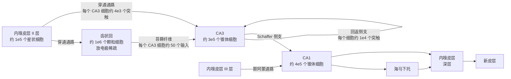
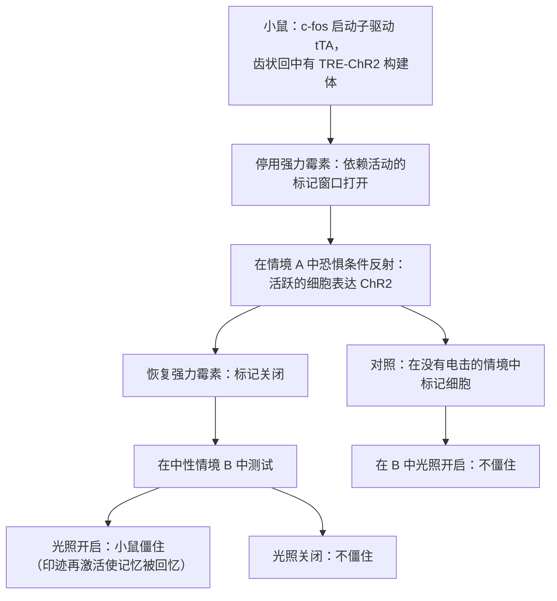

关于事实与事件的记忆，也就是我们能够报告的那一类，依赖于内侧颞叶中以海马为中心的一组结构。本章从最初揭示海马作用的临床观察出发，一直讲到细胞与回路水平：海马环路的解剖结构；这一结构所提示的模式分离与模式完成的计算思想；表征动物所在位置的神经元；在时间上组织它们放电的振荡与重放事件；保存某一特定记忆的细胞；以及记忆变得稳定、之后又被修改的过程。记忆的行为学分类以及关于 H.M. 与巩固的基本事实见 [7.14.46](/7.14.46#sec-46.5.3)；非陈述性形式，即习惯化、敏感化与条件反射，见 [7.16.38](/7.16.38)。这里用到的突触机制，**长时程增强**及其对 **NMDA 受体**的依赖，在 [7.16.14](/7.16.14) 中展开。本章为后续各章的模型做准备：[7.16.43](/7.16.43) 的吸引子网络把模式完成形式化，[7.16.44](/7.16.44) 的连续吸引子解释头朝向与网格系统，[7.16.46](/7.16.46) 的**后继表征**把位置野重新解释为预测。

## 42.1. 内侧颞叶记忆系统

### 42.1.1. H.M. 与记忆系统的分离

1953 年，William Scoville 为治疗顽固性癫痫，切除了患者 Henry Molaison（H.M.）两侧的内侧颞叶，包括海马的前三分之二、**杏仁核**和大部分内嗅皮层。Brenda Milner 的测试（Scoville 与 Milner，1957）确立了一个后来被其他患者证实的模式。H.M. 的智力、知觉、语言和短时记忆正常：他能通过复述把一个数字在脑中保持几分钟。他无法形成关于事实或事件的新的长时记忆（顺行性遗忘），并丧失了手术前若干年的记忆，而童年的记忆完好（时间梯度性逆行性遗忘）。然而，他学会了画只能在镜中看到的五角星这一运动技能，三天里不断进步，却不记得自己练习过（Milner，1962）。

由此得出三个结论，它们界定了这一领域。记忆是可以与知觉和智力分离的功能。短时记忆与长时记忆是不同的，向后者的转移需要内侧颞叶。并且存在几种长时记忆系统，其中只有一种依赖于内侧颞叶。

**定义 42.1.1（陈述性记忆）** **陈述性记忆**（外显记忆）是关于事实与事件的、可以被有意识地回忆和报告的长时记忆；它包括**情景记忆**，即对亲身经历的、有时间与地点的事件的记忆，以及**语义记忆**，即与获得它的场合无关的一般知识。它的获得与初始存储依赖于海马及周围的内侧颞叶皮层。不经有意识的回忆、而通过操作表现出来的记忆，如技能、习惯、启动与条件反射，是非陈述性的（[7.16.38](/7.16.38)）。

### 42.1.2. 解剖结构与分工

内侧颞叶系统由海马本体（CA1–CA3 区，得名于 *cornu Ammonis*）、齿状回与海马下托（合称海马结构），以及相邻的内嗅皮层、嗅周皮层与海马旁皮层组成。内嗅皮层是界面：它通过嗅周皮层（主要是物体信息，“什么”通路）和海马旁皮层（啮齿类中称为后嗅皮层；主要是空间情境，“哪里”通路）接受来自所有联合皮层的高度加工的输入，同时它也是海马的主要输出靶标。

对猴和患者的损毁研究使解剖结构更为清晰。患者 R.B. 在一次缺血发作后损伤仅限于两侧海马的 CA1 区，他有明确的、但较轻的顺行性遗忘（Zola-Morgan、Squire 与 Amaral，1986）：单个海马区的损伤就已足够。包括周围皮层在内的更大损毁产生更严重的缺陷。一种被广泛接受的分工是：把*熟悉感*，即觉得某个项目以前见过的感觉，归于嗅周皮层，把*回想*，即连同情境一起提取该项目，归于海马；识别记忆因此有两个具有不同神经基础的成分，这一观点得到成像研究以及选择性海马损伤患者的支持，这些患者能识别项目却无法回想其情境。海马把一次经历的各要素，物体、地点、时间与顺序，捆绑为一条可检索的记录；这种捆绑作用把它在情景记忆中的功能与它在空间导航中的功能联系了起来，后者是 42.3–42.5 节的主题。

## 42.2. 海马回路

### 42.2.1. 三突触环路

Ramón y Cajal 与 Lorente de Nó 所描述的海马细胞解剖结构，是一个基本单向的环路，可以用大鼠单侧半球的近似细胞数目来概括（Amaral 等）：

经典的三突触通路从内嗅皮层 II 层到齿状回颗粒细胞（突触 1），从颗粒细胞经苔藓纤维到 CA3（突触 2），再从 CA3 经 Schaffer 侧支到 CA1（突触 3）。内嗅皮层的直接输入到达 CA3，而来自 III 层的输入到达 CA1。这些数字的三个特点对计算很重要。齿状回的细胞数目约为其内嗅输入的十倍，而在任何一个环境中只有百分之几的颗粒细胞活跃：它扩展了表征并使之稀疏。每条苔藓纤维形成的突触数目少但非常大（每个颗粒细胞约有 15 个 CA3 靶标，每个 CA3 细胞只接受约 50 条苔藓纤维），强到一个颗粒细胞的爆发就能使其靶标放电，因此它们被称为“引爆器”突触。而 CA3 在脑区中因其密集的兴奋性循环连接而不同寻常：每个锥体细胞接受约 12 000 个来自其他 CA3 细胞的突触，连接概率为百分之几，远多于来自外部输入的突触。

### 42.2.2. 模式分离与模式完成

Marr（1971）提出，带有被 Hebb 可塑性修改的循环兴奋连接的网络，可以把一个事件存储为一组共同活动的细胞的模式，之后再从一部分重构出整个模式。McNaughton 与 Morris（1987）、Treves 与 Rolls（1994）等人把这一想法对应到 CA3，而齿状回提供预处理步骤。

**定义 42.2.1（模式分离与模式完成）** **模式分离**是把相似的输入模式变换为重叠少于输入的输出模式，使相似的经历被存储为不同的记忆。**模式完成**是从一个存储模式的部分或退化版本中提取完整的模式，使一段经历的片段重现整个经历。

这两种运算方向相反：完成把相似的输入映射到同一输出，分离把它们映射到不同输出。一个存储许多相似情节的系统二者都需要，而海马回路被认为对它们进行了分工。模式分离自然地产生于稀疏扩展。当一个模式经随机连接投射到大得多的群体上，并且只允许被最强驱动的细胞放电（通过反馈抑制，一种胜者全得的运算）时，两个共享大部分活动元素的输入仍会选出部分不同的胜者，因为胜者的身份敏感地依赖于总输入的微小差异。输出越稀疏，去相关越强（见下图）。同样的模体，即随机扩展后接稀疏阈值化，也出现在小脑颗粒层（[7.16.33](/7.16.33)）和昆虫**蘑菇体**的 **Kenyon 细胞**中，在那里它实现了一种**局部敏感哈希**（[7.16.23](/7.16.23)）。

遗传学证据与这种分工相符。仅在齿状回颗粒细胞中缺失 **NMDA 受体**的小鼠，正常地学会了恐惧一个情境，却无法学会把它与相似的情境区分开（McHugh 等，2007），这是分离的缺陷。仅在 CA3 锥体细胞中缺失 NMDA 受体的小鼠，正常地学会了水迷宫，并在线索齐全时回忆起平台的位置，但在大多数远端线索被去除时回忆失败，而对照小鼠则不然（Nakazawa 等，2002），这是完成的缺陷。记录显示同样的对比：当围场的形状在方形与圆形之间逐步变形时，齿状回细胞即使对很小的变化也改变其放电模式，而 CA3 的表征只有在形状改变较大时才变化（Leutgeb、Leutgeb、Moser 与 Moser，2007）。循环网络如何存储并完成模式、能容纳多少个模式的理论，是 [7.16.43](/7.16.43) 的主题。

## 42.3. 空间记忆

### 42.3.1. 水迷宫

海马损毁的啮齿类在空间导航中受损，这提供了一种易于操作的海马功能行为学测定。在 Morris 水迷宫（Morris，1981）中，大鼠或小鼠在不透明的水池里游泳，利用房间周围的线索学习找到藏在水面下不远处的平台。几天之内逃避潜伏期下降。在移除平台的探测试验中，受过训练的动物主要在原来平台所在的象限中搜索，这表明它学到的是相对于远端线索的位置，而不是一串固定的运动。海马损毁取消了这种位置学习，但不影响游向可见平台的学习，这一分离类似于人类中陈述性与非陈述性记忆的分离。

### 42.3.2. 检验 LTP 假说

水迷宫成为检验以下假说的主要手段：记忆由**长时程增强**（[定义 14.2.1](/7.16.14#def-14.2.1)）存储。向脑内灌注 NMDA 受体拮抗剂 AP5，其浓度足以在体内阻断海马 LTP，损害了位置学习而不影响可见平台学习（Morris、Anderson、Lynch 与 Baudry，1986）。遗传学方法使这种操作具有区域特异性。在发育之后仅于 CA1 锥体细胞中删除所有 NMDA 受体所必需的 NR1 亚基的小鼠（用 Cre–*loxP* 系统和成年期在 CA1 中活跃的启动子），缺乏 Schaffer 侧支突触处的 LTP，并在水迷宫中受损（Tsien、Huerta 与 Tonegawa，1996）。它们的位置细胞仍然有位置野，但位置野较大，而且位置野重叠的细胞的放电协调性较差（McHugh 等，1996），所以缺陷在于精确而连贯的地图的形成。反之，过表达延长 NMDA 受体电流的 NR2B 亚基的小鼠，LTP 增强，某些任务学得更快（Tang 等，1999）。

这些实验表明，海马中依赖 NMDA 受体的可塑性对空间学习是必需的；它们没有表明被增强的突触就是记忆。关于充分性的最强证据来自 42.6 节的印迹实验。两点保留使这个问题仍未解决。在一个水迷宫中预训练过的大鼠，可以在 NMDA 受体被阻断时学会第二个迷宫（Bannerman 等，1995），所以部分损害反映的是对一般策略而非位置的学习；而且 NMDA 受体在持续的突触传递中的作用超出了可塑性。

## 42.4. 空间的神经表征

### 42.4.1. 位置细胞

在自由活动的大鼠中记录单个神经元，O'Keefe 与 Dostrovsky（1971）发现 CA1 中的锥体细胞在大鼠位于环境的某一部分时放电，其余位置几乎沉默。O'Keefe 与 Nadel（1978）提出，这些细胞构成了 Tolman 意义上的认知地图（cognitive map）（[7.16.46](/7.16.46)）的基质，这是一种异中心的空间表征，与动物的朝向无关。

**定义 42.4.1（位置细胞）** **位置细胞**是海马的主神经元（CA1 或 CA3 的锥体细胞，或齿状回的颗粒细胞或苔藓细胞），其放电率取决于动物的位置：它在环境的一个有限区域，即它的*位置野*内以高达数十赫兹的频率放电，其他地方几乎沉默。

在大鼠的背侧海马中，位置野在实验室围场中的直径约为 20–50 cm，沿背腹轴增大，在腹侧极达到数米（Kjelstrup 等，2008）。一个给定的环境由细胞的一个稀疏子集表征，在典型的围场中是 CA1 细胞的百分之几十，活跃细胞的位置野铺满整个环境。因此该群体是位置的**群体编码**：由同时记录的几十个位置细胞的**脉冲序列**，Bayes 解码器（[7.16.26](/7.16.26)）可以把大鼠的位置估计到几厘米之内（Wilson 与 McNaughton，1993；Zhang、Ginzburg、McNaughton 与 Sejnowski，1998）。

位置野不是细胞的固定属性。当动物被移到另一个环境时，细胞会*重映射*：每个细胞可能在无关的位置获得一个位置野或者变得沉默，使两个环境由几乎独立的地图表征（全局重映射）。较小的变化，例如同一位置墙壁颜色的改变，改变位置野内的放电率而保持其位置不变（率重映射；Leutgeb 等，2005）。位置野也对非空间变量作出反应：在任务中，有些细胞在同一地点的放电取决于动物从哪里来或要到哪里去（“分流”细胞），而在跨时间任务中，海马的“时间细胞”在延迟的相继时刻放电（MacDonald、Lepage、Eden 与 Eichenbaum，2011）。因此海马把位置与发生在那里的事件和偶然性一起编码。

位置野是如何形成的？细胞接受来自内嗅皮层的带空间信息的输入，当这些突触的一个子集被增强时，位置野就出现了。对在跑步机上奔跑的小鼠的胞内记录显示，单个树突平台电位，无论是自发的还是诱发的，就足以在一圈之内在它发生的位置产生一个位置野，其机制是**行为时间尺度突触可塑性**，它增强平台电位前后数秒内活动的输入（[定义 14.8.1](/7.16.14#def-14.8.1)；Bittner 等，2017）。这种一次性的可塑性解释了为什么新的位置野突然出现，以及为什么它们在平台电位频繁出现的奖赏附近聚集。

### 42.4.2. 头朝向细胞、网格细胞与边界细胞

海马从一组邻近的结构接受它的空间信息，每个结构有各自的细胞类型。

**定义 42.4.2（头朝向细胞）** **头朝向细胞**是这样的神经元：其放电率取决于动物头部在水平面内所指的方向，而与其位置和运动方向无关；每个细胞在一个偏好方向放电最强，调谐宽度约为 $60^\circ$–$120^\circ$。

头朝向细胞由 Ranck（1984）在后下托（背侧前下托）中发现，并由 Taube、Muller 与 Ranck（1990）描述其特征；它们存在于一个包括背侧被盖核、外侧乳头体核、前背侧丘脑、压后皮层和内嗅皮层的环路中。它们的偏好方向锚定于视觉地标，但系统通过整合前庭系统的角速度信号，在黑暗中继续更新方向。当地标被旋转时，所有细胞的偏好方向一起旋转，保持其相对偏移：群体的行为如同单个连贯的变量。这是**环吸引子**，即圆周上的连续吸引子，的决定性特征，而头朝向系统是脑中最清楚的一例；它的模型以及在果蝇中对它的直接观察是 [7.16.44](/7.16.44) 的主题。

**定义 42.4.3（网格细胞）** **网格细胞**是主要见于内侧内嗅皮层 II 层的神经元，其放电野形成覆盖整个环境的规则三角形（六边形）点阵；点阵由其间距、朝向与空间相位（顶点的偏移）刻画。

网格细胞由 Fyhn、Molden、Witter、Moser 与 Moser（2004）以及 Hafting、Fyhn、Molden、Moser 与 Moser（2005）发现，2014 年诺贝尔生理学或医学奖授予了 O'Keefe 以及 May-Britt 与 Edvard Moser。相邻的网格细胞间距与朝向相同、相位不同，使少量细胞就能覆盖所有位置。间距沿内嗅皮层的背腹轴从约 $30\,\mathrm{cm}$ 增加到数米，并且是阶梯式增加的：细胞分成少数几个离散的模块，相继模块的间距以约 $1.4$ 的大致恒定的比值增大（Stensola 等，2012）。在一个模块内，细胞在不同环境之间以及在睡眠中都保持其相位关系，群体活动位于一个环面上（[7.16.28](/7.16.28#sec-28.5)），这是连续吸引子的另一个标志（[7.16.44](/7.16.44)）。理想化的网格图可以由三个平面波叠加得到。

**公式 42.4.1（作为三个平面波的网格模式）** 设单位向量 $\boldsymbol{e}_k$ 的角度为 $\theta_0 + k\cdot 60^\circ$（$k = 0, 1, 2$），间距为 $\lambda$，则函数
$$
g(\boldsymbol{x}) = \sum_{k=0}^{2}\cos\bigl(\kappa\,\boldsymbol{e}_k\cdot(\boldsymbol{x} - \boldsymbol{x}_0)\bigr), \qquad \kappa = \frac{4\pi}{\sqrt{3}\,\lambda}, \tag{42.1}
$$
的极大值位于间距为 $\lambda$、朝向为 $\theta_0$、相位为 $\boldsymbol{x}_0$ 的三角点阵上；网格细胞的发放率图建模为 $r(\boldsymbol{x}) = F(g(\boldsymbol{x}))$，其中 $F$ 是阈值非线性。

波数由几何关系得出：以 $60^\circ$ 相交的三个波在三角点阵的顶点处相长干涉，点阵的间距是每个波的波长 $2\pi/\kappa$ 的 $2/\sqrt{3}$ 倍。平面波的图像还预示了两种机制模型。在神经元片层上的连续吸引子网络中，均匀态的类 Turing 失稳产生六边形的活动模式，速度输入使该模式移动（[7.16.44](/7.16.44)）。并且二维环境的转移结构的本征向量就是这类周期模式（[7.16.46](/7.16.46)）。

**定义 42.4.4（边界细胞）** **边界细胞**是内嗅皮层或海马下托的神经元，它沿环境的一面或几面墙壁或边缘放电，位于相对于边界的固定的异中心方向上（Solstad、Boccara、Kropff、Moser 与 Moser，2008）。

边界细胞，以及与之相关的海马下托中在距边界给定距离与方向处放电的边界向量细胞（Lever 等，2009），把网格图与位置图锚定于环境的几何形状，并被认为校正**路径整合**中累积的漂移。更多的细胞类型使系统完整：速度细胞，其发放率与跑动速度成正比；更深的内嗅层中的网格 × 头朝向联合细胞；物体向量细胞；以及在三维空间中导航的蝙蝠中，三维位置细胞和方位角与俯仰角的头朝向细胞（Ulanovsky 等）。

这些细胞之间的分工仍在研究之中。一种广泛使用的方案把内嗅网格系统看作路径整合的度量：速度与头朝向信号移动网格模式，几个模块的网格相位共同编码位置，其容量随模块数目指数增长（每个模块编码位置对其间距取模，如同剩余数系统的各位数字；Fiete、Burak 与 Brookings，2008），位置细胞读出网格与感觉输入的合取。但位置细胞在大鼠幼崽中比类似成体的网格细胞更早出现，并且在内侧隔核失活使网格模式受到破坏时仍然存在，所以网格细胞并不是它们的唯一来源。

## 42.5. Theta 振荡、相位进动与重放

### 42.5.1. Theta 与相位进动

在运动与探索期间以及 REM 睡眠中，啮齿类海马的局部场电位以 theta 节律为主，这是一种 $6$–$10\,\mathrm{Hz}$ 的振荡，由内侧隔核（经胆碱能与 GABA 能投射）起搏，损毁隔核即取消它；gamma 振荡（$30$–$100\,\mathrm{Hz}$）嵌套在每个 theta 周期之内（[7.16.15](/7.16.15#sec-15.5)）。O'Keefe 与 Recce（1993）发现，位置细胞放电时所处的 theta 相位并不恒定。

**定义 42.5.1（相位进动）** **相位进动**是位置细胞放电时所处的 theta 相位随动物穿越其位置野而系统地提前：动物进入位置野时，脉冲出现在 theta 周期的较晚相位，随着它穿越而出现在逐渐更早的相位，总的提前量可达一个周期。

相位进动使放电的相位成为位置野内位置的**相位编码**：同时由发放率和相位解码位置，比仅由发放率更精确（Jensen 与 Lisman，2000）。它是位置而非时间的稳健函数，因为不论动物跑得快还是慢，它覆盖的相位范围相同。一个简单的模型可以重现它：若细胞的膜电位在位置野内以略高于场电位 theta 的频率振荡，两个振荡器的相位就会漂移，细胞的放电受其自身振荡门控并按位置野包络缩放，相对于场电位而言就提前了。

**公式 42.5.1（相位进动的双振荡器模型）** 设场电位 theta 的频率为 $f_\theta$，动物以速度 $v$ 跑过包络为 $G(x)$ 的位置野，并设细胞以 $f_{\mathrm{cell}} = f_\theta + v/L$ 振荡。则细胞以发放率
$$
r(t) = r_{\max}\,G\bigl(x(t)\bigr)\Bigl[\tfrac12\bigl(1 + \cos(2\pi f_{\mathrm{cell}}t + \phi_0)\bigr)\Bigr]^{k}, \tag{42.2}
$$
放电，它相对于场电位的偏好相位 $2\pi(f_{\mathrm{cell}} - f_\theta)t + \phi_0 = 2\pi x/L + \phi_0$ 在行进距离 $L$ 内提前一整个周期，与速度无关。

该模型解释了为什么进动取决于位置：在胞内记录中观察到的细胞振荡频率随速度增加，使 $L$ 保持恒定。这并不是唯一的解释。在网络模型中，动物正在穿越其位置野的那些细胞的序列在每个 theta 周期内被重放，从动物身后到身前，相位进动就是这些 *theta 序列*的单细胞视角（Skaggs、McNaughton、Wilson 与 Barnes，1996；Foster 与 Wilson，2007）。在带适应的连续吸引子网络中，活动包以 theta 频率围绕动物位置振荡并向前扫过，既产生进动，也产生 **theta 扫描**（[7.16.44](/7.16.44)）。由于位置野重叠的细胞按动物经过它们的顺序放电，彼此相差 $10$–$50\,\mathrm{ms}$ 之内，theta 序列把长达数秒的行为序列压缩到**脉冲时间依赖可塑性**的时间窗口之内（[7.16.14](/7.16.14#sec-14.5)），于是存储序列所需的不对称连接可以被学会。

### 42.5.2. 尖波涟漪与重放

当动物停顿、进食、梳理或处于慢波睡眠时，theta 被大而不规则的活动所取代，其间点缀着短暂的群体爆发。

**定义 42.5.2（尖波涟漪）** **尖波涟漪**是持续约 $50$–$150\,\mathrm{ms}$ 的海马群体事件，其中 CA3 锥体细胞的同步爆发在 CA1 的树突层产生大的负向偏转（尖波），并在 CA1 细胞层伴有 $150$–$250\,\mathrm{Hz}$ 的快速振荡（涟漪）；一次事件中，约 10–20% 的锥体细胞放电。尖波涟漪出现在安静觉醒与慢波睡眠期间。

**定义 42.5.3（重放）** **重放**是在尖波涟漪或睡眠期间，行为过程中出现的位置细胞序列放电的再激活，顺序相同（正向重放）或相反（反向重放），在时间上被压缩约 $10$–$20$ 倍。

Wilson 与 McNaughton（1994）发现，探索期间位置野重叠的位置细胞对，在随后的慢波睡眠中比在此前的睡眠中相关性更高，后来用许多细胞的记录显示出追踪大鼠轨迹的位置细胞序列（Lee 与 Wilson，2002）。在清醒的大鼠中，沿轨道跑完一程之后的重放常常是反向的，从当前位置开始（Foster 与 Wilson，2006），并且其发生率随奖赏增加，这提示它在给通向奖赏的路径赋值中起作用，即强化学习中的信用分配问题（[7.16.39](/7.16.39)）。在开阔的场地中，跑动之前的序列常常追踪大鼠即将走向记忆中目标的路径（Pfeiffer 与 Foster，2013），这是规划的一种候选机制（[7.16.46](/7.16.46)）。在动物第一次进入新轨道之前也能看到序列（“预播”；Dragoi 与 Tonegawa，2011），这提示海马含有一套预先配置好的序列库，新的经历被映射到其上；重放有多少是预先配置的仍有争论。

重放对记忆很重要。训练后在睡眠中以电刺激选择性地干扰涟漪，减慢了一项空间任务的学习（Girardeau 等，2009），干扰清醒时的涟漪损害了一项空间**工作记忆**任务（Jadhav 等，2012）；光遗传学地延长涟漪则改善了学习（Fernández-Ruiz 等，2019）。睡眠期间，涟漪与皮层慢振荡和丘脑皮层纺锤波耦合，这种耦合被认为是把海马记忆转移到新皮层的通道（42.7 节）。在强化学习中，对离线采样的存储转移训练网络称为**经验回放**（[7.16.39](/7.16.39)）；这个名称是通过与海马重放类比而选定的。

## 42.6. 记忆印迹

### 42.6.1. 标记与再激活印迹细胞

Richard Semon（1904）创造了 engram（印迹）一词，指记忆的物理痕迹，而 Lashley 在大鼠皮层中未能找到单一的位点，使他怀疑它能否被定位。即早基因使得鉴定学习期间活动的神经元成为可能，而光遗传学使得再激活它们成为可能。

**定义 42.6.1（印迹）** **印迹**是经历在脑中产生的、存储该经历记忆的物理与化学变化；学习期间活动过、发生了持久变化、并且其再激活能提取记忆的神经元称为印迹细胞。

因此印迹细胞的判据是：学习期间被激活，发生持续的变化，再激活时能够回忆起记忆，并且在它们被沉默时记忆丧失。关键的实验使用相同的逻辑：

Liu 等（2012）用通道视紫红质标记了在一个情境中被**恐惧条件反射**激活的齿状回颗粒细胞，并显示在另一个中性情境中的光刺激使小鼠僵住；而在无电击情境的探索中被标记的细胞则不然。Ramirez 等（2013）更进一步：他们标记了探索情境 A 所激活的细胞，然后在小鼠于情境 B 中受到电击时用光刺激它们；之后小鼠在从未受过电击的情境 A 中僵住，这是把一个印迹与一次新经历配对所产生的错误记忆。反过来，去除印迹细胞就去除了记忆：消除分配给听觉恐惧记忆的外侧**杏仁核**神经元就抹去了该记忆（Han 等，2009），在测试期间光遗传学地沉默海马印迹细胞损害了回忆（Denny 等，2014；Tanaka 等，2014）。印迹细胞是分布式的：单个记忆在海马、杏仁核和皮层中都有印迹成分，由连接相联系。

印迹可以存在但无法提取。当学习之后蛋白质合成被阻断时，小鼠出现逆行性遗忘：回到该情境时它们不能回忆起恐惧记忆。然而，对印迹细胞作光遗传学再激活仍能引起僵住（Ryan、Roy、Pignatelli、Arons 与 Tonegawa，2015）。这些“沉默”印迹的印迹细胞缺乏正常印迹细胞增加的树突棘密度与突触强度，但保留了其特异的连接，提示自然提取需要突触的增强，而信息保存在连接的模式中。沉默印迹也见于早期 **Alzheimer 病**的小鼠模型（[7.16.51](/7.16.51)）以及婴儿期的记忆（婴儿期遗忘）。

### 42.6.2. 记忆分配与兴奋性

哪些神经元成为印迹细胞？在外侧杏仁核中，只有约 10–30% 的主细胞被招募进一个给定的恐惧记忆，而且它们并非随机选取。过表达转录因子 CREB 的神经元被优先招募（Han 等，2007），训练后消除它们抹去了记忆，而消除相同大小的随机群体则不然（Han 等，2009）。以其他方式提高兴奋性，如表达显性负性钾通道，或在学习前用**化学遗传学**激活细胞，有同样的效果（Yiu 等，2014）。学习时兴奋性最高的神经元在由侧向抑制实施的竞争中获胜，来编码记忆，这是一种稀疏的胜者全得式分配，类似于 42.2.2 节。

由于兴奋性在学习之后会保持升高数小时，时间上接近的两次经历倾向于被分配到重叠的群体。相隔五小时而不是相隔七天探索两个情境的小鼠，把二者联系了起来：在第二个情境中条件化的恐惧转移到第一个情境（Cai 等，2016），印迹群体的重叠预测了这种联系。因此分配提供了一种在时间上组织记忆的机制，把发生时间接近的事件捆绑起来、把相隔久远的事件分开，这是自由回忆的时间情境模型的细胞对应物（[7.16.43](/7.16.43#sec-43.6)）。

## 42.7. 巩固与再巩固

### 42.7.1. 突触巩固与系统巩固

**定义 42.7.1（记忆巩固）** **记忆巩固**是新获得的、不稳定的记忆被稳定为持久的长时形式的过程。*突触巩固*历时数分钟到数小时，需要在编码该记忆的突触处进行新的基因表达与蛋白质合成；*系统巩固*历时数天到数年，逐渐重组记忆所依赖的脑区，从海马到新皮层。

突触巩固是晚期 LTP 在行为上的对应：在训练前后给予蛋白质合成抑制剂会阻断长时记忆而不影响短时记忆（Davis 与 Squire，1984），而在海兔（*Aplysia*）中确定的依赖 CREB 的转录（[7.16.38](/7.16.38)）是保守的。**突触标记与捕获**假说（[定义 14.7.1](/7.16.14#def-14.7.1)）解释了弱而短暂的记忆如何能在约一小时的时间窗内、有一个触发蛋白质合成的强事件发生时变得持久；这种效应称为行为标记，依赖于来自新异性信号的多巴胺。

系统巩固是从时间梯度性逆行性遗忘推断出来的：海马损伤对远期记忆的影响小于近期记忆，在 H.M. 以及训练后不同时间作损毁的动物中都是如此。标准模型（Squire 与 Alvarez，1995）认为，海马起初把记忆的皮层表征捆绑起来，并通过睡眠中的反复再激活逐渐增强皮层之间的直接连接，直到记忆独立于海马。有两点观察对它作了限定。详细的情景记忆不同于语义要点，似乎在其存续期间始终依赖海马（多重痕迹理论及其后继者痕迹转化理论；Nadel 与 Moscovitch，1997）。并且印迹标记显示，情境恐惧记忆的前额叶印迹在学习时就已形成，但起初是沉默的，在两周内成熟，而海马印迹则变得沉默（Kitamura 等，2017）：巩固改变的是哪个印迹处于活动，而不是从无到有地创造出皮层印迹。

为什么应当有两个系统？互补学习系统理论（McClelland、McNaughton 与 O'Reilly，1995）给出了一个计算上的理由。一个通过小幅改变共享权重来学习的分布式网络，如新皮层对语义知识那样，能提取许多经历的统计结构，但如果它快速学习一个新项目，这种改变就会覆盖它原来所知道的，这种失败称为灾难性干扰。一个用稀疏的、模式分离的编码分别存储每个情节的快速系统，避免了干扰，并且之后可以通过对新旧记忆的交错重放来教会慢速系统。交错重放现在被用于人工网络的持续学习，而这一理论也解释了为什么与已有图式一致的新信息在数天而非数月内就被巩固到新皮层（Tse 等，2007）。

### 42.7.2. 再巩固

人们长期认为已巩固的记忆是永久稳定的。Nader、Schafe 与 LeDoux（2000）训练大鼠恐惧一个声音，一天或两周之后，通过呈现一次该声音再激活记忆，并向外侧杏仁核灌注蛋白质合成抑制剂茴香霉素。第二天大鼠对该声音表现出很少的恐惧，而未经再激活就给药的大鼠则保留了记忆。

**定义 42.7.2（再巩固）** **再巩固**是已巩固的记忆在被提取再激活时回到不稳定状态、必须再次通过蛋白质合成来稳定的过程；在此窗口内，它可以被削弱、增强或更新。

再巩固并非在每次提取后都发生：它要求提取中含有新的东西，即预期与实际发生之间的预测误差，而旧的或非常强的记忆会抵抗它。不稳定的窗口使记忆可以用新信息来更新，代价是失去其保真度，这与人类回忆的重构性质一致。它也是治疗的靶标：阻断再巩固，例如在再激活后使用 $\beta$ 肾上腺素能拮抗剂普萘洛尔，正被试用于削弱创伤记忆与药物相关线索，迄今结果不一。

## 小结

- H.M. 表明陈述性记忆（定义 42.1.1）依赖内侧颞叶，而短时记忆、远期记忆与技能学习不依赖；海马把一个情节的各要素捆绑起来，嗅周皮层支持熟悉感。
- 海马环路从内嗅皮层经齿状回（稀疏扩展）、CA3（密集回返侧支）与 CA1 回到内嗅皮层。齿状回被认为进行模式分离，CA3 进行模式完成（定义 42.2.1），区域特异的 NMDA 受体敲除支持这一点。
- 海马中依赖 NMDA 受体的可塑性对水迷宫中的空间学习以及稳定而连贯的位置图是必需的；一次性的 BTSP 解释了位置野的突然形成。
- 空间由位置细胞（定义 42.4.1）、头朝向细胞（定义 42.4.2）、网格细胞（定义 42.4.3；三个平面波，公式 42.4.1；离散模块）与边界细胞（定义 42.4.4）表征。
- theta 期间，位置细胞表现出相位进动（定义 42.5.1；双振荡器模型，公式 42.5.1）与 theta 序列；尖波涟漪（定义 42.5.2）期间，它们以约 20 倍的速度重放行为序列（定义 42.5.3），而涟漪是学习所必需的。
- 印迹细胞（定义 42.6.1）可以被标记并再激活，以回忆、创造或沉默一个记忆；神经元按兴奋性被分配到印迹中。
- 记忆经历突触巩固与系统巩固（定义 42.7.1），在带预测误差被再激活时经历再巩固（定义 42.7.2）。

| 细胞类型 | 脑区 | 编码的变量 | 吸引子动力学的特征 |
|---|---|---|---|
| 位置细胞 | CA1、CA3、齿状回 | 位置（及情境、事件） | CA3 中地图之间的突然切换 |
| 头朝向细胞 | 前下托、前丘脑、内嗅皮层 | 头朝向 | 所有偏好方向的一致旋转 |
| 网格细胞 | 内侧内嗅皮层 | 对网格间距取模的位置 | 固定的相位关系；环面形的群体活动 |
| 边界细胞 | 内嗅皮层、海马下托 | 到边界的距离与方向 | 锚定其他地图 |

## 思考题

1. H.M. 无法记住新的事实，却能学会镜中画图。哪些记忆系统受到影响，哪些得以保留？你会如何检验一名遗忘症患者能否学会一项新的概率性分类任务？

   **答** 陈述性记忆的内侧颞叶系统受损；程序性记忆（纹状体、小脑、运动皮层）、短时记忆（前额叶与顶叶皮层）和远期的已巩固记忆（新皮层）的系统得以保留。在“天气预测”之类的概率性分类任务中，线索只以概率方式预测结果，学习要经过许多次试验逐渐发生。遗忘症患者在最初的试验中以正常速率学会它，却无法描述训练的情节，而纹状体功能障碍的 Parkinson 病患者学不会它，却记得训练过程（Knowlton、Mangels 与 Squire，1996）。因此这一检验是两组患者在学习与对训练的外显记忆上的双重分离。

2. 利用模式分离图中的模型，解释为什么活跃单元越少，胜者全得阈值使输出去相关越强。如果输出单元根本没有阈值（线性输出），分离会怎样？

   **答** 每个输出单元的输入是许多输入单元之和，两个相似的输入模式给出强相关的输入电流。在两个输出中都活跃的单元必须对两个模式都高于阈值。阈值设得高（输出稀疏）时，只有输入电流分布远端尾部的单元是活跃的，而在尾部，两个电流之间的微小差异就决定单元是否高于阈值，所以一个单元对两个模式都位于最高比例 $f$ 之内的概率相对于 $f$ 下降。对线性输出则没有分离：零均值权重的随机投影近似保持输入的几何（Johnson–Lindenstrauss 引理），而对如图中那样的非负权重，每个输出单元都接受两个输入的公共成分的一份，所以输出相关甚至高于输入相关。去相关是阈值非线性的结果。

3. 一只大鼠以 $40\,\mathrm{cm\,s^{-1}}$ 的速度跑过长 $50\,\mathrm{cm}$ 的位置野，theta 为 $8\,\mathrm{Hz}$。在双振荡器模型中，细胞的振荡频率应是多少，才能使其相位在位置野内进动 $360^\circ$？如果动物以 $20\,\mathrm{cm\,s^{-1}}$ 跑动而细胞频率不变，会发生什么？

   **答** $f_{\mathrm{cell}} = f_\theta + v/L = 8 + 40/50 = 8.8\,\mathrm{Hz}$。如果大鼠以一半的速度跑动而 $f_{\mathrm{cell}}$ 仍为 $8.8\,\mathrm{Hz}$，穿越需要 $2.5\,\mathrm{s}$ 而不是 $1.25\,\mathrm{s}$，相位提前 $0.8 \times 2.5 = 2$ 个周期：模型预测的进动过多。由于观察到的进动取决于位置而非时间，细胞的振荡频率必须随跑动速度增加（在胞内记录中确实如此），或者机制必须是网络性的，其中 theta 序列按速度缩放。

4. 相继模块中的网格细胞间距为 $\lambda_1 = 40\,\mathrm{cm}$、$\lambda_2 = 56\,\mathrm{cm}$ 与 $\lambda_3 = 78\,\mathrm{cm}$。在一维情形下，每个模块告诉动物其位置对其间距取模的值。若相位读取完全精确，三个模块的组合在多大范围内唯一地表示位置？为什么实际有用的范围要小得多？

   **答** 精确读取时，只要相位的组合不重复，位置就可以区分，而重复发生在间距的最小公倍数处。对 $40$、$56$ 与 $78\,\mathrm{cm}$，$\operatorname{lcm}(40, 56, 78) = 2^3 \cdot 3 \cdot 5 \cdot 7 \cdot 13 = 10\,920\,\mathrm{cm}$，约 $109\,\mathrm{m}$；范围约为 $100\,\mathrm{m}$，超过最大间距的 100 倍，而对不可公度的间距则是无穷。实际上相位有噪声，相距很远的两个位置可能有彼此处于噪声范围内的相位组合；有用的范围于是由相位精度决定，随模块数目指数增长，但底数小得多（Fiete、Burak 与 Brookings，2008），仍远超单个模块的范围。

5. （开放题）设计一个实验，检验睡眠期间的海马重放对某个特定记忆的巩固是否必需，而不是对依赖睡眠的记忆整体必需。

   **答** 训练大鼠做两个不同的空间任务（或在不同场地中的两条路线），每个都有睡眠前通过记录确定的位置细胞地图。在随后的睡眠中，实时解码每个涟漪重放的是哪张地图（对集群活动作闭环解码），并只用电或光遗传学刺激干扰重放地图 A 的涟漪，而保持重放地图 B 的涟漪不受影响；对照组接受同样次数的干扰，但有延迟，以至于错过涟漪。特异作用的预测是第二天对任务 A 的记忆而非 B 出现缺陷。睡眠后的记录应当显示，A 的表征而非 B 的表征稳定性较低。一个相关的设计是在睡眠中以感觉线索靶向再激活（用声音的靶向记忆再激活），已用于大鼠和人类，显示出相反的效应，即线索记忆的增强。
