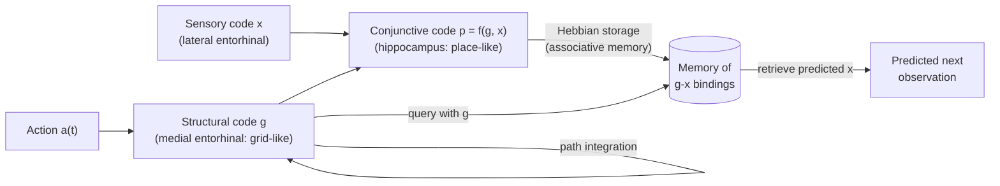

Animals do not only remember places and events; they know how places and events relate to each other, and they use this knowledge to take shortcuts they have never taken, to infer the consequence of an action they have never tried, and to master a new problem faster because it resembles an old one. This chapter asks how the brain represents such relational knowledge. Tolman called it a cognitive map, and the discovery of place and grid cells ([7.16.42](/7.16.42#sec-42.4)) gave the idea a neural form for space. The modern view generalizes it in three steps, each with a precise model. The successor representation, a concept from **reinforcement learning** ([7.16.39](/7.16.39)), treats a map as a prediction of future states, explains why place fields are shaped by behavior, and relates grid cells to the eigenvectors of the environment's transition structure. The Tolman–Eichenbaum machine separates the abstract structure of a task from its sensory content and binds them in the hippocampus with an associative memory ([7.16.43](/7.16.43)). And sequence models with ordinal codes and event boundaries extend the same principle from space to time. The chapter ends with replay as a mechanism for planning, which connects to the model-based reinforcement learning of [7.16.41](/7.16.41).

## 46.1. The Cognitive Map

### 46.1.1. Tolman's Rats

In the behaviorist account dominant in the 1930s, learning was the strengthening of stimulus–response associations by reward. Tolman's experiments did not fit it. In latent learning (Tolman and Honzik, 1930), rats that explored a complex maze for ten days without food made as many errors as rats that never found food; when food was then introduced at the goal, their errors dropped within one or two trials to the level of rats rewarded from the start: they had learned the maze without reward, and the reward only revealed what they had learned. In detour and shortcut experiments (Tolman, Ritchie and Kalish, 1946), rats trained on an indirect route to a goal chose, when the route was blocked and new radiating paths were offered, the path pointing most directly toward the goal. Tolman (1948) concluded that rats form a "cognitive map" of their environment.

**Definition 46.1.1 (Cognitive Map)** A **cognitive map** is an internal representation of the relations between states of the world (locations, objects, events or abstract task states) that supports flexible behavior beyond the repetition of reinforced actions: inferring novel routes and shortcuts, predicting the consequences of actions, and adapting immediately when goals or paths change.

O'Keefe and Nadel (1978) proposed the hippocampus as the locus of the spatial map, and the place cells, grid cells and head direction cells of [7.16.42](/7.16.42) are its components. Tolman's concept was broader: the same structures support relational inference in nonspatial domains. Human hippocampal and entorhinal activity shows grid-like hexadirectional modulation not only during virtual navigation (Doeller, Barry and Burgess, 2010) but also when participants "navigate" a two-dimensional space of bird shapes defined by neck and leg length (Constantinescu, O'Reilly and Behrens, 2016); hippocampal neurons in rats map the frequency of a tone that the animal changes by pressing a lever (Aronov, Nevers and Tank, 2017); and social hierarchies of rank and affiliation are represented in a map-like way (Park, Miller and Boorman, 2021).

### 46.1.2. Structural Knowledge and Learning Sets

A map is useful because it can be reused. Harlow (1949) gave monkeys hundreds of discrimination problems, each with a new pair of objects, one of which always hid a reward. On the first problems, the monkeys needed many trials to learn which object was rewarded; after a few hundred problems, they solved a new one after a single trial: if the first choice was rewarded they stayed with it, otherwise they switched. They had learned a "learning set", abstract knowledge of the structure of the task that is independent of the particular objects. The same transfer underlies everyday expertise: a person who knows the layout of supermarkets in general (entrance with produce, refrigerated cabinets along a back wall, checkout at the exit) finds the milk in a new supermarket immediately, despite a different decor. Flexible behavior thus requires two things that classical **reinforcement learning** does not separate: a representation of the relations between states that predicts the consequences of actions, and a factorization of that representation into an abstract structure, shared across tasks, and the particular sensory content of each task.

## 46.2. The Successor Representation

### 46.2.1. Definition and Bellman Equation

In reinforcement learning, the value of a state is the expected discounted sum of future rewards ([7.16.39](/7.16.39)). Model-free methods learn values directly, which is efficient but inflexible: when the reward changes, all values must be relearned by experience. Model-based methods learn the transition and reward functions and compute values by planning, which is flexible but costly. Dayan (1993) proposed an intermediate representation that separates the prediction of future states from the reward.

**Definition 46.2.1 (Successor Representation)** For a policy $\pi$ in an environment with states $s$, the **successor representation** (SR) is the matrix of expected discounted future occupancies
$$
M(s, s') = \mathbb{E}_\pi\Bigl[\sum_{t=0}^{\infty}\gamma^t\,\boldsymbol{1}_{\{S_t = s'\}}\Bigm| S_0 = s\Bigr], \tag{46.1}
$$
with discount factor $0 \le \gamma < 1$: $M(s, s')$ is the discounted number of times the agent, starting from $s$, will visit $s'$.

**Proposition 46.2.1 (Properties of the Successor Representation)** Let $T$ be the one-step state-transition matrix under $\pi$, $T(s, s') = \mathbb{P}_\pi(S_{t+1} = s' \mid S_t = s)$, and let $\bar{\boldsymbol{r}}$ be the vector of expected immediate rewards in each state. Then

1. $M = \sum_{t=0}^{\infty}\gamma^tT^t = (I - \gamma T)^{-1}$, and $M$ satisfies the Bellman equation $M = I + \gamma TM$;
2. the value function of $\pi$ factorizes as $\boldsymbol{v}_\pi = M\bar{\boldsymbol{r}}$, that is $v_\pi(s) = \sum_{s'}M(s, s')\,\bar r(s')$.

**Proof** By the Markov property, $\mathbb{P}_\pi(S_t = s' \mid S_0 = s) = (T^t)(s, s')$, so Eq. (46.1) gives $M = \sum_t\gamma^tT^t$. The series converges because $T$ is stochastic ($\lVert T\rVert_\infty = 1$) and $\gamma < 1$, and $(I - \gamma T)\sum_t\gamma^tT^t = I$, so it equals $(I - \gamma T)^{-1}$; multiplying out also gives $M = I + \gamma TM$. For the value, $v_\pi(s) = \mathbb{E}_\pi\bigl[\sum_t\gamma^tR_{t+1}\bigr]$ with $\mathbb{E}[R_{t+1} \mid S_t = s'] = \bar r(s')$ (rewards indexed by the state in which they are received), so $v_\pi(s) = \sum_t\gamma^t\sum_{s'}(T^t)(s, s')\bar r(s') = (M\bar{\boldsymbol{r}})(s)$. $\square$

The factorization is the point. If the reward changes, for example if food is moved, the new value function is $M\bar{\boldsymbol{r}}'$, computed with one matrix–vector product, without relearning the predictions: an SR agent adapts immediately to reward revaluation, as a model-based agent would. If the transitions change, for example if a path is blocked, $M$ must be relearned, slowly, as a model-free agent would. Humans tested in multistep tasks show exactly this asymmetry: they adapt faster to changes of reward than to changes of transition structure (Momennejad et al., 2017), consistent with partial reliance on an SR.

The Bellman equation $M = I + \gamma TM$ means that $M$ can be learned from experience by temporal-difference learning, like a value function with a vector-valued "reward" $\boldsymbol{e}_s$ (the indicator of the current state): after each transition $s \to s'$,
$$
M(s, \cdot) \leftarrow M(s, \cdot) + \alpha\bigl[\boldsymbol{e}_s + \gamma M(s', \cdot) - M(s, \cdot)\bigr], \tag{46.2}
$$
with a vector of prediction errors, one per future state. These errors are not reward prediction errors but sensory or state prediction errors, and dopamine neurons also signal such errors in sensory preconditioning tasks without reward (Gardner, Schoenbaum and Gershman, 2018).

### 46.2.2. The Hippocampus as a Predictive Map

Stachenfeld, Botvinick and Gershman (2017) proposed that place cells encode the SR: the cell associated with state $s'$ fires, when the animal is in state $s$, at a rate proportional to $M(s, s')$, so that its place field is the column $M(\cdot, s')$. In an open environment with an unbiased random walk, $M(\cdot, s')$ is a bump around $s'$, a conventional place field. But the SR depends on the policy, and the model makes several predictions that a purely spatial code does not.

- On a track that the animal traverses in one direction, a cell predicting $s'$ is active in states from which $s'$ will soon be reached, that is in states behind $s'$: the field skews backward, against the direction of travel, and its center shifts backward (figure below, B). With experience, as the SR is learned by Eq. (46.2), the field expands backward. Both effects were observed in CA1 place fields on a familiar track (Mehta, Barnes and McNaughton, 1997), where they had been explained by asymmetric Hebbian plasticity of the kind that learns sequences ([7.16.43](/7.16.43#sec-43.6)); the two accounts are related, since STDP on sequential activity approximates TD learning of the SR.
- Barriers change the SR: states on the two sides of a wall are far in transitions even if close in space, so place fields do not extend through walls, as observed.
- Fields cluster at and expand toward frequently visited locations, such as goals and rewarded locations, and they distort around shortcuts and obstacles in the ways seen in recordings.

![The successor representation on a linear track of 40 states (Definition 46.2.1, $\gamma = 0.9$). A: the SR matrix $M$ under a rightward-biased policy (step right with probability 0.9): from each state the animal will visit the states ahead of it. B: the "place field" $M(\cdot, 20)$ of the cell that predicts state 20, as a function of current position, under an unbiased random walk (symmetric field) and under the rightward policy: the field skews backward, against the direction of travel, and its center moves from state 20 to 14.3. C: TD learning of the SR (Eq. (46.2), learning rate 0.1) over laps of rightward running: the field of the same cell after 1, 5, 20 and 80 laps expands backward with experience, as CA1 place fields do on a familiar track.](./plots/sr-track.py)

### 46.2.3. Eigenvectors of the SR and Grid Cells

The SR also suggests what grid cells might compute. If $T$ is symmetric, as for a random walk in an environment with symmetric transitions, it has an orthonormal eigenbasis $\boldsymbol{\phi}_k$ with eigenvalues $\lambda_k \in [-1, 1]$, and
$$
M = (I - \gamma T)^{-1} = \sum_k\frac{1}{1 - \gamma\lambda_k}\,\boldsymbol{\phi}_k\boldsymbol{\phi}_k^{\mathsf T}. \tag{46.3}
$$
The eigenvectors with the largest eigenvalues dominate: they vary slowly over the environment and capture its large-scale structure, while eigenvectors of smaller eigenvalue add finer detail. $T$ and the graph **Laplacian matrix** of the environment share these eigenvectors, so they are the natural "Fourier modes" of the state space: in a rectangular box they are products of cosines of different spatial frequencies, and in an environment with walls they bend around the walls and separate compartments (figure below). Stachenfeld and colleagues proposed that grid cells represent such eigenvectors, providing a low-dimensional basis in which the predictive map can be compressed and from which subgoals and bottlenecks can be identified. The proposal explains why grid cells come in modules with different spatial scales, corresponding to eigenvectors of different eigenvalues, and why grid patterns distort in trapezoidal or compartmentalized environments, as observed.

Eigenvectors of a square box are periodic but not hexagonal. Hexagonal patterns appear when additional constraints are imposed, for example nonnegativity of the firing rates in a principal component analysis of place-cell inputs (Dordek, Soudry, Meir and Derdikman, 2016), or when the dynamics of a continuous attractor network select a three-wave pattern ([7.16.44](/7.16.44#sec-44.5)). The eigenvector account describes what grid cells may represent at the computational level; the attractor account describes how their patterns are generated and maintained.

![Eigenvectors of the successor representation for an unbiased random walk on a $20 \times 20$ grid ($\gamma = 0.95$; the constant first eigenvector is omitted; red and blue are opposite signs). Top: open square box; the eigenvectors with the largest eigenvalues are periodic patterns, products of cosines, at increasing spatial frequency and different orientations. Bottom: the same box with a wall (black line) extending from the left side to three quarters of the width: transitions across the wall are removed, and the leading eigenvectors respect the barrier, the second separating the two compartments, as grid patterns in compartmentalized environments do.](./plots/sr-eigen.py)

## 46.3. Separating Structure from Content

### 46.3.1. The Tolman–Eichenbaum Machine

The SR still binds structure to particular states. To transfer knowledge between environments that share a structure but differ in content, a representation must factorize them. Whittington et al. (2020) built a model with this factorization and trained it to predict sensory observations during random walks on many graphs with the same structure (for example, many two-dimensional grids with different random objects at their nodes).

**Definition 46.3.1 (Tolman–Eichenbaum Machine)** The **Tolman–Eichenbaum machine** (TEM) is a model of the hippocampal formation in which a structural code $\boldsymbol{g}$, assigned to the medial entorhinal cortex and updated by path integration of actions independently of the sensory environment, is bound to a sensory code $\boldsymbol{x}$, assigned to the lateral entorhinal cortex, by a conjunctive code $\boldsymbol{p}$ in the hippocampus, stored with Hebbian plasticity in an associative memory; prediction of the next observation consists of updating $\boldsymbol{g}$ and retrieving the associated $\boldsymbol{x}$ from memory.

Trained only to predict, TEM learned representations that resemble the cells of the hippocampal formation. Its structural units developed grid-like, band-like and border-like responses, the same in every environment of the same structure, whereas its conjunctive units developed place-cell-like fields that remapped between environments. The model made a prediction about remapping that is not obvious: because a place cell is a conjunction of a structural and a sensory code, its field in a new environment should not be random but should occur where its preferred sensory input coincides with grid inputs at a consistent phase. Reanalysis of recordings in which grid and place cells were recorded in two environments confirmed that the relation between place fields and grid phases is preserved across remapping more than chance would predict (Whittington et al., 2020). The model also explains how an animal that has learned the structure of one environment can infer, on its first visit to a new environment with the same structure, that returning by a novel path leads to the starting point: structural inference.

### 46.3.2. Transformers and the Hippocampal Formation

Whittington, Warren and Behrens (2022) showed that TEM is closely related to a **Transformer** ([4.7.6](/4.7.6)). If the stored memories are the past pairs $(\boldsymbol{g}_\tau, \boldsymbol{x}_\tau)$, retrieving the sensory observation associated with the current structural code is an attention operation: the current $\boldsymbol{g}_t$ is the query, the stored $\boldsymbol{g}_\tau$ are the keys and the $\boldsymbol{x}_\tau$ are the values, and attention with a softmax is one step of the modern Hopfield network of [7.16.43](/7.16.43#sec-43.7). The structural code plays the role of the position encoding of the Transformer, except that it is not a fixed function of the token index but is updated recurrently by the actions taken. A Transformer with such recurrent position encodings, trained on the same tasks, learned position encodings with grid-cell-like properties and attention weights resembling place cells. The comparison suggests a reading of the hippocampal circuit as a key–value memory ([Definition 43.8.1](/7.16.43#def-43.8.1)) addressed by an entorhinal structural code, and of the Transformer as an architecture that, without being designed after the brain, arrived at a similar division between relational position and content. The analogy has limits: Transformers attend to an exact copy of every past token, whereas the hippocampus stores compressed, sparse conjunctions with limited capacity and forgets.

## 46.4. Sequences: Order and Content

### 46.4.1. Disentangled Codes for Order

How is a sequence of items represented: by associations between successive items (A→B→C), or by associations of each item with its ordinal position (A in position 1, B in position 2)? Chaining predicts that errors are transitions to items associated with the current one; positional coding predicts that errors are items from the same position in another sequence. Orlov, Yakovlev, Hochstein and Zohary (2000) trained monkeys to reproduce ten sequences of three images each. When tested with sequences recombined from these images, the most common errors were choices of a distractor that had occupied the same ordinal position in a learned sequence, and monkeys spontaneously grouped images by their ordinal position: they had learned order as an abstract dimension.

Neurophysiology confirms that order and content are coded separately. Neurons in dorsolateral prefrontal cortex and in the intraparietal sulcus fire according to the rank of an item in a sequence, independent of its identity (Ninokura, Mushiake and Tanji, 2004); in monkeys holding a sequence of spatial locations in working memory, the population activity places each rank in its own subspace, in which the locations of items of that rank form a ring, so that sequence memory is a conjunction of rank and content codes with a regular geometry (Xie et al., 2022). Similarly, when rats learn a series of odor problems that share a temporal structure, orbitofrontal neurons come to represent the abstract state within the task schema, the same across problems with different stimuli (Zhou et al., 2021).

![A model of the conjunctive code for rank and content in sequence working memory, after the geometry reported by Xie et al. (2022). A population of 120 neurons holds a sequence of three locations, each one of six directions; the item at each rank is written into its own random two-dimensional plane of population space, more weakly for later ranks, plus noise; all 216 sequences are shown, four noisy repetitions each. Each rank's plane is recovered from the data by linear regression on the location of the item at that rank. A–C: projections onto the planes of ranks 1, 2 and 3, colored by the location held at that rank: each rank has its own ring of locations, smaller for later ranks, and the spread within each cluster comes from the other items, whose planes are not exactly orthogonal to it. D: the rank-1 plane colored by the item at rank 2: the location of the second item is invisible in this plane, so a linear readout can retrieve the content of any rank independently of the others.](./plots/rank-content.py)

### 46.4.2. Sequence Attractor Schemas

A disentangled code for order enables conjunctive coding: a new sequence can be represented immediately by combining a known order template with new contents, the temporal counterpart of the separation of structure and content in TEM. Recurrent networks trained to discriminate sequences learn such templates as attractor dynamics. Zou et al. (2023) trained a rate RNN with backpropagation through time to classify four sequences made of two of three items, $(a, b)$, $(a, c)$, $(b, a)$ and $(b, c)$, whose orders form a two-level tree (first item, then second item given the first), with variable intervals between items so that the network had to extract the order independently of timing. In the trained network, the population trajectories, projected on the leading principal components, formed a tree of attractor states: the first item moved the state into one of two branches, the second into one of their sub-branches, and the state remained in the attractor until the next item. The network discriminated sequences coarse to fine, and because states were attractors rather than transient trajectories, its classification was robust to stretching or compressing the sequence in time (temporal warping), an invariance of human speech perception that the model reproduced in a keyword-spotting task with spoken words.

Because the recurrent connections store the order schema and the input connections store the mapping of contents onto it, learning a new set of sequences with the same order structure is faster when the recurrent weights are kept and only the input and output weights are trained: transfer learning by reuse of the schema. This is a computational version of Harlow's learning sets. The pretrained network kept its tree-structured attractors, and the new contents were mapped onto them.

## 46.5. Event Schemas and Event Boundaries

Continuous experience is perceived and remembered as a sequence of discrete events (arriving at a restaurant, ordering, eating, paying), and people agree on where the boundaries between events lie (Zacks et al., 2007). Boundaries leave traces in neural activity and memory.

**Definition 46.5.1 (Event Boundary)** An **event boundary** is a moment at which a perceiver segments continuous experience into successive events, typically when a change in the situation (location, goal, characters, causal structure) makes the current model of the situation fail to predict what happens next.

Brain activity reflects the segmentation: patterns in high-level cortical areas such as the posterior medial cortex remain stable within an event and change abruptly at boundaries, and the hippocampus responds transiently at the end of an event, more strongly when the event is later remembered better (Baldassano et al., 2017), consistent with the encoding of each completed event as an episode. Memory is shaped by boundaries in a characteristic way: the temporal order of two items is remembered better if they belong to the same event than if a boundary separates them, even at equal temporal distance; it is better for items farther apart in time; and it is better for items near the beginning of an event (a local primacy effect). A context model accounts for all three (Pu, Kong, Ranganath and Melloni, 2022). A slowly drifting context vector is stored with each item: at each time step, active context elements turn off and inactive ones turn on with a small probability, so similarity decays smoothly with time. At a boundary, the context shifts abruptly, and part of the context of the beginning of the previous event is reinstated. Within an event, items share context and their order is read from its gradual drift; across a boundary, contexts are dissimilar and their relative order is lost. The same drifting context underlies the temporal contiguity of free recall ([7.16.43](/7.16.43#sec-43.6)).

## 46.6. Replay, Planning and Inference

Replay of place-cell sequences during sharp-wave ripples ([7.16.42](/7.16.42#sec-42.5)) offers a mechanism for using a cognitive map without moving. In the Dyna architecture of reinforcement learning (Sutton, 1990), an agent learns a model of the environment and uses simulated experience, drawn from the model, to update its values offline; hippocampal replay of trajectories, including trajectories never taken (Gupta, van der Meer, Touretzky and Redish, 2010), and of paths toward remembered goals before they are taken (Pfeiffer and Foster, 2013), fits this role. Which memories should be replayed? Mattar and Daw (2018) derived the value of replaying a particular experience as the product of a *gain*, how much the replay would improve the policy at that state, and a *need*, how often the state will be visited in the future, which is exactly the SR, $M(s_{\mathrm{current}}, s)$. The resulting prioritized replay reproduced a range of observations: forward replay before a run, reverse replay after reward, more replay of paths to new rewards, and replay of locations that the animal has seen but not visited. Replay thus links the three representations of this chapter: it uses the SR to decide what to simulate and the structure of the map to generate sequences.

In humans, sequences of task states can be decoded from magnetoencephalography during rest. After participants learned an abstract rule that rearranged a set of pictures into new sequences, spontaneous replay at rest followed the inferred order of the pictures, not the order in which they had been seen, and replay was time-compressed and reversed after reward (Liu, Dolan, Kurth-Nelson and Behrens, 2019): replay operates on structural knowledge, in agreement with factorized models such as TEM. These offline sequences are a candidate substrate for model-based inference and planning, whose algorithms and behavioral signatures, such as the two-step task, are developed in [7.16.41](/7.16.41).

## Summary

- Tolman's latent learning and shortcut experiments motivated the cognitive map (Definition 46.1.1), a relational representation of states that supports flexible inference; hippocampal and entorhinal codes map spatial and nonspatial relations, and learning sets show that structure is abstracted from content.
- The successor representation (Definition 46.2.1) predicts discounted future occupancies; $M = (I - \gamma T)^{-1}$, values factorize as $\boldsymbol{v}_\pi = M\bar{\boldsymbol{r}}$ (Proposition 46.2.1), and $M$ is learned by TD with state prediction errors (Eq. (46.2)). SR agents adapt quickly to reward changes and slowly to transition changes, as humans partly do.
- Place cells as columns of the SR explain backward-skewed and backward-expanding fields on tracks and fields that respect walls; the eigenvectors of the SR (Eq. (46.3)) are periodic, multi-scale and boundary-respecting, a computational account of grid cells.
- The Tolman–Eichenbaum machine (Definition 46.3.1) factorizes structure (entorhinal) and content and binds them in a hippocampal associative memory; it learns grid- and place-like codes, predicts structured remapping and is equivalent to a Transformer with recurrent position encodings.
- Sequences are coded by disentangled ordinal and content representations; RNNs learn tree-structured sequence attractors that are robust to warping and reusable for transfer.
- Event boundaries (Definition 46.5.1) segment experience; drifting and shifting context explains their effects on temporal order memory.
- Replay, prioritized by gain and need (the SR), simulates trajectories for planning and operates on structural knowledge.

| Representation | What it encodes | Learned by | Neural correlate | Flexible to |
|---|---|---|---|---|
| Value function | Expected reward | TD with reward errors | Striatum, dopamine | Neither (relearn) |
| Successor representation | Expected future states | TD with state errors | Place fields, grid eigenvectors | Reward changes |
| Model (transitions) | One-step transitions | Prediction | Hippocampus–PFC | Reward and transition changes |
| Factorized structure (TEM) | Abstract relations + content | Prediction across environments | Grid (structure), place (conjunction) | New environments with known structure |

## Questions

1. For a three-state cycle $1 \to 2 \to 3 \to 1$ with deterministic transitions and $\gamma = 0.5$, compute the SR matrix $M$. If a reward of 1 is given only in state 3, what are the values of the three states?

   **Answer** $T$ is the cyclic permutation, so $M = \sum_t\gamma^tT^t$ and $T^3 = I$: $M = (I + \gamma T + \gamma^2T^2)/(1 - \gamma^3)$. With $\gamma = 0.5$, $1/(1 - 0.125) = 8/7$, and $M(s, s') = \frac{8}{7}\gamma^{d(s, s')}$ with $d$ the number of steps from $s$ to $s'$: row 1 is $\frac87(1, 0.5, 0.25)$, row 2 is $\frac87(0.25, 1, 0.5)$, row 3 is $\frac87(0.5, 0.25, 1)$. With $\bar{\boldsymbol{r}} = (0, 0, 1)$, $\boldsymbol{v} = M\bar{\boldsymbol{r}}$ is the third column: $v(1) = 2/7$, $v(2) = 4/7$, $v(3) = 8/7$. Check with the Bellman equation $v(s) = \bar r(s) + \gamma\,v(s_{\mathrm{next}})$: $v(3) = 1 + 0.5\,v(1) = 1 + 1/7 = 8/7$.

2. An SR agent and a model-free agent both learn a maze in which food is at location A. The food is then moved to location B, which both agents observe once without reaching it from the start. Which agent changes its route on the next trial? What changes if instead a door on the route is closed?

   **Answer** The SR agent: its $M$ is unchanged, and after learning the new reward vector (which requires only experiencing reward at B, without traversing the route) it recomputes $\boldsymbol{v} = M\bar{\boldsymbol{r}}'$ and heads for B immediately. The model-free agent has cached values pointing toward A and must relearn them by traversing paths to B. If a door is closed, the transitions change, which invalidates $M$; the SR agent continues to use the stale predictions and must relearn $M$ by experience, as the model-free agent must relearn values, so neither adapts immediately. Only a model-based agent, which updates its transition model and replans, adapts at once to both changes.

3. Show that the eigenvectors of $M = (I - \gamma T)^{-1}$ are those of $T$, and express the eigenvalues of $M$ in terms of those of $T$. Which eigenvectors of $T$ dominate $M$ as $\gamma \to 1$?

   **Answer** If $T\boldsymbol{\phi} = \lambda\boldsymbol{\phi}$, then $(I - \gamma T)\boldsymbol{\phi} = (1 - \gamma\lambda)\boldsymbol{\phi}$, so $M\boldsymbol{\phi} = (1 - \gamma\lambda)^{-1}\boldsymbol{\phi}$, and conversely. The eigenvalues of $M$ are $1/(1 - \gamma\lambda)$, largest for $\lambda$ close to 1. As $\gamma \to 1$, the constant eigenvector ($\lambda = 1$, for a connected environment) dominates with eigenvalue $1/(1 - \gamma) \to \infty$, followed by the slowest-varying nonconstant eigenvectors (the "Fiedler" vector and others with $\lambda$ near 1), which capture the coarse structure such as compartments. Longer horizons thus emphasize the large-scale geometry of the environment.

4. In the Tolman–Eichenbaum machine, why would a place cell's field in a new environment not be at a random location?

   **Answer** A conjunctive (place) cell fires when its preferred sensory features coincide with a particular configuration of the structural (grid) code. In a new environment, the grid code keeps its internal relations (the same modules and relative phases), while the sensory features are placed differently. The place cell therefore fires at locations where its preferred features happen to coincide with grid phases compatible with its learned conjunction, so across environments its field is constrained to positions with a consistent grid phase relation. Fields remap, but not independently of the grid cells, which is the prediction confirmed in recordings.

5. (Open question) How would you test whether the human hippocampus uses a successor representation or a model-based search when planning in a new task?

   **Answer** Use a multistep task with separate revaluation phases (Momennejad et al., 2017): after learning, change either the rewards or the transitions in a part of the task that participants can experience only separately, without traversing the whole sequence. SR predicts fast adaptation to reward revaluation and slow, experience-dependent adaptation to transition revaluation; model-based planning predicts fast adaptation to both. Neurally, measure with fMRI pattern analysis or MEG whether the representations evoked by a state contain predictive information about future states weighted by the discount (SR) or are sequentially replayed during decision time (search), and test whether hippocampal replay during rest after a transition change predicts later improvement on transition revaluation, as an offline update of $M$ would.
