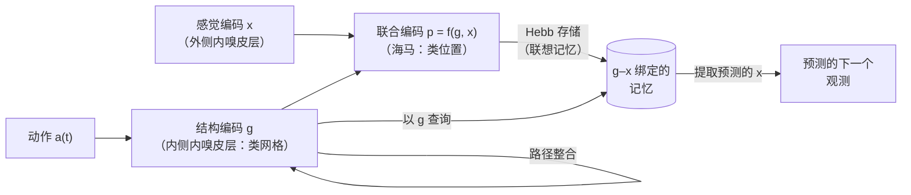

动物不只是记住地点和事件；它们知道地点和事件彼此如何关联，并用这种知识走从未走过的捷径、推断从未尝试过的行动的后果，并且因为新问题与旧问题相似而更快地掌握它。本章讨论大脑怎样表示这类关系性知识。Tolman 称之为认知地图，位置细胞与网格细胞的发现（[7.16.42](/7.16.42#sec-42.4)）使这一想法在空间上有了神经形式。现代观点分三步推广它，每一步都有精确的模型。后继表征来自**强化学习**（[7.16.39](/7.16.39)），它把地图看作对未来状态的预测，解释了位置野为什么受行为塑造，并把网格细胞与环境转移结构的本征向量联系起来。Tolman–Eichenbaum 机器把任务的抽象结构与其感觉内容分开，并用联想记忆（[7.16.43](/7.16.43)）在海马中把二者绑定。带有序数编码和事件边界的序列模型把同样的原理从空间推广到时间。本章以作为规划机制的重放结束，它与 [7.16.41](/7.16.41) 的基于模型的强化学习相联系。

## 46.1. 认知地图

### 46.1.1. Tolman 的大鼠

在 1930 年代占主导的行为主义说法中，学习就是奖赏对刺激–反应联结的强化。Tolman 的实验不符合这一说法。在潜伏学习中（Tolman and Honzik, 1930），在复杂迷宫中没有食物地探索了十天的大鼠，所犯的错误与从未找到食物的大鼠一样多；随后在终点引入食物时，它们的错误在一两次试验之内降到了从一开始就受奖赏的大鼠的水平：它们在没有奖赏的情况下学会了迷宫，奖赏只是显示了它们学到了什么。在绕道与捷径实验中（Tolman, Ritchie and Kalish, 1946），经训练沿间接路线到达目标的大鼠，在路线被堵住、提供了新的辐射状通路时，选择最直接指向目标的那条。Tolman（1948）得出结论：大鼠形成了环境的"认知地图"。

**定义 46.1.1（认知地图）** **认知地图**是对世界状态（地点、物体、事件或抽象的任务状态）之间关系的内部表征，它支持超出重复受强化动作的灵活行为：推断新的路线与捷径、预测行动的后果、在目标或路径改变时立即适应。

O'Keefe 和 Nadel（1978）提出海马是空间地图的所在，[7.16.42](/7.16.42) 的**位置细胞**、**网格细胞**与**头朝向细胞**是它的组成部分。Tolman 的概念更宽：同样的结构支持非空间领域中的关系推断。人类海马与内嗅皮层的活动不仅在虚拟导航时表现出类似网格的六向调制（Doeller, Barry and Burgess, 2010），而且在被试在由颈长和腿长定义的鸟形二维空间中"导航"时也是如此（Constantinescu, O'Reilly and Behrens, 2016）；大鼠海马神经元映射动物通过按压杠杆改变的音调频率（Aronov, Nevers and Tank, 2017）；等级与亲密度的社会层级也以类似地图的方式被表示（Park, Miller and Boorman, 2021）。

### 46.1.2. 结构知识与学习定势

地图有用，因为它可以重复使用。Harlow（1949）给猴子数百个辨别问题，每个问题有一对新的物体，其中一个总是藏着奖赏。在最初的问题上，猴子需要许多次试验才学会哪个物体有奖赏；数百个问题之后，它们只需一次试验就能解决一个新问题：若第一次选择得到奖赏就坚持，否则就换。它们学到了"学习定势"（learning set），即任务结构的抽象知识，与具体的物体无关。同样的迁移也是日常专长的基础：一个人如果大体了解超市的布局（入口处是农产品、冷藏柜沿后墙、出口处是收银台），就会在装潢不同的新超市里马上找到牛奶。因此灵活的行为需要经典**强化学习**没有区分的两件事：对状态之间关系的表征，它能预测行动的后果；以及把这一表征分解为跨任务共享的抽象结构和每个任务具体的感觉内容。

## 46.2. 后继表征

### 46.2.1. 定义与 Bellman 方程

在强化学习中，一个状态的价值是未来奖赏的期望折扣和（[7.16.39](/7.16.39)）。无模型方法直接学习价值，高效但不灵活：奖赏改变时，所有价值都必须通过经验重新学习。基于模型的方法学习转移函数与奖赏函数，通过规划计算价值，灵活但代价高。Dayan（1993）提出了一种中间的表征，把对未来状态的预测与奖赏分开。

**定义 46.2.1（后继表征）** 对环境中状态为 $s$ 的策略 $\pi$，**后继表征**（SR）是期望折扣未来占据次数的矩阵

$$
M(s, s') = \mathbb{E}_\pi\Bigl[\sum_{t=0}^{\infty}\gamma^t\,\boldsymbol{1}_{\{S_t = s'\}}\Bigm| S_0 = s\Bigr], \tag{46.1}
$$

折扣因子为 $0 \le \gamma < 1$：$M(s, s')$ 是智能体从 $s$ 出发将访问 $s'$ 的折扣次数。

**命题 46.2.1（后继表征的性质）** 设 $T$ 为策略 $\pi$ 下的一步状态转移矩阵，$T(s, s') = \mathbb{P}_\pi(S_{t+1} = s' \mid S_t = s)$，设 $\bar{\boldsymbol{r}}$ 为各状态中期望即时奖赏的向量。则

1. $M = \sum_{t=0}^{\infty}\gamma^tT^t = (I - \gamma T)^{-1}$，且 $M$ 满足 Bellman 方程 $M = I + \gamma TM$；
2. $\pi$ 的价值函数可分解为 $\boldsymbol{v}_\pi = M\bar{\boldsymbol{r}}$，即 $v_\pi(s) = \sum_{s'}M(s, s')\,\bar r(s')$。

**证明** 由 Markov 性，$\mathbb{P}_\pi(S_t = s' \mid S_0 = s) = (T^t)(s, s')$，所以式 (46.1) 给出 $M = \sum_t\gamma^tT^t$。该级数收敛，因为 $T$ 是随机矩阵（$\lVert T\rVert_\infty = 1$）且 $\gamma < 1$，而 $(I - \gamma T)\sum_t\gamma^tT^t = I$，所以它等于 $(I - \gamma T)^{-1}$；展开相乘也给出 $M = I + \gamma TM$。对于价值，$v_\pi(s) = \mathbb{E}_\pi\bigl[\sum_t\gamma^tR_{t+1}\bigr]$，其中 $\mathbb{E}[R_{t+1} \mid S_t = s'] = \bar r(s')$（奖赏按收到它时所处的状态编号），所以 $v_\pi(s) = \sum_t\gamma^t\sum_{s'}(T^t)(s, s')\bar r(s') = (M\bar{\boldsymbol{r}})(s)$。$\square$

这个分解是关键。若奖赏改变，例如食物被移走，新的价值函数就是 $M\bar{\boldsymbol{r}}'$，只需一次矩阵–向量乘积即可算出，无需重新学习预测：SR 智能体会像基于模型的智能体那样立即适应奖赏的重新估值。若转移改变，例如某条路被堵住，则必须重新学习 $M$，速度很慢，就像无模型智能体一样。在多步任务中接受测试的人类恰好表现出这种不对称：他们适应奖赏的变化比适应转移结构的变化更快（Momennejad et al., 2017），这与部分依赖 SR 相一致。

Bellman 方程 $M = I + \gamma TM$ 意味着 $M$ 可以通过**时序差分学习**从经验中学得，就像价值函数那样，只是"奖赏"是向量值的 $\boldsymbol{e}_s$（当前状态的指示向量）：每次转移 $s \to s'$ 之后，

$$
M(s, \cdot) \leftarrow M(s, \cdot) + \alpha\bigl[\boldsymbol{e}_s + \gamma M(s', \cdot) - M(s, \cdot)\bigr], \tag{46.2}
$$

其预测误差是一个向量，每个未来状态一个分量。这些误差不是**奖赏预测误差**，而是感觉或状态预测误差，**多巴胺**神经元在没有奖赏的感觉预配对任务中也发出这类误差的信号（Gardner, Schoenbaum and Gershman, 2018）。

### 46.2.2. 作为预测地图的海马

Stachenfeld、Botvinick 和 Gershman（2017）提出，**位置细胞**编码 SR：与状态 $s'$ 相联系的细胞在动物处于状态 $s$ 时，以正比于 $M(s, s')$ 的发放率发放，所以它的位置野就是列 $M(\cdot, s')$。在开放环境中、无偏随机游走下，$M(\cdot, s')$ 是 $s'$ 周围的一个峰，即常规的位置野。但 SR 依赖于策略，模型作出了纯空间编码所没有的几个预测。

- 在动物沿单一方向穿行的轨道上，预测 $s'$ 的细胞在不久就会到达 $s'$ 的状态中活跃，即在 $s'$ 之后的状态：位置野向后偏斜，逆着行进方向，其中心向后移动（下图 B）。随着经验积累，SR 按式 (46.2) 被学到，位置野向后扩展。这两种效应都在熟悉轨道上的 CA1 位置野中观察到（Mehta, Barnes and McNaughton, 1997），当时它们是用学习序列的那类不对称 Hebb 可塑性解释的（[7.16.43](/7.16.43#sec-43.6)）；这两种解释是相关的，因为序列活动上的 **STDP** 近似于 SR 的 TD 学习。
- 障碍改变 SR：墙两侧的状态即使空间上很近，转移步数上也很远，所以位置野不会穿过墙，这与观察相符。
- 位置野聚集在经常访问的位置（如目标和奖赏位置）并向它们扩展，并且在捷径与障碍周围按记录中所见的方式变形。

### 46.2.3. SR 的本征向量与网格细胞

SR 也提示了网格细胞可能在计算什么。若 $T$ 是对称的，如在转移对称的环境中的随机游走，它有标准正交本征基 $\boldsymbol{\phi}_k$，本征值 $\lambda_k \in [-1, 1]$，并且

$$
M = (I - \gamma T)^{-1} = \sum_k\frac{1}{1 - \gamma\lambda_k}\,\boldsymbol{\phi}_k\boldsymbol{\phi}_k^{\mathsf T}. \tag{46.3}
$$

本征值最大的本征向量占主导：它们在环境中变化缓慢，捕获其大尺度结构，而本征值较小的本征向量添加更精细的细节。$T$ 与环境的图 Laplace 矩阵共享这些本征向量，所以它们是状态空间的天然"Fourier 模式"：在矩形箱中，它们是不同空间频率的余弦的乘积；在有墙的环境中，它们绕着墙弯曲并把隔间分开（见下图）。Stachenfeld 及其同事提出，**网格细胞**表示这样的本征向量，它提供了一个低维基，预测地图可以在其中被压缩，并且可以由它识别子目标与瓶颈。这一提议解释了网格细胞为什么成模块、有不同的空间尺度（对应本征值不同的本征向量），以及网格图案为什么在梯形或分隔的环境中变形，这与观察相符。

方形箱的本征向量是周期性的，但不是六角形的。附加约束时才会出现六角图案，例如对位置细胞输入做主成分分析时要求发放率非负（Dordek, Soudry, Meir and Derdikman, 2016），或者连续吸引子网络的动力学选出三波图案时（[7.16.44](/7.16.44#sec-44.5)）。本征向量的解释在计算层面描述网格细胞可能表示什么；吸引子的解释则描述它们的图案怎样被产生和维持。

## 46.3. 把结构与内容分开

### 46.3.1. Tolman–Eichenbaum 机器

SR 仍然把结构绑定在特定的状态上。要在结构相同而内容不同的环境之间迁移知识，表征必须把二者分解。Whittington et al.（2020）建立了具有这种分解的模型，并训练它在结构相同的许多图上随机游走时预测感觉观测（例如许多二维网格，其节点上有不同的随机物体）。

**定义 46.3.1（Tolman–Eichenbaum 机器）** **Tolman–Eichenbaum 机器**（TEM）是海马结构的一个模型，其中结构编码 $\boldsymbol{g}$ 对应内侧内嗅皮层，由动作的路径整合独立于感觉环境而更新；它通过海马中的联合编码 $\boldsymbol{p}$ 与感觉编码 $\boldsymbol{x}$（对应外侧内嗅皮层）绑定，联合编码以 Hebb 可塑性存储在联想记忆中；预测下一个观测就是更新 $\boldsymbol{g}$，并从记忆中提取与之联系的 $\boldsymbol{x}$。

只经过预测训练，TEM 就学到了类似于海马结构中细胞的表征。它的结构单元发展出类网格、类条带和类边界的反应，在结构相同的每个环境中都一样，而它的联合单元发展出类位置细胞的位置野，并在环境之间重映射。该模型对重映射作出了一个并不显然的预测：由于位置细胞是结构编码与感觉编码的联合，它在新环境中的位置野不应是随机的，而应出现在其偏好的感觉输入与网格输入在一致相位上重合之处。对在两个环境中同时记录了网格细胞与位置细胞的数据重新分析，证实位置野与网格相位之间的关系在重映射中的保持程度超过随机预期（Whittington et al., 2020）。该模型也解释了：已经学会一个环境结构的动物，在首次访问结构相同的新环境时，如何能推断经由一条新路径返回会到达起点：结构推断。

### 46.3.2. Transformer 与海马结构

Whittington、Warren 和 Behrens（2022）证明 TEM 与 **Transformer**（[4.7.6](/4.7.6)）密切相关。若存储的记忆是过去的配对 $(\boldsymbol{g}_\tau, \boldsymbol{x}_\tau)$，提取与当前结构编码相联系的感觉观测就是一次注意力运算：当前的 $\boldsymbol{g}_t$ 是查询，存储的 $\boldsymbol{g}_\tau$ 是键，$\boldsymbol{x}_\tau$ 是值，带 softmax 的注意力是 [7.16.43](/7.16.43#sec-43.7) 的现代 Hopfield 网络的一步。结构编码起着 Transformer 位置编码的作用，只是它不是词元下标的固定函数，而是由所采取的动作递归地更新。带有这种循环位置编码的 Transformer，在同样的任务上训练后，学到了具有网格细胞样性质的位置编码，以及类似于位置细胞的注意力权重。这一比较提示了对海马回路的一种解读：它是由内嗅结构编码寻址的**键值记忆**（[定义 43.8.1](/7.16.43#def-43.8.1)）；而 Transformer 是一种并非仿照大脑设计、却得到了关系位置与内容之间类似划分的架构。这一类比有局限：Transformer 关注每个过去词元的精确副本，而海马存储的是压缩的、稀疏的、容量有限的联合并会遗忘。

## 46.4. 序列：顺序与内容

### 46.4.1. 顺序的解缠编码

序列怎样被表示：是通过相继条目之间的联结（A→B→C），还是通过每个条目与其序数位置的联结（A 在位置 1，B 在位置 2）？链式表示预测错误是转到与当前条目有联结的条目；位置编码预测错误是另一序列中同一位置的条目。Orlov、Yakovlev、Hochstein 和 Zohary（2000）训练猴子复现十个序列，每个序列由三幅图像组成。用这些图像重新组合的序列测试时，最常见的错误是选择在某个已学序列中占据同一序数位置的干扰项，并且猴子自发地按序数位置对图像分组：它们把顺序当作一个抽象维度学到了。

神经生理学证实顺序与内容是分开编码的。背外侧前额叶皮层和顶内沟中的神经元按条目在序列中的序位发放，与其身份无关（Ninokura, Mushiake and Tanji, 2004）；在猴子把一个空间位置序列保持在**工作记忆**中时，群体活动把每个序位置于自己的子空间，该序位的条目的位置在其中形成一个环，所以序列记忆是序位与内容编码的联合，具有规则的几何结构（Xie et al., 2022）。同样，大鼠学习一系列有共同时间结构的气味问题时，眶额叶神经元逐渐表示任务图式内的抽象状态，在不同刺激的各问题中是相同的（Zhou et al., 2021）。

### 46.4.2. 序列吸引子图式

顺序的解缠编码使联合编码成为可能：把已知的顺序模板与新的内容结合，就能立即表示一个新序列，这是 TEM 中结构与内容分离在时间上的对应。为区分序列而训练的循环网络把这类模板学成吸引子动力学。Zou et al.（2023）用随时间反向传播训练了一个速率 RNN，对由三个条目中的两个构成的四个序列 $(a, b)$、$(a, c)$、$(b, a)$ 和 $(b, c)$ 进行分类，其顺序形成两层的树（先是第一个条目，再是给定第一个条目的第二个条目），条目之间的间隔可变，使网络必须独立于时间提取顺序。在训练后的网络中，群体轨迹投影到前几个主成分上，形成吸引子状态的树：第一个条目把状态移入两个分支之一，第二个条目把它移入其子分支之一，状态在下一个条目到来之前停留在吸引子中。网络由粗到细地区分序列；由于状态是吸引子而不是暂态轨迹，其分类对序列在时间上的拉伸或压缩（时间扭曲）是稳健的，这是人类言语知觉的一种不变性，该模型在用口语词的关键词检测任务中再现了它。

因为循环连接存储顺序图式，输入连接存储内容到图式上的映射，所以学习具有相同顺序结构的新序列集合时，保留循环权重、只训练输入与输出权重会更快：通过复用图式进行迁移学习。这是 Harlow 学习定势的计算版本。预训练的网络保持了它的树状吸引子，新的内容被映射到它们上面。

## 46.5. 事件图式与事件边界

连续的经验被知觉和记忆为一串离散的事件（到达餐馆、点餐、用餐、付款），人们对事件之间的边界在哪里看法一致（Zacks et al., 2007）。边界在神经活动与记忆中留下痕迹。

**定义 46.5.1（事件边界）** **事件边界**是知觉者把连续经验分割成相继事件的时刻，通常发生在情境的变化（地点、目标、人物、因果结构）使得当前的情境模型无法预测接下来发生什么时。

脑活动反映了这种分割：高层皮层区（如后内侧皮层）的活动模式在事件之内保持稳定，在边界处突然变化；海马在事件结束时短暂响应，事件后来被记得越好，响应越强（Baldassano et al., 2017），这与把每个完成的事件编码为一个情节相一致。记忆以一种特有的方式受边界塑造：两个条目的时间顺序，如果属于同一事件，就比被边界隔开时记得更好，即使时间距离相等；时间上相隔越远的条目顺序记得越好；靠近事件开头的条目顺序记得更好（局部的首因效应）。一个情境模型能解释这三点（Pu, Kong, Ranganath and Melloni, 2022）。缓慢漂移的情境向量与每个条目一起存储：每个时间步，激活的情境元素以小概率关闭，未激活的以小概率开启，所以相似性随时间平滑衰减。在边界处，情境突然移动，上一个事件开头的一部分情境被恢复。在事件之内，条目共享情境，其顺序可从情境的逐渐漂移中读出；跨越边界，情境不相似，相对顺序就丢失了。同样的漂移情境也是自由回忆的时间邻近性的基础（[7.16.43](/7.16.43#sec-43.6)）。

## 46.6. 重放、规划与推断

尖波涟漪期间位置细胞序列的**重放**（[7.16.42](/7.16.42#sec-42.5)）提供了一种不必移动就能使用认知地图的机制。在强化学习的 Dyna 架构中（Sutton, 1990），智能体学习环境模型，并用从模型中抽取的模拟经验离线更新其价值；海马对轨迹的重放，包括从未走过的轨迹（Gupta, van der Meer, Touretzky and Redish, 2010），以及在走向被记住的目标之前对路径的重放（Pfeiffer and Foster, 2013），符合这一角色。应该重放哪些记忆？Mattar 和 Daw（2018）推导出，重放某个特定经验的价值是*增益*（该重放会在该状态下使策略改进多少）与*需求*（未来多常访问该状态，恰好就是 SR，$M(s_{\mathrm{current}}, s)$）的乘积。所得的优先重放再现了一系列观察：奔跑之前的前向重放、奖赏之后的反向重放、对通往新奖赏的路径更多的重放，以及对动物看到过但没有到访过的位置的重放。因此重放把本章的三种表征联系起来：它用 SR 决定模拟什么，用地图的结构生成序列。

在人类中，任务状态的序列可以在静息时从脑磁图中解码出来。被试学会把一组图片重新排成新序列的抽象规则之后，静息时的自发重放遵循图片的推断顺序，而不是看到它们的顺序，并且重放在奖赏之后被时间压缩并反转（Liu, Dolan, Kurth-Nelson and Behrens, 2019）：重放作用于结构知识，与 TEM 这类分解模型一致。这些离线序列是基于模型的推断与规划的候选基质，其算法与行为特征（如**两步任务**）在 [7.16.41](/7.16.41) 中展开。

## 小结

- Tolman 的潜伏学习与捷径实验推动了认知地图（定义 46.1.1），这是状态的关系性表征，支持灵活的推断；海马与内嗅编码映射空间与非空间的关系，学习定势表明结构是从内容中抽象出来的。
- 后继表征（定义 46.2.1）预测折扣的未来占据次数；$M = (I - \gamma T)^{-1}$，价值分解为 $\boldsymbol{v}_\pi = M\bar{\boldsymbol{r}}$（命题 46.2.1），$M$ 由带状态预测误差的 TD 学习得到（式 (46.2)）。SR 智能体适应奖赏变化很快、适应转移变化很慢，人类也部分如此。
- 位置细胞作为 SR 的列，解释了轨道上向后偏斜、向后扩展的位置野以及尊重墙的位置野；SR 的本征向量（式 (46.3)）是周期性的、多尺度的、尊重边界的，这是对网格细胞的计算解释。
- Tolman–Eichenbaum 机器（定义 46.3.1）把结构（内嗅）与内容分解，并在海马的联想记忆中把二者绑定；它学到类网格与类位置的编码，预测有结构的重映射，并等价于带循环位置编码的 Transformer。
- 序列由解缠的序数与内容表征编码；RNN 学到树状序列吸引子，对扭曲稳健，并可复用于迁移。
- 事件边界（定义 46.5.1）分割经验；漂移并移动的情境解释了它们对时间顺序记忆的影响。
- 重放按增益与需求（SR）排定优先级，为规划模拟轨迹，并作用于结构知识。

| 表征 | 编码什么 | 如何学习 | 神经对应 | 能灵活应对 |
|---|---|---|---|---|
| 价值函数 | 期望奖赏 | 带奖赏误差的 TD | 纹状体、多巴胺 | 都不能（重新学习） |
| 后继表征 | 期望的未来状态 | 带状态误差的 TD | 位置野、网格本征向量 | 奖赏变化 |
| 模型（转移） | 一步转移 | 预测 | 海马–前额叶 | 奖赏与转移变化 |
| 分解的结构（TEM） | 抽象关系 + 内容 | 跨环境的预测 | 网格（结构）、位置（联合） | 具有已知结构的新环境 |

## 思考题

1. 对确定性转移的三状态循环 $1 \to 2 \to 3 \to 1$，取 $\gamma = 0.5$，计算 SR 矩阵 $M$。若只在状态 3 给出奖赏 1，三个状态的价值是多少？

   **答** $T$ 是循环置换，所以 $M = \sum_t\gamma^tT^t$，且 $T^3 = I$：$M = (I + \gamma T + \gamma^2T^2)/(1 - \gamma^3)$。取 $\gamma = 0.5$，$1/(1 - 0.125) = 8/7$，$M(s, s') = \frac{8}{7}\gamma^{d(s, s')}$，其中 $d$ 是从 $s$ 到 $s'$ 的步数：第 1 行为 $\frac87(1, 0.5, 0.25)$，第 2 行为 $\frac87(0.25, 1, 0.5)$，第 3 行为 $\frac87(0.5, 0.25, 1)$。取 $\bar{\boldsymbol{r}} = (0, 0, 1)$，$\boldsymbol{v} = M\bar{\boldsymbol{r}}$ 是第三列：$v(1) = 2/7$，$v(2) = 4/7$，$v(3) = 8/7$。用 Bellman 方程 $v(s) = \bar r(s) + \gamma\,v(s_{\mathrm{next}})$ 检验：$v(3) = 1 + 0.5\,v(1) = 1 + 1/7 = 8/7$。

2. SR 智能体和无模型智能体都学习了食物在位置 A 的迷宫。随后食物被移到位置 B，两个智能体都观察到一次，但没有从起点走到那里。下一次试验中哪个智能体会改变路线？如果改为路线上的一扇门被关闭，情况有何不同？

   **答** SR 智能体：它的 $M$ 不变，学到新的奖赏向量之后（只需在 B 处体验奖赏，不必走完整条路线），它重新计算 $\boldsymbol{v} = M\bar{\boldsymbol{r}}'$，立刻前往 B。无模型智能体缓存的价值指向 A，必须通过走到 B 的路径来重新学习。若门被关闭，转移改变，使 $M$ 失效；SR 智能体继续使用过时的预测，必须通过经验重新学习 $M$，就像无模型智能体必须重新学习价值一样，所以两者都不能立即适应。只有基于模型的智能体更新其转移模型并重新规划，才能立即适应这两种变化。

3. 证明 $M = (I - \gamma T)^{-1}$ 的本征向量就是 $T$ 的本征向量，并用 $T$ 的本征值表示 $M$ 的本征值。当 $\gamma \to 1$ 时，$T$ 的哪些本征向量在 $M$ 中占主导？

   **答** 若 $T\boldsymbol{\phi} = \lambda\boldsymbol{\phi}$，则 $(I - \gamma T)\boldsymbol{\phi} = (1 - \gamma\lambda)\boldsymbol{\phi}$，所以 $M\boldsymbol{\phi} = (1 - \gamma\lambda)^{-1}\boldsymbol{\phi}$，反之亦然。$M$ 的本征值是 $1/(1 - \gamma\lambda)$，$\lambda$ 越接近 1 越大。当 $\gamma \to 1$ 时，恒定的本征向量（对连通的环境，$\lambda = 1$）以本征值 $1/(1 - \gamma) \to \infty$ 占主导，其后是变化最慢的非恒定本征向量（"Fiedler"向量和其他 $\lambda$ 接近 1 的向量），它们捕获隔间等粗略结构。因此较长的视野强调环境的大尺度几何。

4. 在 Tolman–Eichenbaum 机器中，为什么位置细胞在新环境中的位置野不会在随机位置？

   **答** 联合（位置）细胞在其偏好的感觉特征与结构（网格）编码的某个特定构型重合时发放。在新环境中，网格编码保持其内部关系（同样的模块与相对相位），而感觉特征被放在不同的位置。因此位置细胞在其偏好特征恰好与同其学到的联合相容的网格相位重合的位置发放，所以跨环境时它的位置野被约束在具有一致网格相位关系的位置。位置野发生重映射，但并非独立于网格细胞，这就是记录中得到证实的预测。

5. （开放题）怎样检验人类海马在新任务中规划时使用的是后继表征还是基于模型的搜索？

   **答** 使用带有单独重新估值阶段的多步任务（Momennejad et al., 2017）：学习之后，在任务中被试只能分别体验、无需走完整个序列的那一部分改变奖赏或转移。SR 预测对奖赏重新估值的快速适应，以及对转移重新估值的缓慢的、依赖经验的适应；基于模型的规划预测对两者都快速适应。在神经方面，用 fMRI 模式分析或 MEG 测量，一个状态所诱发的表征是否包含按折扣加权的、关于未来状态的预测性信息（SR），还是在决策时被依次重放（搜索），并检验转移改变之后静息时的海马重放是否预测之后在转移重新估值上的改进，就像对 $M$ 的离线更新那样。
