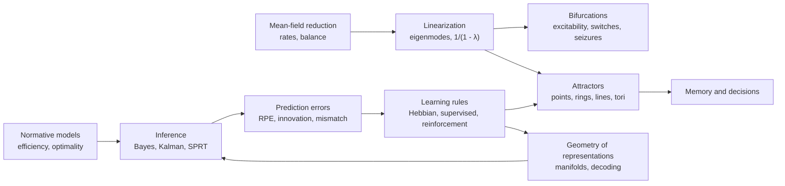

This chapter introduces no new material. It places the preceding 53 chapters on one map, in two passes. The first pass follows the levels of the nervous system, from channels through neurons, synapses and circuits to the senses, movement, value, memory and cognition, and collects for each level its core models, equations and key numbers. The second pass runs across the levels and collects the few methods and principles that keep returning: linearization and bifurcation, mean-field reduction, balance, attractors, normative arguments, inference and prediction errors, learning rules, and the analysis of population data. The course was built on the framework of neurobiology and interleaved with the theory that each part motivated; this summary shows that the two halves describe the same objects in two languages.

## 54.1. Levels, Scales and the Logic of Explanation

The course started from three questions about any explanation in neuroscience ([7.16.1](/7.16.1)): at which level it is given, what kind of model it uses, and what kind of evidence supports it.

- **Marr's levels of analysis** (Definition 1.5.1) separate the computation (what problem is solved and why), the representation and algorithm, and the implementation. Most chapters move between at least two levels: the Reichardt detector is an algorithm implemented by starburst amacrine cells ([7.16.17](/7.16.17)), temporal-difference learning is a computation implemented by dopamine and corticostriatal plasticity ([7.16.39](/7.16.39)).
- Models are descriptive, mechanistic or interpretive (Definition 1.5.2). The LNP model is descriptive, the Hodgkin–Huxley model mechanistic, efficient coding interpretive; the strongest results connect two kinds, as when the energy model of complex cells is both fitted to data and derived from phase invariance (Theorem 18.2.1).
- Evidence comes from observation, which gives correlations, and from perturbation, which tests necessity by loss of function and sufficiency by gain of function (Definition 1.6.1). Each method covers only part of the space of scales ([7.16.3](/7.16.3)).

| Level | Typical size | Typical time | Core models in this course | Chapters |
|---|---|---|---|---|
| Molecules and channels | $1$–$10\,\mathrm{nm}$ | $\mu\mathrm{s}$–ms | Two-state gating, GHK current, HH gates, cascades | 4–5, 11, 17, 25 |
| Neurons and dendrites | $10\,\mu\mathrm{m}$–$1\,\mathrm{mm}$ | ms–s | Phase plane and bifurcations, integrate-and-fire, cable theory | 6–8, 13 |
| Synapses and plasticity | $0.1$–$1\,\mu\mathrm{m}$ | ms–days | Binomial release, kinetic and short-term plasticity models, STDP, Hebbian rules | 9–14, 21–22 |
| Circuits and networks | $0.1\,\mathrm{mm}$–$1\,\mathrm{cm}$ | ms–s | Rate models, E–I networks, balanced and chaotic networks, attractors | 2, 15, 31, 43–45 |
| Systems and behavior | $1\,\mathrm{cm}$–$1\,\mathrm{m}$ | 0.1 s–years | Encoding and decoding, Bayesian observers, optimal control, reinforcement learning, drift diffusion | 16–20, 23–30, 32–42, 46–49 |
| Disease and evolution | whole brain, populations | years to $10^8$ years | Aggregation and spreading, liability threshold, gene birth and death | 51–53 |

![The models of the course placed by the size of the structure they describe (horizontal) and the time scale of the process (vertical), as orders of magnitude; numbers are chapters. Color gives the part of the course. Dotted lines mark a spike (1 ms), a behavioral trial (1 s), a day and a human life. Molecular models sit at the lower left; models of neurons, synapses and circuits fill a band from 10 µs (interaural time differences) to about a second; learning and plasticity rise from seconds (BTSP) to weeks (critical periods), and disease and evolution extend to decades and millions of years. Most models describe processes between 1 ms and 1 s and between 1 µm and 1 cm, the range accessible to electrophysiology and imaging](./plots/model-scales.py)

## 54.2. Molecules and Channels

Every electrical signal in the course begins with an **ion channel** whose open probability depends on voltage, ligand, temperature or force through a free energy of opening.

| Element | Model | Key result or number | Where |
|---|---|---|---|
| Permeation | GHK current; ohmic $i = g(V - E)$ | Rectification (Definition 4.2.2); the ohmic form is accurate for driving forces up to about $10\,\mathrm{mV}$ | Definition 4.2.1 |
| Resting potential | Conductance-weighted mean of reversal potentials | An increase of $g_{\mathrm{Na}}$ moves $V$ toward $E_{\mathrm{Na}}$ | Proposition 4.3.1 |
| Passive membrane | RC circuit, $R_{\mathrm{in}} = R_{\mathrm{m}}/A$, $\tau_{\mathrm{m}} = R_{\mathrm{m}}c_{\mathrm{m}}$ | Low-pass filter with cutoff $1/(2\pi\tau_{\mathrm{m}})$ | Definition 4.4.1 |
| Single channels | $p_\infty = \alpha/(\alpha + \beta)$, $\tau = 1/(\alpha + \beta)$ | Noise variance $Np(1 - p)i^2$: the variance–mean parabola gives $i$ and $N$ | Definition 4.5.1, Proposition 4.5.1 |
| Hodgkin–Huxley | Gates $\dot x = \alpha_x(1 - x) - \beta_x x$, conductances $n^4$, $m^3h$ | Gating charge 11–12 per channel; repetitive firing starts near $58\,\mathrm{Hz}$ in squid axon | Definition 5.2.1 |
| Channel diversity | $I_{\mathrm{A}}, I_{\mathrm{M}}, I_{\mathrm{h}}, I_{\mathrm{T}}, I_{\mathrm{K(Ca)}}, I_{\mathrm{Na,p}}$ | Latency, adaptation, sag and rebound, bursts; many conductance combinations give one pattern | Definition 5.4.1, Remark 5.4.1 |
| Conduction | Cable plus HH, Eq. (5.3) | $v \propto \sqrt d$ unmyelinated, $v \propto d$ myelinated | [7.16.5](/7.16.5), Example 53.2.1 |
| Metabotropic cascades | Chain of first-order stages | Amplification and slowing; saturation of early stages gives spare receptors | Formula 11.1.1 |
| Phototransduction | $n \approx 4$ stage cascade; quadratic onset | About $1\,\mathrm{pA}$ per photon in rods; Weber adaptation | Formula 17.2.1, Formula 17.2.2, Formula 17.3.1 |
| Thermal channels | Enthalpy and entropy of opening | Voltage, temperature and ligands add to one free energy, Eq. (25.3) | Definition 25.2.1, Definition 25.2.2 |

Two points from this level recur later. First, the Boltzmann dependence of opening on voltage and the independent-gate interpretation of the exponents made the Hodgkin–Huxley model predictive of channel structure, so a phenomenological model can still carry physical content. Second, degeneracy (Remark 5.4.1) means that a firing pattern does not determine its conductances; the same statement returns for circuits (Definition 30.3.1) and for the stomatogastric ganglion under neuromodulation ([7.16.11](/7.16.11)).

The toolkit itself is old ([7.16.53](/7.16.53)): $\ce{K+}$ channels are prokaryotic, $\mathrm{Ca_V}$ channels, GPCRs and SNAREs arose in early eukaryotes, and $\mathrm{Na_V}$ channels were derived from $\mathrm{Ca_V}$ channels, with sodium selectivity acquired twice.

## 54.3. Neuron Dynamics

A neuron is a dynamical system with a fast amplifying variable and a slower recovery variable. Its computational properties follow from how its rest state loses stability as input grows.

| Question | Answer | Where |
|---|---|---|
| Is a state stable? | Sign of $F'(V^*)$ on the phase line; eigenvalues of $J$ in the plane | Proposition 6.1.1 |
| What are the canonical two-dimensional models? | FitzHugh–Nagumo and Morris–Lecar; HH reduces to this form with $m = m_\infty(V)$, $h \approx 0.89 - 1.1n$ | Definition 6.3.1, Definition 6.3.2 |
| How does firing start? | Saddle-node on invariant circle: class 1, from zero frequency; Hopf: class 2, at nonzero frequency | Definition 6.4.1, Definition 7.1.1, Definition 7.1.2 |
| Integrator or resonator? | Real eigenvalues (node) sum coincident input; complex eigenvalues (focus) prefer a frequency and fire after inhibition | Definition 6.5.1 |
| How does spiking stop? | Reverse bifurcations, fold of limit cycles, saddle homoclinic orbit | Definition 7.2.1 |
| What is a burst? | Hysteresis loop of a fast subsystem driven by a slow variable | Definition 7.4.1 |
| What is the minimal spiking model? | LIF with $r(I)$ of Eq. (8.1); QIF as the normal form of class 1; ExpIF, AdEx, Izhikevich | Definition 8.2.1, Proposition 8.2.1, Definition 8.3.1, Definition 8.4.1, Definition 8.4.2 |
| Where does input land? | Cable equation $\partial_TV = \partial_X^2V - V$, Eq. (13.1); $\lambda = \sqrt{dR_{\mathrm{m}}/(4R_{\mathrm{i}})} \approx 0.3$–$1\,\mathrm{mm}$ | Definition 13.2.1, Theorem 13.3.1 |
| How do dendrites compute? | On-path shunting, back-propagating spikes, dendritic spikes; a neuron as a two-layer network | Proposition 13.4.1, Definition 13.6.1, Definition 13.6.2 |

The four generic ways in which rest is lost classify neurons along two axes ([7.16.7](/7.16.7)):

| | Bistable (coexisting rest and spiking) | Monostable |
|---|---|---|
| Integrator | Saddle-node | Saddle-node on invariant circle (class 1) |
| Resonator | Subcritical Andronov–Hopf | Supercritical Andronov–Hopf |

The same geometry reappears at larger scales. Bistability and hysteresis describe the sleep–wake **flip-flop switch** (Formula 35.5.1), persistent inward currents in motor neurons (Definition 30.2.1), the commitment of a decision network (Proposition 47.4.1) and the onset and offset of seizures (Formula 52.6.1). The cochlear amplifier works near a Hopf bifurcation ([7.16.24](/7.16.24)), and the phase response curve of an oscillator, which depends on its bifurcation, decides whether coupled oscillators synchronize (Theorem 15.6.1).

## 54.4. Synapses and Plasticity

A synapse converts a presynaptic spike into a probabilistic, history-dependent conductance, and changes its own strength over time scales from milliseconds to days.

| Process | Model | Key result or number | Where |
|---|---|---|---|
| Release | Binomial $K \sim \mathrm{Bin}(N, p)$, quantal size $q$ | Mean $Npq$; varying $p$ traces the variance–mean parabola; central synapses $N \approx 1$–$10$, $p \approx 0.1$–$0.4$ | Definition 9.2.1, Proposition 9.2.1, Proposition 9.2.2 |
| $\ce{Ca^2+}$ sensing | Five-site cooperative sensor; nanodomain and microdomain coupling | Synaptic delay about $0.5\,\mathrm{ms}$; BAPTA and EGTA probe the coupling distance | Formula 9.3.1, Definition 9.3.1 |
| Postsynaptic current | $I_{\mathrm{syn}} = g_{\mathrm{syn}}(V - E_{\mathrm{rev}})$ | AMPA decays in 1–5 ms, NMDA in 40–300 ms | Definition 10.2.1, Definition 10.3.1 |
| NMDA receptor | $\ce{Mg^2+}$ block, Eq. (10.2) | Coincidence detector of release and depolarization | Definition 10.3.2, Definition 10.3.4 |
| Shunting inhibition | Conductance at $E_{\mathrm{Cl}} \approx V_{\mathrm{rest}}$ | Divides small EPSPs by $1 + g_i/g_{\mathrm{L}}$ | Proposition 10.4.1 |
| Neuromodulation | Four small nuclei with brain-wide projections; volume transmission | Peptides diffuse $10\,\mu\mathrm{m}$ in about $50\,\mathrm{ms}$ | Definition 11.4.1, Definition 11.4.2, Definition 11.3.2 |
| Synapse models | Kernels, first-order kinetics, saturating NMDA | Conductance-based versus current-based input | Definition 12.2.1, Definition 12.2.2, Formula 12.3.1 |
| Short-term plasticity | Tsodyks–Markram resources $x$ and utilization $u$ | Depressing synapses saturate at a transmitted rate $1/\tau_{\mathrm{d}}$ and signal relative changes | Definition 12.5.2, Proposition 12.5.1 |

Long-term plasticity forms a ladder of time scales, each rung with its own signal ([7.16.14](/7.16.14)):

| Rule | Signal | Window | Where |
|---|---|---|---|
| Short-term facilitation and depression | Residual $\ce{Ca^2+}$, depletion | 10 ms–seconds | Definition 9.6.2 |
| STDP | Order of pre- and postsynaptic spikes | $\pm 10$–$50\,\mathrm{ms}$ | Definition 14.5.1, Formula 14.5.1 |
| Rate-dependent LTP and LTD | Amount and time course of spine $\ce{Ca^2+}$ | Seconds of stimulation | Definition 14.4.1, Formula 14.4.1 |
| BTSP | Dendritic plateau | Several seconds | Definition 14.8.1 |
| Three-factor rules | Neuromodulator times eligibility trace | $0.3\,\mathrm{s}$ to minutes | Definition 14.9.1 |
| Tagging and capture | Local tag, cell-wide proteins | 1–2 h | Definition 14.7.1 |
| Synaptic scaling | Mean rate of the neuron | Hours to days | Definition 14.6.1 |

The **NMDA receptor** links the molecular and the computational level: its coincidence detection makes **long-term potentiation** input specific, cooperative and associative (Definition 14.2.1), and so implements Hebb's rule (Definition 21.6.1). In development ([7.16.21](/7.16.21)) molecular gradients give a coarse map whose matching is relative (Theorem 21.2.1), and correlated activity such as retinal waves (Definition 21.5.1) refines it.

The mathematics of this refinement is linear algebra ([7.16.22](/7.16.22)): the basic Hebb rule grows the principal eigenvector of the input correlation without bound (Theorem 22.1.1); Oja's rule normalizes it and computes the first principal component (Theorem 22.2.1); the BCM rule with a sliding threshold becomes selective for one pattern (Theorem 22.3.1); averaged STDP depresses uncorrelated inputs when $A_-\tau_- > A_+\tau_+$ (Theorem 22.4.1); and ocular dominance stripes grow from the fastest-growing Fourier mode of the cortical interaction (Theorem 22.5.1).

## 54.5. Circuits and Network Dynamics

Networks are analyzed by replacing spikes with rates (Formula 15.1.1), linearizing, and reading the behavior from the eigenvalues of the connectivity. One factor recurs: a mode with eigenvalue $\lambda < 1$ of the recurrent weights is amplified and slowed by $1/(1 - \lambda)$.

| Instance | Statement | Where |
|---|---|---|
| Recurrent excitation in a single cell | Gain and time constant multiplied by $1/(1 - w)$ | Proposition 2.3.1 |
| Symmetric linear network | Mode $\mu$ amplified by $1/(1 - \lambda_\mu)$, Eq. (15.4) | Proposition 15.2.1 |
| Ring model of V1 | Tuned mode amplified by $1/(1 - \lambda_1/2)$; above $\lambda_1 = 2$ tuning width is set by the recurrence | Formula 18.3.1 |
| Oculomotor integrator | Time constant $\tau/\lvert 1 - \lambda\rvert$; fine tuning near $\lambda = 1$ | Definition 33.4.2 |
| Intrinsic time scales of cortex | $\tau_{\mathrm{int}} = \tau/(1 - w)$, Eq. (49.2) | Definition 49.2.1 |
| Decision network | Unstable eigenvalue $\lambda_-$ of the symmetric saddle sets the integration time | Proposition 47.4.1 |

Beyond this linear core the course met six network regimes:

| Regime | Condition | Behavior | Where |
|---|---|---|---|
| Non-normal amplification | Hidden feedforward structure | Transient amplification without slowing | Definition 15.2.1 |
| E–I oscillation | Strong $w_{EE}$, slow inhibition | Hopf bifurcation and limit cycle (Wilson–Cowan) | Definition 15.4.1 |
| Inhibition-stabilized network | $w_{EE} > 1$, stabilized by inhibition | Paradoxical drop of inhibitory rate when inhibition is driven | Definition 15.4.2, Proposition 15.4.1 |
| Gamma rhythm | Fast excitation, slower inhibition | PING or ING; period set by the decay of inhibition | Definition 15.5.1 |
| Balanced state | Weights $\sim 1/\sqrt K$ | Mean input cancels, fluctuations drive irregular firing; rates linear in input | Definition 15.7.1, Proposition 31.1.1 |
| Chaos in random networks | Gain $g > 1$ | Silent state unstable when the spectrum leaves the unit disk | Theorem 31.2.1 |

Chaotic and high-dimensional dynamics are a resource. **Reservoir computing** reads out a random network linearly, under the echo state property (Definition 31.3.2, sufficient condition Proposition 31.3.1); FORCE learning (Algorithm 31.4.1) trains such a network to produce a target; and trained networks are understood through their fixed and slow points (Definition 31.5.1) and through sequences of saddles (Definition 31.6.1). At the scale of the whole brain the same tools give functional connectivity from structure through the Lyapunov equation (Formula 49.1.1) and the avalanche exponents $3/2$ and $2$ of a critical branching process (Theorem 49.3.1); in vivo the cortex appears slightly subcritical, with branching ratio $\sigma \approx 0.98$.

## 54.6. Coding and the Senses

Coding theory gives the language and the bounds; each sensory system shows them implemented in a particular physics.

| Question | Tool | Key result | Where |
|---|---|---|---|
| How variable are spikes? | Poisson and renewal processes | Poisson: $F = C_V = 1$; renewal: $F(T) \to C_V^2$; cortex $F \approx 1$–$1.5$ | Theorem 16.4.1, Theorem 16.4.2 |
| What does a neuron respond to? | Reverse correlation, LNP, GLM | For white noise the STA recovers the linear filter of an LNP neuron | Theorem 16.5.1, Definition 16.6.1, Theorem 16.6.1 |
| How much information is transmitted? | Mutual information | Gaussian channel $\tfrac12\log_2(1 + \mathrm{SNR})$; fly H1 about 1.8 bits per spike | Definition 20.1.1, Theorem 20.1.1 |
| What is the best code? | Efficient coding | Histogram equalization for one neuron; whitening for natural images; sparse coding gives V1-like bases | Theorem 20.2.1, Definition 20.3.1, Definition 20.5.1 |
| How cheap should spikes be? | Information per unit energy | Low firing probability when spikes are expensive | Formula 20.6.1 |
| How well can a stimulus be read out? | Signal detection, Bayesian decoding, Fisher information | ROC area equals two-alternative proportion correct; $I_{\mathrm{F}} = \sum_i f_i'^2/f_i$ bounds every unbiased decoder, Eq. (26.8) | Theorem 26.2.1, Theorem 26.3.1 |
| Do correlations matter? | Noise correlations | Information-limiting correlations cap $I_{\mathrm{F}}$ at $1/\varepsilon$ | Definition 26.5.2, Theorem 26.5.1 |
| How should cues be combined? | Bayesian observer | Precision-weighted average; combined variance below either cue | Theorem 27.1.1, Theorem 27.2.1 |
| How might neurons represent uncertainty? | Probabilistic population codes | Gain encodes reliability; summing responses multiplies likelihoods | Theorem 27.5.1, Theorem 27.5.2 |

The sensory chapters apply these tools to the physics of each modality:

| System | Transduction | Canonical computation and model | Key numbers | Where |
|---|---|---|---|---|
| Retina | Rhodopsin–transducin–PDE cascade | Weber adaptation; DoG center–surround; direction selectivity by starburst cells and the Reichardt detector | Single-photon responses; about 45 ganglion cell types | Formula 17.5.1, Definition 17.6.3, Theorem 17.6.1 |
| Visual cortex | (Relay through LGN) | Gabor simple cells, energy-model complex cells, ring model, normalization of attention | $M(E) = M_0/(1 + E/E_2)$; pinwheel density about $\pi$ per $\Lambda^2$ | Formula 18.1.1, Definition 18.2.2, Formula 18.7.1 |
| Object vision | (Hierarchy) | Template matching and pooling; task-optimized deep networks; axis code of face cells | Identity linearly decodable in IT | Definition 19.2.1, Definition 19.3.1, Formula 18.6.1 |
| Olfaction | Odorant receptor GPCRs, one receptor per neuron | Combinatorial code, divisive normalization, random expansion and sparsening | 50 channels to about 2000 Kenyon cells in the fly | Definition 23.1.2, Proposition 23.2.1, Algorithm 23.4.1 |
| Hearing | Direct mechanical gating in hair cells | Tonotopy, gammatone filters, Hopf amplifier, phase locking, delay lines | ITD resolution of microseconds; locking fades at a few kHz | Formula 24.1.1, Proposition 24.3.1, Definition 24.5.1 |
| Touch, temperature, pain | Piezo2, TRPV1, TRPM8 | Labeled lines plus comparison; dorsal horn gate, Eq. (25.5); central sensitization | Texture by $f = v/\lambda$, Eq. (25.4) | Definition 25.2.1, Definition 25.5.1 |

Three computations recur across modalities. **Divisive normalization** (Definition 23.4.1) appears in shunting inhibition (Proposition 10.4.1), in the normalization model of attention and in the fly antennal lobe. Expansion with sparsening appears in the mushroom body, in cerebellar granule cells (Theorem 33.1.1) and in the dentate gyrus ([7.16.42](/7.16.42)). Coincidence detection appears in the NMDA receptor, in the Jeffress model and in the adenylyl cyclase of *Aplysia* conditioning ([7.16.38](/7.16.38)). The analysis of populations ([7.16.28](/7.16.28)) closes the coding part: the dimension of activity is set by the task, not by the number of neurons (participation ratio, Definition 28.2.1), and the population lies on a **neural manifold** (Definition 28.5.1) whose topology matches the variable it represents.

## 54.7. Movement

Motor control is coding run in reverse, under delays, noise and redundancy ([7.16.29](/7.16.29)).

| Problem | Solution | Key relation | Where |
|---|---|---|---|
| Sensory delay | Feedforward control, Smith predictor, forward model | Delayed feedback stable only if $kT < \pi/2$ | Proposition 29.2.1, Definition 29.2.2 |
| Self versus world | Efference copy | Cancels reafference; one cannot tickle oneself | Definition 29.3.2 |
| Uncertain body state | Kalman filter | Gain equals the cue-combination weight of Theorem 27.2.1 | Algorithm 29.4.1 |
| Noise and redundancy | Minimum variance, optimal feedback control | Signal-dependent noise gives bell-shaped velocity profiles; only task-relevant errors are corrected | Proposition 29.5.1, Definition 29.5.2, Definition 29.5.3 |
| Changing dynamics | Two-state adaptation | Savings and spontaneous recovery | Formula 29.6.1 |
| Force grading | Size principle and rate coding | Force noise proportional to force | Formula 30.1.1 |
| Rhythm | Half-center CPGs, Matsuoka oscillator | Spinal interneuron classes set alternation | Formula 30.4.1 |
| Cortical output | Cosine tuning, population vector, output-null space, rotations | Preparation sets an initial condition; dynamics generate the movement | Proposition 32.2.1, Definition 32.3.2, Definition 32.4.1 |
| Calibration | Cerebellar perceptron and adaptive filter | A perceptron separates about $2n$ patterns in $n$ dimensions; most parallel fiber synapses are silent | Theorem 33.1.1, Definition 33.2.1, Formula 33.2.1 |
| Holding gaze | Pulse–step command, neural integrator | Line attractor with time constant $\tau/\lvert 1 - \lambda\rvert$ | Formula 33.4.1, Definition 33.4.1 |

The motor chapters link to the rest of the course at three points. The Kalman filter is Bayesian cue combination iterated in time; the size principle produces the signal-dependent noise (Definition 29.5.1) that optimal control assumes; and the brain–machine interface (Definition 32.5.1) is the decoding of [7.16.26](/7.16.26) run online, with users learning new decoders quickly inside the neural manifold and slowly outside it. Motor adaptation depends on the cerebellum, whereas learning from reward depends on the **basal ganglia**, which leads to the next part.

## 54.8. Drives, Value, Learning and Memory

### 54.8.1. Drives, Rhythms and Emotion

The regulatory chapters describe the body's controllers ([7.16.34](/7.16.34)–[7.16.37](/7.16.37)).

| System | Model | Key result | Where |
|---|---|---|---|
| Feeding and drinking | Need minus predicted gain; proportional, integral and feedforward control | AgRP activity drops within seconds of seeing food; integral control has zero steady-state error | Formula 34.3.1, Definition 34.4.1 |
| Homeostatic reinforcement | Reward as drive reduction | Maximizing discounted reward minimizes future drives | Definition 34.5.1, Proposition 34.5.1 |
| Circadian clock | Transcription–translation feedback loop; Goodwin model, Eq. (35.1) | Oscillation needs steep repression ($h > 8$ for three stages); entrainment on a decreasing part of the PRC | Definition 35.1.1, Proposition 35.2.1 |
| Sleep | Flip-flop switch with two-process thresholds | The thresholds are the ends of a hysteresis loop | Definition 35.4.1, Formula 35.5.1 |
| Social behavior | Sex-specific splicing; organizational–activational hormones | Graded VMHvl activity selects behaviors; a line attractor for an aggressive state | Definition 36.1.1, Definition 36.2.1 |
| Fear and reward | CS–US convergence in the amygdala; dopamine prediction error | Burst for unexpected reward, pause for omission | Definition 37.2.1, Definition 37.4.1 |
| Addiction | Drug-evoked component that cannot be predicted away | Values grow without bound; opponent processes give tolerance | Formula 37.5.1, Definition 37.5.2 |

A single quantity runs through this part: a teaching signal of the form "outcome minus prediction". It appears as need minus predicted nutrient gain in AgRP neurons, as the **reward prediction error** of dopamine neurons, and as the opposite-valence signals of the lateral habenula and the amygdala.

### 54.8.2. Reinforcement Learning and the Basal Ganglia

| Algorithm | Learns | Signal | Neural counterpart | Where |
|---|---|---|---|---|
| Rescorla–Wagner | Associative strengths | Shared prediction error | Blocking, fear acquisition and extinction | Definition 39.1.1 |
| TD learning | $v_\pi$ by bootstrapping | $\delta_t = R_{t+1} + \gamma\hat v(S_{t+1}) - \hat v(S_t)$ | Dopamine burst and pause | Definition 39.2.1, Remark 39.3.1 |
| Dynamic programming | $v_*$, $q_*$ of a known MDP | Bellman backups (contractions) | Planning, replay | Theorem 39.4.1, Theorem 39.4.2, Algorithm 39.4.2 |
| SARSA, Q-learning | Action values | Sampled backups | Striatal action values | Algorithm 39.5.1, Algorithm 39.5.2 |
| Distributional TD | Return distribution | Asymmetric learning rates give expectiles | Spread of dopamine reversal points | Definition 39.7.1, Proposition 39.7.1 |
| Action selection | Which channel is released | Focused striatal inhibition, diffuse STN excitation | GPi, SNr disinhibition; dopamine sets the gain | Definition 40.2.1, Formula 40.2.1 |
| Opponent three-factor rules | Go and NoGo weights | Bursts potentiate dSPN, dips potentiate iSPN synapses | Parkinson's on and off medication | Formula 40.3.1 |
| Actor–critic | Policy and value | TD error as advantage | Dorsal (actor) and ventral (critic) striatum | Algorithm 40.4.1, Algorithm 41.3.1 |
| Policy gradient | Policy directly | $(G_t - b)\nabla\ln\pi$ | Reward-modulated plasticity of stochastic neurons | Theorem 41.2.1, Proposition 41.4.1 |
| Model-based RL | A model, then values by planning | State and reward prediction errors | Hippocampus, OFC, PFC | Definition 41.5.1, Definition 41.5.2 |
| Meta-RL | A learning algorithm in activity | Slow RL on weights, fast inference in activity | Prefrontal recurrent dynamics | Definition 41.6.1 |

The learning systems of the course share one template, a plastic site plus a teaching signal plus a coincidence detector:

| System | Plastic site | Teaching signal | Coincidence detector | Where |
|---|---|---|---|---|
| *Aplysia* gill withdrawal | Sensory neuron terminals | Serotonin | $\ce{Ca^2+}$/calmodulin- and G protein–stimulated adenylyl cyclase | Formula 38.3.1 |
| *Drosophila* mushroom body | Kenyon cell–MBON synapses | Compartment-specific dopamine | Rutabaga adenylyl cyclase | [7.16.38](/7.16.38) |
| Amygdala | Inputs to lateral amygdala | US-evoked depolarization | NMDA receptor | Definition 37.2.1 |
| Striatum | Corticostriatal synapses | Dopamine | NMDA receptor, cAMP, eligibility trace | Formula 40.3.1 |
| Cerebellum | Parallel fiber–Purkinje cell synapses | Climbing fiber error | Conjunction of parallel and climbing fiber input | Definition 33.2.1 |
| Hippocampus | CA3–CA1 synapses onto place cells | Dendritic plateau (BTSP) | Plateau-gated eligibility trace | Definition 14.8.1 |

### 54.8.3. Memory, Attractors and Maps

Memory in the course has two substrates, synaptic weights and network states, and attractor theory connects them: weights shape a landscape whose stable states are the remembered patterns.

| Attractor | Represents | Model and key result | Where |
|---|---|---|---|
| Discrete point attractors | Stored patterns, items in working memory | Amari–Hopfield energy decreases to a fixed point; capacity $0.138N$ with small error | Formula 43.3.1, Theorem 43.3.1, Proposition 43.4.1 |
| Dense associative memory | Many patterns | Capacity $\propto N^{n-1}$; the exponential version is the attention update | Definition 43.7.1, Proposition 43.7.1 |
| Ring | Head direction, remembered location | Exact Gaussian bump at every position; one neutral mode; bump diffusion explains growing errors | Proposition 44.2.1, Definition 44.4.1 |
| Torus | Grid cell module | Hexagonal pattern moved by velocity; toroidal population activity | Definition 42.4.3, Formula 42.4.1 |
| Line | Eye position, aggressive state, accumulated evidence | Time constant $\tau/\lvert 1 - \lambda\rvert$ | Definition 33.4.2, [7.16.36](/7.16.36) |
| Activity-silent states | Items in facilitated synapses | Capacity $T_{\max}/t_s \propto \tau_{\mathrm{d}}/\tau$ | Definition 45.4.1, Formula 45.4.1, Proposition 45.5.1 |
| Heteroclinic sequences | Ordered states | Saddles connected by heteroclinic orbits | Definition 31.6.1 |

The hippocampal chapters attach these models to cells and data ([7.16.42](/7.16.42)). The dentate gyrus is thought to perform **pattern separation** and CA3 pattern completion (Definition 42.2.1); place, head direction, grid and border cells (Definition 42.4.1, Definition 42.4.2, Definition 42.4.3, Definition 42.4.4) map space; phase precession (Formula 42.5.1) and replay at about 20 times speed (Definition 42.5.3) compress experience into sequences; and engram cells (Definition 42.6.1) can be reactivated to recall a memory. Memories are consolidated and, when reactivated with a prediction error, reconsolidated (Definition 42.7.1, Definition 42.7.2).

The **successor representation** (Definition 46.2.1) joins memory to value: $M = (I - \gamma T)^{-1}$ predicts discounted future occupancies, values factorize as $\boldsymbol{v}_\pi = M\bar{\boldsymbol{r}}$ (Proposition 46.2.1), place fields resemble its columns and grid fields its eigenvectors. The Tolman–Eichenbaum machine (Definition 46.3.1) factorizes structure and content and is equivalent to a Transformer with recurrent position encodings.

### 54.8.4. Decision-Making

| Model | Dynamics | Result | Where |
|---|---|---|---|
| Drift diffusion | $\mathrm{d}x = A\,\mathrm{d}t + c\,\mathrm{d}W$ to bounds $\pm\theta$ | $P_{\mathrm{c}} = 1/(1 + \mathrm{e}^{-2A\theta/c^2})$, $\mathbb{E}[T_{\mathrm{d}}] = (\theta/A)\tanh(A\theta/c^2)$ | Definition 47.2.1, Proposition 47.2.1 |
| SPRT | Sum of log-likelihood ratios | Minimal mean decision time for given error rates | Definition 47.2.2, Theorem 47.2.1 |
| Wong–Wang network | Slow NMDA recurrence and winner-take-all | DDM-like near the critical boundary $\lambda_- = 0$ | Formula 47.4.1, Proposition 47.4.1 |
| Prospect theory | Reference-dependent, loss-averse value | Risk attitudes in value-based choice | Definition 47.5.1 |
| Confidence | Posterior probability of being correct | Depends on accumulated evidence and elapsed time | Definition 47.6.1, Proposition 47.6.1 |

The **drift-diffusion model** connects four earlier threads: the SPRT is the optimal sequential test (normative), LIP activity accumulates evidence (implementation, Definition 47.3.1), the Wong–Wang model reduces the network to a saddle (bifurcation and linearization), and confidence is a posterior (inference).

## 54.9. Cognition, Disease and Evolution

The last chapters apply the same tools to the largest systems.

| Topic | Model | Key result | Where |
|---|---|---|---|
| Perception as inference | Generative and recognition models; ELBO | Log evidence = ELBO + posterior divergence; wake–sleep learning | Definition 48.1.1, Theorem 48.3.1, Algorithm 48.1.1 |
| Predictive coding | Errors forward, predictions backward | Explains end-stopping and mismatch responses; error neurons debated | Definition 48.4.1, Formula 48.4.1 |
| Self-supervised learning | Contrastive and joint-embedding objectives | Representations predict the ventral stream | Definition 48.5.1, Definition 48.5.2 |
| Brain networks | Structural versus functional connectivity | FC follows SC with $r \approx 0.5$; default mode network at the top of a gradient | Definition 49.1.1, Definition 49.1.2 |
| Language | Encoding models | Next-word prediction models predict the language network | Definition 49.4.1, Formula 49.4.1 |
| Consciousness | Workspace and integrated information theories; PCI | Neither theory survived adversarial testing intact; PCI measures level at the bedside | Definition 49.5.2, Definition 49.5.3, Definition 49.5.4 |
| Credit assignment | Backpropagation and local alternatives | Perturbation estimates the gradient with variance growing with $n$ | Definition 50.1.1, Definition 50.2.1, Proposition 50.2.1 |
| Spiking and neuromorphic hardware | Surrogate gradients; memristors | Brain about $10^{-14}\,\mathrm{J}$ per synaptic event | Definition 50.4.2, Definition 50.5.1 |
| Neurodegeneration | Nucleated polymerization; spread on the connectome | Early growth $\kappa = \sqrt{2k_+k_2m_{\mathrm{tot}}^{n_2 + 1}}$; seeds shift the lag logarithmically; Braak-like staging | Formula 51.2.1, Proposition 51.2.1, Formula 51.2.2 |
| Psychiatric genetics | Liability threshold | High twin concordance with steeply falling risk in more distant relatives | Formula 52.1.1 |
| Epilepsy | Fast–slow system | Seizure onset and offset as bifurcations | Definition 52.6.1, Formula 52.6.1 |
| Evolution | Gene birth and death; opsin duplication | Receptor families change size by turnover; a new L opsin adds a color dimension at once | Formula 53.3.1, Definition 53.4.3 |

Diseases read best as perturbations of models from earlier chapters. **Parkinson's disease** removes the dopamine gain of action selection (Formula 40.2.1), and L-DOPA-induced dyskinesia raises it too far; epilepsy moves a network across a bifurcation of the kind classified in [7.16.7](/7.16.7); the dopamine hypothesis of schizophrenia (Definition 52.2.1) and models of anhedonia are statements about prediction errors and reward sensitivity; autism and fragile X syndrome converge on synaptic genes and on the balance of excitation and inhibition ([7.16.52](/7.16.52)). Evolution ([7.16.53](/7.16.53)) shows the same economy at the longest scale: the molecular toolkit was assembled stepwise from older parts, and behavioral differences between species arise mostly from retuning conserved circuits.

## 54.10. Methods and Principles Across the Course

The second pass runs across the levels. Figure 2 marks for each chapter the methods and principles it relies on; most chapters use two or three, and each principle appears at several levels.

![Which recurring method or principle each chapter relies on. Columns: chapters 7.16.1 to 7.16.53, grouped into the frame of the course, neurons, synapses, network dynamics, coding and the senses, movement, drives, value and reinforcement learning, memory and cognition, and disease and evolution. Filled discs: principles that carry a model, a theorem or the main argument of the chapter; open rings: secondary elements. Bifurcation theory dominates the single neuron, linearization the synapses and networks, attractors the memory chapters, and inference with prediction errors the senses, value and cognition; learning rules run from plasticity (14, 22) through reinforcement learning to credit assignment (50)](./plots/principles-matrix.py)

### 54.10.1. Linearization, Phase Planes and Bifurcations

The most used tool of the course is the Jacobian. At a fixed point its eigenvalues give stability and time constants; along a parameter, the way they cross the imaginary axis classifies the qualitative change. The same analysis classifies neurons (Definition 6.4.1, Definition 7.1.1), gives the oscillation condition of an E–I loop (Eq. (15.6)) and the Hopf bifurcation of the cochlear amplifier, the stability of delayed feedback (Proposition 29.2.1), the edge of chaos in random networks (Theorem 31.2.1), the integration time of a decision network (Proposition 47.4.1) and the onset of seizures.

When linearization fails, at bifurcation points and centers, Lyapunov functions take over: the energy of symmetric networks rules out oscillation (Theorem 43.3.1, [7.16.15](/7.16.15)). Fast–slow decomposition (Definition 7.4.1) explains bursting, sleep switching and seizures by the same picture of a slow variable dragging a bistable fast subsystem around a hysteresis loop.

### 54.10.2. Mean-Field Reduction

Networks of thousands of spiking neurons are reduced to a few equations for population rates. The reductions used in the course are the f–I curve of a noisy LIF neuron (Siegert formula, Eq. (8.3)), the Wilson–Cowan equations, the balanced-state scaling in which weights of order $1/\sqrt K$ leave fluctuations of order one (Proposition 31.1.1), the mean-field capacity of the Hopfield network, the reduced Wong–Wang model (Formula 47.4.1), the mean-field model of synaptic working memory (Formula 45.4.1) and the branching process of avalanches. Rate models are accurate for asynchronous populations and slow synapses; they miss synchrony, which the phase models of [7.16.15](/7.16.15) restore.

### 54.10.3. Balance and Stability

Excitation must be balanced by inhibition and plasticity by homeostasis, or activity runs away. The **balanced state** (Definition 15.7.1) explains irregular cortical firing with Fano factors near one; inhibition-stabilized dynamics explain the paradoxical effect; synaptic scaling (Definition 14.6.1), the sliding threshold of the BCM rule and subtractive or multiplicative normalization (Definition 22.2.1) stabilize Hebbian growth; integral control gives perfect adaptation of body variables ([7.16.34](/7.16.34)); and the maturation of inhibition opens and closes critical periods ([7.16.21](/7.16.21)). Failures of balance are disease: epilepsy and, in part, autism ([7.16.52](/7.16.52)).

### 54.10.4. Normative Models and Efficiency

A normative model asks what an optimal system would do under stated constraints and compares the answer with the data. The course used this argument for retinal and fly coding (histogram equalization, whitening, Theorem 20.2.1), sparse codes and the energy cost of spikes (Formula 20.6.1), the two-channel code of interaural time differences in small heads ([7.16.24](/7.16.24)), Fisher-information bounds on decoding (Theorem 26.5.1), Bayesian cue combination (Theorem 27.2.1), minimum-variance movement and optimal feedback control (Proposition 29.5.1, Definition 29.5.2), expansion recoding (Theorem 33.1.1), the SPRT and reward-rate-maximizing bounds (Theorem 47.2.1, Eq. (47.4)) and hashing in the mushroom body (Algorithm 23.4.1).

Its limits were stated each time ([7.16.20](/7.16.20), [7.16.27](/7.16.27)): the answer depends on the assumed ensemble and constraint, ignores which information is relevant, and needs independently measured components to be a test rather than a fit.

### 54.10.5. Inference and Prediction Errors

Bayesian inference is the computational-level description of perception, motor estimation and decision. The Bayesian observer (Definition 27.1.1), the Kalman filter (Algorithm 29.4.1), the SPRT and decision confidence, the causal inference model (Definition 27.2.1), and variational inference in generative models (Theorem 48.3.1) all combine a prediction with evidence weighted by reliability. Their common algorithmic currency is the prediction error: the innovation of the Kalman filter, the TD error $\delta_t$, the need signal of AgRP neurons, the climbing fiber error of the cerebellum, the error units of predictive coding, the mismatch that triggers reconsolidation. Where the error is computed and what it trains is the biological question each chapter answered for its own system.

### 54.10.6. Learning Rules and Credit Assignment

The plasticity rules of the course fall into three types, distinguished by the signal that gates them ([7.16.22](/7.16.22), [7.16.50](/7.16.50)):

| Type | Signal | Examples in the course | Computational result | Brain system (first approximation) |
|---|---|---|---|---|
| Hebbian (unsupervised) | Pre- and postsynaptic activity | Hebb, Oja, BCM, STDP, covariance rule | Principal components, selectivity, maps, stored patterns | Cortex, hippocampus |
| Supervised (error-driven) | A vector or scalar error | Climbing fiber LTD, adaptive filter, delta rule, FORCE, backpropagation | Calibration, function approximation | Cerebellum |
| Reinforcement (three-factor) | Activity times eligibility trace times a global reward signal | Dopamine-gated corticostriatal plasticity, REINFORCE, node perturbation | Policy and value learning | Basal ganglia |

The **credit assignment problem** (Definition 50.1.1) asks how a synapse learns its share of an error. Backpropagation solves the spatial part exactly but needs weight transport; feedback alignment, dendritic error signals, three-factor rules with eligibility traces and perturbation methods trade exactness for locality, and the variance of perturbation grows with the number of parameters (Proposition 50.2.1). The temporal part is solved by eligibility traces (Definition 14.9.1), BTSP and TD bootstrapping.

### 54.10.7. Geometry of Representations: Encoding, Decoding and Dimensionality Reduction

Data analysis in the course followed one sequence. An encoding model (tuning curves, LNP and GLM, encoding models of language) predicts responses from stimuli; a decoder (population vector, maximum likelihood, optimal linear estimator, Kalman decoder of a BMI) inverts it; and dimensionality reduction (PCA, demixed PCA, GPFA, jPCA; Definition 28.3.1, Definition 28.5.2) finds the low-dimensional state space in which the dynamics live.

Two cautions were repeated: variance is not information, since the optimal linear readout is the Fisher discriminant (Theorem 28.6.1) rather than the largest principal component, and claims about manifolds and rotations need surrogate data and cross-validation (Marchenko–Pastur band, Eq. (28.3)). Indirect measurements (calcium, BOLD) are convolutions of activity with a kernel, and their deconvolution is an ill-posed problem ([7.16.3](/7.16.3)).

### 54.10.8. Brains and Machines

The course repeatedly met an exchange between neuroscience and artificial intelligence, in both directions and with clear limits.

| Correspondence | Shared idea | Difference | Where |
|---|---|---|---|
| CNN and the ventral stream | Hierarchy of template matching and pooling; task optimization predicts V4 and IT | Adversarial vulnerability, texture bias, little recurrence | [7.16.19](/7.16.19), Theorem 19.4.1 |
| TD learning and dopamine | Reward prediction error trains value | Dopamine is also distributional, rank-coded and tied to vigor and salience | [7.16.39](/7.16.39), Definition 39.7.1 |
| Attention and associative memory | Softmax update of modern Hopfield networks; key–value memory | The brain separates fast hippocampal binding from slow cortical storage | Definition 43.7.1, Definition 43.8.1, Definition 46.3.1 |
| Reservoirs and cortex | Rich recurrent dynamics read out linearly | Cortical connectivity is structured and plastic | Definition 31.3.1 |
| Expansion layers | Random expansion and sparsening for linear readout | — | Algorithm 23.4.1, Theorem 33.1.1 |
| Generative and self-supervised models | Learning without labels; inference by a recognition model | Whether the brain uses error neurons or sampling is open | [7.16.48](/7.16.48) |
| Learning algorithms | Gradient descent on an objective | Locality and weight transport; energy about $10^{-14}\,\mathrm{J}$ per synaptic event against picojoules per digital operation | [7.16.50](/7.16.50) |

The exchange works in both directions. Models trained for a task are now standard hypotheses for neural responses, and neural findings (normalization, replay, meta-learning in prefrontal cortex, sparse expansion) have become engineering ideas. The differences are as informative as the similarities: brains learn from few examples, compute with slow, noisy, local and energy-limited components, and are built by development under genetic constraint.

## 54.11. Open Questions

The chapters ended with questions that remain open. Grouped by level:

| Level | Open questions |
|---|---|
| Molecules and synapses | How is a memory maintained for decades when synaptic proteins turn over in days? The role of CaMKII in maintenance is debated ([7.16.14](/7.16.14)), and how tagging, capture and structural change combine into a stable engram is unknown. |
| Neurons and dendrites | How much of cortical computation happens within single neurons, through dendritic spikes and compartmentalized plasticity ([7.16.13](/7.16.13)), and does the apical dendrite carry learning signals ([7.16.50](/7.16.50))? |
| Circuits | What, if anything, do gamma oscillations compute ([7.16.15](/7.16.15))? How do the connectome and the dynamics determine each other, given that wiring diagrams lack synaptic strengths and neuromodulatory state ([7.16.3](/7.16.3))? Is the cortex near a critical point, and does it matter ([7.16.49](/7.16.49))? |
| Coding | How are Bayesian computations implemented and learned, and is uncertainty represented by gain, by sampling or otherwise ([7.16.27](/7.16.27))? Which constraints, beyond those of the early stages, does efficient coding explain ([7.16.20](/7.16.20))? |
| Movement and decision | Accumulation of evidence is distributed, since inactivating LIP spares choices ([7.16.47](/7.16.47)); where and how is commitment implemented? |
| Value and memory | How do model-based and model-free control arbitrate, and what is the role of replay in planning and consolidation ([7.16.41](/7.16.41), [7.16.42](/7.16.42))? What is sleep for ([7.16.35](/7.16.35))? |
| Learning algorithms | Which approximation to gradient descent, if any, does the brain implement ([7.16.50](/7.16.50))? Do cortical feedback pathways carry predictions, errors or both ([7.16.48](/7.16.48))? |
| Cognition | Which theory of consciousness, if any, will survive further adversarial tests, and what are the neural mechanisms of language beyond the encoding-model correspondence ([7.16.49](/7.16.49))? |
| Disease | Does lowering amyloid treat or only slow Alzheimer's disease, and why are particular cells vulnerable ([7.16.51](/7.16.51))? How do hundreds of small genetic effects converge on psychiatric phenotypes ([7.16.52](/7.16.52))? |
| Evolution | Did neurons arise once and get lost in sponges and placozoans, or twice ([7.16.53](/7.16.53))? |

## Summary

- The course described the nervous system at six levels, from channels to behavior, disease and evolution; most models describe processes between 1 ms and 1 s and between 1 µm and 1 cm (Section 54.1, Figure 1).
- Channels: ohmic and GHK currents, two-state and HH gating, cascades and free energies of opening (Definition 4.2.1, Definition 5.2.1, Formula 11.1.1); firing patterns are degenerate in their conductances (Remark 5.4.1).
- Neurons: the bifurcation by which rest is lost decides integrator or resonator, class 1 or class 2, monostable or bistable (Definition 6.4.1, Definition 7.1.1); bursting is a fast–slow hysteresis loop (Definition 7.4.1); integrate-and-fire models keep timing and discard shape (Definition 8.2.1).
- Synapses: release is binomial (Definition 9.2.1), the NMDA receptor detects coincidence (Definition 10.3.4), short-term plasticity filters rates (Definition 12.5.2), and long-term plasticity forms a ladder from STDP to scaling (Definition 14.5.1, Definition 14.6.1); Hebbian rules compute principal components and maps (Theorem 22.2.1, Theorem 22.5.1).
- Networks: the factor $1/(1 - \lambda)$ amplifies and slows recurrent modes (Proposition 15.2.1), from single cells to cortical time scales; balanced, inhibition-stabilized, oscillatory and chaotic regimes follow from the E–I connectivity (Definition 15.7.1, Definition 15.4.2, Theorem 31.2.1).
- Coding: Poisson variability, LNP models, mutual information, efficient coding, Fisher information and Bayesian cue combination give the language and the bounds (Theorem 16.4.1, Theorem 20.2.1, Theorem 26.5.1, Theorem 27.2.1); normalization, sparse expansion and coincidence detection recur across the senses.
- Movement: prediction compensates delay, the Kalman filter combines prediction and sensation, optimal feedback control corrects only task-relevant errors, and the cerebellum calibrates by supervised learning (Algorithm 29.4.1, Definition 29.5.2, Definition 33.2.1).
- Value and memory: dopamine signals a TD error (Remark 39.3.1), the basal ganglia select actions as an actor–critic (Algorithm 40.4.1), memories are attractors of recurrent networks (Theorem 43.3.1, Proposition 44.2.1), and decisions accumulate evidence to a bound (Proposition 47.2.1).
- Across levels, eight methods recur: linearization and bifurcation, mean-field reduction, balance and stability, normative models and efficiency, inference with prediction errors, learning rules and credit assignment, the geometry of population data, and the comparison of brains with machines (Section 54.10, Figure 2); attractors (Section 54.8.3) connect several of them.

## Questions

1. The expression $\tau/(1 - \lambda)$ appears in Proposition 2.3.1, Proposition 15.2.1, Definition 33.4.2 and Eq. (49.2). Explain why the same expression arises in all four, and what it implies for the robustness of persistent activity.

   **Answer** In each case a linear unit or mode with leak rate $1/\tau$ receives recurrent feedback of strength $\lambda$ (or $w$), so its dynamics are $\tau\dot c = -(1 - \lambda)c + h$. The effective leak is reduced to $(1 - \lambda)/\tau$, which multiplies both the steady-state gain $h/(1 - \lambda)$ and the time constant $\tau/(1 - \lambda)$. A time constant of $10\,\mathrm{s}$ built from a synaptic time constant of $100\,\mathrm{ms}$ (NMDA) needs $\lambda = 0.99$: a change of $\lambda$ by $0.01$ either halves the time constant or makes the mode marginal, and a larger excess makes it unstable. Persistent activity based on this mechanism is therefore fragile and needs tuning, which for the oculomotor integrator is provided by cerebellar learning from retinal slip, and which in cortex may be relaxed by nonlinear or discrete attractors, by slow synaptic processes (Formula 45.4.1) or by inhibition-stabilized dynamics.

2. Bistability with hysteresis appears in the subcritical Hopf and saddle-node neuron, in the CaMKII switch, in the sleep flip-flop, in the Wong–Wang decision network and in seizures. For each, name the fast variables, the slow variable or input that moves the system across the bistable region, and the functional consequence.

   **Answer** Neuron (Definition 7.1.2, Definition 7.4.1): fast $V$ and recovery; the input current or a slow current ($I_{\mathrm{K(Ca)}}$, $I_{\mathrm{T}}$) moves it; consequence: brief pulses switch between rest and spiking, and slow currents produce bursts. CaMKII (Formula 14.3.1): the phosphorylation state of the holoenzyme; the spine $\ce{Ca^2+}$ signal switches it; consequence: a candidate memory switch that outlasts the stimulus. Sleep (Formula 35.5.1): the activity of mutually inhibiting arousal and preoptic populations; the homeostatic pressure and the circadian drive move it; consequence: rapid, consolidated transitions, with thresholds of the two-process model at the ends of the hysteresis loop. Decision (Formula 47.4.1): two selective populations with mutual inhibition; the stimulus input moves the network from the symmetric saddle into one basin; consequence: commitment and memory of the choice. Seizure (Formula 52.6.1): the amplitude of a fast network oscillation; a slow excitability variable (such as extracellular $\ce{K+}$), which rises at rest and falls during the discharge, drives it into and out of the seizure state; consequence: abrupt onset and offset, classified by the bifurcations at the two ends.

3. List five prediction errors from different chapters of the course. For each, state what is predicted, where the error is computed, and what the error trains.

   **Answer** (1) Dopamine TD error (Definition 39.2.1): discounted future reward; VTA and SNc; corticostriatal synapses and values (three-factor rule, Formula 40.3.1). (2) Climbing fiber error (Definition 33.2.1): the sensory consequence of a movement, such as retinal slip; inferior olive; parallel fiber–Purkinje synapses by LTD. (3) Kalman innovation (Algorithm 29.4.1): the sensory signal predicted by a forward model; parietal and cerebellar circuits; the state estimate (not weights). (4) AgRP need signal (Formula 34.3.1): nutrient gain predicted from sensory cues; hypothalamus; aversive teaching of food seeking. (5) Predictive coding errors (Formula 48.4.1): lower-level activity predicted from higher levels; hypothesized superficial cortical error units; latent estimates and, more slowly, the generative weights. Further examples: Rescorla–Wagner errors in fear conditioning, the state prediction error that trains the successor representation (Eq. (46.2)), and the mismatch that triggers reconsolidation.

4. A research group finds a population of neurons whose activity forms a ring in state space. Which observations would show that the ring is a continuous attractor rather than an input-driven representation, and which models of the course predict them?

   **Answer** Predictions from the CANN (Definition 44.2.1, Proposition 44.2.1): (a) the ring persists without the sensory input, for example in darkness and in sleep, as found for head direction cells; (b) after a perturbation the activity returns to the ring but not to its original position along it (one neutral mode, decaying modes off the ring); (c) the position diffuses with time when input is absent, so memory errors grow with delay ([7.16.45](/7.16.45)); (d) noise correlations have the M-shaped, information-limiting form of shared shifts (Eq. (44.7)); (e) a velocity input moves the bump at a rate proportional to velocity, implementing path integration (Definition 44.4.1), with anatomical offset connections as in the fly E-PG and P-EN neurons. An input-driven ring would vanish or lose its topology without input and would not show persistence or diffusion. Topology must be tested against surrogate data ([7.16.28](/7.16.28)).

5. Why are the cortex, the cerebellum and the basal ganglia associated with unsupervised, supervised and reinforcement learning? Relate each to its circuit features and give one reason why the division is only a first approximation.

   **Answer** Cerebellum: each Purkinje cell receives one climbing fiber that carries a specific error signal, and an expansion of granule cells provides a high-dimensional input for a linear readout (Theorem 33.1.1); this is the architecture of a perceptron with a teacher (Definition 33.2.1). Basal ganglia: dopamine neurons broadcast a scalar prediction error to the striatum, which gates plasticity of eligible corticostriatal synapses (Formula 40.3.1); this is the architecture of an actor–critic (Algorithm 40.4.1). Cortex: dense recurrent and Hebbian plasticity without a dedicated teaching input learns the statistics of its input (Theorem 22.2.1, Definition 20.5.1). The division is approximate because the cerebellum also acts as a forward model and takes part in cognition and affect through closed loops, cortex receives neuromodulators and may compute errors in its feedback pathways ([7.16.48](/7.16.48), [7.16.50](/7.16.50)), and the hippocampus uses one-shot BTSP gated by dendritic plateaus, which fits none of the three types exactly.

6. Using the course, estimate how much information about a stimulus a population of 100 independent Poisson neurons can carry, and explain why the true information may be much smaller.

   **Answer** For independent Poisson neurons the Fisher information is additive, $I_{\mathrm{F}} = \sum_i f_i'^2/f_i$ (Eq. (26.8)), so it grows linearly with the number of neurons; the discrimination threshold falls as $1/\sqrt{N}$, tenfold from one neuron to 100. The true information may be far smaller for two reasons. First, noise correlations aligned with the signal direction, $\varepsilon\boldsymbol{f}'\boldsymbol{f}'^{\mathsf T}$, cap the information at $1/\varepsilon$ however many neurons are added (Theorem 26.5.1); such correlations are produced by noise in upstream stages and by shared fluctuations of a bump (Eq. (44.7)). Second, the decoder downstream may be suboptimal, for example a population vector with nonuniform preferred directions (Proposition 32.2.2). This is why behavioral thresholds are often close to those of single neurons (the neurometric function of Definition 26.2.2).
