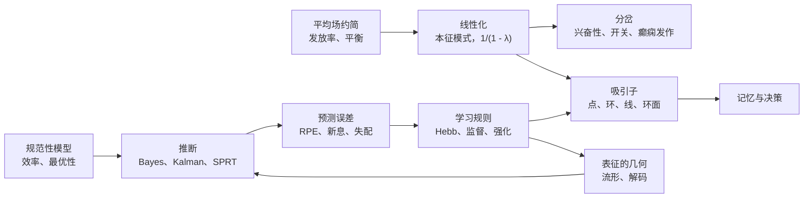

本章不引入新内容，而是把前 53 章放在一张图上，分两遍梳理。第一遍沿神经系统的层次走，从通道经神经元、突触、回路到感觉、运动、价值、记忆与认知，收集每个层次的核心模型、方程与关键数字。第二遍横跨各个层次，收集反复出现的少数方法与原理：线性化与分岔、平均场约简、平衡、吸引子、规范性论证、推断与预测误差、学习规则，以及群体数据的分析。本课程以神经生物学的框架为骨架，并穿插了各部分所催生的理论；这份总结要说明，两半讲的是同一批对象，只是用了两种语言。

## 54.1. 层次、尺度与解释的逻辑

课程从关于任何神经科学解释的三个问题出发（[7.16.1](/7.16.1)）：解释在哪个层次上给出，用的是哪一类模型，由哪一类证据支持。

- **Marr 的三个分析层次**（定义 1.5.1）区分计算（解决什么问题、为什么）、表征与算法，以及实现。多数章节至少在两个层次之间往返：Reichardt 检测器是由星爆无长突细胞实现的算法（[7.16.17](/7.16.17)），时序差分学习是由多巴胺和皮层–纹状体可塑性实现的计算（[7.16.39](/7.16.39)）。
- 模型分为描述性、机制性与解释性三类（定义 1.5.2）。LNP 模型是描述性的，Hodgkin–Huxley 模型是机制性的，高效编码是解释性的；最有力的结果把两类连接起来，例如复杂细胞的能量模型既拟合了数据，又可由相位不变性推出（定理 18.2.1）。
- 证据来自观察和扰动：观察给出相关性，扰动通过功能丧失检验必要性，通过功能获得检验充分性（定义 1.6.1）。每种方法只覆盖尺度空间的一部分（[7.16.3](/7.16.3)）。

| 层次 | 典型尺寸 | 典型时间 | 本课程的核心模型 | 章 |
|---|---|---|---|---|
| 分子与通道 | $1$–$10\,\mathrm{nm}$ | $\mu\mathrm{s}$–ms | 二态门控、GHK 电流、HH 门控、级联 | 4–5、11、17、25 |
| 神经元与树突 | $10\,\mu\mathrm{m}$–$1\,\mathrm{mm}$ | ms–s | 相平面与分岔、整合发放、电缆理论 | 6–8、13 |
| 突触与可塑性 | $0.1$–$1\,\mu\mathrm{m}$ | ms–天 | 二项释放、动力学与短时程可塑性模型、STDP、Hebb 规则 | 9–14、21–22 |
| 回路与网络 | $0.1\,\mathrm{mm}$–$1\,\mathrm{cm}$ | ms–s | 率模型、E–I 网络、平衡网络与混沌网络、吸引子 | 2、15、31、43–45 |
| 系统与行为 | $1\,\mathrm{cm}$–$1\,\mathrm{m}$ | 0.1 s–数年 | 编码与解码、贝叶斯观察者、最优控制、强化学习、漂移扩散 | 16–20、23–30、32–42、46–49 |
| 疾病与演化 | 全脑、种群 | 数年至 $10^8$ 年 | 聚集与扩散、易患性阈值、基因的产生与丢失 | 51–53 |

## 54.2. 分子与通道

课程中的每一个电信号都始于**离子通道**，其开放概率通过开放的自由能取决于电压、配体、温度或力。

| 要素 | 模型 | 关键结果或数字 | 出处 |
|---|---|---|---|
| 通透 | GHK 电流；欧姆形式 $i = g(V - E)$ | 整流（定义 4.2.2）；驱动力在约 $10\,\mathrm{mV}$ 以内时欧姆形式足够准确 | 定义 4.2.1 |
| 静息电位 | 反转电位的电导加权平均 | $g_{\mathrm{Na}}$ 增大使 $V$ 趋向 $E_{\mathrm{Na}}$ | 命题 4.3.1 |
| 被动膜 | RC 电路，$R_{\mathrm{in}} = R_{\mathrm{m}}/A$，$\tau_{\mathrm{m}} = R_{\mathrm{m}}c_{\mathrm{m}}$ | 截止频率为 $1/(2\pi\tau_{\mathrm{m}})$ 的低通滤波器 | 定义 4.4.1 |
| 单通道 | $p_\infty = \alpha/(\alpha + \beta)$，$\tau = 1/(\alpha + \beta)$ | 噪声方差 $Np(1 - p)i^2$：方差–均值抛物线给出 $i$ 与 $N$ | 定义 4.5.1，命题 4.5.1 |
| Hodgkin–Huxley | 门 $\dot x = \alpha_x(1 - x) - \beta_x x$，电导 $n^4$、$m^3h$ | 每个通道的门控电荷为 11–12；枪乌贼轴突在约 $58\,\mathrm{Hz}$ 附近开始重复放电 | 定义 5.2.1 |
| 通道多样性 | $I_{\mathrm{A}}, I_{\mathrm{M}}, I_{\mathrm{h}}, I_{\mathrm{T}}, I_{\mathrm{K(Ca)}}, I_{\mathrm{Na,p}}$ | 潜伏期、适应、下陷与反跳、簇放电；许多电导组合给出同一种模式 | 定义 5.4.1，注 5.4.1 |
| 传导 | 电缆加 HH，式 (5.3) | 无髓 $v \propto \sqrt d$，有髓 $v \propto d$ | [7.16.5](/7.16.5)，例 53.2.1 |
| 代谢型级联 | 一阶环节链 | 放大与减慢；早期环节的饱和产生备用受体 | 公式 11.1.1 |
| 光转导 | $n \approx 4$ 级联；二次起始 | 视杆每个光子约 $1\,\mathrm{pA}$；Weber 适应 | 公式 17.2.1、公式 17.2.2、公式 17.3.1 |
| 热敏通道 | 开放的焓与熵 | 电压、温度与配体叠加为同一个自由能，式 (25.3) | 定义 25.2.1、定义 25.2.2 |

这一层次有两点后面还会再出现。第一，开放对电压的 Boltzmann 依赖，以及对指数的独立门解释，使 Hodgkin–Huxley 模型对通道结构具有预测力，可见唯象模型也可以带有物理内容。第二，简并性（注 5.4.1）意味着放电模式并不决定其电导；同样的陈述在回路中再次出现（定义 30.3.1），在神经调质作用下的口胃神经节中也是如此（[7.16.11](/7.16.11)）。

这套工具箱本身很古老（[7.16.53](/7.16.53)）：$\ce{K+}$ 通道是原核的，$\mathrm{Ca_V}$ 通道、GPCR 与 SNARE 出现在早期真核生物中，$\mathrm{Na_V}$ 通道由 $\mathrm{Ca_V}$ 通道衍生而来，钠选择性两次独立获得。

## 54.3. 神经元动力学

神经元是一个动力系统，具有快速的放大变量和较慢的恢复变量。它的计算性质取决于静息态随输入增大而失稳的方式。

| 问题 | 回答 | 出处 |
|---|---|---|
| 状态是否稳定？ | 相线上 $F'(V^*)$ 的符号；平面内 $J$ 的特征值 | 命题 6.1.1 |
| 典型的二维模型是什么？ | FitzHugh–Nagumo 与 Morris–Lecar；取 $m = m_\infty(V)$、$h \approx 0.89 - 1.1n$，HH 可约化为这种形式 | 定义 6.3.1、定义 6.3.2 |
| 放电如何开始？ | 不变圆上的鞍结分岔：1 类，从零频率开始；Hopf：2 类，在非零频率处开始 | 定义 6.4.1、定义 7.1.1、定义 7.1.2 |
| 整合器还是共振器？ | 实特征值（结点）对同时到达的输入求和；复特征值（焦点）偏好某一频率，并在抑制之后放电 | 定义 6.5.1 |
| 脉冲发放如何停止？ | 逆向分岔、极限环的折叠、鞍点同宿轨 | 定义 7.2.1 |
| 什么是簇放电？ | 由慢变量驱动的快子系统的滞后环 | 定义 7.4.1 |
| 最小的脉冲发放模型是什么？ | 具有式 (8.1) 的 $r(I)$ 的 LIF；QIF 作为 1 类的正规形；ExpIF、AdEx、Izhikevich | 定义 8.2.1，命题 8.2.1，定义 8.3.1，定义 8.4.1，定义 8.4.2 |
| 输入落在何处？ | 电缆方程 $\partial_TV = \partial_X^2V - V$，式 (13.1)；$\lambda = \sqrt{dR_{\mathrm{m}}/(4R_{\mathrm{i}})} \approx 0.3$–$1\,\mathrm{mm}$ | 定义 13.2.1，定理 13.3.1 |
| 树突如何计算？ | 路径上的分流、反向传播脉冲、树突锋电位；神经元相当于两层网络 | 命题 13.4.1，定义 13.6.1，定义 13.6.2 |

静息态失稳的四种一般方式按两条轴对神经元分类（[7.16.7](/7.16.7)）：

| | 双稳（静息与发放共存） | 单稳 |
|---|---|---|
| 整合器 | 鞍结 | 不变圆上的鞍结分岔（1 类） |
| 共振器 | 亚临界 Andronov–Hopf | 超临界 Andronov–Hopf |

同样的几何在更大的尺度上再次出现。双稳性与滞后描述了睡眠–觉醒的**触发器开关**（公式 35.5.1）、运动神经元中的持续内向电流（定义 30.2.1）、决策网络的承诺（命题 47.4.1），以及癫痫发作的起止（公式 52.6.1）。耳蜗放大器工作在 Hopf 分岔附近（[7.16.24](/7.16.24)），振荡器的相位响应曲线取决于它的分岔类型，并决定耦合振荡器是否同步（定理 15.6.1）。

## 54.4. 突触与可塑性

突触把突触前脉冲转换为概率性的、依赖历史的电导，并在从毫秒到数天的时间尺度上改变自身的强度。

| 过程 | 模型 | 关键结果或数字 | 出处 |
|---|---|---|---|
| 释放 | 二项分布 $K \sim \mathrm{Bin}(N, p)$，量子大小 $q$ | 均值 $Npq$；改变 $p$ 描出方差–均值抛物线；中枢突触 $N \approx 1$–$10$，$p \approx 0.1$–$0.4$ | 定义 9.2.1，命题 9.2.1，命题 9.2.2 |
| $\ce{Ca^2+}$ 感受 | 五位点协同传感器；纳米域与微米域耦合 | 突触延迟约 $0.5\,\mathrm{ms}$；BAPTA 与 EGTA 用来探测耦合距离 | 公式 9.3.1，定义 9.3.1 |
| 突触后电流 | $I_{\mathrm{syn}} = g_{\mathrm{syn}}(V - E_{\mathrm{rev}})$ | AMPA 在 1–5 ms 内衰减，NMDA 在 40–300 ms 内衰减 | 定义 10.2.1，定义 10.3.1 |
| NMDA 受体 | $\ce{Mg^2+}$ 阻断，式 (10.2) | 释放与去极化的巧合检测器 | 定义 10.3.2，定义 10.3.4 |
| 分流抑制 | $E_{\mathrm{Cl}} \approx V_{\mathrm{rest}}$ 处的电导 | 把小的 EPSP 除以 $1 + g_i/g_{\mathrm{L}}$ | 命题 10.4.1 |
| 神经调质作用 | 四个投射遍及全脑的小核团；容积传递 | 肽类在约 $50\,\mathrm{ms}$ 内扩散 $10\,\mu\mathrm{m}$ | 定义 11.4.1，定义 11.4.2，定义 11.3.2 |
| 突触模型 | 核函数、一阶动力学、饱和的 NMDA | 电导型与电流型输入 | 定义 12.2.1，定义 12.2.2，公式 12.3.1 |
| 短时程可塑性 | Tsodyks–Markram 资源 $x$ 与利用率 $u$ | 压抑性突触饱和于传递速率 $1/\tau_{\mathrm{d}}$，并传递相对变化 | 定义 12.5.2，命题 12.5.1 |

长时程可塑性构成一个时间尺度的阶梯，每一级有自己的信号（[7.16.14](/7.16.14)）：

| 规则 | 信号 | 时间窗 | 出处 |
|---|---|---|---|
| 短时程易化与压抑 | 残余 $\ce{Ca^2+}$、耗竭 | 10 ms–数秒 | 定义 9.6.2 |
| STDP | 突触前与突触后脉冲的先后次序 | $\pm 10$–$50\,\mathrm{ms}$ | 定义 14.5.1，公式 14.5.1 |
| 依赖频率的 LTP 与 LTD | 棘突 $\ce{Ca^2+}$ 的幅度与时程 | 数秒的刺激 | 定义 14.4.1，公式 14.4.1 |
| BTSP | 树突平台 | 数秒 | 定义 14.8.1 |
| 三因子规则 | 神经调质乘以资格迹 | $0.3\,\mathrm{s}$ 到数分钟 | 定义 14.9.1 |
| 标记与捕获 | 局部标记、全细胞蛋白 | 1–2 h | 定义 14.7.1 |
| 突触缩放 | 神经元的平均发放率 | 数小时到数天 | 定义 14.6.1 |

**NMDA 受体**连接分子层次与计算层次：它的巧合检测使**长时程增强**具有输入特异性、协同性与联合性（定义 14.2.1），从而实现 Hebb 规则（定义 21.6.1）。在发育中（[7.16.21](/7.16.21)），分子梯度给出粗略的图谱，其匹配是相对的（定理 21.2.1），而视网膜波等相关活动（定义 21.5.1）对它加以精修。

这种精修的数学是线性代数（[7.16.22](/7.16.22)）：基本的 Hebb 规则使输入相关矩阵的主特征向量无界增长（定理 22.1.1）；Oja 规则将其归一化并计算第一主成分（定理 22.2.1）；带滑动阈值的 BCM 规则变得只选择一种模式（定理 22.3.1）；当 $A_-\tau_- > A_+\tau_+$ 时，平均后的 STDP 压抑不相关的输入（定理 22.4.1）；眼优势柱由皮层相互作用中增长最快的 Fourier 模式长出（定理 22.5.1）。

## 54.5. 回路与网络动力学

分析网络的办法是把脉冲换成发放率（公式 15.1.1）、线性化，并从连接矩阵的特征值读出行为。有一个因子反复出现：循环权重中特征值 $\lambda < 1$ 的模式被放大并减慢 $1/(1 - \lambda)$ 倍。

| 情形 | 陈述 | 出处 |
|---|---|---|
| 单个细胞内的循环兴奋 | 增益与时间常数乘以 $1/(1 - w)$ | 命题 2.3.1 |
| 对称线性网络 | 模式 $\mu$ 被放大 $1/(1 - \lambda_\mu)$ 倍，式 (15.4) | 命题 15.2.1 |
| V1 的环模型 | 调谐模式被放大 $1/(1 - \lambda_1/2)$ 倍；$\lambda_1 = 2$ 以上调谐宽度由循环连接决定 | 公式 18.3.1 |
| 眼动积分器 | 时间常数 $\tau/\lvert 1 - \lambda\rvert$；$\lambda = 1$ 附近需要精细调节 | 定义 33.4.2 |
| 皮层的内禀时间尺度 | $\tau_{\mathrm{int}} = \tau/(1 - w)$，式 (49.2) | 定义 49.2.1 |
| 决策网络 | 对称鞍点的不稳定特征值 $\lambda_-$ 决定整合时间 | 命题 47.4.1 |

在这个线性核心之外，课程遇到了六种网络状态：

| 状态 | 条件 | 行为 | 出处 |
|---|---|---|---|
| 非正规放大 | 隐含的前馈结构 | 瞬时放大而不减慢 | 定义 15.2.1 |
| E–I 振荡 | 强 $w_{EE}$、慢抑制 | Hopf 分岔与极限环（Wilson–Cowan） | 定义 15.4.1 |
| 抑制稳定网络 | $w_{EE} > 1$，由抑制稳定 | 驱动抑制性神经元时其发放率反常下降 | 定义 15.4.2，命题 15.4.1 |
| gamma 节律 | 快兴奋、较慢的抑制 | PING 或 ING；周期由抑制的衰减决定 | 定义 15.5.1 |
| 平衡态 | 权重 $\sim 1/\sqrt K$ | 平均输入相互抵消，涨落驱动不规则放电；发放率对输入呈线性 | 定义 15.7.1，命题 31.1.1 |
| 随机网络中的混沌 | 增益 $g > 1$ | 当谱离开单位圆盘时，静默态不稳定 | 定理 31.2.1 |

混沌与高维动力学是一种资源。**储备池计算**在回声状态性质下对随机网络做线性读出（定义 31.3.2，充分条件见命题 31.3.1）；FORCE 学习（算法 31.4.1）训练这样的网络产生目标输出；训练后的网络通过它的不动点与慢点（定义 31.5.1）以及鞍点序列（定义 31.6.1）来理解。在全脑尺度上，同样的工具通过 Lyapunov 方程由结构给出功能连接（公式 49.1.1），并给出临界分支过程的雪崩指数 $3/2$ 与 $2$（定理 49.3.1）；在体内，皮层看起来略为亚临界，分支比 $\sigma \approx 0.98$。

## 54.6. 编码与感觉

编码理论提供语言与界限；每个感觉系统展示它们如何在特定的物理中实现。

| 问题 | 工具 | 关键结果 | 出处 |
|---|---|---|---|
| 脉冲的变异有多大？ | Poisson 过程与更新过程 | Poisson：$F = C_V = 1$；更新过程：$F(T) \to C_V^2$；皮层 $F \approx 1$–$1.5$ | 定理 16.4.1，定理 16.4.2 |
| 神经元对什么起反应？ | 反向相关、LNP、GLM | 对白噪声，STA 可还原 LNP 神经元的线性滤波器 | 定理 16.5.1，定义 16.6.1，定理 16.6.1 |
| 传递了多少信息？ | 互信息 | Gauss 信道 $\tfrac12\log_2(1 + \mathrm{SNR})$；果蝇 H1 约每个脉冲 1.8 比特 | 定义 20.1.1，定理 20.1.1 |
| 什么是最佳编码？ | 高效编码 | 单个神经元用直方图均衡；自然图像用白化；稀疏编码给出类似 V1 的基 | 定理 20.2.1，定义 20.3.1，定义 20.5.1 |
| 脉冲应该有多廉价？ | 单位能量的信息 | 脉冲昂贵时发放概率低 | 公式 20.6.1 |
| 刺激能被读出得多好？ | 信号检测、贝叶斯解码、Fisher 信息 | ROC 曲线下面积等于二选一的正确率；$I_{\mathrm{F}} = \sum_i f_i'^2/f_i$ 给出所有无偏解码器的界，式 (26.8) | 定理 26.2.1，定理 26.3.1 |
| 相关性重要吗？ | 噪声相关 | 信息限制相关把 $I_{\mathrm{F}}$ 限制在 $1/\varepsilon$ | 定义 26.5.2，定理 26.5.1 |
| 线索应如何整合？ | 贝叶斯观察者 | 精度加权平均；合并后的方差小于任何一个线索 | 定理 27.1.1，定理 27.2.1 |
| 神经元如何表示不确定性？ | 概率群体编码 | 增益编码可靠性；对响应求和即对似然求积 | 定理 27.5.1，定理 27.5.2 |

感觉各章把这些工具用到每种模态的物理上：

| 系统 | 转导 | 典型计算与模型 | 关键数字 | 出处 |
|---|---|---|---|---|
| 视网膜 | 视紫红质–转导蛋白–PDE 级联 | Weber 适应；DoG 中心–周边；星爆细胞与 Reichardt 检测器的方向选择性 | 单光子响应；约 45 种神经节细胞类型 | 公式 17.5.1，定义 17.6.3，定理 17.6.1 |
| 视觉皮层 | （经 LGN 中继） | Gabor 简单细胞、能量模型复杂细胞、环模型、注意的归一化 | $M(E) = M_0/(1 + E/E_2)$；风车中心密度约每 $\Lambda^2$ 为 $\pi$ 个 | 公式 18.1.1，定义 18.2.2，公式 18.7.1 |
| 物体视觉 | （层级） | 模板匹配与汇聚；任务优化的深度网络；面孔细胞的轴编码 | IT 中身份可线性解码 | 定义 19.2.1，定义 19.3.1，公式 18.6.1 |
| 嗅觉 | 气味受体 GPCR，每个神经元一种受体 | 组合编码、除法归一化、随机扩展与稀疏化 | 果蝇中 50 个通道对应约 2000 个 Kenyon 细胞 | 定义 23.1.2，命题 23.2.1，算法 23.4.1 |
| 听觉 | 毛细胞中的直接机械门控 | 音调拓扑、gammatone 滤波器、Hopf 放大器、锁相、延迟线 | ITD 分辨率为微秒级；锁相在数 kHz 处消失 | 公式 24.1.1，命题 24.3.1，定义 24.5.1 |
| 触觉、温度觉、痛觉 | Piezo2、TRPV1、TRPM8 | 标记线加比较；背角闸门，式 (25.5)；中枢敏化 | 纹理由 $f = v/\lambda$ 编码，式 (25.4) | 定义 25.2.1，定义 25.5.1 |

有三种计算横跨多种模态。**除法归一化**（定义 23.4.1）出现在分流抑制（命题 10.4.1）、注意的归一化模型和果蝇触角叶中。扩展加稀疏化出现在蘑菇体、小脑颗粒细胞（定理 33.1.1）和齿状回（[7.16.42](/7.16.42)）。巧合检测出现在 NMDA 受体、Jeffress 模型和海兔条件反射的腺苷酸环化酶（[7.16.38](/7.16.38)）中。群体分析（[7.16.28](/7.16.28)）为编码部分收尾：活动的维数由任务而非神经元数目决定（参与比，定义 28.2.1），群体位于**神经流形**（定义 28.5.1）上，流形的拓扑与它所表示的变量一致。

## 54.7. 运动

运动控制是在延迟、噪声与冗余下反向运行的编码（[7.16.29](/7.16.29)）。

| 问题 | 解决办法 | 关键关系 | 出处 |
|---|---|---|---|
| 感觉延迟 | 前馈控制、Smith 预估器、前向模型 | 延迟反馈仅当 $kT < \pi/2$ 时稳定 | 命题 29.2.1，定义 29.2.2 |
| 自身与外界 | 传出副本 | 抵消再传入信号；人无法给自己挠痒 | 定义 29.3.2 |
| 身体状态不确定 | Kalman 滤波 | 增益等于定理 27.2.1 的线索整合权重 | 算法 29.4.1 |
| 噪声与冗余 | 最小方差、最优反馈控制 | 信号依赖噪声给出钟形速度曲线；只纠正与任务相关的误差 | 命题 29.5.1，定义 29.5.2，定义 29.5.3 |
| 动力学改变 | 二态适应 | 节省与自发恢复 | 公式 29.6.1 |
| 力的分级 | 大小原则与频率编码 | 力噪声与力成正比 | 公式 30.1.1 |
| 节律 | 半中枢 CPG、Matsuoka 振荡器 | 脊髓中间神经元类别决定交替 | 公式 30.4.1 |
| 皮层输出 | 余弦调谐、群体向量、输出零空间、旋转 | 准备活动设定初始条件；动力学产生运动 | 命题 32.2.1，定义 32.3.2，定义 32.4.1 |
| 校准 | 小脑感知机与自适应滤波器 | 感知机在 $n$ 维中可分开约 $2n$ 个模式；多数平行纤维突触是沉默的 | 定理 33.1.1，定义 33.2.1，公式 33.2.1 |
| 保持注视 | 脉冲–阶跃指令、神经积分器 | 时间常数为 $\tau/\lvert 1 - \lambda\rvert$ 的线吸引子 | 公式 33.4.1，定义 33.4.1 |

运动各章在三处与课程其余部分相连。Kalman 滤波是在时间上迭代的贝叶斯线索整合；大小原则产生了最优控制所假设的信号依赖噪声（定义 29.5.1）；脑机接口（定义 32.5.1）是 [7.16.26](/7.16.26) 的解码在线运行，用户在神经流形之内学习新解码器很快，在流形之外则很慢。运动适应依赖小脑，而从奖赏中学习依赖**基底神经节**，这引向下一部分。

## 54.8. 驱力、价值、学习与记忆

### 54.8.1. 驱力、节律与情绪

调节各章描述了身体的控制器（[7.16.34](/7.16.34)–[7.16.37](/7.16.37)）。

| 系统 | 模型 | 关键结果 | 出处 |
|---|---|---|---|
| 摄食与饮水 | 需求减去预测收益；比例、积分与前馈控制 | 看到食物后数秒内 AgRP 活动下降；积分控制的稳态误差为零 | 公式 34.3.1，定义 34.4.1 |
| 稳态强化 | 奖赏即驱力降低 | 最大化折扣奖赏即最小化未来的驱力 | 定义 34.5.1，命题 34.5.1 |
| 昼夜节律钟 | 转录–翻译反馈环；Goodwin 模型，式 (35.1) | 振荡需要陡峭的抑制（三级时 $h > 8$）；在 PRC 的下降部分上被牵引 | 定义 35.1.1，命题 35.2.1 |
| 睡眠 | 带双过程阈值的触发器开关 | 阈值是滞后环的两端 | 定义 35.4.1，公式 35.5.1 |
| 社会行为 | 性别特异的剪接；组织–激活激素 | VMHvl 的分级活动选择行为；攻击状态的线吸引子 | 定义 36.1.1，定义 36.2.1 |
| 恐惧与奖赏 | 杏仁核中的 CS–US 汇聚；多巴胺预测误差 | 意外奖赏时发放爆发，奖赏缺失时暂停 | 定义 37.2.1，定义 37.4.1 |
| 成瘾 | 无法被预测抵消的药物诱发成分 | 价值无界增长；对手过程产生耐受 | 公式 37.5.1，定义 37.5.2 |

这一部分贯穿着同一个量：形如“结果减去预测”的教学信号。它表现为 AgRP 神经元中的需求减去预测的营养收益，表现为多巴胺神经元的**奖赏预测误差**，也表现为外侧缰核与杏仁核中效价相反的信号。

### 54.8.2. 强化学习与基底神经节

| 算法 | 学习什么 | 信号 | 神经对应物 | 出处 |
|---|---|---|---|---|
| Rescorla–Wagner | 联想强度 | 共享的预测误差 | 阻断、恐惧习得与消退 | 定义 39.1.1 |
| TD 学习 | 通过自举学习 $v_\pi$ | $\delta_t = R_{t+1} + \gamma\hat v(S_{t+1}) - \hat v(S_t)$ | 多巴胺的爆发与暂停 | 定义 39.2.1，注 39.3.1 |
| 动态规划 | 已知 MDP 的 $v_*$、$q_*$ | Bellman 回溯（压缩映射） | 规划、重放 | 定理 39.4.1，定理 39.4.2，算法 39.4.2 |
| SARSA、Q 学习 | 动作价值 | 采样回溯 | 纹状体动作价值 | 算法 39.5.1，算法 39.5.2 |
| 分布式 TD | 回报分布 | 不对称学习率给出期望分位数 | 多巴胺反转点的分散 | 定义 39.7.1，命题 39.7.1 |
| 动作选择 | 哪个通道被释放 | 聚焦的纹状体抑制、弥散的 STN 兴奋 | GPi、SNr 去抑制；多巴胺设定增益 | 定义 40.2.1，公式 40.2.1 |
| 对立的三因子规则 | Go 与 NoGo 权重 | 爆发增强 dSPN 突触，低谷增强 iSPN 突触 | 服药与停药时的 Parkinson 病 | 公式 40.3.1 |
| 行动者–评价者 | 策略与价值 | TD 误差作为优势 | 背侧（行动者）与腹侧（评价者）纹状体 | 算法 40.4.1，算法 41.3.1 |
| 策略梯度 | 直接学习策略 | $(G_t - b)\nabla\ln\pi$ | 随机神经元的奖赏调制可塑性 | 定理 41.2.1，命题 41.4.1 |
| 基于模型的 RL | 先学模型，再通过规划得到价值 | 状态与奖赏预测误差 | 海马、OFC、PFC | 定义 41.5.1，定义 41.5.2 |
| 元 RL | 活动中的学习算法 | 权重上的慢 RL，活动中的快推断 | 前额叶的循环动力学 | 定义 41.6.1 |

课程中的各种学习系统共享同一个模板：可塑位点、教学信号与巧合检测器：

| 系统 | 可塑位点 | 教学信号 | 巧合检测器 | 出处 |
|---|---|---|---|---|
| 海兔鳃回缩 | 感觉神经元终末 | 5-羟色胺 | 受 $\ce{Ca^2+}$/钙调蛋白与 G 蛋白共同激活的腺苷酸环化酶 | 公式 38.3.1 |
| 果蝇蘑菇体 | Kenyon 细胞–MBON 突触 | 分隔室特异的多巴胺 | Rutabaga 腺苷酸环化酶 | [7.16.38](/7.16.38) |
| 杏仁核 | 外侧杏仁核的输入 | US 诱发的去极化 | NMDA 受体 | 定义 37.2.1 |
| 纹状体 | 皮层–纹状体突触 | 多巴胺 | NMDA 受体、cAMP、资格迹 | 公式 40.3.1 |
| 小脑 | 平行纤维–Purkinje 细胞突触 | 攀缘纤维误差 | 平行纤维与攀缘纤维输入的合取 | 定义 33.2.1 |
| 海马 | 位置细胞上的 CA3–CA1 突触 | 树突平台（BTSP） | 平台门控的资格迹 | 定义 14.8.1 |

### 54.8.3. 记忆、吸引子与图谱

课程中的记忆有两种基质，突触权重与网络状态，吸引子理论把二者联系起来：权重塑造一个景观，其稳定状态就是被记住的模式。

| 吸引子 | 表示什么 | 模型与关键结果 | 出处 |
|---|---|---|---|
| 离散点吸引子 | 存储的模式、工作记忆中的项目 | Amari–Hopfield 能量下降到不动点；容量 $0.138N$，伴有少量误差 | 公式 43.3.1，定理 43.3.1，命题 43.4.1 |
| 稠密联想记忆 | 大量模式 | 容量 $\propto N^{n-1}$；指数形式即注意力更新 | 定义 43.7.1，命题 43.7.1 |
| 环 | 头朝向、被记住的位置 | 每个位置上都有精确的 Gauss 凸起；一个中性模式；凸起的扩散解释了增长的误差 | 命题 44.2.1，定义 44.4.1 |
| 环面 | 网格细胞模块 | 六边形图案随速度移动；环面状的群体活动 | 定义 42.4.3，公式 42.4.1 |
| 线 | 眼位、攻击状态、累积的证据 | 时间常数 $\tau/\lvert 1 - \lambda\rvert$ | 定义 33.4.2，[7.16.36](/7.16.36) |
| 活动沉默状态 | 存于被易化突触中的项目 | 容量 $T_{\max}/t_s \propto \tau_{\mathrm{d}}/\tau$ | 定义 45.4.1，公式 45.4.1，命题 45.5.1 |
| 异宿序列 | 有序的状态 | 由异宿轨连接的鞍点 | 定义 31.6.1 |

海马各章把这些模型与细胞和数据联系起来（[7.16.42](/7.16.42)）。齿状回被认为执行**模式分离**，CA3 执行模式完成（定义 42.2.1）；位置细胞、头朝向细胞、网格细胞与边界细胞（定义 42.4.1、定义 42.4.2、定义 42.4.3、定义 42.4.4）描绘空间；相位进动（公式 42.5.1）与约 20 倍速的重放（定义 42.5.3）把经验压缩成序列；记忆印迹细胞（定义 42.6.1）可以被重新激活以回忆记忆。记忆被巩固，并在伴随预测误差被重新激活时被再巩固（定义 42.7.1，定义 42.7.2）。

**后继表征**（定义 46.2.1）把记忆与价值联系起来：$M = (I - \gamma T)^{-1}$ 预测折扣后的未来占据，价值分解为 $\boldsymbol{v}_\pi = M\bar{\boldsymbol{r}}$（命题 46.2.1），位置野类似它的列，网格野类似它的特征向量。Tolman–Eichenbaum 机器（定义 46.3.1）把结构与内容分解，与带循环位置编码的 Transformer 等价。

### 54.8.4. 决策

| 模型 | 动力学 | 结果 | 出处 |
|---|---|---|---|
| 漂移扩散 | $\mathrm{d}x = A\,\mathrm{d}t + c\,\mathrm{d}W$，至边界 $\pm\theta$ | $P_{\mathrm{c}} = 1/(1 + \mathrm{e}^{-2A\theta/c^2})$，$\mathbb{E}[T_{\mathrm{d}}] = (\theta/A)\tanh(A\theta/c^2)$ | 定义 47.2.1，命题 47.2.1 |
| SPRT | 对数似然比之和 | 在给定错误率下平均决策时间最短 | 定义 47.2.2，定理 47.2.1 |
| Wong–Wang 网络 | 慢 NMDA 循环与赢者通吃 | 在临界边界 $\lambda_- = 0$ 附近与 DDM 相似 | 公式 47.4.1，命题 47.4.1 |
| 前景理论 | 依赖参照点、损失厌恶的价值 | 基于价值的选择中的风险态度 | 定义 47.5.1 |
| 置信度 | 正确的后验概率 | 取决于累积的证据与已经过的时间 | 定义 47.6.1，命题 47.6.1 |

**漂移扩散模型**联结了此前的四条线索：SPRT 是最优的序贯检验（规范性），LIP 活动累积证据（实现，定义 47.3.1），Wong–Wang 模型把网络约化为一个鞍点（分岔与线性化），置信度是一个后验（推断）。

## 54.9. 认知、疾病与演化

最后几章把同样的工具用于最大的系统。

| 主题 | 模型 | 关键结果 | 出处 |
|---|---|---|---|
| 作为推断的知觉 | 生成模型与识别模型；ELBO | 对数证据 = ELBO + 后验散度；醒–睡学习 | 定义 48.1.1，定理 48.3.1，算法 48.1.1 |
| 预测编码 | 误差向前、预测向后 | 解释终止抑制与失配响应；误差神经元尚有争议 | 定义 48.4.1，公式 48.4.1 |
| 自监督学习 | 对比与联合嵌入目标 | 其表征可预测腹侧通路 | 定义 48.5.1，定义 48.5.2 |
| 脑网络 | 结构连接与功能连接 | FC 与 SC 的相关 $r \approx 0.5$；默认模式网络位于梯度的顶端 | 定义 49.1.1，定义 49.1.2 |
| 语言 | 编码模型 | 预测下一个词的模型可预测语言网络 | 定义 49.4.1，公式 49.4.1 |
| 意识 | 工作空间与整合信息理论；PCI | 两种理论都没有完整地通过对抗性检验；PCI 在床边测量意识水平 | 定义 49.5.2，定义 49.5.3，定义 49.5.4 |
| 信用分配 | 反向传播与局部替代方法 | 扰动法估计梯度，其方差随 $n$ 增长 | 定义 50.1.1，定义 50.2.1，命题 50.2.1 |
| 脉冲与神经形态硬件 | 代理梯度；忆阻器 | 大脑每个突触事件约 $10^{-14}\,\mathrm{J}$ | 定义 50.4.2，定义 50.5.1 |
| 神经退行性变 | 成核聚合；在连接组上扩散 | 早期增长 $\kappa = \sqrt{2k_+k_2m_{\mathrm{tot}}^{n_2 + 1}}$；种子使延迟期按对数移动；类 Braak 分期 | 公式 51.2.1，命题 51.2.1，公式 51.2.2 |
| 精神疾病遗传学 | 易患性阈值 | 双生子一致率高，而在较远亲属中风险急剧下降 | 公式 52.1.1 |
| 癫痫 | 快–慢系统 | 发作的起止是分岔 | 定义 52.6.1，公式 52.6.1 |
| 演化 | 基因的产生与丢失；视蛋白复制 | 受体家族通过更替改变大小；新的 L 视蛋白一次就增加一个颜色维度 | 公式 53.3.1，定义 53.4.3 |

疾病最好理解为对前面各章模型的扰动。**Parkinson 病**去除了动作选择的多巴胺增益（公式 40.2.1），而左旋多巴引起的异动症又把它抬得过高；癫痫使网络越过 [7.16.7](/7.16.7) 中分类过的那种分岔；精神分裂症的多巴胺假说（定义 52.2.1）和快感缺失的模型是关于预测误差与奖赏敏感性的陈述；孤独症与脆性 X 综合征汇聚于突触基因以及兴奋与抑制的平衡（[7.16.52](/7.16.52)）。演化（[7.16.53](/7.16.53)）在最长的尺度上展示同样的节约：分子工具箱是由更古老的部件逐步组装起来的，物种间的行为差异多半来自对保守回路的重新调谐。

## 54.10. 贯穿课程的方法与原理

第二遍横跨各个层次。图 2 为每一章标出它所依赖的方法与原理；多数章用到两三种，每种原理都出现在多个层次上。

### 54.10.1. 线性化、相平面与分岔

课程中用得最多的工具是 Jacobi 矩阵。在不动点处，它的特征值给出稳定性与时间常数；沿着某个参数，特征值穿越虚轴的方式对定性变化进行分类。同样的分析对神经元分类（定义 6.4.1、定义 7.1.1），给出 E–I 环路的振荡条件（式 (15.6)）与耳蜗放大器的 Hopf 分岔、延迟反馈的稳定性（命题 29.2.1）、随机网络的混沌边缘（定理 31.2.1）、决策网络的整合时间（命题 47.4.1）以及癫痫发作的起始。

当线性化失效时，即在分岔点和中心处，由 Lyapunov 函数接手：对称网络的能量排除了振荡（定理 43.3.1，[7.16.15](/7.16.15)）。快慢分解（定义 7.4.1）用同一幅图像解释簇放电、睡眠切换与癫痫发作：慢变量拖着一个双稳的快子系统绕滞后环运行。

### 54.10.2. 平均场约简

由数千个脉冲神经元组成的网络被约化为关于群体发放率的少数几个方程。课程中用到的约简有：带噪声 LIF 神经元的 f–I 曲线（Siegert 公式，式 (8.3)）、Wilson–Cowan 方程、权重为 $1/\sqrt K$ 量级而涨落为一量级的平衡态标度（命题 31.1.1）、Hopfield 网络的平均场容量、约化的 Wong–Wang 模型（公式 47.4.1）、突触工作记忆的平均场模型（公式 45.4.1）以及雪崩的分支过程。率模型对异步群体和慢突触是准确的；它漏掉了同步，而 [7.16.15](/7.16.15) 的相位模型把同步补了回来。

### 54.10.3. 平衡与稳定

兴奋必须由抑制平衡，可塑性必须由稳态机制平衡，否则活动会失控。**平衡态**（定义 15.7.1）解释了 Fano 因子接近 1 的不规则皮层放电；抑制稳定的动力学解释了悖论效应；突触缩放（定义 14.6.1）、BCM 规则的滑动阈值以及减性或乘性归一化（定义 22.2.1）稳定 Hebb 增长；积分控制给出身体变量的完美适应（[7.16.34](/7.16.34)）；抑制的成熟打开并关闭关键期（[7.16.21](/7.16.21)）。平衡的失败就是疾病：癫痫，以及部分的孤独症（[7.16.52](/7.16.52)）。

### 54.10.4. 规范性模型与效率

规范性模型问：在给定约束下，最优系统会怎么做？然后把答案与数据比较。课程把这一论证用于视网膜与果蝇的编码（直方图均衡、白化，定理 20.2.1）、稀疏编码与脉冲的能量代价（公式 20.6.1）、小头部中双耳时间差的双通道编码（[7.16.24](/7.16.24)）、解码的 Fisher 信息界（定理 26.5.1）、贝叶斯线索整合（定理 27.2.1）、最小方差运动与最优反馈控制（命题 29.5.1，定义 29.5.2）、扩展重编码（定理 33.1.1）、SPRT 与使奖赏率最大的边界（定理 47.2.1，式 (47.4)），以及蘑菇体中的哈希（算法 23.4.1）。

它的局限每次都说明过了（[7.16.20](/7.16.20)、[7.16.27](/7.16.27)）：答案取决于假设的集合与约束，忽略了哪些信息是相关的，并且需要独立测量的各个成分才能成为检验而不只是拟合。

### 54.10.5. 推断与预测误差

贝叶斯推断是知觉、运动估计与决策的计算层次描述。贝叶斯观察者（定义 27.1.1）、Kalman 滤波（算法 29.4.1）、SPRT 与决策置信度、因果推断模型（定义 27.2.1），以及生成模型中的变分推断（定理 48.3.1），都是把预测与按可靠性加权的证据结合起来。它们共同的算法货币是预测误差：Kalman 滤波的新息、TD 误差 $\delta_t$、AgRP 神经元的需求信号、小脑的攀缘纤维误差、预测编码的误差单元、触发再巩固的失配。误差在哪里计算、它训练什么，是每一章针对各自系统回答的生物学问题。

### 54.10.6. 学习规则与信用分配

课程中的可塑性规则分为三类，按门控它们的信号区分（[7.16.22](/7.16.22)、[7.16.50](/7.16.50)）：

| 类型 | 信号 | 课程中的例子 | 计算结果 | 脑系统（一阶近似） |
|---|---|---|---|---|
| Hebb 型（无监督） | 突触前与突触后活动 | Hebb、Oja、BCM、STDP、协方差规则 | 主成分、选择性、图谱、存储的模式 | 皮层、海马 |
| 监督型（误差驱动） | 向量或标量误差 | 攀缘纤维 LTD、自适应滤波器、delta 规则、FORCE、反向传播 | 校准、函数逼近 | 小脑 |
| 强化型（三因子） | 活动乘以资格迹再乘以全局奖赏信号 | 多巴胺门控的皮层–纹状体可塑性、REINFORCE、节点扰动 | 策略与价值学习 | 基底神经节 |

**信用分配问题**（定义 50.1.1）问的是，突触如何学到它在误差中所占的份额。反向传播精确地解决了空间部分，但需要权重传输；反馈对齐、树突误差信号、带资格迹的三因子规则以及扰动方法，用精确性换取局部性，而扰动的方差随参数数目增长（命题 50.2.1）。时间部分由资格迹（定义 14.9.1）、BTSP 和 TD 自举解决。

### 54.10.7. 表征的几何：编码、解码与降维

课程中的数据分析遵循同一个序列。编码模型（调谐曲线、LNP 与 GLM、语言的编码模型）由刺激预测响应；解码器（群体向量、最大似然、最优线性估计器、BMI 的 Kalman 解码器）把它求逆；降维（PCA、去混合 PCA、GPFA、jPCA；定义 28.3.1、定义 28.5.2）找出动力学所在的低维状态空间。

有两点警告被反复强调：方差不是信息，因为最优线性读出是 Fisher 判别（定理 28.6.1），而不是最大的主成分；关于流形和旋转的论断需要代理数据与交叉验证（Marchenko–Pastur 带，式 (28.3)）。间接测量（钙、BOLD）是活动与某个核的卷积，其反卷积是一个不适定问题（[7.16.3](/7.16.3)）。

### 54.10.8. 大脑与机器

课程多次遇到神经科学与人工智能之间的交流，它是双向的，也有明确的限度。

| 对应 | 共同的想法 | 差异 | 出处 |
|---|---|---|---|
| CNN 与腹侧通路 | 模板匹配与汇聚的层级；任务优化可预测 V4 与 IT | 对抗脆弱性、纹理偏向、很少有循环 | [7.16.19](/7.16.19)，定理 19.4.1 |
| TD 学习与多巴胺 | 奖赏预测误差训练价值 | 多巴胺还是分布式的、按秩编码的，并与活力和显著性相关 | [7.16.39](/7.16.39)，定义 39.7.1 |
| 注意力与联想记忆 | 现代 Hopfield 网络的 softmax 更新；键值记忆 | 大脑把快速的海马结合与缓慢的皮层存储分开 | 定义 43.7.1，定义 43.8.1，定义 46.3.1 |
| 储备池与皮层 | 丰富的循环动力学经线性读出 | 皮层连接是有结构且可塑的 | 定义 31.3.1 |
| 扩展层 | 为线性读出而做的随机扩展与稀疏化 | — | 算法 23.4.1，定理 33.1.1 |
| 生成与自监督模型 | 无标签学习；用识别模型做推断 | 大脑用的是误差神经元还是采样，尚无定论 | [7.16.48](/7.16.48) |
| 学习算法 | 对目标函数做梯度下降 | 局部性与权重传输；每个突触事件约 $10^{-14}\,\mathrm{J}$，而数字运算每次为皮焦量级 | [7.16.50](/7.16.50) |

这种交流是双向的。为某项任务训练的模型如今已成为神经响应的标准假说，而神经科学的发现（归一化、重放、前额叶的元学习、稀疏扩展）已成为工程思想。差异和相似同样有信息量：大脑从很少的样本中学习，用缓慢、嘈杂、局部且受能量限制的部件计算，并在遗传约束下由发育构建而成。

## 54.11. 尚未解决的问题

各章都以仍未解决的问题结尾。按层次归纳如下：

| 层次 | 尚未解决的问题 |
|---|---|
| 分子与突触 | 突触蛋白几天就更新一轮，记忆如何维持数十年？CaMKII 在维持中的作用尚有争议（[7.16.14](/7.16.14)），标记、捕获与结构改变如何结合成稳定的印迹也不清楚。 |
| 神经元与树突 | 皮层计算有多少发生在单个神经元之内，借助树突锋电位与分隔化的可塑性（[7.16.13](/7.16.13)）？顶树突是否携带学习信号（[7.16.50](/7.16.50)）？ |
| 回路 | gamma 振荡究竟计算什么（[7.16.15](/7.16.15)）？既然布线图缺少突触强度与神经调质状态，连接组与动力学如何相互决定（[7.16.3](/7.16.3)）？皮层是否接近临界点，这有没有意义（[7.16.49](/7.16.49)）？ |
| 编码 | 贝叶斯计算如何实现与学习，不确定性是由增益、采样还是别的方式表示（[7.16.27](/7.16.27)）？除早期阶段之外，高效编码还能解释哪些约束（[7.16.20](/7.16.20)）？ |
| 运动与决策 | 证据累积是分布式的，因为失活 LIP 并不影响选择（[7.16.47](/7.16.47)）；承诺在何处、如何实现？ |
| 价值与记忆 | 基于模型与无模型的控制如何仲裁，重放在规划与巩固中起什么作用（[7.16.41](/7.16.41)、[7.16.42](/7.16.42)）？睡眠是为了什么（[7.16.35](/7.16.35)）？ |
| 学习算法 | 大脑实现的是梯度下降的哪种近似，如果有的话（[7.16.50](/7.16.50)）？皮层的反馈通路携带的是预测、误差，还是两者兼有（[7.16.48](/7.16.48)）？ |
| 认知 | 哪种意识理论（如果有的话）能经受住进一步的对抗性检验？在编码模型的对应之外，语言的神经机制是什么（[7.16.49](/7.16.49)）？ |
| 疾病 | 降低淀粉样蛋白是治疗还是只是减缓 Alzheimer 病，为什么特定的细胞易受损（[7.16.51](/7.16.51)）？数以百计的微小遗传效应如何汇聚为精神疾病表型（[7.16.52](/7.16.52)）？ |
| 演化 | 神经元是只出现一次、后来在海绵与扁盘动物中丢失，还是出现过两次（[7.16.53](/7.16.53)）？ |

## 小结

- 课程在六个层次上描述神经系统，从通道到行为、疾病与演化；多数模型描述的是 1 ms 到 1 s、1 µm 到 1 cm 之间的过程（第 54.1 节，图 1）。
- 通道：欧姆电流与 GHK 电流、二态与 HH 门控、级联以及开放的自由能（定义 4.2.1、定义 5.2.1、公式 11.1.1）；放电模式在电导上是简并的（注 5.4.1）。
- 神经元：静息态失稳的分岔方式决定整合器还是共振器、1 类还是 2 类、单稳还是双稳（定义 6.4.1、定义 7.1.1）；簇放电是快–慢滞后环（定义 7.4.1）；整合发放模型保留时间而舍弃形状（定义 8.2.1）。
- 突触：释放是二项的（定义 9.2.1），NMDA 受体检测巧合（定义 10.3.4），短时程可塑性对发放率滤波（定义 12.5.2），长时程可塑性构成从 STDP 到缩放的阶梯（定义 14.5.1、定义 14.6.1）；Hebb 规则计算主成分与图谱（定理 22.2.1、定理 22.5.1）。
- 网络：因子 $1/(1 - \lambda)$ 放大并减慢循环模式（命题 15.2.1），从单个细胞到皮层的时间尺度；平衡、抑制稳定、振荡与混沌状态由 E–I 连接决定（定义 15.7.1、定义 15.4.2、定理 31.2.1）。
- 编码：Poisson 变异、LNP 模型、互信息、高效编码、Fisher 信息与贝叶斯线索整合给出语言与界限（定理 16.4.1、定理 20.2.1、定理 26.5.1、定理 27.2.1）；归一化、稀疏扩展与巧合检测在各感觉中反复出现。
- 运动：预测补偿延迟，Kalman 滤波结合预测与感觉，最优反馈控制只纠正与任务相关的误差，小脑通过监督学习进行校准（算法 29.4.1、定义 29.5.2、定义 33.2.1）。
- 价值与记忆：多巴胺传递 TD 误差（注 39.3.1），基底神经节以行动者–评价者的方式选择动作（算法 40.4.1），记忆是循环网络的吸引子（定理 43.3.1、命题 44.2.1），决策把证据累积到边界（命题 47.2.1）。
- 跨层次地，有八种方法反复出现：线性化与分岔、平均场约简、平衡与稳定性、规范性模型与效率、带预测误差的推断、学习规则与信用分配、群体数据的几何，以及大脑与机器的比较（第 54.10 节，图 2）；吸引子（第 54.8.3 节）把其中几种联系起来。

## 思考题

1. 表达式 $\tau/(1 - \lambda)$ 出现在命题 2.3.1、命题 15.2.1、定义 33.4.2 和式 (49.2) 中。解释为什么同一个表达式在这四处都会出现，以及它对持续活动的稳健性意味着什么。

   **答** 每种情形中，漏率为 $1/\tau$ 的线性单元或模式都接受强度为 $\lambda$（或 $w$）的循环反馈，所以其动力学为 $\tau\dot c = -(1 - \lambda)c + h$。有效漏率降为 $(1 - \lambda)/\tau$，它同时使稳态增益 $h/(1 - \lambda)$ 和时间常数 $\tau/(1 - \lambda)$ 乘上同一个因子。由 $100\,\mathrm{ms}$ 的突触时间常数（NMDA）造出 $10\,\mathrm{s}$ 的时间常数，需要 $\lambda = 0.99$：$\lambda$ 改变 $0.01$，时间常数要么减半，要么使该模式变为临界，更大的偏差则使它失稳。因此基于这一机制的持续活动是脆弱的，需要调节：眼动积分器的调节由小脑根据视网膜滑动进行学习来提供，而在皮层中，这一要求可能因非线性或离散的吸引子、慢突触过程（公式 45.4.1）或抑制稳定的动力学而放宽。

2. 双稳与滞后出现在亚临界 Hopf 与鞍结神经元、CaMKII 开关、睡眠触发器、Wong–Wang 决策网络和癫痫发作中。对每一个，说出快变量、使系统穿越双稳区的慢变量或输入，以及功能上的后果。

   **答** 神经元（定义 7.1.2、定义 7.4.1）：快变量 $V$ 与恢复变量；输入电流或慢电流（$I_{\mathrm{K(Ca)}}$、$I_{\mathrm{T}}$）使其移动；后果：短脉冲使系统在静息与发放之间切换，慢电流产生簇放电。CaMKII（公式 14.3.1）：全酶的磷酸化状态；棘突 $\ce{Ca^2+}$ 信号使其切换；后果：一个比刺激持续更久的候选记忆开关。睡眠（公式 35.5.1）：相互抑制的觉醒与视前区群体的活动；稳态压力与昼夜驱动使其移动；后果：快速而巩固的转换，双过程模型的阈值位于滞后环的两端。决策（公式 47.4.1）：两个相互抑制的选择性群体；刺激输入使网络从对称鞍点进入某一个吸引域；后果：承诺与对选择的记忆。癫痫发作（公式 52.6.1）：快网络振荡的幅度；慢的兴奋性变量（如细胞外 $\ce{K+}$）在静息时升高、在放电期间下降，驱动系统进出发作状态；后果：突然的起始与终止，由两端的分岔分类。

3. 列出课程中不同章节的五种预测误差。对每一种，说明预测的是什么、误差在哪里计算、误差训练什么。

   **答** (1) 多巴胺 TD 误差（定义 39.2.1）：折扣后的未来奖赏；VTA 与 SNc；皮层–纹状体突触与价值（三因子规则，公式 40.3.1）。(2) 攀缘纤维误差（定义 33.2.1）：运动的感觉后果，如视网膜滑动；下橄榄核；通过 LTD 训练平行纤维–Purkinje 突触。(3) Kalman 新息（算法 29.4.1）：由前向模型预测的感觉信号；顶叶与小脑回路；状态估计（而非权重）。(4) AgRP 需求信号（公式 34.3.1）：由感觉线索预测的营养收益；下丘脑；觅食行为的厌恶性教学。(5) 预测编码误差（公式 48.4.1）：由高层预测的低层活动；假设位于皮层浅层的误差单元；潜变量估计，以及较慢地训练生成权重。其他例子：恐惧条件反射中的 Rescorla–Wagner 误差、训练后继表征的状态预测误差（式 (46.2)），以及触发再巩固的失配。

4. 一个研究组发现一群神经元，其活动在状态空间中形成一个环。哪些观察可以说明这个环是连续吸引子，而不是由输入驱动的表征？课程中的哪些模型预测了这些观察？

   **答** CANN（定义 44.2.1、命题 44.2.1）的预测如下。(a) 没有感觉输入时环依然存在，例如在黑暗中和睡眠中，头朝向细胞即是如此；(b) 受扰动后，活动回到环上，但不回到沿环的原位置（一个中性模式，环外的模式衰减）；(c) 没有输入时位置随时间扩散，因此记忆误差随延迟增长（[7.16.45](/7.16.45)）；(d) 噪声相关具有共享位移所致的 M 形、信息限制形式（式 (44.7)）；(e) 速度输入以正比于速度的速率移动凸起，实现路径整合（定义 44.4.1），并有解剖上的偏移连接，如果蝇的 E-PG 与 P-EN 神经元。输入驱动的环在没有输入时会消失或失去拓扑，也不会表现出持续性或扩散。拓扑必须用代理数据检验（[7.16.28](/7.16.28)）。

5. 为什么皮层、小脑与基底神经节分别与无监督、监督和强化学习相联系？把每一个与它的回路特征联系起来，并给出这种划分只是一阶近似的一条理由。

   **答** 小脑：每个 Purkinje 细胞接受一根携带特定误差信号的攀缘纤维，颗粒细胞的扩展为线性读出提供高维输入（定理 33.1.1）；这是带教师的感知机的架构（定义 33.2.1）。基底神经节：多巴胺神经元向纹状体广播标量预测误差，门控符合资格的皮层–纹状体突触的可塑性（公式 40.3.1）；这是行动者–评价者的架构（算法 40.4.1）。皮层：稠密的循环连接与 Hebb 可塑性，没有专门的教学输入，学习其输入的统计规律（定理 22.2.1、定义 20.5.1）。这种划分只是近似的，因为小脑也充当前向模型，并通过闭环参与认知与情感；皮层接受神经调质，并可能在其反馈通路中计算误差（[7.16.48](/7.16.48)、[7.16.50](/7.16.50)）；海马使用由树突平台门控的一次性 BTSP，它与三种类型都不完全吻合。

6. 利用本课程估计 100 个独立的 Poisson 神经元组成的群体能携带多少关于刺激的信息，并解释为什么真实的信息可能小得多。

   **答** 对独立的 Poisson 神经元，Fisher 信息是可加的，$I_{\mathrm{F}} = \sum_i f_i'^2/f_i$（式 (26.8)），因此随神经元数目线性增长；辨别阈值按 $1/\sqrt{N}$ 下降，从一个神经元到 100 个下降为十分之一。真实的信息可能小得多，有两个原因。第一，与信号方向对齐的噪声相关 $\varepsilon\boldsymbol{f}'\boldsymbol{f}'^{\mathsf T}$ 把信息限制在 $1/\varepsilon$，无论增加多少神经元（定理 26.5.1）；这类相关由上游阶段的噪声以及凸起的共同涨落产生（式 (44.7)）。第二，下游的解码器可能是次优的，例如偏好方向不均匀的群体向量（命题 32.2.2）。这就是行为阈值常常与单个神经元的阈值相近的原因（神经测量函数，定义 26.2.2）。
