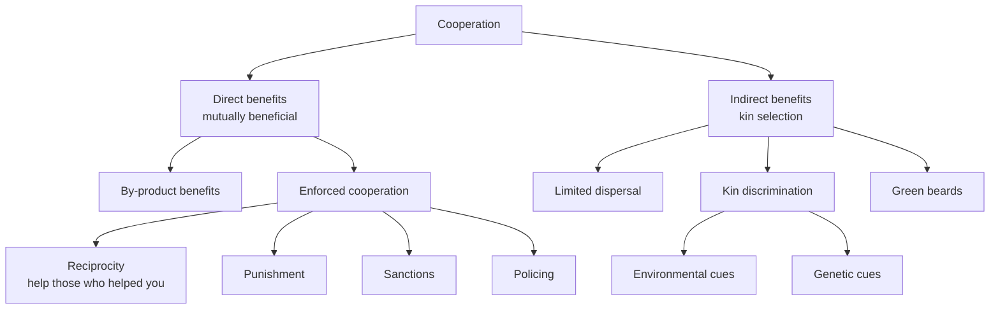

Meerkats that spend a day guarding the pups of a dominant pair lose weight while their foraging group mates gain it. A cleaner wrasse that could eat the protective mucus of its client instead eats the client's parasites. A soybean plant pays carbon to the bacteria in its root nodules, and the bacteria pay nitrogen to the plant. None of these partners need be relatives, so **kin selection** ([7.18.33](/7.18.33)) cannot explain why they help. Cooperation among nonrelatives must pay the cooperator directly, through its own survival and reproduction, and the problem is to see how it can do so when every cooperator could be exploited by an individual that takes the benefits without paying the costs.

This chapter classifies the solutions and examines the evidence for each. The game theory on which it rests, **evolutionarily stable strategies**, the **prisoner's dilemma** and the theorem on **tit for tat** in the iterated game, was introduced in [7.10.16](/7.10.16#sec-16.2) and extended with **replicator dynamics** in [7.18.25](/7.18.25); here we use it to ask what kinds of behavior should be seen in nature and which are actually seen. The last part turns to cooperation between species, the **mutualisms** whose ecological consequences are treated in [7.10.17](/7.10.17) and, for plants and microbes, in [7.11.31](/7.11.31). Helping in families of birds and mammals, where direct and indirect benefits combine, is the subject of the next chapter ([7.18.35](/7.18.35)).

## 34.1. The Problem of Cooperation

**Definition 34.1.1 (Cooperation)** A behavior is **cooperation** if it provides a benefit to another individual (the recipient) and has been selected for, at least in part, because of its beneficial effect on the recipient (West, Griffin and Gardner 2007).

:::

The second clause excludes one-way by-products. An elephant's dung benefits the dung beetles that use it, but the elephant produces dung for its own reasons, and the amount it produces has not been shaped by the benefit to beetles; producing dung is not cooperation. By the definition, all altruistic behaviors and some mutually beneficial ones are cooperative ([7.18.33](/7.18.33#sec-33.1)). Most cooperation among nonrelatives is mutually beneficial over the lifetime of the actor, even if it is costly in the short term.

The difficulty is that cooperative acts create opportunities for exploitation.

**Definition 34.1.2 (Free Riding)** **Free riding** (or cheating) is the strategy of obtaining the benefits of others' cooperation while avoiding the cost of cooperating oneself.

:::

The prisoner's dilemma captures the problem for two players. Each can cooperate ($C$) or defect ($D$); the payoffs to a player are the reward $R$ for mutual cooperation, the temptation $T$ for defecting against a cooperator, the sucker's payoff $S$ for cooperating with a defector and the punishment $P$ for mutual defection, with

$$
T > R > P > S, \qquad 2R > T + S. \tag{34.1}
$$

The second condition ensures that mutual cooperation is better than taking turns at exploiting each other. With the illustrative values $T = 5$, $R = 3$, $P = 1$, $S = 0$ (Axelrod and Hamilton 1981), a player whose partner cooperates gets 5 by defecting and 3 by cooperating; if the partner defects, defection gives 1 and cooperation 0. Defection is the better reply to either move, so in a single encounter both defect and receive 1, although each would receive 3 if both cooperated. In evolutionary terms, $D$ is the only ESS, and a population that contains both strategies evolves to all defectors.

Many cooperative acts benefit a whole group rather than one partner. A bacterium that secretes a **siderophore**, an enzyme that digests a protein outside the cell, or a molecule of a biofilm matrix produces a *public good*: all cells nearby benefit, whether or not they contributed. If each of $N$ group members can contribute at a cost $c$ to itself and each contribution produces a total benefit $b$ shared equally by all members, a contributor gains $b/N$ from its own contribution and pays $c$, so that contributing pays the contributor only if

$$
\frac{b}{N} > c, \tag{34.2}
$$

although the group as a whole gains whenever $b > c$. In large groups this condition fails for almost any benefit, which is the "tragedy of the commons" (Hardin 1968). It is important to see that the prisoner's dilemma and the public goods game illustrate the problem of cooperation; they are not explanations of it. To explain cooperation, we must identify the circumstances in which the lifetime payoffs are not those of a prisoner's dilemma.

## 34.2. A Classification of Explanations

A gene can increase its transmission either through the reproduction of the individual that carries it (direct fitness) or through the reproduction of others that carry copies of it (indirect fitness). Explanations of cooperation fall accordingly into two groups (West, Griffin and Gardner 2007): indirect benefits, which explain altruistic cooperation among relatives by kin selection, and direct benefits, which make cooperation mutually beneficial.

| Explanation | How the cooperator gains | Examples in this chapter |
|---|---|---|
| Kin selection | Helping individuals that share copies of its genes | Long-tailed tits, social amoebae ([7.18.33](/7.18.33), [7.18.35](/7.18.35)) |
| By-product benefits | Cooperation is the best option even for a selfish individual; the benefit to others is a by-product | Cooperative hunting, cofounding ant queens, group augmentation in meerkats |
| Reciprocity | Help is returned by the partner later | Iterated games; vampire bats (partly) |
| Enforcement | Cooperators are rewarded or free riders punished, changing the payoffs | Cleaner fish, superb fairy-wrens, legume sanctions, worker policing |

The categories are not exclusive. If interacting individuals are relatives, the mechanisms that provide direct benefits also provide indirect ones, and in many cooperative breeders both contribute ([7.18.35](/7.18.35)). The classification nevertheless sharpens the empirical question: for a given case, what would happen to the cooperator if it stopped cooperating?

## 34.3. By-product Benefits

### 34.3.1. Games without a Dilemma

**Definition 34.3.1 (By-product Mutualism)** **By-product mutualism** is cooperation that is the best option for each individual from a purely self-interested point of view, so that the benefit it provides to others is an automatic consequence of an act that pays the actor in any case.

:::

Binmore (2007) called a game of this kind the "prisoner's delight". Imagine two individuals that can take part in a hunt, which costs one unit of energy. The prey is always shared equally between them, whether or not both took part. A lone hunter brings back 4 units, so that each gets 2 (the hunter's payoff is $2 - 1 = 1$, the free rider's 2); two hunters together bring back 10, and each gets $5 - 1 = 4$. Hunting is the better reply whatever the other does ($4 > 2$ and $1 > 0$), so hunting is the ESS, even though free riding on a lone hunter (2) is better than being free ridden on (1). What matters for selection is how a strategy does against the population, not how it does relative to its partner: in a population of hunters, a rare free rider gets 2 while the hunters get nearly 4.

![The prisoner's dilemma and a cooperative hunting game. A: payoffs to the row player in the prisoner's dilemma (Eq. 34.1): defection is the better reply to either move, and mutual defection (shaded) is the only equilibrium. B: a cooperative hunting game in which the prey is always shared and two hunters catch far more than one (the "prisoner's delight"): hunting is the better reply to either move and mutual hunting (shaded) is the equilibrium. C: replicator dynamics of the frequency of cooperators (hunters) from three starting frequencies: cooperation is lost in the prisoner's dilemma and fixed in the hunting game](./plots/dilemma-and-delight.py)

The key feature is synergy: the payoff of two cooperators is more than twice that of one. Cooperative hunting by lions, wolves and some raptors probably has this structure when prey are large and a single hunter rarely succeeds ([7.18.27](/7.18.27#sec-27.3.2)); joining a flock or herd, which reduces one's own risk of predation, is a by-product mutualism in the same sense.

A dramatic example has a violent ending. In several ant species, including desert harvester ants of the genus *Messor*, unrelated newly mated queens join to found a colony together (pleometrosis). Workers from mature colonies destroy young nests, and workers of incipient colonies raid each other's brood, so a colony that produces more workers sooner survives better; colonies founded by several queens grow faster. The queens do not forage during foundation: they seal themselves in the nest and rear the first workers from their body reserves, including the proteins of their histolyzed flight muscles. As soon as the first workers emerge, the advantage of having other queens ends, since the workers can now feed the colony, while the advantage of monopolizing reproduction remains; the queens, which showed no aggression before, then fight until only one is left (Bernasconi and Strassmann 1999). Cooperation lasts exactly as long as it pays each queen.

### 34.3.2. Hidden and Delayed Benefits

Benefits may be delayed and hard to see.

**Definition 34.3.2 (Group Augmentation)** **Group augmentation** is the direct benefit that individuals gain from increasing the size of the group they live in, because larger groups survive, forage or defend their territories better, or because the individuals recruited will later help the helper.

:::

Meerkats (*Suricata suricatta*) live in groups of up to about 20 adults, a dominant breeding pair and subordinates of both sexes, in arid regions of southern Africa. While the group forages, one or more subordinates stay at the burrow and guard the pups. Babysitting is costly: in the 12 hours after the start of a full day of babysitting, babysitters lost on average 1% of their body mass while foragers gained 5.9%, and over a whole breeding attempt the most active babysitters lost up to 11% (Clutton-Brock and colleagues 1998). Larger groups have more sentries, each individual spends less time on guard, groups win encounters with neighboring groups, and annual adult mortality is lower; helping that adds pups to the group thus benefits the helpers directly. Helpers of the sex more likely to stay and breed in the natal group should gain most from future group size. As predicted, females help more than males, and males reduce their contributions when they become adults and prepare to leave. Because most meerkats are related to the pups they raise, indirect benefits contribute too, and their relative importance probably differs between natal and immigrant helpers ([7.18.35](/7.18.35)).

Benefits may also be concealed. In the superb fairy-wren (*Malurus cyaneus*), a cooperatively breeding Australian songbird, the presence of helpers did not increase the mass of the chicks, which suggested that helpers do nothing useful. Russell and colleagues (2007) found that females with helpers laid eggs 5.3% smaller, with 14% less yolk, than females without helpers. A cross-fostering experiment that moved eggs between nests with different numbers of helpers separated the two effects: among eggs of the same size, helpers did increase chick mass. The mother uses the help to save her own resources, and in a 16-year data set females with helpers were 11% more likely to survive to the next breeding season. The benefit of help goes to the breeder's future reproduction rather than to the current brood.

Benefits may be delayed by years. In the long-tailed manakin (*Chiroxiphia linearis*) of Central America, a team of two males performs a coordinated dance display for females, but only the dominant (alpha) male mates. Beta males are not related to the alpha; they gain by inheriting the alpha position and its display perch when the alpha dies, which may take years (McDonald and Potts 1994). The same holds in the lance-tailed manakin ([7.10.16](/7.10.16#sec-16.2.1)).

## 34.4. Reciprocity

### 34.4.1. The Theory

Trivers (1971) argued that an individual can be favored to help another at a cost if the other helps it back later: "you scratch my back and I'll scratch yours". Trivers called the arrangement **reciprocal altruism**; since the cost of helping is repaid with interest, the exchange is mutually beneficial over the lifetime and is now usually called reciprocity. The problem is the delay: the individual helped first could take the benefit and refuse to repay.

The iterated prisoner's dilemma shows when repayment can be enforced by the threat of withholding future help. If the two players meet only once, defection is the only stable strategy. If they meet a known number of times, defection is again stable, since defection is best in the last round, and therefore in the next-to-last, and so on back to the first. But if after each round there is a probability $w$ of another, so that the end of the game is uncertain, the long-term benefit of continued cooperation can outweigh the short-term gain of defection. In the donation game (cooperating costs $c$ and gives the partner $b$), the strategy **tit for tat**, which cooperates in the first round and then copies the partner's previous move, resists invasion by always-defect if and only if $w > c/b$ ([Theorem 16.2.1](/7.10.16#thm-16.2.1) in 7.10.16).

In 1980 Robert Axelrod invited game theorists, economists, biologists and others to submit strategies for computer tournaments of the iterated prisoner's dilemma; the second tournament had 62 entries. The winner both times was tit for tat, submitted by Anatol Rapoport, one of the simplest entries. Axelrod (1984) attributed its success to four properties: it is *nice* (never the first to defect), *retaliatory* (it punishes a defection at once), *forgiving* (it returns to cooperation as soon as the partner does) and *clear* (its behavior is easy for partners to recognize). Axelrod and Hamilton (1981) placed the result in an evolutionary setting.

### 34.4.2. Errors and Generosity

Later work showed that tit for tat is not an unbeatable strategy. In a population of tit-for-tat players, a mutant that always cooperates does exactly as well, since no one ever defects, and can drift to high frequency; a population with many unconditional cooperators can then be invaded by defectors. More importantly, real animals make mistakes. If a move is occasionally misexecuted or misperceived, two tit-for-tat players fall into a sequence of alternating retaliation, each punishing the other's last defection, until another error restores cooperation or makes both defect; their average payoff drops toward that of random play. Strategies that forgive some defections do better. *Generous tit for tat* cooperates after a partner's defection with some probability (Nowak and Sigmund 1992), and *win-stay, lose-shift* (also called Pavlov) repeats its last move after a good outcome and switches after a bad one, which corrects errors between two players of the same strategy in two rounds (Nowak and Sigmund 1993).

![Reciprocity strategies in the iterated donation game (b = 3, c = 1, probability w = 0.95 of a further round) when each intended move is reversed by mistake with probability e. Strategies: always defect (ALLD), tit for tat (TFT), generous tit for tat (GTFT, which forgives a defection with probability 1/3) and win-stay, lose-shift (WSLS). Payoffs are computed exactly from the Markov chain of outcomes, and frequencies follow the discrete replicator equation. A, B: starting from a population of 90% ALLD and 9% TFT with traces of the other two, TFT invades ALLD, and is then replaced by GTFT; with more errors the invasion is slower. WSLS, which is exploited by ALLD while ALLD is common, disappears early in these runs. C: the payoff per round of each strategy playing against itself as errors increase: TFT pairs lose most because errors start runs of mutual retaliation; forgiving strategies keep most of the benefit of cooperation](./plots/reciprocity-noise.py)

The general lesson is that reciprocity is theoretically possible in many forms, but no single simple rule dominates, and which strategy wins depends on the error rate, the probability of further encounters and the mixture of strategies present (Boyd and Lorberbaum 1987). We should not expect to find tit for tat itself in nature. In humans, reciprocity is common and takes many forms; the dealers of the Antwerp diamond market lend each other bags of diamonds for inspection without receipts or contracts, and anyone who cheats is excluded from the community for good, a strategy called "grim". In nonhuman animals, as we shall see, convincing cases are surprisingly hard to find.

### 34.4.3. Testing for Reciprocity

Reciprocity has been proposed for cooperation in cleaner fish, alarm calls, blood sharing in vampire bats, predator inspection in fish, mobbing in birds, grooming and food sharing in primates. Demonstrating it requires four conditions:

1. Individuals interact repeatedly with the same partners, so that they can take turns helping.
2. The benefit of receiving aid exceeds the cost of giving it.
3. Help is contingent: individuals help those that have helped them and refuse help to those that have not.
4. The cooperation cannot be explained more simply by a mechanism that does not require reciprocation, such as kin selection or by-product benefits.

The common vampire bat (*Desmodus rotundus*) satisfies the first two well. In Costa Rica, Wilkinson (1984) studied individually marked bats roosting in stable groups of 8–12 females with their young, relatives and some nonrelatives, which stay together for years. Bats feed on blood at night, foraging is risky, and a bat that fails to feed for two or three nights in a row dies. Unfed bats beg from roost-mates that have fed, and often receive regurgitated blood. Because a bat's mass falls quickly after a meal and then more slowly, a donation of blood moves a well-fed donor only a short way toward starvation but moves a starving recipient far from it: the cost to the donor, measured in hours of life before starvation, is much smaller than the benefit to the recipient.

Wilkinson found that regurgitations occurred only between close relatives or between unrelated bats that frequently roosted together. In the laboratory, with a group composed of unrelated bats from two roosts, he removed one bat at a time, kept it hungry and returned it to the group: 12 of 13 regurgitations occurred between bats from the same wild roost, and bats that had received blood later donated to their donors more often than expected by chance. The third and fourth conditions remained doubtful for many years. The experiment showed that bats feed familiar partners, not that they feed those that fed them and refuse those that did not; relatives account for most donations (only 5 of 98 observed donations between bats of known relatedness involved pairs less related than grandparent and grandchild); and donations might be a way of stopping the harassment of a begging roost-mate or of keeping alive group members that can be begged from in the future (Clutton-Brock 2009). Later experiments by Carter and Wilkinson tightened the case. Over many fasting trials in a captive colony, the amount of blood a bat had given to others predicted the amount it received better than its kinship to the donors did; bats that had fed more nonrelatives had more donors and, when a key donor was removed, lost less food (Carter and Wilkinson 2013, 2015; Carter, Farine and Wilkinson 2017). Sharing with nonkin appears to work as insurance against the loss of a relative, with reciprocity at least partly involved.

Other proposed cases fare worse. Male olive baboons (*Papio anubis*) form coalitions in which one male enlists another to fight a male consorting with an estrous female, and goes off with the female while the other two fight; Packer (1977) suggested that the roles are reversed later. But there is little evidence that a male allows his partner to mate because he has been helped before, and later observations showed that once the female had been separated from her consort, both coalition partners raced to monopolize her (Bercovitch 1988): forming a coalition increases each partner's immediate chance of mating. Male chimpanzees share meat with others after a hunt, and the sharing was long interpreted as exchange with allies; detailed studies found that whether meat is shared depends mainly on the intensity of begging and harassment by others (Gilby 2006). Pied flycatchers (*Ficedula hypoleuca*) joined neighbors in mobbing a predator at their nest if the neighbors had helped them before and withheld help from neighbors that had not (Krams and colleagues 2008), the most direct evidence of contingency in a wild bird, but the interpretation is disputed: the nonhelping neighbors had been experimentally prevented from helping, and their own nests and willingness to defend may have differed (Russell and Wright 2009). Grooming among primates is, over long periods, given most to those that groom most in return (Schino and Aureli 2010), but grooming may be exchanged for other services such as support in fights or tolerance at food.

### 34.4.4. Why Reciprocity Is Rare

The scarcity of good examples (Hammerstein 2003; Clutton-Brock 2009) may have several causes. Reciprocity requires a partner that will be met again, recognition and memory of individuals, and the ability to keep track of what has been given and received. It also requires valuing future payoffs, which animals strongly discount. Stephens, McLinn and Stevens (2002) let pairs of blue jays (*Cyanocitta cristata*) play an iterated prisoner's dilemma for food in an operant apparatus, in which one jay's partner played tit for tat. The jays cooperated with the tit-for-tat partner only when the food from successive rounds accumulated behind a transparent window and was released after several rounds; when each round's payoff was delivered at once, they defected. Impulsive preference for immediate rewards, which serves animals well in foraging ([7.18.23](/7.18.23)), is a barrier to reciprocity. Finally, the iterated game assumes that the cost of cooperation is paid now and the benefit received later, whereas many cooperative interactions offer simpler and more immediate payoffs.

### 34.4.5. Indirect Reciprocity and Reputation

Help can also be returned by third parties. In *indirect reciprocity*, individuals help those that have a reputation for helping others, so that helping builds a reputation that attracts help (Nowak and Sigmund 1998, 2005). It requires observers and information about the behavior of others, and is mainly important in humans, whose language spreads reputations. A comparable effect occurs in the cleaning mutualism. Clients of the cleaner wrasse waiting on a reef watch cleaners at work and approach cleaners that they have seen feeding cooperatively; cleaners in turn feed more cooperatively, biting their clients less, when they are being watched by potential clients (Bshary and Grutter 2006). Cooperation under observation in this case is driven by the choices of partners, a form of enforcement.

## 34.5. Enforcement

### 34.5.1. Punishment

If there is a mechanism that rewards cooperators or penalizes free riders, the payoffs of a prisoner's dilemma change: if a defector loses more by being punished than it gains by exploiting, cooperation becomes the best strategy whatever the partner does. Reciprocity is one such mechanism; there are others.

**Definition 34.5.1 (Punishment)** **Punishment** is a behavior that imposes a cost on an individual that has acted against the punisher's interests, at an immediate cost or no benefit to the punisher, and that is favored because it reduces the probability that the punished individual (or others) will repeat the act (Clutton-Brock and Parker 1995).

:::

In many cooperatively breeding birds, young individuals delay dispersal and help rear offspring in their natal group. Mulder and Langmore (1993) tested whether superb fairy-wren helpers are punished for not helping. They removed helpers and held them in captivity for 24 hours, then returned them. When the removal was made in the breeding season, which prevented helping, returning helpers were attacked by the dominant male with prolonged chases and pecking in 9 of 14 cases; when it was made outside the breeding season, when no help was due, they were never attacked (0 of 12). The result suggests punishment but is incomplete, since it was not shown that helpers increase their effort after being punished.

The cleaner wrasse *Labroides dimidiatus* shows the full cycle of punishment and its effect. Cleaners remove and eat ectoparasites, mostly gnathiid isopod larvae, from client fishes that visit their cleaning stations on coral reefs, but they prefer the mucus that covers their clients' skin, which the clients need. A cleaner that takes mucus makes the client jolt, and clients respond to such cheating by chasing the cleaner or swimming off (Bshary and Grutter 2002). Bshary and Grutter (2005) simulated clients with Plexiglas plates offering two foods: fish flakes, which cleaners eat readily, and mashed prawn, which they prefer, standing for mucus. When eating prawn caused the plate to be removed (the client swimming away) or to chase the cleaner (the client punishing), cleaners learned to eat against their preference, choosing flakes. In pairs of cleaners that inspect a client together, a cheating bite by one ends the meal for both; males, which are larger, chase females that cheat, and females then cheat less, so that the male protects his own feeding from his partner's misbehavior (Raihani, Grutter and Bshary 2010).

Dominant individuals in societies use aggression and eviction to suppress the reproduction of subordinates that might compete with their own young, as in meerkats and banded mongooses; this enforcement of reproductive restraint is analyzed in [7.18.35](/7.18.35), and the destruction of workers' eggs by other workers, **worker policing**, in [7.18.36](/7.18.36).

### 34.5.2. Sanctions in Mutualisms

**Definition 34.5.2 (Sanctions)** **Sanctions** are responses in which an individual reduces the benefits it provides to, or terminates its interaction with, a partner that cooperates less, so that less cooperative partners have lower fitness; the term is used mainly for mutualisms between species.

:::

Legumes house nitrogen-fixing rhizobia in root nodules and supply them with carbon and oxygen; fixation is energetically costly to the bacteria, so a strain that fixed less nitrogen would seem to gain. Kiers and colleagues (2003) forced rhizobia to cheat by replacing the air around soybean roots with an atmosphere of 80% argon and 20% oxygen, which contains almost no nitrogen, so that the bacteria could not fix. They did so for whole plants, for half of a root system and for single nodules. In every case the rhizobia in nonfixing nodules multiplied much less than those in fixing nodules, because the plant reduced the supply of oxygen to the nodules that did not supply nitrogen ([7.11.31](/7.11.31#sec-31.2.4)). Each nodule is usually colonized by a single strain, so the sanction falls on the bacteria responsible. When nodules contain several strains, cheaters share in the rewards earned by fixers, and sanctions become less effective.

![Host sanctions and the stability of nitrogen fixation, an illustrative model. Rhizobia are fixers, paying a growth cost c = 0.1, or cheaters. Each nodule is founded by k cells drawn at random from the soil population; the plant sanctions a nodule in proportion to its fraction of cheaters (sanction strength s = 0.5), and the bacteria released from the nodules form the next soil population. A: change in the fraction of fixers per generation: with one founder per nodule, sanctions fall entirely on cheaters and fixers spread whenever s > c; with mixed nodules cheaters share the fixers' rewards, and with eight founders per nodule the sanction falling on a single cheater (s/k) is smaller than the cost of fixing and cheaters spread. B: the fraction of fixers over generations from p = 0.5](./plots/rhizobia-sanctions.py)

Other plants sanction their pollinators. Yucca moths (*Tegeticula*) pollinate yucca flowers actively and lay eggs in the ovary, where their larvae eat some of the developing seeds. Flowers with many eggs, whose seeds would be largely eaten, are often aborted by the plant, killing the larvae (Pellmyr and Huth 1994). Fig trees abort, or reduce the development of, figs entered by pollinating wasps that carry no pollen, so that wasps that fail to pollinate leave fewer offspring (Jandér and Herre 2010; on the **fig–fig wasp mutualism** see [7.10.17](/7.10.17)).

### 34.5.3. Why Enforcement Evolves

Enforcement raises its own problem. If punishing is costly and its benefit, more cooperation, goes to everyone, then individuals that cooperate but do not punish would free ride on the punishers: a second-order public goods problem. In the animal examples the problem does not arise, because the enforcer gains directly. A client that swims away from a cheating cleaner protects its own mucus and changes the cleaner's future behavior toward itself; a legume that diverts oxygen from a nonfixing nodule invests its resources where they return nitrogen; a male cleaner wrasse that chases a cheating female protects his own meal. Enforcement in these cases is self-serving. In human groups, experiments with public goods games show that people pay to punish free riders even when they will not meet them again, and that the possibility of punishment raises the level of cooperation (Fehr and Gächter 2002); why this "altruistic punishment" evolved, whether through reputation, cultural group selection or by-products of emotions shaped in small groups, is debated.

## 34.6. Manipulation

Some behaviors that look like cooperation are manipulation of the helper by the recipient (Dawkins 1982). A reed warbler that feeds a cuckoo chick gains nothing; it has been tricked by a brood parasite ([7.18.32](/7.18.32)). Caterpillars of the large blue butterflies (*Phengaris*, formerly *Maculinea*) are carried into the nests of *Myrmica* ants and fed by the workers, because they mimic the surface hydrocarbons of the ants' larvae; the caterpillars and pupae of *P. rebeli* also produce sounds that resemble those of the queen ant, and workers given a choice rescue them in preference to their own brood (Barbero and colleagues 2009). Within species, females of many birds lay eggs in the nests of conspecifics. European starling (*Sturnus vulgaris*) females that do so first remove an egg of the host and drop it on the ground nearby; eggs found on the ground were once thought to have been laid by females that could not reach their nests in time, until marked eggs showed that they had been removed from nests (Feare 1984). In each case one partner is exploited, and the interaction is better described as parasitism than cooperation.

## 34.7. Mutualisms between Species

Mutualisms provide some of the clearest tests of theories of cooperation, because kin selection cannot operate between species. Most are exchanges of services or resources: protection for food (ants defending acacias in exchange for nectar and food bodies, ants tending aphids for honeydew), transport for food (pollinators and seed dispersers), cleaning for food (cleaner fishes and shrimps), and nutrients for carbon (rhizobia, mycorrhizal fungi, the algal symbionts of corals).

Partners can be kept honest in two ways (Sachs and colleagues 2004). With *partner fidelity feedback*, the interaction is long and the fates of the partners are linked, so that harming the partner harms oneself; vertically transmitted symbionts, passed from parent to offspring, are the extreme case, and they are generally less virulent than horizontally transmitted ones. With *partner choice*, an individual chooses among potential partners or rewards them according to their behavior; sanctions are one form. The cleaning mutualism also illustrates *biological markets* (Noë and Hammerstein 1994): clients that can choose among several cleaning stations ("visitors", with large home ranges) are served sooner and more cooperatively than resident clients that have access to only one cleaner, just as an economic market would predict (Bshary 2001).

Humans take part in a striking mutualism with a bird. In parts of sub-Saharan Africa, the greater honeyguide (*Indicator indicator*) leads people to nests of wild bees with a chattering call and short flights; after the people have opened the nest with axes and smoke, the bird eats the wax combs. In northern Mozambique, Yao honey hunters attract honeyguides with a special call, a loud trill followed by a grunt, learned from their fathers. In playback experiments the honey hunters' call roughly doubled the probability that a honeyguide would start guiding and roughly tripled the probability of being led to a bees' nest, compared with control sounds; the birds associate the call with honey hunting (Spottiswoode, Begg and Begg 2016).

Mutualisms are not free of conflict. Each partner is selected to obtain more and give less, and many mutualisms contain cheating species: nonpollinating fig wasps, nectar robbers that bite through flowers, orchids that offer no reward. Their stability depends on the same mechanisms that stabilize cooperation within species: synergy that makes the exchange pay each partner, linked fates, and enforcement by the partner that controls the resources.

## 34.8. Cooperation in Humans

Humans cooperate with nonrelatives on a scale unmatched by other animals, and all the mechanisms of this chapter are involved: by-product benefits in collective work, direct and indirect reciprocity, punishment, and institutions that reward cooperation. Experimental games show that people cooperate more when interactions are repeated (Camerer 2003) and when reputations are at stake; even an image of eyes above an honesty box for drinks in a university coffee room increased the amount paid nearly threefold compared with an image of flowers (Bateson, Nettle and Roberts 2006). How much of human cooperation can be explained by these mechanisms acting on individuals, and how much requires cultural evolution and selection among groups, is an active question that lies beyond the scope of this course.

## Summary

- Cooperation (Definition 34.1.1) benefits a recipient and has been selected because of that benefit. Free riding (Definition 34.1.2) threatens it: in the **prisoner's dilemma** (Eq. 34.1) defection is the only ESS, and a public good pays its producer only if $b/N > c$ (Eq. 34.2).
- Explanations divide into indirect benefits (**kin selection**) and direct benefits: by-products, reciprocity and enforcement.

| Mechanism | Payoff structure | Best evidence |
|---|---|---|
| By-product mutualism (Definition 34.3.1) | No dilemma: cooperating is best whatever the partner does (synergy) | Cooperative hunting; cofounding ant queens, which fight once workers emerge |
| Group augmentation (Definition 34.3.2) | Delayed direct benefits of larger groups | Meerkat babysitters; fairy-wren mothers saving resources; manakin beta males |
| Reciprocity | Iterated game, future help contingent on present help | Few convincing cases; vampire bats partly; contested in birds and primates |
| Punishment (Definition 34.5.1) | Cost imposed on cheaters | Cleaner wrasse and its clients; male cleaners punishing females |
| Sanctions (Definition 34.5.2) | Reduced rewards to poor partners | Soybean oxygen supply to nonfixing nodules; yuccas, figs |

- In theory, **tit for tat** wins Axelrod's tournaments and resists defectors when $w > c/b$, but it is not unbeatable: errors trap tit-for-tat pairs in retaliation, and generous or error-correcting strategies do better.
- Reciprocity is rare in animals, perhaps because it requires partners met repeatedly, individual memory and patience; blue jays cooperate with a tit-for-tat partner only when rewards accumulate.
- Enforcement works in animals because the enforcer gains directly (self-serving punishment and sanctions); human "altruistic punishment" is harder to explain.
- Apparent cooperation may be manipulation (brood parasites, large blue butterflies, egg dumping by starlings).
- **Mutualisms** are stabilized by partner fidelity feedback, partner choice and sanctions; partners compete in biological markets.

## Questions

1. Show that in the cooperative hunting game of Section 34.3.1 the strategy "hunt" is evolutionarily stable. What kind of game results if the payoff to each of two hunters, $H$, falls below 2, the other payoffs being unchanged, and is it then a prisoner's dilemma?

   **Answer** The payoffs to the row player are $H = 4$ (both hunt), 1 (hunt alone), 2 (free ride on a hunter) and 0 (no hunt). In a population of hunters, a hunter gets 4 and a rare free rider 2, so a free rider cannot invade: hunt is a strict Nash equilibrium and hence an ESS. If $H < 2$, free riding on a hunter pays more than hunting with one, but hunting alone (1) still pays more than not hunting when the partner does not hunt (0). Each strategy is then the better reply to the other, neither pure strategy is stable, and the population settles at a stable mixture of hunters and free riders: a "snowdrift" game with the structure of the hawk–dove game. It is not a prisoner's dilemma, which requires $P > S$, i.e. that cooperating against a defector be the worst outcome; that would hold only if a lone hunt cost more than its share of the catch returns.

2. Why does a decelerating curve of body mass against time since feeding make blood sharing profitable in vampire bats? What would happen if mass declined linearly?

   **Answer** With a decelerating (convex) curve, the rate of mass loss is high just after a meal and low near starvation. A fixed amount of blood therefore corresponds to few hours of life for a recently fed donor, whose mass is falling fast, and to many hours for a starving recipient, whose mass is falling slowly; the benefit in hours greatly exceeds the cost, which is the second condition for reciprocity. If mass declined linearly, every gram would be worth the same number of hours to any bat, and a donation would cost the donor exactly as much time as it gave the recipient. The benefit would then be equal to the cost, and even perfect reciprocity would not increase survival, except insofar as death is a threshold that makes time near starvation more valuable.

3. Design an experiment to test the third condition for reciprocity (contingency) in a group-living mammal while controlling for kinship and familiarity.

   **Answer** Use a captive group of unrelated individuals that are equally familiar with each other (for example, housed together for the same time), so that kinship and familiarity are constant. In each trial, deprive one individual of food and manipulate whether a particular partner can help it, for instance by temporarily giving only that partner access to food or by preventing it from donating. Later, reverse roles and measure whether the previously helped individual donates more to its former donor than to partners that were prevented from helping; the manipulation ensures that "nonhelpers" differ only in their past behavior, not in quality or affiliation. Repeated rounds with randomized pairings also allow one to test whether individuals reduce help to partners that refused to help them. Experiments of this design with Norway rats (*Rattus norvegicus*) showed that rats pull a lever that delivers food to a partner more often when that partner has helped them before (Rutte and Taborsky 2008).

4. In cleaner wrasse, why do clients punish cleaners that bite, and why might male cleaners punish their female partners rather than the client doing so?

   **Answer** A client that is bitten loses mucus; by chasing the cleaner or swimming away, it ends the interaction and makes it less likely that the cleaner will bite it in future visits, so punishment pays the client directly and is self-serving. When a pair of cleaners inspects a client together, a bite by one partner makes the client leave and ends the meal for both; the female, which is smaller and benefits more from mucus, has a greater temptation to cheat, while the male loses his share of the meal when she does. The male therefore gains directly by chasing her, and his punishment makes her cheat less, which keeps clients feeding with the pair. The client cannot tell which cleaner bit it, so the male, who can, is the more effective enforcer.

5. Explain why sanctions by a host are less effective when nodules (or flowers, or figs) are colonized by several unrelated symbionts, and relate this to the relatedness among the symbionts.

   **Answer** A sanction reduces the reproduction of all symbionts in a unit (a nodule, a fruit). If the unit contains only one strain, the cost falls entirely on the strain that caused it, and a cheating mutation reduces its own fitness. If a unit contains a fixer and a cheater, the cheater still benefits from the oxygen earned by the fixer and pays only part of the sanction its own cheating causes, while the fixer suffers part of the sanction caused by the cheater; with $k$ unrelated founders, a cheater bears only about $1/k$ of the sanction it triggers. This is the same logic as Hamilton's rule: within a unit, the symbionts are related by about $1/k$, and the host's sanction acts like selection among groups, which is effective only when the members of a group are highly related. Hosts should therefore benefit from mechanisms that limit the number of strains per unit, such as the clonal growth of rhizobia within a nodule.
