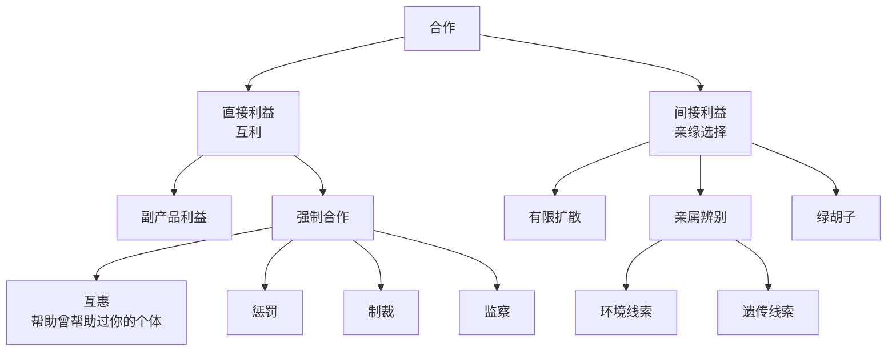

在一天里守卫优势配偶幼崽的狐獴体重下降，而同群外出觅食的伙伴体重增加。一条本可以吃掉客户体表保护性黏液的裂唇鱼，却去吃客户的寄生虫。一株大豆把碳付给根瘤中的细菌，细菌则把氮付给植物。这些伙伴都不必是亲属，所以**亲缘选择**（[7.18.33](/7.18.33)）无法解释它们为什么帮助对方。非亲属之间的合作必须通过合作者自身的存活与繁殖直接回报它，而问题在于：当每个合作者都可能被一个只拿利益、不付代价的个体利用时，它怎么可能做到。

本章对各种解决办法分类，并检验每一种的证据。它所依据的博弈论，即**演化稳定策略**、**囚徒困境**以及重复博弈中关于**以牙还牙**的定理，已在 [7.10.16](/7.10.16#sec-16.2) 中引入，并在 [7.18.25](/7.18.25) 中随**复制者动力学**得到扩展；这里用它来追问自然界中应当看到哪些行为、实际又看到哪些。最后一部分转向物种之间的合作，即**互利共生**，其生态后果见 [7.10.17](/7.10.17)，植物与微生物方面见 [7.11.31](/7.11.31)。鸟类与哺乳类家庭中的帮助行为，直接利益与间接利益兼而有之，是下一章的主题（[7.18.35](/7.18.35)）。

## 34.1. 合作的问题

**定义 34.1.1（合作）** 一个行为若给另一个个体（受惠者）带来利益，并且至少部分地因其对受惠者的有益效应而被选择，则是**合作**（West、Griffin 与 Gardner，2007）。

:::

第二个条件排除了单向的副产物。大象的粪便使利用它的蜣螂受益，但大象产生粪便另有原因，产粪的量也并不是由对蜣螂的利益塑造的；产粪不是合作。按这一定义，所有利他行为和一部分互利行为是合作的（[7.18.33](/7.18.33#sec-33.1)）。非亲属之间的大多数合作在施动者的终生尺度上是互利的，即使短期内有代价。

困难在于合作行为制造了被利用的机会。

**定义 34.1.2（搭便车）** **搭便车**（或欺骗）是获取他者合作的利益而避免自己付出合作代价的策略。

:::

囚徒困境以两个参与者刻画了这一问题。每人可以合作（$C$）或背叛（$D$）；参与者的收益是：双方合作的奖励 $R$、对合作者背叛的诱惑 $T$、与背叛者合作的受骗者收益 $S$、以及双方背叛的惩罚 $P$，满足

$$
T > R > P > S, \qquad 2R > T + S. \tag{34.1}
$$

第二个条件保证相互合作优于轮流相互利用。取示意性的数值 $T = 5$、$R = 3$、$P = 1$、$S = 0$（Axelrod 与 Hamilton，1981），伙伴合作时，参与者背叛得 5、合作得 3；伙伴背叛时，背叛得 1、合作得 0。无论对方怎么做，背叛都是更好的回应，所以单次相遇中双方都背叛并各得 1，尽管双方合作时各得 3。以演化的语言说，$D$ 是唯一的 ESS，同时包含两种策略的群体会演化为全部是背叛者。

许多合作行为使整个群体而不是一个伙伴受益。分泌**铁载体**、分泌在细胞外消化蛋白质的酶或生物膜基质分子的细菌，产生的是一种*公共物品*：附近所有细胞都受益，无论它们有没有出力。设 $N$ 个群体成员中每个都可以付出代价 $c$ 做出贡献，每次贡献产生总利益 $b$，由所有成员平等分享，则贡献者从自己的贡献中得到 $b/N$ 而付出 $c$，所以只有当

$$
\frac{b}{N} > c \tag{34.2}
$$

时贡献才对贡献者有利，尽管只要 $b > c$ 群体整体就有所得。在大群体中，这一条件对几乎任何利益都不成立，这就是"公地悲剧"（Hardin，1968）。需要看到，囚徒困境与公共物品博弈说明的是合作的问题，并不是对它的解释。要解释合作，我们必须找出终生收益并非囚徒困境的收益的那些情形。

## 34.2. 解释的分类

基因可以通过携带它的个体的繁殖（直接适合度）或携带其拷贝的其他个体的繁殖（间接适合度）增加自身的传递。合作的解释相应分为两组（West、Griffin 与 Gardner，2007）：间接利益，通过亲缘选择解释亲属之间的利他合作；直接利益，使合作成为互利的。

| 解释 | 合作者如何得益 | 本章的例子 |
|---|---|---|
| 亲缘选择 | 帮助与自己共有基因拷贝的个体 | 银喉长尾山雀、社会性变形虫（[7.18.33](/7.18.33)、[7.18.35](/7.18.35)） |
| 副产品利益 | 即使对自私的个体，合作也是最佳选择；对他者的利益是副产品 | 集体狩猎、共同创群的蚁后、狐獴的群体增益 |
| 互惠 | 伙伴日后回报帮助 | 重复博弈；吸血蝠（部分） |
| 强制 | 合作者得到奖励或搭便车者受到惩罚，从而改变收益 | 清洁鱼、华丽细尾鹩莺、豆科植物的制裁、工蜂监察 |

这些类别并不互相排斥。若相互作用的个体是亲属，提供直接利益的机制也提供间接利益，在许多合作繁殖者中两者都起作用（[7.18.35](/7.18.35)）。不过这一分类使实证问题更加尖锐：对于一个具体的例子，如果合作者停止合作，会发生什么？

## 34.3. 副产品利益

### 34.3.1. 没有困境的博弈

**定义 34.3.1（副产品互利）** **副产品互利**是从纯粹自利的角度看对每个个体都是最佳选择的合作，所以它对他者提供的利益是一个无论如何都对施动者有利的行为的自动后果。

:::

Binmore（2007）把这类博弈称为"囚徒之乐"。设想两个个体可以参加一次狩猎，它耗费一个单位的能量。猎物总是在二者之间平分，无论两者是否都参加了。单独狩猎者带回 4 个单位，于是各得 2（狩猎者的收益为 $2 - 1 = 1$，搭便车者的为 2）；两个狩猎者合作带回 10 个单位，各得 $5 - 1 = 4$。无论对方怎么做，狩猎都是更好的回应（$4 > 2$ 且 $1 > 0$），所以狩猎是 ESS，尽管搭便车利用一个单独的狩猎者（2）优于被搭便车（1）。对选择而言，重要的是一个策略对群体的表现，而不是相对于伙伴的表现：在一个狩猎者群体中，罕见的搭便车者得 2，而狩猎者得近 4。

关键特征是协同：两个合作者的收益多于一个的两倍。当猎物很大、单个狩猎者很少成功时，狮、狼和一些猛禽的集体狩猎大概具有这种结构（[7.18.27](/7.18.27#sec-27.3.2)）；加入鸟群或兽群以降低自身被捕食的风险，同样意义上是一种副产品互利。

一个戏剧性的例子有个暴力的结局。在包括荒漠收获蚁 *Messor* 属在内的几种蚂蚁中，无亲缘关系的新交配蚁后联合创建一个群体（多后创群）。成熟群体的工蚁摧毁年轻的巢，初生群体的工蚁互相掠夺对方的幼虫，所以更早产生更多工蚁的群体存活得更好；由多只蚁后建立的群体生长得更快。蚁后在创群期间不觅食：它们把自己封闭在巢内，靠体内的储备（包括溶解的飞行肌的蛋白质）养育第一批工蚁。第一批工蚁一羽化，有其他蚁后的好处就结束了，因为工蚁现在可以供养群体，而独占繁殖的好处仍然存在；此前没有表现出攻击性的蚁后随后相互争斗，直到只剩一只（Bernasconi 与 Strassmann，1999）。合作恰好持续到它对每只蚁后都不再有利为止。

### 34.3.2. 隐蔽与延迟的利益

利益可能延迟，也很难看到。

**定义 34.3.2（群体增益）** **群体增益**是个体通过增加所居群体的规模而获得的直接利益，因为较大的群体存活、觅食或保卫领域的能力更强，或因为被招募的个体日后会帮助帮手。

:::

狐獴（*Suricata suricatta*）生活在南部非洲干旱地区，群体最多有大约 20 只成体，包括一对优势繁殖配偶和两性的从属个体。群体外出觅食时，一只或几只从属个体留在洞口守卫幼崽。保姆工作代价高昂：从一整天的保姆工作开始后的 12 小时内，保姆平均损失 1% 的体重，而觅食者增重 5.9%，在整个繁殖尝试中最积极的保姆损失多达 11%（Clutton-Brock 等，1998）。较大的群体有更多哨兵，每个个体站岗的时间更少，群体在与邻群的遭遇中获胜，成体的年死亡率更低；因此给群体增添幼崽的帮助直接使帮手受益。更可能留在出生群中繁殖的那个性别的帮手，应当从未来的群体规模中得益最多。如预测的那样，雌性比雄性帮助得多，雄性在成年并准备离开时减少贡献。由于大多数狐獴与它们养育的幼崽有亲缘关系，间接利益也起作用，其相对重要性可能在出生群帮手与迁入帮手之间有所不同（[7.18.35](/7.18.35)）。

利益也可能被隐藏。在华丽细尾鹩莺（*Malurus cyaneus*）这种合作繁殖的澳大利亚鸣禽中，帮手的存在并没有增加雏鸟的体重，这似乎表明帮手没有做任何有用的事。Russell 等（2007）发现有帮手的雌鸟所产的卵小 5.3%，卵黄少 14%，比没有帮手的雌鸟的少。把卵在帮手数不同的巢之间互换的互换养育实验把两种效应分开了：在大小相同的卵中，帮手确实增加了雏鸟的体重。母鸟利用帮助来节省自己的资源，在一个 16 年的数据集中，有帮手的雌鸟存活到下一个繁殖季的可能性高 11%。帮助的利益归于繁殖者未来的繁殖，而不是当前的一窝。

利益也可能延迟多年。在中美洲的长尾娇鹟（*Chiroxiphia linearis*）中，两只雄鸟组成一队为雌鸟表演协调的舞蹈展示，但只有优势（alpha）雄鸟交配。beta 雄鸟与 alpha 没有亲缘关系；它们的收益是在 alpha 死去时继承 alpha 的位置及其展示栖枝，这可能要等上几年（McDonald 与 Potts，1994）。枪尾娇鹟也是如此（[7.10.16](/7.10.16#sec-16.2.1)）。

## 34.4. 互惠

### 34.4.1. 理论

Trivers（1971）论证，一个个体如果能在日后得到对方的回报，就可能受到偏爱而付出代价去帮助另一个个体："你帮我挠背，我帮你挠背"。Trivers 把这种安排称为**互惠利他**；由于帮助的代价连本带利得到偿还，这种交换在终生尺度上是互利的，现在通常称为互惠。问题在于延迟：先得到帮助的个体可能拿走利益而拒绝偿还。

重复囚徒困境显示了什么时候可以用扣留未来帮助的威胁来强制偿还。若两个参与者只相遇一次，背叛是唯一稳定的策略。若它们相遇已知的次数，背叛同样稳定，因为在最后一轮背叛最好，因此倒数第二轮也是如此，一直回推到第一轮。但如果每一轮之后都有概率 $w$ 再来一轮，使博弈何时结束不确定，持续合作的长期利益就可能超过背叛的短期所得。在捐赠博弈中（合作花费 $c$，给伙伴 $b$），**以牙还牙**策略，即第一轮合作、之后复制伙伴上一步的行动，当且仅当 $w > c/b$ 时抵抗全部背叛策略的入侵（7.10.16 的[定理 16.2.1](/7.10.16#thm-16.2.1)）。

1980 年 Robert Axelrod 邀请博弈论学者、经济学家、生物学家等提交重复囚徒困境计算机竞赛的策略；第二次竞赛有 62 个参赛策略。两次的优胜者都是以牙还牙，由 Anatol Rapoport 提交，是最简单的参赛策略之一。Axelrod（1984）把它的成功归因于四个性质：它是*善良的*（从不首先背叛）、*报复的*（立即惩罚背叛）、*宽容的*（伙伴一合作它就回到合作）以及*清晰的*（其行为容易被伙伴识别）。Axelrod 与 Hamilton（1981）把这一结果放进了演化的背景。

### 34.4.2. 错误与宽容

后来的工作表明，以牙还牙并非不可战胜的策略。在以牙还牙者的群体中，总是合作的突变体表现与之完全相同，因为没有人背叛，因而可以漂变到高频率；含有许多无条件合作者的群体随后会被背叛者入侵。更重要的是，真实的动物会犯错。如果某一步行动偶尔执行错误或被误判，两个以牙还牙者就陷入交替报复的序列，每一方都惩罚对方上一次的背叛，直到另一次错误恢复合作或使双方都背叛；它们的平均收益降向随机行动的收益。宽恕部分背叛的策略表现更好。*宽容的以牙还牙*在伙伴背叛之后以一定概率合作（Nowak 与 Sigmund，1992），而*赢则守、输则变*（也称 Pavlov）在结果好时重复上一步行动、结果差时改变，这使同一策略的两个参与者之间的错误在两轮内得到纠正（Nowak 与 Sigmund，1993）。

一般的教训是，互惠在理论上有多种可能的形式，但没有哪一条简单规则占优势，哪种策略获胜取决于错误率、再次相遇的概率以及存在的策略的混合（Boyd 与 Lorberbaum，1987）。我们不应期望在自然界中找到以牙还牙本身。在人类中互惠很常见，形式多样；安特卫普钻石市场的商人彼此借出成袋的钻石供检验，没有收据也没有合同，欺骗的人会被永远逐出这个共同体，这种策略称为"冷酷"。在非人类动物中，我们将会看到，令人信服的例子少得出奇。

### 34.4.3. 检验互惠

互惠曾被用来解释清洁鱼的合作、报警叫声、吸血蝠的血液分享、鱼类的捕食者探查、鸟类的围攻、灵长类的梳理毛发与食物分享。证明它需要四个条件：

1. 个体与相同的伙伴反复相互作用，从而可以轮流帮助。
2. 接受帮助的利益超过给予帮助的代价。
3. 帮助是有条件的：个体帮助帮助过它们的个体，拒绝帮助没有帮助过它们的个体。
4. 这种合作不能用不要求回报的机制，如亲缘选择或副产品利益，更简单地解释。

普通吸血蝠（*Desmodus rotundus*）很好地满足了前两个条件。Wilkinson（1984）在哥斯达黎加研究个体标记的吸血蝠，它们栖息在稳定的群体中，由 8–12 只雌蝠及其幼崽组成，其中有亲属也有一些非亲属，一起生活多年。吸血蝠夜间吸血，觅食有风险，连续两三夜没有进食的吸血蝠就会死去。没有吃饱的蝙蝠向已进食的栖息伙伴乞食，常常得到反刍的血液。因为蝙蝠的体重在进食后迅速下降、然后下降得更慢，一次血液捐赠只使吃饱的捐赠者向饥饿靠近一小段，却使濒临饥饿的受惠者远离饥饿：捐赠者的代价，以饥饿前的生命小时数计，远小于受惠者的利益。

Wilkinson 发现，反刍只发生在近亲之间，或经常一起栖息的无亲缘关系的蝙蝠之间。在实验室里，他用来自两个栖息地的无亲缘关系的蝙蝠组成一个群体，一次移走一只蝙蝠，使它保持饥饿再放回群体：13 次反刍中有 12 次发生在来自同一野外栖息地的蝙蝠之间，得到过血液的蝙蝠日后向它们的捐赠者捐赠的次数多于随机预期。第三和第四个条件多年来仍然可疑。实验显示蝙蝠喂养熟悉的伙伴，并没有显示它们喂养喂过自己的个体、拒绝没有喂过自己的个体；大多数捐赠发生在亲属之间（在已知亲缘关系的蝙蝠之间观察到的 98 次捐赠中，只有 5 次涉及亲缘关系低于祖孙的配对）；捐赠也可能是制止乞食的栖息伙伴骚扰的方式，或是为了让日后可以向其乞食的群体成员活下去（Clutton-Brock，2009）。Carter 与 Wilkinson 后来的实验使论据更为扎实。在圈养群体的多次禁食试验中，一只蝙蝠给予他者的血量比它与捐赠者的亲缘关系更好地预测了它得到的血量；喂养过更多非亲属的蝙蝠有更多捐赠者，当一个关键捐赠者被移走时损失的食物更少（Carter 与 Wilkinson，2013，2015；Carter、Farine 与 Wilkinson，2017）。与非亲属分享似乎起着防范失去亲属的保险的作用，至少部分涉及互惠。

另一些提出的例子则更差。雄性橄榄狒狒（*Papio anubis*）结成联盟，其中一只雄性招募另一只去与一只伴随发情雌性的雄性争斗，自己带着雌性走开，而另外两只打斗；Packer（1977）提出角色日后会颠倒。但很少有证据表明一只雄性因为以前得到过帮助而允许其伙伴交配，后来的观察表明，一旦雌性与其伴侣被隔开，两个联盟伙伴都竞相独占她（Bercovitch，1988）：结成联盟增加了每个伙伴眼前交配的机会。雄性黑猩猩在狩猎后与他者分享肉，这种分享长期被解释为与盟友的交换；详细研究发现，肉是否被分享主要取决于他者乞求与骚扰的强度（Gilby，2006）。斑姬鹟（*Ficedula hypoleuca*）若邻居以前帮助过它们，就会加入邻居围攻其巢边的捕食者，而对没有帮助过的邻居则不予帮助（Krams 等，2008），这是野生鸟类中有条件性的最直接的证据，但解释有争议：不帮助的邻居是被实验阻止去帮助的，它们自己的巢与防御意愿可能有所不同（Russell 与 Wright，2009）。灵长类的梳理毛发在长时期内最多地给予回报梳理最多的个体（Schino 与 Aureli，2010），但梳理可能被用来交换其他服务，如争斗中的支持或在食物处的容忍。

### 34.4.4. 互惠为什么罕见

好例子的稀少（Hammerstein，2003；Clutton-Brock，2009）可能有几个原因。互惠需要还会再次遇到的伙伴、对个体的识别与记忆，以及追踪给予与接受了什么的能力。它还需要看重未来的收益，而动物对此大幅折扣。Stephens、McLinn 与 Stevens（2002）让成对的冠蓝鸦（*Cyanocitta cristata*）在操作装置中为食物玩重复囚徒困境，其中一只蓝鸦的伙伴采用以牙还牙。只有当相继几轮的食物累积在透明窗口后面、几轮之后才释放时，蓝鸦才与以牙还牙的伙伴合作；当每一轮的收益立即发放时，它们就背叛。对即时奖励的冲动偏好，在觅食中对动物很有用（[7.18.23](/7.18.23)），却是互惠的障碍。最后，重复博弈假定合作的代价现在支付、利益日后收到，而许多合作互动提供的是更简单、更即时的回报。

### 34.4.5. 间接互惠与声誉

帮助也可以由第三方回报。在*间接互惠*中，个体帮助那些有帮助他者的声誉的个体，所以帮助建立起吸引帮助的声誉（Nowak 与 Sigmund，1998，2005）。它需要观察者以及关于他者行为的信息，主要对人类重要，因为人类的语言传播声誉。清洁互利共生中也出现类似的效应。在珊瑚礁上等待的裂唇鱼的客户观察清洁鱼工作，并接近它们见到过合作取食的清洁鱼；清洁鱼则在被潜在客户观看时取食更合作，较少咬它们的客户（Bshary 与 Grutter，2006）。在这个例子中，被观察时的合作是由伙伴的选择驱动的，是强制的一种形式。

## 34.5. 强制

### 34.5.1. 惩罚

如果有一种机制奖励合作者或惩罚搭便车者，囚徒困境的收益就会改变：背叛者若因受罚所失多于利用所得，则无论伙伴怎么做，合作都成为最佳策略。互惠是这样一种机制；还有其他机制。

**定义 34.5.1（惩罚）** **惩罚**是对一个违背惩罚者利益而行动的个体施加代价的行为，惩罚者承担即时代价或毫无所得，之所以受到偏爱，是因为它降低了被惩罚个体（或他者）重复该行为的概率（Clutton-Brock 与 Parker，1995）。

:::

在许多合作繁殖的鸟类中，年轻个体推迟扩散，在出生群中帮助养育后代。Mulder 与 Langmore（1993）检验了华丽细尾鹩莺的帮手不帮忙时是否受到惩罚。他们把帮手移走并圈养 24 小时，再放回。当移走发生在繁殖季，使帮手无法帮忙时，14 例中有 9 例回归的帮手受到优势雄鸟的长时间追逐与啄击；当移走发生在繁殖季之外、没有帮助可做时，它们从未受到攻击（12 例中 0 例）。结果提示存在惩罚，但并不完整，因为没有显示帮手受罚后增加了努力。

裂唇鱼 *Labroides dimidiatus* 显示了惩罚及其效果的完整循环。清洁鱼从造访其清洁站的珊瑚礁鱼类客户身上去除并吃掉外寄生虫，主要是颚虱（gnathiid isopod）幼虫，但它们更喜欢覆盖客户皮肤的黏液，而这是客户所需要的。吃黏液的清洁鱼使客户颤动，客户对这种欺骗的反应是追赶清洁鱼或游走（Bshary 与 Grutter，2002）。Bshary 与 Grutter（2005）用有机玻璃板模拟客户，板上提供两种食物：清洁鱼乐于吃的鱼片，以及它们更喜欢的、代表黏液的捣碎的对虾。当吃对虾导致板被撤走（客户游走）或追赶清洁鱼（客户惩罚）时，清洁鱼学会违背自己的偏好而选择鱼片。在共同检查一位客户的成对清洁鱼中，其中一条欺骗性的一咬会使两者的这一餐都结束；体型较大的雄鱼追赶欺骗的雌鱼，雌鱼随后欺骗减少，这样雄鱼保护了自己的取食不受其伙伴不当行为的影响（Raihani、Grutter 与 Bshary，2010）。

社会中的优势个体用攻击与驱逐来压制可能与自己后代竞争的从属个体的繁殖，如在狐獴和侏獴中；这种对繁殖克制的强制在 [7.18.35](/7.18.35) 中分析，而工蜂毁掉其他工蜂的卵，即**工蜂监察**，在 [7.18.36](/7.18.36) 中分析。

### 34.5.2. 互利共生中的制裁

**定义 34.5.2（制裁）** **制裁**是个体减少对合作较少的伙伴提供的利益、或终止与它的相互作用的反应，使合作较少的伙伴适合度较低；这一术语主要用于物种之间的互利共生。

:::

豆科植物把固氮的根瘤菌容纳在根瘤中，并向它们提供碳与氧；固氮对细菌来说耗能很大，所以固氮较少的菌株似乎会得益。Kiers 等（2003）把大豆根周围的空气换成 80% 氩气与 20% 氧气的大气，其中几乎不含氮，使细菌无法固氮，从而迫使根瘤菌欺骗。他们对整株植物、半个根系以及单个根瘤都这样做。在每一种情况下，不固氮的根瘤中的根瘤菌繁殖都远少于固氮的根瘤中的根瘤菌，因为植物减少了对不提供氮的根瘤的氧供应（[7.11.31](/7.11.31#sec-31.2.4)）。每个根瘤通常只被一个菌株定殖，所以制裁落在应负责任的细菌身上。当根瘤含有多个菌株时，欺骗者分享固氮者挣得的奖励，制裁就变得不那么有效。

其他植物对传粉者实施制裁。丝兰蛾（*Tegeticula*）主动为丝兰的花传粉，并把卵产在子房里，幼虫在那里吃掉一部分发育中的种子。卵多的花，其种子将大部分被吃掉，常被植物脱落，杀死幼虫（Pellmyr 与 Huth，1994）。榕树会使被不带花粉的传粉小蜂进入的榕果脱落或减少其发育，所以不传粉的小蜂留下的后代更少（Jandér 与 Herre，2010；关于**榕–榕小蜂互利共生**见 [7.10.17](/7.10.17)）。

### 34.5.3. 强制为什么演化

强制本身又带来问题。如果惩罚代价高昂，而它的利益，即更多的合作，归于所有个体，那么合作而不惩罚的个体就会搭惩罚者的便车：这是第二层公共物品问题。在动物的例子中这个问题并不出现，因为强制者直接得益。从欺骗的清洁鱼身边游走的客户保护了自己的黏液，并改变了清洁鱼未来对它的行为；把氧从不固氮的根瘤转走的豆科植物把资源投到能换回氮的地方；追赶欺骗的雌鱼的雄性清洁鱼保护了自己的一餐。这些情形中的强制是自利的。在人类群体中，公共物品博弈的实验表明，即使不会再遇到搭便车者，人们也愿意付出代价去惩罚他们，并且惩罚的可能性提高了合作的水平（Fehr 与 Gächter，2002）；这种"利他惩罚"为什么演化，是通过声誉、文化群选择，还是在小群体中塑造的情感的副产品，尚有争议。

## 34.6. 操纵

有些看似合作的行为是受惠者对帮手的操纵（Dawkins，1982）。喂养杜鹃雏鸟的芦苇莺一无所得；它被巢寄生者欺骗了（[7.18.32](/7.18.32)）。大蓝蝶（*Phengaris*，旧称 *Maculinea*）的毛虫被带入 *Myrmica* 属蚂蚁的巢并由工蚁喂养，因为它们拟态蚂蚁幼虫的表面碳氢化合物；*P. rebeli* 的毛虫与蛹还发出类似蚁后的声音，工蚁在可选择时优先救助它们而不是自己的幼虫（Barbero 等，2009）。在物种内部，许多鸟类的雌鸟把卵产在同种个体的巢中。这样做的紫翅椋鸟（*Sturnus vulgaris*）雌鸟先移走宿主的一枚卵并把它丢在附近的地上；地上发现的卵曾被认为是来不及赶回巢的雌鸟所产，直到标记卵显示它们是从巢中移走的（Feare，1984）。在每一例中都有一方被利用，这种相互作用称为寄生比称为合作更恰当。

## 34.7. 物种间的互利共生

互利共生提供了对合作理论的一些最清楚的检验，因为亲缘选择在物种之间不起作用。大多数互利共生是服务或资源的交换：保护换食物（蚂蚁保卫金合欢以换取花蜜与食物体，蚂蚁照看蚜虫以换取蜜露）、运输换食物（传粉者与种子传播者）、清洁换食物（清洁鱼与清洁虾），以及营养换碳（根瘤菌、菌根真菌、珊瑚的藻类共生体）。

保持伙伴诚实有两种方式（Sachs 等，2004）。通过*伙伴忠诚反馈*，相互作用长久而伙伴的命运相连，所以伤害伙伴就是伤害自己；垂直传递的共生体由亲代传给后代，是极端的情形，它们的毒力通常低于水平传递的共生体。通过*伙伴选择*，个体在潜在伙伴中做出选择，或依其行为给予奖励；制裁是其中一种形式。清洁互利共生也说明了*生物市场*（Noë 与 Hammerstein，1994）：能在几个清洁站之间选择的客户（"访客"，有大的巢域）比只能使用一个清洁站的常驻客户更快、更合作地得到服务，正如经济市场所预测的那样（Bshary，2001）。

人类与一种鸟之间有一个引人注目的互利共生。在撒哈拉以南非洲的一些地区，黑喉响蜜鴷（*Indicator indicator*）以喋喋的叫声和短距离飞行引导人们找到野蜂巢；人们用斧头和烟打开蜂巢后，这种鸟吃蜂蜡巢脾。在莫桑比克北部，尧人（Yao）蜂蜜猎人用一种特殊的呼叫吸引响蜜鴷，即一声响亮的颤音后接一声低哼，是从父亲那里学来的。在回放实验中，与对照声音相比，蜂蜜猎人的呼叫使响蜜鴷开始引导的概率约增加一倍，被引到蜂巢的概率约增加两倍；这种鸟把呼叫与采蜜联系起来（Spottiswoode、Begg 与 Begg，2016）。

互利共生并非没有冲突。每个伙伴都被选择去多得少给，许多互利共生中含有欺骗的物种：不传粉的榕小蜂、咬穿花朵的盗蜜者、不提供奖励的兰花。它们的稳定性依赖于稳定物种内合作的同样机制：使交换对每个伙伴都有利的协同、相连的命运，以及由控制资源的伙伴实施的强制。

## 34.8. 人类的合作

人类与非亲属合作的规模是其他动物无法比拟的，本章的所有机制都有涉及：集体劳动中的副产品利益、直接与间接互惠、惩罚，以及奖励合作的制度。实验博弈显示，当相互作用重复进行（Camerer，2003）以及声誉攸关时，人们合作得更多；甚至在大学咖啡室的饮料诚信箱上方放一幅眼睛的图像，就使所付金额比放一幅花朵的图像时增加近两倍（Bateson、Nettle 与 Roberts，2006）。人类合作有多少能用这些作用于个体的机制来解释、有多少需要文化演化与群体间的选择，是一个活跃的问题，超出了本课程的范围。

## 小结

- 合作（定义 34.1.1）使受惠者受益，并因这一利益而被选择。搭便车（定义 34.1.2）威胁合作：在**囚徒困境**（式 34.1）中，背叛是唯一的 ESS，一个公共物品只有当 $b/N > c$（式 34.2）时才对其产生者有利。
- 解释分为间接利益（**亲缘选择**）与直接利益：副产品、互惠与强制。

| 机制 | 收益结构 | 最佳证据 |
|---|---|---|
| 副产品互利（定义 34.3.1） | 没有困境：无论伙伴怎么做，合作都最好（协同） | 集体狩猎；共同创群的蚁后，工蚁一羽化就争斗 |
| 群体增益（定义 34.3.2） | 较大群体的延迟直接利益 | 狐獴保姆；节省资源的细尾鹩莺母鸟；娇鹟 beta 雄鸟 |
| 互惠 | 重复博弈，未来的帮助取决于当前的帮助 | 令人信服的例子很少；吸血蝠部分；在鸟类与灵长类中有争议 |
| 惩罚（定义 34.5.1） | 对欺骗者施加代价 | 裂唇鱼与其客户；雄性清洁鱼惩罚雌鱼 |
| 制裁（定义 34.5.2） | 减少对不佳伙伴的回报 | 大豆对不固氮根瘤的氧供应；丝兰、榕树 |

- 理论上，**以牙还牙**赢得 Axelrod 的竞赛，并在 $w > c/b$ 时抵抗背叛者，但它并非不可战胜：错误使以牙还牙者对陷入报复，宽容或能纠正错误的策略表现更好。
- 互惠在动物中罕见，也许因为它需要反复相遇的伙伴、个体记忆与耐心；冠蓝鸦只有在奖励累积时才与以牙还牙的伙伴合作。
- 强制在动物中起作用，是因为强制者直接得益（自利的惩罚与制裁）；人类的"利他惩罚"更难解释。
- 表面上的合作可能是操纵（巢寄生者、大蓝蝶、紫翅椋鸟的弃卵）。
- **互利共生**由伙伴忠诚反馈、伙伴选择与制裁来稳定；伙伴在生物市场中竞争。

## 思考题

1. 证明在第 34.3.1 节的集体狩猎博弈中，策略"狩猎"是演化稳定的。若两个狩猎者各自的收益 $H$ 低于 2，其他收益不变，会得到哪一类博弈？它此时是囚徒困境吗？

   **答** 行参与者的收益为 $H = 4$（双方狩猎）、1（单独狩猎）、2（搭狩猎者的便车）和 0（不狩猎）。在狩猎者群体中，狩猎者得 4，罕见的搭便车者得 2，所以搭便车者无法入侵：狩猎是严格的 Nash 均衡，因而是 ESS。若 $H < 2$，搭狩猎者的便车比与之一起狩猎得益更多，但在伙伴不狩猎时，单独狩猎（1）仍优于不狩猎（0）。于是每种策略都是对另一种的更好回应，两种纯策略都不稳定，群体稳定在狩猎者与搭便车者的一个混合上：这是具有鹰鸽博弈结构的"雪堆"博弈。它不是囚徒困境，后者要求 $P > S$，即与背叛者合作是最坏的结果；只有当单独一次狩猎的代价超过其所得份额的回报时，这才成立。

2. 为什么体重随进食后时间下降的减速曲线使吸血蝠的血液分享有利可图？如果体重线性下降会怎样？

   **答** 减速（凸）曲线下，体重损失的速率在刚进食后很高、接近饥饿时很低。因此一定量的血液对刚进食的捐赠者（其体重下降得快）相当于很少的生命小时数，而对濒临饥饿的受惠者（其体重下降得慢）相当于很多小时；以小时计的利益大大超过代价，这是互惠的第二个条件。若体重线性下降，对任何蝙蝠每克都值同样多的小时，捐赠使捐赠者付出的时间恰好等于受惠者得到的时间。于是利益等于代价，即使是完美的互惠也不会增加存活，除非死亡是一个阈值，使接近饥饿时的时间更有价值。

3. 设计一个实验，在群居哺乳动物中检验互惠的第三个条件（有条件性），同时控制亲缘关系与熟悉度。

   **答** 使用一个圈养的、无亲缘关系的个体组成的群体，它们彼此同样熟悉（例如一起饲养相同的时间），使亲缘关系与熟悉度恒定。在每次试验中剥夺一个个体的食物，并操纵某个特定伙伴能否帮助它，例如暂时只让该伙伴得到食物，或阻止它捐赠。之后互换角色，测量先前得到帮助的个体是否向其以前的捐赠者捐赠得多于向被阻止帮助的伙伴；这一操纵保证"不帮助者"只在过去的行为上不同，而不是在质量或亲密程度上不同。以随机配对重复多轮，也可以检验个体是否减少对拒绝帮助它们的伙伴的帮助。采用这种设计的褐家鼠（*Rattus norvegicus*）实验表明，大鼠在伙伴以前帮助过它们时，更多地拉动向伙伴送出食物的杠杆（Rutte 与 Taborsky，2008）。

4. 在裂唇鱼中，客户为什么惩罚咬它们的清洁鱼？为什么可能是雄性清洁鱼而不是客户来惩罚其雌性伙伴？

   **答** 被咬的客户失去黏液；通过追赶清洁鱼或游走，它终止了相互作用，使清洁鱼在日后的造访中不太可能再咬它，所以惩罚直接使客户受益，是自利的。当一对清洁鱼共同检查一位客户时，一方的一咬会使客户离开并使双方的这一餐都结束；雌鱼体型较小、从黏液中获益更多，欺骗的诱惑更大，而雌鱼欺骗时雄鱼失去了他那一份食物。因此雄鱼追赶她直接得益，他的惩罚使她欺骗减少，使客户继续让这一对取食。客户无法分辨是哪条清洁鱼咬了它，而雄鱼能够分辨，所以是更有效的强制者。

5. 解释为什么当根瘤（或花、或榕果）被几个无亲缘关系的共生体定殖时，宿主的制裁不那么有效，并把这与共生体之间的亲缘系数联系起来。

   **答** 制裁降低一个单元（根瘤、果实）中所有共生体的繁殖。如果该单元只含一个菌株，代价完全落在造成它的菌株身上，欺骗突变会降低自身的适合度。如果一个单元含有一个固氮者和一个欺骗者，欺骗者仍从固氮者挣得的氧中得益，只承担自己欺骗所造成制裁的一部分，而固氮者承担了欺骗者所造成制裁的一部分；有 $k$ 个无亲缘关系的创始者时，欺骗者只承担它所引发制裁的约 $1/k$。这与 Hamilton 法则的逻辑相同：在一个单元之内，共生体的亲缘系数约为 $1/k$，宿主的制裁起着群间选择的作用，只有在群体成员高度相关时才有效。因此宿主应当从限制每个单元内菌株数的机制中获益，如根瘤菌在根瘤内的克隆式生长。
