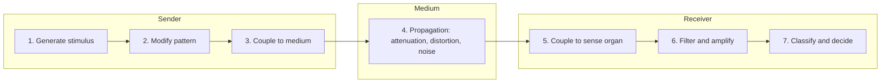

A male túngara frog calls from a puddle, a honey bee dances on the comb, a vervet monkey barks at a leopard, a caterpillar-damaged maize plant releases a plume of volatile terpenes. Each of these acts changes the behavior of another organism: a female frog approaches, other bees fly to a patch of flowers, the troop runs into the trees, a parasitoid wasp finds the caterpillar. Communication is the glue of social life, and almost every topic of the preceding chapters, from territorial defense ([7.18.26](/7.18.26)) to group decisions ([7.18.27](/7.18.27)), has involved it.

This chapter and the next three treat communication systematically, following the organization of Bradbury and Vehrencamp's synthesis. This first chapter asks what a signal is and how receivers use the information it carries: a receiver is a decision maker that must act without knowing the true state of the world, and signals are worth attending to only insofar as they improve its decisions. The tools are elementary probability (**Bayes' theorem**, [3.4.10](/3.4.10)), **signal detection theory** ([7.16.47](/7.16.47)) and information theory ([7.16.20](/7.16.20)), and the economic and game-theoretic reasoning of the chapters on behavioral ecology ([7.18.25](/7.18.25)). The next chapter treats the physics of producing and transmitting signals in each sensory channel, which complements the chapters on reception ([7.18.9](/7.18.9)–[7.18.11](/7.18.11)); the third asks how signals originate and why they are honest; and the fourth surveys signals in their social contexts: conflict, courtship, social integration and predation.

## 37.1. What Is Communication?

### 37.1.1. Signals and Cues

Animals are surrounded by stimuli that are correlated with things they need to know: where food is, whether a predator is near, whether a potential mate is of the right species and in good condition. Most of these stimuli are produced without any intention of informing anyone. A mosquito finds a host by the carbon dioxide it exhales, a bat finds a moth by the echoes from its body, a toad judges the size of a rival from its silhouette. Other stimuli exist precisely because they affect the behavior of others: the song of a male, the bright colors of a poisonous frog, the scent marks of a territorial antelope. The distinction is central to the study of communication and is captured by the following definitions (Maynard Smith and Harper 2003).

**Definition 37.1.1 (Signal and Cue)** A **signal** is any act or structure of one organism that alters the behavior of another organism, that evolved because of that effect, and that is effective because the response of the other organism has also evolved. A **cue** is any feature of the world, animate or inanimate, that an organism can use as a guide to future action but that did not evolve for that purpose.

**Definition 37.1.2 (Animal Communication, Sender, Receiver)** **Animal communication** is the provision of information by one individual, the **sender**, to another, the **receiver**, by means of signals, where the receiver uses the information to decide how to act. Individuals that detect and use a signal not directed at them are eavesdroppers ([7.18.39](/7.18.39)).

The definition of a signal has three parts, and each excludes something. That the act alters the behavior of another excludes features that are never perceived. That it evolved because of that effect excludes cues: the carbon dioxide exhaled by a mammal informs mosquitoes, but it is a by-product of respiration and would be produced even if no mosquito existed. That the receiver's response has also evolved excludes coercion and manipulation of reflexes: a male that physically pushes a female into position, or a parasite that manipulates the nervous system of its host ([7.18.22](/7.18.22)), alters behavior without a co-evolved response.

The same feature can be a cue in one species and a signal in another. The body size of a spider is a cue to its opponent's fighting ability; when a male funnel-web spider vibrates the web in a way whose amplitude depends on its weight, the vibration is a signal of size (Riechert 1978). Cues often become signals: a pursued animal that turns to look at a predator provides a cue that it has detected the predator, and if predators respond by giving up, selection may exaggerate the movement into a display ([7.18.24](/7.18.24#sec-24.6.3)). This process of *ritualization* is the main route by which signals originate ([7.18.39](/7.18.39)), and the classical ethologists' **releasers** were the first signals to be studied systematically ([7.18.3](/7.18.3#sec-3.2.4)).

### 37.1.2. Information or Manipulation?

The early ethologists regarded signals as devices for the efficient transfer of information between sender and receiver, often with the implicit assumption that communication benefits the group or the species. Richard Dawkins and John Krebs (1978) objected that natural selection favors senders that change the behavior of receivers to the sender's advantage, whether or not the receiver gains: a signal is a means of *manipulation*. Receivers in turn are selected to resist manipulation and to extract whatever information about the sender they can, *mind-reading* in their phrase (Krebs and Dawkins 1984). Where interests coincide, signals should become quiet, cheap "conspiratorial whispers"; where interests conflict, an arms race between manipulative senders and sales-resistant receivers should produce loud, repetitive, exaggerated displays.

The two views are reconciled by a simple argument. A receiver's response to a signal is itself an evolved trait, and it can persist only if responding is, on average, better for the receiver than ignoring the signal. A signaling system is therefore evolutionarily stable only if both parties benefit on average: the receiver because the signal carries information that improves its decisions, the sender because the receiver's response benefits it. Signals carry information *about* the state of the sender (its quality, motivation, identity) or about the environment, and they are used because they *influence* receivers. The central problem of communication theory then becomes the problem of reliability: when sender and receiver have conflicting interests, what prevents senders from exaggerating or lying? This problem is the subject of [7.18.39](/7.18.39).

### 37.1.3. A Classification of Communication Systems

Communication systems can be classified along several independent axes (Bradbury and Vehrencamp 2011). The axes are useful because the physical, economic and evolutionary constraints on a signal depend on its position along each of them.

| Axis | Categories | Example |
|---|---|---|
| Modality and medium | Sound, light, chemicals, touch and vibration, hydrodynamic stimuli, electric fields; in air, water or solids | Cricket song in air; whale song in water; treehopper vibrations in plant stems |
| Origin (preadaptation) | Derived from a sender precursor (an intention movement, an autonomic response) or a receiver precursor (a preexisting sensory bias) | Gull threat posture; túngara frog chuck |
| Information focus | The sender (identity, species, sex, age, condition, motivation, location); the receiver (a sender that knows something about the receiver, as a parent signaling to its young); the environment (predators, food) | Status badges; alarm calls; honey bee dances |
| Reliability guarantee | Index (cannot be faked), handicap (faking does not pay), conventional (no intrinsic guarantee, maintained by common interest or social costs) | Red deer roars; peacock trains; vervet alarm calls |
| Social context | Conflict resolution; mate attraction and courtship; social integration (recognition, cooperation, appeasement); environmental signals (predators, food) | [7.18.40](/7.18.40) |

## 37.2. The Signal Sequence

Every act of communication, in any modality, consists of the same seven steps (Bradbury and Vehrencamp 2011). Three take place in the sender, one in the medium and three in the receiver:

1. *Generation*: a source produces energy in the right modality: a vibrating membrane, a pigment, a gland.
2. *Modification*: the raw stimulus is given a pattern: a resonator filters the frequencies of a sound, a feather structure selects the reflected wavelengths, a blend of compounds is mixed in a fixed ratio.
3. *Coupling to the medium*: sound must be radiated efficiently into air or water, a color patch must be exposed to light, a pheromone must evaporate.
4. *Propagation*: the signal spreads, weakens and is distorted by the medium and masked by noise; its fate depends on the modality, the habitat and the distance.
5. *Coupling to the receiver*: an ear, an eye or an antenna captures some of the propagated energy.
6. *Modification by the receiver*: the sense organ filters the stimulus, amplifies it and improves its resolution: the tuned filters of the cochlea, the opsins of the retina.
7. *Classification and decision*: the receiver's nervous system identifies the signal, compares it with stored templates and decides how to respond.

The sequence separates two kinds of design problem (Guilford and Dawkins 1991). *Efficacy* concerns steps 1 to 6: how a signal gets through the environment and into the sense organs of the receiver; it explains, for example, why forest birds sing at lower frequencies than birds of open country ([7.18.38](/7.18.38)). *Strategic design* concerns step 7 and the economics behind it: what information the signal carries and why the receiver should believe it. The physics of efficacy is shared with the senses and is treated in [7.18.38](/7.18.38); strategic design is the subject of this chapter and of [7.18.39](/7.18.39).

## 37.3. Decisions and Information

### 37.3.1. Conditions, Probabilities and Actions

Why should a receiver pay attention to signals at all? Because it must choose among actions whose consequences depend on conditions it cannot observe directly. A female choosing a mate cannot see the male's genes or his future parental effort; a squirrel cannot know whether the rustle in the grass is a snake; a bird at a boundary cannot know whether its neighbor will escalate. A receiver can be modeled as maintaining a list of alternative conditions $C_1, \dots, C_n$, with a probability $p_j$ for each, and choosing among actions $a_1, \dots, a_m$; if action $a_i$ in condition $C_j$ yields payoff $R_{ij}$ (ultimately a contribution to **fitness**), the expected payoff of action $a_i$ is

$$
\bar R_i = \sum_{j=1}^{n} p_j R_{ij},
$$

and the optimal decision is the action with the largest $\bar R_i$. Before any signal is received, the probabilities are the receiver's prior estimates, based on past experience, on cues or on evolved defaults; the action that is best given the prior alone is the *default* action.

### 37.3.2. Updating with Bayes' Theorem

A cue or signal $s$ is useful because it is correlated with the condition. If the receiver knows (by evolution or by learning) the probability $\mathbb{P}(s \mid C_j)$ of perceiving $s$ in each condition, it can revise its estimates by Bayes' theorem.

**Formula 37.3.1 (Bayesian Updating)** After perceiving $s$, the probability of condition $C_j$ becomes

$$
\mathbb{P}(C_j \mid s) = \frac{\mathbb{P}(s \mid C_j)\, p_j}{\sum_{k} \mathbb{P}(s \mid C_k)\, p_k}.
$$
With two conditions, the posterior odds are the prior odds multiplied by the likelihood ratio, $\dfrac{\mathbb{P}(C_1 \mid s)}{\mathbb{P}(C_2 \mid s)} = \dfrac{p_1}{p_2}\cdot\dfrac{\mathbb{P}(s \mid C_1)}{\mathbb{P}(s \mid C_2)}$, so that independent signals add their log likelihood ratios.

The additivity of log likelihood ratios means that a receiver that samples a sender repeatedly, as a female does when she listens to many songs of a male or as two contestants do in a sequence of displays, accumulates evidence by a random walk toward one of two thresholds. This is the logic of the **sequential assessment model** of contests ([7.18.26](/7.18.26#sec-26.4.2)) and of the **drift-diffusion model** of perceptual decisions in the brain ([7.16.47](/7.16.47#sec-47.2)), and it predicts that decisions between similar alternatives take longer.

Do animals update their estimates in a Bayesian way? A foraging animal that must decide when to leave a patch of uncertain quality is a natural test: the number of prey it has found tells it something about the quality of the patch, and an optimal forager should leave a patch sooner after a run of failures when good and bad patches are very different. Downy woodpeckers (*Dryobates pubescens*) foraging on artificial logs with holes that were either all empty or partly filled left empty logs after sampling about as many holes as an optimal Bayesian rule predicts (Lima 1984), and bumblebees learned to adjust their patch-leaving rule to the distribution of rewards among flowers (Biernaskie, Walker and Gegear 2009). A review of such studies (Valone 2006) concluded that many animals combine prior information with sampling in approximately Bayesian ways, although usually by simple rules that approximate the optimum rather than by explicit computation. Perception itself can be described as Bayesian inference ([7.16.27](/7.16.27)).

### 37.3.3. The Red Line

With two conditions and two actions, the decision rule takes a particularly simple form.

**Proposition 37.3.1 (Threshold Probability)** Let action $a_1$ be better in condition $C_1$ and action $a_2$ in condition $C_2$, and let $L_1 = R_{11} - R_{21} > 0$ and $L_2 = R_{22} - R_{12} > 0$ be the losses from choosing the wrong action in each condition. Then $a_1$ has the higher expected payoff if and only if the probability $p$ of $C_1$ exceeds

$$
p^* = \frac{L_2}{L_1 + L_2}.
$$

**Proof** $\bar R_1 - \bar R_2 = p(R_{11} - R_{21}) + (1-p)(R_{12} - R_{22}) = pL_1 - (1-p)L_2$, which is positive if and only if $p(L_1 + L_2) > L_2$. $\square$

Bradbury and Vehrencamp call $p^*$ the *red line*. It depends only on the relative costs of the two kinds of error, not on how likely the conditions are, and it explains why receivers often act on weak evidence. A bird that hears an alarm call should flee even if a predator is unlikely, because the loss from staying when a predator is present (death) is much greater than the loss from fleeing unnecessarily (an interrupted meal): with $L_1 = 100$ and $L_2 = 1$, $p^* \approx 0.01$. The same logic, phrased in terms of a sensory variable rather than a probability, gives the optimal criterion for an alarm system in [7.18.8](/7.18.8#sec-8.3) (Example 8.3.1). The red line also explains the asymmetric "smoke detector" design of many defenses: false alarms are the price of rarely missing a real attack.

**Example 37.3.1 (A Female Listening to a Male)** A female encounters a male who is of high quality ($C_1$) with prior probability $p = 0.3$. Mating with a high-quality male yields a payoff of 10, mating with a low-quality male 2, and rejecting the male and continuing to search yields an expected 5 whatever his quality. Then $L_1 = 10 - 5 = 5$, $L_2 = 5 - 2 = 3$ and the red line is $p^* = 3/8 = 0.375$. Without further information she should reject him ($p < p^*$).

Suppose the male sings at a high rate with probability $0.8$ if he is of high quality and $0.3$ if he is of low quality. If he sings fast, Formula 37.3.1 gives

$$
\mathbb{P}(C_1 \mid \text{fast}) = \frac{0.8 \times 0.3}{0.8 \times 0.3 + 0.3 \times 0.7} = \frac{0.24}{0.45} \approx 0.53,
$$
which is above the red line, so she should accept him; if he sings slowly, $\mathbb{P}(C_1 \mid \text{slow}) = 0.06/0.55 \approx 0.11$, and she should reject him.

![Decisions with a red line. A: expected payoffs of accepting (blue) and rejecting (grey) a male as functions of the probability p that he is of high quality, for the payoffs of Example 37.3.1; the lines cross at the red line p* = 0.375, and the receiver's best payoff (heavy line) is the upper envelope, a convex function of p. B: the posterior probability of a female listening to a sequence of songs from a high-quality male (blue) and a low-quality male (orange), updated by Bayes' theorem after each song (fast songs with probability 0.8 and 0.3); each trace starts at the prior 0.3, and the female accepts once her estimate rises above the red line (dashed). Several songs are often needed, and the low-quality male occasionally crosses the line by chance](./plots/red-line.py)

### 37.3.4. Signal Detection

Signals rarely arrive as clean categories. A receiver perceives a noisy stimulus, the internal response to which overlaps between conditions, and must set a criterion along a continuous variable. **Signal detection theory** ([7.16.47](/7.16.47)) describes this situation: for a given separation of the two distributions ($d'$), moving the criterion trades hits against false alarms along the **ROC curve**, and the optimal criterion depends on the prior probabilities and on the costs of the two kinds of error in exactly the way that the red line does. Haven Wiley (1994, 2006) used the framework to analyze the "receiver's dilemma" of communication: a receiver whose criterion is low ("adaptive gullibility") responds to most signals but also to many irrelevant stimuli and to deceptive mimics; a receiver whose criterion is high ("adaptive fastidiousness") avoids errors but misses many genuine signals. Senders can ease the dilemma by making signals more distinct from background and from each other, by exaggeration, repetition and stereotypy, which increase $d'$. Wiley's argument explains why many signals are conspicuous and stereotyped, and it reappears in the analysis of crypsis and mimicry ([7.18.24](/7.18.24#sec-24.4.2)).

### 37.3.5. The Value of Information

A signal is worth attending to only if it changes decisions. This intuitive point can be made precise.

**Definition 37.3.1 (Value of Information)** The **value of information** provided by a signal set is the difference between the receiver's expected payoff when it chooses its action after perceiving the signal and its expected payoff when it chooses the default action without the signal:

$$
\mathrm{VI} = \sum_{s} \mathbb{P}(s)\, \max_{i} \bar R_i(s) - \max_{i} \bar R_i,
$$
where $\bar R_i(s) = \sum_j \mathbb{P}(C_j \mid s) R_{ij}$ is the expected payoff of action $a_i$ given the signal $s$.

**Proposition 37.3.2 (Properties of the Value of Information)** $\mathrm{VI} \ge 0$, and $\mathrm{VI} = 0$ if every possible signal leaves the posterior probabilities on the same side of the red line as the prior, so that the signal never changes the decision.

**Proof** With two conditions, the receiver's best expected payoff $V(p) = \max_i \bar R_i(p)$ is the maximum of functions linear in $p$ and therefore convex (Figure A of Section 37.3.3). The posterior probability $\mathbb{P}(C_1 \mid s)$ has expectation $\sum_s \mathbb{P}(s)\, \mathbb{P}(C_1 \mid s) = p$, the prior, so by Jensen's inequality $\sum_s \mathbb{P}(s) V(\mathbb{P}(C_1 \mid s)) \ge V(p)$. If all posteriors lie on the same side of the red line as $p$, $V$ is linear on the interval containing them and equality holds. The argument extends to more conditions, since $V$ is again a maximum of linear functions of the probability vector. $\square$

In Example 37.3.1, the female's expected payoff when she uses the male's song is $0.45 \times (0.53 \times 10 + 0.47 \times 2) + 0.55 \times 5 \approx 5.57$ (the male sings fast with probability $0.45$), compared with $5$ when she rejects every male, so the value of the information is about $0.57$ payoff units.

Three general conclusions follow. First, the value of information is greatest when the prior lies near the red line, where the receiver is most uncertain about what to do, and vanishes when the prior is so extreme that no realistic signal could change the decision: a female that is almost certain that all males are good gains nothing from listening. Second, the value increases with the reliability of the signal, but a perfectly reliable signal is not needed; a signal that is right only 70% of the time may still be worth a great deal. Third, attending to signals has costs (time, exposure to predators, the risk of being deceived), and the receiver should attend only when the value of the information exceeds them. The same comparison sets a limit on deception: a receiver continues to respond to a signal that is sometimes dishonest as long as the value of the information remains above the cost of attending ([7.18.39](/7.18.39)).

![The value of information. A: VI as a function of the prior probability p of condition C₁ for the payoffs of Example 37.3.1 and binary signals of three reliabilities (probability that the signal matches the condition: 0.6, 0.75 and 0.9); VI is zero when the prior is far from the red line (dashed) and largest near it, and it increases with reliability. B: the same as a map over the prior and the reliability; the region where VI exceeds an attention cost of 0.2 (contour) is the set of conditions under which a receiver should pay attention to the signal](./plots/value-of-information.py)

## 37.4. Coding and the Amount of Information

### 37.4.1. Signal Sets and Coding Schemes

A species' signal repertoire can be divided into *signal sets*: groups of alternative signals that answer the same question for the receiver. The alarm calls of vervet monkeys form one set (an eagle, a leopard, a snake), the song types of a territorial bird another. The rules by which senders associate conditions with signals in a set constitute its *coding scheme*. Coding schemes differ in several ways.

- *Plurality*: a set may consist of discrete alternatives (the three vervet alarm calls; a fixed number of song types) or of continuously graded variants (the duration of a honey bee's waggle run, which encodes the distance to food; the rate of calling, which encodes motivation). Discrete signals resist degradation during transmission and are easy to classify; graded signals can carry more information but are harder to discriminate at a distance.
- *Persistence*: a scent mark or a feather color persists for days to months and reflects conditions over a long period; a call or a posture reflects the sender's current state and can change from second to second. Static signals such as plumage colors are suited to information about stable attributes (species, sex, quality), dynamic signals to information about motivation and intention.
- *Multivariate structure*: a signal may vary in several properties at once. The properties may be *redundant*, all carrying the same information, which improves reliability in a noisy channel, or each may carry a different message (*multiple messages*), as when the frequency of a frog's call indicates its size while its rate indicates its motivation. Combinations of signals across sensory modalities are treated in [7.18.38](/7.18.38).

### 37.4.2. Measuring Information

Information theory, introduced by Claude Shannon (1948) and applied to neural coding in [7.16.20](/7.16.20), provides a measure of how much a signal set tells a receiver about a condition. If the conditions have probabilities $p_j$, the receiver's initial uncertainty is the entropy $H(C) = -\sum_j p_j \log_2 p_j$ bits. After perceiving signal $s$, the remaining uncertainty is $H(C \mid s)$; averaged over signals, the reduction in uncertainty is the **mutual information**

$$
I(C; S) = H(C) - H(C \mid S) = \sum_{j, s} \mathbb{P}(C_j, s) \log_2 \frac{\mathbb{P}(C_j, s)}{\mathbb{P}(C_j)\,\mathbb{P}(s)},
$$

which is zero when signal and condition are independent and equals $H(C)$ when the signal identifies the condition perfectly. The maximum over all possible distributions of inputs is the **channel capacity** of the signal set.

For a set of $n$ equally likely conditions, each with its own signal, in which the signal given matches the condition with probability $q$ (the *consistency* of the set) and errors are spread evenly over the other signals,

$$
I = \log_2 n + q \log_2 q + (1 - q) \log_2 \frac{1-q}{n-1}.
$$

A perfectly consistent set of three alarm calls transmits $\log_2 3 \approx 1.58$ bits; with $q = 0.8$, it transmits about $0.66$ bits. Field studies that have estimated the consistency of animal signal sets usually find intermediate consistencies, typically between 30% and 80%, and perfect information appears to be rare in animal communication (Bradbury and Vehrencamp 2011). Haldane and Spurway (1954) made the first such estimate, for the direction information in the honey bee dance ([7.18.40](/7.18.40)).

The amount of information should not be confused with its value. Mutual information measures how strongly signals and conditions are correlated, regardless of whether the receiver can do anything with the knowledge; the value of information (Definition 37.3.1) measures how much the receiver gains by using it. A signal set may carry many bits about something irrelevant to the receiver's decisions, and a single bit may be worth a life. The two measures are complementary: information theory describes the capacity of a channel, decision theory the use made of it.

![Information transmitted by a signal set. A: mutual information between condition and signal for sets of 2, 3 and 5 equally likely alternatives, as a function of the consistency q (probability that the signal matches the condition, with errors spread evenly); dotted lines mark the chance level 1/n, at which no information is transmitted, and the right end gives the maximum log₂ n bits. The shaded band marks the range of consistencies reported for most animal signal sets. B: the fraction of the maximum information transmitted, showing that a set of five alternatives at 70% consistency transmits less than half of what it could](./plots/information.py)

### 37.4.3. Weber's Law and the Perception of Signals

Receivers do not perceive differences between signals in absolute terms. In most sensory systems the smallest detectable change in a stimulus is a constant fraction of its magnitude, the **Weber–Fechner law** ([7.6.35](/7.6.35#def-35.6.3)): a difference of 2 dB is as noticeable between two quiet calls as between two loud ones, and a difference of one pulse is easy to notice between calls of two and three pulses but not between calls of twenty and twenty-one. Comparisons by ratio have consequences for the evolution of signals. Female túngara frogs prefer calls with more chucks ([7.18.16](/7.18.16#sec-16.6.4)), but their preference for a call with one more chuck than another weakened as the number of chucks increased, in proportion to the ratio of the chuck numbers, and fringe-lipped bats, which hunt the frogs by their calls, showed the same ratio dependence (Akre and colleagues 2011). Because each additional chuck increases the attractiveness of a call less than the one before while its costs in energy and predation do not diminish, the ratio-based perception of females sets a limit to the elaboration of the call, and males produce no more than a few chucks.

Weber's law has two further implications. A sender that competes with others for the attention of receivers gains more by exceeding its rivals by a fixed proportion than by a fixed amount, which can drive escalating competition in signal intensity. And receivers that compare by ratio are susceptible to context: the attractiveness of a signal depends on the alternatives present.

### 37.4.4. Departures from Optimal Choice

Receivers are not perfect Bayesian decision makers, and some of their departures are systematic.

- *Nonlinear utility*: when fitness is a nonlinear function of the amount gained, variance in the outcome matters as well as the mean, as in **risk-sensitive foraging** ([7.18.23](/7.18.23)).
- *Context dependence*: in an optimal chooser, the preference between two options should not depend on the presence of a third, inferior option. Female túngara frogs offered a choice between an attractive call and a call that was faster but less attractive in other respects switched their preference when a third, "decoy" call was added, a violation of this principle known from human decision making as the decoy effect (Lea and Ryan 2015). Such violations may reflect mechanisms that compare options by ratios or rank, which are efficient in the environments in which they evolved.
- **Rules of thumb**: when the expected payoffs of alternatives are similar, or when gathering more information would be costly, animals use rules of thumb, such as "accept the first male above a threshold", which approximate the optimum at much lower cost ([7.18.22](/7.18.22)).

These departures do not invalidate the decision-theoretic framework; they show where the mechanisms of perception and choice constrain it, and they create opportunities for senders to exploit receivers ([7.18.39](/7.18.39)).

## 37.5. The Economics of Communication

### 37.5.1. Individual and Evolutionary Economics

Communication has costs for both parties. Senders spend energy (calling is among the most expensive activities of small frogs and insects, raising metabolic rate many times above rest), time that could be spent feeding, and safety, since signals attract predators and parasites ([7.18.16](/7.18.16#sec-16.5)). Receivers spend time and attention, are exposed while listening and may be deceived. The *individual economics* of a signal compares these costs with the benefits to an individual: the response of receivers for the sender, the value of information for the receiver.

The *evolutionary economics* of a signal asks which strategies of signaling and responding will spread in a population. Two kinds of model are used. Simple **optimality models** ([7.18.22](/7.18.22)) assume that the payoff of a strategy does not depend on what other individuals do; they work for problems such as the choice of song frequency in a given habitat. Most questions about communication, however, are frequency dependent: whether it pays a receiver to respond depends on how many senders are honest, and whether it pays a sender to exaggerate depends on how receivers respond. Such questions require evolutionary game theory: one looks for an **evolutionarily stable strategy** ([7.10.16](/7.10.16)), or a **Nash equilibrium** of sender and receiver strategies that no rare mutant can invade ([7.18.25](/7.18.25)). Communication games are usually asymmetric, since senders and receivers have different roles, strategy sets and payoffs. Most models adopt the *phenotypic gambit*, the assumption that the genetic details do not alter the direction of evolution, and measure payoffs in relative fitness.

### 37.5.2. When Do Signals Pay?

A minimal model shows the main result. Let a sender be in one of two states, and let the receiver choose between two responses. The receiver ranks the responses according to the sender's state; the sender may rank them in the same way or not.

- *Common interest*: if both parties prefer the same response in each state, a sender has no incentive to misrepresent its state, and any signal, however cheap and arbitrary, can be stable. Honey bees reporting the location of food to their sisters, which share their interest in the colony's foraging success, are an example ([7.18.40](/7.18.40)); such signals tend to be inconspicuous and economical.
- *Conflict of interest*: if the sender prefers the same response (say, being chosen as a mate) whatever its state, a cheap signal cannot be stable, because low-quality senders would give it too, and receivers would cease to attend. Signals then remain informative only if something prevents dishonest senders from giving them: they are physically impossible to fake (index signals), costlier for dishonest senders than for honest ones (handicaps), or punished by receivers.

Most interesting cases lie between these extremes, with partial conflict. Their analysis, including the **handicap principle** ([7.10.13](/7.10.13)) and the games of Grafen (1990) and Maynard Smith (1991), is developed in [7.18.39](/7.18.39).

## 37.6. Communication beyond Animals

### 37.6.1. Bacteria

Many bacteria regulate the expression of genes for cooperative traits, such as the secretion of digestive enzymes, siderophores or toxins, bioluminescence and the formation of biofilms, according to the concentration of small molecules that they themselves secrete: **quorum sensing** ([7.11.11](/7.11.11#sec-11.7)). Each cell produces the autoinducer at a low rate; when the population density is high enough, the concentration crosses a threshold and the cooperative genes are switched on, so that public goods are produced only when there are enough cells to benefit from them.

Does quorum sensing meet the definition of a signal? The autoinducer is produced at a cost, it alters the behavior of other cells, and the response has evolved; so by Definition 37.1.1 it is a signal. Its evolution raises the same problem of conflict as signaling among animals, because the public goods it regulates can be exploited by cells that do not contribute. In the opportunistic pathogen *Pseudomonas aeruginosa*, mutants that cannot respond to the signal (they lack the receptor LasR) and therefore do not produce the public goods grew faster than the wild type when mixed with it, and mutants that do not produce the signal exploited the signal of others; the wild type grew better when populations were founded by single clones, in which cells are highly related, than in mixed populations (Diggle and colleagues 2007). Quorum sensing is thus stabilized by **kin selection** ([7.10.16](/7.10.16)) in the same way as cooperation in animals ([7.18.33](/7.18.33)). An alternative interpretation, *diffusion sensing* (Redfield 2002), holds that the autoinducer is less a signal to other cells than a probe with which each cell tests whether secreted products would diffuse away; in natural environments, both cell density and mass transfer affect the concentration, and the two interpretations are probably complementary.

### 37.6.2. Plants

Plants have no nervous systems, but they produce and respond to chemical stimuli in ways that resemble communication. Maize seedlings attacked by caterpillars of the beet armyworm (*Spodoptera exigua*) release a blend of terpenoid volatiles that attracts the parasitoid wasp *Cotesia marginiventris*, which lays its eggs in the caterpillars (Turlings, Tumlinson and Lewis 1990); the release is triggered by compounds in the caterpillar's saliva, not by mechanical damage alone. In field experiments with wild tobacco (*Nicotiana attenuata*), herbivore-induced volatiles attracted predatory bugs and reduced the number of herbivores by more than 90% (Kessler and Baldwin 2001). The volatiles are produced at a cost and the parasitoid's response has evolved, so they can be regarded as signals from plant to wasp, a "cry for help" that benefits both.

Whether plants signal to each other is less clear. Neighbors of damaged plants can increase their own defenses after exposure to the volatiles: wild tobacco plants growing next to clipped sagebrush (*Artemisia tridentata*) suffered less herbivory (Karban and colleagues 2000), and sagebrush responded more strongly to volatiles from clipped kin than from nonkin (Karban and colleagues 2013). But the emitting plant may not benefit from warning its competitors, so the volatiles may be cues on which neighbors eavesdrop rather than signals; the early claims of "talking trees" were criticized for weak experimental design, and the distinction is still debated. Flowers, by contrast, are unambiguous signals: their colors, patterns and scents evolved to attract pollinators, and the pollinators' responses have evolved too. Flowers that change color after pollination, signaling to bees that they no longer contain a reward, show that plant signals can also be honest when sender and receiver share an interest in efficient foraging.

### 37.6.3. Humans

Human communication combines signals shared with other primates, such as facial expressions of emotion, laughter and the acoustic correlates of body size in the voice, with language, a system of learned, conventional and combinatorial signals of unique expressive power. Language is treated in [7.18.47](/7.18.47), and the design features of animal signals that resemble it, such as referential alarm calls, in [7.18.40](/7.18.40).

## Summary

- A **signal** evolved because it alters the behavior of others, who have evolved to respond; a **cue** is information that did not evolve for that purpose (Definition 37.1.1). **Animal communication** is the provision of information by a **sender** to a **receiver** by signals (Definition 37.1.2).
- Signals are both information and influence: a signaling system is stable only if senders and receivers both benefit on average, so the central problem is the reliability of signals under conflicts of interest.
- Communication systems are classified by modality and medium, origin, information focus, reliability guarantee (index, handicap, conventional) and social context.
- Every act of communication passes through seven steps, three in the sender, one in the medium and three in the receiver; efficacy concerns transmission and reception, strategic design the information and its reliability.
- Receivers are decision makers:

  | Tool | Statement | Use |
  |---|---|---|
  | Expected payoff | $\bar R_i = \sum_j p_j R_{ij}$ | Choose the action with the largest $\bar R_i$ |
  | Bayes' theorem (Formula 37.3.1) | Posterior odds = prior odds × likelihood ratio | Updating after cues and signals |
  | Red line (Proposition 37.3.1) | $p^* = L_2/(L_1 + L_2)$ | Act on weak evidence when one error is costly |
  | Signal detection | Criterion along a noisy variable | Adaptive gullibility and fastidiousness |
  | Value of information (Definition 37.3.1, Proposition 37.3.2) | $\mathrm{VI} \ge 0$, zero unless a signal can change the decision | When to attend to signals |
  | Mutual information | $I = H(C) - H(C \mid S)$ bits | How much a signal set tells |

- Signal sets differ in plurality, persistence and multivariate structure; animal signal sets usually have consistencies of 30–80% and transmit well below the maximum information. Amount and value of information are different quantities.
- Receivers compare signals by ratio (**Weber–Fechner law**), which limits the elaboration of signals such as túngara chucks; they also show context effects such as the decoy effect and use heuristics.
- Signaling economics are frequency dependent and require game theory; cheap signals are stable under common interest, while conflict requires indices, handicaps or social costs.
- **Quorum sensing** in bacteria is signaling stabilized by relatedness (*Pseudomonas aeruginosa* cheats); herbivore-induced plant volatiles are signals to parasitoids and possibly cues for neighbors; flowers are signals to pollinators.

## Questions

1. For each of the following, decide whether it is a signal, a cue or coercion, and explain: (a) the carbon dioxide that guides mosquitoes to a host; (b) the red belly of a breeding male stickleback; (c) a dominant male elephant seal crushing a smaller male that tries to mate; (d) the scent of a ripe fruit for a frugivorous bat.

   **Answer** (a) A cue: carbon dioxide is a by-product of respiration that did not evolve to inform mosquitoes, and the host gains nothing from the mosquito's response. (b) A signal: the color is produced only by breeding males, it evolved because of its effect on rivals and females, and their responses have evolved. (c) Coercion: the behavior of the smaller male is changed by force, not by a signal to which a response has evolved. (d) Arguably a signal: the scent of many fruits evolved to attract seed dispersers, which respond to it and benefit from it; if the odor is merely a by-product of ripening, it would be a cue. The distinction depends on the evolutionary history of the trait, which can be tested by asking whether the trait is exaggerated beyond its other functions and whether its expression is timed to the presence of receivers.
2. A ground squirrel hears a rustle. The prior probability that it is a snake is 0.02. Staying when a snake is present costs 50 (in fitness units relative to fleeing), and fleeing when no snake is present costs 1. (a) Compute the red line and decide what the squirrel should do. (b) How would the answer change on an island without snakes, where the prior is 0.001?

   **Answer** (a) Let $C_1$ = snake, $a_1$ = flee. The losses are $L_1 = 50$ (staying when a snake is present) and $L_2 = 1$ (fleeing unnecessarily), so $p^* = 1/51 \approx 0.0196$. The prior 0.02 is just above the red line, so the squirrel should flee. (b) With prior 0.001, far below the red line, the squirrel should stay: the expected loss from staying is $0.001 \times 50 = 0.05$, less than the certain loss of 1 from fleeing. Animals on predator-free islands are indeed often less wary.
3. Using the payoffs of Example 37.3.1, compute the value of information for a female whose prior is $p = 0.6$, with the same song signal. Explain why it differs from the value at $p = 0.3$.

   **Answer** At $p = 0.6$, the default is to accept ($0.6 \times 10 + 0.4 \times 2 = 6.8 > 5$). $\mathbb{P}(\text{fast}) = 0.8 \times 0.6 + 0.3 \times 0.4 = 0.60$; $\mathbb{P}(C_1 \mid \text{fast}) = 0.48/0.60 = 0.80$, so she accepts with expected payoff $0.8 \times 10 + 0.2 \times 2 = 8.4$. $\mathbb{P}(\text{slow}) = 0.40$; $\mathbb{P}(C_1 \mid \text{slow}) = 0.12/0.40 = 0.30$, below the red line, so she rejects and gets 5. With the signal: $0.6 \times 8.4 + 0.4 \times 5 = 7.04$. VI $= 7.04 - 6.8 = 0.24$. The value is lower than at $p = 0.3$ (0.57) because the prior 0.6 is farther from the red line 0.375 than 0.3 is, so the default action is more often correct and the signal changes the decision only after a slow song.
4. Show that a binary signal set with equal priors and consistency $q = 0.75$ transmits about 0.19 bits. Why might such a signal still be very valuable to a receiver?

   **Answer** $I = 1 + 0.75 \log_2 0.75 + 0.25 \log_2 0.25 = 1 - 0.311 - 0.5 = 0.189$ bits. The value depends on the payoffs, not on the number of bits: if the prior lies close to the red line, as for a decision whose two errors have comparable costs and whose conditions are about equally likely, even a weakly informative signal changes the decision often, and if the stakes are high (life and death), the expected gain can be large. Information theory measures correlation; decision theory measures usefulness.
5. Why can a cheap, arbitrary signal be stable between nestmate honey bees but not between a male and a female choosing a mate? What would make a cheap signal stable in the second case?

   **Answer** Worker bees of a colony share an interest in efficient foraging, since their fitness depends on the colony's reproduction; a dancer gains nothing by misreporting the location of food, so receivers can trust a cheap signal. A male, in contrast, benefits from being chosen whatever his quality, so a low-quality male would give any cheap signal of quality, and females would be selected to ignore it. A cheap signal could be stable if dishonesty were detected and punished (social costs, as in some status badges), if the signal were physically linked to the quality signaled (an index), or if the conflict of interest were small (for example, when males differ mainly in compatibility rather than in quality, so that both sexes prefer accurate matching).
6. (Open question) Design an experiment to test whether the release of volatiles by a damaged plant is a signal to parasitoids or merely a by-product of damage.

   **Answer** A signal should have evolved because of its effect on parasitoids, so its production should be specific and costly, and the plant should benefit from the parasitoids' response. Tests: (1) compare the blend released after mechanical damage with that released after damage plus caterpillar saliva (or its elicitors); a specific, inducible blend suggests a signal. (2) Using genetically modified or natural genotypes that do not produce particular volatiles, measure parasitoid attraction, parasitism rates and plant fitness (seed set) in the field; if plants that signal suffer less herbivory and set more seed when parasitoids are present but not when they are excluded, the plant benefits from the response. (3) Measure the costs of volatile production (growth or seed set of plants induced in the absence of parasitoids). Kessler and Baldwin's experiments with *Nicotiana attenuata* followed this design.
