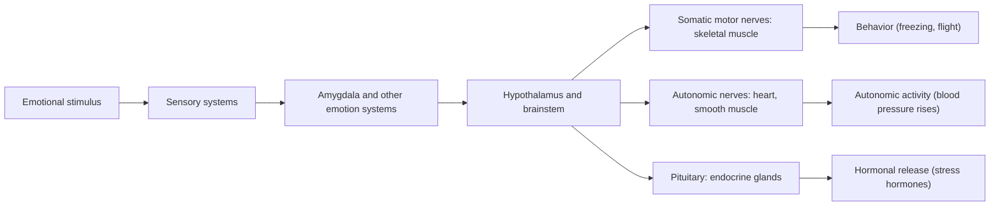

Behavior is produced by the whole nervous system, but a few brain regions have become landmarks because damaging or stimulating them changes behavior in striking and specific ways. This chapter treats three of them, each associated with one kind of behavioral control: the hypothalamus with homeostatic behaviors such as feeding, the amygdala with fear and other emotional responses, and the prefrontal cortex with planning, inhibition and social behavior. We begin with the comparative question of how vertebrate brains, and the brains of other animals capable of complex behavior, differ, and how the evolution of brain size can be tested. The anatomy of the vertebrate brain is described in [7.14.7](/7.14.7) and [7.17.67](/7.17.67), and the evolution of the cortex in [7.16.53](/7.16.53); the computational treatments of hunger, fear, reward and working memory are in [7.16.34](/7.16.34), [7.16.37](/7.16.37) and [7.16.45](/7.16.45). Here we emphasize the behavioral experiments, the comparisons between species and the ways in which these systems serve natural behavior.

## 8.1. Brains Compared

### 8.1.1. A Shared Vertebrate Plan

All vertebrates share the same major brain divisions, which arise from the three primary vesicles of the embryonic neural tube: the forebrain (telencephalon and diencephalon), the midbrain (with the optic tectum) and the hindbrain (cerebellum, pons and medulla) ([7.17.67](/7.17.67#sec-67.3)). What differs between groups is the relative size of these parts, which follows the sensory and motor demands of each way of life:

| Group | Enlarged structure | Behavioral specialization |
|---|---|---|
| Many teleost fishes | Optic tectum | Visually guided predation |
| Mormyrid electric fishes | Cerebellum (valvula), electrosensory lobe | Active electrolocation and communication ([7.18.15](/7.18.15)) |
| Birds | Optic tectum, pallium, cerebellum | Vision, flight, song learning and cognition |
| Kiwi, many mammals | Olfactory bulbs | Foraging by smell |
| Primates | Neocortex, especially visual and frontal | Vision, manipulation, social life |
| Echolocating bats | Auditory midbrain and cortex | Echolocation ([7.18.12](/7.18.12)) |

The comparative question is whether brain parts evolve together or separately. One view holds that the sizes of brain regions are tightly linked to total brain size by developmental constraints, so that selection on overall size enlarges all regions in a predictable way, with late-developing regions such as the neocortex growing fastest (concerted evolution; Finlay and Darlington, 1995). The other holds that functional systems evolve semi-independently in response to selection on particular abilities (**mosaic evolution**; Barton and Harvey, 2000). Both are partly right: most variation in region size is predicted by total brain size, yet some regions deviate strongly in particular lineages. The representation of the body in the somatosensory cortex shows the second kind of change at a finer scale. In humans the hands and lips occupy a disproportionate area; in the naked mole-rat, which lives in tunnels and digs with its teeth, the incisors occupy about a third of the primary somatosensory cortex (Catania and Remple, 2002), and in the star-nosed mole the touch organ around the nostrils dominates it ([7.16.53](/7.16.53#sec-53.6.3)). Brains are adapted to the sensory world of the species.

### 8.1.2. The Evolution of the Cortex

The **neocortex** is a mammalian innovation; it is homologous as a region to the three-layered dorsal cortex of reptiles and has expanded enormously in several mammalian lineages ([7.16.53](/7.16.53#sec-53.6), [7.14.46](/7.14.46#sec-46.1)). Birds took another route. Their telencephalon is dominated by a pallium organized in nuclei rather than in layers, long mistaken for striatum and renamed in 2005 on the basis of gene expression and connections ([7.14.46](/7.14.46#sec-46.8.3)). The homology of particular parts of the avian pallium with particular parts of the neocortex is still debated, but the main conclusion for behavior is clear: complex cognition does not require a six-layered cortex.

### 8.1.3. Different Routes to Intelligence

Three groups of animals far apart in the tree of life have evolved large brains and flexible behavior: primates (and cetaceans and elephants), corvids and parrots, and coleoid cephalopods (octopuses, squid and cuttlefish).

*Corvids and parrots* match great apes in many cognitive tasks: New Caledonian crows make and use hooked tools ([7.18.44](/7.18.44)), and scrub jays remember what they cached, where and when ([7.18.42](/7.18.42)). Their brains are small in absolute terms, but their pallium is packed with small neurons: parrots and songbirds have two to four times as many pallial neurons as primates with brains of the same mass, and a large corvid or macaw has as many as a monkey (Olkowicz et al., 2016). The nidopallium caudolaterale of birds plays a role similar to that of the primate prefrontal cortex, with neurons that maintain information during delays and encode abstract rules.

*Octopuses* represent a different architecture. An octopus has about 500 million neurons, comparable to a dog, but about two thirds of them are in the arms, in the axial nerve cords and ganglia associated with each sucker; the central brain, which surrounds the esophagus, contains most of the rest, in the large optic lobes and a set of lobes that includes the vertical lobe, a center of learning ([7.14.46](/7.14.46#sec-46.8.4)). The arms carry out much of the motor computation themselves. An arm that reaches toward a target does so by propagating a bend along its length, and the same bend propagation can be evoked in an arm severed from the body (Sumbre et al., 2001); when the octopus brings food to its mouth, the flexible arm forms a quasi-articulated structure with three segments, like a jointed limb, the joints being set by waves of muscle activity that collide (Sumbre et al., 2005). The central brain thus issues high-level commands, while the arms solve the problem of controlling a limb with virtually unlimited degrees of freedom. The skin of cephalopods is also under direct neural control: the chromatophores that produce camouflage and signals are small organs expanded by radial muscles innervated from the brain, so that body patterns can change in a fraction of a second ([7.18.24](/7.18.24)).

![The vertebrate brain plan in five classes (schematic lateral views, anterior to the left; not to scale). Homologous divisions have the same color in every brain: olfactory bulb, telencephalon (pallium and subpallium), diencephalon, optic tectum and midbrain, cerebellum and medulla. The plan is shared; the relative sizes differ: the optic tectum is large in the fish and the bird, the cerebellum in the fish (its valvula) and the bird, the telencephalon in the bird and above all in the mammal, where the neocortex covers most of the rest.](./plots/brain-plan.py)

### 8.1.4. Brain Size and Cognition: Comparative Tests

Brain mass scales with body mass as a power law, and relative brain size is often expressed by the **encephalization quotient** ([7.14.46](/7.14.46#sec-46.8.2)). Why have some lineages evolved much larger brains than expected for their body size? The hypotheses fall into two groups: those about the benefits of a large brain and those about the costs.

**Definition 8.1.1 (Social Brain Hypothesis)** The **social brain hypothesis** proposes that large brains evolved mainly in response to the cognitive demands of living in large, stable and complex social groups, such as recognizing individuals, tracking relationships, forming alliances and competing for status (Dunbar, 1998).

Competing hypotheses on the benefit side emphasize ecology: the demands of finding and processing food that is patchy in space and time, such as ripe fruit, or that must be extracted (ecological intelligence), and the advantage of flexible behavior in new or variable environments (the cognitive buffer hypothesis). Comparative tests have given mixed results:

- Across primates, early studies found that the relative size of the neocortex correlates with group size. A later analysis of more than 140 primate species found that diet (the proportion of fruit) predicted relative brain size better than measures of sociality (DeCasien et al., 2017).
- In birds, social complexity predicts brain size poorly, but species that form long-lasting pair bonds and raise young together have relatively large brains (Shultz and Dunbar, 2010), and large-brained bird species are more likely to establish themselves when introduced to new regions, as the cognitive buffer hypothesis predicts (Sol et al., 2005).
- A direct test of problem solving gave a clear answer. Benson-Amrama et al. (2016) presented 140 individuals of 39 carnivore species in zoos with a puzzle box baited with food and scaled to their body size. Species with larger brains relative to body mass were more successful at opening the box, but measures of social complexity did not predict success.
- Some cognitive abilities are specialized rather than general. The paper wasp *Polistes fuscatus*, in which co-foundresses compete for dominance and recognize each other by their variable facial patterns, learns to discriminate wasp faces much better than other images, whereas *P. metricus*, which nests alone and has uniform faces, does not (Sheehan and Tibbetts, 2011; [7.18.45](/7.18.45)).

The difficulties of such comparisons are methodological. Species are not independent data points, so the analyses must use the **comparative method** with phylogenetic corrections ([7.10.26](/7.10.26)); sociality and diet are hard to measure on a common scale; brain mass is a coarse proxy for the number of neurons, which differs between groups with brains of the same mass; and "cognition" in different species is measured with different tasks.

On the cost side, nervous tissue is among the most expensive tissues of the body ([7.14.46](/7.14.46#sec-46.7)): the human brain is about $2\,\%$ of body mass and uses about $20\,\%$ of the resting metabolic rate.

**Definition 8.1.2 (Expensive-Tissue Hypothesis)** The **expensive-tissue hypothesis** proposes that, because the basal metabolic rate of a species is roughly fixed by its body mass, an increase in the size of one metabolically expensive organ, the brain, must be paid for by a decrease in another, mainly the gut; in humans, the enlargement of the brain would have been made possible by a smaller gut, sustained by a diet of higher quality (Aiello and Wheeler, 1995).

The hypothesis predicts a negative correlation between brain size and gut size across species. A comparison of 100 mammal species found none, but found that species with large brains store less fat, so the trade-off, where it exists, may involve other organs or energy stores (Navarrete et al., 2011). An alternative is that species with large brains have increased their total energy budget: humans have a higher total energy expenditure than other great apes, measured with doubly labeled water, which accommodates a larger brain, faster reproduction and a long life (the metabolic rate hypothesis; Pontzer et al., 2016).

The most direct test was experimental. Kotrschal et al. (2013) selected guppies (*Poecilia reticulata*) for large and small brain size relative to body size; after two generations, brain size differed by about $9\,\%$ in the two lines. Large-brained females performed better in a numerical learning task, in which they had to learn which of two sets of symbols was associated with food. But large-brained fish had smaller guts and produced fewer offspring, as the expensive-tissue hypothesis predicts. The experiment shows within one species both the cognitive benefit and the energetic cost of a larger brain, the two sides of the trade-off that comparative studies infer across species.

## 8.2. The Hypothalamus and Homeostatic Behavior

### 8.2.1. Lesions, Stimulation and the Dual-Center Model

The **hypothalamus** ([7.16.34](/7.16.34#sec-34.2)) is a small region at the base of the diencephalon that controls the pituitary gland and the autonomic nervous system and contains circuits for feeding, drinking, thermoregulation, sexual behavior, parental behavior and aggression ([7.16.36](/7.16.36)). Its role in behavior was discovered by lesions and electrical stimulation.

Bilateral lesions of the ventromedial hypothalamus (VMH) made rats overeat and become obese (Hetherington and Ranson, 1940), and lesions of the lateral hypothalamus (LH) made them stop eating and drinking, sometimes until death (Anand and Brobeck, 1951). These results led to the dual-center model: a **feeding center** in the LH and a **satiety center** in the VMH ([7.14.30](/7.14.30#sec-30.4.2)). Behavioral analysis soon showed that the lesioned animals were not simply hungrier or less hungry:

- *VMH-lesioned rats are finicky.* They overeat palatable food but eat less than normal rats when the food is made bitter with quinine, and they work less for food: when food must be obtained by pressing a lever or lifting a weighted lid, they eat less than controls (Miller, Bailey and Stevenson, 1950; Teitelbaum, 1955). After a dynamic phase of weight gain, they stabilize at a higher body weight (static phase) and defend it; if they are force-fed beyond it, they eat less, and if starved below it, more. The lesion changes the level at which weight is regulated and the animal's responsiveness to the taste of food, rather than abolishing satiety.
- *LH-lesioned rats recover in stages.* With careful nursing, they recover over weeks, first accepting wet palatable foods, then dry food and finally water (Teitelbaum and Epstein, 1962), but they remain deficient in responding to emergencies such as glucose deprivation. Their deficit is broader than feeding: they are inactive and unresponsive to sensory stimuli in general. Electrolytic lesions of the LH also cut the axons of the nigrostriatal dopamine pathway, which runs through it, and selective destruction of this pathway elsewhere produces a similar loss of eating and drinking (Ungerstedt, 1971). Part of the LH syndrome is therefore a loss of the motivational activation provided by dopamine ([7.18.7](/7.18.7)).

Electrical stimulation gave the complementary picture. Walter Hess (1920s–1940s) elicited coordinated behaviors in awake cats by stimulating sites in the hypothalamus ([7.14.46](/7.14.46#sec-46.6)), and later studies distinguished two kinds of attack from different sites: affective defense, with hissing, raised fur and a sympathetic response, from the medial hypothalamus, and quiet biting attack, the stalking and killing of a rat, from the lateral hypothalamus (Flynn, 1967). The effect of stimulation depends on what is available: Valenstein (1968) found that a rat stimulated through an LH electrode that elicited eating would, if food was removed and water provided, begin to drink in response to the same stimulation, and afterwards drink even when food was returned. Hypothalamic stimulation thus often activates a general state of arousal that is channeled into whatever behavior the environment and the animal's history make available, rather than a fixed behavior. Modern genetic methods resolve this ambiguity by targeting defined cell types: optogenetic activation of AgRP neurons of the arcuate nucleus makes sated mice eat voraciously, and activation of estrogen receptor-expressing neurons in a subdivision of the VMH elicits attack ([7.16.34](/7.16.34), [7.16.36](/7.16.36)).

### 8.2.2. Parabiosis and the Discovery of Leptin

If the hypothalamus regulates body weight, it must be informed about the body's energy stores. Kennedy (1953) proposed that fat stores are signaled by a circulating factor, and parabiosis, the surgical joining of two animals so that their blood circulations mix, tested the idea. Hervey (1959) joined rats with VMH lesions to intact partners: the lesioned rats became obese, and their intact partners ate less and became thin. The obese rats were apparently producing a satiety signal, in proportion to their fat, to which they could not respond but their partners could.

Coleman (1973) made the same experiment with two strains of mice that are obese because of single recessive mutations, *ob* (obese) and *db* (diabetes), with results that located the defects precisely ([7.14.30](/7.14.30#sec-30.4.5)):

| Pair | Result | Interpretation |
|---|---|---|
| *ob/ob* joined to normal | The *ob* mouse eats less and loses weight | *ob* mice lack the factor and receive it from the partner |
| *db/db* joined to normal | The normal mouse stops eating and starves; the *db* mouse stays obese | *db* mice make large amounts of the factor but cannot respond to it |
| *ob/ob* joined to *db/db* | The *ob* mouse starves | The *db* mouse supplies the factor, which the *ob* mouse can sense |

Zhang et al. (1994) cloned the *ob* gene and named its product **leptin** ([7.1.29](/7.1.29)); *db* encodes the leptin receptor, which is expressed in the arcuate nucleus and other hypothalamic regions. Leptin is secreted by fat cells in proportion to fat mass, and in children and adults with congenital leptin deficiency, rare cases of extreme obesity, leptin injections reduce food intake and body weight, restore puberty and change food-related behavior (Farooqi et al., 1999; Licinio et al., 2004). Most obese people, however, have high leptin levels and respond poorly to additional leptin (leptin resistance), and the system defends against weight loss more strongly than against weight gain.

**Example 8.2.1 (A Feedback Model of Parabiosis)** Let each mouse $i$ have fat mass $F_i$ and plasma leptin concentration $L_i$. Leptin is secreted in proportion to fat mass with rate constant $s_i$ ($s_i = 0$ for an *ob/ob* mouse), cleared with rate constant $c$, and exchanged between the joined circulations with rate constant $q$ ($q = 0$ for an unjoined mouse). Food intake decreases with leptin if the receptor is present, and is maximal if it is absent ($\rho_i = 0$ for a *db/db* mouse). With energy expenditure proportional to a basal rate plus fat mass,
$$
\begin{aligned}
\frac{\mathrm{d}L_i}{\mathrm{d}t} &= s_i F_i - c\,L_i + q\,(L_j - L_i),\\
\frac{\mathrm{d}F_i}{\mathrm{d}t} &= \eta\left(\frac{I_{\max}}{1 + \rho_i\,(L_i/K)^n} - E_0 - k F_i\right),
\end{aligned}
$$
where $I_{\max}$ is the maximal intake, $K$ the leptin concentration that halves intake and $n$ a Hill coefficient. The steady state of a normal mouse is set where intake equals expenditure, at a fat mass for which leptin is near $K$. In an *ob/ob* mouse, $L = 0$, intake stays maximal and fat rises until expenditure catches up, at a much higher steady state. In a *db/db* mouse, intake is also maximal, so the mouse is equally obese, but it secretes leptin in proportion to its large fat mass.

Joining a *db/db* mouse to a normal one exposes the normal mouse to the high leptin of the *db* partner: its intake falls below expenditure and its fat mass declines toward zero, while the *db* mouse, insensitive to leptin, stays obese. Joining an *ob/ob* mouse to a normal one supplies the *ob* mouse with leptin from the partner, and its fat mass falls. With leptin dynamics fast relative to fat dynamics, the steady leptin levels follow from the first equation. For the parameters of the figure, a normal mouse settles at $F \approx 5.8$ and an *ob/ob* or *db/db* mouse at $F = (I_{\max} - E_0)/k = 25$. In a *db/db*–normal pair, the leptin of the normal mouse approaches $L \approx 8.3 + \tfrac{2}{3}F$ even as its own fat disappears, which holds its intake ($\le 0.35$) below its basal expenditure ($0.5$): it starves. The same calculation for an *ob/ob*–*db/db* pair gives the *ob* mouse a leptin level of about $8.3$ and the same fate.

:::

![Simulation of Coleman's parabiosis experiments with the feedback model of Example 8.2.1 (arbitrary units; $s = 1$, $c = 1$, $q = 1\,\mathrm{d^{-1}}$ after joining at day 0; $I_{\max} = 3$, $E_0 = 0.5$, $k = 0.1$, $K = 5$, $n = 4$, $\eta = 0.5\,\mathrm{d^{-1}}$). Each panel shows the fat mass of the two partners from their unjoined steady states. A: normal–normal, no change. B: *ob/ob* joined to normal: the *ob* mouse loses some fat, and its normal partner, which now shares its leptin, gains some. C: *db/db* joined to normal: the normal mouse loses almost all its fat while the *db* mouse remains obese. D: *ob/ob* joined to *db/db*: the *ob* mouse starves.](./plots/parabiosis.py)

### 8.2.3. Behavior as Part of Homeostatic Control

Physiological regulation is often described by **negative feedback** to a set point ([7.14.1](/7.14.1)), but much homeostatic control is behavioral: animals regulate their energy balance by eating, their water balance by drinking and seeking salt, and their temperature by choosing where to be. Desert lizards keep their body temperature within a few degrees by moving between sun and shade and by changing posture, ectotherms with infections move to warmer places and raise their body temperature (behavioral fever), and many rodents build nests and huddle in the cold. These behaviors are motivated: animals work for access to heat or water when they need it, and the reward value of food, water and warmth depends on the deficit ([7.18.7](/7.18.7)). The concept of **drive** ([7.18.3](/7.18.3)) was an early attempt to formalize this link; modern work locates it in identified neurons. The AgRP neurons that signal hunger, for example, are inhibited within seconds when a hungry mouse sees or smells food, before it eats, as if they predicted the coming correction of the deficit, and their activity is aversive, so that animals learn to eat to escape it ([7.16.34](/7.16.34#sec-34.3.3)).

The levels that are defended are not fixed. Before migration, birds eat far more than they need and double their body mass in fat within a few weeks ([7.18.20](/7.18.20)); hibernating mammals fatten in autumn and then defend a lower body temperature in torpor; incubating emperor penguins fast for months ([7.14.30](/7.14.30#sec-30.6)). Mrosovsky (1990) called such programmed changes of the regulated level *rheostasis*: the regulation is as precise as in ordinary homeostasis, but the level itself changes with season, life stage or circumstance. In the vocabulary of behavioral ecology, the animal's state, its fat reserves, determines the optimal decisions about when and how much to feed, and natural selection sets the levels that the hypothalamus defends ([7.18.23](/7.18.23)).

## 8.3. The Amygdala and Fear

### 8.3.1. A Fearless Patient

The **amygdala** ([7.16.37](/7.16.37#sec-37.2.2)) is a group of nuclei in the medial temporal lobe. Monkeys with bilateral lesions of the temporal lobes including the amygdala lose their fear of snakes and of humans, examine objects with their mouths and show indiscriminate sexual behavior (the Klüver–Bucy syndrome; [7.14.46](/7.14.46#sec-46.6)). In humans, the clearest evidence comes from a woman known as S. M., who has Urbach–Wiethe disease, a rare genetic disorder that in her case calcified both amygdalae while sparing the surrounding tissue.

- S. M. cannot recognize fear in the facial expressions of others, although she recognizes other emotions and identities normally, and she cannot draw a fearful face (Adolphs et al., 1994).
- She shows no fear when handling live snakes and spiders, which she had claimed to dislike, or when walking through a "haunted house", and over three months of daily diary sampling she reported almost no fear. She has been held up at knifepoint and gunpoint and did not react with fear; she also approaches strangers too readily and does not keep normal personal distance (Feinstein et al., 2011).
- Yet she does feel fear, and panic, when she inhales air enriched with carbon dioxide, which produces a sensation of suffocation (Feinstein et al., 2013). The amygdala is needed for fear of external threats, but not for the fear produced by internal, interoceptive signals, which is generated by brainstem and other circuits.

In healthy people, functional imaging shows that the amygdala responds to fearful faces even when they are presented too briefly to be consciously seen (Whalen et al., 1998). Meta-analyses of imaging studies find that the amygdala is activated most reliably by fearful and disgusted faces but also by happy faces and by other emotionally significant stimuli; it is better described as a detector of the biological relevance of stimuli, with a bias toward threat, than as a "fear center".

### 8.3.2. Fear Conditioning and the Two Routes

**Fear conditioning** ([7.16.37](/7.16.37#sec-37.2)) is the standard laboratory model of learned fear: a tone paired with a mild shock comes to elicit freezing. Its circuit, worked out mainly by LeDoux, Davis and Fanselow, has its association site in the lateral amygdala and its output in the central amygdala. Auditory information reaches the lateral amygdala by two routes. A direct route from the auditory thalamus is fast (about $12\,\mathrm{ms}$ in rats) but carries only a coarse representation of the sound; an indirect route through the auditory cortex is slower but carries a detailed one. LeDoux called them the "low road" and the "high road". The low road allows a quick, provisional response to anything that might be dangerous; the high road allows that response to be confirmed or cancelled once the stimulus has been identified. Rats with lesions of the auditory cortex can still be conditioned to a tone through the low road, but they cannot learn to discriminate between two similar tones, only one of which predicts shock.

The logic of a fast, coarse alarm is familiar from human experience. The Han historian Sima Qian tells, in the *Records of the Grand Historian*, how the general Li Guang, out hunting, saw a stone in the grass, took it for a tiger and shot it; the arrowhead sank into the stone. When he saw that it was a stone, he shot again, and the arrows never entered it. A system that responds at once to a striped shape in the grass will sometimes respond to stones, but the opposite error, ignoring a real tiger, is far more costly. Nesse (2005) called this the smoke-detector principle: when the cost of a false alarm is small and the cost of a missed threat is large, the optimal detector gives many false alarms. The principle follows from **signal detection theory** ([7.16.47](/7.16.47)).

**Example 8.3.1 (Asymmetric Costs and the Optimal Alarm Threshold)** Let a sensory variable $x$ be normally distributed with unit variance and mean $0$ when no predator is present and mean $d'$ when one is. The animal flees when $x > x_c$. A false alarm (fleeing without a predator) costs $C_{\mathrm{FA}}$, a miss (not fleeing from a predator) costs $C_{\mathrm{M}}$, and a predator is present with prior probability $\pi$. The expected cost is
$$
C(x_c) = (1 - \pi)\,C_{\mathrm{FA}}\,\bigl[1 - \Phi(x_c)\bigr] + \pi\,C_{\mathrm{M}}\,\Phi(x_c - d'),
$$
where $\Phi$ is the standard normal distribution function. Setting $\mathrm{d}C/\mathrm{d}x_c = 0$ gives the optimal criterion where the likelihood ratio of the two hypotheses equals $(1 - \pi)C_{\mathrm{FA}}/(\pi C_{\mathrm{M}})$:
$$
x_c^* = \frac{d'}{2} + \frac{1}{d'}\ln\frac{(1 - \pi)\,C_{\mathrm{FA}}}{\pi\,C_{\mathrm{M}}}.
$$
With $\pi = 0.05$, $C_{\mathrm{M}} = 100$ (death or injury) and $C_{\mathrm{FA}} = 1$ (an interrupted meal), the logarithm is $\ln(0.95/5) \approx -1.66$. For a coarse signal ($d' = 1$), $x_c^* \approx -1.2$: the animal should flee on most occasions on which no predator is present (the false-alarm rate is $1 - \Phi(-1.2) \approx 0.88$). For a detailed signal ($d' = 3$), $x_c^* \approx 0.95$, with a false-alarm rate of about $0.17$ and a miss rate of about $0.02$.

:::

The model shows why a fast but poor channel should be biased toward alarm, and why it pays to add a slower, better channel that can cancel false alarms when there is time. In nature, the trade-off between speed and accuracy also depends on the distance of the threat: the closer the predator, the less time there is for the high road, which is one reason why escape decisions depend on the distance and speed of an approaching predator ([7.18.24](/7.18.24)). How important a separate subcortical route is in primates, whose visual cortex is fast, has been questioned (Pessoa and Adolphs, 2010), but the computational argument does not depend on the anatomy.

![Two routes of fear and the asymmetric costs of errors. A: the low road from the sensory thalamus directly to the lateral amygdala is fast and coarse; the high road through the sensory cortex is slower and detailed; the central amygdala drives defensive responses. B: distributions of a sensory variable without (grey) and with (colored) a predator for a coarse channel ($d' = 1$) and a detailed channel ($d' = 3$), with the optimal flight criteria of Example 8.3.1 ($\pi = 0.05$, $C_{\mathrm{M}}/C_{\mathrm{FA}} = 100$; dashed lines). C: receiver operating characteristic curves of the two channels and the optimal operating points (dots): the coarse channel must accept many false alarms to avoid misses.](./plots/fear-roads.py)

### 8.3.3. From Emotion to Effectors

An emotional stimulus produces three kinds of response, coordinated through the hypothalamus and brainstem: somatic responses executed by skeletal muscle (freezing, flight, facial expression), autonomic responses (a rise in blood pressure and heart rate), and endocrine responses (the release of stress hormones through the **hypothalamic–pituitary–adrenal axis**; [7.18.19](/7.18.19)).

Which defensive behavior is produced depends on how close the threat is. Fanselow and Lester (1988) described a predatory imminence continuum. When no predator has been detected but the place is risky (pre-encounter), animals change their foraging, leaving the nest less often and eating larger meals; when a predator is detected at a distance (post-encounter), they freeze, which reduces the chance of being seen; when the predator is about to strike (circa-strike), they flee, jump or fight. Different parts of the periaqueductal gray of the midbrain organize these responses: its ventrolateral column produces freezing and its dorsolateral and lateral columns active flight and fighting. The same graded organization appears in the ecology of fear, in which animals trade foraging against safety according to the perceived risk of each place ([7.18.23](/7.18.23)).

## 8.4. The Prefrontal Cortex

### 8.4.1. Anatomy, Connections and Evolution

The frontal lobes make up about a third of the human cerebral cortex. Behind lie the motor and premotor areas that control movement; in front of them lies the prefrontal cortex.

**Definition 8.4.1 (Prefrontal Cortex)** The **prefrontal cortex** is the cortex of the anterior frontal lobe, rostral to the premotor areas, defined anatomically by its reciprocal connections with the mediodorsal nucleus of the thalamus; in primates it comprises dorsolateral, ventrolateral, orbital and medial (including anterior cingulate) regions, and it is concerned with the control of behavior according to goals, rules and context.

The prefrontal cortex is the most highly interconnected region of the cortex: it is linked with the sensory association areas of the parietal and temporal lobes, with the motor and premotor cortex, with limbic structures (the amygdala, hippocampus and hypothalamus) and, through the thalamus, with the basal ganglia and cerebellum. "All neural roads eventually lead to the frontal lobes", in the phrase of Kolb and Whishaw; this position at the top of the hierarchy of perception and action suits a region that coordinates other regions rather than processing one kind of information.

All mammals have frontal cortex, but the extent of prefrontal cortex and its homologies differ. The granular dorsolateral prefrontal cortex, with a distinct layer IV, is found only in primates; rodents have agranular medial and orbital frontal areas that share some connections and functions with primate prefrontal regions, and how far they are homologous is debated (Laubach et al., 2018). The human frontal lobe is large, but it is about as large relative to the rest of the brain as expected for a great ape with a brain of human size (Semendeferi et al., 2002); what may be enlarged beyond expectation are particular regions, such as the frontal pole, and the volume of white matter that connects the prefrontal cortex with other regions. The often-stated claim that the ratio of frontal lobe to brain is "largest in humans" is therefore true in a raw comparison but not after allometry is taken into account.

The prefrontal cortex is the last part of the cortex to mature. In longitudinal imaging studies, the gray matter of the cortex thickens in childhood and then thins, as synapses are pruned and myelination continues; the thinning sweeps from the back of the brain to the front and is completed in the dorsolateral prefrontal cortex only in the early twenties (Gogtay et al., 2004; Lenroot and Giedd, 2006). The slow maturation of prefrontal control is one explanation for the high novelty seeking and risk taking of adolescents, a pattern also seen in adolescent rodents and primates, where it may serve the exploration and dispersal typical of that life stage ([7.18.26](/7.18.26)).

### 8.4.2. Functions and Lesions

Damage to the prefrontal cortex leaves sensation, movement and general intelligence measured by standard tests largely intact, but disrupts the organization of behavior:

| Function | Deficit after prefrontal damage | Example test |
|---|---|---|
| Planning and multitasking | Failure to organize multistep tasks in everyday life | Multiple errands test in a real shopping street (Shallice and Burgess, 1991) |
| Flexibility | Perseveration: continuing a rule after it has stopped working | Wisconsin card sorting (Milner, 1963) |
| Response inhibition | Failure to suppress a prepotent response | Go/no-go, Stroop |
| Working memory | Failure to hold and use information over a delay | Delayed response (Section 8.4.3) |
| Delay of gratification | Choosing small immediate over large delayed rewards | Delay discounting |
| Social behavior and personality | Impulsiveness, poor judgment, social inappropriateness | Iowa gambling task |

The classic case is that of Phineas Gage, a railway foreman who in 1848 survived an iron rod driven through his left frontal lobe; his physician reported that he became impulsive and unreliable, "no longer Gage" (Harlow, 1868), although later historical research suggests that he recovered considerably and worked for years as a stagecoach driver. Patients with damage to the ventromedial prefrontal cortex make disadvantageous choices in the Iowa gambling task, persisting with decks of cards that give large wins but larger losses, and they fail to show the anticipatory skin conductance responses that healthy people develop before choosing from risky decks (Bechara et al., 1994). Damasio's somatic marker hypothesis interprets these responses as bodily signals of value that guide decisions; the interactions of the orbitofrontal and ventromedial cortex with the amygdala are thought to supply such signals. The history of the frontal lobe also includes a warning: prefrontal leucotomy (lobotomy) was introduced in 1935 and earned its inventor the Nobel Prize of 1949, and tens of thousands of patients were lobotomized before its devastating effects on personality and initiative led to its abandonment ([7.18.1](/7.18.1)).

### 8.4.3. Working Memory

**Working memory** ([7.16.45](/7.16.45)) is the capacity to hold information for seconds and use or manipulate it in thought and action. Its study in animals began with the delayed-response task: a monkey watches food being placed under one of two cups, a screen is lowered for a delay, and the monkey then chooses a cup. Jacobsen (1936) found that monkeys with prefrontal lesions failed the task when there was a delay, but not when they could choose at once; later work showed that lesions restricted to the dorsolateral prefrontal cortex around the principal sulcus are sufficient, and that the same monkeys learn visual discriminations and associations normally. In recordings during an oculomotor version of the task, Goldman-Rakic and colleagues found neurons in this region that fire throughout the delay when the remembered target was at a particular location, the neuron's "memory field", and whose activity fails on error trials ([7.16.45](/7.16.45#sec-45.2)).

![The delayed-response task and its dependence on the dorsolateral prefrontal cortex (illustrative). A: the trial structure of the oculomotor delayed-response task: fixation, a brief cue at one of several locations, a delay of several seconds and a saccade to the remembered location, with the schematic firing rate of a prefrontal neuron for a cue in its memory field (colored), outside it (grey) and on an error trial (dashed), in which the delay activity decays before the response. B: accuracy as a function of delay for intact animals and animals with dorsolateral prefrontal lesions, modeled as an exponential decay of the stored memory toward chance ($50\,\%$ for two locations) with time constants of $30\,\mathrm{s}$ and $3\,\mathrm{s}$, and for lesioned animals in a visual discrimination task without delay, which is unaffected.](./plots/delayed-response.py)

The behavioral function of working memory in nature is evident in foraging and navigation: an animal searching a patch must remember which places it has already visited, and a predator must keep track of prey that has disappeared behind cover. Analogous delay activity has been found in the nidopallium caudolaterale of crows, which suggests that the same computation has evolved in the bird pallium (Section 8.1.3).

### 8.4.4. Frontal Cortex in Natural Social Behavior

Studies of the prefrontal cortex have traditionally used restrained animals performing trained tasks. Recent studies show what can be learned when the same region is recorded during natural social interactions, the program of neuroethology ([7.18.6](/7.18.6)).

Kingsbury et al. (2019) imaged the activity of neurons in the dorsomedial prefrontal cortex of pairs of mice interacting freely. Some neurons encoded the animal's own behavior and others the partner's behavior, and the activity of the two brains became correlated during interaction, because each brain represented both the shared behavior and the partner's actions. The strength of the correlation depended on the dominance relationship between the two mice, as measured in a tube test, and predicted how they would interact later.

Rose et al. (2021) recorded wirelessly from the frontal cortex of Egyptian fruit bats (*Rousettus aegyptiacus*) living together in groups and vocalizing spontaneously, as they do in their roosts. Many neurons responded to vocalizations produced by the bat itself or by others, distinguishing self from others, and many neurons responded differently to the calls of different individuals, so that the identity of the caller could be decoded from the population. Such a representation is what a social animal needs to keep track of who is communicating with whom in a noisy group, and it could not have been found with playback of calls to a restrained animal. These studies return to the starting point of neuroethology: the questions a brain region answers are best discovered by observing the behavior for which it evolved.

## Summary

- Vertebrates share the major brain divisions; relative sizes follow the way of life (Section 8.1.1). Brain regions scale largely with total brain size, with some independent change (**mosaic evolution**); body maps in the cortex magnify the sense organs most used.
- Complex cognition evolved in brains of different organization: the densely packed pallium of corvids and parrots, and the distributed nervous system of octopuses, two thirds of whose neurons are in the arms.
- Hypotheses for large brains concern benefits (the social brain hypothesis, Definition 8.1.1; ecological and cognitive buffer hypotheses) and costs (the expensive-tissue hypothesis, Definition 8.1.2; the metabolic rate hypothesis). Comparative tests are mixed; artificial selection in guppies demonstrated both a cognitive benefit and an energetic cost of larger brains.
- The **hypothalamus**: VMH lesions produce finicky obesity and a raised defended weight, LH lesions loss of eating and general activation (partly by damage to dopamine fibers); stimulation evokes states channeled by the environment. Parabiosis (Hervey; Coleman) revealed **leptin**, and the feedback model of Example 8.2.1 reproduces the results. Much homeostasis is behavioral, and defended levels change with season (rheostasis).
- The **amygdala** is needed for fear of external threats (patient S. M.) but not for interoceptive fear. **Fear conditioning** uses a fast, coarse low road and a slower high road; with asymmetric costs, the optimal alarm is biased toward false alarms (Example 8.3.1, the smoke-detector principle). Emotional responses are somatic, autonomic and endocrine; defensive behavior follows the predatory imminence continuum.
- The prefrontal cortex (Definition 8.4.1) is the most interconnected cortical region and the last to mature; its damage impairs planning, flexibility, inhibition, **working memory** and social behavior. Frontal cortex in freely interacting mice and bats represents self, others and social relationships.

## Questions

1. The amygdala of S. M. is destroyed, yet she panics when breathing air rich in carbon dioxide. What does this tell us about the organization of fear?

   **Answer** Fear is not produced by a single center. The amygdala is needed to detect and respond to external threats, which are recognized through sensory systems and learned associations (faces, snakes, dangerous situations), but threats signaled by the body itself (suffocation, detected by chemoreceptors for carbon dioxide and acidity in the brainstem and elsewhere) can produce fear and panic through other circuits, including brainstem and hypothalamic ones. The amygdala may even normally restrain such interoceptive panic. Fear is therefore better seen as a set of defensive systems with different inputs that converge on common effector pathways.

2. Using Example 8.3.1, how should the optimal flight criterion change (a) in a habitat where predators are rarer, (b) for an animal with large energy reserves, for which an interrupted meal costs little, and (c) when the signal becomes more reliable? Relate the answers to observed antipredator behavior.

   **Answer** (a) A smaller $\pi$ makes the logarithm larger, so $x_c^*$ rises: the animal should be less jumpy. Animals on predator-free islands, for example, often have very short flight initiation distances. (b) A smaller $C_{\mathrm{FA}}$ lowers $x_c^*$: well-fed animals can afford to flee more readily, whereas hungry animals should tolerate more risk, as observed in many foraging studies ([7.18.23](/7.18.23)). (c) A larger $d'$ moves the optimal criterion toward the midpoint between the distributions ($d'/2$), and the logarithmic term, divided by $d'$, has less influence: with good information the animal can afford a more balanced threshold, with fewer false alarms and fewer misses. This is the advantage of the high road.

3. In Hervey's experiment, a rat with a VMH lesion joined to an intact partner became obese, and the partner became thin. Explain the result with the feedback model of Example 8.2.1. Which parameter does the VMH lesion change?

   **Answer** The VMH lesion makes the lesioned rat insensitive to the satiety signal, which in the model corresponds to reducing $\rho$ (or raising $K$) for the lesioned rat: its intake stays high and its fat mass rises. Its fat secretes leptin in proportion to fat mass, so its leptin level rises, and the exchange through the joined circulations raises the leptin of the intact partner, whose receptors respond normally: the partner's intake falls below its expenditure and it loses fat. The lesioned rat thus behaves like a *db/db* mouse in Coleman's experiment, which suggested that the receptors for the signal are in or near the VMH region (now known to include the arcuate nucleus).

4. Design a comparative study to test whether brain size in birds is better predicted by social complexity or by the demands of foraging. What are the main pitfalls?

   **Answer** Collect brain mass (or, better, pallial neuron numbers) and body mass for many species from several independent lineages; define measures of social complexity (group size, stability of groups, cooperative breeding, pair-bond duration) and of foraging demands (diet breadth, reliance on extractive foraging or on patchy, ephemeral food, food caching); measure the cognitive performance of species with standardized tasks where possible. Analyze with phylogenetic comparative methods, including body size as a covariate, and compare models with social and ecological predictors. Pitfalls: phylogenetic non-independence; correlations among predictors (social species may also forage in particular ways); measurement error in behavioral variables taken from the literature; brain mass as a proxy for neurons; and confusing correlation with causation (large brains may enable sociality rather than be selected by it). Experimental evolution and within-species comparisons, as in the guppy selection experiment, complement the comparative approach.

5. Why might natural selection favor a prefrontal cortex that matures late, if adolescents take more risks?

   **Answer** Late maturation may be a by-product of building a large, highly connected region whose wiring is refined by experience, which requires time; a prefrontal cortex shaped by years of social and ecological experience may control behavior better in adulthood than one fixed early. In addition, risk taking and novelty seeking in adolescence may themselves be adaptive: in many mammals, adolescence is the time of dispersal from the natal group, of exploring new environments and of competing for mates and status, all of which require a willingness to take risks ([7.18.26](/7.18.26)). The cost is a higher rate of accidents and dangerous choices, but this cost may be outweighed by the benefits of exploration and of a slowly built, flexible control system.
