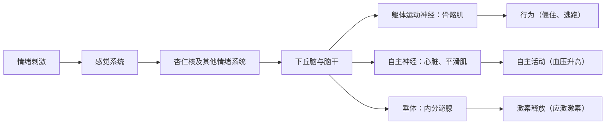

行为由整个神经系统产生，但有几个脑区已成为地标，因为损毁或刺激它们会以显著而特定的方式改变行为。本章讲其中三个，各与一种行为控制相联系：下丘脑与摄食等稳态行为，杏仁核与恐惧及其他情绪反应，前额叶皮层与规划、抑制和社会行为。我们先从比较的问题开始：脊椎动物的脑，以及其他能产生复杂行为的动物的脑，有何不同，以及如何检验脑大小的演化。脊椎动物脑的解剖见 [7.14.7](/7.14.7) 和 [7.17.67](/7.17.67)，皮层的演化见 [7.16.53](/7.16.53)；对饥饿、恐惧、奖赏与工作记忆的计算处理见 [7.16.34](/7.16.34)、[7.16.37](/7.16.37) 和 [7.16.45](/7.16.45)。这里着重讲行为实验、物种之间的比较，以及这些系统如何服务于自然行为。

## 8.1. 脑的比较

### 8.1.1. 共同的脊椎动物蓝图

所有脊椎动物共有同样的主要脑分区，它们源自胚胎神经管的三个初级脑泡：前脑（端脑与间脑）、中脑（含视顶盖）和后脑（小脑、脑桥与延髓）（[7.17.67](/7.17.67#sec-67.3)）。不同类群之间的差别在于这些部分的相对大小，它们随每种生活方式的感觉与运动需求而变化：

| 类群 | 增大的结构 | 行为特化 |
|---|---|---|
| 许多硬骨鱼 | 视顶盖 | 视觉引导的捕食 |
| 象鼻鱼类弱电鱼 | 小脑（瓣）、电感觉叶 | 主动电定位与通讯（[7.18.15](/7.18.15)） |
| 鸟类 | 视顶盖、端脑皮质（pallium）、小脑 | 视觉、飞行、鸣唱学习与认知 |
| 几维鸟、许多哺乳动物 | 嗅球 | 凭气味觅食 |
| 灵长类 | 新皮层，尤其是视觉区与额叶 | 视觉、操作、社会生活 |
| 回声定位的蝙蝠 | 听觉中脑与皮层 | 回声定位（[7.18.12](/7.18.12)） |

比较的问题是脑的各部分是一起演化还是分别演化。一种观点认为，脑区的大小通过发育限制与总脑大小紧密相连，因此对总体大小的选择会以可预测的方式使所有脑区增大，发育晚的脑区如新皮层增长最快（协调演化；Finlay 与 Darlington, 1995）。另一种观点认为，功能系统为响应对特定能力的选择而半独立地演化（**镶嵌演化**；Barton 与 Harvey, 2000）。两者都部分正确：脑区大小的大部分变异可由总脑大小预测，但某些脑区在特定谱系中大幅偏离。躯体感觉皮层中的身体表征在更精细的尺度上显示了第二类变化。在人类中，手与嘴唇占据不成比例的面积；在生活在隧道中、用牙齿挖掘的裸鼹鼠中，门齿占据初级躯体感觉皮层的约三分之一（Catania 与 Remple, 2002），在星鼻鼹中，鼻孔周围的触觉器官占据其主导（[7.16.53](/7.16.53#sec-53.6.3)）。脑适应于物种的感觉世界。

### 8.1.2. 皮层的演化

**新皮层**是哺乳动物的创新；作为一个区域，它与爬行动物三层的背侧皮层同源，并在若干哺乳动物谱系中大幅扩张（[7.16.53](/7.16.53#sec-53.6)、[7.14.46](/7.14.46#sec-46.1)）。鸟类走了另一条路。它们的端脑由以核团而非分层方式组织的端脑皮质（pallium）所主导，长期被误认为纹状体，2005 年根据基因表达和连接被重新命名（[7.14.46](/7.14.46#sec-46.8.3)）。鸟类端脑皮质的特定部分与新皮层的特定部分同源到何种程度仍有争议，但对行为而言的主要结论是清楚的：复杂认知并不需要六层皮层。

### 8.1.3. 通往智力的不同道路

在生命树上相距很远的三类动物演化出了大脑和灵活的行为：灵长类（以及鲸类和象）、鸦科与鹦鹉，以及鞘形亚纲头足类（章鱼、枪乌贼和乌贼）。

*鸦科与鹦鹉*在许多认知任务中与大猿相当：新喀鸦制作并使用钩状工具（[7.18.44](/7.18.44)），西丛鸦记得自己贮藏了什么、在哪里、什么时候（[7.18.42](/7.18.42)）。它们的脑在绝对大小上很小，但端脑皮质中密布小神经元：鹦鹉与鸣禽的端脑皮质神经元数目是同样脑重的灵长类的两到四倍，大型鸦科鸟或金刚鹦鹉的神经元数与猴一样多（Olkowicz et al., 2016）。鸟类的尾外侧巢皮质（nidopallium caudolaterale）所起的作用类似灵长类的前额叶皮层，其神经元在延迟期间保持信息并编码抽象规则。

*章鱼*代表另一种结构。章鱼约有 5 亿个神经元，与狗相当，但其中约三分之二在腕里，位于轴神经索和与每个吸盘相联系的神经节中；围绕食管的中央脑含有其余的大部分，分布在巨大的视叶和一组包括垂直叶（学习中枢）的脑叶中（[7.14.46](/7.14.46#sec-46.8.4)）。腕自己完成了大部分运动计算。伸向目标的腕靠沿其长度传播一个弯曲来完成，同样的弯曲传播在与身体切断的腕中也能被诱发（Sumbre et al., 2001）；章鱼把食物送到嘴边时，柔软的腕形成一个有三段的准关节结构，像有关节的肢体，关节由相撞的肌肉活动波所设定（Sumbre et al., 2005）。中央脑因此只发出高层指令，而腕解决了控制自由度几乎无限的肢体的问题。头足类的皮肤也受神经的直接控制：产生伪装和信号的色素细胞是由脑支配的辐射状肌所扩张的小器官，因此体表花纹能在几分之一秒内改变（[7.18.24](/7.18.24)）。

### 8.1.4. 脑大小与认知：比较检验

脑的质量与体重呈幂律关系，相对脑大小常用**脑化指数**表示（[7.14.46](/7.14.46#sec-46.8.2)）。为什么一些谱系演化出远大于其体型预期的脑？假说分为两组：关于大脑的益处的，以及关于代价的。

**定义 8.1.1（社会脑假说）** **社会脑假说**（social brain hypothesis）提出，大脑的演化主要是对生活在庞大、稳定而复杂的社会群体中的认知需求的响应，这些需求如识别个体、追踪关系、结成联盟和争夺地位（Dunbar, 1998）。

益处一侧的竞争假说强调生态：寻找和处理在时空上呈斑块分布的食物（如成熟的果实）或必须费力取出的食物的需求（生态智力），以及灵活行为在新的或多变的环境中的优势（认知缓冲假说）。比较检验的结果不一：

- 在灵长类中，早期研究发现新皮层的相对大小与群体大小相关。后来对 140 多种灵长类的分析发现，食性（果实所占比例）比社会性的各种度量更好地预测相对脑大小（DeCasien et al., 2017）。
- 在鸟类中，社会复杂性对脑大小预测得很差，但形成长久配偶关系并共同养育幼鸟的物种脑相对较大（Shultz 与 Dunbar, 2010），并且脑大的鸟种被引入新地区时更容易建立种群，正如认知缓冲假说所预测的（Sol et al., 2005）。
- 一项对解决问题的直接检验给出了明确的答案。Benson-Amrama et al.（2016）向动物园中 39 种食肉动物的 140 个个体提供一个放有食物、按其体型缩放的谜题箱。相对体重脑较大的物种更成功地打开箱子，但社会复杂性的度量不能预测成功。
- 有些认知能力是特化的而非一般的。马蜂 *Polistes fuscatus*（paper wasp）的共同创建雌蜂争夺支配地位，并凭可变的面部花纹互相识别，它辨别胡蜂面孔的学习远好于辨别其他图像，而独自筑巢、面孔一致的 *P. metricus* 则不能（Sheehan 与 Tibbetts, 2011；[7.18.45](/7.18.45)）。

这类比较的困难是方法上的。物种不是独立的数据点，因此分析必须使用带系统发育校正的**比较方法**（[7.10.26](/7.10.26)）；社会性与食性难以在同一尺度上度量；脑质量是神经元数目的粗略代理，而脑质量相同的类群之间神经元数目不同；并且不同物种的"认知"是用不同的任务测量的。

在代价一侧，神经组织是身体最昂贵的组织之一（[7.14.46](/7.14.46#sec-46.7)）：人脑约占体重的 $2\,\%$，却消耗约 $20\,\%$ 的静息代谢率。

**定义 8.1.2（昂贵组织假说）** **昂贵组织假说**（expensive-tissue hypothesis）提出，由于一个物种的基础代谢率大致由其体重固定，一个代谢上昂贵的器官即脑的增大，必须由另一个器官（主要是肠）的缩小来补偿；在人类中，脑的增大是由更小的肠实现的，并由更高质量的食物所支撑（Aiello 与 Wheeler, 1995）。

该假说预测物种之间脑大小与肠大小呈负相关。对 100 种哺乳动物的比较没有发现这种相关，但发现脑大的物种储存的脂肪较少，所以这种权衡若存在，可能涉及其他器官或能量储备（Navarrete et al., 2011）。另一种可能是脑大的物种增加了其总能量预算：用双标水测得，人类的总能量消耗高于其他大猿，这容纳了更大的脑、更快的生殖和更长的寿命（代谢率假说；Pontzer et al., 2016）。

最直接的检验是实验性的。Kotrschal et al.（2013）对孔雀鱼（*Poecilia reticulata*）按相对于体型的大脑和小脑选择；两代之后，两个品系的脑大小相差约 $9\,\%$。脑大的雌鱼在数量学习任务中表现更好，该任务要求它们学会两组符号中哪一组与食物相联系。但脑大的鱼肠更小，产的后代更少，正如昂贵组织假说所预测的。这个实验在同一个物种内显示了较大脑的认知益处与能量代价，这是比较研究跨物种推断的权衡的两个方面。

## 8.2. 下丘脑与稳态行为

### 8.2.1. 损毁、刺激与双中枢模型

**下丘脑**（[7.16.34](/7.16.34#sec-34.2)）是间脑底部的一个小区域，控制垂体和自主神经系统，并含有摄食、饮水、体温调节、性行为、亲代行为和攻击的回路（[7.16.36](/7.16.36)）。它在行为中的作用是通过损毁与电刺激发现的。

双侧损毁腹内侧下丘脑（VMH）使大鼠暴食并变得肥胖（Hetherington 与 Ranson, 1940），损毁外侧下丘脑（LH）使它们停止进食和饮水，有时直至死亡（Anand 与 Brobeck, 1951）。这些结果导致了双中枢模型：LH 中有**摄食中枢**，VMH 中有**饱中枢**（[7.14.30](/7.14.30#sec-30.4.2)）。行为分析很快表明，受损动物并非只是更饿或更不饿：

- *VMH 损毁的大鼠挑食。* 它们对适口的食物暴食，但当食物被奎宁弄苦时比正常大鼠吃得少，并且为食物付出的努力也少：当必须按压杠杆或抬起加重的盖子才能得到食物时，它们吃得比对照少（Miller、Bailey 与 Stevenson, 1950；Teitelbaum, 1955）。在体重增加的动态期之后，它们稳定在较高的体重（静态期）并捍卫它；若被强制喂食超过这一体重，它们就吃得少，若被饿到低于这一体重，就吃得多。损毁改变的是体重被调节的水平以及动物对食物味道的反应性，而不是消除了饱足。
- *LH 损毁的大鼠分阶段恢复。* 经过精心护理，它们在数周内恢复，先接受湿的适口食物，然后是干食物，最后是水（Teitelbaum 与 Epstein, 1962），但它们对葡萄糖剥夺等紧急情况的反应仍然不足。它们的缺陷比摄食更广：它们不活动，对一般感觉刺激没有反应。LH 的电解损毁还切断了穿行其中的黑质纹状体多巴胺通路的轴突，在别处选择性破坏这一通路会产生类似的进食和饮水丧失（Ungerstedt, 1971）。因此 LH 综合征的一部分是多巴胺所提供的动机性激活的丧失（[7.18.7](/7.18.7)）。

电刺激给出了互补的图景。Walter Hess（二十世纪二十至四十年代）通过刺激下丘脑的位点，在清醒的猫中引发了协调的行为（[7.14.46](/7.14.46#sec-46.6)），后来的研究从不同位点区分出两种攻击：来自内侧下丘脑的情感性防御，伴有嘶叫、竖毛和交感反应；以及来自外侧下丘脑的安静的咬杀攻击，即潜行并杀死大鼠（Flynn, 1967）。刺激的效果取决于有什么可用：Valenstein（1968）发现，经 LH 电极刺激而引发进食的大鼠，若移走食物、提供水，会对同样的刺激开始饮水，此后即使食物放回也饮水。因此下丘脑刺激常常激活一种一般的唤醒状态，它被导入环境和动物的经历所提供的任何行为，而不是固定的行为。现代遗传学方法通过靶向确定的细胞类型来消除这种含糊：光遗传学激活弓状核的 AgRP 神经元使吃饱的小鼠狼吞虎咽，激活 VMH 一个亚区中表达雌激素受体的神经元则引发攻击（[7.16.34](/7.16.34)、[7.16.36](/7.16.36)）。

### 8.2.2. 并体联生与瘦素的发现

如果下丘脑调节体重，它就必须被告知身体的能量储备。Kennedy（1953）提出脂肪储备由一种循环因子来传递信号，而并体联生，即把两只动物手术连在一起使它们的血液循环混合，检验了这一想法。Hervey（1959）把 VMH 损毁的大鼠与完好的伙伴连在一起：受损大鼠变得肥胖，而它们完好的伙伴吃得少并变瘦。肥胖大鼠显然在按其脂肪的比例产生一种饱足信号，它们自己不能对其作出反应，而它们的伙伴可以。

Coleman（1973）用两个因单个隐性突变 *ob*（肥胖）和 *db*（糖尿病）而肥胖的小鼠品系做了同样的实验，其结果精确定位了缺陷（[7.14.30](/7.14.30#sec-30.4.5)）：

| 配对 | 结果 | 解释 |
|---|---|---|
| *ob/ob* 与正常鼠相连 | *ob* 小鼠吃得少并减轻体重 | *ob* 小鼠缺乏该因子，并从伙伴处获得 |
| *db/db* 与正常鼠相连 | 正常小鼠停止进食并饿死；*db* 小鼠保持肥胖 | *db* 小鼠产生大量该因子，却不能对其作出反应 |
| *ob/ob* 与 *db/db* 相连 | *ob* 小鼠饿死 | *db* 小鼠提供该因子，*ob* 小鼠能感受到它 |

Zhang et al.（1994）克隆了 *ob* 基因，并把它的产物命名为**瘦素**（[7.1.29](/7.1.29)）；*db* 编码瘦素受体，在弓状核及其他下丘脑区域表达。瘦素由脂肪细胞按脂肪量的比例分泌，在患有先天性瘦素缺乏症（极端肥胖的罕见病例）的儿童和成人中，注射瘦素减少食物摄入和体重，恢复青春期，并改变与食物有关的行为（Farooqi et al., 1999；Licinio et al., 2004）。然而大多数肥胖者的瘦素水平很高，对额外的瘦素反应很差（瘦素抵抗），并且该系统抵御体重下降比抵御体重增加更强。

**例 8.2.1（并体联生的反馈模型）** 设每只小鼠 $i$ 的脂肪量为 $F_i$，血浆瘦素浓度为 $L_i$。瘦素按脂肪量的比例以速率常数 $s_i$ 分泌（*ob/ob* 小鼠 $s_i = 0$），以速率常数 $c$ 清除，并在相连的循环之间以速率常数 $q$ 交换（未相连的小鼠 $q = 0$）。若有受体，食物摄入随瘦素下降；若没有受体，则摄入最大（*db/db* 小鼠 $\rho_i = 0$）。设能量消耗等于基础速率加上正比于脂肪量的项，则
$$
\begin{aligned}
\frac{\mathrm{d}L_i}{\mathrm{d}t} &= s_i F_i - c\,L_i + q\,(L_j - L_i),\\
\frac{\mathrm{d}F_i}{\mathrm{d}t} &= \eta\left(\frac{I_{\max}}{1 + \rho_i\,(L_i/K)^n} - E_0 - k F_i\right),
\end{aligned}
$$
其中 $I_{\max}$ 为最大摄入，$K$ 为使摄入减半的瘦素浓度，$n$ 为 Hill 系数。正常小鼠的稳态由摄入等于消耗之处决定，此时的脂肪量使瘦素接近 $K$。在 *ob/ob* 小鼠中，$L = 0$，摄入保持最大，脂肪增加直到消耗赶上，达到高得多的稳态。在 *db/db* 小鼠中，摄入同样最大，因此同样肥胖，但它按其大量的脂肪成比例地分泌瘦素。

把 *db/db* 小鼠与正常小鼠相连，使正常小鼠暴露于 *db* 伙伴的高瘦素：它的摄入降到消耗之下，脂肪量向零下降，而对瘦素不敏感的 *db* 小鼠保持肥胖。把 *ob/ob* 小鼠与正常小鼠相连，使 *ob* 小鼠从伙伴处得到瘦素，它的脂肪量下降。当瘦素动态相对于脂肪动态较快时，稳定的瘦素水平可由第一个方程得出。对图中的参数，正常小鼠稳定在 $F \approx 5.8$，*ob/ob* 或 *db/db* 小鼠稳定在 $F = (I_{\max} - E_0)/k = 25$。在 *db/db*–正常对中，即使正常小鼠自身的脂肪消失，它的瘦素仍趋近 $L \approx 8.3 + \tfrac{2}{3}F$，这使其摄入（$\le 0.35$）低于其基础消耗（$0.5$）：它挨饿。对 *ob/ob*–*db/db* 对做同样的计算，*ob* 小鼠的瘦素水平约为 $8.3$，命运相同。

:::

### 8.2.3. 行为作为稳态控制的一部分

生理调节常被描述为向调定点的**负反馈**（[7.14.1](/7.14.1)），但许多稳态控制是行为性的：动物通过进食调节能量平衡，通过饮水和寻找盐调节水平衡，通过选择所处位置调节体温。沙漠蜥蜴通过在日照与阴凉之间移动并改变姿势，把体温保持在几度范围内；变温动物感染后移向更暖的地方并升高体温（行为性发热）；许多啮齿动物筑巢并在寒冷中挤在一起。这些行为是有动机的：动物在需要时为获得热或水而付出努力，食物、水和温暖的奖赏价值取决于缺乏程度（[7.18.7](/7.18.7)）。**驱力**概念（[7.18.3](/7.18.3)）是将这一联系形式化的早期尝试；现代研究把它定位在可辨认的神经元上。例如，发出饥饿信号的 AgRP 神经元，在饥饿的小鼠看到或闻到食物时、在进食之前几秒内就被抑制，仿佛预测到缺乏即将得到纠正，并且它们的活动是厌恶性的，所以动物学会进食以摆脱它（[7.16.34](/7.16.34#sec-34.3.3)）。

被捍卫的水平并不固定。迁徙之前，鸟类吃得远超所需，几周内脂肪使体重翻倍（[7.18.20](/7.18.20)）；冬眠的哺乳动物在秋天长肥，然后在蛰伏中捍卫较低的体温；孵卵的帝企鹅禁食数月（[7.14.30](/7.14.30#sec-30.6)）。Mrosovsky（1990）把这类受调节水平的程序化变化称为*变稳态*（rheostasis）：调节与普通稳态一样精确，但水平本身随季节、生活阶段或环境而变化。用行为生态学的话说，动物的状态，即它的脂肪储备，决定何时进食、进食多少的最优决策，而自然选择设定下丘脑所捍卫的水平（[7.18.23](/7.18.23)）。

## 8.3. 杏仁核与恐惧

### 8.3.1. 一位无畏的患者

**杏仁核**（[7.16.37](/7.16.37#sec-37.2.2)）是内侧颞叶中的一组核团。双侧损毁包括杏仁核在内的颞叶的猴子，失去对蛇和人的恐惧，用嘴检查物体，并表现出不加区分的性行为（Klüver–Bucy 综合征；[7.14.46](/7.14.46#sec-46.6)）。在人类中，最清楚的证据来自一位名叫 S. M. 的女性，她患有 Urbach–Wiethe 病，这是一种罕见的遗传病，在她身上使两侧杏仁核钙化，而周围组织未受损。

- S. M. 无法识别他人面部表情中的恐惧，尽管她对其他情绪和身份的识别正常，而且她不能画出恐惧的脸（Adolphs et al., 1994）。
- 她在摆弄活蛇和蜘蛛（她曾说不喜欢它们）时、或走过"鬼屋"时，都没有恐惧，并且在三个月的每日日记取样中，她几乎没有报告过恐惧。她曾被人用刀和枪指着抢劫而没有表现出恐惧；她还过于轻易地接近陌生人，不保持正常的人际距离（Feinstein et al., 2011）。
- 然而当她吸入富含二氧化碳的空气产生窒息感时，她确实会感到恐惧和惊恐（Feinstein et al., 2013）。杏仁核是对外部威胁的恐惧所必需的，但不是由内部的、内感受信号产生的恐惧所必需的，后者由脑干和其他回路产生。

在健康人中，功能成像显示杏仁核对恐惧的面孔有反应，即使它们呈现得太短暂而无法被意识到（Whalen et al., 1998）。成像研究的元分析发现，杏仁核最可靠地被恐惧与厌恶的面孔激活，但也被快乐的面孔和其他有情绪意义的刺激激活；它最好被描述为刺激生物学相关性的检测器，带有对威胁的偏向，而不是"恐惧中枢"。

### 8.3.2. 恐惧条件反射与两条路径

**恐惧条件反射**（[7.16.37](/7.16.37#sec-37.2)）是习得性恐惧的标准实验室模型：与轻微电击配对的音调，最终引发僵住。其回路主要由 LeDoux、Davis 和 Fanselow 阐明，联结位点在外侧杏仁核，输出在中央杏仁核。听觉信息通过两条路径到达外侧杏仁核。来自听丘脑的直接路径很快（在大鼠中约 $12\,\mathrm{ms}$），但只携带声音的粗略表征；经过听皮层的间接路径较慢，但携带详细的表征。LeDoux 称之为"低路"和"高路"。低路允许对任何可能危险的事物作出快速的、暂时的反应；高路允许在刺激被识别之后确认或取消这一反应。听皮层损毁的大鼠仍可以通过低路对音调形成条件反射，但它们不能学会区分两个相似的音调，其中只有一个预示电击。

快速而粗略的警报的逻辑，在人类经验中并不陌生。汉代史学家司马迁在《史记》中讲到，将军李广出猎，见草中一块石头，以为是虎，一箭射去，箭镞没入石中。他看出那是石头之后，再射，箭就再也射不进去了。一个对草丛中条纹状形状立即作出反应的系统，有时会对石头作出反应，但相反的错误，即忽略一只真正的老虎，代价要大得多。Nesse（2005）把这称为烟雾报警器原理：当误报的代价小、漏报威胁的代价大时，最优的检测器会有很多误报。这一原理源自**信号检测论**（[7.16.47](/7.16.47)）。

**例 8.3.1（不对称代价与最优警报阈值）** 设感觉变量 $x$ 服从方差为 1 的正态分布，没有捕食者时均值为 $0$，有捕食者时均值为 $d'$。动物在 $x > x_c$ 时逃跑。误报（没有捕食者而逃跑）的代价为 $C_{\mathrm{FA}}$，漏报（对捕食者不逃跑）的代价为 $C_{\mathrm{M}}$，捕食者在场的先验概率为 $\pi$。期望代价为
$$
C(x_c) = (1 - \pi)\,C_{\mathrm{FA}}\,\bigl[1 - \Phi(x_c)\bigr] + \pi\,C_{\mathrm{M}}\,\Phi(x_c - d'),
$$
其中 $\Phi$ 是标准正态分布函数。令 $\mathrm{d}C/\mathrm{d}x_c = 0$，得到最优判据，在该处两个假设的似然比等于 $(1 - \pi)C_{\mathrm{FA}}/(\pi C_{\mathrm{M}})$：
$$
x_c^* = \frac{d'}{2} + \frac{1}{d'}\ln\frac{(1 - \pi)\,C_{\mathrm{FA}}}{\pi\,C_{\mathrm{M}}}.
$$
取 $\pi = 0.05$，$C_{\mathrm{M}} = 100$（死亡或受伤），$C_{\mathrm{FA}} = 1$（被打断的一餐），则对数为 $\ln(0.95/5) \approx -1.66$。对粗略的信号（$d' = 1$），$x_c^* \approx -1.2$：动物在大多数没有捕食者的场合也应当逃跑（误报率为 $1 - \Phi(-1.2) \approx 0.88$）。对详细的信号（$d' = 3$），$x_c^* \approx 0.95$，误报率约 $0.17$，漏报率约 $0.02$。

:::

这个模型说明了为什么快速但质量差的通道应当偏向警报，以及为什么增加一条较慢而更好的通道是值得的，它在有时间时可以取消误报。在自然界中，速度与准确性之间的权衡还取决于威胁的距离：捕食者越近，留给高路的时间越少，这是逃避决策取决于逼近的捕食者的距离与速度的原因之一（[7.18.24](/7.18.24)）。在视觉皮层很快的灵长类中，单独的皮层下通路有多重要，已受到质疑（Pessoa 与 Adolphs, 2010），但计算上的论证并不依赖解剖。

### 8.3.3. 从情绪到效应器

情绪刺激产生三类反应，通过下丘脑与脑干协调：骨骼肌执行的躯体反应（僵住、逃跑、面部表情），自主反应（血压与心率升高），以及内分泌反应（通过**下丘脑–垂体–肾上腺轴**释放应激激素；[7.18.19](/7.18.19)）。

产生哪种防御行为取决于威胁有多近。Fanselow 与 Lester（1988）描述了捕食迫近连续体。当尚未发现捕食者但所处之地有风险时（遭遇前），动物改变觅食，更少离开巢穴，一次吃得更多；当在远处发现捕食者时（遭遇后），它们僵住，以减少被看到的机会；当捕食者即将攻击时（攻击时），它们逃跑、跳起或战斗。中脑导水管周围灰质的不同部分组织这些反应：其腹外侧柱产生僵住，背外侧柱与外侧柱产生主动的逃跑与战斗。同样的分级组织也出现在恐惧生态学中，动物根据对每个地点所感知的风险，在觅食与安全之间权衡（[7.18.23](/7.18.23)）。

## 8.4. 前额叶皮层

### 8.4.1. 解剖、连接与演化

额叶约占人类大脑皮层的三分之一。后面是控制运动的运动区和运动前区；在它们前面是前额叶皮层。

**定义 8.4.1（前额叶皮层）** **前额叶皮层**（prefrontal cortex）是前部额叶的皮层，位于运动前区的头端，在解剖上以其与丘脑背内侧核的往返连接来定义；在灵长类中它包括背外侧、腹外侧、眶部和内侧（包括前扣带）区域，它关系到按目标、规则和情境控制行为。

前额叶皮层是皮层中连接最密集的区域：它与顶叶和颞叶的感觉联合区、运动与运动前皮层、边缘结构（杏仁核、海马和下丘脑）相连，并通过丘脑与基底神经节和小脑相连。"所有神经通路最终都通向额叶"，用 Kolb 与 Whishaw 的话说；这种处于感知与行动层级顶端的位置，适合一个协调其他区域而不是处理某一类信息的区域。

所有哺乳动物都有额叶皮层，但前额叶皮层的范围及其同源性各不相同。有明显第 IV 层的颗粒性背外侧前额叶皮层只见于灵长类；啮齿动物有无颗粒的内侧与眶部额区，它们与灵长类前额叶区域有某些共同的连接和功能，同源到何种程度尚有争议（Laubach et al., 2018）。人类的额叶很大，但相对于脑的其余部分，它的大小与脑大小同人类的大猿所预期的差不多（Semendeferi et al., 2002）；可能超出预期而增大的是特定的区域，如额极，以及连接前额叶皮层与其他区域的白质体积。因此，常说的额叶与脑的比例"在人类中最大"，在粗略比较中成立，但在考虑异速生长之后则不成立。

前额叶皮层是皮层中最后成熟的部分。在纵向成像研究中，皮层灰质在儿童期变厚，然后随着突触被修剪和髓鞘化的继续而变薄；变薄从脑的后部扫向前部，直到二十岁出头才在背外侧前额叶皮层完成（Gogtay et al., 2004；Lenroot 与 Giedd, 2006）。前额叶控制的缓慢成熟，是青少年高度寻求新奇和冒险的一种解释，这一模式在青春期的啮齿动物和灵长类中也能见到，在那里它可能服务于该生活阶段典型的探索与扩散（[7.18.26](/7.18.26)）。

### 8.4.2. 功能与损伤

前额叶皮层受损，感觉、运动和标准测验所测的一般智力基本保持完好，但行为的组织受到破坏：

| 功能 | 前额叶受损后的缺陷 | 测验例子 |
|---|---|---|
| 规划与多任务 | 无法组织日常生活中的多步任务 | 真实购物街上的多项任务测验（Shallice 与 Burgess, 1991） |
| 灵活性 | 持续症：在规则不再有效之后仍继续使用它 | Wisconsin 卡片分类（Milner, 1963） |
| 反应抑制 | 无法抑制优势反应 | Go/no-go、Stroop |
| 工作记忆 | 无法在延迟期间保持并使用信息 | 延迟反应（8.4.3 节） |
| 延迟满足 | 选择小的即时奖赏而非大的延迟奖赏 | 延迟折扣 |
| 社会行为与人格 | 冲动、判断力差、社交不当 | Iowa 赌博任务 |

经典病例是 Phineas Gage，一位铁路工头，1848 年一根铁棍穿过他的左额叶而幸存；他的医生报告说他变得冲动而不可靠，"不再是 Gage"（Harlow, 1868），尽管后来的历史研究提示他恢复得相当好，并做了多年马车夫。腹内侧前额叶皮层受损的患者在 Iowa 赌博任务中做出不利的选择，坚持选择赢得多但输得更多的牌堆，并且没有表现出健康人在从有风险的牌堆中选择之前发展出的预期性皮肤电反应（Bechara et al., 1994）。Damasio 的躯体标记假说把这些反应解释为引导决策的价值的身体信号；眶额与腹内侧皮层同杏仁核的相互作用被认为提供了这类信号。额叶的历史也包含一个警示：前额叶白质切断术（脑叶切除术）于 1935 年提出，使其发明者获得 1949 年诺贝尔奖，在它对人格和主动性的毁灭性影响使其被放弃之前，数以万计的患者被切除了脑叶（[7.18.1](/7.18.1)）。

### 8.4.3. 工作记忆

**工作记忆**（[7.16.45](/7.16.45)）是把信息保持数秒、并在思维与行动中使用或操作它的能力。它在动物中的研究始于延迟反应任务：猴子看着食物被放到两个杯子之一下面，随后放下屏幕造成延迟，然后猴子选择一个杯子。Jacobsen（1936）发现，前额叶损毁的猴子在有延迟时任务失败，而能立即选择时则不会；后来的工作表明，局限于主沟周围背外侧前额叶皮层的损毁就足够了，而且同样的猴子学习视觉辨别和联想是正常的。在该任务的眼动版本的记录中，Goldman-Rakic 及其同事在这一区域发现了这样的神经元：当被记住的目标位于特定位置时，它们在整个延迟期间放电，这就是该神经元的"记忆野"，并且它们的活动在错误试次中失效（[7.16.45](/7.16.45#sec-45.2)）。

工作记忆在自然界中的行为功能在觅食与导航中显而易见：在斑块中搜寻的动物必须记住它已经访问过哪些地方，捕食者必须追踪消失在掩体后的猎物。在乌鸦的尾外侧巢皮质中发现了类似的延迟活动，提示同样的计算在鸟类的端脑皮质中独立演化出来（8.1.3 节）。

### 8.4.4. 自然社会行为中的额叶皮层

对前额叶皮层的研究传统上使用受束缚的、执行训练任务的动物。最近的研究表明，当在自然的社会互动中记录同一区域时能学到什么，这正是神经行为学的纲领（[7.18.6](/7.18.6)）。

Kingsbury et al.（2019）对自由互动的成对小鼠的背内侧前额叶皮层神经元的活动成像。一些神经元编码动物自己的行为，另一些编码伙伴的行为，两个脑的活动在互动期间变得相关，因为每个脑既表征共同的行为，又表征伙伴的动作。相关的强度取决于两只小鼠之间的支配关系（用管测试测定），并预测它们以后将如何互动。

Rose et al.（2021）对成群生活、像在栖息处那样自发发声的埃及果蝠（*Rousettus aegyptiacus*）的额叶皮层进行无线记录。许多神经元对蝙蝠自己或他者发出的声音作出反应，区分自我与他者；许多神经元对不同个体的叫声反应不同，因此可以从群体活动中解码叫声者的身份。这样的表征正是社会性动物在嘈杂的群体中追踪谁在和谁交流所需要的，而向受束缚的动物回放叫声是发现不了它的。这些研究回到了神经行为学的起点：一个脑区回答什么问题，最好通过观察它为之演化的行为来发现。

## 小结

- 脊椎动物共有主要的脑分区；相对大小随生活方式而变（8.1.1 节）。脑区大小在很大程度上随总脑大小缩放，同时有某些独立的变化（**镶嵌演化**）；皮层中的身体图谱放大最常用的感觉器官。
- 复杂认知在组织不同的脑中演化出来：鸦科与鹦鹉密集排列的端脑皮质，以及章鱼分布式的神经系统，其神经元的三分之二在腕里。
- 关于大脑的假说涉及益处（社会脑假说，定义 8.1.1；生态与认知缓冲假说）和代价（昂贵组织假说，定义 8.1.2；代谢率假说）。比较检验结果不一；孔雀鱼的人工选择同时证明了较大脑的认知益处与能量代价。
- **下丘脑**：VMH 损毁产生挑食性肥胖和被捍卫体重的升高，LH 损毁产生进食丧失和一般激活的丧失（部分是由于损伤多巴胺纤维）；刺激引发被环境导入的状态。并体联生（Hervey；Coleman）揭示了**瘦素**，例 8.2.1 的反馈模型重现了这些结果。许多稳态是行为性的，被捍卫的水平随季节变化（变稳态）。
- **杏仁核**是对外部威胁的恐惧所必需的（患者 S. M.），但对内感受性恐惧并非必需。**恐惧条件反射**使用快而粗略的低路和较慢的高路；在代价不对称时，最优警报偏向误报（例 8.3.1，烟雾报警器原理）。情绪反应是躯体的、自主的与内分泌的；防御行为遵循捕食迫近连续体。
- 前额叶皮层（定义 8.4.1）是连接最密集的皮层区域，也是最后成熟的；它受损会损害规划、灵活性、抑制、**工作记忆**与社会行为。自由互动的小鼠与蝙蝠的额叶皮层表征自我、他者和社会关系。

## 思考题

1. S. M. 的杏仁核被破坏了，但她在呼吸富含二氧化碳的空气时会惊恐。这说明恐惧的组织是怎样的？

   **答** 恐惧不是由单一中枢产生的。杏仁核是检测并响应外部威胁所必需的，这些威胁通过感觉系统和习得的联想被识别（面孔、蛇、危险情境），但由身体自身发出信号的威胁（窒息，由脑干及其他部位对二氧化碳和酸度敏感的化学感受器检测）可以通过其他回路，包括脑干与下丘脑的回路，产生恐惧与惊恐。杏仁核甚至可能在正常情况下抑制这种内感受性惊恐。因此恐惧更适合看作一组输入不同、汇聚到共同效应器通路的防御系统。

2. 利用例 8.3.1，最优逃跑判据应当怎样变化：(a) 在捕食者更少的生境中，(b) 对能量储备充足、被打断一餐代价很小的动物，(c) 当信号变得更可靠时？把答案与观察到的反捕食行为联系起来。

   **答** (a) 更小的 $\pi$ 使对数项变大，所以 $x_c^*$ 升高：动物应当不那么神经过敏。例如，无捕食者岛屿上的动物常常有很短的逃跑起始距离。(b) 更小的 $C_{\mathrm{FA}}$ 使 $x_c^*$ 降低：吃饱的动物承担得起更容易逃跑，而饥饿的动物应当容忍更多风险，正如许多觅食研究中所观察到的（[7.18.23](/7.18.23)）。(c) 更大的 $d'$ 使最优判据移向两个分布的中点（$d'/2$），而对数项除以 $d'$ 的影响变小：有了好的信息，动物承担得起更平衡的阈值，误报与漏报都更少。这就是高路的优势。

3. 在 Hervey 的实验中，VMH 损毁的大鼠与完好的伙伴相连，变得肥胖，伙伴则变瘦。用例 8.2.1 的反馈模型解释这一结果。VMH 损毁改变了哪个参数？

   **答** VMH 损毁使受损大鼠对饱足信号不敏感，在模型中相当于降低受损大鼠的 $\rho$（或提高 $K$）：它的摄入保持很高，脂肪量上升。它的脂肪按脂肪量的比例分泌瘦素，所以它的瘦素水平升高，并且通过相连的循环交换，升高了完好伙伴的瘦素，后者的受体反应正常：伙伴的摄入降到消耗之下，失去脂肪。因此受损大鼠的表现像 Coleman 实验中的 *db/db* 小鼠，这提示该信号的受体在 VMH 区域或其附近（现已知包括弓状核）。

4. 设计一项比较研究，检验鸟类的脑大小更好地由社会复杂性还是由觅食需求来预测。主要的陷阱是什么？

   **答** 收集来自若干独立谱系的许多物种的脑质量（或更好地，端脑皮质神经元数目）和体重；定义社会复杂性的度量（群体大小、群体的稳定性、合作繁殖、配偶关系持续时间）和觅食需求的度量（食性广度、对费力取食或斑块状、短暂食物的依赖、食物贮藏）；尽可能用标准化任务测量各物种的认知表现。用系统发育比较方法分析，把体型作为协变量，并比较含社会与生态预测变量的模型。陷阱：系统发育非独立性；预测变量之间的相关（社会性的物种可能也以特定方式觅食）；取自文献的行为变量的测量误差；以脑质量作为神经元的代理；以及混淆相关与因果（大脑可能使社会性成为可能，而不是被它选择出来）。实验演化与种内比较，如孔雀鱼的选择实验，可以补充比较方法。

5. 如果青少年冒更多风险，自然选择为什么可能偏好成熟较晚的前额叶皮层？

   **答** 成熟较晚可能是构建一个庞大、高度连接、其布线靠经验精修的区域的副产品，这需要时间；由多年社会与生态经验塑造的前额叶皮层，在成年期对行为的控制可能好于早早定型的。此外，青春期的冒险与寻求新奇本身可能就是适应性的：在许多哺乳动物中，青春期是离开出生群体扩散、探索新环境以及争夺配偶与地位的时期，所有这些都需要愿意冒险（[7.18.26](/7.18.26)）。代价是事故与危险选择的比率更高，但这一代价可能被探索以及缓慢建成的灵活控制系统的益处所抵消。
