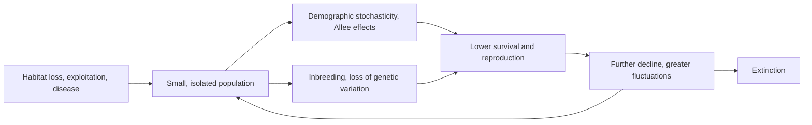

Deterministic models say that a population with a positive growth rate and a finite **carrying capacity** persists forever, however small it is. Real populations consist of a whole number of individuals, each of which lives or dies, breeds or fails, by chance, and they live in environments that vary from year to year. For large populations these random events average out, which is why the deterministic theory of [7.19.10](/7.19.10)–[7.19.14](/7.19.14) works; for small populations they decide whether the population survives. This chapter develops the theory of extinction in three steps: chance events affecting individuals (demographic stochasticity, Section 15.1), chance events affecting the whole population (environmental stochasticity and catastrophes, Section 15.2) and their interaction with **Allee effects** (Section 15.3). It then turns to the practice of conservation: the two paradigms of conservation biology, the extinction vortex and minimum viable populations (Section 15.4), and population viability analysis (Section 15.5). The mathematics builds on the **birth–death process** and the **Galton–Watson process** of [7.5.36](/7.5.36), on Markov chains and diffusions ([3.1](/3.1)) and on the matrix models of [7.19.14](/7.19.14); the genetic threats to small populations are developed in [7.19.20](/7.19.20).

## 15.1. Demographic Stochasticity

### 15.1.1. Two Kinds of Chance

**Definition 15.1.1 (Demographic and Environmental Stochasticity)** *Demographic stochasticity* is the random variation in population growth that arises because the births, deaths and sexes of individuals are independent chance events, even when every individual has the same probabilities. *Environmental stochasticity* is the random variation in population growth caused by changes in the environment that alter the birth and death probabilities of all individuals in a population together (weather, food supply, disease outbreaks). Rare extreme events that kill a large fraction of a population at once (fires, floods, epidemics) are called *catastrophes*, an extreme form of environmental stochasticity.

The two differ in how they scale with population size. If each of $N$ individuals contributes independently a random number of offspring with variance $\sigma_d^2$, the per capita growth rate of the population has variance $\sigma_d^2/N$, which vanishes for large $N$. An environmental fluctuation changes everyone's rates together, so its contribution $\sigma_\mathrm{e}^2$ to the variance of the per capita growth rate does not depend on $N$. Combining both (Lande, Engen and Sæther 2003),

$$
\operatorname{Var}\left(\frac{\Delta N}{N}\,\Big\vert\,N\right) \approx \sigma_\mathrm{e}^2 + \frac{\sigma_d^2}{N},
\tag{15.1}
$$
so demographic stochasticity dominates when $N < \sigma_d^2/\sigma_\mathrm{e}^2$. For birds and mammals, $\sigma_d^2$ is typically of order 0.5 and $\sigma_\mathrm{e}^2$ of order 0.01–0.1, so demographic stochasticity is important below a few tens of individuals and negligible above a few hundred. The fate of the heath hen (*Tympanuchus cupido cupido*), once common from Maine to Virginia, illustrates the sequence. Gone from the mainland by about 1830 and restricted to the island of Martha's Vineyard, it recovered from about 50 birds in 1908 to several thousand by 1915 in a reserve; then a fire, a hard winter with many goshawks, and poultry disease (environmental events and catastrophes) reduced it to a few dozen, and demographic chance finished it: of 13 birds in 1928 only two were females, and the last bird died in 1932.

### 15.1.2. The Linear Birth–Death Process

The simplest model of demographic stochasticity is the linear birth–death process ([Definition 36.4.1](/7.5.36#def-36.4.1) of 7.5.36): each individual independently gives birth at rate $b$ and dies at rate $d$. Its mean grows as $\mathbb{E}[N(t)] = N_0\mathrm{e}^{(b-d)t}$, the deterministic exponential model, but individual realizations can die out (Figure 1A).

**Theorem 15.1.1 (Extinction Probability of the Linear Birth–Death Process)** Let $N(0) = N_0$. If $b \le d$ the population goes extinct with probability 1. If $b > d$ its **extinction probability** is

$$
\mathbb{P}(\text{extinction}) = \left(\frac db\right)^{N_0},
\tag{15.2}
$$
and otherwise $N(t) \to \infty$.

**Proof** Look only at the sequence of states visited (the embedded jump chain). From state $n \ge 1$ the next event is a birth with probability $p = bn/(bn + dn) = b/(b + d)$ and a death with probability $q = d/(b + d)$, independently of $n$: the chain is a simple random walk absorbed at 0, the classical gambler's ruin. Let $h_n$ be the probability of ever reaching 0 from $n$. Then $h_0 = 1$ and $h_n = ph_{n+1} + qh_{n-1}$ for $n \ge 1$, whose solutions are $h_n = \alpha + \beta(q/p)^n$. The probability of reaching 0 before a level $M$ is the solution with $h_M = 0$, namely $h_n^{(M)} = \bigl((q/p)^n - (q/p)^M\bigr)/\bigl(1 - (q/p)^M\bigr)$ when $p \ne q$; letting $M \to \infty$ gives $h_n = (q/p)^n = (d/b)^n$ if $p > q$ and $h_n = 1$ if $p < q$. For $p = q$ the solution is $h_n^{(M)} = 1 - n/M \to 1$. Since the jump chain of a surviving population cannot stay bounded without reaching 0 (from any state below $M$, 0 is reached with probability at least $q^M$ in at most $M$ steps), survival means $N \to \infty$. $\square$

Alternatively, extinction requires that each of the $N_0$ independent founding lineages dies out, and [Corollary 36.4.1](/7.5.36#cor-36.4.1) of 7.5.36 gives $d/b$ for one lineage. Three consequences matter for conservation (Figure 1).

- Extinction is likely even for growing populations: with $b = 1$ and $d = 0.8$ (a mean growth rate of 20 % per unit time), a single founder dies out with probability $0.8$, and five founders with probability $0.33$.
- The risk falls geometrically with $N_0$: founding or reintroduced populations need enough individuals. With $d/b = 0.8$, reducing the extinction probability below 1 % requires $N_0 \ge 21$.
- Extinction, if it happens, happens early. The probability of extinction by time $t$, $P_0(t)^{N_0}$ with $P_0(t)$ from [Theorem 36.4.1](/7.5.36#thm-36.4.1) of 7.5.36, approaches its limit within a few multiples of $1/(b - d)$; a population that has grown large is safe from demographic accidents.

For populations with discrete generations, the corresponding model is the Galton–Watson branching process ([7.5.36](/7.5.36#thm-36.4.3)): each individual leaves a random number of offspring with probability generating function $f(x)$, and the extinction probability per founder is the smallest root of $q = f(q)$ in $[0, 1]$, which is less than 1 if and only if the mean offspring number $R_0 = f'(1)$ exceeds 1 (with $\mathbb{P}(\text{one offspring}) < 1$). For Poisson offspring with mean $R_0$, $q = \mathrm{e}^{R_0(q - 1)}$; with $R_0 = 1.25$ this gives $q = 0.63$ per founder, less than the $0.80$ of the birth–death process with the same $b/d$ (Figure 1B). The difference shows that the variance of reproductive success, not only its mean, controls the risk: in the birth–death process the number of offspring of an individual over its lifetime is geometric, with variance $R_0(R_0 + 1)$, larger than the Poisson variance $R_0$.

![Demographic stochasticity in the linear birth–death process (b = 1, d = 0.8). A: 25 realizations started with five individuals (Gillespie algorithm); red paths are extinct by t = 15, although the deterministic expectation (black) grows exponentially. B: probability of ultimate extinction against the initial size: the exact value (d/b)^N0 (line), simulations (points), and the Galton–Watson process with Poisson offspring of the same mean, whose smaller variance gives a lower risk (dashed). C: probability of extinction by time t for one, two and five founders; most extinctions occur early, and the curves approach (d/b)^N0 (dotted lines)](./plots/birth-death-extinction.py)

The simulations use the **Gillespie algorithm** ([4.4.7](/4.4.7)): exponential waiting times with rate $(b + d)N$, and a birth with probability $b/(b + d)$.

### 15.1.3. Regulated Populations: Time to Extinction

A population with density dependence does not grow to infinity, so demographic stochasticity eventually drives it extinct with certainty, and the relevant question becomes how long it takes. Let the population have birth rate $\lambda_n$ and death rate $\mu_n$ in state $n$, with $\lambda_0 = \mu_0 = 0$ (extinction is absorbing).

**Theorem 15.1.2 (Mean Time to Extinction)** Suppose extinction is certain from every state. The mean time to go from state $k$ to state $k - 1$ is

$$
\tau_k = \sum_{i=k}^{\infty}\frac{\lambda_k\lambda_{k+1}\cdots\lambda_{i-1}}{\mu_k\mu_{k+1}\cdots\mu_i},
\tag{15.3}
$$
and the mean time to extinction from state $n$ is $T_n = \tau_1 + \tau_2 + \cdots + \tau_n$.

**Proof** To go from $k$ down to $k - 1$, the process first waits an exponential time with mean $1/(\lambda_k + \mu_k)$; then with probability $\mu_k/(\lambda_k + \mu_k)$ it steps down and is done, and with probability $\lambda_k/(\lambda_k + \mu_k)$ it steps up, after which it must first return from $k + 1$ to $k$ (mean $\tau_{k+1}$) and then start again (mean $\tau_k$). Hence

$$
\tau_k = \frac{1}{\lambda_k + \mu_k} + \frac{\lambda_k}{\lambda_k + \mu_k}\bigl(\tau_{k+1} + \tau_k\bigr), \qquad\text{that is}\qquad \tau_k = \frac1{\mu_k} + \frac{\lambda_k}{\mu_k}\tau_{k+1}.
$$
Iterating gives the series (15.3); it converges when extinction is certain and the population cannot escape to infinity, and the minimal nonnegative solution of the recursion is the true mean. Finally, to reach 0 from $n$ the process must pass successively from $n$ to $n - 1$, from $n - 1$ to $n - 2$, and so on. $\square$

For a logistic birth–death process, with $\lambda_n = bn$ and $\mu_n = n\bigl(d + (b - d)n/K\bigr)$, the expected dynamics are the **logistic growth** $\mathrm{d}N/\mathrm{d}t = rN(1 - N/K)$ with $r = b - d$. Near $K$ births and deaths balance, so the products in Eq. (15.3) contain about $K$ factors close to 1 before deaths start to win; the ratio $\lambda_n/\mu_n$ exceeds 1 for all $n < K$, and the leading terms of $\tau_1$ are products of $K$ such ratios. Consequently $T$ grows exponentially with $K$: to leading order $\ln T \approx K\int_0^1\ln\frac{b}{d + (b - d)x}\,\mathrm{d}x$ (Question 3), which for $b = 1$, $d = 0.5$ is $0.31K$, and the mean time to extinction rises from about 50 at $K = 10$ to more than $10^7$ at $K = 55$ (Figure 3). Large populations are effectively immune to demographic stochasticity, as Leigh (1981) first showed; small ones are not. Before extinction, a regulated population fluctuates around $K$ in a *quasi-stationary distribution*, and extinction comes as a rare large excursion to zero.

## 15.2. Environmental Stochasticity

### 15.2.1. Geometric Mean Growth

Let a population with discrete, non-overlapping generations grow as $N_{t+1} = \lambda_tN_t$, where the finite rates of increase $\lambda_t$ are independent random variables with the same distribution, set by the environment of each year. Then $N_t = N_0\lambda_0\lambda_1\cdots\lambda_{t-1}$ and

$$
\ln N_t = \ln N_0 + \sum_{s=0}^{t-1}\ln\lambda_s .
$$

**Theorem 15.2.1 (Long-Run Growth in a Random Environment)** If $\mu = \mathbb{E}[\ln\lambda_t]$ is finite, then $\frac1t\ln N_t \to \mu$ with probability 1, whereas $\mathbb{E}[N_t] = N_0(\mathbb{E}[\lambda_t])^t$. Since $\mathbb{E}[\ln\lambda] \le \ln\mathbb{E}[\lambda]$, with equality only if $\lambda$ is constant, almost every population grows more slowly than the expected population; if $\mu < 0 < \ln\mathbb{E}[\lambda]$, the expected size grows while almost every population declines to extinction.

**Proof** The first statement is the strong law of large numbers applied to the independent identically distributed variables $\ln\lambda_s$. The second follows from independence: $\mathbb{E}[N_t] = N_0\prod_s\mathbb{E}[\lambda_s]$. The inequality is Jensen's inequality for the concave function $\ln$; equivalently, the geometric mean $\mathrm{e}^{\mu}$ never exceeds the arithmetic mean (**inequality of arithmetic and geometric means**). $\square$

The quantity $\mu = \mathbb{E}[\ln\lambda]$, the logarithm of the **geometric mean** of $\lambda$, is the *stochastic growth rate*; it, not the mean $\lambda$, decides the long-run fate of a population (Lewontin and Cohen 1969). If $\lambda$ follows a **log-normal distribution** with mean $\bar\lambda$ and coefficient of variation $\mathrm{CV}$, then $\mu = \ln\bar\lambda - \frac12\ln(1 + \mathrm{CV}^2) \approx \ln\bar\lambda - \frac12\mathrm{CV}^2$; more generally, a second-order expansion of $\ln\lambda$ about $\bar\lambda$ gives $\mu \approx \ln\bar\lambda - \operatorname{Var}(\lambda)/(2\bar\lambda^2)$. A population with $\bar\lambda = 1.05$ declines in the long run once $\mathrm{CV} > 0.32$ (Figure 2B). In the example of Figure 2A, good years ($\lambda = 1.5$) and bad years ($\lambda = 0.6$) are equally frequent: the mean is $1.05$, the stochastic growth rate $-0.053$; after 100 years the median population has fallen from 100 to about $0.5$, although the expected size has risen to $13\,000$. The expectation is carried by a few extremely lucky trajectories, a warning against judging viability from mean vital rates. The same principle explains bet-hedging life histories, which reduce the variance of fitness at some cost to its mean ([7.19.19](/7.19.19)).

For structured populations in a random environment, $\boldsymbol{n}(t + 1) = A_t\boldsymbol{n}(t)$ with random matrices $A_t$, the stochastic growth rate $\lim\frac1t\ln N_t$ also exists with probability 1 (Furstenberg and Kesten 1960), and for small variability Tuljapurkar's approximation gives $\ln\lambda_{\mathrm{s}} \approx \ln\bar\lambda_1 - \frac{1}{2\bar\lambda_1^2}\sum_{ij,kl}s_{ij}s_{kl}\operatorname{Cov}(a_{ij}, a_{kl})$, where $\bar\lambda_1$ and the sensitivities $s_{ij}$ are those of the mean matrix ([7.19.14](/7.19.14)): variance in vital rates with high sensitivity lowers the growth rate most, and positive covariances between them make it worse.

![Environmental stochasticity. A: 300 simulated populations with λ = 1.5 or 0.6 in each year with probability 1/2 (gray, log scale). The expected size N0 1.05^t (red) grows, but the median (blue) declines as exp(-0.053t), since E[ln λ] < 0; the sample mean (dashed) follows the expectation only as long as a few very lucky trajectories dominate it. B: stochastic growth rate E[ln λ] for log-normal λ with arithmetic mean 1.05 against the coefficient of variation of λ (exact and second-order approximation); the population declines once CV > 0.32](./plots/environmental-stochasticity.py)

### 15.2.2. The Diffusion Approximation and Quasi-Extinction

For a population below its carrying capacity, $X_t = \ln N_t$ is a random walk with mean step $\mu$ and step variance $\sigma^2 = \operatorname{Var}(\ln\lambda)$. Over many steps such a walk is well approximated by **Brownian motion** with drift, $\mathrm{d}X = \mu\,\mathrm{d}t + \sigma\,\mathrm{d}W$, a **diffusion approximation** that gives closed formulas for extinction risk (Lande and Orzack 1988, Dennis, Munholland and Scott 1991). Since a log-normal model never reaches zero exactly, risk is expressed by the probability of falling below a *quasi-extinction threshold* $N_q$, a size at which the population is considered functionally extinct or demographic stochasticity takes over. Let $x_d = \ln(N_0/N_q) > 0$ be the distance to the threshold on the log scale.

**Theorem 15.2.2 (Quasi-Extinction in the Diffusion Approximation)** For Brownian motion with drift $\mu$ and variance $\sigma^2$ started at distance $x_d$ above the threshold:

1. The probability of ever reaching the threshold is 1 if $\mu \le 0$ and $\exp(-2\mu x_d/\sigma^2)$ if $\mu > 0$.
2. If $\mu < 0$, the mean time to reach it is $x_d/\lvert\mu\rvert$.
3. The probability of reaching it by time $t$ is

$$
G(t) = \Phi\left(\frac{-x_d - \mu t}{\sigma\sqrt t}\right) + \exp\left(-\frac{2\mu x_d}{\sigma^2}\right)\Phi\left(\frac{-x_d + \mu t}{\sigma\sqrt t}\right),
\tag{15.4}
$$
where $\Phi$ is the standard normal distribution function; the time to quasi-extinction has an inverse Gaussian distribution.

**Proof** (1) Let $u(x)$ be the probability of reaching the threshold, placed at $0$, before a level $L$, starting from $x$. Over a short time $h$, $X$ moves by an increment with mean $\mu h$ and variance $\sigma^2h$, so $u(x) = \mathbb{E}[u(x + \Delta X)] = u(x) + \mu hu'(x) + \frac12\sigma^2hu''(x) + o(h)$, which gives the backward equation $\frac12\sigma^2u'' + \mu u' = 0$ with $u(0) = 1$, $u(L) = 0$. Its solution is $u(x) = \bigl(\mathrm{e}^{-2\mu x/\sigma^2} - \mathrm{e}^{-2\mu L/\sigma^2}\bigr)/\bigl(1 - \mathrm{e}^{-2\mu L/\sigma^2}\bigr)$; as $L \to \infty$ it tends to $\mathrm{e}^{-2\mu x/\sigma^2}$ for $\mu > 0$ and to 1 for $\mu \le 0$. (2) The mean time $m(x)$ satisfies $\frac12\sigma^2m'' + \mu m' = -1$ with $m(0) = 0$; for $\mu < 0$ the solution that does not grow exponentially is $m(x) = x/\lvert\mu\rvert$. (3) By the reflection principle for Brownian motion with drift (a Girsanov change of measure removes the drift and multiplies the reflected paths by $\mathrm{e}^{-2\mu x_d/\sigma^2}$), the probability that the minimum of $X$ on $[0, t]$ lies below 0 is the sum of the probability that $X_t < 0$, the first term, and the weighted probability of the reflected event, the second term. $\square$

The formulas show which parameters matter: risk depends on the drift relative to the variance, $\mu/\sigma^2$, and on the logarithm of the initial size relative to the threshold. Doubling a population adds only $\ln 2$ to $x_d$, which helps much less than a small increase in $\mu$ when the population is declining. In practice $\mu$ and $\sigma^2$ are estimated from a census series by the mean and variance of $\ln(N_{t+1}/N_t)$ (adjusting for unequal intervals), and confidence intervals on $G(t)$ are wide unless the series is long (Dennis et al. 1991; Morris and Doak 2002). Figure 4 compares four hypothetical management scenarios for a population of 20 females.

![Quasi-extinction curves for a population of 20 females with quasi-extinction threshold 5, under four hypothetical management scenarios differing in the mean μ and standard deviation σ of the annual log growth rate. Lines: the diffusion approximation (15.4); points: simulations of the discrete-time model, slightly lower because a yearly census misses crossings between censuses; dotted lines: the ultimate risk exp(-2μx_d/σ²) for μ > 0. A declining population (μ = -0.02) has an 80 % chance of falling below the threshold within a century; raising μ to 0.03 lowers this to a few percent](./plots/pva-quasi-extinction.py)

### 15.2.3. How Extinction Time Scales with Population Size

Combining demographic and environmental stochasticity and catastrophes in a single diffusion model, Lande (1993) derived how the mean time to extinction $T$ of a population starting at its carrying capacity $K$ depends on $K$. With demographic stochasticity alone, $T$ increases exponentially with $K$ (Section 15.1.3). With environmental stochasticity of variance $V_e$ and mean growth rate $r$ at low density, $T$ increases only as a power of $K$:

$$
T \approx \frac{2}{V_ec}\left(\frac{K^c - 1}{c} - \ln K\right), \qquad c = \frac{2r}{V_e} - 1,
$$
so that $T \propto K^c$ when $c > 0$, and $T$ grows only like $(\ln K)^2$ or slower when $r < V_e/2$ (Figure 3). Catastrophes also lead to a power law. The practical message is sobering: when environmental variation is large compared with the growth rate, increasing a population tenfold may only double its expected persistence, and no realistic size makes it safe. Simulations of laboratory and field populations agree that environmental stochasticity and heterogeneity among individuals greatly shorten extinction times compared with demographic stochasticity alone (Melbourne and Hastings 2008).

## 15.3. Allee Effects and Small Populations

An **Allee effect** ([7.19.10](/7.19.10)) is a decline of the per capita growth rate at low density, caused by difficulty in finding mates, failure of cooperative defense or feeding, or inbreeding. A strong Allee effect creates a threshold below which the deterministic population declines. With mate limitation, a simple model is a birth rate $bn \cdot n/(n + \theta)$, where $n/(n + \theta)$ is the fraction of females that find a mate; with death rate $dn$, the deterministic threshold is $n_A = \theta d/(b - d)$.

Stochasticity and Allee effects compound each other. Demographic stochasticity can push a population above the threshold by luck or below it by misfortune, so the sharp deterministic threshold becomes a smooth, sigmoid probability of establishment (Figure 5). Without an Allee effect, a founding group of 10 individuals establishes with probability about 0.9 in this example; with mate limitation, the same group establishes with probability only 0.05, and even a group at the deterministic threshold ($N_0 = 20$) succeeds in only 40 % of cases. Three practical consequences follow. Reintroductions and translocations must release groups well above any threshold. Invasions often fail when propagule numbers are small, so that propagule pressure is one of the best predictors of invasion success ([7.19.51](/7.19.51)). And for populations harvested or reduced to low numbers, an Allee effect can turn a manageable decline into collapse, as in some overfished stocks ([7.19.53](/7.19.53)).

![Establishment of a small population. A: deterministic per capita growth rate without an Allee effect and with mate limitation (θ = 5, b = 1, d = 0.8), which is negative below the Allee threshold n_A = 20. B: probability that a founding group of N0 individuals reaches 300 before extinction, computed exactly for the birth–death chain (lines) and by simulation (points). Demographic stochasticity turns the deterministic threshold into a sigmoid curve; with the Allee effect, groups below about 30 individuals usually fail](./plots/allee-establishment.py)

## 15.4. Small and Declining Populations

### 15.4.1. Two Paradigms

Caughley (1994) distinguished two approaches in conservation biology. The *small-population paradigm* studies the consequences of small size itself: demographic and environmental stochasticity (Sections 15.1–15.2), Allee effects (Section 15.3) and genetic problems, namely the loss of variation by **genetic drift** and **inbreeding depression** ([7.19.20](/7.19.20)). It is rich in theory but, Caughley argued, poor in tested applications. The *declining-population paradigm* asks why a population is declining and what can be done: it identifies the external agents of decline (habitat loss, overexploitation, introduced predators and competitors, disease, pollution) by the methods of field ecology and tests remedies by experiment. Most populations that become small do so because of such agents, and removing them is the first priority; the stochastic and genetic problems of small size become decisive afterwards. The two paradigms are complementary: the declining-population paradigm explains how populations become small, the small-population paradigm what then threatens them.

### 15.4.2. The Extinction Vortex

**Definition 15.4.1 (Extinction Vortex)** An **extinction vortex** (Gilpin and Soulé 1986) is the mutual reinforcement of the processes that threaten a small population: a reduction in size increases demographic stochasticity, inbreeding and loss of genetic variation and the strength of Allee effects, which lower survival and reproduction, which reduce the population further.

The southern dunlin (*Calidris alpina schinzii*) in southwestern Sweden appears to be caught in such a vortex. The population declined steadily from 1993 to 2004 even though the habitat loss that had originally reduced it had been stopped; mated pairs became increasingly related, and the eggs of less heterozygous pairs failed to hatch more often (Blomqvist et al. 2010). Earlier habitat loss had pushed the population into a state in which inbreeding kept it declining. Many extinctions are similarly multicausal: the heath hen (Section 15.1.1) went through habitat loss and hunting, then catastrophes, then demographic accidents.

### 15.4.3. Minimum Viable Populations

**Definition 15.4.2 (Minimum Viable Population)** A **minimum viable population** (MVP) is the smallest population size that has a specified probability of persisting for a specified time, given the expected effects of demographic, environmental and genetic stochasticity and of catastrophes (Shaffer 1981). Shaffer's original criterion was a 99 % probability of persistence for 1000 years; 95 % for 100 years is also widely used.

The definition contains two arbitrary choices, the probability and the time horizon, and MVPs therefore express value judgments as well as biology. Underestimating an MVP leads to complacency; overestimating it may lead managers to abandon populations that could be saved. Empirical estimates come from long-term records. In North American desert bighorn sheep (*Ovis canadensis*), all populations that started with fewer than 50 individuals went extinct within 50 years, about half of those with 51–100 lasted 50 years, and populations of more than 100 persisted for the 70 years of records (Berger 1990). Analyses of birds on the California Channel Islands suggest MVPs of 100–1000 pairs for 90–99 % persistence over 80 years (Thomas 1990). Genetic rules of thumb (the 50/500 rule, now often revised to 100/1000 for the **effective population size**) are discussed in [7.19.20](/7.19.20). Reviews of many species have produced median MVP estimates of several thousand adults (Traill et al. 2007), but the variation between species and studies is so large that a general number is of little use for a particular case; this is why population viability analysis is preferred.

## 15.5. Population Viability Analysis

**Definition 15.5.1 (Population Viability Analysis)** **Population viability analysis** (PVA) is the use of quantitative models, usually stochastic simulations, to estimate the probability that a population will persist (or fall below a quasi-extinction threshold) over a given time, and to compare these risks under alternative management options.

### 15.5.1. Steps and Models

A PVA proceeds in five steps.

1. Formulate the model structure: count-based (Section 15.2.2), demographic (stage-classified matrices, [7.19.14](/7.19.14)), individual-based (such as the program VORTEX, which follows each individual's age, sex, kinship and genotype), or spatial (metapopulation models such as RAMAS GIS, [7.19.16](/7.19.16)). Choose whether to include density dependence, Allee effects, catastrophes and genetics.
2. Estimate parameters and their variances from field data, separating sampling variance from true environmental variance (process variance), and specify their correlations.
3. Simulate many (typically thousands of) trajectories, drawing vital rates each year from their distributions and individual fates by chance.
4. Summarize the results: quasi-extinction probability curves, the distribution of times to quasi-extinction, final population sizes and genetic diversity; analyze the sensitivity of the results to uncertain parameters.
5. Compare management scenarios: reducing a source of mortality, increasing habitat, connecting populations, supplementing or translocating individuals, controlling disease.

Two PVAs from the Australian and North American literature illustrate the use. For koalas (*Phascolarctos cinereus*) in Queensland, VORTEX models of a declining (Oakey) and a stable (Springsure) population, built from demographic data, predicted extinction probabilities of $0.38$ and $0.06$ over the modeled period, and their trajectories matched later census results (Penn et al. 2000). For the royal catchfly *Silene regia*, matrix-based PVAs showed that only burned populations were secure ([7.19.14](/7.19.14)).

### 15.5.2. The Amur Tiger in Northeastern China

The Amur tiger (*Panthera tigris altaica*) survives mainly in the Russian Far East (several hundred animals), with a small population of a few tens of tigers along the border in Jilin and Heilongjiang, northeastern China, which depends on immigration from Russia. Wang et al. (2023) built an individual-based PVA (VORTEX) of the Chinese population and compared, over 100 years and for three levels of inbreeding depression (3.14, 6.29 and 12.26 lethal equivalents), a baseline with four management scenarios: control of canine distemper, a virus transmitted from domestic dogs that kills tigers (scenario A); habitat connection allowing exchange with the large Russian population (B); and expansion of habitat to hold 45 or 100 breeding females (C45, C100). Reading their results approximately from the published figure:

| Scenario | Stochastic growth rate | Probability of persistence over 100 years (3.14 / 6.29 / 12.26 lethal equivalents) |
|---|---|---|
| Baseline | negative (about $-0.02$ to $-0.06$) | about $0.35$ / $0.1$ / $0$ |
| A: distemper control | negative | about $0.6$ / $0.25$ / $0$ |
| B: connection to Russian population | positive at low inbreeding | about $0.98$ / $0.95$ / $0.85$ |
| C45, C100: more habitat | negative | about $0.5$ / $0.2$ / $0$ |

Only connection to the large population secured the small one under all assumptions about inbreeding, because immigration both rescues numbers and restores genetic variation (**genetic rescue**, [7.19.20](/7.19.20)); habitat expansion alone could not compensate for inbreeding in an isolated population. The result illustrates two general points: management options that seem similar (more habitat versus connected habitat) can differ greatly in their effect on viability, and the genetic assumptions, which are often poorly known, can change absolute risks from near zero to near certainty while leaving the ranking of options unchanged.

### 15.5.3. Limitations and Validation

PVAs are only as good as their data and structure. The commonest problems are short data series (which inflate or underestimate the variance), the confusion of sampling and process variance, unknown forms of density dependence, ignored correlations among vital rates or among populations, unmodeled catastrophes and evolutionary change, and the long time horizons over which conditions will certainly change. Ludwig (1999) argued that the confidence intervals of extinction probabilities are often so wide that the point estimates are meaningless. Retrospective tests are more encouraging: when 21 long-term datasets were truncated, PVAs fitted to the early part predicted the later declines and population sizes without significant bias (Brook et al. 2000). Most practitioners therefore use PVA to compare options and to identify the parameters that most influence risk (and hence the data most worth collecting), rather than to predict an absolute probability of extinction. The IUCN Red List accepts quantitative PVA as one of its criteria (criterion E): a taxon is critically endangered if its probability of extinction is at least 50 % within 10 years or three generations, endangered at 20 % within 20 years or five generations, and vulnerable at 10 % within 100 years.

## Summary

- Demographic stochasticity (independent chance events in individuals) contributes variance $\sigma_d^2/N$ to the per capita growth rate, environmental stochasticity a variance $\sigma_\mathrm{e}^2$ independent of $N$, Eq. (15.1) (Definition 15.1.1); catastrophes are extreme environmental events.
- In the linear birth–death process, extinction probability is $(d/b)^{N_0}$ for $b > d$ (Theorem 15.1.1, gambler's ruin), so growing populations can die out, risk falls geometrically with founder number, and extinctions occur early. In branching processes the risk depends on the variance of offspring number as well as on $R_0$.
- In regulated populations extinction is certain; the mean time to extinction follows from the first-step formula (Theorem 15.1.2) and grows exponentially with $K$ under demographic stochasticity alone.
- In a random environment, long-run growth is governed by the stochastic growth rate $\mathbb{E}[\ln\lambda] \le \ln\mathbb{E}[\lambda]$ (Theorem 15.2.1); variability lowers it by about $\mathrm{CV}^2/2$. The diffusion approximation (Theorem 15.2.2) gives quasi-extinction probabilities $\mathrm{e}^{-2\mu x_d/\sigma^2}$ ($\mu > 0$), mean times $x_d/\lvert\mu\rvert$ ($\mu < 0$) and the inverse Gaussian curve (15.4). With environmental stochasticity extinction times grow only as a power of $K$ (Lande 1993).
- Allee effects create thresholds that stochasticity turns into sigmoid establishment probabilities; small founding groups and small remnants are at particular risk.
- The declining-population paradigm (find and remove the causes of decline) and the small-population paradigm (stochastic and genetic risks of small size) are complementary; small populations may enter an extinction vortex (Definition 15.4.1). An MVP (Definition 15.4.2) requires an explicit probability and time horizon.
- PVA (Definition 15.5.1) combines data and stochastic models to compare management options (koalas, royal catchfly, Amur tiger: only connection to the Russian population secures the Chinese population under all inbreeding assumptions); it is most reliable for ranking options and identifying critical parameters.

## Questions

1. A reintroduction program releases $N_0$ animals into a protected area where the per capita birth rate is $0.5$ and the death rate $0.3$ per year (ignore density dependence). How many must be released for the probability of establishment to exceed 95 %? How would the answer change if half of the released animals died immediately from the stress of release?

   **Answer** By Theorem 15.1.1, $\mathbb{P}(\text{extinction}) = (0.3/0.5)^{N_0} = 0.6^{N_0} \le 0.05$ requires $N_0 \ge \ln 0.05/\ln 0.6 = 5.9$, so 6 animals. If half die at release, the effective founding number is about $N_0/2$ (more precisely, the number of survivors is binomial), so about 12 must be released; averaging over the binomial, $\mathbb{E}[0.6^{S}] = (0.5 + 0.5 \times 0.6)^{N_0} = 0.8^{N_0} \le 0.05$ gives $N_0 \ge 14$. Release mortality, sex ratio and Allee effects (Section 15.3) all increase the number needed, and in practice tens of animals are released.

2. A population of a perennial plant has annual growth rates $\lambda_t$ with arithmetic mean $1.02$ and standard deviation $0.25$. Estimate its stochastic growth rate and the median population size after 50 years, starting from 1000 plants. What does a deterministic model predict?

   **Answer** $\mathrm{CV} = 0.25/1.02 = 0.245$, so $\mu \approx \ln 1.02 - 0.245^2/2 = 0.0198 - 0.0300 = -0.010$ (log-normal exact: $0.0198 - \frac12\ln(1.060) = -0.0093$). The median after 50 years is about $1000\,\mathrm{e}^{-0.47} \approx 630$ plants, whereas the deterministic model with $\lambda = 1.02$ predicts $1000 \times 1.02^{50} \approx 2690$. The population that "grows" on average is more likely than not to decline.

3. For the logistic birth–death process with $\lambda_n = bn$ and $\mu_n = n(d + (b - d)n/K)$, write down $\tau_1$ from Eq. (15.3) and explain why it grows exponentially with $K$.

   **Answer** $\tau_1 = \sum_{i\ge1}\frac{\lambda_1\cdots\lambda_{i-1}}{\mu_1\cdots\mu_i} = \sum_{i\ge1}\frac1{\mu_i}\prod_{j=1}^{i-1}\frac{\lambda_j}{\mu_j}$, with $\lambda_j/\mu_j = b/(d + (b - d)j/K)$. This ratio exceeds 1 for $j < K$ and falls below 1 for $j > K$, so the products increase up to $i \approx K$ and then decrease; the largest product is $\prod_{j<K}\frac{b}{d + (b - d)j/K} \approx \exp\bigl(K\int_0^1\ln\frac{b}{d + (b - d)x}\,\mathrm{d}x\bigr)$, which is exponential in $K$ (the integral is positive because the integrand is positive on $[0, 1)$). The sum is dominated by terms near $i = K$, so $\tau_1$, and hence $T_K$, grows exponentially with $K$.

4. Using the diffusion approximation, compare two management options for a population of 200 females declining with $\mu = -0.01$ and $\sigma = 0.15$ and a quasi-extinction threshold of 20: (a) double the population by translocation; (b) raise $\mu$ to $+0.01$ by reducing poaching. Which option reduces the risk more, in the long run?

   **Answer** Currently $x_d = \ln 10 = 2.30$ and, since $\mu < 0$, quasi-extinction is certain eventually, with mean time $2.30/0.01 = 230$ years. (a) Doubling gives $x_d = \ln 20 = 3.00$: still certain, mean time 300 years. (b) With $\mu = 0.01$, the ultimate risk is $\exp(-2 \times 0.01 \times 2.30/0.0225) = \mathrm{e}^{-2.05} = 0.13$. Changing the sign of the drift changes the long-run outcome qualitatively, whereas adding individuals only postpones a decline; the result illustrates the declining-population paradigm. Over short horizons (say 20 years), $G(t)$ from Eq. (15.4) is small in all cases, and translocation may matter more if Allee effects or genetic problems are present.

5. Why do the conclusions of the Amur tiger PVA about the ranking of management scenarios hold for all three levels of inbreeding depression, while the absolute probabilities of persistence differ so much? What data would most reduce the uncertainty?

   **Answer** Inbreeding depression lowers survival and fecundity in all scenarios, so it shifts all persistence probabilities down; but connection to the Russian population acts on both the numerical and the genetic problem (immigrants add individuals and new alleles, preventing the accumulation of inbreeding), whereas distemper control and habitat expansion act only on numbers and leave the isolated population to become inbred. Hence the advantage of connection grows with the strength of inbreeding depression, and the ranking is robust. The absolute probabilities depend on the poorly known number of lethal equivalents and on vital rates of a population of a few tens of animals. Data that would help most: estimates of the actual rate of movement of tigers between Russia and China (genetic assignment, camera traps), survival and reproduction of Chinese tigers, the prevalence and impact of canine distemper, and genetic estimates of inbreeding and of its effects on juvenile survival.

6. (Open question) Caughley argued that the small-population paradigm had contributed little to saving species. Discuss, with examples, when the theory of small populations is indispensable to conservation practice.

   **Answer** Key points: removing the causes of decline is necessary but not sufficient once a population is very small. Theory is indispensable for (a) designing reintroductions and translocations (founder numbers, Theorem 15.1.1; Allee thresholds; genetic diversity of founders), (b) setting priorities and Red List categories (criterion E uses extinction probabilities), (c) deciding on genetic rescue, as for the Florida panther (whose population recovered after the release of eight Texas pumas in 1995) or the Amur tiger scenario of connection, (d) managing captive and remnant populations (the pink pigeon recovered from about 10 birds with breeding managed to minimize inbreeding), and (e) evaluating whether a population in a protected area is large enough to survive environmental variation (power-law scaling of extinction times). Conversely, examples where the agents of decline dominated (the decline of vultures in South Asia from the veterinary drug diclofenac, of amphibians from chytrid fungus) show the necessity of the declining-population paradigm. A good answer concludes that both are needed in sequence.
