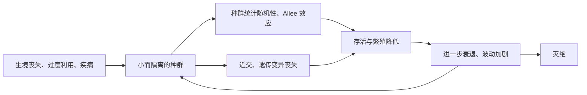

确定性模型认为，只要增长率为正且**环境容纳量**有限，种群无论多小都会永远存续。真实的种群由整数个个体组成，每个个体的生死、繁殖成败都由机会决定，而且它们生活在逐年变化的环境中。对大种群，这些随机事件相互平均，这就是 [7.19.10](/7.19.10)–[7.19.14](/7.19.14) 的确定性理论行之有效的原因；对小种群，它们则决定种群能否存活。本章分三步发展灭绝理论：影响个体的机会事件（种群统计随机性，15.1 节）、影响整个种群的机会事件（环境随机性与灾变，15.2 节），以及它们与 **Allee 效应**的相互作用（15.3 节）。然后转向保护的实践：保护生物学的两种范式、灭绝漩涡与最小可存活种群（15.4 节），以及种群生存力分析（15.5 节）。其数学建立在 [7.5.36](/7.5.36) 的**生灭过程**与 **Galton–Watson 过程**、Markov 链与扩散（[3.1](/3.1)）以及 [7.19.14](/7.19.14) 的矩阵模型之上；小种群面临的遗传威胁在 [7.19.20](/7.19.20) 展开。

## 15.1. 种群统计随机性

### 15.1.1. 两种机会

**定义 15.1.1（种群统计随机性与环境随机性）** **种群统计随机性**是指：即使每个个体的概率相同，由于个体的出生、死亡与性别是独立的机会事件而引起的种群增长的随机变异。**环境随机性**是指：环境的变化同时改变一个种群中所有个体的出生与死亡概率（天气、食物供应、疾病暴发）而引起的种群增长的随机变异。一次杀死种群很大一部分个体的罕见极端事件（火灾、洪水、流行病）称为**灾变**，是环境随机性的极端形式。

两者随种群大小的标度方式不同。若 $N$ 个个体各自独立地贡献随机数目的后代，方差为 $\sigma_d^2$，则种群每员增长率的方差为 $\sigma_d^2/N$，当 $N$ 大时趋于零。环境波动同时改变所有个体的生命率，所以它对每员增长率方差的贡献 $\sigma_\mathrm{e}^2$ 与 $N$ 无关。把二者合起来（Lande、Engen 与 Sæther 2003），

$$
\operatorname{Var}\left(\frac{\Delta N}{N}\,\Big\vert\,N\right) \approx \sigma_\mathrm{e}^2 + \frac{\sigma_d^2}{N},
\tag{15.1}
$$
所以当 $N < \sigma_d^2/\sigma_\mathrm{e}^2$ 时种群统计随机性占主导。对鸟类和哺乳类，$\sigma_d^2$ 通常为 0.5 量级，$\sigma_\mathrm{e}^2$ 为 0.01–0.1 量级，所以种群统计随机性在几十个个体以下很重要，在几百个个体以上可以忽略。曾经从缅因州到弗吉尼亚州常见的 heath hen（*Tympanuchus cupido cupido*）的命运说明了这一序列。约 1830 年它在大陆上消失，局限于马撒葡萄园岛，1908 年约 50 只，到 1915 年在一个保护区中恢复到数千只；随后一场火灾、一个有许多苍鹰的严冬以及家禽疾病（环境事件和灾变）使它减少到几十只，而种群统计的偶然性终结了它：1928 年的 13 只中只有两只是雌鸟，最后一只在 1932 年死去。

### 15.1.2. 线性生灭过程

种群统计随机性最简单的模型是线性生灭过程（[定义 36.4.1](/7.5.36#def-36.4.1)，见 7.5.36）：每个个体独立地以速率 $b$ 生育、以速率 $d$ 死亡。其均值为 $\mathbb{E}[N(t)] = N_0\mathrm{e}^{(b-d)t}$，即确定性的指数模型，但单个实现可能灭绝（图 1A）。

**定理 15.1.1（线性生灭过程的灭绝概率）** 设 $N(0) = N_0$。若 $b \le d$，种群以概率 1 灭绝。若 $b > d$，其**灭绝概率**为

$$
\mathbb{P}(\text{extinction}) = \left(\frac db\right)^{N_0},
\tag{15.2}
$$
否则 $N(t) \to \infty$。

**证明** 只看所访问的状态序列（嵌入的跳链）。从状态 $n \ge 1$ 出发，下一个事件以概率 $p = bn/(bn + dn) = b/(b + d)$ 为出生，以概率 $q = d/(b + d)$ 为死亡，且与 $n$ 无关：该链是在 0 处被吸收的简单随机游走，即经典的赌徒破产问题。令 $h_n$ 为从 $n$ 出发最终到达 0 的概率，则 $h_0 = 1$，$h_n = ph_{n+1} + qh_{n-1}$（$n \ge 1$），其解为 $h_n = \alpha + \beta(q/p)^n$。在到达水平 $M$ 之前先到达 0 的概率，是满足 $h_M = 0$ 的解，当 $p \ne q$ 时为 $h_n^{(M)} = \bigl((q/p)^n - (q/p)^M\bigr)/\bigl(1 - (q/p)^M\bigr)$；令 $M \to \infty$，当 $p > q$ 时 $h_n = (q/p)^n = (d/b)^n$，当 $p < q$ 时 $h_n = 1$。当 $p = q$ 时解为 $h_n^{(M)} = 1 - n/M \to 1$。由于存活种群的跳链不可能一直有界而不到达 0（从低于 $M$ 的任一状态出发，至多 $M$ 步内以至少 $q^M$ 的概率到达 0），存活意味着 $N \to \infty$。$\square$

换一种说法，灭绝要求 $N_0$ 个独立的奠基谱系每一个都灭绝，而 [推论 36.4.1](/7.5.36#cor-36.4.1)（见 7.5.36）给出一个谱系灭绝的概率为 $d/b$。有三点结论对保护很重要（图 1）。

- 即使对增长的种群，灭绝也很可能发生：$b = 1$、$d = 0.8$（单位时间平均增长 20 %）时，单个奠基者以 $0.8$ 的概率灭绝，五个奠基者以 $0.33$ 的概率灭绝。
- 风险随 $N_0$ 几何下降：奠基或再引入的种群需要足够多的个体。$d/b = 0.8$ 时，要把灭绝概率降到 1 % 以下，需要 $N_0 \ge 21$。
- 如果灭绝发生，则发生得早。到时刻 $t$ 为止的灭绝概率 $P_0(t)^{N_0}$（$P_0(t)$ 取自 [定理 36.4.1](/7.5.36#thm-36.4.1)，见 7.5.36）在几个 $1/(b - d)$ 之内就趋近其极限；已经长大的种群不再受种群统计意外的威胁。

对世代离散的种群，相应的模型是 Galton–Watson 分支过程（[7.5.36](/7.5.36#thm-36.4.3)）：每个个体留下随机数目的后代，概率母函数为 $f(x)$，每个奠基者的灭绝概率是 $q = f(q)$ 在 $[0, 1]$ 中的最小根，当且仅当平均后代数 $R_0 = f'(1)$ 超过 1（且 $\mathbb{P}(\text{一个后代}) < 1$）时它小于 1。对均值为 $R_0$ 的 Poisson 后代，$q = \mathrm{e}^{R_0(q - 1)}$；$R_0 = 1.25$ 时每个奠基者的 $q = 0.63$，小于 $b/d$ 相同的生灭过程的 $0.80$（图 1B）。这一差异表明，决定风险的不仅是繁殖成功的均值，还有其方差：在生灭过程中，个体一生的后代数服从几何分布，方差为 $R_0(R_0 + 1)$，大于 Poisson 方差 $R_0$。

模拟使用 **Gillespie 算法**（[4.4.7](/4.4.7)）：等待时间服从速率为 $(b + d)N$ 的指数分布，出生的概率为 $b/(b + d)$。

### 15.1.3. 受调节的种群：灭绝时间

有密度制约的种群不会增长到无穷，所以种群统计随机性最终必然使它灭绝，相关的问题变成需要多长时间。设种群在状态 $n$ 的出生率为 $\lambda_n$，死亡率为 $\mu_n$，$\lambda_0 = \mu_0 = 0$（灭绝是吸收态）。

**定理 15.1.2（平均灭绝时间）** 设从每个状态出发灭绝都是必然的。从状态 $k$ 到状态 $k - 1$ 的平均时间为

$$
\tau_k = \sum_{i=k}^{\infty}\frac{\lambda_k\lambda_{k+1}\cdots\lambda_{i-1}}{\mu_k\mu_{k+1}\cdots\mu_i},
\tag{15.3}
$$
而从状态 $n$ 出发的平均灭绝时间为 $T_n = \tau_1 + \tau_2 + \cdots + \tau_n$。

**证明** 要从 $k$ 降到 $k - 1$，过程先等待一段均值为 $1/(\lambda_k + \mu_k)$ 的指数时间；然后以概率 $\mu_k/(\lambda_k + \mu_k)$ 下降而完成，以概率 $\lambda_k/(\lambda_k + \mu_k)$ 上升，之后必须先从 $k + 1$ 回到 $k$（平均 $\tau_{k+1}$），再重新开始（平均 $\tau_k$）。因此

$$
\tau_k = \frac{1}{\lambda_k + \mu_k} + \frac{\lambda_k}{\lambda_k + \mu_k}\bigl(\tau_{k+1} + \tau_k\bigr), \qquad\text{即}\qquad \tau_k = \frac1{\mu_k} + \frac{\lambda_k}{\mu_k}\tau_{k+1}.
$$
迭代得级数 (15.3)；当灭绝是必然的且种群不能逃逸到无穷时它收敛，递推关系的最小非负解就是真正的平均值。最后，要从 $n$ 到达 0，过程必须依次从 $n$ 到 $n - 1$、从 $n - 1$ 到 $n - 2$，如此继续。$\square$

对逻辑斯谛生灭过程，$\lambda_n = bn$，$\mu_n = n\bigl(d + (b - d)n/K\bigr)$，期望动态是**逻辑斯谛增长** $\mathrm{d}N/\mathrm{d}t = rN(1 - N/K)$，$r = b - d$。$K$ 附近出生与死亡平衡，所以式 (15.3) 中的乘积在死亡开始占优之前含有约 $K$ 个接近 1 的因子；对所有 $n < K$ 比值 $\lambda_n/\mu_n$ 都大于 1，$\tau_1$ 的主项是 $K$ 个这样的比值的乘积。因此 $T$ 随 $K$ 指数增长：到主阶，$\ln T \approx K\int_0^1\ln\frac{b}{d + (b - d)x}\,\mathrm{d}x$（思考题 3），对 $b = 1$、$d = 0.5$ 这是 $0.31K$，平均灭绝时间从 $K = 10$ 时的约 50 上升到 $K = 55$ 时的 $10^7$ 以上（图 3）。大种群实际上对种群统计随机性免疫，这是 Leigh（1981）首先证明的；小种群则不然。灭绝之前，受调节的种群在*准平稳分布*中围绕 $K$ 波动，灭绝是一次罕见的大幅度偏离到零的事件。

## 15.2. 环境随机性

### 15.2.1. 几何平均增长

设世代离散且不重叠的种群按 $N_{t+1} = \lambda_tN_t$ 增长，其中周限增长率 $\lambda_t$ 是同分布的独立随机变量，由每年的环境决定。则 $N_t = N_0\lambda_0\lambda_1\cdots\lambda_{t-1}$，且

$$
\ln N_t = \ln N_0 + \sum_{s=0}^{t-1}\ln\lambda_s .
$$

**定理 15.2.1（随机环境中的长期增长）** 若 $\mu = \mathbb{E}[\ln\lambda_t]$ 有限，则以概率 1 有 $\frac1t\ln N_t \to \mu$，而 $\mathbb{E}[N_t] = N_0(\mathbb{E}[\lambda_t])^t$。由于 $\mathbb{E}[\ln\lambda] \le \ln\mathbb{E}[\lambda]$，仅当 $\lambda$ 为常数时取等号，几乎每个种群的增长都比期望种群慢；若 $\mu < 0 < \ln\mathbb{E}[\lambda]$，则期望大小增长，而几乎每个种群都下降到灭绝。

**证明** 第一个论断是强大数定律用于独立同分布的变量 $\ln\lambda_s$。第二个由独立性得出：$\mathbb{E}[N_t] = N_0\prod_s\mathbb{E}[\lambda_s]$。不等式是对凹函数 $\ln$ 的 Jensen 不等式；等价地，**几何平均数** $\mathrm{e}^{\mu}$ 从不超过算术平均数（**算术–几何平均不等式**）。$\square$

量 $\mu = \mathbb{E}[\ln\lambda]$ 是 $\lambda$ 的**几何均数**的对数，即随机增长率（stochastic growth rate）；决定种群长期命运的是它而不是 $\lambda$ 的均值（Lewontin 与 Cohen 1969）。若 $\lambda$ 服从均值为 $\bar\lambda$、变异系数为 $\mathrm{CV}$ 的**对数正态分布**，则 $\mu = \ln\bar\lambda - \frac12\ln(1 + \mathrm{CV}^2) \approx \ln\bar\lambda - \frac12\mathrm{CV}^2$；更一般地，把 $\ln\lambda$ 在 $\bar\lambda$ 处作二阶展开得 $\mu \approx \ln\bar\lambda - \operatorname{Var}(\lambda)/(2\bar\lambda^2)$。$\bar\lambda = 1.05$ 的种群，一旦 $\mathrm{CV} > 0.32$ 就会在长期中下降（图 2B）。在图 2A 的例子中，好年份（$\lambda = 1.5$）与坏年份（$\lambda = 0.6$）同样频繁：均值为 $1.05$，随机增长率为 $-0.053$；100 年后，中位数种群已从 100 降到约 $0.5$，而期望大小已升到 $13\,000$。期望由少数极其幸运的轨迹承担，这警告我们不要根据平均生命率判断生存力。同一原理解释了风险分摊的生活史，它以牺牲一些均值为代价来降低适合度的方差（[7.19.19](/7.19.19)）。

对随机环境中的结构化种群，$\boldsymbol{n}(t + 1) = A_t\boldsymbol{n}(t)$，其中 $A_t$ 为随机矩阵，随机增长率 $\lim\frac1t\ln N_t$ 也以概率 1 存在（Furstenberg 与 Kesten 1960），且对小的变异，Tuljapurkar 近似给出 $\ln\lambda_{\mathrm{s}} \approx \ln\bar\lambda_1 - \frac{1}{2\bar\lambda_1^2}\sum_{ij,kl}s_{ij}s_{kl}\operatorname{Cov}(a_{ij}, a_{kl})$，其中 $\bar\lambda_1$ 与敏感度 $s_{ij}$ 取自平均矩阵（[7.19.14](/7.19.14)）：敏感度高的生命率的变异使增长率降低最多，它们之间的正协方差使情况更糟。

![环境随机性。A：300 个模拟种群，每年以概率 1/2 取 λ = 1.5 或 0.6（灰色，对数尺度）。期望大小 N0 1.05^t（红色）增长，而中位数（蓝色）按 exp(-0.053t) 下降，因为 E[ln λ] < 0；样本均值（虚线）只在少数极其幸运的轨迹主导它的时候才跟随期望。B：算术均值为 1.05 的对数正态 λ 的随机增长率 E[ln λ] 对 λ 的变异系数的曲线（精确与二阶近似）；一旦 CV > 0.32 种群就下降](./plots/environmental-stochasticity.py)

### 15.2.2. 扩散近似与准灭绝

对低于环境容纳量的种群，$X_t = \ln N_t$ 是平均步长为 $\mu$、步长方差为 $\sigma^2 = \operatorname{Var}(\ln\lambda)$ 的随机游走。经过许多步，这样的游走可以很好地用带漂移的 **Brown 运动** $\mathrm{d}X = \mu\,\mathrm{d}t + \sigma\,\mathrm{d}W$ 来近似，这一**扩散近似**给出了灭绝风险的闭式公式（Lande 与 Orzack 1988，Dennis、Munholland 与 Scott 1991）。由于对数正态模型永远不会恰好到达零，风险以降到准灭绝阈值（quasi-extinction threshold）$N_q$ 之下的概率表示，该阈值是种群在功能上被视为灭绝、或种群统计随机性接管的大小。令 $x_d = \ln(N_0/N_q) > 0$ 为对数尺度上到阈值的距离。

**定理 15.2.2（扩散近似下的准灭绝）** 对漂移为 $\mu$、方差为 $\sigma^2$、从阈值之上距离 $x_d$ 处出发的 Brown 运动：

1. 曾经到达阈值的概率，当 $\mu \le 0$ 时为 1，当 $\mu > 0$ 时为 $\exp(-2\mu x_d/\sigma^2)$。
2. 若 $\mu < 0$，到达阈值的平均时间为 $x_d/\lvert\mu\rvert$。
3. 到时刻 $t$ 为止到达阈值的概率为

$$
G(t) = \Phi\left(\frac{-x_d - \mu t}{\sigma\sqrt t}\right) + \exp\left(-\frac{2\mu x_d}{\sigma^2}\right)\Phi\left(\frac{-x_d + \mu t}{\sigma\sqrt t}\right),
\tag{15.4}
$$
其中 $\Phi$ 为标准正态分布函数；准灭绝时间服从逆 Gauss 分布。

**证明** (1) 令 $u(x)$ 为从 $x$ 出发、在到达水平 $L$ 之前到达位于 $0$ 的阈值的概率。在短时间 $h$ 内，$X$ 移动的增量均值为 $\mu h$，方差为 $\sigma^2h$，所以 $u(x) = \mathbb{E}[u(x + \Delta X)] = u(x) + \mu hu'(x) + \frac12\sigma^2hu''(x) + o(h)$，由此得向后方程 $\frac12\sigma^2u'' + \mu u' = 0$，$u(0) = 1$，$u(L) = 0$。其解为 $u(x) = \bigl(\mathrm{e}^{-2\mu x/\sigma^2} - \mathrm{e}^{-2\mu L/\sigma^2}\bigr)/\bigl(1 - \mathrm{e}^{-2\mu L/\sigma^2}\bigr)$；当 $L \to \infty$ 时，对 $\mu > 0$ 趋于 $\mathrm{e}^{-2\mu x/\sigma^2}$，对 $\mu \le 0$ 趋于 1。(2) 平均时间 $m(x)$ 满足 $\frac12\sigma^2m'' + \mu m' = -1$，$m(0) = 0$；对 $\mu < 0$，不指数增长的解为 $m(x) = x/\lvert\mu\rvert$。(3) 由带漂移 Brown 运动的反射原理（Girsanov 测度变换去掉漂移，并把反射路径乘以 $\mathrm{e}^{-2\mu x_d/\sigma^2}$），$[0, t]$ 上 $X$ 的最小值低于 0 的概率，是 $X_t < 0$ 的概率（第一项）与反射事件的加权概率（第二项）之和。$\square$

这些公式说明哪些参数重要：风险取决于漂移相对于方差的大小 $\mu/\sigma^2$，以及初始大小相对于阈值的对数。种群加倍只使 $x_d$ 增加 $\ln 2$，当种群在下降时，这远不如 $\mu$ 的一点小增加有帮助。实践中，$\mu$ 与 $\sigma^2$ 由普查序列中 $\ln(N_{t+1}/N_t)$ 的均值与方差估计（对不等间隔作调整），除非序列很长，$G(t)$ 的置信区间都很宽（Dennis 等 1991；Morris 与 Doak 2002）。图 4 比较了一个 20 头雌性的种群的四种假想管理方案。

### 15.2.3. 灭绝时间如何随种群大小标度

Lande（1993）把种群统计随机性、环境随机性与灾变合并到同一个扩散模型中，推导了从环境容纳量 $K$ 出发的种群的平均灭绝时间 $T$ 如何依赖于 $K$。仅有种群统计随机性时，$T$ 随 $K$ 指数增长（15.1.3 节）。对方差为 $V_e$ 的环境随机性、低密度时平均增长率为 $r$ 的情形，$T$ 只按 $K$ 的幂增长：

$$
T \approx \frac{2}{V_ec}\left(\frac{K^c - 1}{c} - \ln K\right), \qquad c = \frac{2r}{V_e} - 1,
$$
所以当 $c > 0$ 时 $T \propto K^c$，当 $r < V_e/2$ 时 $T$ 只按 $(\ln K)^2$ 或更慢地增长（图 3）。灾变同样导致幂律。实际的信息令人清醒：当环境变异相对于增长率很大时，把种群增加十倍可能只使期望的存续时间加倍，没有哪个现实的大小能使之安全。对实验室与野外种群的模拟一致表明，与仅有种群统计随机性相比，环境随机性与个体间的异质性大大缩短了灭绝时间（Melbourne 与 Hastings 2008）。

## 15.3. Allee 效应与小种群

**Allee 效应**（[7.19.10](/7.19.10)）是低密度时每员增长率下降，其原因是难以找到配偶、合作防御或取食失败，或近交。强 Allee 效应产生一个阈值，低于它确定性种群下降。对配偶受限的情形，一个简单模型是出生率 $bn \cdot n/(n + \theta)$，其中 $n/(n + \theta)$ 是找到配偶的雌体的比例；死亡率为 $dn$ 时，确定性阈值为 $n_A = \theta d/(b - d)$。

随机性与 Allee 效应相互加剧。种群统计随机性可以靠运气把种群推过阈值，也可以由于厄运把它推到阈值之下，所以尖锐的确定性阈值变成平滑的、S 形的建立概率（图 5）。在这个例子中，没有 Allee 效应时，10 个个体的奠基群体以约 0.9 的概率建立；配偶受限时，同样的群体建立的概率只有 0.05，即使恰在确定性阈值（$N_0 = 20$）的群体也只有 40 % 成功。由此得出三点实际结论。再引入与迁地放归必须释放远高于任何阈值的群体。传播体数量少时入侵常常失败，因此传播体压力是入侵成功最好的预测因子之一（[7.19.51](/7.19.51)）。而对被捕捞或减少到低数量的种群，Allee 效应可以把可控的下降变成崩溃，如一些过度捕捞的渔业资源（[7.19.53](/7.19.53)）。

## 15.4. 小种群与衰退种群

### 15.4.1. 两种范式

Caughley（1994）区分了保护生物学中的两种途径。*小种群范式*研究小尺寸本身的后果：种群统计与环境随机性（15.1–15.2 节）、Allee 效应（15.3 节）与遗传问题，即**遗传漂变**造成的变异丧失与**近交衰退**（[7.19.20](/7.19.20)）。它理论丰富，但 Caughley 认为经过检验的应用很少。*衰退种群范式*则追问种群为何下降、可以做些什么：它用野外生态学的方法识别衰退的外部因素（生境丧失、过度利用、引入的捕食者与竞争者、疾病、污染），并用实验检验补救措施。多数变小的种群都是因这类因素所致，消除它们是第一要务；小尺寸的随机性与遗传问题在其后才成为决定性的。两种范式是互补的：衰退种群范式解释种群如何变小，小种群范式解释之后什么威胁着它们。

### 15.4.2. 灭绝漩涡

**定义 15.4.1（灭绝漩涡）** **灭绝漩涡**（Gilpin 与 Soulé 1986）是威胁小种群的各种过程的相互强化：大小的减少增加种群统计随机性、近交与遗传变异的丧失以及 Allee 效应的强度，它们降低存活与繁殖，从而使种群进一步减小。

瑞典西南部的黑腹滨鹬南方亚种（*Calidris alpina schinzii*）似乎陷入了这样的漩涡。1993 年至 2004 年间该种群持续下降，尽管最初使它减少的生境丧失已经停止；配对的个体之间亲缘关系越来越近，杂合度较低的配对的卵孵化失败得更多（Blomqvist 等 2010）。早先的生境丧失把种群推入一个近交使它持续下降的状态。许多灭绝同样是多因素的：heath hen（15.1.1 节）先后经历了生境丧失与狩猎、灾变，然后是种群统计意外。

### 15.4.3. 最小可存活种群

**定义 15.4.2（最小可存活种群）** **最小可存活种群**（MVP）是在考虑种群统计、环境与遗传随机性以及灾变的预期影响后，具有指定概率在指定时间内存续的最小种群大小（Shaffer 1981）。Shaffer 最初的标准是 1000 年存续概率 99 %；100 年 95 % 也被广泛使用。

这个定义包含两个任意的选择，即概率与时间尺度，所以 MVP 既表达价值判断，也表达生物学。低估 MVP 会导致自满；高估则可能使管理者放弃本可挽救的种群。经验估计来自长期记录。在北美的大角羊（*Ovis canadensis*）中，起初少于 50 只的种群全部在 50 年内灭绝，51–100 只的种群约有一半持续了 50 年，而超过 100 只的种群在 70 年的记录期内都存续（Berger 1990）。对加利福尼亚海峡群岛上鸟类的分析表明，80 年内 90–99 % 的存续概率，其 MVP 为 100–1000 对（Thomas 1990）。遗传上的经验法则（50/500 规则，现在常修订为对**有效群体大小**的 100/1000）在 [7.19.20](/7.19.20) 讨论。对许多物种的综述给出的 MVP 估计中位数为数千个成体（Traill 等 2007），但物种间与研究间的差异如此之大，以致一个普遍的数字对具体案例没有什么用处；这正是人们更偏好种群生存力分析的原因。

## 15.5. 种群生存力分析

**定义 15.5.1（种群生存力分析）** **种群生存力分析**（PVA）是用定量模型（通常是随机模拟）估计种群在给定时间内存续（或降到准灭绝阈值之下）的概率，并比较不同管理方案下的这些风险。

### 15.5.1. 步骤与模型

PVA 分五个步骤进行。

1. 确定模型结构：基于计数的（15.2.2 节）、种群统计的（阶段分类矩阵，[7.19.14](/7.19.14)）、个体为基础的（如程序 VORTEX，它追踪每个个体的年龄、性别、亲缘关系与基因型），或空间的（集合种群模型如 RAMAS GIS，[7.19.16](/7.19.16)）。选择是否包含密度制约、Allee 效应、灾变与遗传。
2. 由野外数据估计参数及其方差，把抽样方差与真实的环境方差（过程方差）分开，并给出它们之间的相关。
3. 模拟许多（通常是数千条）轨迹，每年从生命率的分布中抽取，个体的命运则由机会决定。
4. 汇总结果：准灭绝概率曲线、准灭绝时间的分布、最终种群大小与遗传多样性；分析结果对不确定参数的敏感度。
5. 比较管理方案：降低某个死亡来源、增加生境、连接种群、补充或迁移个体、控制疾病。

澳大利亚与北美文献中的两个 PVA 说明了其用途。对昆士兰的树袋熊（*Phascolarctos cinereus*），根据种群统计数据建立的 VORTEX 模型，对一个下降的种群（Oakey）与一个稳定的种群（Springsure）分别预测在所模拟的时期内有 $0.38$ 与 $0.06$ 的灭绝概率，其轨迹与后来的普查结果相符（Penn 等 2000）。对 *Silene regia*（royal catchfly），基于矩阵的 PVA 表明只有烧除过的种群才是安全的（[7.19.14](/7.19.14)）。

### 15.5.2. 中国东北的东北虎

东北虎（*Panthera tigris altaica*）主要生存在俄罗斯远东（数百头），沿吉林与黑龙江边境有数十头的小种群，依赖来自俄罗斯的迁入。Wang 等（2023）为中国种群建立了一个个体为基础的 PVA（VORTEX），在 100 年内、三种近交衰退水平（3.14、6.29 与 12.26 个致死当量）下，比较了基线与四种管理方案：控制犬瘟热，这是一种由家犬传播、可杀死老虎的病毒（方案 A）；生境连接，使之与俄罗斯的大种群交换个体（B）；以及扩大生境使之容纳 45 或 100 头繁殖雌虎（C45、C100）。从发表的图中大致读出其结果：

| 方案 | 随机增长率 | 100 年存续概率（3.14 / 6.29 / 12.26 个致死当量） |
|---|---|---|
| 基线 | 为负（约 $-0.02$ 至 $-0.06$） | 约 $0.35$ / $0.1$ / $0$ |
| A：控制犬瘟热 | 为负 | 约 $0.6$ / $0.25$ / $0$ |
| B：与俄罗斯种群连接 | 低近交时为正 | 约 $0.98$ / $0.95$ / $0.85$ |
| C45、C100：更多生境 | 为负 | 约 $0.5$ / $0.2$ / $0$ |

只有与大种群的连接，才使小种群在所有关于近交的假设下都得到保障，因为迁入既拯救了数量，也恢复了遗传变异（**遗传拯救**，[7.19.20](/7.19.20)）；单纯扩大生境无法补偿隔离种群中的近交。这一结果说明两个一般的要点：看似相似的管理方案（更多的生境对相连的生境）对生存力的影响可以大不相同；而往往了解不足的遗传假设，可以使绝对风险从接近零变为接近必然，却不改变各方案的排序。

### 15.5.3. 局限与验证

PVA 的好坏取决于其数据与结构。最常见的问题有：数据序列短（使方差被夸大或低估）、抽样方差与过程方差混淆、密度制约的形式未知、忽略生命率之间或种群之间的相关、未模拟灾变与演化变化，以及条件肯定会改变的长时间尺度。Ludwig（1999）认为，灭绝概率的置信区间往往宽到使点估计毫无意义。回溯检验则令人鼓舞：把 21 个长期数据集截短后，拟合早期部分的 PVA 预测了后来的下降与种群大小，没有显著偏差（Brook 等 2000）。因此多数实践者用 PVA 来比较方案、找出对风险影响最大的参数（也就是最值得收集的数据），而不是预测灭绝的绝对概率。IUCN 红色名录接受定量 PVA 作为其标准之一（标准 E）：若一个分类单元在 10 年或三个世代内灭绝概率至少为 50 %，则为极危；20 年或五个世代内为 20 %，则为濒危；100 年内为 10 %，则为易危。

## 小结

- 种群统计随机性（个体中独立的机会事件）对每员增长率贡献方差 $\sigma_d^2/N$，环境随机性贡献与 $N$ 无关的方差 $\sigma_\mathrm{e}^2$，式 (15.1)（定义 15.1.1）；灾变是极端的环境事件。
- 在线性生灭过程中，$b > d$ 时灭绝概率为 $(d/b)^{N_0}$（定理 15.1.1，赌徒破产），所以增长的种群也可能灭绝，风险随奠基者数目几何下降，灭绝发生得早。在分支过程中，风险除取决于 $R_0$ 外，还取决于后代数的方差。
- 在受调节的种群中灭绝是必然的；平均灭绝时间由一步分析公式得出（定理 15.1.2），仅有种群统计随机性时随 $K$ 指数增长。
- 在随机环境中，长期增长由随机增长率 $\mathbb{E}[\ln\lambda] \le \ln\mathbb{E}[\lambda]$ 支配（定理 15.2.1）；变异使之降低约 $\mathrm{CV}^2/2$。扩散近似（定理 15.2.2）给出准灭绝概率 $\mathrm{e}^{-2\mu x_d/\sigma^2}$（$\mu > 0$）、平均时间 $x_d/\lvert\mu\rvert$（$\mu < 0$）与逆 Gauss 曲线 (15.4)。有环境随机性时，灭绝时间只按 $K$ 的幂增长（Lande 1993）。
- Allee 效应产生阈值，随机性把它变成 S 形的建立概率；小的奠基群体与小的残余种群尤其危险。
- 衰退种群范式（找出并消除衰退的原因）与小种群范式（小尺寸的随机性与遗传风险）互补；小种群可能进入灭绝漩涡（定义 15.4.1）。MVP（定义 15.4.2）需要明确的概率与时间尺度。
- PVA（定义 15.5.1）结合数据与随机模型来比较管理方案（树袋熊、royal catchfly、东北虎：只有与俄罗斯种群连接才使中国种群在所有近交假设下都有保障）；它在对方案排序与找出关键参数上最可靠。

## 思考题

1. 一项再引入计划把 $N_0$ 头动物释放到一个保护区，那里每员出生率为每年 $0.5$，死亡率为 $0.3$（忽略密度制约）。必须释放多少头，建立的概率才能超过 95 %？如果一半被释放的动物因释放的压力立即死亡，答案会怎样变化？

   **答** 由定理 15.1.1，$\mathbb{P}(\text{extinction}) = (0.3/0.5)^{N_0} = 0.6^{N_0} \le 0.05$ 要求 $N_0 \ge \ln 0.05/\ln 0.6 = 5.9$，即 6 头。若一半在释放时死亡，有效奠基数约为 $N_0/2$（更准确地说，幸存者数服从二项分布），所以需要释放约 12 头；对二项分布取平均，$\mathbb{E}[0.6^{S}] = (0.5 + 0.5 \times 0.6)^{N_0} = 0.8^{N_0} \le 0.05$ 给出 $N_0 \ge 14$。释放死亡率、性比与 Allee 效应（15.3 节）都使所需数量增加，实践中常释放几十头。

2. 一种多年生植物的种群，年增长率 $\lambda_t$ 的算术均值为 $1.02$，标准差为 $0.25$。估计其随机增长率，以及从 1000 株开始 50 年后的中位数种群大小。确定性模型预测什么？

   **答** $\mathrm{CV} = 0.25/1.02 = 0.245$，所以 $\mu \approx \ln 1.02 - 0.245^2/2 = 0.0198 - 0.0300 = -0.010$（对数正态的精确值：$0.0198 - \frac12\ln(1.060) = -0.0093$）。50 年后的中位数约为 $1000\,\mathrm{e}^{-0.47} \approx 630$ 株，而 $\lambda = 1.02$ 的确定性模型预测 $1000 \times 1.02^{50} \approx 2690$。平均意义上“增长”的种群更可能是下降的。

3. 对 $\lambda_n = bn$、$\mu_n = n(d + (b - d)n/K)$ 的逻辑斯谛生灭过程，由式 (15.3) 写出 $\tau_1$，并解释它为什么随 $K$ 指数增长。

   **答** $\tau_1 = \sum_{i\ge1}\frac{\lambda_1\cdots\lambda_{i-1}}{\mu_1\cdots\mu_i} = \sum_{i\ge1}\frac1{\mu_i}\prod_{j=1}^{i-1}\frac{\lambda_j}{\mu_j}$，其中 $\lambda_j/\mu_j = b/(d + (b - d)j/K)$。该比值在 $j < K$ 时大于 1，在 $j > K$ 时小于 1，所以乘积在 $i \approx K$ 之前增大，之后减小；最大的乘积为 $\prod_{j<K}\frac{b}{d + (b - d)j/K} \approx \exp\bigl(K\int_0^1\ln\frac{b}{d + (b - d)x}\,\mathrm{d}x\bigr)$，它对 $K$ 是指数的（积分为正，因为被积函数在 $[0, 1)$ 上为正）。和式由 $i = K$ 附近的项主导，所以 $\tau_1$ 以及 $T_K$ 随 $K$ 指数增长。

4. 用扩散近似比较两种管理方案：一个 200 头雌性的种群以 $\mu = -0.01$、$\sigma = 0.15$ 下降，准灭绝阈值为 20：(a) 通过迁移使种群加倍；(b) 通过减少偷猎把 $\mu$ 提高到 $+0.01$。从长期看，哪种方案降低的风险更多？

   **答** 目前 $x_d = \ln 10 = 2.30$，且由于 $\mu < 0$，准灭绝最终必然发生，平均时间为 $2.30/0.01 = 230$ 年。(a) 加倍给出 $x_d = \ln 20 = 3.00$：仍然必然发生，平均时间 300 年。(b) $\mu = 0.01$ 时，最终风险为 $\exp(-2 \times 0.01 \times 2.30/0.0225) = \mathrm{e}^{-2.05} = 0.13$。改变漂移的符号会从性质上改变长期结果，而增加个体只是推迟下降；这个结果说明了衰退种群范式。在短期（比如 20 年）内，式 (15.4) 的 $G(t)$ 在所有情形下都很小，而如果存在 Allee 效应或遗传问题，迁移可能更重要。

5. 为什么东北虎 PVA 关于管理方案排序的结论对三种近交衰退水平都成立，而存续的绝对概率却差别如此之大？什么数据最能减少不确定性？

   **答** 近交衰退在所有方案中都降低存活与繁殖力，所以把所有存续概率都向下移动；但与俄罗斯种群的连接既作用于数量问题，也作用于遗传问题（迁入者增加个体和新的等位基因，阻止近交的积累），而犬瘟热控制与生境扩大只作用于数量，让隔离的种群变得近交。因此连接的优势随近交衰退的强度而增大，排序是稳健的。绝对概率则取决于了解不足的致死当量数，以及由几十头动物组成的种群的生命率。最有帮助的数据有：老虎在俄罗斯与中国之间实际移动速率的估计（遗传归属、红外相机）、中国老虎的存活与繁殖、犬瘟热的流行与影响，以及近交及其对幼体存活影响的遗传估计。

6. （开放题）Caughley 认为小种群范式对拯救物种贡献甚少。结合例子讨论，小种群理论在什么时候对保护实践是不可或缺的。

   **答** 要点：消除衰退的原因是必要的，但一旦种群极小就不充分。理论在以下情形不可或缺：(a) 设计再引入与迁移（奠基者数量，定理 15.1.1；Allee 阈值；奠基者的遗传多样性）；(b) 确定优先次序与红色名录等级（标准 E 使用灭绝概率）；(c) 决定遗传拯救，如佛罗里达美洲狮（1995 年释放八头得克萨斯美洲狮之后种群恢复）或东北虎的连接情景；(d) 管理圈养与残余种群（粉红鸠从约 10 只恢复，其繁殖经过管理以尽量减少近交）；以及 (e) 评估保护区中的种群是否大到足以经受环境变异（灭绝时间的幂律标度）。反过来，衰退的因素占主导的例子（南亚秃鹫因兽药双氯芬酸而减少，两栖类因壶菌而减少）显示了衰退种群范式的必要性。好的回答会得出结论：两者需要先后兼用。
