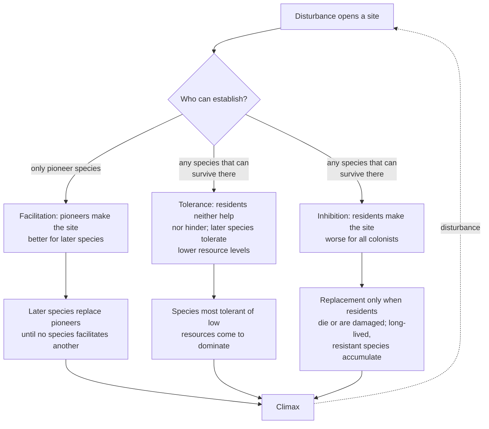

Communities change in time even where the climate is constant. Some of the change is internal and reversible: species replace one another in the course of the year, and their abundances fluctuate from year to year about a mean (Section 36.1). Other change is directional. After a disturbance, or on newly exposed ground, species colonize, modify the site and are replaced by others in a more or less predictable sequence, **ecological succession**, the subject of most of this chapter. Section 36.2 defines its types and describes primary, secondary and heterotrophic successions; Section 36.3 asks what drives them, from the three models of Connell and Slatyer to Tilman's resource-ratio hypothesis; Section 36.4 develops Horn's Markov chain model, in which the final composition is the stationary distribution of a matrix of replacement probabilities; Section 36.5 discusses the end point, the climax; Section 36.6 the changes of ecosystem properties during succession; and Section 36.7 the use of succession theory in restoration. The chapter builds on the gap dynamics and disturbance of [7.19.33](/7.19.33), on the competition–colonization trade-off of [7.19.16](/7.19.16) and the resource competition theory of [7.19.23](/7.19.23), and on the theory of Markov chains in [3.5.9](/3.5.9). The assembly of communities from a regional pool continues in [7.19.37](/7.19.37).

## 36.1. Internal Dynamics: Seasonal Change and Fluctuation

The composition of a community changes over the year as species complete their life cycles against the seasonal cycle of temperature, light and water. In temperate grasslands and deciduous forests the change is conspicuous: spring ephemerals flower and die back before the canopy closes, summer and autumn species follow, and the community has a different appearance, or *aspect*, in each season. The timing of these events is the subject of **phenology** ([7.19.4](/7.19.4)). Seasonal change does not alter the identity of the community; it is repeated each year.

Between years, the abundances of species change too, usually in response to irregular variation in weather. Such changes, which do not replace the community by another, are called community fluctuations. They have three characteristics: the species composition is relatively stable, the quantitative characteristics (density, cover, biomass, the importance values of the dominants) vary irregularly, and the changes are reversible. Three types are distinguished.

| Type | Description | Typical duration |
|---|---|---|
| Indistinct fluctuation | Quantitative relations among species change little; appearance and structure of the community are nearly constant; occurs where weather and hydrology are similar from year to year | — |
| Oscillatory fluctuation | Short-term changes in the numbers and production of the components, associated with alternation of the dominant species from year to year | 1–5 years |
| Shifting (deflected) fluctuation | A long deviation of climate or water supply changes one or several dominants markedly; the community later returns close to its former state by self-regulation | 5–10 years |

Communities differ in how much they fluctuate. Qualitative properties (species composition, interspecific relations, layering) are more stable than quantitative ones (density, cover, biomass); mature communities are more stable than developing ones; communities dominated by woody plants are more stable than those dominated by herbs, and evergreen woody communities more stable than deciduous ones; and the harsher the environment, the larger the fluctuations. Reversibility is incomplete: after a fluctuation a community approaches its previous state but rarely returns to it exactly, and the products of the organisms, organic matter in the soil above all, accumulate year after year. Accumulated quantitative change may eventually alter the character of the site and initiate succession.

The longest records show how stable community composition can be. In the Park Grass Experiment at Rothamsted, started in 1856, the proportions of grasses, legumes and other herbs on unfertilized plots have fluctuated from year to year but changed little over more than a century, while fertilized plots diverged quickly to new compositions.

## 36.2. Succession: Concepts and Types

### 36.2.1. Definitions

**Definition 36.2.1 (Ecological Succession)** **Ecological succession** is the nonseasonal, directional and continuous pattern of colonization and extinction of species populations at a site, by which one community is replaced by another.

The series of communities from the first colonists to the final, relatively stable community is a *sere*, and each recognizable community in the series a *seral stage*. The formation of any community requires three processes: the arrival of propagules (dispersal), their establishment (germination, growth and reproduction of the colonists, sometimes called *ecesis*) and competition among the established plants. Succession is classified first by the condition of the starting site.

**Definition 36.2.2 (Primary and Secondary Succession)** A **primary succession** begins on a substrate that has not been influenced by a previous community, or from which the previous vegetation and its soil have been removed entirely, such as lava flows, glacial moraines, new sand dunes or rock exposed by a landslide. A **secondary succession** begins on a site from which the vegetation has been removed but where the soil, with its seed bank and other propagules, remains, as after fire, logging, windthrow or the abandonment of cultivation.

Primary successions on land typically take hundreds of years, secondary successions decades to a century or two. Because few successions can be followed from start to finish, most are reconstructed from a *chronosequence*: a set of sites that differ in the time since the start of succession (dated by historical records, tree rings, radiocarbon or, in one study described below, gravestones) and are assumed to have followed the same course. The assumption of space-for-time substitution must be checked, since sites also differ in other ways and the climate and species pool may have changed since the older sites began.

### 36.2.2. Primary Successions

*Volcanic islands.* Miyake-jima, a volcanic island of the Izu Islands south of Tokyo, has lava flows of known ages, 16, 37, 125 and more than 800 years old. The 16-year-old flow had little soil, almost no nitrogen and only a few small alders (*Alnus sieboldiana*), which fix nitrogen through actinorhizal symbionts. On older flows the nitrogen added by alder allowed the mid-successional cherry *Prunus speciosa* and then the evergreen laurel *Machilus thunbergii* to establish; a mixed forest shaded out alder and cherry; and the longer-lived chinquapin *Castanopsis sieboldii* finally replaced *Machilus* (Kamijo et al. 2002). The sequence combines colonization, **nitrogen fixation** and facilitation, and competition for light. Krakatau, sterilized by the eruption of 1883, was recolonized from Java and Sumatra: blue-green algal (cyanobacterial) crusts and ferns on the ash were followed by grassland and then forest, and the animals changed with the vegetation ([7.19.34](/7.19.34)).

*Glacial retreat.* At Glacier Bay, Alaska, glaciers have retreated about 100 km since the late eighteenth century, exposing a chronosequence of moraines. Pioneer stages of mosses, the mat-forming *Dryas* and willows give way to thickets of nitrogen-fixing alder (*Alnus viridis*) and then to forest of Sitka spruce (*Picea sitchensis*) and, after about 200 years, western and mountain hemlock. Soil organic matter and nitrogen accumulate and pH falls from about 8 to below 5. Experiments showed that alder both facilitates spruce, by adding nitrogen, and inhibits it, by shading and competition for other resources; the net effect depends on the stage (Chapin et al. 1994). The first studies, by William Cooper from 1916, were among the founding studies of succession.

*Sand dunes.* On 13 dune ridges of known age (30–440 years) along Lake Michigan, the dune grass *Ammophila breviligulata* on young mobile dunes is followed by shrubs and bunch grasses, by pines and other conifers after about 150 years and by oaks and maples only after 440 years. It used to be thought that early species facilitated later ones by adding organic matter. Experiments in which seeds were added and seedlings transplanted showed instead that late species can establish on young dunes; their colonization is limited by seed dispersal and by seed predation by rodents (Lichter 2000). The sequence on these dunes reflects the transient dynamics of colonization and competitive displacement more than facilitation, a reminder that the mechanisms must be tested experimentally.

### 36.2.3. Secondary Successions

*Fire in the taiga of Kanas.* In the boreal forest of the Kanas region of the Altai in northern Xinjiang, lightning fires start a secondary succession. Fire-tolerant Siberian larch (*Larix sibirica*), with thick bark, survives; in the first 20 years after the fire light-demanding herbs and broad-leaved trees, birches and aspens, establish and grow quickly; between 20 and 50 years the stand closes and the light-demanding herbs and small broad-leaved trees decline; between 50 and 80 years shade-tolerant herbs and conifers (Siberian spruce and fir) increase; after about 80 years the conifers overtop the broad-leaved trees, close the canopy and the broad-leaved trees die. Fire thus maintains a mosaic of stands of different ages, the successional mosaic of Section 33.3 of [7.19.33](/7.19.33), and the **fire regime** ([7.19.5](/7.19.5)) determines its composition.

*Old fields of the Loess Plateau.* Old-field successions have been studied wherever farmland was abandoned. On the Loess Plateau of China, Wang (2002) compared fields abandoned 3, 26, 46 and 149 years earlier, the oldest dated by the inscriptions on gravestones, because the vicinity of graves is protected from cultivation. Three-year-old fields were dominated by the annual or biennial *Artemisia scoparia* and the grass *Setaria viridis*, with high seed production. By 26 years the perennial legume *Lespedeza davurica*, with good seed dispersal, lateral vegetative spread and a deep root system, had replaced *A. scoparia*. At 46 years perennials with diverse life histories, including *Stipa bungeana*, *Bothriochloa ischaemum* and *Artemisia gmelinii*, gave the highest richness. At 149 years the clonal, competitive perennial grass *B. ischaemum* dominated. Soil nitrogen increased throughout. The study suggests that the climax on this part of the plateau is steppe grassland rather than forest, a conclusion of practical importance for the large-scale restoration programs of the region, in which trees planted on dry loess often grow poorly and deplete soil water.

*Old fields in North America and Europe.* Farms abandoned in the eastern USA in the nineteenth century follow a sequence of annual weeds (crabgrass, *Digitaria sanguinalis*; horseweed, *Erigeron canadensis*), herbaceous perennials (asters; broomsedge, *Andropogon virginicus*), shrubs, early-successional trees and late-successional trees. On the Baltic island of Öland, centuries of low-intensity grazing direct succession on abandoned arable land to semi-natural grassland instead of forest. There, richness increased between early (5–15 years) and early-mid stages (16–50 years) without an increase in functional diversity, and functional diversity increased only later, without further increase in richness (Purschke et al. 2013): early succession is filtered by the environment and by dispersal, which select similar species, late succession by competition, which selects dissimilar ones.

### 36.2.4. Hydroseres and Xeroseres

Classical descriptions of primary succession contrast two extreme starting points, open water and bare rock, which converge on communities of intermediate, mesic conditions.

A *hydrosere* is the filling of a lake or pond. It proceeds from the shore toward the center, as a series of concentric zones each of which prepares the substrate for the next:

1. Free-floating plants and plankton (duckweeds, *Azolla*, algae): their remains and the sediment washed in from the banks raise the bottom.
2. Submerged plants: stoneworts (*Chara*) at depths of 5–7 m, then pondweeds (*Potamogeton*), hornworts (*Ceratophyllum*), *Hydrilla* and naiads (*Najas*) at 2–4 m; large rooted plants rarely grow below about 7 m, which is the limit of colonization.
3. Floating-leaved rooted plants (lotus, *Nelumbo*; water lilies, *Nymphaea*): their leaves shade the water and their remains raise the bottom further.
4. Emergent plants (reeds, *Phragmites*; cattails, *Typha*; water plantain, *Alisma*): dense rhizomes trap sediment and may form floating mats, and the surface emerges from the water.
5. Wet meadow of sedges and grasses on the new, organic, waterlogged soil.
6. Shrubs and trees, and finally a mesic forest.

A *xerosere* starts on bare rock or sand. Crustose lichens secrete acids that weather the rock surface; foliose and fruticose lichens add organic matter to the weathered particles; mosses accumulate more humus and hold water; drought-tolerant herbs (grasses, composites, roses) invade the thin soil; light-demanding shrubs then dominate; and finally trees establish and form forest where the climate permits.

Both sequences are idealized and very slow, and in many climates neither ends in forest. They do illustrate the classical view that succession moves communities from extreme to mesic conditions.

Succession can also go in reverse. *Retrogressive succession* (degradation) is the simplification of community structure and loss of productivity under persistent stress, most often human: overgrazing turns a tall grassland into a short grassland dominated by unpalatable or grazing-tolerant species, then into a sparse community of annual weeds and finally into bare, eroding ground; excessive logging and repeated fire have the same effect on forests. Both the exclusion of grazing and overgrazing can degrade grasslands that evolved under moderate grazing, as noted in [7.19.33](/7.19.33).

### 36.2.5. Classifications of Succession

| Criterion | Types |
|---|---|
| Starting condition | Primary; secondary |
| Duration | Rapid (a few years to a decade: small burrows, abandoned fields near seed sources); long-term (decades to centuries: forest recovery after logging); secular (geological time, with climatic change and landform evolution, such as after glaciation) |
| Substrate | Hydrarch (starting in water); xerarch (starting on dry substrate) |
| Main driver | Autogenic: driven by the activities of the organisms themselves (shading, soil formation); allogenic: driven by external changes (siltation, climatic change, uplift) |
| Community metabolism | Autotrophic: gross production $P$ exceeds community respiration $R$, organic matter accumulates; heterotrophic: $P < R$, organic matter is consumed (decomposition of dead organisms, polluted water) |
| Pattern | Directional; cyclic (a sequence of phases that returns to its start) |

A well-known cyclic succession is the heather cycle of Scottish heaths described by Watt (1947): heather (*Calluna vulgaris*) passes through pioneer, building, mature and degenerate phases over 30–40 years; the degenerate bushes collapse, the gap is occupied by lichens (*Cladonia*) and bearberry (*Arctostaphylos uva-ursi*), and heather recolonizes. Each patch cycles, while the landscape as a whole is a stable mosaic of phases.

### 36.2.6. Heterotrophic Successions

When a large animal dies, its carcass is a pulse of organic matter colonized by a predictable sequence of consumers. The best-studied case is the whale fall on the deep-sea floor, which passes through four stages (Smith and Baco 2003):

1. *Mobile scavengers* (hagfishes, sleeper sharks, amphipods, crabs) remove the soft tissue within months to a few years.
2. *Enrichment opportunists* (dense populations of polychaetes, crustaceans and the bone-eating worms *Osedax*, which digest bone collagen through symbiotic bacteria, Section 29.1.1 of [7.19.29](/7.19.29)) colonize the bones and the enriched sediment for months to years.
3. In the *sulfophilic* stage, anaerobic bacteria decompose the lipids in the bones and produce sulfide, which supports chemosynthetic bacteria and animals with chemosynthetic symbionts (mussels, clams, tubeworms) for decades.
4. A *reef* stage follows, in which suspension feeders use the mineral remains as hard substrate.

A single large skeleton can support more than 30 000 macrofaunal individuals, more than 400 species have been recorded from whale falls, some known from nowhere else, and the carcasses may serve as stepping stones for the dispersal of species of hydrothermal vents and cold seeps. Experiments with other carcasses extend the picture. In 2019 the Louisiana Universities Marine Consortium placed alligator carcasses on the floor of the Gulf of Mexico at about 2000 m; giant isopods arrived within a day, and one carcass was colonized by a previously unknown species of *Osedax*. In 2021 Chinese scientists placed three cattle carcasses of about 600 kg on the floor of the South China Sea at 650, 1600 and 3400 m and followed their decomposition with in situ observatories, comparing the rates and communities at different depths.

Heterotrophic successions on land include those in carrion, dung and fallen logs, and inside the bodies of animals. The gut **microbiota** of humans, for example, follows a succession from birth: facultative anaerobes such as enterobacteria and streptococci colonize first and consume oxygen; strict anaerobes (*Bifidobacterium*, then Bacteroidetes and Firmicutes) follow; diversity increases with weaning and solid food and reaches an adult-like composition by about three years of age; composition changes again in old age (Martino et al. 2022; the microbiology is in [7.11.29](/7.11.29)).

## 36.3. Mechanisms of Succession

### 36.3.1. Facilitation, Tolerance and Inhibition

Clements (1916) explained succession by facilitation: each stage modifies the site so that it becomes less suitable for itself and more suitable for the next. Connell and Slatyer (1977) proposed that facilitation is only one of three possible mechanisms, and phrased all three as testable alternatives.

**Definition 36.3.1 (Facilitation, Tolerance and Inhibition Models)** In the **facilitation model** of succession, only certain early-successional species can colonize a newly opened site, and they modify it so that it becomes more suitable for later species, which then replace them. In the **tolerance model**, any species able to survive as an adult can establish early; early species neither help nor hinder later ones, and later species are those that tolerate the lower resource levels created by earlier ones. In the **inhibition model**, any species can establish early, and early occupants make the site less suitable for all later colonists; later species can establish only when the early occupants are damaged or killed, and the sequence is set by the longevity and resistance of the species (Connell and Slatyer 1977).

The three models differ in their predictions for removal experiments. Under facilitation, removing early species slows the establishment of later ones; under inhibition it speeds it up; under tolerance it has little effect on later species, which establish anyway. On intertidal boulders in California, Sousa (1979) found that removing the early green alga *Ulva* greatly increased recruitment of the late red alga *Chondracanthus canaliculatus*, and that removing the mid-successional red algae (*Gigartina leptorhynchos*, *Gelidium coulteri*) also increased its recruitment: inhibition at each step. The early species were also more vulnerable to desiccation and to herbivores, so succession proceeded because the inhibitors died first, as the inhibition model predicts. In the low intertidal of Oregon, by contrast, the seeds of the surfgrass *Phyllospadix scouleri*, which have barbs that hook onto algae, were found almost exclusively attached to the mid-successional red alga *Rhodomela larix*: of 48 seeds found in experimental plots, 46 were in control plots with algae and 2 in plots from which algae had been removed, both attached to regrowing *Rhodomela* (Turner 1983). This is obligate facilitation. In abandoned fields of the North Carolina Piedmont, horseweed inhibits aster, but aster stimulates the growth of broomsedge (Keever 1950); at Glacier Bay, alder both facilitates and inhibits spruce. Most real successions combine mechanisms, and their balance changes from stage to stage.

### 36.3.2. Trade-Offs between Colonization and Competition

Early-successional plants share a syndrome of correlated traits: many small seeds, effective dispersal, rapid growth when resources are abundant and poor growth and survival when they are scarce. Late-successional species have the opposite traits: fewer, larger seeds, slow growth, and the ability to grow, survive and compete at low levels of light and nutrients. In the absence of disturbance, late species eventually exclude early ones by reducing resources below the levels the early species need. Early species succeed in two ways (Rees et al. 2001).

- *Competition–colonization trade-off.* Early species arrive first: their dispersal and fecundity allow them to colonize recently disturbed sites before late species arrive, and they persist in the landscape by continually colonizing new sites. This is the **competition–colonization trade-off** of [7.19.16](/7.19.16), whose consequences for diversity under disturbance were derived in Proposition 33.3.2 of [7.19.33](/7.19.33). Its physiological basis is the trade-off between seed number and seed size: small-seeded species are good colonists and poor competitors, large-seeded species the reverse. In evolutionary terms, the early species are selected for escape from succession (**r-selection**), the late ones for persistence in it (**K-selection**).
- *Successional niche.* Even when they arrive at the same time, early species can temporarily outcompete late species because they grow faster in resource-rich early conditions. Seedlings of trembling aspen (*Populus tremuloides*), northern red oak (*Quercus rubra*) and sugar maple (*Acer saccharum*), which appear in this order in North American successions, were grown along a gradient of light: aspen outgrew the others whenever relative light exceeded about 5 % of full sunlight, but in deep shade the ranks reversed and oak and maple grew and survived better (Kaelke et al. 2001).

Noble and Slatyer (1981) classified plants by *vital attributes*: the mode of recovery after disturbance (vegetative spread, a seedling pulse from a seed bank, a seedling pulse from abundant dispersal, or none of these) and the ability to establish in competition (tolerant or intolerant). From these attributes and the longevity of each species, the sequence of species after a disturbance of a given kind can be predicted. In fire-prone vegetation, for example, *resprouters* survive fire as individuals with deep roots and lignotubers, *reseeders* are killed but recruit from heat-stimulated seeds, and short intervals between fires favor resprouters, long intervals reseeders.

### 36.3.3. The Resource-Ratio Hypothesis

Tilman (1985) explained succession by changes in the relative supply of two resources, typically a soil nutrient and light, combined with his theory of competition for two resources ([7.19.23](/7.19.23)). On a newly exposed substrate, soils are poor in nitrogen but light at the ground is abundant; as soil develops, nitrogen accumulates, plant biomass increases and light at the ground declines. If species are ranked along a trade-off in their requirements for the two resources, their $R^*$ values, the species that wins at each stage is the one whose requirements match the current ratio of resource supply, and the sequence of dominants follows the trajectory of the supply point through the resource plane. Each species thus has a "successional niche" defined by a ratio of resources.

The figure shows a consumer–resource model of this kind. Five species compete for soil nitrogen $N$ and light $L$, with growth limited by the scarcer resource (Liebig's **law of the minimum**, [7.13.4](/7.13.4)):

$$
\frac{\mathrm{d}B_i}{\mathrm{d}t} = B_i\left[r\min\left(\frac{N}{N + k_{N,i}}, \frac{L}{L + k_{L,i}}\right) - m\right], \qquad L = \mathrm{e}^{-\kappa\sum_jB_j}, \tag{36.1}
$$
with the half-saturation constants ranked so that species 1 needs little nitrogen but much light and species 5 the reverse, and with available nitrogen renewed toward a supply that rises as the soil develops. The species replace one another in order, and diversity is highest in mid-succession, when the supply ratio passes through the region where several species have similar requirements.

![The resource-ratio hypothesis of succession, Eq. (36.1): five species with a trade-off between their nitrogen and light requirements (R*); nitrogen supply rises as soil develops and light at the ground falls as biomass accumulates. A: biomass of the five species over 350 years; each dominates in turn. B: the path of the two resources (arrow, with years marked) and the R* of each species (numbered dots): the environment moves from poor soil and bright light to rich soil and deep shade. C: the number of species with at least 5 % of total biomass and the Shannon diversity H′, highest in mid-succession (computed once the cover is no longer sparse, gray band)](./plots/resource-ratio-succession.py)

Tilman's experiments at Cedar Creek, Minnesota, supported the hypothesis in part: on old fields of a chronosequence, total soil nitrogen increased with field age, and the late-successional grasses (little bluestem, *Schizachyrium scoparium*, and big bluestem, *Andropogon gerardii*) had lower $R^*$ for nitrogen than the early species. But the late species also grew slowly, so the sequence reflects a trade-off between maximal growth rate and competitive ability for nitrogen as much as a nitrogen–light trade-off. The resource-ratio hypothesis and the competition–colonization trade-off are complementary: one explains which species can win at each stage, the other in what order they arrive.

### 36.3.4. Animals and Enemies

If late-successional dominants are limited by the arrival of seeds (the competition–colonization trade-off), animals that destroy or disperse seeds can change the pace of succession. Removing insect seed predators from old fields allowed meadow goldenrod (*Solidago altissima*), which normally appears about five years into succession, to dominate after only three (Carson and Root 1999); on the Lake Michigan dunes rodents limit the establishment of late species (Section 36.2.2). Frugivorous bats disperse early-successional trees into abandoned land in the Neotropics. Herbivores that prefer early species accelerate succession; those that prefer late species slow it. Animals are often passive followers of plant succession, as are most birds and mycorrhizal fungi, but by dispersing seeds and affecting plant survival they influence its course.

## 36.4. A Markov Chain Model of Succession

### 36.4.1. Horn's Model

Horn (1975, 1981) proposed that forest succession can be predicted, without explaining its mechanisms, from the probabilities of tree-by-tree replacement. Consider a canopy site occupied by a tree of species $i$. Over a fixed interval, here 50 years, the tree is replaced by a tree of species $j$ with probability $p_{ij}$; Horn estimated these probabilities from the proportions of saplings of each species found beneath adult trees of each species in a forest near Princeton, New Jersey. If the replacement of each tree is independent of the history of the site, the species occupying a site in successive intervals is a time-homogeneous **Markov chain** with **transition matrix** $P = (p_{ij})$ ([Definition 9.3.1](/3.5.9#def-9.3.1) of 3.5.9):

| Present occupant | Gray birch | Blackgum | Red maple | Beech |
|---|---|---|---|---|
| Gray birch (*Betula populifolia*) | 0.05 | 0.36 | 0.50 | 0.09 |
| Blackgum (*Nyssa sylvatica*) | 0.01 | 0.57 | 0.25 | 0.17 |
| Red maple (*Acer rubrum*) | 0.00 | 0.14 | 0.55 | 0.31 |
| Beech (*Fagus grandifolia*) | 0.00 | 0.01 | 0.03 | 0.96 |

A site occupied by gray birch, a pioneer, has only a 5 % chance of still holding gray birch after 50 years, and a 50 % chance of holding red maple; a beech site holds beech again with probability 0.96. If $\boldsymbol{\pi}_t$ is the row vector of the proportions of sites held by each species after $t$ intervals, the law of total probability gives

$$
\boldsymbol{\pi}_{t+1} = \boldsymbol{\pi}_tP, \qquad \boldsymbol{\pi}_t = \boldsymbol{\pi}_0P^t. \tag{36.2}
$$
Starting from a stand of pure gray birch, the composition after 50 years is the first row of $P$, $(5, 36, 50, 9)\,\%$, after 100 years $(1, 29, 39, 31)\,\%$, after 200 years $(0, 18, 24, 58)\,\%$, and it tends to about $(0, 5, 9, 86)\,\%$, close to the composition of old forest in the region, $(0, 3, 4, 93)\,\%$.

### 36.4.2. The Stationary Composition

**Proposition 36.4.1 (Convergence to a Stationary Composition)** Let $P$ be the transition matrix of a finite Markov chain that is irreducible and aperiodic. Then there is a unique **stationary distribution** $\boldsymbol{\pi}$ with $\boldsymbol{\pi} = \boldsymbol{\pi}P$ and $\sum_j\pi_j = 1$, all $\pi_j > 0$, and $\boldsymbol{\pi}_0P^t \to \boldsymbol{\pi}$ for every initial composition $\boldsymbol{\pi}_0$. If $P$ is diagonalizable with eigenvalues $1 = \lambda_1 > \lvert\lambda_2\rvert \ge \cdots$, the distance from equilibrium decreases as $\lvert\lambda_2\rvert^t$.

**Proof** Existence, uniqueness and convergence are the basic limit theorem for finite irreducible aperiodic chains ([Theorem 9.3.3](/3.5.9#thm-9.3.3) of 3.5.9); positivity of all $\pi_j$ follows from irreducibility. For the rate, write $\boldsymbol{\pi}_0 = \boldsymbol{\pi} + \sum_{k\ge2}a_k\boldsymbol{u}_k$, where $\boldsymbol{u}_k$ are left eigenvectors of $P$ for the eigenvalues $\lambda_k$ (the coefficient of $\boldsymbol{\pi}$ is 1 because each $\boldsymbol{u}_k$ with $k \ge 2$ sums to zero: $\boldsymbol{u}_kP\boldsymbol{1} = \boldsymbol{u}_k\boldsymbol{1}$ and $\boldsymbol{u}_kP\boldsymbol{1} = \lambda_k\boldsymbol{u}_k\boldsymbol{1}$ with $\lambda_k \ne 1$). Then $\boldsymbol{\pi}_0P^t = \boldsymbol{\pi} + \sum_{k\ge2}a_k\lambda_k^t\boldsymbol{u}_k$, and the slowest-decaying term is proportional to $\lambda_2^t$. $\square$

Horn's matrix is irreducible (every species can eventually replace every other, through red maple and blackgum) and aperiodic (all diagonal entries are positive). Its left eigenvector for the eigenvalue 1 is

$$
\boldsymbol{\pi} \approx (0.0005,\ 0.048,\ 0.085,\ 0.866),
$$
which is the stationary composition: 87 % beech, 9 % red maple, 5 % blackgum, and a trace of gray birch. The other eigenvalues are $0.716$, $0.369$ and $0.045$. The second eigenvalue sets the time scale of succession: the deviation from the stationary composition shrinks by a factor $0.716$ every 50 years, an e-folding time of $-50/\ln0.716 \approx 150$ years, so that 90 % of the initial deviation is gone after about $2.30\times150 \approx 340$ years (panel B of the figure below). This is the "time to climax" of the model.

![Horn's Markov chain model of succession in a New Jersey forest. A: composition of the canopy, starting from pure gray birch, after successive 50-year intervals (Eq. (36.2)); dashed lines: the stationary distribution (left eigenvector for eigenvalue 1); diamonds at the right: composition of old forest observed in the region. B: distance from the stationary composition for four different initial stands, on a logarithmic scale: all decay in parallel at the rate of the second eigenvalue λ₂ = 0.716 per 50 years. C: one realization of the chain for 60 individual canopy sites starting as gray birch: at the stationary state the forest is a mosaic in which individual sites keep changing species](./plots/horn-markov.py)

The model makes several points that hold beyond its assumptions.

1. *The climax is a statistical equilibrium.* The stationary composition is the same whatever the starting composition, provided adjacent areas supply seeds of all species; but individual sites continue to change. A climax forest is a mosaic of trees replacing one another, a "shifting mosaic steady state", as in Watt's (1947) pattern and process.
2. *Monoclimax and absorbing states.* If the late species replaced only itself ($p_{\mathrm{beech,beech}} = 1$), the chain would have an absorbing state and every site would eventually hold beech: a single climax. With small but positive probabilities of replacement by other species, the stationary composition is mixed. The distinction between Clements' single climax and a mixed, dynamic climax is thus a question of whether the late species can be replaced.
3. *The mechanisms of Connell and Slatyer appear as structures of $P$.* Under facilitation, early species are rarely replaced by themselves, and transitions lead "upward" through a fixed sequence; under inhibition, early species have high probabilities of self-replacement, and transitions occur only when their occupants die; under tolerance, transitions from any species to the most shade-tolerant species are frequent.

The assumptions are restrictive: replacement probabilities are taken to be constant in time and space, independent of the neighbors of a site and of history (order of arrival, initial conditions), and the interval is fixed. Facelli and Pickett (1990) and others pointed out that these assumptions fail in many communities, and that the model predicts without explaining. In a subtidal succession of sponges, anemones, polychaetes and encrusting algae on rock walls in the Gulf of Maine, however, models with averaged probabilities, spatially varying probabilities and temporally varying probabilities predicted similar sequences and end points, all close to the observed structure (Hill et al. 2002). Modern individual-based forest models (gap models such as JABOWA and SORTIE) follow every tree as it establishes, grows, competes for light and dies; a model of this kind reproduced 300 years of succession of 37 species in a subtropical dry forest in Puerto Rico from demographic data (Holm et al. 2012). Markov models remain useful for summarizing long-term data and for projecting the composition of landscapes under different disturbance regimes, by adding a "disturbed" state to the chain.

## 36.5. The Climax

**Definition 36.5.1 (Climax Community)** A **climax community** (climax) is the relatively stable community at the end of a succession, which persists, with only fluctuations, as long as the conditions of the site and the disturbance regime do not change.

Three theories describe the relation of the climax to the environment.

- *Monoclimax theory* (Clements 1916). Every succession passes through six processes, migration (arrival), ecesis (establishment), aggregation, competition, reaction (modification of the site by the plants) and stabilization, and ends in a community in balance with the regional climate, the *climatic climax*. Within a climatic region, successions starting from very different sites converge: xeric sites become more mesic and hydric sites drier, and all end in the same climatic climax. Other stable communities are regarded as stages held back by local factors (*subclimaxes*, *disclimaxes*).
- *Polyclimax theory* (Tansley 1939). Any community that is stable and self-perpetuating on its site is a climax; a climatic region contains many climaxes determined by soil (edaphic climax), topography (topographic climax), fire (fire climax), animals such as grazers (zootic climax) or combinations of them (topo-edaphic, fire–zootic climaxes), besides the climatic climax on zonal sites.
- *Climax-pattern hypothesis* (Whittaker 1953). Environmental factors vary continuously, and so do climax communities: rather than a set of discrete climaxes, a region contains a continuous pattern of climax vegetation along environmental gradients. The most widespread climax, usually at the center of the pattern and best reflecting the regional climate, is the *prevailing climax*, corresponding to the climatic climax of the monoclimax theory. The idea extends Whittaker's gradient analysis of the vegetation of the Great Smoky Mountains of Tennessee ([7.19.32](/7.19.32)), where the abundances of tree species change individually and continuously along gradients of elevation and moisture.

Monoclimax and polyclimax theories agree that the climax results from directional change toward a stable state adapted to the site; they disagree on whether climate alone determines it. The climax-pattern hypothesis follows Gleason's individualistic view of the community. In practice a stable climax is hard to identify: one can usually only say that the rate of change has become too slow to perceive. Intertidal communities may converge in a few years, old fields need one to five centuries, during which fires and storms often restart the process, and northern forests are still responding to the end of the last glaciation. Horn's model suggests a working definition: the climax is the stationary distribution of the replacement process under the present disturbance regime.

## 36.6. Ecosystem Development

Odum (1969) summarized the changes in the properties of ecosystems during succession, which he called ecosystem development, in a table of trends from developmental (early) to mature (late) stages. The main ones are:

| Property | Early stages | Mature stages |
|---|---|---|
| Gross production / community respiration ($P/R$) | Greater or less than 1 | Close to 1 |
| Gross production / standing biomass ($P/B$) | High | Low |
| Biomass supported per unit energy flow ($B/E$) | Low | High |
| Net community production (yield) | High | Low |
| Food chains | Linear, predominantly grazing | Weblike, predominantly detritus |
| Total organic matter | Small | Large |
| Inorganic nutrients | Extrabiotic | Intrabiotic (in organisms) |
| Mineral cycles | Open | Closed |
| Nutrient exchange between organisms and environment | Rapid | Slow |
| Role of detritus in nutrient regeneration | Unimportant | Important |
| Species diversity | Low | High |
| Biochemical diversity, stratification and spatial heterogeneity | Low, poorly organized | High, well organized |
| Size of organisms; life cycles | Small; short and simple | Large; long and complex |
| Selection pressure | For rapid growth (**r-selection**) | For feedback control (**K-selection**) |
| Nutrient conservation; resistance to perturbations | Poor | Good |

The first trends follow from a simple carbon balance. Let $B$ be the biomass of an autotrophic community, with gross production $P(B)$ that increases with biomass but saturates as the canopy closes, and respiration (by the plants and the decomposers of their litter) proportional to biomass:

$$
\frac{\mathrm{d}B}{\mathrm{d}t} = P(B) - R(B), \qquad P(B) = \frac{P_{\max}B}{B + K}, \quad R(B) = \rho B. \tag{36.3}
$$

**Proposition 36.6.1 (Trends in the Carbon Balance)** If $P_{\max} > \rho K$, Eq. (36.3) has a unique positive equilibrium $B^* = P_{\max}/\rho - K$, globally stable for $B > 0$. Along any trajectory starting from small $B$, the ratio $P/R = P_{\max}/[\rho(B + K)]$ decreases monotonically from $P_{\max}/(\rho K) > 1$ to 1, and the ratio $B/P = (B + K)/P_{\max}$ increases monotonically to $1/\rho$.

**Proof** $P(B) = R(B)$ for $B > 0$ gives $P_{\max}/(B + K) = \rho$, so $B^* = P_{\max}/\rho - K$, positive by assumption. For $0 < B < B^*$, $P/R = P_{\max}/[\rho(B + K)] > 1$ and $\dot B > 0$; for $B > B^*$, $\dot B < 0$; so $B(t) \to B^*$ monotonically. $P/R$ is a decreasing function of $B$, equal to 1 at $B^*$, and $B/P = (B + K)/P_{\max}$ an increasing function, equal to $(B^* + K)/P_{\max} = 1/\rho$ at $B^*$. $\square$

The net ecosystem production $P - R$ ([7.19.42](/7.19.42)) therefore peaks early and declines to zero at maturity, while biomass and the biomass supported per unit production keep rising (figure below). In a heterotrophic succession, such as the decomposition of a carcass or of the organic load of a polluted stream, respiration of the imported organic matter exceeds production and $P/R < 1$; as the organic matter is used up and autotrophs establish, $P/R$ rises toward 1. Odum's prediction that $P/R$ approaches 1 from either side is the most robust of his trends.

![Ecosystem development in a minimal carbon-balance model (Proposition 36.6.1). A: autotrophic succession, gross production P (saturating as the canopy closes), community respiration R and biomass B over 120 years. B: P/R on a logarithmic scale for autotrophic succession (starting far above 1) and heterotrophic succession (a pulse of dead organic matter whose respiration keeps P/R far below 1 until it is consumed and autotrophs establish); both approach 1. C: net ecosystem production P − R, which peaks early and declines to zero, and the biomass supported per unit production, B/P, which rises to 1/ρ](./plots/odum-pr-trajectory.py)

Other trends are less general. Species richness often peaks in mid-succession and declines in the latest stages (Section 35.4.1 of [7.19.35](/7.19.35), and panel C of the resource-ratio figure in Section 36.3.3). Nutrient retention can decline in very old ecosystems: long chronosequences on islands in Sweden, on volcanic soils in Hawaii and on dunes in Australia and New Zealand show a *retrogressive phase*, lasting thousands to millions of years, in which phosphorus is lost by weathering and leaching or locked in unavailable forms, biomass and productivity decline, and the vegetation becomes shorter and more open (Wardle, Walker and Bardgett 2004). Odum's table describes a tendency of development over decades to centuries, not a law; its trends are hypotheses to be tested in each system, and several have been confirmed (the $P/R$, $P/B$ and $B/E$ trends, the shift toward detrital food chains) while others hold only in some systems.

## 36.7. Succession and Restoration

Restoration ecology applies succession theory to accelerate or redirect succession on degraded land ([7.19.52](/7.19.52)). Each mechanism suggests a type of intervention.

- *Overcoming dispersal limitation (competition–colonization trade-off).* In abandoned tropical pastures in Panama and Costa Rica, large-seeded late-successional trees such as *Dipteryx panamensis* and *Genipa americana* rarely arrive, because their seeds depend on birds, bats or primates from distant forest fragments; planted by hand, they survived well and bypassed up to 70 years of succession (Martínez-Garza and Howe 2003). Artificial perches for birds greatly increased the dispersal of bird-dispersed tree seeds into early-successional temperate forest in Chile.
- *Restoring the successional niche.* On sand-mined land in New South Wales, invaded by the grass *Imperata cylindrica*, removing the grass and sowing native seeds did not restore woody vegetation, but adding soil rich in organic matter did: the limitation was the condition of the site, not competition (Cummings et al. 2005).
- *Using facilitation.* In the Sierra Nevada of southern Spain, pioneer shrubs act as nurse plants for seedlings of oaks, maples and mid-successional shrubs in the hot, dry Mediterranean summer, and leguminous shrubs, which add nitrogen and shade, were the best nurses; rockroses (*Cistus*), which are allelopathic (**allelopathy**), were not nurses at all (Gómez-Aparicio et al. 2004). The traditional practice of clearing shrubs before planting trees is therefore counterproductive in harsh sites.
- *Controlling enemies.* In Hong Kong, tree guards that excluded browsing mammals improved the growth and survival of seedlings of the late-successional oak *Cyclobalanopsis edithiae*, more than weed mats that reduced competition, and reduced the cost per surviving seedling (Lai and Wong 2005).

Three broad strategies of forest restoration are distinguished. *Passive restoration* (natural regeneration) removes the cause of degradation, such as grazing or cultivation, and lets succession proceed; it is cheap and produces the most natural communities where seed sources and soil remain. *Applied nucleation* plants small islands of trees that attract seed-dispersing animals and spread outward, a compromise in cost and speed. *Plantation* establishes trees over the whole area, quickly but at high cost and often with few species. A global synthesis comparing plantations with native forests found that plantations provided, relative to native forests, roughly two-thirds of the carbon storage, less than half of the soil erosion control, about nine-tenths of the water supply and roughly three-quarters of the biodiversity, with long-established plantations doing somewhat better than young ones except for erosion control (Hua et al. 2022). Monoculture plantations can be nearly empty of wildlife: rubber plantations that have replaced tropical forest in Xishuangbanna, Yunnan, support far fewer species of birds, mammals and insects than the forest. Restoring natural forest from plantations, by thinning, underplanting native species and allowing natural regeneration, is now an aim of forestry in China, as in a forest restoration project of the Shan Shui Conservation Center at the Jingxi forest farm in Mentougou, Beijing, whose experimental plots test ways of turning plantations into more natural forest.

Succession theory is also used at sea. "Artificial whale-fall" marine ranches deliberately sink the carcasses of large animals in suitable areas to imitate natural whale falls (Section 36.2.6), providing food, energy and hard substrate for commercially valuable species and for biodiversity; the idea is being tested in China, though its effects on fisheries remain to be evaluated.

## Summary

| Topic | Key points | Section |
|---|---|---|
| Internal dynamics | Seasonal aspects; fluctuations (indistinct, oscillatory 1–5 yr, shifting 5–10 yr) with stable composition, variable quantities, incomplete reversibility | 36.1 |
| Succession | Definition 36.2.1; primary vs secondary (Definition 36.2.2); chronosequences; Miyake-jima, Glacier Bay, Lake Michigan dunes; Kanas fire succession; Loess Plateau old fields to steppe | 36.2.1–36.2.3 |
| Seres and types | Hydrosere from shore to center, xerosere from lichens to forest; retrogressive succession; classifications; cyclic heather succession; heterotrophic successions (whale falls in four stages, other carcass falls, gut microbiota) | 36.2.4–36.2.6 |
| Mechanisms | Facilitation, tolerance and inhibition models (Definition 36.3.1) and removal experiments; competition–colonization trade-off and successional niche; vital attributes; resource-ratio hypothesis (Eq. (36.1)); seed predators and dispersers | 36.3 |
| Markov model | $\boldsymbol{\pi}_{t+1} = \boldsymbol{\pi}_tP$; Horn's forest converges to $(0, 5, 9, 86)\,\%$; rate set by $\lambda_2 = 0.716$ per 50 years, 90 % in about 340 years (Proposition 36.4.1); climax as a statistical equilibrium; limitations | 36.4 |
| Climax | Monoclimax (Clements), polyclimax (Tansley), climax pattern (Whittaker) | 36.5 |
| Ecosystem development | Odum's table; $P/R \to 1$, $B/P$ rises, NEP peaks early (Proposition 36.6.1); diversity often peaks mid-succession; retrogression in very old ecosystems | 36.6 |
| Restoration | Overcome dispersal limitation, restore site conditions, use nurse plants, control enemies; passive restoration, applied nucleation, plantation; plantations deliver less than native forest | 36.7 |

## Questions

1. Using Horn's matrix, compute the composition after 50 years of a stand that is now 50 % red maple and 50 % beech. Which species increases?

   **Answer** $\boldsymbol{\pi}_1 = 0.5(0, 0.14, 0.55, 0.31) + 0.5(0, 0.01, 0.03, 0.96) = (0, 0.075, 0.29, 0.635)$. Beech increases from 50 % to 63.5 %, red maple falls from 50 % to 29 %, and blackgum appears at 7.5 %. The stand moves toward the stationary composition $(0, 5, 9, 87)\,\%$.

2. A two-species forest has replacement probabilities $p_{12} = a$ (pioneer replaced by the late species) and $p_{21} = b$ (late species replaced by the pioneer) per 50 years. Find the stationary composition and the e-folding time of convergence for $a = 0.6$ and $b = 0.05$. What happens if $b = 0$?

   **Answer** By [Example 9.3.2](/3.5.9#ex-9.3.2) of 3.5.9, $\boldsymbol{\pi} = (b/(a + b), a/(a + b)) = (0.05/0.65, 0.6/0.65) = (7.7\,\%, 92.3\,\%)$, and the second eigenvalue is $1 - a - b = 0.35$, so the deviation shrinks by a factor 0.35 every 50 years, an e-folding time of $-50/\ln0.35 \approx 48$ years. If $b = 0$, the late species is an absorbing state: the stationary distribution is $(0, 1)$, a single climax of the late species, approached at the rate $(1 - a)^t$.

3. Design an experiment that distinguishes the facilitation, tolerance and inhibition models for the replacement of an early-successional shrub by a late-successional tree on an abandoned field.

   **Answer** Establish replicated plots in fields where the shrub is present and (1) remove the shrub (and prevent its return), (2) leave it intact, and in both (3) sow or plant the tree at controlled densities; measure tree germination, survival and growth over several years. Under facilitation the tree performs worse where the shrub was removed; under inhibition it performs better; under tolerance shrub removal has little effect on the tree, which establishes regardless but grows slowly. Include treatments that separate mechanisms (shade cloth to mimic shrub shade, nitrogen addition, exclusion of seed predators or herbivores, which may be sheltered by shrubs), and replicate across sites of different moisture, since facilitation is expected to be stronger in harsher conditions (stress-gradient hypothesis, [7.19.29](/7.19.29)).

4. In the model of Proposition 36.6.1 with $P_{\max} = 2$, $K = 1$ (kg C m⁻²) and $\rho = 0.1$ per year, find the equilibrium biomass, the initial $P/R$ and the biomass at which net ecosystem production is largest.

   **Answer** $B^* = P_{\max}/\rho - K = 20 - 1 = 19$ kg C m⁻². As $B \to 0$, $P/R \to P_{\max}/(\rho K) = 20$. Net production $N(B) = 2B/(B + 1) - 0.1B$ has derivative $2/(B + 1)^2 - 0.1$, zero at $(B + 1)^2 = 20$, $B = \sqrt{20} - 1 \approx 3.5$ kg C m⁻², where $N \approx 1.55 - 0.35 = 1.2$ kg C m⁻² per year. Net production is maximal at less than a fifth of the equilibrium biomass, which is why young, growing stands sequester carbon fastest while old stands store the most.

5. (Open question) A county on the Loess Plateau plans to plant trees on all abandoned farmland on its hills. Using what is known about succession in the region, what would you advise?

   **Answer** Key points: (1) chronosequence studies (Wang 2002) indicate that the endpoint of old-field succession on much of the plateau is steppe dominated by *Bothriochloa ischaemum*, *Stipa* and *Artemisia*, not forest, because precipitation is limiting; (2) dense tree plantations on dry loess often grow poorly, form "dwarf old trees" and deplete deep soil water, which can harm later vegetation and water supply; (3) natural regeneration of grassland after the end of cultivation and grazing (passive restoration) controls erosion effectively and is cheap, and soil nitrogen and diversity increase with field age; (4) trees and shrubs can be targeted to moister sites (valley bottoms, shaded slopes) where the successional niche permits them, possibly with native species and nurse shrubs; (5) monitor soil moisture, cover and diversity, and adapt the plan. The general principle is to match restoration to the potential climax under the regional climate and to use succession rather than replace it.
