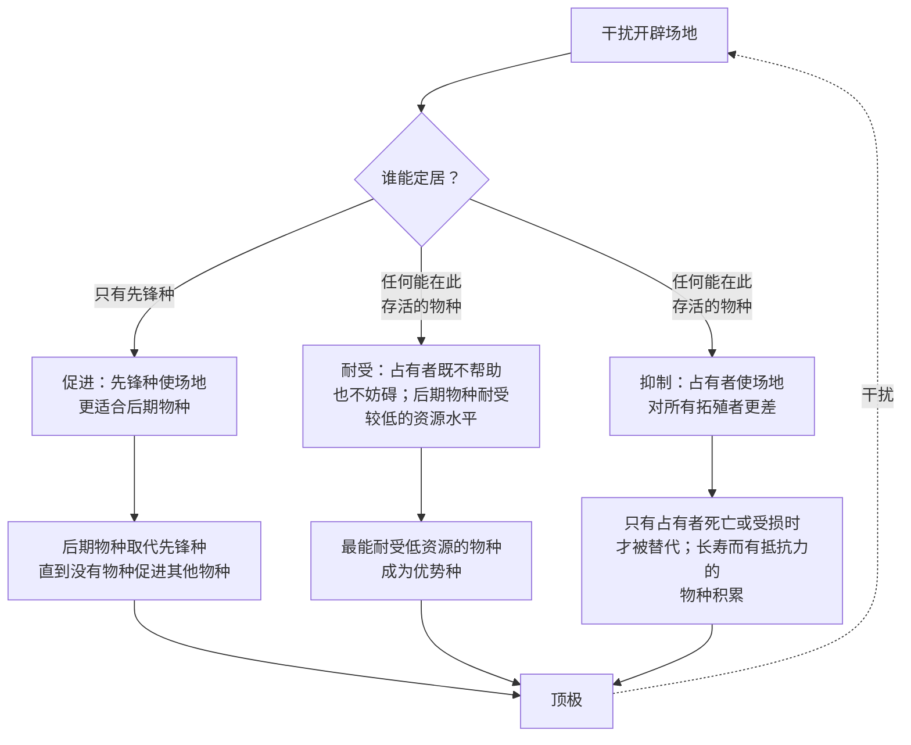

即使气候恒定，群落也随时间而变化。有些变化是内部的、可逆的：物种在一年之中相互更替，它们的丰度逐年围绕均值波动（第 36.1 节）。另一些变化是有方向的。在干扰之后，或在新暴露的地面上，物种拓殖、改变场地，并被另一些物种以大致可预测的顺序取代，这就是**演替**，本章的大部分篇幅讨论它。第 36.2 节界定它的类型并描述原生、次生与异养演替；第 36.3 节追问是什么驱动它们，从 Connell 与 Slatyer 的三种模型到 Tilman 的资源比率假说；第 36.4 节展开 Horn 的 Markov 链模型，其中最终的组成是替代概率矩阵的平稳分布；第 36.5 节讨论终点，即顶极；第 36.6 节讨论演替期间生态系统性质的变化；第 36.7 节讨论演替理论在恢复中的应用。本章以 [7.19.33](/7.19.33) 的林窗动态与干扰、[7.19.16](/7.19.16) 的竞争–拓殖权衡、[7.19.23](/7.19.23) 的资源竞争理论以及 [3.5.9](/3.5.9) 的 Markov 链理论为基础。群落由区域物种库装配的过程在 [7.19.37](/7.19.37) 中继续。

## 36.1. 内部动态：季节变化与波动

群落的组成在一年中随物种按温度、光照和水分的季节循环完成生活周期而变化。在温带草原和落叶阔叶林中，这种变化十分明显：早春短命植物在林冠闭合之前开花并枯萎，夏秋的物种随后出现，群落在每个季节有不同的外观，即*季相*。这些事件的时间安排是**物候学**的主题（[7.19.4](/7.19.4)）。季节变化并不改变群落的身份，它每年重复。

在年与年之间，物种的丰度也会变化，通常是对天气不规则变化的响应。这种变化不使群落被另一个群落取代，称为群落波动。它们有三个特征：物种组成相对稳定，数量特征（密度、盖度、生物量、优势种的重要值）不规则地变化，变化是可逆的。区分三种类型。

| 类型 | 描述 | 典型持续时间 |
|---|---|---|
| 不明显波动 | 物种之间的数量关系变化很小；群落的外貌与结构几乎不变；出现在天气和水文逐年相似的地方 | — |
| 摆动性波动 | 各成员的数量与生产量的短期变化，伴随优势种逐年交替 | 1–5 年 |
| 偏途性波动 | 气候或水分供应的长期偏离使一个或几个优势种明显变化；群落后来通过自我调节回到接近原来的状态 | 5–10 年 |

群落的波动程度各不相同。定性特征（物种组成、种间关系、层次）比定量特征（密度、盖度、生物量）更稳定；成熟群落比发育中的群落更稳定；以木本植物为主的群落比以草本为主的更稳定，常绿木本群落比落叶的更稳定；环境越严酷，波动越大。可逆性是不完全的：波动之后群落趋近而很少精确回到原来的状态，生物的产物，首先是土壤中的有机质，逐年积累。积累的数量变化最终可能改变场地的性质而引发演替。

最长的记录显示群落组成可以多么稳定。在 1856 年开始的 Rothamsted 的 Park Grass 试验中，未施肥样地上禾草、豆科植物和其他草本的比例逐年波动，但一个多世纪中变化很小，而施肥的样地很快分化为新的组成。

## 36.2. 演替：概念与类型

### 36.2.1. 定义

**定义 36.2.1（演替）** **演替**是一个场地上物种种群非季节性的、有方向的、连续的拓殖与灭绝的格局，由此一个群落被另一个群落取代。

从最初的拓殖者到最终的、相对稳定的群落的一系列群落称为*演替系列*，系列中每个可辨认的群落称为*演替阶段*。任何群落的形成都需要三个过程：繁殖体的到达（扩散）、它们的定居（拓殖者的萌发、生长与繁殖，有时称为 *ecesis*）以及已定居植物之间的竞争。演替首先按起始场地的条件分类。

**定义 36.2.2（原生演替与次生演替）** **原生演替**始于未受先前群落影响的基质，或先前的植被连同土壤已被完全除去的基质，如熔岩流、冰碛、新沙丘或滑坡暴露出的岩石。**次生演替**始于植被已被除去、但土壤连同其种子库及其他繁殖体仍保留的场地，如火烧、采伐、风倒或弃耕之后。

陆地上的原生演替通常需要数百年，次生演替需要几十年到一两个世纪。由于很少有演替能从头到尾追踪，大多数是由*年代序列*重建的：一组距演替开始的时间不同的样点（用历史记录、树木年轮、放射性碳或如下面所述的一项研究中的墓碑定年），假定它们遵循了同样的过程。这种以空间代替时间的假设必须检验，因为样点在其他方面也不同，而且自较老样点开始以来，气候与物种库可能已经改变。

### 36.2.2. 原生演替

*火山岛。* 三宅岛是东京以南伊豆群岛的火山岛，有年龄已知的熔岩流，分别为 16 年、37 年、125 年和 800 年以上。16 年的熔岩流上几乎没有土壤，几乎没有氮，只有几株小赤杨（*Alnus sieboldiana*），它通过放线菌共生体固氮。在较老的熔岩流上，赤杨所增加的氮使演替中期的樱（*Prunus speciosa*）以及随后常绿的红楠（*Machilus thunbergii*）得以定居；混交林使赤杨和樱失去光照；寿命更长的栲（*Castanopsis sieboldii*）最终取代红楠（Kamijo 等 2002）。这个序列结合了拓殖、**固氮作用**与促进作用，以及对光的竞争。1883 年的喷发使 Krakatau 无菌，之后从爪哇和苏门答腊重新拓殖：火山灰上先出现蓝绿藻（蓝细菌）结皮和蕨类，随后是草地，再是森林，动物随植被而变化（[7.19.34](/7.19.34)）。

*冰川退缩。* 在阿拉斯加的 Glacier Bay，自 18 世纪末以来冰川退缩了约 100 km，暴露出冰碛的年代序列。苔藓、成垫的仙女木（*Dryas*）和柳的先锋阶段，让位于固氮的绿赤杨（*Alnus viridis*）灌丛，然后是西特卡云杉（*Picea sitchensis*）的森林，约 200 年后是异叶铁杉和山地铁杉。土壤有机质与氮积累，pH 从约 8 降到 5 以下。实验表明，赤杨既通过增加氮而促进云杉，又通过遮荫和对其他资源的竞争而抑制云杉；净效应取决于阶段（Chapin 等 1994）。William Cooper 从 1916 年开始的最初研究是演替研究的奠基性研究之一。

*沙丘。* 在密歇根湖沿岸 13 条年龄已知（30–440 年）的沙丘脊上，年轻的流动沙丘上的沙丘禾草 *Ammophila breviligulata* 之后是灌木和丛生禾草，约 150 年后是松树和其他针叶树，440 年后才是栎和槭。过去认为早期物种通过增加有机质促进后期物种。添加种子和移植幼苗的实验却表明，后期物种可以在年轻沙丘上定居；它们的拓殖受种子扩散和啮齿类的种子捕食所限制（Lichter 2000）。这些沙丘上的序列更多地反映拓殖和竞争取代的瞬态动力学，而不是促进作用，提示机制必须经过实验检验。

### 36.2.3. 次生演替

*喀纳斯泰加林的火。* 在新疆北部阿尔泰喀纳斯地区的北方针叶林中，雷击火引发次生演替。耐火的、树皮厚的西伯利亚落叶松（*Larix sibirica*）幸存；火后头 20 年，喜光的草本和阔叶树，即桦与杨，定居并迅速生长；20 到 50 年间林分郁闭，喜光草本和小阔叶树衰退；50 到 80 年间，耐荫的草本和针叶树（西伯利亚云杉和冷杉）增加；约 80 年后针叶树超过阔叶树，使林冠郁闭，阔叶树死亡。因此火维持着不同年龄林分的镶嵌体，即 [7.19.33](/7.19.33) 第 33.3 节的演替镶嵌体，而**火情**（[7.19.5](/7.19.5)）决定其组成。

*黄土高原的撂荒地。* 凡农田被弃耕的地方都研究过撂荒地演替。在中国黄土高原，Wang（2002）比较了弃耕 3 年、26 年、46 年和 149 年的农田，最老的用墓碑上的铭文定年，因为坟墓附近不被耕种。3 年的农田由一年生或二年生的猪毛蒿（*Artemisia scoparia*）和禾草狗尾草（*Setaria viridis*）占优势，种子产量高。到 26 年，扩散好、侧向营养扩展并有深根系的多年生豆科植物达乌里胡枝子（*Lespedeza davurica*）已取代猪毛蒿。46 年时，生活史多样的多年生植物，包括长芒草（*Stipa bungeana*）、白羊草（*Bothriochloa ischaemum*）与 *Artemisia gmelinii*，使丰富度最高。149 年时，克隆的、有竞争力的多年生禾草白羊草占优势。土壤氮一直在增加。这项研究提示，高原这一部分的顶极是草原而不是森林，这一结论对该地区大规模的恢复计划有实际意义，在那里，种在干燥黄土上的树常常生长不良，并耗竭土壤水分。

*北美与欧洲的撂荒地。* 美国东部 19 世纪被弃耕的农场遵循这样的序列：一年生杂草（马唐 *Digitaria sanguinalis*；小蓬草 *Erigeron canadensis*）、多年生草本（紫菀；弗吉尼亚须芒草 *Andropogon virginicus*）、灌木、演替早期的树木和演替后期的树木。在波罗的海的厄兰岛，几个世纪的低强度放牧把弃耕地上的演替导向半自然草地而不是森林。在那里，丰富度在早期（5–15 年）与早中期（16–50 年）之间增加而功能多样性未增加，功能多样性只在后来增加而丰富度没有进一步增加（Purschke 等 2013）：演替早期由环境与扩散过滤，二者选择相似的物种，演替后期由竞争过滤，竞争选择相异的物种。

### 36.2.4. 水生演替系列与旱生演替系列

原生演替的经典描述对比了两个极端的起点，开阔水体与裸岩，它们都趋向于中等的、中生条件的群落。

*水生演替系列*是湖泊或池塘的填平。它从岸边向中心推进，是一系列同心的带，每一带为下一带准备基质：

1. 自由漂浮植物与浮游生物（浮萍、满江红、藻类）：其残体和从岸上冲入的沉积物抬高湖底。
2. 沉水植物：5–7 m 深处的轮藻（*Chara*），然后在 2–4 m 处是眼子菜（*Potamogeton*）、金鱼藻（*Ceratophyllum*）、黑藻（*Hydrilla*）和茨藻（*Najas*）；大型根生植物很少生长在约 7 m 以下，这是拓殖的极限。
3. 浮叶根生植物（莲 *Nelumbo*；睡莲 *Nymphaea*）：叶片遮蔽水面，残体进一步抬高湖底。
4. 直立水生植物（芦苇 *Phragmites*；香蒲 *Typha*；泽泻 *Alisma*）：密集的根茎截留沉积物，并可形成浮岛，水面露出。
5. 在新形成的、有机的、水饱和的土壤上的莎草和禾草的湿生草甸。
6. 灌木和乔木，最后是中生森林。

*旱生演替系列*始于裸岩或沙地。壳状地衣分泌酸，使岩石表面风化；叶状和枝状地衣为风化的颗粒增加有机质；苔藓积累更多腐殖质并保持水分；耐旱草本（禾草、菊科、蔷薇科）侵入薄薄的土壤；喜光灌木随后占优势；最后在气候允许的地方树木定居并形成森林。

这两个序列都是理想化的，而且非常缓慢，在许多气候下都不以森林告终。它们确实说明了经典观点：演替使群落从极端条件走向中生条件。

演替也可以逆转。*退化演替*（逆行演替）是在持续胁迫（最常见的是人为胁迫）下群落结构的简化与生产力的丧失：过度放牧使高草草地变成由适口性差或耐牧的物种占优势的矮草草地，再变成一年生杂草的稀疏群落，最终成为裸露的、被侵蚀的地面；过度采伐与反复火烧对森林有同样的效果。如 [7.19.33](/7.19.33) 所述，禁牧和过度放牧都能使在适度放牧下演化的草地退化。

### 36.2.5. 演替的分类

| 标准 | 类型 |
|---|---|
| 起始条件 | 原生；次生 |
| 持续时间 | 快速（几年到十年：小洞穴、靠近种源的弃耕地）；长期（几十年到几个世纪：采伐后的森林恢复）；世纪性（地质时间，伴随气候变化与地貌演化，如冰川作用之后） |
| 基质 | 水生（始于水中）；旱生（始于干燥基质） |
| 主要驱动 | 内因：由生物自身的活动驱动（遮荫、土壤形成）；外因：由外部变化驱动（淤积、气候变化、抬升） |
| 群落代谢 | 自养性：总生产量 $P$ 超过群落呼吸 $R$，有机质积累；异养性：$P < R$，有机质被消耗（死亡生物的分解、污染水体） |
| 格局 | 有方向的；周期性的（序列的相位回到起点） |

一个著名的周期性演替是 Watt（1947）描述的苏格兰石楠荒原的石楠循环：石楠（*Calluna vulgaris*）在 30–40 年中经历先锋、建成、成熟和衰退相位；衰退的灌丛倒塌，缺口被地衣（*Cladonia*）与熊果（*Arctostaphylos uva-ursi*）占据，石楠再次拓殖。每个斑块循环，而整个景观是相位的稳定镶嵌体。

### 36.2.6. 异养演替

大型动物死亡时，它的尸体是有机质的脉冲，被可预测的消费者序列所拓殖。研究得最好的例子是深海底的鲸落，它经历四个阶段（Smith 和 Baco 2003）：

1. *移动的食腐者*（盲鳗、睡鲨、端足类、蟹）在几个月到几年内除去软组织。
2. *富集的机会种*（多毛类、甲壳类的密集种群，以及食骨蠕虫 *Osedax*，它借助共生细菌消化骨胶原，见 [7.19.29](/7.19.29) 第 29.1.1 节）在几个月到几年中拓殖骨骼和富集的沉积物。
3. 在*嗜硫*阶段，厌氧细菌分解骨骼中的脂类并产生硫化物，硫化物在几十年中支持化能合成细菌和带有化能合成共生体的动物（贻贝、蛤、管栖蠕虫）。
4. 随后是*礁*阶段，滤食动物把矿物残余物用作硬基质。

一具大型骨骼可以支持三万多个大型底栖动物个体，鲸落中已记录到 400 多个物种，有些别处不见，这些尸体还可能成为热液喷口和冷泉物种扩散的踏脚石。对其他尸体的实验扩大了这一图景。2019 年，路易斯安那大学海洋联盟把鳄鱼尸体放在墨西哥湾约 2000 m 的海底；巨型等足类在一天之内就到达，一具尸体被此前未知的一种 *Osedax* 拓殖。2021 年，中国科学家把三头约 600 kg 的牛的尸体放在南海 650 m、1600 m 和 3400 m 的海底，用原位观测站追踪其分解，比较不同深度的速率与群落。

陆地上的异养演替包括尸体、粪便和倒木中的演替，以及动物体内的演替。例如，人类肠道**微生物群**从出生起经历演替：兼性厌氧菌如肠杆菌和链球菌最先定居并消耗氧；严格厌氧菌（双歧杆菌，然后是拟杆菌门和厚壁菌门）随后出现；多样性随断奶和固体食物增加，约三岁时达到类似成人的组成；老年时组成再次变化（Martino 等 2022；微生物学见 [7.11.29](/7.11.29)）。

## 36.3. 演替的机制

### 36.3.1. 促进、耐受与抑制

Clements（1916）用促进作用解释演替：每个阶段改变场地，使它对自身更不适宜，对下一个阶段更适宜。Connell 和 Slatyer（1977）提出，促进只是三种可能机制之一，并把三者表述为可检验的替代假说。

**定义 36.3.1（促进、耐受与抑制模型）** 在演替的**促进模型**中，只有某些演替早期的物种能拓殖新开辟的场地，它们改变场地，使之更适合后来的物种，后者随后取代它们。在**耐受模型**中，任何能以成体存活的物种都能在早期定居；早期物种既不帮助也不妨碍后期物种，后期物种是耐受早期物种所造成的较低资源水平的物种。在**抑制模型**中，任何物种都能在早期定居，早期占有者使场地对所有后来的拓殖者更不适宜；后期物种只有在早期占有者受损或死亡时才能定居，序列由物种的寿命与抵抗力决定（Connell 和 Slatyer 1977）。

三种模型对去除实验的预测不同。在促进作用下，除去早期物种会减慢后期物种的定居；在抑制作用下会加快；在耐受作用下对后期物种几乎没有影响，它们无论如何都会定居。在加利福尼亚的潮间带岩块上，Sousa（1979）发现，除去早期的绿藻 *Ulva* 大大增加了晚期红藻 *Chondracanthus canaliculatus* 的补充，除去演替中期的红藻（*Gigartina leptorhynchos*、*Gelidium coulteri*）也增加了它的补充：每一步都是抑制。早期物种也更易受干燥和食草动物的伤害，所以演替的进行是因为抑制者先死亡，正如抑制模型所预测的。相反，在俄勒冈的低潮间带，海草 *Phyllospadix scouleri* 的种子带有钩住藻类的倒刺，几乎只附着在演替中期的红藻 *Rhodomela larix* 上：在实验样地中发现的 48 粒种子里，46 粒在有藻类的对照样地中，2 粒在去除藻类的样地中，且都附着在再生的 *Rhodomela* 上（Turner 1983）。这是专性的促进作用。在北卡罗来纳 Piedmont 的弃耕地中，小蓬草抑制紫菀，而紫菀促进须芒草生长（Keever 1950）；在 Glacier Bay，赤杨既促进又抑制云杉。大多数真实的演替结合了几种机制，其平衡随阶段而变化。

### 36.3.2. 拓殖与竞争之间的权衡

演替早期的植物具有一组相关联的性状：许多小种子、有效的扩散、资源丰富时快速生长、资源稀缺时生长和存活差。演替后期的物种有相反的性状：种子少而大、生长缓慢，以及在低水平的光和养分下生长、存活和竞争的能力。没有干扰时，后期物种最终通过把资源降低到早期物种所需水平以下而排除早期物种。早期物种以两种方式成功（Rees 等 2001）。

- *竞争–拓殖权衡。* 早期物种最先到达：其扩散与繁殖力使它们能在后期物种到达之前拓殖刚受干扰的场地，并通过不断拓殖新场地而在景观中延续。这就是 [7.19.16](/7.19.16) 的**竞争–拓殖权衡**，其在干扰下对多样性的后果已在 [7.19.33](/7.19.33) 的命题 33.3.2 中推导。它的生理基础是种子数量与种子大小之间的权衡：小种子的物种是好的拓殖者和差的竞争者，大种子的物种则相反。在演化上，早期物种被选择为逃离演替（**r 选择**），后期物种被选择为在演替中持续（**K 选择**）。
- *演替生态位。* 即使同时到达，早期物种也可以暂时胜过后期物种，因为它们在资源丰富的早期条件下生长更快。颤杨（*Populus tremuloides*）、北美红栎（*Quercus rubra*）与糖槭（*Acer saccharum*）的幼苗按此顺序出现在北美的演替中，沿光梯度培养：只要相对光照超过全日照的约 5 %，颤杨就比其他两种长得快，但在深荫下顺序颠倒，栎与槭生长与存活得更好（Kaelke 等 2001）。

Noble 与 Slatyer（1981）按*生活属性*对植物分类：干扰之后的恢复方式（营养扩展、种子库的幼苗脉冲、大量扩散的幼苗脉冲，或都不是）与在竞争中定居的能力（耐受或不耐受）。由这些属性和每个物种的寿命，可预测某种干扰之后物种的序列。例如，在易火植被中，*再萌发者*以带深根和木块茎的个体在火中幸存，*再播种者*被杀死但由受热刺激的种子补充，火的间隔短有利于再萌发者，间隔长有利于再播种者。

### 36.3.3. 资源比率假说

Tilman（1985）用两种资源（通常是土壤养分与光）相对供应量的变化，结合他的两种资源竞争理论（[7.19.23](/7.19.23)）来解释演替。在新暴露的基质上，土壤缺氮但地面的光很充足；随着土壤发育，氮积累，植物生物量增加，地面的光减少。如果物种按其对两种资源的需求之间的权衡（即它们的 $R^*$ 值）排序，则每个阶段获胜的物种是其需求与当前资源供应比率相匹配的物种，优势种的序列沿供应点在资源平面中的轨迹展开。因此每个物种有一个由资源比率界定的“演替生态位”。

图示出了这类消费者–资源模型。五个物种竞争土壤氮 $N$ 与光 $L$，生长受较稀缺资源的限制（Liebig **最小因子定律**，[7.13.4](/7.13.4)）：

$$
\frac{\mathrm{d}B_i}{\mathrm{d}t} = B_i\left[r\min\left(\frac{N}{N + k_{N,i}}, \frac{L}{L + k_{L,i}}\right) - m\right], \qquad L = \mathrm{e}^{-\kappa\sum_jB_j}, \tag{36.1}
$$
半饱和常数的排序使物种 1 需要很少的氮而需要很多的光，物种 5 相反，可得氮向一个随土壤发育而升高的供应量更新。物种按顺序相互取代，多样性在演替中期最高，此时供应比率经过多个物种需求相似的区域。

Tilman 在明尼苏达 Cedar Creek 的实验部分地支持该假说：在年代序列的撂荒地上，土壤总氮随撂荒年龄增加，演替后期的禾草（小须芒草 *Schizachyrium scoparium* 与大须芒草 *Andropogon gerardii*）对氮的 $R^*$ 低于早期物种。但后期物种也生长缓慢，所以该序列既反映了氮–光权衡，也同样反映了最大生长速率与对氮的竞争能力之间的权衡。资源比率假说与竞争–拓殖权衡是互补的：一个解释每个阶段哪些物种能获胜，另一个解释它们以什么顺序到达。

### 36.3.4. 动物与天敌

如果演替后期的优势种受种子到达所限制（竞争–拓殖权衡），破坏或传播种子的动物就能改变演替的步伐。从撂荒地中除去昆虫种子捕食者，使通常在演替约五年时出现的高大一枝黄花（*Solidago altissima*）在仅三年之后就占优势（Carson 和 Root 1999）；在密歇根湖的沙丘上，啮齿类限制后期物种的定居（第 36.2.2 节）。新热带的食果蝙蝠把演替早期的树种传播到废弃土地上。偏好早期物种的食草动物加速演替，偏好后期物种的则减缓。动物常常是植物演替的被动跟随者，大多数鸟类和菌根真菌也是如此，但通过传播种子和影响植物存活，它们影响演替的进程。

## 36.4. 演替的 Markov 链模型

### 36.4.1. Horn 模型

Horn（1975，1981）提出，不必解释机制，就可以由逐株树木替代的概率预测森林演替。考虑一个被物种 $i$ 的树占据的林冠位点。在固定的间隔（这里是 50 年）内，该树被物种 $j$ 的树取代的概率为 $p_{ij}$；Horn 由新泽西州普林斯顿附近一片森林中各物种成年树下发现的各物种幼树的比例估计了这些概率。如果每棵树的替代与场地的历史无关，则连续间隔中占据一个位点的物种是时齐的 **Markov 链**，其转移矩阵为 $P = (p_{ij})$（3.5.9 的[定义 9.3.1](/3.5.9#def-9.3.1)）：

| 现有占据者 | 灰桦 | 黑紫树 | 红花槭 | 山毛榉 |
|---|---|---|---|---|
| 灰桦（*Betula populifolia*） | 0.05 | 0.36 | 0.50 | 0.09 |
| 黑紫树（*Nyssa sylvatica*） | 0.01 | 0.57 | 0.25 | 0.17 |
| 红花槭（*Acer rubrum*） | 0.00 | 0.14 | 0.55 | 0.31 |
| 山毛榉（*Fagus grandifolia*） | 0.00 | 0.01 | 0.03 | 0.96 |

被先锋种灰桦占据的位点，50 年后仍为灰桦的机会只有 5 %，为红花槭的机会为 50 %；山毛榉位点再次为山毛榉的概率为 0.96。若 $\boldsymbol{\pi}_t$ 是 $t$ 个间隔后各物种所占位点比例的行向量，全概率公式给出

$$
\boldsymbol{\pi}_{t+1} = \boldsymbol{\pi}_tP, \qquad \boldsymbol{\pi}_t = \boldsymbol{\pi}_0P^t. \tag{36.2}
$$
从纯灰桦林分开始，50 年后的组成为 $P$ 的第一行，$(5, 36, 50, 9)\,\%$，100 年后为 $(1, 29, 39, 31)\,\%$，200 年后为 $(0, 18, 24, 58)\,\%$，并趋于约 $(0, 5, 9, 86)\,\%$，接近该地区老森林的组成 $(0, 3, 4, 93)\,\%$。

### 36.4.2. 平稳组成

**命题 36.4.1（向平稳组成的收敛）** 设 $P$ 是不可约、非周期的有限 Markov 链的转移矩阵。则存在唯一的**平稳分布** $\boldsymbol{\pi}$，满足 $\boldsymbol{\pi} = \boldsymbol{\pi}P$ 与 $\sum_j\pi_j = 1$，所有 $\pi_j > 0$，且对每个初始组成 $\boldsymbol{\pi}_0$ 都有 $\boldsymbol{\pi}_0P^t \to \boldsymbol{\pi}$。若 $P$ 可对角化，特征值为 $1 = \lambda_1 > \lvert\lambda_2\rvert \ge \cdots$，则到平衡的距离按 $\lvert\lambda_2\rvert^t$ 下降。

**证明** 存在性、唯一性与收敛性是有限不可约非周期链的基本极限定理（3.5.9 的[定理 9.3.3](/3.5.9#thm-9.3.3)）；所有 $\pi_j$ 为正由不可约性得出。对于速率，写 $\boldsymbol{\pi}_0 = \boldsymbol{\pi} + \sum_{k\ge2}a_k\boldsymbol{u}_k$，其中 $\boldsymbol{u}_k$ 是 $P$ 对应特征值 $\lambda_k$ 的左特征向量（$\boldsymbol{\pi}$ 的系数为 1，因为每个 $k \ge 2$ 的 $\boldsymbol{u}_k$ 之和为零：$\boldsymbol{u}_kP\boldsymbol{1} = \boldsymbol{u}_k\boldsymbol{1}$ 且 $\boldsymbol{u}_kP\boldsymbol{1} = \lambda_k\boldsymbol{u}_k\boldsymbol{1}$，而 $\lambda_k \ne 1$）。于是 $\boldsymbol{\pi}_0P^t = \boldsymbol{\pi} + \sum_{k\ge2}a_k\lambda_k^t\boldsymbol{u}_k$，衰减最慢的项正比于 $\lambda_2^t$。$\square$

Horn 的矩阵是不可约的（每个物种最终都可通过红花槭与黑紫树取代其他物种）且非周期的（对角元全为正）。它对应特征值 1 的左特征向量是

$$
\boldsymbol{\pi} \approx (0.0005,\ 0.048,\ 0.085,\ 0.866),
$$
这就是平稳组成：87 % 山毛榉、9 % 红花槭、5 % 黑紫树，以及微量灰桦。其他特征值为 $0.716$、$0.369$ 和 $0.045$。第二特征值决定演替的时间尺度：与平稳组成的偏差每 50 年缩小为 $0.716$ 倍，e 折时间为 $-50/\ln0.716 \approx 150$ 年，所以初始偏差的 90 % 在约 $2.30\times150 \approx 340$ 年后消失（下图的 B 栏）。这就是该模型的“到达顶极的时间”。

该模型提出了几点超出其假设仍然成立的结论。

1. *顶极是统计平衡。* 只要邻近地区提供所有物种的种子，则无论起始组成如何，平稳组成都相同；但单个位点继续变化。顶极森林是树木相互取代的镶嵌体，是一种“移动的镶嵌稳态”，如 Watt（1947）的格局与过程。
2. *单顶极与吸收态。* 如果后期物种只取代自己（$p_{\mathrm{beech,beech}} = 1$），链就有吸收态，每个位点最终都会是山毛榉：单一顶极。当被其他物种取代的概率很小但为正时，平稳组成是混合的。Clements 的单一顶极与混合的动态顶极之间的区别，因此归结为后期物种能否被取代的问题。
3. *Connell 与 Slatyer 的机制表现为 $P$ 的结构。* 在促进作用下，早期物种很少被自己取代，转移沿固定序列“向上”；在抑制作用下，早期物种自我替代的概率高，只有当其占有者死亡时才发生转移；在耐受作用下，从任何物种到最耐荫物种的转移频繁。

这些假设是有限制的：替代概率被当作在时间和空间上恒定，与位点的邻居和历史（到达的顺序、初始条件）无关，间隔也固定。Facelli 和 Pickett（1990）等指出，这些假设在许多群落中不成立，而且该模型只预测而不解释。然而，在缅因湾岩壁上海绵、海葵、多毛类与壳状藻类的潮下带演替中，用平均概率、随空间变化的概率和随时间变化的概率的模型，预测了相似的序列和终点，都接近观测到的结构（Hill 等 2002）。现代的个体森林模型（林窗模型，如 JABOWA 与 SORTIE）追踪每棵树的定居、生长、对光的竞争和死亡；这类模型曾依据种群统计数据重现波多黎各一片亚热带干旱森林 37 个物种 300 年的演替（Holm 等 2012）。Markov 模型仍可用于概括长期数据，并通过在链中加入“受干扰”状态，来预测不同干扰体制下景观的组成。

## 36.5. 顶极

**定义 36.5.1（顶极群落）** **顶极群落**（顶极）是演替终点处相对稳定的群落，只要场地条件与干扰体制不变，它就只带着波动而持续存在。

有三种理论描述顶极与环境的关系。

- *单顶极理论*（Clements 1916）。每个演替都经过六个过程，即迁移（到达）、定居、聚集、竞争、反应（植物对场地的改变）与稳定，终结于与区域气候平衡的群落，即*气候顶极*。在一个气候区内，始于极不相同场地的演替趋于一致：干旱的场地变得更中生，湿生的场地变得更干，全都终结于同一个气候顶极。其他稳定的群落被视为受局部因素阻滞的阶段（*亚顶极*、*偏途顶极*）。
- *多顶极理论*（Tansley 1939）。任何在其场地上稳定而自我延续的群落都是顶极；一个气候区除地带性场地上的气候顶极之外，还包含许多顶极，分别由土壤（土壤顶极）、地形（地形顶极）、火（火顶极）、食草动物之类的动物（动物顶极）或它们的组合（地形–土壤顶极、火–动物顶极）决定。
- *顶极–格局假说*（Whittaker 1953）。环境因素连续变化，顶极群落也是如此：一个区域含有的不是一组离散的顶极，而是沿环境梯度连续的顶极植被格局。分布最广的顶极，通常位于格局的中心，最能反映区域气候，是*优势顶极*，对应于单顶极理论的气候顶极。这一想法扩展了 Whittaker 对田纳西 Great Smoky 山脉植被的梯度分析（[7.19.32](/7.19.32)），那里树种的丰度沿海拔与湿度梯度各自连续地变化。

单顶极与多顶极理论都认为，顶极是向适应场地的稳定状态的定向变化的结果；它们的分歧在于是否仅由气候决定。顶极–格局假说遵循 Gleason 的群落个体论观点。实际上很难确认稳定的顶极：通常只能说变化的速率已经慢到无法察觉。潮间带群落可能几年内趋同，撂荒地需要一到五个世纪，其间火与风暴常使这一过程重新开始，而北方森林仍在响应末次冰期的结束。Horn 的模型提示一个可操作的定义：顶极是当前干扰体制下替代过程的平稳分布。

## 36.6. 生态系统发育

Odum（1969）把演替期间生态系统性质的变化，他称之为生态系统发育，总结成一张从发育（早期）阶段到成熟（后期）阶段的趋势表。主要的有：

| 性质 | 早期阶段 | 成熟阶段 |
|---|---|---|
| 总生产量 / 群落呼吸（$P/R$） | 大于或小于 1 | 接近 1 |
| 总生产量 / 现存生物量（$P/B$） | 高 | 低 |
| 单位能流所支持的生物量（$B/E$） | 低 | 高 |
| 群落净生产量（产量） | 高 | 低 |
| 食物链 | 线性，以牧食为主 | 网状，以碎屑为主 |
| 有机质总量 | 少 | 多 |
| 无机养分 | 生物体外 | 生物体内 |
| 矿质循环 | 开放 | 封闭 |
| 生物与环境之间的养分交换 | 快 | 慢 |
| 碎屑在养分再生中的作用 | 不重要 | 重要 |
| 物种多样性 | 低 | 高 |
| 生化多样性、成层现象与空间异质性 | 低，组织差 | 高，组织良好 |
| 生物的大小；生活周期 | 小；短而简单 | 大；长而复杂 |
| 选择压力 | 快速生长（**r 选择**） | 反馈控制（**K 选择**） |
| 养分保持；对扰动的抵抗力 | 差 | 好 |

前几项趋势来自一个简单的碳平衡。设 $B$ 为自养群落的生物量，总生产量 $P(B)$ 随生物量增加但随林冠闭合而饱和，呼吸（植物与其凋落物分解者的）正比于生物量：

$$
\frac{\mathrm{d}B}{\mathrm{d}t} = P(B) - R(B), \qquad P(B) = \frac{P_{\max}B}{B + K}, \quad R(B) = \rho B. \tag{36.3}
$$

**命题 36.6.1（碳平衡的趋势）** 若 $P_{\max} > \rho K$，则式 (36.3) 有唯一的正平衡点 $B^* = P_{\max}/\rho - K$，对 $B > 0$ 全局稳定。沿从小 $B$ 出发的任一轨迹，比值 $P/R = P_{\max}/[\rho(B + K)]$ 从 $P_{\max}/(\rho K) > 1$ 单调降到 1，比值 $B/P = (B + K)/P_{\max}$ 单调增加到 $1/\rho$。

**证明** 对 $B > 0$，$P(B) = R(B)$ 给出 $P_{\max}/(B + K) = \rho$，所以 $B^* = P_{\max}/\rho - K$，由假设为正。当 $0 < B < B^*$ 时，$P/R = P_{\max}/[\rho(B + K)] > 1$ 且 $\dot B > 0$；当 $B > B^*$ 时 $\dot B < 0$；所以 $B(t) \to B^*$ 单调。$P/R$ 是 $B$ 的减函数，在 $B^*$ 处等于 1，$B/P = (B + K)/P_{\max}$ 是增函数，在 $B^*$ 处等于 $(B^* + K)/P_{\max} = 1/\rho$。$\square$

因此，净生态系统生产力 $P - R$（[7.19.42](/7.19.42)）在早期达到峰值，到成熟时降为零，而生物量与单位生产量所支持的生物量不断上升（下图）。在异养演替中，如尸体或污染溪流的有机负荷的分解，输入的有机质的呼吸超过生产，$P/R < 1$；随着有机质被用尽、自养生物定居，$P/R$ 向 1 上升。Odum 关于 $P/R$ 从两侧趋近 1 的预测，是他的趋势中最稳健的一条。

其他趋势不那么普遍。物种丰富度常在演替中期达到峰值，在最后阶段下降（[7.19.35](/7.19.35) 的第 35.4.1 节，以及第 36.3.3 节资源比率图的 C 栏）。养分保持在非常古老的生态系统中可能下降：瑞典岛屿上、夏威夷火山土壤上以及澳大利亚和新西兰沙丘上的长年代序列显示了*退化阶段*，持续数千到数百万年，其间磷因风化与淋溶而丧失或被锁在不可利用的形态中，生物量与生产力下降，植被变得更矮、更开阔（Wardle、Walker 和 Bardgett 2004）。Odum 的表描述的是几十年到几个世纪内发育的一种趋势，而不是定律；其趋势是要在每个系统中检验的假说，有几条已经被证实（$P/R$、$P/B$ 与 $B/E$ 趋势，向碎屑食物链的转变），而另一些只在某些系统中成立。

## 36.7. 演替与恢复

恢复生态学应用演替理论，加速或改变退化土地上的演替（[7.19.52](/7.19.52)）。每种机制提示一类干预。

- *克服扩散限制（竞争–拓殖权衡）。* 在巴拿马和哥斯达黎加废弃的热带牧场上，大种子的演替后期树木，如 *Dipteryx panamensis* 与 *Genipa americana*，很少到达，因为它们的种子依赖来自遥远森林斑块的鸟、蝙蝠或灵长类；人工种植后，它们存活良好，绕过了多达 70 年的演替（Martínez-Garza 和 Howe 2003）。人工鸟栖木大大增加了智利温带演替早期森林中鸟类传播的树木种子的扩散。
- *恢复演替生态位。* 在新南威尔士被白茅（*Imperata cylindrica*）入侵的采沙土地上，除去白茅并播种本地种子没有恢复木本植被，但添加富含有机质的土壤却做到了：限制因素是场地条件，而不是竞争（Cummings 等 2005）。
- *利用促进作用。* 在西班牙南部的 Sierra Nevada，先锋灌木在炎热干燥的地中海夏季对栎、槭与演替中期灌木的幼苗起保育植物的作用，增加氮和遮荫的豆科灌木是最好的保育植物；有**化感作用**的岩蔷薇（*Cistus*）则根本不是保育植物（Gómez-Aparicio 等 2004）。因此，在种树前清除灌木的传统做法在严酷的场地上适得其反。
- *控制天敌。* 在香港，排除啃食哺乳动物的树木保护套，比减少竞争的除草垫更能改善演替后期的栎 *Cyclobalanopsis edithiae* 幼苗的生长与存活，并降低每株存活幼苗的成本（Lai 和 Wong 2005）。

区分三种森林恢复的大策略。*被动恢复*（自然更新）除去退化的原因，如放牧或耕种，让演替进行；它成本低，在种源与土壤尚存之处产生最自然的群落。*应用成核*种植小块树木岛屿，吸引传播种子的动物并向外扩展，是成本与速度的折中。*人工林*在整个区域种植树木，速度快，但成本高，且常常物种很少。一项比较人工林与天然林的全球综合发现，相对于天然林，人工林提供大约三分之二的碳储存、不到一半的水土保持、约九成的水供应和大约四分之三的生物多样性，建成时间长的人工林比年轻的稍好，水土保持除外（Hua 等 2022）。单一树种的人工林几乎可以没有野生动物：云南西双版纳取代了热带森林的橡胶林，支持的鸟类、哺乳动物和昆虫物种比森林少得多。通过疏伐、林下补植本地物种和让其自然更新，把人工林恢复为天然林，现在是中国林业的目标，如山水自然保护中心在北京门头沟京西林场的森林恢复项目，其实验样地检验把人工林变为更自然森林的方法。

演替理论也用于海洋。“人工鲸落”海洋牧场有意在合适的海域沉放大型动物的尸体，以模仿天然鲸落（第 36.2.6 节），为有商业价值的物种和生物多样性提供食物、能量和硬基质；这一想法正在中国试验，其对渔业的影响尚待评估。

## 小结

| 主题 | 要点 | 节 |
|---|---|---|
| 内部动态 | 季相；波动（不明显、摆动性 1–5 年、偏途性 5–10 年），组成稳定、数量多变、可逆性不完全 | 36.1 |
| 演替 | 定义 36.2.1；原生与次生（定义 36.2.2）；年代序列；三宅岛、Glacier Bay、密歇根湖沙丘；喀纳斯火后演替；黄土高原撂荒地到草原 | 36.2.1–36.2.3 |
| 系列与类型 | 水生演替系列从岸边到中心，旱生演替系列从地衣到森林；退化演替；分类；周期性的石楠演替；异养演替（分四个阶段的鲸落、其他尸体落、肠道微生物群） | 36.2.4–36.2.6 |
| 机制 | 促进、耐受与抑制模型（定义 36.3.1）与去除实验；竞争–拓殖权衡与演替生态位；生活属性；资源比率假说（式 (36.1)）；种子捕食者与传播者 | 36.3 |
| Markov 模型 | $\boldsymbol{\pi}_{t+1} = \boldsymbol{\pi}_tP$；Horn 的森林收敛到 $(0, 5, 9, 86)\,\%$；速率由 $\lambda_2 = 0.716$ 每 50 年决定，90 % 约需 340 年（命题 36.4.1）；顶极是统计平衡；局限 | 36.4 |
| 顶极 | 单顶极（Clements）、多顶极（Tansley）、顶极–格局（Whittaker） | 36.5 |
| 生态系统发育 | Odum 的表；$P/R \to 1$，$B/P$ 上升，NEP 早期达峰（命题 36.6.1）；多样性常在演替中期达峰；非常古老的生态系统中的退化 | 36.6 |
| 恢复 | 克服扩散限制、恢复场地条件、利用保育植物、控制天敌；被动恢复、应用成核、人工林；人工林提供的少于天然林 | 36.7 |

## 思考题

1. 用 Horn 的矩阵，计算现为 50 % 红花槭与 50 % 山毛榉的林分 50 年后的组成。哪个物种增加？

   **答** $\boldsymbol{\pi}_1 = 0.5(0, 0.14, 0.55, 0.31) + 0.5(0, 0.01, 0.03, 0.96) = (0, 0.075, 0.29, 0.635)$。山毛榉从 50 % 增加到 63.5 %，红花槭从 50 % 降到 29 %，黑紫树出现，占 7.5 %。林分向平稳组成 $(0, 5, 9, 87)\,\%$ 移动。

2. 一个双物种森林，每 50 年的替代概率为 $p_{12} = a$（先锋种被后期物种取代）与 $p_{21} = b$（后期物种被先锋种取代）。对 $a = 0.6$ 与 $b = 0.05$，求平稳组成与收敛的 e 折时间。若 $b = 0$ 会怎样？

   **答** 由 3.5.9 的[例 9.3.2](/3.5.9#ex-9.3.2)，$\boldsymbol{\pi} = (b/(a + b), a/(a + b)) = (0.05/0.65, 0.6/0.65) = (7.7\,\%, 92.3\,\%)$，第二特征值为 $1 - a - b = 0.35$，所以偏差每 50 年缩小为 0.35 倍，e 折时间为 $-50/\ln0.35 \approx 48$ 年。若 $b = 0$，后期物种是吸收态：平稳分布为 $(0, 1)$，是后期物种的单一顶极，以速率 $(1 - a)^t$ 趋近。

3. 设计一个实验，区分撂荒地上演替早期灌木被演替后期树木取代的促进、耐受与抑制模型。

   **答** 在有该灌木的田地中建立重复样地，（1）除去灌木（并阻止其返回），（2）保持其完整，并在两者中（3）以受控密度播种或种植该树；测量几年中树的萌发、存活与生长。在促进作用下，树在灌木被除去之处表现更差；在抑制作用下表现更好；在耐受作用下，除去灌木对树影响很小，树无论如何都能定居，但生长缓慢。纳入区分机制的处理（用遮阳布模拟灌木的遮荫、添加氮、排除可能被灌木庇护的种子捕食者或食草动物），并在湿度不同的地点重复，因为预期促进作用在更严酷的条件下更强（胁迫梯度假说，[7.19.29](/7.19.29)）。

4. 在命题 36.6.1 的模型中取 $P_{\max} = 2$、$K = 1$（kg C m⁻²）与 $\rho = 0.1$ 每年，求平衡生物量、初始 $P/R$，以及净生态系统生产力最大时的生物量。

   **答** $B^* = P_{\max}/\rho - K = 20 - 1 = 19$ kg C m⁻²。当 $B \to 0$ 时，$P/R \to P_{\max}/(\rho K) = 20$。净生产量 $N(B) = 2B/(B + 1) - 0.1B$ 的导数为 $2/(B + 1)^2 - 0.1$，在 $(B + 1)^2 = 20$ 处为零，$B = \sqrt{20} - 1 \approx 3.5$ kg C m⁻²，此处 $N \approx 1.55 - 0.35 = 1.2$ kg C m⁻² 每年。净生产量在不到平衡生物量的五分之一处最大，这就是年轻的、生长中的林分固碳最快，而老林分储存最多的原因。

5. （开放题）黄土高原上某县计划在山上所有的弃耕地上植树。根据该地区演替的已知情况，你会提什么建议？

   **答** 要点：（1）年代序列研究（Wang 2002）表明，高原大部分地区撂荒地演替的终点是由白羊草、*Stipa* 和 *Artemisia* 占优势的草原，而不是森林，因为降水是限制因素；（2）干燥黄土上的密植人工林常常生长不良，形成“小老树”并耗竭深层土壤水分，这可能损害之后的植被与水供应；（3）停止耕种和放牧后草地的自然更新（被动恢复）能有效控制侵蚀且成本低，土壤氮与多样性随撂荒年龄增加；（4）树木和灌木可以放在演替生态位允许的较湿润的地点（谷底、阴坡），可用本地物种和保育灌木；（5）监测土壤水分、盖度与多样性，并调整计划。一般原则是使恢复与区域气候下的潜在顶极相匹配，利用演替而不是取代它。
