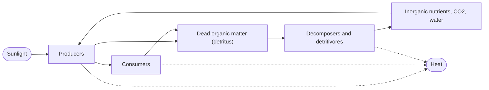

The preceding chapters studied populations and communities of organisms. This chapter begins the study of ecosystems, in which the organisms of a place are considered together with their physical and chemical environment as one system through which energy flows and matter cycles. The ecosystem is the level at which ecology meets physics, chemistry and the earth sciences, and at which most practical questions about the environment, fisheries, agriculture, water quality, climate, are posed. Section 40.1 traces the concept and defines it. Section 40.2 describes the components of an ecosystem and the processes that link them; production, secondary production and decomposition are treated quantitatively in [7.19.42](/7.19.42)–[7.19.44](/7.19.44), the cycles of matter in [7.19.45](/7.19.45)–[7.19.46](/7.19.46). Section 40.3 surveys the main kinds of ecosystems, whose distribution over the earth is the subject of [7.19.41](/7.19.41). Section 40.4 treats the regulation of ecosystems by feedback, the concept of ecological balance and the Gaia hypothesis, with two models; Section 40.5 asks what we learn from building ecosystems in containers, from laboratory microcosms to Biosphere 2 and the life-support systems of spacecraft. The food webs that structure the biotic part of ecosystems were treated in [7.19.38](/7.19.38)–[7.19.39](/7.19.39).

## 40.1. The Ecosystem Concept

### 40.1.1. Origins

The idea that organisms and their environment form a unit is old, but its scientific formulation dates from the late nineteenth century. Möbius (1877) called the community of an oyster bank a *biocoenosis*; Forbes (1887), in "The Lake as a Microcosm", described a lake as a system in which "nothing can be fully understood until its relations to the whole are clearly seen". The physical chemist Lotka (1925) treated the organic and inorganic world as a single system of energy transformations. The word *ecosystem* was coined by the British plant ecologist Arthur Tansley (1935), who wanted a term free of the organismic analogies of Clements' theory of the community as a superorganism: "the whole system (in the sense of physics), including not only the organism-complex, but also the whole complex of physical factors forming what we call the environment". Russian ecologists developed the parallel concept of the *biogeocoenosis* (Sukachev 1944).

Lindeman (1942), in his study of the senescent lake Cedar Bog Lake in Minnesota, gave the concept its quantitative core, the *trophic-dynamic* view: an ecosystem is a system of energy transfer between trophic levels, and its structure can be described by the rates of energy flow and the efficiencies of transfer ([7.19.43](/7.19.43)). The brothers Eugene and Howard Odum made the ecosystem the organizing concept of ecology in the 1950s and 1960s, with systems diagrams, energy budgets of whole ecosystems (Silver Springs, Florida; Eniwetok coral reef) and radioactive tracers, and the International Biological Programme (1964–1974) measured the productivity of ecosystems around the world.

### 40.1.2. Definition and Properties

**Definition 40.1.1 (Ecosystem)** An **ecosystem** is the biotic community of a given area together with its abiotic environment, forming a functional unit through which energy flows and matter cycles between living and non-living components.

The definition does not fix a scale: a water-filled tree hole, a pond, a forest catchment and the whole biosphere are ecosystems, and the choice of boundaries is set by the question. Odum emphasized that ecosystems are open systems: energy must enter (as sunlight or as imported organic matter) and leave (as heat), and matter and organisms move in and out. A complete description therefore includes an *input environment* and an *output environment* as well as the system itself; the larger the system, the less it depends on exchanges across its boundary relative to its internal flows. Lakes, catchments bounded by ridges and islands have natural boundaries, which is why they have been the classical objects of ecosystem studies, from Lindeman's lake to the catchments of the Hubbard Brook Experimental Forest ([7.19.45](/7.19.45)).

Ecosystems have several general properties:

| Property | Meaning |
|---|---|
| Structural and functional unit | the lowest level of the ecological hierarchy that contains all components needed for the persistence of life: producers, consumers, decomposers and the abiotic environment |
| Three basic functions | one-way energy flow, from sunlight through organisms to heat; cycling of matter (carbon, nitrogen, phosphorus, water) between organisms and environment; information flow (physical, chemical and behavioral signals) |
| Self-regulation | feedbacks within the system keep many of its properties within limits (Section 40.4) |
| Limited number of trophic levels | because energy is lost at each transfer, food chains rarely exceed four to six levels ([7.19.38](/7.19.38#sec-38.2)) |
| Dynamics | ecosystems change by succession ([7.19.36](/7.19.36)), fluctuate and respond to disturbance |

## 40.2. The Components of an Ecosystem

### 40.2.1. Four Components

Every ecosystem has four kinds of components: the abiotic environment and three functional groups of organisms, defined by their role in energy flow and matter cycling.

**Definition 40.2.1 (Producers, Consumers and Decomposers)** **Producers** are the autotrophic organisms of an ecosystem, which synthesize organic matter from inorganic substances using light (photosynthesis) or the energy of inorganic chemical reactions (chemosynthesis). **Consumers** are heterotrophic organisms that obtain energy and matter by eating other living organisms or parts of them. **Decomposers** are heterotrophic organisms, chiefly bacteria and fungi, that obtain energy by breaking down dead organic matter (detritus) and excretions, releasing the inorganic nutrients that producers reuse.

1. *The abiotic environment* comprises the inorganic substances that take part in the cycles (carbon, nitrogen, $\ce{CO2}$, $\ce{O2}$, water, calcium, phosphorus, potassium), the organic compounds that link the biotic and abiotic parts (proteins, carbohydrates, lipids, and above all the humic substances of soils and sediments, which never occur inside cells), and the climate and physical conditions (temperature, precipitation, light, pressure) treated in [7.19.2](/7.19.2)–[7.19.5](/7.19.5).
2. *Producers*, the **autotrophs** ([7.1.1](/7.1.1)): green plants, algae and cyanobacteria (photoautotrophs), and chemoautotrophic bacteria and archaea, which oxidize hydrogen sulfide, ammonia, ferrous iron or methane and are the base of the food webs of hydrothermal vents ([7.11.29](/7.11.29)). Producers fix solar energy as chemical energy in organic matter, which supports themselves and all other organisms; their production is primary production ([7.19.42](/7.19.42)).
3. *Consumers*, **heterotrophs** that eat living organisms: herbivores (primary consumers), carnivores that eat herbivores (secondary consumers), carnivores that eat carnivores (tertiary consumers), and omnivores, parasites and parasitoids. Their production is **secondary production** ([7.19.43](/7.19.43)). Odum called them *phagotrophs* or macroconsumers.
4. *Decomposers*, the *saprotrophs* or microconsumers. They break down detritus and absorb the products; together with the detritivorous animals (earthworms, millipedes, springtails, dung beetles) that fragment and ingest dead matter, they carry out decomposition ([7.19.44](/7.19.44)). Their activity is the reverse of production: it releases energy as heat and returns nutrients to the inorganic pool.

The groups are functional, not taxonomic, and several intuitive statements are false:

| Statement | True? | Counterexamples |
|---|---|---|
| All bacteria are decomposers | no | cyanobacteria and chemoautotrophic nitrifying and sulfur bacteria are producers; pathogenic and predatory bacteria (*Bdellovibrio*) are consumers |
| All animals are consumers | no | earthworms, dung beetles and many soil invertebrates that eat dead matter function in decomposition (as detritivores) |
| All producers are green plants | no | algae, cyanobacteria and chemoautotrophs are producers |
| All plants are producers | no | holoparasitic plants (dodder *Cuscuta*, *Rafflesia*) and mycoheterotrophic orchids and *Monotropa* are consumers |

The components are linked by energy flow and nutrient cycles:

Energy enters as light, passes from producers to consumers and decomposers, and leaves as heat (dashed); it is not recycled. Nutrients pass along the same paths but return to the inorganic pool through decomposition, and are used again.

### 40.2.2. Spatial and Temporal Organization

The autotrophic and heterotrophic processes are partly separated in space and time. In most ecosystems photosynthesis is concentrated in an upper "green belt", the canopy of a forest or the illuminated surface layer of a lake, while decomposition is concentrated in a lower "brown belt" of litter, soil and sediment (Odum). Only a small part of the organic matter produced is eaten while alive; most of it, especially in forests, becomes detritus and is consumed weeks, years or, for peat and fossil fuels, millennia later. Two parallel food chains result, a grazing chain based on living plants and a detrital chain based on dead matter ([7.19.38](/7.19.38#sec-38.1.1)), and in most terrestrial ecosystems more than 90 % of net primary production passes through the detrital chain.

## 40.3. Kinds of Ecosystems

Ecosystems are classified by their environment and by the degree of human influence:

| Group | Main types | Characteristic features |
|---|---|---|
| Terrestrial | tropical rainforest, savanna, desert, temperate forest and grassland, boreal forest, tundra | structured by climate and soil; vegetation determines physical structure ([7.19.41](/7.19.41)) |
| Freshwater, standing (lentic) | lakes and ponds | zones: littoral (shallow, rooted plants), limnetic (open water, plankton), profundal (deep, without light), benthic (bottom); thermal stratification ([7.19.3](/7.19.3)) |
| Freshwater, flowing (lotic) | rivers and streams | rapids and pools, tributaries, floodplains and oxbow lakes; much energy imported as litter from land; downstream changes ([7.19.41](/7.19.41)) |
| Marine | open ocean, coastal seas, coral reefs, kelp forests, deep sea, hydrothermal vents | largest by area; production limited by nutrients and light; vents based on chemosynthesis |
| Wetlands and estuaries | marshes, swamps, peatlands, estuaries; tidal marshes: salt marshes (herbaceous, temperate and subtropical) and mangrove swamps (woody, tropical and southern subtropical) | among the most productive ecosystems; transitional between land and water |
| Human-made | farmland, plantations, reservoirs, cities | dominated by human inputs of energy and materials |

The ecosystems of China range from tropical rainforest in southern Yunnan and Hainan to boreal forest in the Greater Khingan Range and alpine meadows and deserts on the Tibetan Plateau; national classifications distinguish first-level types such as forest, shrubland, grassland, wetland, farmland, settlement (urban) and desert ecosystems, each subdivided by climate and vegetation. Chinese ecologists also developed the concept of the *social–economic–natural complex ecosystem* (Ma Shijun and Wang Rusong 1984), in which a city or region is analyzed as a coupled system of natural subsystems (water, soil, organisms), an economic subsystem (production, consumption, circulation) and a social subsystem (population, institutions, culture), linked by flows of energy, materials, money and information.

Ecosystems also differ in their energy base. *Autotrophic* ecosystems are supported mainly by their own photosynthesis, with gross primary production exceeding community respiration ($P/R > 1$). *Heterotrophic* ecosystems depend on organic matter imported from elsewhere ($P/R < 1$): shaded headwater streams living on leaf litter, caves, the deep-sea floor living on sinking particles, and cities living on food and fuel. The ratio $P/R$ changes during succession, approaching 1 in mature ecosystems (Odum 1969; [7.19.36](/7.19.36)).

## 40.4. Feedback and Ecological Balance

### 40.4.1. Feedback

Ecosystems are regulated by feedback: a change in one component changes others, which in turn act on the first. **Negative feedback** ([7.14.1](/7.14.1)) counteracts the original change and tends to keep the system near an equilibrium; **positive feedback** amplifies it and drives the system away from its previous state.

- Negative feedback: an increase of herbivores reduces plant biomass, which reduces herbivore reproduction; nutrient release by decomposition increases plant growth, which, by locking nutrients into biomass, limits further growth; **density dependence** of populations ([7.19.11](/7.19.11)) is negative feedback at the population level.
- Positive feedback: in a polluted lake, dying fish decompose and consume oxygen, which kills more fish; in eutrophic waters, algal blooms die and their decomposition releases phosphorus from anoxic sediments, which fuels further blooms ([7.19.46](/7.19.46)); in permafrost, warming releases greenhouse gases that warm further ([7.19.39](/7.19.39#sec-39.4.1)). Positive feedback is also necessary for growth: compound interest in population growth, the self-reinforcement of vegetation in drylands.

Ecosystems differ from engineered control systems and from organisms in an important respect. A thermostat or a mammal regulating its body temperature (**homeostasis**, [7.14.1](/7.14.1)) has a *set point* specified by a controller. Ecosystem regulation is diffuse: there is no set point and no controller, only the interactions of many populations and abiotic processes, so that ecosystem properties fluctuate within a range (a "pulsing state") rather than being held at a value (Patten and Odum 1981). Redundancy contributes: if several autotroph species with different temperature optima are present, community photosynthesis can remain stable while temperature changes, the insurance effect of diversity ([7.19.38](/7.19.38#sec-38.5)).

A minimal model shows how a nutrient cycle regulates itself. Consider a closed ecosystem with a dissolved nutrient pool $N$, producers $P$ and a pool $D$ of detritus with its decomposers, all measured in units of the limiting nutrient:

$$
\frac{\mathrm{d}N}{\mathrm{d}t} = dD - \frac{\mu NP}{k + N}, \qquad
\frac{\mathrm{d}P}{\mathrm{d}t} = \frac{\mu NP}{k + N} - mP, \qquad
\frac{\mathrm{d}D}{\mathrm{d}t} = mP - dD, \tag{40.1}
$$
where $\mu$ is the maximal uptake (growth) rate of producers, $k$ the half-saturation constant, $m$ the mortality of producers and $d$ the decomposition rate. The total nutrient $T = N + P + D$ is conserved.

**Proposition 40.4.1 (Equilibrium of a Closed Nutrient Cycle)** If $\mu > m$ and $T > N^* = km/(\mu - m)$, system (40.1) has the equilibrium

$$
N^* = \frac{km}{\mu - m}, \qquad P^* = \frac{T - N^*}{1 + m/d}, \qquad D^* = \frac{m}{d}P^*, \tag{40.2}
$$
which is locally asymptotically stable for all parameter values; the approach is oscillatory (damped) when the uptake response is steep enough that $(d + u'P^*)^2 < 4(d + m)u'P^*$, where $u'$ is the derivative of $u(N) = \mu N/(k + N)$ at $N^*$.

**Proof** At equilibrium with $P > 0$, $u(N^*) = m$, which gives $N^*$; $\dot D = 0$ gives $D^* = mP^*/d$, and conservation gives $P^*$. Eliminating $D = T - N - P$ leaves a two-dimensional system in $(N, P)$ with Jacobian at the equilibrium

$$
J = \begin{bmatrix} -d - u'P^* & -d - m \\ u'P^* & 0 \end{bmatrix},
$$
using $u(N^*) = m$. Its trace $-d - u'P^*$ is negative and its determinant $(d + m)u'P^*$ is positive ($u' > 0$), so both eigenvalues have negative real parts by the trace–determinant criterion ([2.4.11](/2.4.11)), and they are complex when the trace squared is less than four times the determinant. $\square$

The equilibrium has two lessons (Figure 1). First, the system returns after a disturbance: if a fire converts most of the producers into dissolved nutrient, the released nutrient fuels regrowth, which removes it from solution again (negative feedback through nutrient limitation), possibly overshooting. Second, the dissolved pool at equilibrium is fixed by the requirement of the producers, $N^*$, independently of the total nutrient capital: every additional unit of nutrient ends up in living and dead biomass. This is the ecosystem form of the $R^*$ principle ([7.19.23](/7.19.23)), and it explains why nutrient-rich ecosystems can have very low concentrations of dissolved nutrients, as in tropical rainforests whose nutrients are held in biomass and are lost when the forest is cleared ([7.19.41](/7.19.41)).

![A closed nutrient cycle, Eq. (40.1), with μ = 1, k = 0.5, m = 0.2, d = 0.1 and total nutrient T = 10. A: at t = 100 a fire converts 80 % of producer biomass into dissolved nutrient; producers regrow rapidly on the released nutrient, overshoot and return to equilibrium, detritus dips and recovers, and the total (dashed) stays constant. B: the equilibrium partition, Eq. (40.2), against the total nutrient: the dissolved pool N* is fixed by the producers' requirement, while producer and detritus pools increase in proportion to the nutrient capital](./plots/nutrient-cycle.py)

### 40.4.2. Ecological Balance

**Definition 40.4.1 (Ecological Balance)** **Ecological balance** is the relatively stable state that an ecosystem reaches through development and self-regulation, in which its structure (species composition and biomass), its functions (energy flow and nutrient cycling) and its exchanges of energy and matter with the environment fluctuate within limits around a dynamic equilibrium. The *ecological threshold* is the limit of disturbance beyond which self-regulation fails and the ecosystem does not return to that state; an *ecological crisis* is the breakdown of the structure and function of ecosystems over a region, or the biosphere, caused by human activity, to the point of threatening human welfare.

Ecological balance is a dynamic, not a static, state: populations fluctuate, species turn over, and succession continues slowly. It is a stable equilibrium (or attractor) of an open system with continuous flows, comparable to a steady state of a chemical reactor and not to the equilibrium of a closed system. The capacity to maintain it is measured by the stability concepts of [7.19.38](/7.19.38#sec-38.3): **resilience**, the speed of return, and resistance, the ability to remain unchanged. The threshold corresponds to the boundary of the basin of attraction or to a fold bifurcation at which the equilibrium disappears, and crossing it causes the **regime shifts** of [7.19.39](/7.19.39). Ecosystems with complex food webs are often said to be more balanced; as [7.19.38](/7.19.38) showed, this holds for aggregate properties such as total biomass, not necessarily for individual populations.

### 40.4.3. Gaia and Daisyworld

The **Gaia hypothesis** ([7.10.29](/7.10.29)) of Lovelock and Margulis (1974) extends feedback regulation to the whole earth: the biota, especially microorganisms, regulate the composition of the atmosphere, the temperature and the chemistry of the oceans so as to keep them suitable for life. Earth's atmosphere is indeed far from chemical equilibrium, with 21 % oxygen coexisting with methane, and its composition is maintained by organisms; but critics objected that natural selection acts on individuals and cannot produce regulation "for the good of the planet" (Doolittle 1981; Dawkins 1982). Watson and Lovelock (1983) answered with a model in which regulation emerges without foresight or altruism.

On Daisyworld, a planet lit by a star whose luminosity $L$ slowly increases, grow black daisies (albedo 0.25) and white daisies (albedo 0.75) on bare ground (albedo 0.5). The planetary temperature follows from the radiation balance $\sigma T_{\mathrm{e}}^4 = \operatorname{SL}(1 - A)$, where $A$ is the area-weighted albedo, and local temperatures differ, dark patches being warmer. Daisy cover $a_i$ grows as

$$
\frac{\mathrm{d}a_i}{\mathrm{d}t} = a_i\left[x\,\beta(T_i) - \gamma\right], \qquad \beta(T) = 1 - 0.003265\,(295.5\ \mathrm{K} - T)^2, \tag{40.3}
$$
where $x$ is the free ground, $\beta$ the growth rate, maximal at $22.5\,^\circ\mathrm{C}$ and zero below $5\,^\circ\mathrm{C}$ and above $40\,^\circ\mathrm{C}$, and $\gamma$ the death rate. When the star is faint, black daisies, which warm themselves and their surroundings, spread and raise the planetary temperature; as the star brightens, white daisies, which keep cool, take over and lower it. The two feedbacks are local positive feedback (each daisy type grows where it improves its own temperature) and global negative feedback (the spread of either type moves the planetary temperature towards the optimum). Over a wide range of luminosity, the planetary temperature stays close to the optimum and even decreases as the star brightens (Figure 2).

Regulation has limits: when the luminosity exceeds what even complete white cover can compensate, the daisies collapse abruptly, the temperature jumps to the lifeless value, and the planet does not recover until the luminosity has fallen well below the collapse point. The ecological threshold of Definition 40.4.1 and the hysteresis of [7.19.39](/7.19.39) appear here at planetary scale. Daisyworld does not show that the real earth is regulated, but it shows that regulation of the environment can be a side effect of organisms responding to it, and it is the origin of a large literature on biotic feedbacks in climate (Lenton 1998). Most ecologists accept the weak form of Gaia, that organisms strongly influence the atmosphere, oceans and climate, and that some of these influences are stabilizing; the strong form, that the biosphere is an optimizing control system, is not supported.

![Daisyworld (Watson and Lovelock 1983), Eq. (40.3), with albedos 0.5 (ground), 0.75 (white daisies) and 0.25 (black daisies) and death rate γ = 0.3. A: planetary temperature against the luminosity of the star without life (dashed) and with daisies, for luminosity slowly increasing (solid) and decreasing (dotted). Between L ≈ 0.7 and 1.55 the daisies hold the temperature near the optimum for growth (22.5 °C); beyond, the daisies collapse and the temperature jumps to the lifeless curve, and life returns only when the luminosity falls to about 1.2 (hysteresis). B: equilibrium cover of black and white daisies for increasing luminosity: black daisies dominate under a faint star, white daisies under a bright one](./plots/daisyworld.py)

## 40.5. Microcosms, Mesocosms and Closed Ecosystems

### 40.5.1. Experimental Ecosystems

Ecosystems can be studied experimentally at three scales (Odum). *Microcosms* are small self-contained ecosystems in laboratory containers, either derived from nature by inoculating a medium with samples of a pond or soil, or assembled from known species in pure culture (gnotobiotic systems). *Mesocosms* are larger enclosures outdoors or in greenhouses, tanks, artificial ponds, stream channels and fenced plots of land, which experience natural light and temperature and can contain larger organisms. *Macrocosms* are natural ecosystems, catchments and whole lakes, which serve as references and can sometimes be manipulated whole, as in the experiments on lakes of [7.19.39](/7.19.39). Microcosms allow replication and control; mesocosms trade some of both for realism; whole-ecosystem experiments give the most direct answers but cannot be replicated.

The oldest microcosm is the "balanced aquarium". Warington (1851) kept goldfish, snails and eelgrass (*Vallisneria*) in a 12-gallon aquarium in which the plants supplied oxygen and the snails decomposed dead plant matter, and recognized that the balance of producers, consumers and decomposers, not the plants alone, sustained the system. Most domestic aquaria are not balanced because they hold too many fish for the volume: a medium-sized fish needs many cubic meters of water and its food organisms to be self-sufficient, so aquaria need subsidies of food, aeration and cleaning.

### 40.5.2. Biosphere 2

The largest attempt to build a closed ecosystem with people inside was Biosphere 2, a glass-covered enclosure of 1.27 ha in the Sonoran Desert of Arizona. It contained a rainforest, savanna, desert, marsh and a small "ocean" with a coral reef, an intensive agricultural area and living quarters, with about 4000 species. On 26 September 1991 eight people were sealed inside for two years; energy (sunlight and electricity for pumps and climate control) and information could cross the boundary, matter could not.

The project failed to maintain a self-sustaining environment. Most conspicuously, the oxygen concentration of the atmosphere fell from 20.9 % to 14.5 % within 16 months, and oxygen had to be injected to protect the health of the crew (Severinghaus et al. 1994). The missing oxygen had not reappeared as carbon dioxide: $\ce{CO2}$ concentrations, though high and variable (several thousand ppm in winter), accounted for only a small part. Isotope measurements showed where it had gone. The soils had been made very rich in organic matter to support agriculture, so microbial respiration consumed oxygen and produced $\ce{CO2}$ faster than photosynthesis, which was reduced by the glass and by cloudy winters, could fix it; and the $\ce{CO2}$ was absorbed by the large areas of exposed concrete, whose calcium hydroxide reacts to calcium carbonate,

$$
\ce{Ca(OH)2 + CO2 -> CaCO3 + H2O},
$$
locking away carbon together with the oxygen that had been bound to it in respiration.

A box model makes the accounting explicit. Let $O$ and $C$ be the amounts of $\ce{O2}$ and $\ce{CO2}$ in the atmosphere, $R$ the rate of community respiration, $\Phi(t, C)$ the rate of gross photosynthesis (dependent on light and on $\ce{CO2}$), and $k_cC$ the uptake of $\ce{CO2}$ by concrete:

$$
\frac{\mathrm{d}O}{\mathrm{d}t} = \Phi(t, C) - R, \qquad \frac{\mathrm{d}C}{\mathrm{d}t} = R - \Phi(t, C) - k_cC. \tag{40.4}
$$

**Proposition 40.5.1 (Oxygen Loss in a Closed Atmosphere)** In model (40.4), $\mathrm{d}(O + C)/\mathrm{d}t = -k_cC$, so the oxygen lost over a period equals the increase of $\ce{CO2}$ in the air plus the carbon taken up by concrete, $\Delta O = -\Delta C - k_c\int C\,\mathrm{d}t$. Without the sink ($k_c = 0$), oxygen falls only by as much as $\ce{CO2}$ rises, and if photosynthesis increases with $\ce{CO2}$ the system approaches a state in which $\Phi = R$ on average, with little net loss of oxygen.

**Proof** Adding the two equations gives the first identity; integrating it gives the mass balance. With $k_c = 0$, $O + C$ is constant, so $\Delta O = -\Delta C$; if $\Phi$ increases with $C$ and the respiration $R$ is constant, $C$ rises until photosynthesis balances respiration on average, after which $C$ and hence $O$ only fluctuate seasonally. $\square$

With parameters chosen to reproduce the observed magnitudes (Figure 3), the model loses oxygen at the observed rate only with the concrete sink; without it, $\ce{CO2}$ would have risen to around 1 % in winter while oxygen fell by less than one percentage point. Respiration of the rich soils caused the imbalance; the concrete hid it, because without the rise in $\ce{CO2}$ the photosynthetic compensation that would have stabilized the system could not develop.

![A box model of the oxygen loss in Biosphere 2, Eq. (40.4): an atmosphere of about 8 × 10⁶ mol of air, community respiration of 5000 mol O₂ per day (mostly decomposition in the organic-rich soils), gross photosynthesis increasing with CO₂ and seasonal light, and uptake of CO₂ by exposed concrete (k_c = 0.04 per day); parameters are illustrative. A: oxygen with the concrete sink (solid) falls from 20.9 % to about 14.7 % after 16 months, close to the observed 14.5 % (cross; Severinghaus et al. 1994); without the sink (dashed) oxygen only fluctuates. B: carbon dioxide peaks in winter, when light limits photosynthesis, and is drawn down in summer; without the concrete sink it would rise to about 1 %](./plots/biosphere2-box-model.py)

The biological communities fared no better. Of 25 small vertebrate species introduced, 19 became extinct, as did all the insect pollinators, so that most plants could not set seed; vines such as morning glories overgrew other plants, and an introduced "crazy ant" and cockroaches became extremely abundant (Cohen and Tilman 1996). Nitrous oxide accumulated to concentrations that could impair brain function. The crew spent about 45 % of their time producing and preparing food and remained healthy, but lost weight. The lessons were that a functioning biosphere depends on the buffering capacity of very large reservoirs (for every square meter of land the earth has more than 1000 m³ of atmosphere and almost 10 000 m³ of ocean), on balanced rates of production and decomposition, on functional groups such as pollinators and decomposers, and on chemical interactions with materials that are easily overlooked. Biosphere 2 demonstrated how much the free **ecosystem services** ([7.19.50](/7.19.50)) of the earth would cost to replace (Odum).

### 40.5.3. Bioregenerative Life Support

Long missions in space, or settlements on the Moon or Mars, would need *bioregenerative life-support systems*, controlled ecosystems in which plants and microorganisms regenerate air, water and food. Spacecraft so far have carried stored supplies, with physical and chemical regeneration of water and oxygen. Experimental systems include BIOS-3 in Krasnoyarsk, in which crews lived for up to six months from the 1970s with algae (*Chlorella*) and crop plants regenerating air and much of the food; the European MELiSSA project, a loop of compartments modeled on a lake ecosystem in which bacteria degrade wastes, nitrifiers convert ammonium to nitrate and cyanobacteria and plants regenerate oxygen and food; and Lunar Palace 1 (Yuegong-1) at Beihang University in Beijing, in which volunteers lived in rotation for 370 days in 2017–2018 in a system of crops, insects (mealworms as animal protein) and microbial waste treatment that recycled most of the oxygen, water and food. In April 2024 the spacecraft Shenzhou-18 carried a small aquatic ecosystem of four zebrafish (*Danio rerio*) and the hornwort *Ceratophyllum demersum* to the Chinese space station, to study how a closed aquatic system of a vertebrate and a plant operates in microgravity; the fish survived and laid eggs in orbit. These systems are engineered: they work because controllers adjust light, temperature and gas exchange and remove imbalances that a natural ecosystem would buffer, a reminder of the difference between cybernetic control with set points and the diffuse regulation of natural ecosystems (Section 40.4.1).

### 40.5.4. Technoecosystems and the Ecological Footprint

Odum called the urban–industrial systems built by modern societies *technoecosystems*: systems powered mainly by fossil and nuclear fuels, with energy flows per unit area far exceeding those of natural ecosystems, and dependent on large areas of natural and agricultural land for food, water, waste assimilation and climate regulation. An industrial city uses on the order of $4000\ \mathrm{kcal\,m^{-2}\,d^{-1}}$ (about $200\ \mathrm{W\,m^{-2}}$), roughly 70 times the energy flow through an oyster reef, its natural analogue as a densely populated heterotrophic system that depends on imported food. A city is in this sense a parasite of its countryside, and its sustainability depends on the coupling between the technoecosystem and the natural ecosystems that support it.

**Definition 40.5.1 (Ecological Footprint)** The *ecological footprint* of a population (a city, a country, humanity) is the area of biologically productive land and water required to produce the resources it consumes and to absorb its wastes, in particular the forest area needed to sequester its emissions of carbon dioxide, with current technology (Rees and Wackernagel 1994).

The footprint is compared with the *biocapacity*, the productive area actually available. Cities have footprints hundreds of times their own area; by the estimates of the Global Footprint Network, the footprint of humanity has exceeded the biocapacity of the earth since about 1970 and is now about 1.7 times as large, the excess being met by drawing down stocks (forests, fish, groundwater) and accumulating carbon dioxide in the atmosphere. The method has been criticized for converting very different pressures into one area unit and for depending heavily on the carbon component; it is best read as an indicator of overshoot, alongside the planetary boundaries of [7.19.47](/7.19.47).

## Summary

- The **ecosystem** (Definition 40.1.1) is the community plus its abiotic environment, a functional unit of energy flow and matter cycling (Tansley 1935; Lindeman's trophic-dynamic view 1942; Odum's open system with input and output environments). Its functions: energy flow, matter cycling, information flow; it is self-regulating, dynamic and has few trophic levels.
- Components: abiotic environment (inorganic substances, linking organic compounds, climate) and producers, consumers and decomposers (Definition 40.2.1), defined by function: some bacteria are producers, some animals decomposers, some plants consumers. Green belt and brown belt; most production enters the detrital chain.
- Kinds of ecosystems: terrestrial, lentic and lotic freshwater, marine, wetlands and estuaries (salt marshes, mangroves), human-made; the social–economic–natural complex ecosystem; autotrophic ($P/R > 1$) and heterotrophic ($P/R < 1$) systems.
- **Negative feedback** stabilizes, **positive feedback** amplifies; ecosystem regulation is diffuse, without set points. Closed nutrient cycle (40.1): equilibrium (40.2) with $N^* = km/(\mu - m)$ independent of total nutrient, always stable (Proposition 40.4.1).
- Ecological balance (Definition 40.4.1): a dynamic equilibrium of structure, function and exchanges; ecological threshold and crisis; related to resilience and regime shifts.
- **Gaia hypothesis**; Daisyworld (40.3): local positive and global negative feedbacks regulate temperature over a wide range of luminosity, with abrupt collapse and hysteresis beyond it.
- Microcosms, mesocosms and macrocosms; Biosphere 2: oxygen fell from 20.9 % to 14.5 % because soil respiration exceeded photosynthesis and concrete absorbed the $\ce{CO2}$ (Proposition 40.5.1, Figure 3); species losses. Bioregenerative life support (BIOS-3, MELiSSA, Lunar Palace 1, Shenzhou-18). Technoecosystems and the ecological footprint (Definition 40.5.1).

## Questions

1. Classify each of the following as producer, consumer or decomposer, and justify: (a) *Nitrosomonas*, (b) the dodder *Cuscuta*, (c) an earthworm, (d) *Euglena* in light, (e) a bracket fungus on a dead log, (f) a mycorrhizal fungus.

   **Answer** (a) Producer: a chemoautotroph that fixes $\ce{CO2}$ with the energy of ammonia oxidation. (b) Consumer: a holoparasitic plant without significant photosynthesis, taking organic matter from its host. (c) A detritivore, part of the decomposer subsystem: it ingests dead organic matter and soil. (d) Producer: it photosynthesizes (in darkness it can live heterotrophically, showing that the categories describe functions, not species). (e) Decomposer: it breaks down dead wood. (f) It receives carbohydrates from living roots, so with respect to energy it is a consumer (a mutualistic symbiont, [7.19.29](/7.19.29)); it also takes part in decomposition and nutrient uptake. Some organisms do not fit one category.

2. In model (40.1), how do the equilibrium pools change if (a) the decomposition rate $d$ halves, (b) the total nutrient doubles, (c) producer mortality $m$ increases? Interpret (a) for a cold, waterlogged ecosystem.

   **Answer** (a) $N^*$ is unchanged; $P^* = (T - N^*)/(1 + m/d)$ decreases and $D^* = mP^*/d$ increases: more of the nutrient is locked in detritus. This is the situation of peatlands and tundra, where slow decomposition accumulates dead organic matter and nutrients are scarce for plants. (b) $N^*$ unchanged, $P^*$ and $D^*$ increase by $T/(1 + m/d)$ each in proportion: the extra nutrient goes into biomass. (c) $N^* = km/(\mu - m)$ increases, so more nutrient stays dissolved, and $P^*$ decreases both because $N^*$ is larger and because $1 + m/d$ is larger.

3. Explain why the oxygen of Biosphere 2 decreased while carbon dioxide did not increase correspondingly. What would have happened if the concrete had been sealed?

   **Answer** Respiration in the organic-rich soils converted $\ce{O2}$ to $\ce{CO2}$ faster than photosynthesis converted it back. Normally the accumulating $\ce{CO2}$ would both show the imbalance and, by stimulating photosynthesis, reduce it. Instead the $\ce{CO2}$ reacted with calcium hydroxide in the concrete to form calcium carbonate, removing carbon, and with it the oxygen bound in respiration, from the gas cycle: by Proposition 40.5.1 the oxygen loss equals the carbon in the concrete plus the $\ce{CO2}$ rise. With sealed concrete, $\ce{CO2}$ would have risen much higher (in the model to about 1 % in winter), stimulating photosynthesis until it balanced respiration on average; oxygen would have fallen by roughly as much as $\ce{CO2}$ rose, less than one percentage point, but the high $\ce{CO2}$ would itself have been a problem for the crew.

4. In Daisyworld, why does the planetary temperature decrease while the luminosity increases over part of the range? Why is the collapse at high luminosity abrupt?

   **Answer** As luminosity increases, white daisies, which are cooler than the planet average and so grow better when the planet is warm, gain cover at the expense of black daisies; the planetary albedo increases faster than the luminosity, and the temperature can decrease. The collapse is abrupt because of positive feedback: when the temperature exceeds the range in which white daisies can maintain their cover, cover declines, the albedo falls, the temperature rises further and cover declines more, until all daisies are gone; the equilibrium with daisies disappears in a fold bifurcation, as in the regime shifts of [7.19.39](/7.19.39).

5. (Open question) A school wants to build a sealed bottle ecosystem that persists for a year on a windowsill. Using the concepts of this chapter, advise on its design.

   **Answer** Include all functional groups: producers (aquatic plants such as hornwort or *Elodea*, and algae), small consumers at low density (snails, ostracods, water fleas; no fish, whose demand is too large for a small volume), decomposers (pond sediment and water as an inoculum of bacteria and fungi) and a small amount of detritus. Keep total biomass of consumers low relative to producers so that production balances respiration; provide moderate, indirect light (too much light causes algal blooms and overheating, too little lets respiration exceed photosynthesis); use a large volume of water and headspace relative to biomass as a buffer; avoid excess organic matter (no rich soil, cf. Biosphere 2) and materials that react with $\ce{CO2}$; and keep the temperature stable. Expect species losses and successional change; the system may persist with simplified communities, as in long-lived sealed bottle gardens.

6. (Open question) Is the concept of ecological balance useful for managing ecosystems that are changing because of climate change?

   **Answer** Points: ecological balance describes a dynamic equilibrium under given conditions; when conditions change directionally, there is no fixed state to return to, and management aimed at preserving a historical balance may fail or be counterproductive. More useful concepts are resilience and thresholds (identify slow variables and feedbacks that could cause regime shifts), maintenance of functions and services rather than of a particular composition, and facilitation of adaptation (connectivity for range shifts, diversity as insurance). The concept remains useful as a reminder that ecosystems regulate themselves within limits, and that pressures beyond the ecological threshold lead to qualitatively different states.
