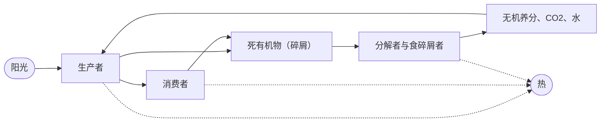

前几章研究生物的种群与群落。本章开始研究生态系统，其中一个地方的生物与其物理和化学环境被一起视为一个系统，能量流经它，物质在其中循环。生态系统是生态学与物理学、化学和地球科学交会的层次，也是大多数关于环境的实际问题，渔业、农业、水质、气候，被提出的层次。第 40.1 节追溯这一概念并给出定义。第 40.2 节描述生态系统的组成以及把它们联系起来的过程；生产、次级生产与分解的定量讨论见 [7.19.42](/7.19.42)–[7.19.44](/7.19.44)，物质循环见 [7.19.45](/7.19.45)–[7.19.46](/7.19.46)。第 40.3 节概述生态系统的主要类型，它们在地球上的分布是 [7.19.41](/7.19.41) 的主题。第 40.4 节讨论生态系统通过反馈的调节、生态平衡的概念与盖亚假说，并配有两个模型；第 40.5 节追问在容器中构建生态系统，从实验室微宇宙到生物圈 2 号和航天器的生命保障系统，能让我们学到什么。构成生态系统生物部分结构的食物网已在 [7.19.38](/7.19.38)–[7.19.39](/7.19.39) 中讨论。

## 40.1. 生态系统的概念

### 40.1.1. 起源

生物与其环境构成一个整体的想法由来已久，但其科学的表述始于十九世纪后期。Möbius（1877）把牡蛎礁的群落称为*生物群落*（biocoenosis）；Forbes（1887）在《湖泊作为一个微宇宙》中把湖泊描述为这样一个系统：“除非清楚地看到它与整体的关系，否则任何事物都不能被完全理解”。物理化学家 Lotka（1925）把有机界与无机界当作单一的能量转化系统。*生态系统*一词由英国植物生态学家 Arthur Tansley（1935）创造，他想要一个摆脱 Clements 把群落看作超有机体的理论中的有机体类比的术语：“整个系统（在物理学的意义上），不仅包括生物复合体，也包括构成我们所谓环境的全部物理因子复合体”。俄罗斯生态学家发展了与之平行的*生物地理群落*（biogeocoenosis）概念（Sukachev 1944）。

Lindeman（1942）在对明尼苏达州衰老湖泊 Cedar Bog Lake 的研究中，赋予这一概念定量的核心，即*营养动态*观：生态系统是营养级之间能量传递的系统，其结构可以用能量流动的速率与传递的效率来描述（[7.19.43](/7.19.43)）。Eugene 和 Howard Odum 兄弟在 1950 和 1960 年代以系统图、整个生态系统的能量收支（佛罗里达的 Silver Springs；Eniwetok 珊瑚礁）与放射性示踪剂使生态系统成为生态学的组织概念，国际生物学计划（1964–1974）测量了世界各地生态系统的生产力。

### 40.1.2. 定义与性质

**定义 40.1.1（生态系统）** **生态系统**是一个给定地区的生物群落及其非生物环境，构成一个功能单位，能量在其中流动，物质在生物与非生物组分之间循环。

这一定义没有固定尺度：盛水的树洞、池塘、森林集水区和整个生物圈都是生态系统，边界的选择由所提的问题决定。Odum 强调生态系统是开放系统：能量必须进入（作为阳光或输入的有机物）并离开（作为热），物质与生物也进出系统。因此完整的描述除系统本身之外，还包括*输入环境*与*输出环境*；系统越大，相对于内部流动，它对跨边界交换的依赖越小。湖泊、以山脊为界的集水区和岛屿有天然的边界，这就是为什么从 Lindeman 的湖泊到哈伯德布鲁克实验森林的集水区（[7.19.45](/7.19.45)），它们一直是生态系统研究的经典对象。

生态系统有若干一般性质：

| 性质 | 含义 |
|---|---|
| 结构与功能单位 | 生态层级中包含维持生命所需的全部组分的最低层次：生产者、消费者、分解者与非生物环境 |
| 三项基本功能 | 单向的能量流动，从阳光经生物到热；物质（碳、氮、磷、水）在生物与环境之间的循环；信息流动（物理、化学与行为信号） |
| 自我调节 | 系统内的反馈使其许多性质保持在一定范围内（第 40.4 节） |
| 营养级数有限 | 因为每次传递都损失能量，食物链很少超过四到六级（[7.19.38](/7.19.38#sec-38.2)） |
| 动态性 | 生态系统通过演替（[7.19.36](/7.19.36)）而变化，发生波动并响应干扰 |

## 40.2. 生态系统的组分

### 40.2.1. 四种组分

每个生态系统都有四类组分：非生物环境，以及按其在能量流动与物质循环中的角色定义的三个生物功能类群。

**定义 40.2.1（生产者、消费者与分解者）** **生产者**是生态系统中的自养生物，利用光（光合作用）或无机化学反应的能量（化能合成）由无机物合成有机物。**消费者**是异养生物，通过吃其他活的生物或其部分获得能量与物质。**分解者**是异养生物，主要是细菌和真菌，通过分解死有机物（碎屑）与排泄物获得能量，释放出生产者重新利用的无机养分。

1. *非生物环境*包括参与循环的无机物（碳、氮、$\ce{CO2}$、$\ce{O2}$、水、钙、磷、钾），联系生物与非生物部分的有机化合物（蛋白质、碳水化合物、脂质，尤其是土壤与沉积物的腐殖质，它们从不出现在细胞之内），以及 [7.19.2](/7.19.2)–[7.19.5](/7.19.5) 中讨论的气候与物理条件（温度、降水、光、压力）。
2. *生产者*，即**自养生物**（[7.1.1](/7.1.1)）：绿色植物、藻类和蓝细菌（光能自养生物），以及化能自养细菌和古菌，它们氧化硫化氢、氨、亚铁或甲烷，是热液喷口食物网的基础（[7.11.29](/7.11.29)）。生产者把太阳能固定为有机物中的化学能，供养自身及所有其他生物；它们的生产是初级生产（[7.19.42](/7.19.42)）。
3. *消费者*，吃活生物的**异养生物**：食草动物（初级消费者），吃食草动物的食肉动物（次级消费者），吃食肉动物的食肉动物（三级消费者），以及杂食动物、寄生物和拟寄生物。它们的生产是**次级生产**（[7.19.43](/7.19.43)）。Odum 称它们为*吞噬营养者*或大型消费者。
4. *分解者*，即*腐生生物*或小型消费者。它们分解碎屑并吸收产物；与破碎并摄入死物质的食碎屑动物（蚯蚓、马陆、跳虫、蜣螂）一起，完成分解作用（[7.19.44](/7.19.44)）。它们的活动与生产相反：把能量以热的形式释放，并把养分返还到无机库中。

这些类群是功能性的而不是分类学的，一些直觉的说法是错误的：

| 说法 | 对吗？ | 反例 |
|---|---|---|
| 所有细菌都是分解者 | 否 | 蓝细菌以及化能自养的硝化细菌和硫细菌是生产者；致病细菌和捕食性细菌（*Bdellovibrio*）是消费者 |
| 所有动物都是消费者 | 否 | 蚯蚓、蜣螂和许多吃死物质的土壤无脊椎动物（作为食碎屑者）在分解中起作用 |
| 所有生产者都是绿色植物 | 否 | 藻类、蓝细菌和化能自养生物是生产者 |
| 所有植物都是生产者 | 否 | 全寄生植物（菟丝子 *Cuscuta*、大花草 *Rafflesia*）以及菌异养的兰科植物和水晶兰 *Monotropa* 是消费者 |

各组分由能量流动与养分循环联系起来：

能量以光的形式进入，从生产者传给消费者和分解者，并以热的形式离开（虚线）；它不循环。养分沿同样的路径传递，但通过分解返回无机库并被再次利用。

### 40.2.2. 空间与时间组织

自养过程与异养过程在空间和时间上部分分离。在多数生态系统中，光合作用集中于上层的“绿带”，即森林的林冠或湖泊被光照射的表层，而分解集中于下层的“棕带”，即凋落物、土壤和沉积物（Odum）。所产生的有机物中只有一小部分在活着时被吃；其大部分，尤其在森林中，成为碎屑，在数周、数年，或对泥炭和化石燃料而言数千年之后被消耗。由此产生两条平行的食物链：基于活植物的捕食食物链和基于死物质的碎屑食物链（[7.19.38](/7.19.38#sec-38.1.1)），在多数陆地生态系统中，超过 90 % 的净初级生产量通过碎屑食物链。

## 40.3. 生态系统的类型

生态系统按其环境和人类影响的程度分类：

| 类群 | 主要类型 | 特征 |
|---|---|---|
| 陆地 | 热带雨林、稀树草原、荒漠、温带森林与草原、北方森林、苔原 | 由气候和土壤塑造；植被决定物理结构（[7.19.41](/7.19.41)） |
| 淡水，静水（滞水） | 湖泊与池塘 | 分带：沿岸带（浅，有根植物）、湖沼带（开阔水域，浮游生物）、深水带（深，无光）、底栖带（底部）；热分层（[7.19.3](/7.19.3)） |
| 淡水，流水 | 河流与溪流 | 急流与深潭、支流、泛滥平原与牛轭湖；大量能量以凋落物的形式从陆地输入；沿下游的变化（[7.19.41](/7.19.41)） |
| 海洋 | 大洋、近海、珊瑚礁、海藻林、深海、热液喷口 | 面积最大；生产受养分与光限制；喷口以化能合成为基础 |
| 湿地与河口 | 沼泽、泥炭地、河口；潮汐沼泽：盐沼（草本，温带与亚热带）与红树林沼泽（木本，热带与南亚热带） | 最丰产的生态系统之一；陆地与水域之间的过渡 |
| 人工 | 农田、人工林、水库、城市 | 由人类输入的能量与物质主导 |

中国的生态系统范围从云南南部和海南的热带雨林到大兴安岭的北方森林，以及青藏高原的高寒草甸与荒漠；国家分类区分一级类型，如森林、灌丛、草地、湿地、农田、聚落（城市）和荒漠生态系统，每一类再按气候和植被细分。中国的生态学家还提出了*社会–经济–自然复合生态系统*的概念（马世骏和王如松 1984），其中一座城市或一个区域被分析为由自然子系统（水、土壤、生物）、经济子系统（生产、消费、流通）和社会子系统（人口、制度、文化）耦合而成的系统，由能量、物质、货币与信息的流动联系起来。

生态系统的能量基础也不同。*自养型*生态系统主要靠自身的光合作用维持，总初级生产量超过群落呼吸（$P/R > 1$）。*异养型*生态系统依赖从别处输入的有机物（$P/R < 1$）：靠落叶生活的有遮荫的源头溪流、洞穴、靠下沉颗粒生活的深海底，以及靠食物和燃料生活的城市。比值 $P/R$ 在演替中变化，在成熟的生态系统中趋近 1（Odum 1969；[7.19.36](/7.19.36)）。

## 40.4. 反馈与生态平衡

### 40.4.1. 反馈

生态系统由反馈调节：一个组分的变化改变其他组分，后者又反过来作用于前者。**负反馈**（[7.14.1](/7.14.1)）抵消原来的变化，使系统趋于保持在平衡附近；**正反馈**放大它，把系统推离先前的状态。

- 负反馈：食草动物增加使植物生物量减少，使食草动物的繁殖减少；分解释放的养分促进植物生长，而植物把养分锁定在生物量中，限制进一步的生长；种群的**密度制约**（[7.19.11](/7.19.11)）是种群水平的负反馈。
- 正反馈：在被污染的湖泊中，死鱼分解并消耗氧气，使更多的鱼死亡；在富营养的水体中，藻华死亡，其分解从缺氧沉积物中释放磷，促成更多的藻华（[7.19.46](/7.19.46)）；在多年冻土中，变暖释放温室气体，使气候进一步变暖（[7.19.39](/7.19.39#sec-39.4.1)）。正反馈对生长也是必要的：种群增长中的复利，旱地中植被的自我强化。

生态系统在一个重要方面不同于工程控制系统和生物体。恒温器或调节体温的哺乳动物（**稳态**，[7.14.1](/7.14.1)）有由控制器规定的*调定点*。生态系统的调节是弥散的：没有调定点，也没有控制器，只有许多种群与非生物过程的相互作用，所以生态系统的性质在一个范围内波动（一种“脉动状态”），而不是被保持在某个值上（Patten 和 Odum 1981）。冗余有所贡献：若存在温度最适不同的几种自养物种，群落光合作用可以在温度变化时保持稳定，这是多样性的保险效应（[7.19.38](/7.19.38#sec-38.5)）。

一个最小模型显示养分循环如何自我调节。考虑一个封闭的生态系统，有溶解养分库 $N$、生产者 $P$ 和带有分解者的碎屑库 $D$，都以限制性养分为单位度量：

$$
\frac{\mathrm{d}N}{\mathrm{d}t} = dD - \frac{\mu NP}{k + N}, \qquad
\frac{\mathrm{d}P}{\mathrm{d}t} = \frac{\mu NP}{k + N} - mP, \qquad
\frac{\mathrm{d}D}{\mathrm{d}t} = mP - dD, \tag{40.1}
$$
其中 $\mu$ 是生产者的最大吸收（生长）速率，$k$ 是半饱和常数，$m$ 是生产者的死亡率，$d$ 是分解速率。总养分 $T = N + P + D$ 守恒。

**命题 40.4.1（封闭养分循环的平衡）** 若 $\mu > m$ 且 $T > N^* = km/(\mu - m)$，系统 (40.1) 有平衡

$$
N^* = \frac{km}{\mu - m}, \qquad P^* = \frac{T - N^*}{1 + m/d}, \qquad D^* = \frac{m}{d}P^*, \tag{40.2}
$$
它对所有参数值都是局部渐近稳定的；当吸收响应足够陡，使 $(d + u'P^*)^2 < 4(d + m)u'P^*$ 时，趋近是（衰减的）振荡，其中 $u'$ 是 $u(N) = \mu N/(k + N)$ 在 $N^*$ 处的导数。

**证明** 在 $P > 0$ 的平衡，$u(N^*) = m$，由此得 $N^*$；$\dot D = 0$ 给出 $D^* = mP^*/d$，守恒给出 $P^*$。消去 $D = T - N - P$ 后得到关于 $(N, P)$ 的二维系统，其在平衡点的 Jacobi 矩阵为

$$
J = \begin{bmatrix} -d - u'P^* & -d - m \\ u'P^* & 0 \end{bmatrix},
$$
其中用到 $u(N^*) = m$。它的迹 $-d - u'P^*$ 为负，行列式 $(d + m)u'P^*$ 为正（$u' > 0$），所以由迹–行列式判据（[2.4.11](/2.4.11)），两个特征值都有负实部，且当迹的平方小于行列式的四倍时它们是复的。$\square$

这个平衡给出两点教益（图 1）。第一，系统在受扰动后回复：如果火把大部分生产者转化为溶解养分，释放的养分促进再生，再生又把它从溶液中移走（通过养分限制的负反馈），可能发生过冲。第二，平衡时的溶解库由生产者的需求决定，即 $N^*$，与养分总量无关：每增加一单位养分，最后都进入活的和死的生物量。这是 $R^*$ 原理（[7.19.23](/7.19.23)）的生态系统形式，也解释了为什么养分丰富的生态系统可以有很低的溶解养分浓度，如热带雨林，其养分储存在生物量中，在森林被砍伐时流失（[7.19.41](/7.19.41)）。

### 40.4.2. 生态平衡

**定义 40.4.1（生态平衡）** **生态平衡**是生态系统通过发展与自我调节达到的相对稳定的状态，其结构（物种组成与生物量）、功能（能量流动与养分循环）以及与环境的能量与物质交换在动态平衡附近的一定范围内波动。*生态阈值*是干扰的极限，越过它自我调节失效，生态系统不再回到该状态；*生态危机*是人类活动造成的、一个区域或整个生物圈的生态系统结构与功能的崩溃，达到威胁人类福祉的程度。

生态平衡是动态的而不是静态的状态：种群波动，物种更替，演替缓慢地继续。它是具有连续流动的开放系统的稳定平衡（或吸引子），可类比于化学反应器的稳态，而不是封闭系统的平衡。维持它的能力由 [7.19.38](/7.19.38#sec-38.3) 的稳定性概念度量：**恢复力**，即回复的速度，以及抵抗力，即保持不变的能力。阈值对应于吸引域的边界，或平衡消失的折叠分岔，越过它会造成 [7.19.39](/7.19.39) 的**稳态转换**。具有复杂食物网的生态系统常被说成更平衡；如 [7.19.38](/7.19.38) 所示，这对总生物量这样的总体性质成立，对个别种群则不一定。

### 40.4.3. 盖亚与雏菊世界

Lovelock 和 Margulis（1974）的**盖亚假说**（[7.10.29](/7.10.29)）把反馈调节推广到整个地球：生物，特别是微生物，调节大气的组成、温度和海洋的化学，使之适合生命。地球的大气确实远离化学平衡，21 % 的氧与甲烷共存，其组成由生物维持；但批评者反对说，自然选择作用于个体，不可能产生“为了行星的利益”的调节（Doolittle 1981；Dawkins 1982）。Watson 和 Lovelock（1983）以一个模型作答，其中调节无需远见或利他而涌现。

在雏菊世界上，一个行星被光度 $L$ 缓慢增加的恒星照亮，裸地（反照率 0.5）上长着黑雏菊（反照率 0.25）和白雏菊（反照率 0.75）。行星温度由辐射平衡 $\sigma T_{\mathrm{e}}^4 = S L(1 - A)$ 得出，其中 $A$ 是按面积加权的反照率，局部温度不同，深色斑块更暖。雏菊盖度 $a_i$ 按

$$
\frac{\mathrm{d}a_i}{\mathrm{d}t} = a_i\left[x\,\beta(T_i) - \gamma\right], \qquad \beta(T) = 1 - 0.003265\,(295.5\ \mathrm{K} - T)^2, \tag{40.3}
$$
生长，其中 $x$ 是空闲的地面，$\beta$ 是生长速率，在 $22.5\,^\circ\mathrm{C}$ 时最大，在 $5\,^\circ\mathrm{C}$ 以下和 $40\,^\circ\mathrm{C}$ 以上为零，$\gamma$ 是死亡率。当恒星较暗时，使自身及其周围变暖的黑雏菊扩展并升高行星温度；随着恒星变亮，保持凉爽的白雏菊占据优势并使之降低。这两个反馈是局部的正反馈（每种雏菊在改善其自身温度的地方生长）和全局的负反馈（任一类型的扩展都使行星温度趋向最适）。在很宽的光度范围内，行星温度保持在最适附近，甚至随恒星变亮而下降（图 2）。

调节是有限度的：当光度超过即使完全白色覆盖也无法补偿的程度时，雏菊突然崩溃，温度跳到无生命的值，直到光度降到远低于崩溃点，行星才恢复。定义 40.4.1 的生态阈值和 [7.19.39](/7.19.39) 的滞后在这里以行星尺度出现。雏菊世界并没有证明真实的地球是被调节的，但它表明，环境的调节可以是生物对环境作出响应的副产品，它也是关于气候中生物反馈的大量文献的源头（Lenton 1998）。多数生态学家接受盖亚的弱形式，即生物强烈影响大气、海洋和气候，且其中一些影响是稳定性的；强形式，即生物圈是一个优化的控制系统，则没有得到支持。

## 40.5. 微宇宙、中宇宙与封闭生态系统

### 40.5.1. 实验生态系统

生态系统可以在三个尺度上进行实验研究（Odum）。*微宇宙*是实验室容器中小型的、自足的生态系统，或者通过在培养基中接种池塘或土壤的样品而来自自然，或者由纯培养的已知物种组装而成（无菌生物系统）。*中宇宙*是户外或温室中较大的围隔：水箱、人工池塘、溪流水槽和有围栏的土地样方，它们经受自然的光和温度，可以含有较大的生物。*大宇宙*是自然的生态系统、集水区和整个湖泊，它们充当参照，有时可以被整体操纵，如 [7.19.39](/7.19.39) 中对湖泊的实验。微宇宙允许重复与控制；中宇宙以其中一部分换取真实性；全生态系统实验给出最直接的回答，但无法重复。

最古老的微宇宙是“平衡水族箱”。Warington（1851）在一个 12 加仑的水族箱中养金鱼、螺和苦草（*Vallisneria*），其中植物提供氧气，螺分解死的植物质，他认识到维持该系统的是生产者、消费者与分解者的平衡，而不是单靠植物。多数家用水族箱并不平衡，因为按体积养的鱼太多：一条中等大小的鱼需要许多立方米的水及其食物生物才能自给自足，所以水族箱需要食物、曝气和清洁的补贴。

### 40.5.2. 生物圈 2 号

建造有人居住的封闭生态系统的最大尝试是生物圈 2 号，一个位于亚利桑那州索诺兰沙漠、面积 1.27 ha、有玻璃覆盖的围场。它包含雨林、稀树草原、荒漠、沼泽、带珊瑚礁的小“海洋”、集约农业区和居住区，约有 4000 个物种。1991 年 9 月 26 日，八个人被封闭在里面两年；能量（阳光以及用于水泵和气候控制的电力）和信息可以穿过边界，物质不能。

该项目未能维持一个自我维持的环境。最显著的是，大气中的氧浓度在 16 个月内从 20.9 % 降到 14.5 %，不得不注入氧气以保护船员的健康（Severinghaus 等 1994）。缺失的氧没有以二氧化碳的形式重新出现：$\ce{CO2}$ 浓度虽然高而且多变（冬季几千 ppm），却只占其中很小一部分。同位素测量显示了它的去向。为支持农业，土壤被做成富含有机质，所以微生物呼吸消耗氧并产生 $\ce{CO2}$ 的速度，比因玻璃和多云的冬季而减弱的光合作用固定它的速度更快；而 $\ce{CO2}$ 被大片裸露的混凝土吸收，其中的氢氧化钙与之反应生成碳酸钙，

$$
\ce{Ca(OH)2 + CO2 -> CaCO3 + H2O},
$$
把碳连同呼吸中与之结合的氧一起锁住。

一个箱式模型使这一核算变得明确。令 $O$ 和 $C$ 为大气中 $\ce{O2}$ 与 $\ce{CO2}$ 的量，$R$ 为群落呼吸速率，$\Phi(t, C)$ 为总光合作用速率（取决于光和 $\ce{CO2}$），$k_cC$ 为混凝土对 $\ce{CO2}$ 的吸收：

$$
\frac{\mathrm{d}O}{\mathrm{d}t} = \Phi(t, C) - R, \qquad \frac{\mathrm{d}C}{\mathrm{d}t} = R - \Phi(t, C) - k_cC. \tag{40.4}
$$

**命题 40.5.1（封闭大气中氧的损失）** 在模型 (40.4) 中，$\mathrm{d}(O + C)/\mathrm{d}t = -k_cC$，所以一段时间内损失的氧等于空气中 $\ce{CO2}$ 的增加加上混凝土吸收的碳，$\Delta O = -\Delta C - k_c\int C\,\mathrm{d}t$。没有汇（$k_c = 0$）时，氧只下降 $\ce{CO2}$ 上升的量，而若光合作用随 $\ce{CO2}$ 增加，系统趋近平均而言 $\Phi = R$ 的状态，氧几乎没有净损失。

**证明** 把两个方程相加得第一个恒等式；对它积分得质量平衡。$k_c = 0$ 时，$O + C$ 为常数，所以 $\Delta O = -\Delta C$；若 $\Phi$ 随 $C$ 增加而呼吸 $R$ 为常数，则 $C$ 上升直到光合作用平均地与呼吸平衡，此后 $C$ 以及 $O$ 只有季节性的波动。$\square$

取能再现观测量级的参数（图 3），模型只有在有混凝土汇时才以观测的速率损失氧；没有它，$\ce{CO2}$ 在冬季会上升到约 1 %，而氧下降不到一个百分点。是富含有机质的土壤的呼吸造成了失衡；混凝土把它掩盖了，因为没有 $\ce{CO2}$ 的上升，本可使系统稳定的光合补偿就无法形成。

生物群落的状况也没有更好。引进的 25 种小型脊椎动物中，有 19 种灭绝，所有传粉昆虫也灭绝了，所以多数植物无法结实；牵牛花等藤本覆盖其他植物，引进的“疯蚂蚁”和蟑螂变得极其丰富（Cohen 和 Tilman 1996）。氧化亚氮累积到足以损害脑功能的浓度。船员把约 45 % 的时间用于生产和准备食物，保持健康，但体重减轻。教训是：一个正常运转的生物圈依赖于巨大库的缓冲能力（地球每平方米陆地对应超过 1000 m³ 的大气和近 10 000 m³ 的海洋），依赖于生产与分解速率的平衡，依赖于传粉者和分解者这样的功能类群，也依赖于与容易被忽视的材料之间的化学相互作用。生物圈 2 号表明，替代地球免费的**生态系统服务**（[7.19.50](/7.19.50)）要花多少代价（Odum）。

### 40.5.3. 生物再生式生命保障

长期的太空任务，或月球与火星上的定居点，需要*生物再生式生命保障系统*，即由植物和微生物再生空气、水和食物的受控生态系统。迄今为止的航天器携带储存的补给，并对水和氧进行物理与化学再生。实验系统包括克拉斯诺亚尔斯克的 BIOS-3，1970 年代起乘员在其中生活长达六个月，由藻类（小球藻 *Chlorella*）和作物再生空气和大部分食物；欧洲的 MELiSSA 项目，一个仿照湖泊生态系统建立的、由若干隔室组成的回路，其中细菌降解废物，硝化细菌把铵转化为硝酸盐，蓝细菌与植物再生氧气和食物；以及北京航空航天大学的月宫一号，志愿者在 2017–2018 年轮流在其中生活 370 天，系统由作物、昆虫（作为动物蛋白的黄粉虫）和微生物废物处理组成，循环了大部分氧气、水和食物。2024 年 4 月，神舟十八号飞船把一个由四条斑马鱼（*Danio rerio*）和金鱼藻 *Ceratophyllum demersum* 组成的小型水生生态系统送到中国空间站，研究一个由脊椎动物和植物构成的封闭水生系统如何在微重力下运行；鱼存活下来并在轨道上产了卵。这些系统是工程化的：它们能运行，是因为控制器调节光、温度和气体交换，并消除自然生态系统本可缓冲的失衡，这提醒人们，有调定点的控制论控制不同于自然生态系统的弥散调节（第 40.4.1 节）。

### 40.5.4. 技术生态系统与生态足迹

Odum 把现代社会建造的城市–工业系统称为*技术生态系统*：主要以化石燃料和核燃料为动力、单位面积能量流远超自然生态系统、并依赖大片自然与农业土地提供食物、水、废物同化和气候调节的系统。一座工业城市使用的能量约为 $4000\ \mathrm{kcal\,m^{-2}\,d^{-1}}$（约 $200\ \mathrm{W\,m^{-2}}$），大致是通过牡蛎礁的能量流的 70 倍，牡蛎礁是它在自然界的类比，作为依赖输入食物的、密集居住的异养系统。在这个意义上，城市是其乡村的寄生物，它的可持续性依赖于技术生态系统与支撑它的自然生态系统之间的耦合。

**定义 40.5.1（生态足迹）** 一个人群（一座城市、一个国家、全人类）的*生态足迹*是在当前技术下，生产其所消耗的资源并吸收其废物所需的具有生物生产力的土地和水域的面积，尤其是固定其二氧化碳排放所需的森林面积（Rees 和 Wackernagel 1994）。

足迹与*生物承载力*，即实际可用的生产性面积，相比较。城市的足迹是其自身面积的数百倍；按全球足迹网络的估计，人类的足迹自约 1970 年起已超过地球的生物承载力，现在约为其 1.7 倍，超出的部分通过消耗存量（森林、鱼类、地下水）和在大气中积累二氧化碳来满足。这一方法因把非常不同的压力换算成一个面积单位、并严重依赖碳的部分而受到批评；它最好被看作过度利用的指标，与 [7.19.47](/7.19.47) 的行星边界并用。

## 小结

- **生态系统**（定义 40.1.1）是群落加上其非生物环境，是能量流动与物质循环的功能单位（Tansley 1935；Lindeman 1942 的营养动态观；Odum 的有输入与输出环境的开放系统）。其功能：能量流动、物质循环、信息流动；它是自我调节的、动态的，且营养级数很少。
- 组分：非生物环境（无机物、联系性的有机化合物、气候）以及生产者、消费者与分解者（定义 40.2.1），按功能定义：有些细菌是生产者，有些动物是分解者，有些植物是消费者。绿带与棕带；多数生产进入碎屑食物链。
- 生态系统的类型：陆地、静水与流水淡水、海洋、湿地与河口（盐沼、红树林）、人工；社会–经济–自然复合生态系统；自养型（$P/R > 1$）与异养型（$P/R < 1$）系统。
- **负反馈**稳定，**正反馈**放大；生态系统的调节是弥散的，没有调定点。封闭养分循环 (40.1)：平衡 (40.2)，$N^* = km/(\mu - m)$ 与养分总量无关，总是稳定的（命题 40.4.1）。
- 生态平衡（定义 40.4.1）：结构、功能与交换的动态平衡；生态阈值与危机；与恢复力和稳态转换相关。
- **盖亚假说**；雏菊世界 (40.3)：局部正反馈与全局负反馈在很宽的光度范围内调节温度，超出之后突然崩溃并出现滞后。
- 微宇宙、中宇宙与大宇宙；生物圈 2 号：氧从 20.9 % 降到 14.5 %，因为土壤呼吸超过光合作用，而混凝土吸收了 $\ce{CO2}$（命题 40.5.1，图 3）；物种丧失。生物再生式生命保障（BIOS-3、MELiSSA、月宫一号、神舟十八号）。技术生态系统与生态足迹（定义 40.5.1）。

## 思考题

1. 把下列各项分为生产者、消费者或分解者，并说明理由：(a) *Nitrosomonas*（亚硝化单胞菌），(b) 菟丝子 *Cuscuta*，(c) 蚯蚓，(d) 光下的 *Euglena*（眼虫），(e) 死木上的多孔菌，(f) 菌根真菌。

   **答** (a) 生产者：化能自养生物，利用氨氧化的能量固定 $\ce{CO2}$。(b) 消费者：没有显著光合作用的全寄生植物，从寄主取得有机物。(c) 食碎屑者，属于分解者子系统：它摄入死有机物和土壤。(d) 生产者：它进行光合作用（在黑暗中它可以异养生活，表明这些类别描述的是功能而不是物种）。(e) 分解者：它分解死木。(f) 它从活根接收碳水化合物，所以就能量而言它是消费者（互利共生的共生体，[7.19.29](/7.19.29)）；它也参与分解和养分吸收。有些生物不属于单一的类别。

2. 在模型 (40.1) 中，若 (a) 分解速率 $d$ 减半，(b) 养分总量加倍，(c) 生产者死亡率 $m$ 增加，平衡库会怎样变化？对 (a) 以寒冷、渍水的生态系统解释。

   **答** (a) $N^*$ 不变；$P^* = (T - N^*)/(1 + m/d)$ 下降，$D^* = mP^*/d$ 增加：更多养分被锁定在碎屑中。这是泥炭地和苔原的情形，那里缓慢的分解使死有机物累积，植物可用的养分稀缺。(b) $N^*$ 不变，$P^*$ 与 $D^*$ 各按 $T/(1 + m/d)$ 成比例增加：额外的养分进入生物量。(c) $N^* = km/(\mu - m)$ 增加，所以更多养分保持溶解，而 $P^*$ 下降，既因为 $N^*$ 更大，也因为 $1 + m/d$ 更大。

3. 解释为什么生物圈 2 号的氧下降而二氧化碳没有相应增加。如果混凝土被密封，会发生什么？

   **答** 富含有机质的土壤中的呼吸把 $\ce{O2}$ 转化为 $\ce{CO2}$ 的速度快于光合作用把它转化回来的速度。通常积累的 $\ce{CO2}$ 既会显示这种失衡，又会通过促进光合作用而减轻它。然而 $\ce{CO2}$ 与混凝土中的氢氧化钙反应形成碳酸钙，把碳以及呼吸中与之结合的氧一起从气体循环中移走：由命题 40.5.1，氧的损失等于混凝土中的碳加上 $\ce{CO2}$ 的上升。混凝土被密封时，$\ce{CO2}$ 会升得高得多（在模型中冬季约 1 %），促进光合作用，直到它平均地与呼吸平衡；氧下降的量大致等于 $\ce{CO2}$ 上升的量，不到一个百分点，但高浓度的 $\ce{CO2}$ 本身会成为船员的问题。

4. 在雏菊世界中，为什么在部分范围内光度增加而行星温度却下降？为什么高光度时的崩溃是突然的？

   **答** 光度增加时，比行星平均温度低、因而在行星温暖时长得更好的白雏菊，以牺牲黑雏菊为代价增加盖度；行星反照率增加得比光度更快，温度可能下降。崩溃是突然的，是由于正反馈：当温度超出白雏菊能维持其盖度的范围时，盖度下降，反照率降低，温度进一步上升，盖度进一步下降，直到雏菊全部消失；有雏菊的平衡在折叠分岔处消失，如 [7.19.39](/7.19.39) 的稳态转换。

5. （开放题）一所学校想要建造一个能在窗台上存续一年的密封瓶生态系统。用本章的概念，就其设计提出建议。

   **答** 包括所有功能类群：生产者（金鱼藻或伊乐藻等水生植物，以及藻类），低密度的小型消费者（螺、介形类、溞；不放鱼，因为它们对小体积来说需求太大），分解者（池塘沉积物和水作为细菌和真菌的接种物）以及少量碎屑。保持消费者的总生物量相对于生产者较低，使生产与呼吸平衡；提供适度的间接光照（光太多造成藻华和过热，太少使呼吸超过光合作用）；相对于生物量，使用大体积的水和顶空作为缓冲；避免过多的有机物（不用肥沃的土壤，参照生物圈 2 号）和与 $\ce{CO2}$ 反应的材料；保持温度稳定。预计会有物种丧失和演替变化；系统可能以简化的群落存续，就像长寿的密封瓶花园那样。

6. （开放题）生态平衡的概念对管理因气候变化而变化的生态系统是否有用？

   **答** 要点：生态平衡描述给定条件下的动态平衡；当条件发生定向变化时，没有固定的状态可回，旨在保持历史平衡的管理可能失败或适得其反。更有用的概念是恢复力与阈值（识别可能造成稳态转换的慢变量与反馈），维持功能与服务而不是特定的组成，以及促进适应（为分布区移动提供连通性，以多样性作保险）。这一概念作为提醒仍然有用：生态系统在一定限度内自我调节，超过生态阈值的压力会导致性质不同的状态。
