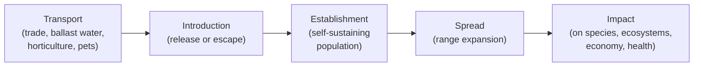

The previous chapter ([7.19.50](/7.19.50)) defined biodiversity and argued that it is valuable. This chapter asks how fast it is being lost and why. Section 51.1 places the present in the context of the history of life: the **mass extinctions** of the fossil record, the background rate of extinction, and the evidence that current rates are far above it, including the statistical problem of deciding when a species is extinct. Section 51.2 identifies the root cause, the growth of the human population and its use of resources, and Section 51.3 surveys the direct threats: habitat destruction and fragmentation, degradation and pollution, climate change and disease, with a model of how habitat loss translates into extinction. Section 51.4 treats biological invasions, from the stages of invasion and the reasons why some invaders succeed to the models of their spread and the Chinese invaders of greatest concern. Section 51.5 treats overexploitation, with a model of why rare species can be harvested to extinction when their price rises with rarity. Population viability and the **extinction vortex** were analyzed in [7.19.15](/7.19.15), the macroevolutionary history of extinction in [7.10.31](/7.10.31), and the responses that conservation can make are the subject of [7.19.52](/7.19.52).

## 51.1. Extinction Past and Present

### 51.1.1. Mass Extinctions

More than 99 % of the species that have ever lived are extinct. Most disappeared one by one, at a fairly steady **background extinction** rate, as environments changed and competitors evolved ([7.10.31](/7.10.31)). Five times in the last 500 million years, however, a large fraction of all species disappeared within a geologically short interval:

| Event | Age (Ma) | Estimated species loss | Probable causes |
|---|---|---|---|
| End-Ordovician | ~444 | ~85 % | Glaciation and sea-level fall, then warming |
| Late Devonian | ~372 | ~75 % | Several pulses; marine anoxia; plants on land changed weathering |
| End-Permian | ~252 | ~81–96 % | Siberian Traps volcanism, warming, ocean acidification and anoxia |
| End-Triassic | ~201 | ~76 % | Central Atlantic Magmatic Province volcanism, warming, acidification |
| End-Cretaceous | 66 | ~76 % | Chicxulub asteroid impact, with Deccan volcanism |

Each was followed by millions of years of reduced diversity before recovery, and each changed the composition of life permanently: the end-Cretaceous extinction ended the non-avian dinosaurs and opened the way for the radiation of mammals. The present question is whether human activity is causing a sixth event of this kind, the **sixth mass extinction** ([7.10.31](/7.10.31)).

### 51.1.2. Current Rates of Extinction

Comparing present and past requires a common unit. Extinction rates are expressed in *extinctions per million species-years* (E/MSY): the number of extinctions per year divided by the number of species, times $10^6$. If the average species lasts 1–10 million years in the fossil record, the background rate is $0.1$–$1$ E/MSY; Pimm and colleagues (2014) argued for about $0.1$ E/MSY. With 10 million species, this means 1–10 extinctions per year worldwide.

**Example 51.1.1** About 160 bird species of roughly 11 000 have become extinct since 1500, over about 525 years. The rate is $160/(11\,000 \times 525) \times 10^6 \approx 28$ E/MSY, about 30–300 times the background rate. This is an underestimate: extinctions are recorded only for described and monitored species, many island birds were exterminated before ornithologists described them, and many more species survive in numbers too small to persist (extinction debt, [7.19.16](/7.19.16)).

:::

Similar calculations for other well-known groups give similar results. Ceballos and colleagues (2015) used a deliberately high background rate of 2 E/MSY, and still found that the number of vertebrate extinctions recorded since 1900 would, at background rates, have taken between 800 and 10 000 years; current rates of vertebrate extinction are up to 100 times the background. The IUCN Red List had assessed more than 170 000 species by 2025, of which about 28 % are threatened (in the categories Vulnerable, Endangered or Critically Endangered, [7.17.69](/7.17.69)); about 900 species are known to have become extinct since 1500. The proportions threatened differ widely among groups: about 41 % of amphibians, more than a third of reef-building corals, sharks and rays, and conifers, about a quarter of mammals and about one in eight bird species.

Is this a mass extinction? By the usual criterion, the loss of about three quarters of species, not yet: recorded extinctions are 1–2 % of assessed species in the best-known groups. But Barnosky and colleagues (2011) showed that if the species now threatened were lost within a century and the current rates continued, a loss of 75 % would be reached within a few centuries to millennia, as fast as or faster than in the past events. The sixth mass extinction is therefore best described as under way rather than accomplished, and what happens depends on whether threatened species are lost.

### 51.1.3. Declaring a Species Extinct

A species is declared extinct only when there is no reasonable doubt that the last individual has died, after exhaustive surveys in known and expected habitat at appropriate times. Because absence is hard to prove, statistical methods based on the record of sightings help.

**Proposition 51.1.1 (Sighting-Record Test)** Suppose that while a species exists, it is sighted according to a Poisson process of constant rate over an observation period $(0, T]$, and that $n$ sightings were made, the last at time $t_n$. Under the hypothesis that the species still exists at $T$, the probability that the last of $n$ sightings occurs at or before $t_n$ is

$$
p = \left(\frac{t_n}{T}\right)^n,
\tag{51.1}
$$
which serves as the $p$-value of a test of persistence (Solow 1993).

**Proof** Conditional on $n$ events in $(0, T]$, the event times of a homogeneous Poisson process are distributed as $n$ independent uniform random variables on $(0, T]$, sorted. The largest of them is at most $t_n$ exactly when all $n$ are, which has probability $(t_n/T)^n$. $\square$

For example, if a fish was recorded 10 times between 1980 and 2003 and not since, by 2020 ($T = 40$ years from 1980, $t_n = 23$) the $p$-value is $(23/40)^{10} \approx 0.004$, strong evidence of extinction. Real sighting rates decline as a species becomes rare, which makes the test anti-conservative; extensions allow declining rates, sightings of uncertain reliability and survey effort.

The Chinese paddlefish (*Psephurus gladius*) of the Yangtze, one of the largest freshwater fishes, with a spoon-like rostrum up to a third of its length of 3 m or more, was last confirmed alive in 2003. Its spawning migrations had been blocked by the Gezhouba Dam since 1981, and it was heavily fished. A survey of the upper Yangtze in 2017–2018 found none, and an analysis of sighting records estimated that it became extinct between 2005 and 2010, and functionally extinct (unable to reproduce) by 1993 (Zhang et al. 2020). The IUCN declared it extinct on 21 July 2022. The baiji, the Yangtze river dolphin (*Lipotes vexillifer*), was not found in an intensive survey of its whole range in 2006 and was declared functionally extinct; it remains listed as Critically Endangered (Possibly Extinct). Both were lost to the combined effects of damming, fishing (including bycatch in rolling hooks and electrofishing), ship traffic and pollution on one of the most heavily used rivers on Earth ([7.19.52](/7.19.52)).

### 51.1.4. Threatened Vertebrates in China

China's own Red List assessment of its vertebrates (marine fishes excluded; Jiang et al. 2016) evaluated about 4360 species and found about 21 % threatened. As elsewhere, amphibians were the most threatened group (about 43 %), followed by reptiles (about 30 %), mammals (about 26 %), inland fishes (about 20 %) and birds (about 11 %), and a number of species were classified as extinct, extinct in the wild or regionally extinct, among them the Père David's deer before its reintroduction ([7.10.34](/7.10.34)) and the South China tiger in the wild ([7.19.50](/7.19.50)). National legal protection (the list of wildlife under special state protection, revised in 2021) and the Red List categories measure different things ([7.17.69](/7.17.69)).

## 51.2. The Root Causes: People and Consumption

All the direct threats have a common root: the growth of the human population and of its use of natural resources. The world population passed 8 billion on 15 November 2022, according to the United Nations, having been about 1 billion in 1800 and 2.5 billion in 1950; around April 2023 India passed China as the most populous country. The six most populous countries (India, China, the United States, Indonesia, Pakistan and Nigeria) hold almost half of humanity. Growth has slowed as fertility has fallen in most regions (the **demographic transition**, [7.19.10](/7.19.10)), and the United Nations projects a peak of about 10.3 billion in the 2080s, but the environmental effect of each person depends on consumption and technology. The *IPAT identity* (Ehrlich and Holdren 1971) expresses this as

$$
I = P \times A \times T,
$$
the impact $I$ as the product of population $P$, affluence $A$ (consumption per person) and technology $T$ (impact per unit of consumption). It is an accounting identity, not a model, but it shows that the same impact can arise from many people consuming little or few people consuming much, and that technology can raise or lower impact.

The scale of human use of the biosphere is best seen in a few numbers. About three quarters of the ice-free land surface has been significantly altered by human activity and two thirds of the ocean area is affected by cumulative impacts (IPBES 2019). By biomass, livestock make up about 60 % of all mammals on Earth, humans 36 % and wild mammals only 4 %; domestic poultry are about 70 % of all birds (Bar-On et al. 2018). Humans appropriate about a quarter of the global net primary production of the land (**net primary production**, [7.13.1](/7.13.1)). Agriculture, the largest single use of land, is the main driver of habitat loss, and global trade moves both goods and species across continents. The **ecological footprint** ([7.19.40](/7.19.40)) of humanity has exceeded the biocapacity of the Earth since about the 1970s.

## 51.3. The Major Threats

### 51.3.1. An Overview

Seven direct threats are usually distinguished:

1. Habitat destruction, the conversion of natural ecosystems to farmland, plantations, pasture, cities and infrastructure.
2. Habitat fragmentation, the division of the remaining habitat into small and isolated pieces ([7.19.49](/7.19.49)).
3. Habitat degradation, including pollution, which leaves habitat in place but makes it unsuitable ([7.19.54](/7.19.54)).
4. Global climate change ([7.19.47](/7.19.47)).
5. Overexploitation by hunting, fishing, logging and collection (Section 51.5).
6. Invasive alien species (Section 51.4).
7. The spread of disease, often carried by invasive species or favored by the other threats.

The Global Assessment of IPBES (2019) ranked the direct drivers of biodiversity loss over the past 50 years, globally, in the order: changes in land and sea use, direct exploitation of organisms, climate change, pollution and invasive alien species. Its headline estimate was that about one million species are threatened with extinction, many within decades. The threats recorded for individual species on the IUCN Red List show the same dominance of overexploitation and agriculture (Figure 1). The ranking differs among groups and regions: overexploitation dominates for large vertebrates and marine fishes, invasive species on islands, pollution and dams in freshwater, and climate change is rising quickly in importance everywhere. Threats also interact: a population reduced by habitat loss is more vulnerable to hunting, disease and inbreeding, and may enter an extinction vortex ([7.19.15](/7.19.15)).

### 51.3.2. Habitat Destruction

Habitat destruction has been the leading cause of biodiversity loss for centuries and is set to remain so. Forest clearance is its most extensive form. According to the Food and Agriculture Organization, about 10 million hectares of forest were cleared each year in 2015–2020, mostly in the tropics, offset partly by forest expansion to a net loss of about 4.7 million hectares a year; the loss of tropical primary forest, which holds most of the world's terrestrial species, continued at several million hectares a year. In temperate regions, most native forest was cleared long ago, and the conversion of grasslands, wetlands and savannas (often less noticed than deforestation) continues. Freshwater ecosystems have lost the largest proportion of their extent: wetlands, floodplains and rivers fragmented by dams, drained or channelized ([7.19.54](/7.19.54)).

### 51.3.3. Predicting Extinction from Habitat Loss

How many species will be lost when a given fraction of habitat is destroyed? The most widely used method applies the **species–area relationship** $S = cA^z$ ([7.19.34](/7.19.34)): if the area is reduced from $A_0$ to $A_1 = (1 - h)A_0$, the number of species is expected to fall from $S_0$ to $S_1 = S_0(1 - h)^z$, so the fraction lost is

$$
\frac{S_0 - S_1}{S_0} = 1 - (1 - h)^z.
\tag{51.2}
$$
With a typical $z = 0.25$, losing half the habitat loses 16 % of the species, and losing 90 % loses 44 % (Figure 2A). The relationship is strongly concave: the first losses of habitat cost few species, and most losses come when little habitat remains. This method gave the estimates of tens of thousands of extinctions a year from tropical deforestation that alarmed biologists in the 1980s and 1990s, and it underlies most global projections. It has three main biases.

First, it is an equilibrium prediction. Species do not disappear when their habitat shrinks; their populations decline over decades to centuries, and the predicted losses are an **extinction debt** ([7.19.16](/7.19.16)) still to be paid, which explains why recorded extinctions lag behind predictions and also why restoration of habitat can still prevent some of them.

Second, the species–area relationship predicts the number of species in a sample of a given area, whereas extinction requires that all individuals of a species be in the destroyed area. For species whose individuals are aggregated, the area that must be destroyed to eliminate a species is larger than the SAR implies, so that Eq. (51.2) tends to overestimate losses (He and Hubbell 2011); the size of the overestimate has been debated, because it depends on how the SAR is constructed. The geometry of destruction also matters (Figure 2B): if habitat is destroyed in one block, species confined to that block are lost, but if the same area is destroyed in scattered cells, the remnants still sample the whole region, and far fewer species are lost immediately, although the remaining small fragments may lose more later through isolation and edge effects.

Third, converted land is not uniformly hostile. Many species survive in farmland, plantations and gardens. The *countryside species–area relationship* (Pereira and Daily 2006) replaces the area of native habitat by an effective area, $S = c(A_{\mathrm{native}} + \sum_j\sigma_jA_j)^z$, where $A_j$ is the area of land use $j$ and $\sigma_j \in [0, 1]$ its affinity for the species group; it predicts lower losses and has been used to assess how different land uses, such as forest versus plantation, affect the number of species expected to persist. The species–area method also says nothing about which species are lost: rare, specialized, large-bodied and endemic species, which matter most for conservation, are the most vulnerable.

![Predicting extinctions from habitat loss. A: fraction of species lost when a fraction $h$ of habitat is destroyed, $1 - (1 - h)^z$ (Eq. (51.2)) for $z = 0.15$, $0.25$, $0.35$, and from the countryside species–area relationship with converted land retaining an affinity $\sigma = 0.2$ or $0.4$ for the species ($z = 0.25$). B: a simulated region of 200 species with aggregated distributions (lognormal abundances; individuals clustered around randomly placed centers). Dashed: the species–area prediction with $z$ fitted to nested squares in the region. Red: species lost (no individual left) when habitat is destroyed in one contiguous block; blue: when the same area is destroyed as scattered cells (means of 20 regions). The prediction overestimates even contiguous loss, and scattered loss of the same area removes far fewer species.](./plots/sar-extinction.py)

### 51.3.4. Fragmentation, Degradation and Pollution

Fragmentation and its consequences, isolation, **edge effects**, the reduction of interior habitat and the disruption of movement, were analyzed in [7.19.49](/7.19.49). Degradation leaves habitat in place but alters it: pollution by pesticides that kill non-target species ([7.19.53](/7.19.53)), by fertilizers that cause **eutrophication** of lakes and coasts ([7.19.46](/7.19.46)), by acid deposition, mercury, persistent organic pollutants and plastics ([7.19.54](/7.19.54)); the hardening of river banks and the extraction of sand; the overgrazing of grasslands; and disturbance by visitors, even divers on coral reefs. Light and noise pollution affect the behavior and physiology of many animals (**light pollution**, [7.19.3](/7.19.3)).

### 51.3.5. Climate Change

Climate change ([7.19.47](/7.19.47)) threatens species whose climatic niche moves faster than they can follow, whose habitat disappears (mountaintops, sea ice, low islands, cold-water reefs) or whose interactions with other species are disrupted by shifts in timing (**phenological mismatch**). A meta-analysis of 131 studies (Urban 2015) estimated that the proportion of species threatened with extinction by climate change would rise from about 2.8 % at the warming of the time to 5.2 % at 2 °C and 16 % under a high-emission scenario of about 4.3 °C, with the highest risks in South America, Australia and New Zealand. Few extinctions so far are attributed to climate change alone. The Bramble Cay melomys (*Melomys rubicola*), a rodent known only from a small coral cay in the Torres Strait, is considered the first mammal extinction caused by climate change: rising sea levels and storm surges destroyed its vegetation, and it was declared extinct in 2016. The golden toad (*Incilius periglenes*) of Monteverde, Costa Rica, last seen in 1989, probably disappeared from the combination of drought linked to an El Niño event and chytrid disease. Climate change will increasingly act in combination with the other threats: fragmented landscapes prevent range shifts, and warming favors some invasive species and pathogens.

### 51.3.6. Disease

Infectious disease can drive species to extinction when a pathogen is maintained in reservoir hosts or in the environment, so that it does not die out as its host declines ([7.19.28](/7.19.28)). The chytrid fungus *Batrachochytrium dendrobatidis*, spread worldwide probably by the trade in amphibians from East Asia, caused the most devastating loss of biodiversity attributed to a disease: it contributed to the decline of at least 501 amphibian species, including 90 presumed extinctions (Scheele et al. 2019). A related fungus, *B. salamandrivorans*, threatens European salamanders. White-nose syndrome, caused by the fungus *Pseudogymnoascus destructans* introduced from Eurasia, killed millions of hibernating bats in North America after 2006; a transmissible cancer, devil facial tumour disease, reduced Tasmanian devil populations by about 80 %; and sea star wasting disease eliminated the sunflower sea star (*Pycnopodia helianthoides*) from much of the Pacific coast of North America in 2013–2017, with cascading effects on sea urchins and kelp forests ([7.19.39](/7.19.39)). Most of these diseases are novel to their hosts, introduced by human transport: disease spread is often the outcome of invasion.

## 51.4. Biological Invasions

### 51.4.1. Definitions and Stages

**Definition 51.4.1 (Biological Invasion and Invasive Species)** An *alien* (introduced, non-native, exotic) species is a species present outside its natural range as a result of human transport. A **biological invasion** is the process by which an alien species is transported, introduced, establishes self-sustaining populations and spreads in a new region. An **invasive species** is an alien species that has established and is spreading; in policy (the Convention on Biological Diversity and the IUCN), the term is restricted to alien species whose introduction or spread threatens biodiversity, ecosystems or human interests.

The two uses of "invasive", by spread or by impact, should be kept apart: many spreading aliens have little detectable impact, and some species with large impacts spread little. Invasions are not new, and some species spread naturally, but human transport has increased the rate of introductions by orders of magnitude; the number of alien species recorded worldwide has risen continuously for two centuries with no sign of saturation. Invasion proceeds through a sequence of stages, each a barrier that most species fail to pass (Blackburn et al. 2011):

The *tens rule* (Williamson and Fitter 1996) summarizes the attrition: roughly 10 % of species imported into a region appear in the wild (casual), about 10 % of these establish, and about 10 % of established species become pests, so that about one in a thousand imported species becomes a damaging invader. The rule is a rough average, useful mainly to emphasize that invasion is hard to predict from the number of species imported. Success rates are much higher for some groups and pathways: for vertebrates exchanged between Europe and North America, about half of those introduced established, and about half of these spread (Jeschke and Strayer 2005). Deliberate introductions of species chosen for vigor, such as forage plants and game animals, succeed far more often than accidental ones.

### 51.4.2. Why Some Invaders Succeed

No single trait makes a species invasive. Hypotheses fall into those concerning the invader, the recipient community and the process of introduction.

*Propagule pressure*, the number of individuals introduced and the number of introduction events, is the most consistent predictor of establishment (Lockwood et al. 2005). The reason is demographic. A small founding population faces **demographic stochasticity** and possibly an **Allee effect** ([7.19.15](/7.19.15)); in a linear birth–death process with per-capita birth rate $b$ and death rate $d < b$, a population founded by $N_0$ individuals escapes extinction with probability $1 - (d/b)^{N_0}$ ([Theorem 15.1.1](/7.19.15#thm-15.1.1)), which approaches 1 geometrically as $N_0$ increases. If one introduction of 5 individuals establishes with probability $1 - (0.8)^5 \approx 0.67$, ten independent introductions of the same size establish at least once with probability $1 - 0.33^{10} \approx 1$. Repeated introductions also bring genetic variation, which reduces inbreeding and allows adaptation; many successful invaders, such as the brown anole lizard in Florida, are genetic mixtures of several source populations.

The *enemy release hypothesis* (Keane and Crawley 2002) holds that introduced species prosper because they have left their specialist enemies behind. Plants naturalized in the United States from Europe were infected by 84 % fewer fungal and 24 % fewer viral species than in their native range, and those with the greatest release were the most widely reported as harmful (Mitchell and Power 2003); introduced animals carry about half as many parasite species as in their native ranges (Torchin et al. 2003). Enemy release is also the premise of classical **biological control** ([7.19.53](/7.19.53)), which reunites the invader with an enemy from its homeland. A variant, the *evolution of increased competitive ability* hypothesis (Blossey and Nötzold 1995), proposes that released from enemies, invaders evolve to reallocate resources from defense to growth.

Properties of the recipient community also matter. Elton (1958) proposed that diverse communities resist invasion, because their resources are more fully used (*biotic resistance*). Small-scale experiments often support this, but at larger scales invader and native richness are positively correlated, because the same favorable conditions support both (the invasion paradox; Levine 2000). Disturbed habitats, where resources are released, are more often invaded, and islands, with few competitors and predators, are particularly vulnerable. Some invaders bring novel weapons, such as allelopathic chemicals to which native plants have no evolved tolerance (**allelopathy**, [7.13.26](/7.13.26)); and established invaders can facilitate one another, an *invasional meltdown* (Simberloff and Von Holle 1999). Finally, climate matching: an invader must find suitable conditions, which species distribution models predict from its native range ([7.19.49](/7.19.49#sec-49.5)).

### 51.4.3. Lag Phases and Spread

Many invaders remain rare and local for decades after introduction before spreading rapidly. Among woody plants introduced to Brandenburg, Germany, the average lag between introduction and spread was more than a century (Kowarik 1995). Some lags are apparent rather than real. A population growing exponentially remains small for a long time on a linear scale, and a range expanding at constant speed covers an area that grows as the square of time, so that the occupied area long remains below the threshold of detection (Figure 3A). Real lags have causes that delay growth: Allee effects that hold a population near its threshold until chance or new introductions push it over; the time needed to adapt to the new environment or for adaptive hybrids to arise; environmental change (warming, new disturbance) that makes the region suitable; and the arrival of a pollinator, a disperser or a new genotype. Lags mean that the number of invaders already present but not yet spreading, an *invasion debt*, is large, and that the most cost-effective time to act is before spread.

Spread follows the models of [7.19.17](/7.19.17). With logistic growth at rate $r$ and diffusive dispersal with diffusion coefficient $D$, the range expands as a traveling front at the **invasion speed** $c = 2\sqrt{rD}$ of the **Fisher–KPP equation**, so that the radius of the range grows linearly with time; muskrats in central Europe after 1905 fit this prediction. With a strong Allee effect, the front is slower and a population can fail to spread at all if it is small or if the landscape is fragmented. Many invasions, however, spread faster than diffusion predicts, because of *stratified dispersal*: short-distance diffusion around established populations combined with rare long-distance jumps, usually by human transport, that found new foci, which then grow and merge. The range then expands at an accelerating rate (Figure 3B), as for the gypsy moth in North America, the zebra mussel carried by boats between lakes, and many plants spread along roads, rivers and railways. With fat-tailed **dispersal kernels**, integrodifference models predict accelerating spread even without discrete jumps ([7.19.17](/7.19.17)).

![Lag phases and spread of invaders. A: occupied area after introduction in a two-dimensional reaction–diffusion model with a strong Allee effect (threshold 0.2 of carrying capacity), started from a small founding population at density 0.8 (blue) or 0.5 (red); the dashed line is a detection threshold of 10 km². Even without any change in the environment, the invasion remains undetectable for years to decades; with founders near the Allee threshold, the lag is longer. Green (right axis): logistic growth of a local population from $10^{-4}$ of carrying capacity, which looks like a lag on a linear scale. B: radius of the invaded range with diffusion only (linear, at speed $2\sqrt{rD}$; blue) and with stratified dispersal, in which rare long-distance jumps found new foci (red; mean of 20 simulations, band: central 80 %): spread accelerates.](./plots/invasion-lag.py)

### 51.4.4. Impacts

Invasive species act on natives through all the interactions of earlier chapters: predation, competition, herbivory, parasitism and disease, hybridization, and the modification of whole ecosystems by invaders that are **ecosystem engineers** ([7.19.33](/7.19.33)). The most dramatic impacts occur when an invader is a predator of a type the natives have never encountered. The brown tree snake (*Boiga irregularis*), introduced to Guam after the Second World War, eliminated most of the island's native forest birds (about ten of twelve species), with cascading effects on the pollination and seed dispersal of trees that depended on them. The Nile perch (*Lates niloticus*), introduced to Lake Victoria in the 1950s, contributed to the extinction of perhaps 200 species of endemic cichlid fishes, together with eutrophication. On islands, introduced rats, cats and goats have been the main cause of bird and reptile extinctions.

The IPBES assessment of invasive alien species (2023) found that more than 37 000 alien species have become established worldwide, of which more than 3500 are invasive with documented negative effects; that invasive species were a major factor in 60 % of recorded global extinctions of plants and animals and the only driver in 16 %; and that their annual economic cost exceeded US\$423 billion in 2019, having roughly quadrupled every decade since 1970. Costs include losses of agricultural and forest production, damage to infrastructure (zebra mussels clogging water intakes), control, and human health (mosquitoes such as *Aedes albopictus* carrying dengue).

China has a long list of invaders. The national lists of invasive alien species published in 2003, 2010, 2014 and 2016 contained 71 species, and the *List of Key Invasive Alien Species under Management*, in force since 2023, contains 59. Some of the most important:

| Species | Origin | Introduction | Effects |
|---|---|---|---|
| Water hyacinth (*Pontederia crassipes*, formerly *Eichhornia crassipes*) | Amazon basin, South America | Early twentieth century as an ornamental; promoted as pig fodder in the 1950s–1960s | Mats cover rivers and lakes, block navigation and irrigation, deplete oxygen and reduce native aquatic life |
| Johnson grass (*Sorghum halepense*) | Mediterranean | Accidentally, with grain | Weed of more than 30 crops, spreading by rhizomes; cyanogenic young shoots poison livestock |
| Canada goldenrod (*Solidago canadensis*) | North America | 1935, as an ornamental near Shanghai and Nanjing | More than 20 000 wind-dispersed seeds per plant and rhizomes; allelopathic; spread from the 1980s across eastern China, displacing native vegetation |
| Crofton weed (*Ageratina adenophora*) | Mexico | Spread into Yunnan from Myanmar in the 1940s | Dense stands in southwestern China; toxic to livestock |
| Alligator weed (*Alternanthera philoxeroides*) | South America | 1930s–1940s; later promoted as fodder | Aquatic and terrestrial weed; controlled partly by the introduced flea beetle *Agasicles hygrophila* |
| Smooth cordgrass (*Spartina alterniflora*) | Atlantic coast of North America | 1979, for coastal protection and land reclamation | Replaces native salt marsh and mudflats used by shorebirds; a national eradication campaign since 2022 |
| Golden apple snail (*Pomacea canaliculata*) | South America | 1980s, for food | Rice pest; host of the rat lungworm *Angiostrongylus cantonensis*, which causes meningitis in people |
| Fall webworm (*Hyphantria cunea*) | North America | Detected in Dandong, Liaoning, in 1979 | Defoliates hundreds of species of trees; controlled partly by the parasitoid wasp *Chouioia cunea* |
| Pine wood nematode (*Bursaphelenchus xylophilus*) | North America | Detected near Nanjing in 1982 | Pine wilt disease, carried by longhorn beetles; kills millions of pines |
| Red imported fire ant (*Solenopsis invicta*) | South America | Detected in Guangdong in 2004 | Stings people and livestock; damages crops and native ants |

### 51.4.5. Management

The principles of invasion management follow from the stages of invasion and from the economics of lags. Prevention is cheapest: biosecurity at borders (inspection, treatment of ballast water, regulation of the trade in live plants and pets), and risk assessment of species proposed for import, which uses the best single predictor of invasiveness, a history of invasion elsewhere, together with climate matching. Early detection and rapid response come next: while an invader is still local, eradication is possible, as shown by the eradication of introduced rats, cats and goats from hundreds of islands, which has allowed seabirds and endemic species to recover. Once an invader is widespread, management shifts to containment and long-term control: mechanical removal, herbicides and pesticides, and classical biological control, which has succeeded against water hyacinth (with *Neochetina* weevils) in Africa and alligator weed in China, but carries the risk that the agent attacks non-target species, as the cactus moth *Cactoblastis cactorum* has done to native cacti in North America ([7.19.53](/7.19.53)). China's Biosecurity Law (2021) provides the legal framework for the prevention and control of invasive species.

## 51.5. Overexploitation

### 51.5.1. Hunting, Fishing and Trade

Overexploitation has caused extinctions since prehistory. The extinction of most large mammals and birds outside Africa at the end of the Pleistocene and after the human colonization of Australia, the Americas, Madagascar and New Zealand was at least partly due to hunting ([7.10.31](/7.10.31)). Today, as Figure 1 shows, it affects more threatened species than any other threat. About 18 % of the world's terrestrial vertebrate species (5579 of about 31 500) are traded for pets, food, medicine or other products (Scheffers et al. 2019). Pangolins have been called the most trafficked wild mammals: all eight species were transferred to Appendix I of CITES (the Convention on International Trade in Endangered Species of Wild Fauna and Flora) in 2017, and in 2020 China raised its two native species to the highest class of national protection and removed pangolin scales from the official pharmacopoeia. The African elephant fell from about 1.3 million in 1979 to about 600 000 in 1989 as the price of ivory rose; the international trade was banned under CITES from 1990, and China closed its domestic ivory market at the end of 2017.

In the sea, fishing is the main threat to marine biodiversity. The proportion of assessed fish stocks fished at biologically unsustainable levels rose from 10 % in 1974 to about 38 % in 2021 (FAO 2024); large predatory fishes, sharks and rays have declined most. The theory of sustainable harvesting, maximum sustainable yield and its economic and ecological complications is developed in [7.19.53](/7.19.53). In inland waters, the collapse of the fisheries and of the large migratory fishes of the Yangtze led to the ten-year fishing ban discussed in [7.19.52](/7.19.52).

### 51.5.2. Rarity Value and the Anthropogenic Allee Effect

Ordinary harvesting has a brake: as a resource becomes rare, the cost of finding each unit rises, harvesting becomes unprofitable, and effort declines before the population is exterminated. For goods valued for their rarity (collectors' items, luxury foods, trophy animals, ingredients of prestige medicines), the price can rise faster than the cost, so that the brake fails. Courchamp and colleagues (2006) called this an *anthropogenic Allee effect*: the per-capita rate of exploitation increases as the population declines, as in a biological Allee effect. A simple model shows when the brake fails.

**Proposition 51.5.1 (Open Access with Rarity Value)** Let a stock $n$ (scaled by its carrying capacity) grow logistically and be harvested by effort $e$ with catch $en$, so that $\dot n = n(1 - n) - en$, and let effort grow or shrink with the profit per unit effort under open access, $\dot e = \eta e\,(\pi n^{1 - b} - \gamma)$, where the price per unit catch is proportional to $n^{-b}$ ($b \ge 0$), $\pi$ is the revenue per unit effort of the unexploited stock and $\gamma < \pi$ the cost per unit effort. Then:

- if $b < 1$, the system has a positive equilibrium $n^* = (\gamma/\pi)^{1/(1 - b)}$, $e^* = 1 - n^*$, which is locally asymptotically stable; its stock level decreases as $b$ increases;
- if $b = 1$, revenue per unit effort is $\pi$ regardless of the stock, effort grows without bound, and $n \to 0$.

**Proof** For $b < 1$, $\dot e = 0$ with $e > 0$ requires $n^{1 - b} = \gamma/\pi$, and $\dot n = 0$ with $n > 0$ requires $e = 1 - n$, which gives the equilibrium. The Jacobi matrix at it is

$$
J = \begin{bmatrix} 1 - 2n^* - e^* & -n^* \\ \eta e^*\pi(1 - b)(n^*)^{-b} & 0 \end{bmatrix} = \begin{bmatrix} -n^* & -n^* \\ \eta e^*\pi(1 - b)(n^*)^{-b} & 0 \end{bmatrix},
$$
with trace $-n^* < 0$ and determinant $\eta e^*n^*\pi(1 - b)(n^*)^{-b} > 0$, so both eigenvalues have negative real parts. Since $\gamma/\pi < 1$ and the exponent $1/(1 - b)$ increases with $b$, $n^*$ decreases with $b$. For $b = 1$, $\dot e = \eta e(\pi - \gamma)$ with $\pi > \gamma$, so $e(t) = e(0)\mathrm{e}^{\eta(\pi - \gamma)t} \to \infty$; once $e > 1$, $\dot n < -(e - 1)n$, and $n \to 0$ exponentially. $\square$

With constant price ($b = 0$), open access drives the stock to the bionomic equilibrium $n^* = \gamma/\pi$, often far below the level of maximum sustainable yield but not to extinction ([7.19.53](/7.19.53)). As the price elasticity $b$ increases, the equilibrium falls (Figure 4), and at $b = 1$, when price doubles each time abundance halves, the economic brake disappears entirely. Real markets for rare wildlife can come close to this: the price of rhinoceros horn and of some rare fishes and birds has risen steeply as they became rare. Near extinction, the equilibrium stock with $b < 1$ is also so small that demographic stochasticity and Allee effects finish what harvesting began. This is why rarity value requires direct regulation (bans on trade, protected status, enforcement against poaching) rather than reliance on economics, and why Tanzania, with effective control of poaching, increased its elephant population while neighboring countries with unregulated ivory markets lost theirs.

## Summary

| Topic | Main points | Section |
|---|---|---|
| Mass extinctions | Five events (~444, 372, 252, 201, 66 Ma) with 75–96 % species loss; recovery took millions of years | 51.1.1 |
| Current rates | Background 0.1–1 E/MSY; birds about 28 E/MSY since 1500 (Example 51.1.1); vertebrates up to 100 times background; about 28 % of assessed species threatened; sixth extinction under way, not yet accomplished | 51.1.2 |
| Declaring extinction | Sighting-record test $p = (t_n/T)^n$ (Proposition 51.1.1); Chinese paddlefish extinct (IUCN 2022), baiji functionally extinct | 51.1.3 |
| China | About 21 % of vertebrates threatened; amphibians most (about 43 %) | 51.1.4 |
| Root causes | Population (8 billion in 2022) and consumption, $I = PAT$; three quarters of land altered; livestock 60 % of mammal biomass | 51.2 |
| Threats | Habitat destruction, fragmentation, degradation and pollution, climate change, overexploitation, invasions, disease; IPBES ranking and Red List threats (Figure 1) | 51.3.1 |
| Habitat loss | Predicted loss $1 - (1 - h)^z$ (Eq. (51.2)); biases: extinction debt, overestimate for aggregated species, geometry of loss, countryside SAR | 51.3.3 |
| Climate and disease | 2.8 → 5.2 → 16 % of species threatened with warming (Urban 2015); Bramble Cay melomys; chytrid (501 species, 90 extinctions), white-nose syndrome, devil facial tumour | 51.3.5–51.3.6 |
| Invasions | Definition 51.4.1; stages; tens rule; propagule pressure ($1 - (d/b)^{N_0}$), enemy release, biotic resistance, invasion paradox; lags (apparent and real), Fisher–KPP and stratified spread (Figure 3); IPBES 2023: 60 % of extinctions, US\$423 billion a year; Chinese invaders; prevention, eradication, control | 51.4 |
| Overexploitation | 18 % of terrestrial vertebrates traded; pangolins, ivory; 38 % of fish stocks overfished; rarity value removes the economic brake (Proposition 51.5.1) | 51.5 |

## Questions

1. A tropical country has lost 60 % of its lowland forest. Using Eq. (51.2) with $z = 0.25$, estimate the fraction of forest species expected to be lost. Discuss why the number of species recorded as extinct is much smaller, and whether that should be reassuring.

   **Answer** $1 - 0.4^{0.25} = 1 - 0.795 \approx 0.20$: about a fifth of the forest species. Recorded extinctions are fewer because (a) extinctions take time, and many species persist as small, declining populations (extinction debt); (b) most tropical species are undescribed or unmonitored, so their extinctions go unrecorded; (c) the SAR may overestimate losses for aggregated species, and some species survive in secondary forest or plantations (countryside SAR); (d) declaring extinction requires exhaustive surveys. It is not reassuring: (a) and (b) mean that losses are underestimated and still to come, although extinction debt also means that restoring and reconnecting habitat can still prevent some of them.
2. A rare bird was sighted 6 times between 1990 and 2010 and never since. In 2025, a conservation agency asks whether it should be declared extinct. Apply Proposition 51.1.1 and discuss the assumptions.

   **Answer** With $t$ measured from 1990, $t_n = 20$ (if the last sighting was in 2010), $T = 35$, $n = 6$: $p = (20/35)^6 \approx 0.035$. The data are moderately strong evidence against persistence at the 5 % level. Assumptions: constant sighting rate while the species exists, whereas sightings decline as the species becomes rare (making the test anti-conservative, overstating evidence of extinction) or increase with search effort; independence of sightings; all sightings genuine. The decision should also depend on surveys targeted at the species in suitable habitat and season, and on the cost of the two errors: declaring a living species extinct may end its protection (the "Romeo error"), while not declaring an extinct species extinct wastes resources. Many species have been rediscovered after decades without sightings.
3. Explain the tens rule and its limitations. An importer proposes to bring 50 new ornamental plant species into a region. What does the rule predict, and what would you recommend?

   **Answer** About 10 % of imported species become casual, 10 % of those establish and 10 % of those become pests, so 50 imports yield on average 0.05 pests; the expected number is small but the rule is only an average, and for some groups and pathways (ornamental plants selected for vigor and planted widely, vertebrates) the rates are much higher. Horticulture is the main pathway of invasive plants; propagule pressure is high because ornamentals are planted in large numbers and many places. Recommendations: screen each species with a risk assessment (history of invasion elsewhere, climate match with an SDM, traits such as abundant small seeds, vegetative spread, allelopathy); prohibit high-risk species; monitor escapes near plantings; and plan rapid eradication of any that establish, during the lag phase.
4. Water hyacinth was deliberately spread in China as a fodder plant. Using the concepts of this chapter, explain why it became one of the worst invaders, and evaluate the main control options.

   **Answer** Propagule pressure was enormous, because it was cultivated deliberately and widely; it reproduces vegetatively at high rates (doubling of biomass in days to two weeks in warm, nutrient-rich water), so a single fragment can found a population; it left its specialist enemies in South America (enemy release); and eutrophication of Chinese waters supplied the nutrients for explosive growth, while abandonment of its use as fodder removed harvesting. Control: mechanical removal is effective locally but expensive and must be repeated; herbicides kill mats but leave decaying biomass and contaminate water; biological control by *Neochetina* weevils (and other agents) has reduced water hyacinth in parts of Africa and elsewhere, with careful testing for host specificity; the most lasting measure is reducing nutrient loading, which removes the cause of its dominance. Utilization (biogas, compost) can offset costs but must not encourage cultivation.
5. In the model of Proposition 51.5.1, show that with $b = 0.5$, $\gamma = 0.25$ and $\pi = 1$ the equilibrium stock is $1/16$ of carrying capacity. What policies would raise it?

   **Answer** $n^* = (\gamma/\pi)^{1/(1 - b)} = 0.25^2 = 0.0625 = 1/16$. Policies: raise the cost of effort $\gamma$ (taxes, gear restrictions, enforcement that raises the risk of poaching): $n^*$ increases as $\gamma^2$ here; reduce the price or its rise with rarity, $\pi$ and $b$ (trade bans, demand reduction, certification of legal products, destroying stockpiles rather than selling them); replace open access by regulated access (quotas, protected areas, property or community rights) so that effort does not expand until profit vanishes. Because $n^*$ is very small, demographic stochasticity and Allee effects at this level could cause extinction even if the deterministic equilibrium is positive, so the target should be well above it.
6. (Open question) Which is the greater threat to biodiversity in China in the next 30 years: habitat loss, climate change or invasive species? Outline how you would assemble the evidence.

   **Answer** Framework: define the response (number of species threatened, extinction risk, loss of populations, ecosystem functions) and the region and taxa. Evidence: Red List threat classifications for Chinese species (which threats affect how many threatened species); trends in land use from remote sensing (conversion of natural habitat, urbanization, restoration programs); SDM-based projections of range loss under climate scenarios for many taxa, with attention to mountains, which are refugia but also places where species run out of room; inventories and spread rates of invasive species and their documented impacts. Then compare effects, ideally with models that combine drivers (land use and climate together), and consider interactions (fragmentation limits range shifts; warming favors some invaders). A likely outcome: habitat conversion and degradation remain dominant for many groups, freshwater species are especially threatened by dams and pollution, climate change rises in importance for montane and cold-adapted species, and invasions are most important on islands and in disturbed and aquatic habitats; but the conclusion depends on the evidence, not on a priori ranking.
