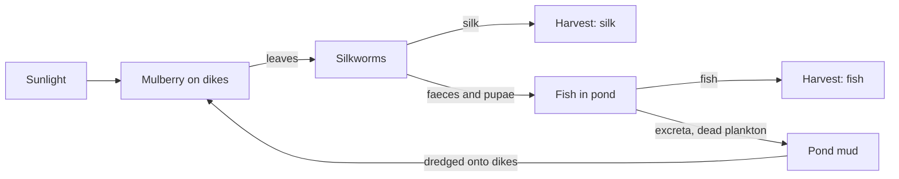

Most of the land surface of the Earth is now used or modified by people, and many of the questions that ecology is asked in public concern systems that people have built: fields, fish ponds, polluted rivers, cities. This chapter applies the ecology of the previous chapters to them. Agriculture is treated as an ecosystem with its own energy flow, nutrient cycles and population interactions, and intercropping is analyzed with the competition theory of 7.19.22. Pollution is treated through its ecological effects: oxygen depletion, nutrient enrichment (7.19.46), toxic substances and their transfer in food chains (the biomagnification model of [7.19.53](/7.19.53#sec-53.3.4)), radioactivity and plastics. The chapter then turns to the restoration of degraded ecosystems, to the human population and the city as ecological systems, and to sustainable development, and it gives an ecological analysis of several questions of current public debate. Global change (greenhouse warming, stratospheric ozone, planetary boundaries) is the subject of 7.19.47, and the conservation of biodiversity of 7.19.50–7.19.52. Where questions involve values and policy as well as ecology, the chapter sets out the ecological evidence and the questions it can answer; the choices remain open.

## 54.1. Agroecology

### 54.1.1. Agroecosystems

Farms are ecosystems: their crops are producers, their livestock, pests and people consumers, their soils hold decomposers and nutrient pools. They differ from natural ecosystems in three ways (Odum and Barrett 2005). They are subsidized by auxiliary energy, human and animal labor in traditional agriculture and fossil fuel in industrial agriculture (machinery, fertilizer, pesticides, irrigation, transport); their diversity is reduced, often to a single crop; and their dominant species are selected by people for yield rather than by natural selection for persistence. Agricultural history is often divided into stages by the relationship between agriculture and nature: primitive agriculture (shifting cultivation and gathering), traditional agriculture (labor-intensive, organic manure, local varieties), industrial or "petroleum" agriculture (fossil-fuel subsidies, synthetic fertilizer, pesticides, high-yielding varieties), and ecological or sustainable agriculture, which seeks high yields with lower external inputs.

Industrial agriculture made the **Green Revolution** possible: from the 1960s, dwarf high-yielding varieties of wheat and rice, irrigation and fertilizer tripled the world's cereal production, while the area of cropland grew by little more than 10%. Synthetic nitrogen fertilizer from the Haber–Bosch process now supplies about half of the nitrogen in the world's crops, and roughly half of humanity is fed by it (Erisman et al. 2008). These gains have ecological costs, which follow from the properties of agroecosystems:

- A monoculture of genetically uniform plants with identical requirements maximizes intraspecific competition and offers large, uniform resources to pests and pathogens; the system has little capacity for self-regulation and depends on continual management.
- High inputs of energy and matter accelerate energy flow and nutrient cycling and decouple them from those of the surrounding ecosystems: nitrogen and phosphorus leak into waters and cause **eutrophication** (7.19.46), groundwater is overdrawn, irrigated soils become saline, and bare soil erodes.
- Pesticides kill natural enemies, cause **pest resurgence** and select for resistance (7.19.53), and residues enter food chains.
- Soil organic matter declines under continuous tillage, which reduces soil structure and water retention.

### 54.1.2. Agroecology and Ecological Agriculture

**Definition 54.1.1 (Agroecology)** **Agroecology** is the study of agricultural systems as ecosystems: it uses the theories and methods of ecology, economics and systems science to study agricultural organisms together with their natural and social environment as a whole, its structure, functions, internal interactions, regulation and conditions for sustainable development. The word is also used for farming practices and social movements based on these principles.

**Definition 54.1.2 (Ecological Agriculture)** **Ecological agriculture** is an integrated system of agricultural production managed according to ecological and ecological-economic principles, which aims to raise the efficiency of solar energy capture, the conversion of biological energy and the recycling of agricultural by-products, so as to increase production while conserving resources and the environment: a high-yield, low-input, low-pollution mode of agriculture.

Its characteristics are usually listed as three. Holism and controllability: crops, forestry, animal husbandry, side-line production and fisheries are combined into one system whose components are regulated together according to ecological and economic laws. Stability, efficiency and durability: a well-structured system resists disturbances, converts solar energy efficiently and conserves its resource base. Regional adaptation: designs are adapted to the climate, soils and economy of each region. Its scientific basis is the ecology of earlier chapters:

| Principle | Ecological basis | Agricultural application |
|---|---|---|
| Organisms and environment interact and coevolve | Conditions and resources (7.19.6) | Crops and varieties matched to climate and soil |
| Food chains and webs | **Food chain**, **food web** (7.19.38) | Crop residues fed to livestock, manure to fish or biogas; natural enemies conserved |
| Multiple use of energy and recycling of matter | **Ecological efficiency** (7.19.43); nutrient cycles (7.19.45) | By-products of one component are inputs of another; nutrients returned to fields |
| Structural stability and functional coordination | Diversity and stability (7.19.38) | Crop rotation, mixed cropping, agroforestry |
| Edge effect | **Edge effect** (7.19.48) | Strip intercropping, hedgerows and field margins rich in enemies and pollinators |
| Niche | **Ecological niche** ([7.10.15](/7.10.15)), niche differentiation (7.19.23) | Combining species that use different resources, depths or seasons |
| Limiting factors | **Limiting factor** (7.19.2) | Supplying the resource that limits yield, not all resources indiscriminately |

The table describes aims more than guarantees. Whether a given ecological design actually raises yields or reduces inputs is an empirical question, answered by field experiments and measured by quantities such as the land equivalent ratio, the nutrient balance and the energy return on inputs.

### 54.1.3. Intercropping and the Land Equivalent Ratio

Intercropping, growing two or more crops together on the same field, is the oldest application of niche theory to agriculture: maize with beans or soybean, wheat with maize in strips, cereals with legumes. Its advantage is measured by comparing the mixture with monocultures of the same crops.

**Definition 54.1.3 (Land Equivalent Ratio)** The **land equivalent ratio** (LER) of an intercrop of crops 1 and 2 is

$$
\mathrm{LER} = \frac{Y_1^{\mathrm{mix}}}{Y_1^{\mathrm{mono}}} + \frac{Y_2^{\mathrm{mix}}}{Y_2^{\mathrm{mono}}}, \tag{54.1}
$$
where $Y_i^{\mathrm{mix}}$ is the yield of crop $i$ per unit area in the intercrop and $Y_i^{\mathrm{mono}}$ its yield per unit area in monoculture. Each term is a *relative yield*. $\mathrm{LER} > 1$ means that the area of monocultures needed to produce the same harvest exceeds the area of the intercrop: an LER of 1.25 saves 20% of the land.

The **Lotka–Volterra model** of competition (Definition 22.3.2) gives the condition for a yield advantage. Suppose that the final biomass of each crop is set by competition, so that in monoculture each reaches its carrying capacity $K_i$, independently of the sowing density (the **law of constant final yield**, Definition 11.4.1), and in the mixture the two reach the Lotka–Volterra equilibrium.

**Proposition 54.1.1 (LER of the Lotka–Volterra Equilibrium)** Let $\kappa = K_2/K_1$ and let the competition coefficients satisfy $\alpha_{12}\kappa < 1$ and $\alpha_{21}/\kappa < 1$, the conditions for stable coexistence (Theorem 22.4.3). Then

$$
\mathrm{LER} = \frac{N_1^*}{K_1} + \frac{N_2^*}{K_2} = 1 + \frac{(1 - \alpha_{12}\kappa)(1 - \alpha_{21}/\kappa)}{1 - \alpha_{12}\alpha_{21}} > 1. \tag{54.2}
$$
If instead one crop excludes the other, the mixture ends as a monoculture and $\mathrm{LER} = 1$. In the symmetric case $\kappa = 1$, $\alpha_{12} = \alpha_{21} = \alpha$, $\mathrm{LER} = 2/(1 + \alpha)$.

**Proof** The coexistence equilibrium is $N_1^* = (K_1 - \alpha_{12}K_2)/(1 - \alpha_{12}\alpha_{21})$, $N_2^* = (K_2 - \alpha_{21}K_1)/(1 - \alpha_{12}\alpha_{21})$. Dividing by $K_1$ and $K_2$ and adding,

$$
\mathrm{LER} = \frac{2 - \alpha_{12}\kappa - \alpha_{21}/\kappa}{1 - \alpha_{12}\alpha_{21}},
$$
and $\mathrm{LER} - 1 = (1 - \alpha_{12}\kappa - \alpha_{21}/\kappa + \alpha_{12}\alpha_{21})/(1 - \alpha_{12}\alpha_{21})$, whose numerator factorizes as $(1 - \alpha_{12}\kappa)(1 - \alpha_{21}/\kappa)$. Under the coexistence conditions both factors are positive and $\alpha_{12}\alpha_{21} = (\alpha_{12}\kappa)(\alpha_{21}/\kappa) < 1$. The symmetric case follows by substitution. $\square$

Overyielding is therefore the agricultural face of stable coexistence: it occurs when each crop limits itself more than it limits the other, which requires that they differ in resource use, in rooting depth, in the timing of growth, in light interception, or in nitrogen source (Figure 1). Facilitation, a negative competition coefficient, raises the LER further. The classic case is the legume: soybean, faba bean or pea fix their own nitrogen through **nitrogen fixation** by rhizobia and leave the soil nitrogen to the cereal. In faba bean–maize intercrops in Gansu, the faba bean also acidifies its **rhizosphere** and releases organic acids that mobilize soil phosphorus, from which the interwoven maize roots benefit (Li et al. 2007). Field intercrops typically have LERs of about 1.1–1.3; meta-analyses of hundreds of experiments find means of about 1.2–1.3 (Yu et al. 2015; Martin-Guay et al. 2018). Intercrops also reduce pests and diseases by diluting hosts and harboring enemies, the basis of the push–pull system described in [7.17.40](/7.17.40#sec-40.6.3), and the rice cultivar mixtures of Yunnan, in which susceptible glutinous rice planted in rows between resistant hybrid rice suffered far less blast (*Magnaporthe oryzae*) than in monoculture (Zhu et al. 2000). The costs are practical: intercrops are harder to mechanize and to manage, which is why strip designs that allow machines in each strip are favored.

![The land equivalent ratio (LER) from competition theory. A: LER of the Lotka–Volterra competition equilibrium (Proposition 54.1.1) with equal carrying capacities, against the two competition coefficients; within the square of stable coexistence (both coefficients below 1) the LER exceeds 1 and increases as the coefficients decrease, and it exceeds 2 where the crops facilitate each other (negative coefficients); where one crop excludes the other, the LER is 1. B: a replacement series (de Wit): the two crops are sown in different proportions at the same total density, with hyperbolic yield–density responses; the relative yields of the two crops (colored) and their sum, the LER (black), are shown for a competition coefficient of 0.4 (solid), when the sum rises above 1 at intermediate proportions, and of 1 (dashed), when the crops are ecologically equivalent and the sum is exactly 1. C: in the symmetric case LER = 2/(1 + α); typical field values of 1.1–1.3 (shaded) correspond to interspecific competition about half to four-fifths as strong as intraspecific competition.](./plots/ler.py)

### 54.1.4. Integrated Farming Systems

Traditional Chinese agriculture developed integrated systems that recycle the by-products of one component as the inputs of another, and some have been recognized by the FAO as Globally Important Agricultural Heritage Systems.

- Rice–fish co-culture, practiced in Qingtian County, Zhejiang, for more than a thousand years: carp in the paddy eat weeds, insects and planthoppers, stir the water and soil, and fertilize the rice with their excreta, while the rice shades and shelters the fish. A field study and survey found that rice–fish fields needed 68% less pesticide and 24% less chemical fertilizer than rice monocultures, with similar rice yields and stable yields over years (Xie et al. 2011). Rice–duck, rice–crayfish and rice–crab systems follow the same principle, though some, such as rice–crayfish, are run for the animal's value and increase nutrient losses.
- Mulberry dike–fish pond systems of the Pearl River Delta and of Huzhou, Zhejiang: ponds are dug in low-lying land and the soil heaped into dikes planted with mulberry; mulberry leaves feed silkworms, silkworm feces and pupae feed fish, and the nutrient-rich pond mud is dredged onto the dikes to fertilize the mulberry. Sugarcane, fruit trees or vegetables can replace the mulberry.

Biogas digesters that convert manure and residues into methane for cooking and slurry for fields add an energy loop to such systems. Integrated systems are labor-intensive and depend on local markets, and many have declined with urbanization and the economics of specialized farming; their value now lies partly in what they show about nutrient recycling and in their cultural and biodiversity value.

## 54.2. Pollution Ecology

### 54.2.1. Pollutants and Their Effects

*Pollution* is the addition to the environment, directly or indirectly by people, of substances or energy (heat, noise, light, radiation) in amounts that have harmful effects on organisms, ecosystems or human uses of the environment. Pollutants are distinguished by their source (point sources, such as an outfall or a chimney, and diffuse or nonpoint sources, such as agricultural runoff and traffic), by their persistence (degradable pollutants, which are broken down by organisms or chemical processes, and persistent ones), and by their mode of action. Many substances that pollute at high concentration are resources at low concentration (nitrogen, phosphorus, organic matter, heat), so that pollution is a matter of dose, as for any ecological factor with a tolerance range (7.19.2).

Toxicity is measured by dose–response experiments: the proportion of organisms responding (dying, failing to reproduce) is plotted against the dose or concentration, usually giving a sigmoid curve against log concentration. Its summaries are the **median lethal dose** ($\mathrm{LD}_{50}$, or the concentration $\mathrm{LC}_{50}$ killing half of the test organisms in a fixed time) and, for chronic effects, the highest concentration with no observed effect. Environmental standards are set by dividing such values by safety factors for the uncertainty of extrapolating from a few test species to whole ecosystems. Effects propagate across levels of organization: biochemical changes (enzyme inhibition, induction of detoxifying enzymes, used as biomarkers), individual effects (reduced growth, reproduction, behavior), population effects (decline, evolution of tolerance), and community and ecosystem effects (loss of sensitive species, changes of function). Organisms whose presence or condition reflects the environment serve as bioindicators: the disappearance of **lichens** from cities was one of the first indicators of sulfur dioxide pollution, and the composition of stream invertebrates is used to grade river quality.

### 54.2.2. Air Pollution and Smog

Air pollutants are emitted mostly by burning fossil fuels and biomass: sulfur dioxide, nitrogen oxides, carbon monoxide, volatile organic compounds and particles. Their combination with weather produces two types of smog.

- Sulfurous (London-type) smog arises from coal burning in cold, damp, still air under a temperature inversion: sulfur dioxide and soot accumulate and form sulfuric acid droplets. In December 1952, five days of such smog in London caused about 4000 deaths in the following weeks, later estimates being considerably higher; it led to the Clean Air Act of 1956.
- Photochemical (Los Angeles-type) smog forms in sunny weather from the emissions of motor vehicles and industry. Haagen-Smit showed in the early 1950s that it is produced by reactions of nitrogen oxides and volatile organic compounds driven by sunlight, whose main product is ozone.

The chemistry of photochemical smog explains why ozone accumulates. Sunlight splits nitrogen dioxide, and the oxygen atom forms ozone:

$$
\ce{NO2 + h\nu -> NO + O}, \qquad \ce{O + O2 -> O3}, \qquad \ce{NO + O3 -> NO2 + O2}.
$$
These three reactions alone create no net ozone: they come to a photostationary state with $[\ce{O3}] = j[\ce{NO2}]/(k[\ce{NO}])$, where $j$ is the photolysis rate of $\ce{NO2}$ and $k$ the rate constant of the third reaction. Volatile organic compounds break this cycle: their oxidation produces peroxy radicals that convert $\ce{NO}$ back into $\ce{NO2}$ without consuming ozone, so that $[\ce{NO2}]/[\ce{NO}]$ and therefore ozone rise through the day. By-products include peroxyacetyl nitrate (PAN), a secondary pollutant that damages plants at concentrations of parts per billion, and secondary organic particles. Ground-level ozone injures leaves (it enters through stomata and oxidizes cell components), reducing crop yields by several percent in polluted regions and forest growth.

Fine particles with diameters below $2.5\,\mathrm{\mu m}$ ($\mathrm{PM}_{2.5}$), emitted directly or formed from gases, penetrate deep into the lungs and are the air pollutant with the largest effect on human health. In Beijing the annual mean concentration fell from about $90\,\mathrm{\mu g\,m^{-3}}$ in 2013, when China adopted its Air Pollution Prevention and Control Action Plan, to about $30\,\mathrm{\mu g\,m^{-3}}$ in the early 2020s, still well above the WHO guideline of $5\,\mathrm{\mu g\,m^{-3}}$ (2021). Sulfur and nitrogen oxides also return to the surface as acid deposition, which acidifies soils and lakes (7.19.46).

### 54.2.3. Water Pollution: Organic Matter, Oxygen and Toxic Substances

Sewage, food-processing wastes and manure add organic matter to waters, whose decomposition by bacteria consumes oxygen. The load is measured by the **biochemical oxygen demand** (BOD), the oxygen consumed by microorganisms in oxidizing the organic matter in a sample (usually over five days at $20\,^\circ\mathrm{C}$), and the chemical oxygen demand (COD), the oxygen equivalent of the organic matter oxidized by a strong chemical oxidant, which includes compounds that microorganisms cannot readily degrade. Below an outfall into a river, the balance between decomposition and reaeration produces a characteristic sag of dissolved oxygen, first modeled by Streeter and Phelps (1925) for the Ohio River.

**Proposition 54.2.1 (Streeter–Phelps Oxygen Sag)** Let $L(t)$ be the BOD remaining and $D(t) = O_{\mathrm{sat}} - O(t)$ the oxygen deficit in a parcel of water traveling downstream, with deoxygenation rate constant $k_1$ and reaeration rate constant $k_2 \ne k_1$:

$$
\frac{\mathrm{d}L}{\mathrm{d}t} = -k_1L, \qquad \frac{\mathrm{d}D}{\mathrm{d}t} = k_1L - k_2D, \tag{54.3}
$$
with $L(0) = L_0$ and $D(0) = D_0$ after mixing. Then

$$
D(t) = \frac{k_1L_0}{k_2 - k_1}\left(\mathrm{e}^{-k_1t} - \mathrm{e}^{-k_2t}\right) + D_0\mathrm{e}^{-k_2t}. \tag{54.4}
$$
If $D_0 < k_1L_0/k_2$, the deficit is greatest at the critical time

$$
t_{\mathrm c} = \frac{1}{k_2 - k_1}\ln\left[\frac{k_2}{k_1}\left(1 - \frac{D_0(k_2 - k_1)}{k_1L_0}\right)\right], \qquad D_{\mathrm c} = \frac{k_1}{k_2}L_0\,\mathrm{e}^{-k_1t_{\mathrm c}}. \tag{54.5}
$$

**Proof** $L = L_0\mathrm{e}^{-k_1t}$. The equation for $D$ is linear; with the integrating factor $\mathrm{e}^{k_2t}$, $(D\mathrm{e}^{k_2t})' = k_1L_0\mathrm{e}^{(k_2 - k_1)t}$, which integrates to Eq. (54.4). At the maximum $\mathrm{d}D/\mathrm{d}t = 0$, so $k_2D_{\mathrm c} = k_1L(t_{\mathrm c})$, which is the second part of Eq. (54.5); differentiating Eq. (54.4) and setting the derivative to zero gives $k_2\mathrm{e}^{-k_2t}(k_1L_0 - D_0(k_2 - k_1)) = k_1^2L_0\mathrm{e}^{-k_1t}$, which solves to $t_{\mathrm c}$. The condition $D_0 < k_1L_0/k_2$ makes $\mathrm{d}D/\mathrm{d}t > 0$ at $t = 0$, so the maximum lies at $t_{\mathrm c} > 0$. $\square$

Eq. (54.3) is a two-compartment linear model of the kind treated in 7.19.45, and the critical deficit is proportional to the load $L_0$. This gives the river a *carrying capacity for effluent*: the largest BOD load that keeps the minimum oxygen above a standard (Figure 2). The model also explains the longitudinal zones below a sewage outfall, recognized long before it in the saprobic system of river classification: a zone of degradation and active decomposition, where oxygen is low, bacteria and fungi ("sewage fungus") abound, and the invertebrates are dominated by tolerant tubificid worms and chironomid larvae; and a zone of recovery, where algae, then mayflies, stoneflies and fish return. When the load is large enough, oxygen falls to zero and decomposition becomes anaerobic, producing hydrogen sulfide and methane; the model ceases to apply.

![The Streeter–Phelps oxygen sag below an organic effluent (Proposition 54.2.1; deoxygenation rate 0.3 per day, reaeration rate 0.6 per day, flow 20 km per day, oxygen saturation 9 mg/L, initial deficit 1 mg/L). A: dissolved oxygen against distance downstream for three BOD loads after mixing; the dots mark the critical point, about 40 km downstream. The labels give the classical zones below an outfall. Oxygen below about 5 mg/L excludes most fish. B: minimum dissolved oxygen against the BOD load: the largest load keeping oxygen above 5 mg/L, about 15 mg/L here, is the river's capacity to assimilate effluent under these conditions; it falls in summer, when warm water holds less oxygen and decomposition is faster.](./plots/oxygen-sag.py)

Nutrients pose the other main problem of water quality. Nitrogen and phosphorus from sewage, fertilizer and livestock cause **eutrophication**: algal blooms in fresh waters (often of toxic cyanobacteria) and red tides in the sea, shading of submerged plants, and oxygen depletion when the blooms decay, the mechanisms and models of which are in 7.19.46 and 7.19.39 (clear and turbid lake states). Coastal "dead zones" with seasonal hypoxia, such as that off the Mississippi delta and off the Changjiang (Yangtze) estuary, are fed by the nutrients of whole river basins.

Toxic substances in water include metals (mercury, cadmium, lead, arsenic, chromium), cyanide, oil and persistent organic pollutants such as PCBs. Mercury illustrates how chemistry and ecology determine toxicity. Inorganic mercury is converted in anoxic sediments and waters into methylmercury by anaerobic microorganisms (sulfate- and iron-reducing bacteria and methanogens carrying the *hgcAB* genes, [7.11.30](/7.11.30)). Methylmercury binds to proteins, is assimilated from food with high efficiency and eliminated slowly; inorganic mercury is poorly assimilated. The biomagnification model of Proposition 53.3.3 therefore predicts that only methylmercury biomagnifies, and that almost all the mercury in predatory fish is methylmercury (Figure 3), as is observed: more than 90% of the mercury in fish muscle is methylmercury, and a global meta-analysis found that methylmercury concentrations increase on average about sixfold per trophic level (Lavoie et al. 2013).

![Why methylmercury, not inorganic mercury, biomagnifies: steady states of the food-chain model of Proposition 53.3.3 for the two forms, with a gross growth efficiency of 0.1 at every step. Methylmercury is assimilated with efficiency 0.9 and eliminated slowly (biomagnification factor 6 per step); inorganic mercury is assimilated with efficiency 0.3 and eliminated faster (factor 0.75). A: concentrations along a five-level food chain starting from phytoplankton with 0.01 mg/kg total mercury, of which 20% is methylmercury (logarithmic scale); dotted lines: limits for methylmercury in fish (0.5 mg/kg, and 1.0 mg/kg for predatory fish, in the Chinese food standard). B: methylmercury as a percentage of total mercury rises to nearly 100% in fish. The calculation is a model, with illustrative parameters.](./plots/mercury.py)

Minamata disease is the case that made this mechanism known. From 1932 to 1968, the Chisso Corporation's factory at Minamata, Japan, used mercury as a catalyst in producing acetaldehyde and discharged wastewater containing methylmercury, formed as a by-product, into Minamata Bay. Methylmercury accumulated in fish and shellfish, and from the early 1950s cats, birds and then people who ate seafood developed a neurological disease: numbness, loss of coordination, constriction of the visual field, and in children exposed before birth, severe congenital disabilities, since methylmercury crosses the placenta. The disease was officially recognized in 1956, but the government accepted its cause only in 1968; about 2300 patients have been officially certified, and many more people received compensation. A second outbreak occurred in Niigata in 1965. The Minamata Convention on Mercury (adopted 2013, in force 2017) controls mercury mining, trade, products and emissions; the main global sources are now artisanal gold mining and coal combustion, and atmospheric mercury, deposited far from its sources, reaches remote lakes and the Arctic.

### 54.2.4. Soil Pollution and Solid Waste

Soils receive metals from mining, smelting, sewage sludge, irrigation with wastewater and phosphate fertilizers (which contain cadmium), organic pollutants from pesticides and industry, and plastics. Soil pollution is persistent: metals are not degraded, and many organic pollutants bind to organic matter and clays. A national soil survey of China (2005–2013, published in 2014) found that 16.1% of the sampled sites, and 19.4% of those on cultivated land, exceeded the soil quality standards, cadmium being the most frequent pollutant. Cadmium is taken up by rice, especially from acidic, oxidized paddy soils, and accumulates in the grain; in the Jinzu River basin of Japan, chronic cadmium poisoning from mining wastes caused itai-itai disease (kidney damage and brittle bones) in the mid-20th century.

Polluted soils are remediated by removal and replacement, by chemical immobilization (liming to raise pH, which reduces cadmium uptake), by managing water (keeping paddies flooded during grain filling, when reducing conditions immobilize cadmium as sulfide), and biologically. **Bioremediation** uses microorganisms to degrade organic pollutants, such as oil and chlorinated solvents ([7.11.30](/7.11.30)). Phytoremediation uses plants: **hyperaccumulators**, plants that concentrate metals in their shoots to more than a hundred times the levels in other plants, extract metals that are then removed with the harvest. The Chinese brake fern *Pteris vittata* accumulates arsenic to more than 1% of its dry mass (Ma et al. 2001) and has been used in field remediation of arsenic-contaminated farmland in southern China; *Sedum alfredii*, discovered in old lead–zinc mining areas of Zhejiang, hyperaccumulates zinc and cadmium. Phytoextraction is slow (years to decades) and limited to the root zone, but cheap and gentle on the soil.

Solid wastes, municipal refuse, construction debris, industrial residues and hazardous wastes, are landfilled, incinerated or recycled. Landfills emit methane, a **greenhouse gas** (7.19.47), and leachate that can contaminate groundwater; incineration recovers energy but emits pollutants unless controlled. The ecological principle of recycling matter applies to cities as to farms: waste sorting, composting of organic waste and recovery of materials reduce both the extraction of resources and the burden on the receiving ecosystems.

### 54.2.5. Radioactive Pollution

Radioactive isotopes behave chemically like their stable counterparts and follow them through ecosystems: caesium-137 follows potassium into muscle, strontium-90 follows calcium into bone and milk, and iodine-131 is concentrated by the thyroid. They can therefore be concentrated by organisms and food chains; downstream of the Hanford nuclear site on the Columbia River in the 1950s–1960s, radioactive phosphorus in the eggs of geese was about two million times more concentrated than in the river water (Odum and Barrett 2005). Radionuclide tracers were also among the first tools of ecosystem ecology, used to measure flows in food webs and nutrient cycles.

The accident at Chernobyl in 1986 contaminated large areas of Ukraine, Belarus and Russia, and about 350 000 people were resettled from an exclusion zone of several thousand square kilometers. Its effects on wildlife are a genuine controversy. Census data show that large mammals (elk, roe deer, red deer, wild boar, wolves) became as abundant in the exclusion zone as in uncontaminated nature reserves, or more so (Deryabina et al. 2015): the removal of people outweighed the effects of radiation on these populations. Studies along radiation gradients within the zone have reported lower abundances of birds and invertebrates, more abnormalities and slower decomposition at the most contaminated sites (Møller and Mousseau and coauthors), findings whose interpretation is disputed because doses are hard to measure and sites differ in other ways. Both kinds of evidence can be correct at once: chronic radiation can harm individuals at highly contaminated sites while populations over the zone as a whole increase in the absence of human activity. The accident at Fukushima Daiichi in 2011 led to similar studies in Japan.

### 54.2.6. Microplastics

Plastic production has grown to about 400 million tonnes a year, and plastic waste is now found in every environment. *Microplastics* are plastic particles smaller than $5\,\mathrm{mm}$, either manufactured at that size (pellets, microbeads in cosmetics) or formed by the fragmentation of larger items and the shedding of fibers from textiles and particles from tires; particles below about $1\,\mathrm{\mu m}$ are called nanoplastics. Conventional plastics are not decomposed at significant rates by organisms (7.19.44), so they persist and accumulate. Between 4.8 and 12.7 million tonnes of plastic were estimated to enter the oceans from land in 2010 (Jambeck et al. 2015).

Whether the problem of microplastics is exaggerated is a reasonable question, and the answer depends on which claim is meant, because the evidence differs greatly in strength:

| Claim | Evidence | Strength |
|---|---|---|
| Microplastics are ubiquitous: in oceans, sediments, soils, air, organisms, drinking water and human tissues | Many independent surveys with standardized methods | Strong (but counts depend strongly on method and size limits, and contamination of samples is a recurrent problem) |
| Large plastic debris harms wildlife by entanglement and ingestion | Direct observation in seabirds, turtles, marine mammals | Strong |
| Microplastics harm organisms in laboratory exposures | Hundreds of experiments: reduced feeding, growth and reproduction in invertebrates and fish | Moderate: effects are common at high concentrations, often above those measured in the environment (Bucci et al. 2020); environmental particles differ from the uniform spheres often tested |
| Microplastics carry adsorbed pollutants and microorganisms into organisms | Laboratory and field studies | Moderate; their contribution relative to other routes (food, water) is usually small for pollutants |
| Microplastics reduce populations or change ecosystem functions in the field | Few studies | Weak or not yet established |
| Microplastics harm human health | Detection in blood, placenta and arterial plaques; one observational study associated microplastics in carotid plaques with more cardiovascular events (Marfella et al. 2024) | Weak to moderate: associations, analytical uncertainties (some measurements may confuse lipids with polyethylene), no established causal effects |

Ecologically, the reasonable conclusion is that microplastics are a persistent and growing contaminant whose effects at present environmental concentrations are uncertain and probably modest for most organisms, but whose concentrations will keep rising for decades even if emissions fall, because of the fragmentation of the plastic already in the environment. This combination of persistence, irreversibility and uncertainty is the situation in which the precautionary approach (7.19.53) applies. Large plastic debris, by contrast, causes well-documented harm: in a survey of 159 coral reefs in the Asia–Pacific region, the likelihood of disease increased from about 4% to 89% when corals were in contact with plastic debris (Lamb et al. 2018).

Technologies for degrading plastics exist for some polymers. The bacterium *Ideonella sakaiensis*, isolated from a recycling site, degrades PET with two enzymes (Yoshida et al. 2016), and engineered PET hydrolases depolymerize 90% of PET within hours under industrial conditions (Tournier et al. 2020), which is being developed for enzymatic recycling. Polyethylene and polypropylene, the most abundant plastics, have carbon–carbon backbones for which no efficient enzymes are known. Degradation technologies may help recycling, but they do not remove plastics already dispersed in the environment; reducing emissions is the only effective control.

## 54.3. Restoration Ecology and Ecological Engineering

Restoration ecology, the science of assisting the recovery of degraded, damaged or destroyed ecosystems, is introduced in [7.19.52](/7.19.52) as part of conservation. It applies the theory of **ecological succession** (7.19.36): restoration often consists of removing the factors that arrest succession (grazing, erosion, pollution, altered hydrology) and of supplying the species or soil conditions that facilitate it. Alternative stable states (7.19.39) explain why some degraded systems do not recover when the stress is removed and require an active push across a threshold, such as the removal of planktivorous fish to return a eutrophic lake to its clear state.

Restoration in China has been large in scale. On the Saihanba plateau in Hebei, north of Beijing, foresters planted from 1962 a forest on degraded grassland and sand, raising forest cover from about 11% to about 80%. The Grain for Green program, begun in 1999, converted sloping cropland to forest and grassland across the Loess Plateau and elsewhere, greatly increasing vegetation cover and reducing sediment flow into the Yellow River; but the water consumed by the new vegetation is approaching the limit that rainfall can sustain in parts of the plateau (Feng et al. 2016), a reminder that afforestation in dry regions must respect the water balance, and that grassland or shrubland may be the appropriate target where rainfall is low.

**Definition 54.3.1 (Ecological Engineering)** **Ecological engineering** is the design, construction and management of ecosystems that integrate human society with its natural environment for the benefit of both (Mitsch and Jørgensen): it uses the self-organization of ecosystems, driven mainly by solar energy, rather than replacing it with fossil-fuel technology.

H. T. Odum introduced the concept in the 1960s; in China, Ma Shijun formulated its principles in the late 1970s and 1980s as holism, coordination, self-generation (self-regulation and self-renewal) and recycling, and applied them to integrated farming systems like those of Section 54.1.4 and to the "ecological engineering" of rice pest management ([7.17.40](/7.17.40#sec-40.6.3)). Its most widespread application is the constructed wetland, in which water flows through beds of reeds and other wetland plants, and microbial processes in the sediments and on the roots degrade organic matter, remove nitrogen by **denitrification** and retain phosphorus and particles.

**Formula 54.3.1 (First-Order Removal in a Treatment Wetland)** In the "$k$–$C^*$" model (Kadlec and Knight), a pollutant in a wetland with plug flow is removed at a rate proportional to its excess over a background concentration $C^*$, with an areal rate constant $k$ (meters per year). With inflow and outflow concentrations $C_{\mathrm{in}}$, $C_{\mathrm{out}}$ and hydraulic loading rate $q = Q/A$ (flow rate per unit area),

$$
\frac{C_{\mathrm{out}} - C^*}{C_{\mathrm{in}} - C^*} = \mathrm{e}^{-k/q}, \qquad A = \frac{Q}{k}\ln\frac{C_{\mathrm{in}} - C^*}{C_{\mathrm{out}} - C^*}. \tag{54.6}
$$

For example, to reduce the BOD of $1000\,\mathrm{m^3}$ of wastewater per day from $100$ to $20\,\mathrm{mg\,L^{-1}}$, with $k = 35\,\mathrm{m\,a^{-1}}$ and $C^* = 5\,\mathrm{mg\,L^{-1}}$, the wetland needs $A = (365\,000/35)\ln(95/15) \approx 1.9 \times 10^4\,\mathrm{m^2}$, about 2 hectares. The area grows only logarithmically with the required removal but linearly with the flow, which is why treatment wetlands suit small towns, farms and the polishing of effluents rather than large cities.

## 54.4. Human Ecology and Urban Ecosystems

### 54.4.1. The Human Population

Human ecology studies people as part of ecosystems: their population dynamics, resource use and effects on the environment, and the ecological constraints on societies. The growth of the human population and the **demographic transition** are described in 7.19.10, and population growth as a root cause of biodiversity loss in 7.19.51. The world population passed 8 billion in November 2022 and, in the United Nations' medium projection, will peak at about 10.3 billion in the mid-2080s (World Population Prospects 2024). Its growth rate has fallen from a maximum of about 2.1% per year in the late 1960s to below 1%. The age structure of a population, represented by its **age pyramid** (7.19.9), classifies it by an international convention:

| Type | Proportion aged 0–14 | Proportion aged 65 and over | Median age |
|---|---|---|---|
| Young | > 40% | < 4% | < 20 years |
| Adult | 30–40% | 4–7% | 20–30 years |
| Old | < 30% | > 7% | > 30 years |

By these criteria, China's population became old around 2000; in the 2020 census, 17.95% of its 1.41 billion people were aged 0–14 and 13.50% were 65 or over, and the population began to decline in 2022.

How many people the Earth can support has no single answer, because it depends on the standard of living, technology and the use of other species' share of production. Human use already appropriates about a quarter of global terrestrial **net primary production** (7.19.42). Published estimates of human carrying capacity range over orders of magnitude, most lying between 4 and 16 billion (Cohen 1995); a distinction is often made between the biological maximum, at which people would merely subsist, and an economically optimal population at a given standard of living. Population size is only one factor of human impact, as the IPAT identity makes explicit.

**Formula 54.4.1 (IPAT Identity)** The environmental impact $I$ of a population (resource use, emissions) is the product of population size $P$, affluence $A$ (consumption per person) and technology $T$ (impact per unit of consumption) (Ehrlich and Holdren 1971):

$$
I = P \cdot A \cdot T, \qquad \frac{\mathrm{d}\ln I}{\mathrm{d}t} = \frac{\mathrm{d}\ln P}{\mathrm{d}t} + \frac{\mathrm{d}\ln A}{\mathrm{d}t} + \frac{\mathrm{d}\ln T}{\mathrm{d}t}. \tag{54.7}
$$

The growth rates add: if population grows at 1% and consumption per person at 3% a year, impact falls only if the impact per unit of consumption falls by more than 4% a year. The identity is an accounting device, not a causal model, since the factors influence one another (affluence lowers fertility; technology changes consumption), but it shows why reducing impact requires changes in more than one factor. The **ecological footprint** (Definition 40.5.1) measures the impact in units of productive area.

### 54.4.2. The Social–Economic–Natural Complex Ecosystem

**Definition 54.4.1 (Social–Economic–Natural Complex Ecosystem)** A **social–economic–natural complex ecosystem** (Ma Shijun and Wang Rusong 1984) is a system formed by human society, its economy and its natural environment, coupled by flows of energy, materials, money and information, whose sustainability depends on the coordination of all three subsystems: the natural subsystem supplies resources and absorbs wastes, the economic subsystem transforms resources into products, and the social subsystem, through institutions, culture and knowledge, regulates both.

The concept, developed independently of but parallel to the social–ecological systems of Western resilience research, treats a city or a region as an ecosystem whose "metabolism" can be analyzed with the tools of ecosystem ecology: budgets of energy, water, carbon and nutrients, efficiencies of transformation, the degree of recycling and the dependence on imports.

### 54.4.3. Urban Ecosystems

More than half of the world's people, and about two-thirds of China's, live in cities. Urban ecosystems have distinctive properties:

- They are heterotrophic and open: a city's food, energy and water come from far beyond its boundaries, and its wastes are exported to them, so its ecological footprint is hundreds of times its area.
- Surfaces are largely impervious (buildings, roads), so rain runs off rather than infiltrating; streams are buried or channelized; groundwater recharge falls.
- Cities are warmer than their surroundings, the urban heat island, by one to several degrees on average and more on calm nights, because of dark surfaces that absorb radiation, reduced evaporation, the heat stored in buildings and waste heat; plants flower earlier and some insects and birds breed earlier in cities.
- Light at night, noise and air pollution affect animal behavior (7.19.3).
- Communities are novel: mixtures of native species tolerant of disturbance, introduced species and cultivated plants.

Along gradients from wildland to the urban core, the number of native species declines; the number of introduced plant species increases, so that total plant richness is often highest at intermediate, suburban levels of urbanization; bird species richness declines, while total bird abundance may increase because a few "urban exploiters" (pigeons, sparrows, crows, starlings, mynas) become very abundant (McKinney 2002, 2008; Figure 4A, B). Because the same urban exploiters and the same ornamental plants occur in cities everywhere, urbanization makes communities across regions more similar, a process called biotic homogenization. Cities nevertheless hold important habitat for some species, including threatened ones, and the green spaces, wetlands and corridors of a city can be designed for biodiversity; the questions of landscape ecology (patch size, **habitat fragmentation**, connectivity) apply to them (7.19.48, 7.19.49).

### 54.4.4. Ecological Analysis of Urban Controversies

Many public controversies about urban nature have ecological components. Ecology does not decide what people should value, but it can answer factual questions on which the choices depend: how large an effect is, through which mechanism, whether a proposed measure achieves its aim, and what its side effects are. Three examples illustrate the approach.

Free-ranging cats and dogs. Domestic cats are efficient predators that hunt even when fed. In the contiguous United States, free-ranging cats were estimated to kill 1.3–4.0 billion birds and 6.3–22.3 billion mammals a year, most of them by unowned cats (Loss et al. 2013), and on islands cats have contributed to at least 14% of modern extinctions of birds, mammals and reptiles (Medina et al. 2011). Because they are subsidized by people, cat populations do not decline when their prey does, the situation in which a predator can drive prey to local extinction (7.19.26). The effectiveness of trap–neuter–return programs, which aim to reduce colonies by sterilization, is a question of population dynamics: as for any population with compensating recruitment (7.19.11), sterilizing a small fraction of breeders each year is offset by higher survival of kittens and by immigration and abandonment; models and field studies suggest that colonies decline only if a large majority, typically more than about three-quarters, of the cats are sterilized each year and new cats do not arrive. Free-ranging dogs, in addition to predation and harassment of wildlife, transmit rabies and canine distemper to wild carnivores.

Feeding wild animals. Feeding is a resource subsidy, and its effects follow from the ecology of resources. Bird feeders increase winter survival and local densities of the species that use them, have changed the composition of garden bird communities in Britain over four decades (Plummer et al. 2019), and advance breeding; but they concentrate birds and transmit diseases: trichomonosis, spread at feeders, reduced the British population of greenfinches (*Chloris chloris*) by about a third within a few years of its emergence in 2005, and continued declines followed. Baiting birds at photography hides concentrates individuals at artificial food and can alter their behavior and diet. Provisioning primates or deer habituates them to people, increases densities and aggression, and leads to conflict and disease transmission in both directions. The ecological questions are the size of the subsidy relative to natural food, which species benefit (often already common ones), and whether the benefits for individuals outweigh the costs at the population level.

Channelized rivers. Lining a river with concrete and straightening it increases its conveyance: by the Manning equation of hydraulics, mean flow velocity is $v = R^{2/3}S^{1/2}/n$, with $R$ the hydraulic radius, $S$ the slope and $n$ a roughness coefficient, which falls from about 0.035 for a natural channel with vegetation and meanders to about 0.013 for concrete. Water therefore leaves the channelized reach two to three times faster, which lowers local flood levels; but the flood wave reaches downstream sooner and with a higher peak.

**Proposition 54.4.1 (Peak Discharge of a Linear Reservoir Cascade)** Model a river reach as a cascade of $n$ linear reservoirs, each with outflow equal to storage divided by a storage constant $k$ (proportional to the travel time, hence inversely proportional to flow velocity). Then the outflow from a short pulse of runoff of volume $V$ is $Q(t) = V\,t^{n-1}\mathrm{e}^{-t/k}/(k^n\Gamma(n))$ (the Nash unit hydrograph), whose peak occurs at $t = (n - 1)k$ and has height

$$
Q_{\max} = \frac{V}{k\,\Gamma(n)}\left(\frac{n - 1}{\mathrm{e}}\right)^{n-1}, \tag{54.8}
$$
inversely proportional to $k$.

**Proof** The impulse response of one linear reservoir $\mathrm{d}S/\mathrm{d}t = I - S/k$ is $\mathrm{e}^{-t/k}/k$; that of $n$ reservoirs in series is its $n$-fold convolution, the Gamma density with shape $n$ and scale $k$. Setting its derivative to zero gives the time of the peak, and substituting it gives Eq. (54.8). $\square$

Reducing $k$ by a factor of 2.7 raises the peak by the same factor for a given runoff volume, and paving the catchment increases the volume as well (Figure 4C). Channelization also removes the floodplain storage and the riparian habitat in which a natural river spreads and slows its floods, eliminates the exchange between river water and the gravel beneath the bed, raises water temperatures and simplifies the habitat for fish and invertebrates. Whether a channelization improves flood protection therefore depends on where the protection is measured: it can protect the reach itself while increasing the risk downstream. Approaches based on ecology, such as the restoration of floodplains, wetlands and meanders and the "sponge city" program that China began in 2015 to increase infiltration and storage in urban catchments, aim to reduce peaks at their source.

![Urban ecosystems. A, B: schematic patterns of diversity along an urbanization gradient (a qualitative model of the patterns reviewed by McKinney 2002, 2008, not data): native plant species decline with urbanization while introduced species increase, so that total plant richness can peak in suburbs; bird species richness declines while the share of individuals belonging to a few urban exploiters (dashed, right axis) rises. C: discharge at the outlet of a 50 km² catchment after 10 mm of rain falling in 2 hours, routed through a cascade of three linear reservoirs (Proposition 54.4.1): a natural channel (storage constant 6 h, 30% of the rain running off), the same channel lined with concrete (flow 2.7 times faster, storage constant 2.2 h), and the lined channel with a paved catchment (70% runoff); the flood peak arrives earlier and is several times higher.](./plots/urban.py)

## 54.5. Sustainable Development

**Definition 54.5.1 (Sustainable Development)** **Sustainable development** is development that meets the needs of the present without compromising the ability of future generations to meet their own needs (World Commission on Environment and Development, *Our Common Future*, 1987).

The definition joins three dimensions, ecological, economic and social, which are often in tension. Economists distinguish *weak* sustainability, in which the total capital passed to future generations, natural plus human-made, is maintained and may be substituted between its forms, from *strong* sustainability, in which critical natural capital (the climate, soils, biodiversity, the ozone layer) cannot be replaced by human-made capital and must be maintained in itself. Ecology supports the strong view for functions that have no substitutes and for losses that are irreversible, such as extinctions. The United Nations' 17 Sustainable Development Goals (2015) combine goals for poverty, food, health and education with goals for climate, oceans and life on land, and the **planetary boundaries** (7.19.47) express the strong view at the global scale: limits of the Earth system that development should not cross. The ecological footprint of humanity exceeds the biocapacity of the Earth, so that the date by which humanity has used a year's biocapacity now falls in late July or early August.

Odum compared the development of human civilization with the development of ecosystems (7.19.36): young ecosystems maximize growth and production, mature ones maximize the maintenance of a large biomass with efficient recycling; a sustainable civilization would make the transition from growth to maturity, valuing quality over quantity, reducing waste and recycling more. The analogy is a metaphor rather than a theory, but it summarizes the direction of the ecological arguments of this chapter.

Energy and climate policy illustrate the trade-offs that sustainable development must manage, and they are the subject of several current debates:

- Carbon neutrality and biodiversity. Climate change is itself one of the main threats to biodiversity (7.19.47, 7.19.51), so reducing emissions protects biodiversity in the long run; but measures to reduce emissions can harm it locally. Monoculture tree plantations established as carbon sinks store less carbon than natural forests and support far fewer species (Lewis et al. 2019), and afforestation of grasslands and savannas destroys ecosystems that were never forests. Bioenergy crops grown on a large scale would compete for land with food production and natural ecosystems and would increase the human appropriation of net primary production (7.19.42). Measures that serve both aims, protection and restoration of natural forests, wetlands and peatlands, which store large amounts of carbon, exist and are favored by both perspectives.
- Is renewable energy clean? Wind, solar and hydropower emit little carbon in operation but have ecological costs: wind turbines kill birds and bats (in the United States a few hundred thousand birds a year, far fewer than cats, buildings or vehicles, but concentrated on raptors and on migratory bats), large solar installations occupy land, and dams fragment rivers and block fish migration, as the Gezhouba Dam on the Changjiang blocked the spawning migration of the Chinese sturgeon (*Acipenser sinensis*) in 1981. These costs depend strongly on siting and can be reduced by planning, but they are not zero.
- Carbon offsets. An offset credits an emitter for a reduction or removal of carbon elsewhere, for example by protecting a forest. Its ecological value depends on whether the reduction is additional (would not have happened anyway), permanent (the forest is not later burned or cut) and free of leakage (the clearing does not simply move elsewhere); independent evaluations of forest-protection projects have found that many credited much larger reductions than they achieved (West et al. 2023).

## Summary

- Agroecology (Definition 54.1.1) treats farms as subsidized, simplified ecosystems; industrial agriculture's high yields come with nutrient losses, eutrophication, pest resurgence, soil degradation and water overuse. Ecological agriculture (Definition 54.1.2) applies food chains, recycling, niche differentiation, edge effects and limiting factors to reduce inputs.
- The land equivalent ratio (Definition 54.1.3) measures intercropping advantage; at the Lotka–Volterra equilibrium $\mathrm{LER} = 1 + (1 - \alpha_{12}\kappa)(1 - \alpha_{21}/\kappa)/(1 - \alpha_{12}\alpha_{21}) > 1$ whenever the crops coexist stably (Proposition 54.1.1), and facilitation by legumes raises it further. Rice–fish and mulberry dike–fish pond systems recycle by-products.
- Pollution is a matter of dose and persistence. Photochemical smog accumulates ozone because volatile organic compounds convert NO to $\ce{NO2}$; fine particles are the main threat to health.
- Organic pollution causes the Streeter–Phelps oxygen sag (Proposition 54.2.1), whose critical deficit is proportional to the load and defines a river's capacity for effluent; nutrients cause eutrophication.
- Only methylmercury biomagnifies, because it is assimilated efficiently and eliminated slowly (Proposition 53.3.3, Figure 3); Minamata disease made this known. Soil metals persist and are remediated by immobilization, water management and **hyperaccumulators**; radionuclides follow their chemical analogues.
- The evidence on microplastics ranges from strong (ubiquity, harm from large debris) to weak (population, ecosystem and human-health effects at current concentrations); persistence and rising concentrations justify precaution.
- Ecological engineering (Definition 54.3.1) designs self-organizing ecosystems, such as treatment wetlands with first-order removal (Formula 54.3.1); restoration applies succession and alternative stable states and must respect water limits.
- Human impact is $I = PAT$ (Formula 54.4.1); cities are social–economic–natural complex ecosystems (Definition 54.4.1) with heat islands, impervious surfaces, novel communities, declining native and rising introduced richness, and biotic homogenization.
- Ecology informs urban controversies by quantifying effects and mechanisms: subsidized cat populations, feeding as resource subsidy and disease concentration, and channelization, which raises downstream flood peaks in proportion to the reduction of travel time (Proposition 54.4.1).
- Sustainable development (Definition 54.5.1) requires managing trade-offs between climate measures, energy and biodiversity: plantations, bioenergy, renewable energy and carbon offsets have ecological costs and conditions.

## Questions

1. In an intercrop of maize and soybean, maize yields 6.0 t/ha in monoculture and 4.2 t/ha in the intercrop, soybean 2.5 t/ha in monoculture and 1.1 t/ha in the intercrop. Compute the LER and interpret it. If the two crops followed Lotka–Volterra competition with equal carrying capacities and symmetric coefficients, what coefficient would give this LER?

   **Answer** $\mathrm{LER} = 4.2/6.0 + 1.1/2.5 = 0.70 + 0.44 = 1.14$: producing the same harvest in monocultures would need 14% more land (or the intercrop saves $1 - 1/1.14 = 12\%$ of the land). With $\mathrm{LER} = 2/(1 + \alpha)$, $\alpha = 2/1.14 - 1 \approx 0.75$: interspecific competition about three-quarters as strong as intraspecific competition. The real crops are not symmetric (the relative yields differ), so this is only an index of niche overlap.

2. A town discharges sewage into a river so that the BOD after mixing is 12 mg/L and the deficit 1 mg/L; $k_1 = 0.25$ per day, $k_2 = 0.5$ per day, the saturation concentration is 8 mg/L and the river flows 15 km per day. Where does the oxygen minimum occur and what is it? What happens in a hot summer, when $k_1$ rises and saturation falls?

   **Answer** $t_{\mathrm c} = \ln[(0.5/0.25)(1 - 1 \times 0.25/(0.25 \times 12))]/0.25 = \ln[2 \times 0.9167]/0.25 = \ln 1.833/0.25 \approx 2.42$ days, about 36 km downstream. $D_{\mathrm c} = (0.25/0.5) \times 12 \times \mathrm{e}^{-0.25 \times 2.42} = 6 \times 0.546 \approx 3.3$ mg/L, so the minimum oxygen is about $8 - 3.3 = 4.7$ mg/L, just below the 5 mg/L needed by most fish. In summer, faster decomposition (larger $k_1$) moves the minimum upstream and deepens it, and the lower saturation reduces the oxygen available, so the same load may cause fish kills; low summer flows also reduce dilution, raising $L_0$.

3. Why do fish from some remote, unpolluted lakes in Canada or Scandinavia contain more mercury than is safe for frequent consumption? Which properties of a lake increase the mercury in its fish?

   **Answer** Mercury emitted to the atmosphere (from coal burning and gold mining) travels globally and is deposited far from its sources. In lakes, inorganic mercury is methylated by anaerobic microorganisms, especially in wetlands, anoxic sediments and newly flooded reservoirs (decomposing organic matter favors methylation), and in acidic, low-productivity waters. Methylmercury then biomagnifies by a factor of about six per trophic level (Proposition 53.3.3), so long food chains with large, old piscivores (pike, lake trout) accumulate the most; in unproductive lakes, growth dilution is weak. New reservoirs, acidification, extensive wetlands, low productivity and long food chains therefore increase mercury in fish.

4. (Open question) Evaluate the claim "the problem of microplastics is exaggerated". Which parts of the claim can ecology test, and what evidence would change your assessment?

   **Answer** Distinguish the claims (table in Section 54.2.6): ubiquity and harm from large debris are well established; laboratory toxicity is common at high doses; effects on populations, ecosystems and human health at current concentrations are not established. Ecology can test dose–response at environmental concentrations with realistic particles, field correlations controlled for confounders, and population consequences in long-term studies; analytical chemistry must solve contamination and identification problems. Evidence of effects at current environmental concentrations, or of rapidly rising concentrations, would strengthen concern; robust null results at environmental doses would weaken it. Persistence and irreversibility justify precaution even under uncertainty, but priorities should be set by comparison with other stressors (warming, overfishing, nutrients).

5. (Open question) A city considers (a) trap–neuter–return of its free-ranging cats, (b) bird-feeding stations in parks, and (c) lining an urban river with concrete. For each, list the ecological questions that should be answered before deciding, and the data needed.

   **Answer** (a) Cat population size, sources (abandonment, immigration), the sterilization rate achievable each year relative to the threshold for decline, effects on birds, small mammals and reptiles (predation rates, species of concern), disease risks; alternatives such as adoption, keeping owned cats indoors, removal from sensitive sites. (b) Which species use the food (common or rare), the size of the subsidy relative to natural food, disease risks and hygiene, effects on predators (cats, corvids) attracted, and on behavior and breeding; monitoring of disease. (c) The flood risk in the reach and downstream (hydrological modeling of peak discharge, Proposition 54.4.1), the loss of habitat and of floodplain storage, alternatives such as retention areas, floodplain restoration and sponge-city measures. In each case ecology supplies effects and their uncertainty; the decision also involves animal welfare, public values and costs.

6. (Open question) Discuss whether carbon neutrality and biodiversity conservation are compatible goals, and which should take priority when they conflict. Use examples of measures that serve both and measures that serve one at the expense of the other.

   **Answer** Points: climate change threatens biodiversity, so mitigation serves conservation in the long run; protecting and restoring natural carbon stores (old forests, peatlands, mangroves, seagrasses) serves both. Conflicts arise with monoculture plantations, afforestation of grasslands, large-scale bioenergy, hydropower in biodiverse rivers and poorly sited wind and solar farms. Priority need not be absolute: planning that sites energy infrastructure away from sensitive habitats, safeguards in carbon markets, and accounting of both carbon and biodiversity in projects reduce conflicts. Irreversible losses (extinctions) argue for strong protection of critical biodiversity even at some cost to the speed of decarbonization; the scale and urgency of climate change argue against vetoing all energy development. An answer should separate the ecological facts from the value judgment of priority.

7. (Open question) Is carbon offset trading ecologically sound? Under what conditions does an offset produce the reduction it claims?

   **Answer** An offset is sound if the reduction or removal is additional (it would not have happened without the payment), permanent (or insured against reversal by fire, pests, logging), measured against a credible baseline, free of leakage, and not double-counted; removals should be compared with the residence time of carbon in the atmosphere (7.19.45): carbon stored in a forest for decades does not cancel fossil carbon that stays in the atmosphere–ocean system for millennia. Evaluations of forest-protection credits have found overstated baselines; well-monitored projects with conservative baselines can be useful, and offsets are most defensible for residual emissions after direct reductions. Ecological co-benefits (biodiversity, water) are additional considerations but do not substitute for the carbon accounting.
