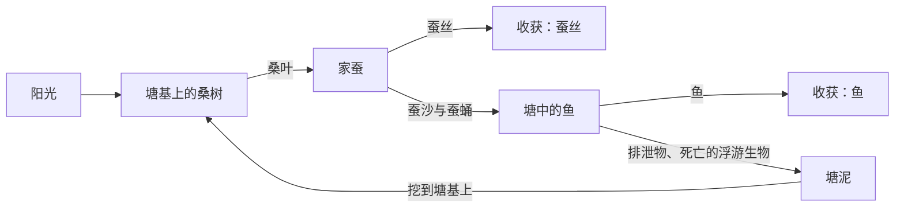

地球陆地表面的大部分现在已被人类利用或改造，公众向生态学提出的许多问题涉及人类所建造的系统：农田、鱼塘、被污染的河流、城市。本章把前面各章的生态学应用于它们。农业被当作有自己的能量流动、养分循环和种群相互作用的生态系统，间作用 7.19.22 的竞争理论分析。污染从它的生态效应来处理：氧的耗竭、养分富集（7.19.46）、有毒物质及其在食物链中的传递（[7.19.53](/7.19.53#sec-53.3.4) 的生物放大模型）、放射性和塑料。然后本章转向退化生态系统的恢复，转向作为生态系统的人口与城市，转向可持续发展，并对当前公共辩论中的几个问题做生态学分析。全球变化（温室效应、平流层臭氧、行星边界）是 7.19.47 的主题，生物多样性的保护见 7.19.50–7.19.52。当问题既涉及价值与政策、也涉及生态学时，本章给出生态学证据以及它能回答的问题；选择仍然是开放的。

## 54.1. 农业生态学

### 54.1.1. 农业生态系统

农场是生态系统：作物是生产者，家畜、害虫和人是消费者，土壤中有分解者和养分库。它们与自然生态系统有三点不同（Odum 与 Barrett 2005）。它们由辅助能补贴，传统农业中是人力和畜力，工业化农业中是化石燃料（机械、化肥、农药、灌溉、运输）；它们的多样性被降低，常常只剩一种作物；它们的优势种由人为产量而选择，而不是由自然选择为持久性而选择。农业史常按农业与自然的关系划分阶段：原始农业（刀耕火种与采集）、传统农业（劳动密集，有机肥，地方品种）、工业化或“石油”农业（化石燃料补贴，合成肥料，农药，高产品种），以及寻求以较少外部投入获得高产的生态农业或可持续农业。

工业化农业使**绿色革命**成为可能：从 1960 年代起，矮秆高产的小麦和水稻品种、灌溉和肥料使世界谷物产量增加到三倍，而耕地面积只增加了略多于 10%。Haber–Bosch 法生产的合成氮肥现在供应了世界作物中约一半的氮，大约一半的人类靠它养活（Erisman 等 2008）。这些收益有生态代价，它们源于农业生态系统的性质：

- 遗传上一致、需求相同的植物的单一栽培，使种内竞争最大，并给害虫和病原体提供大量均一的资源；这样的系统自我调节的能力很小，依赖持续的管理。
- 能量和物质的高投入加速了能量流动和养分循环，并使之与周围生态系统脱耦：氮和磷渗入水体，造成**富营养化**（7.19.46），地下水被过度抽取，灌溉的土壤盐渍化，裸露的土壤受到侵蚀。
- 农药杀死天敌，造成**害虫再猖獗**并选择出抗性（7.19.53），残留进入食物链。
- 连续耕作使土壤有机质下降，从而破坏土壤结构、降低持水能力。

### 54.1.2. 农业生态学与生态农业

**定义 54.1.1（农业生态学）** **农业生态学**（agroecology）是把农业系统当作生态系统来研究：运用生态学、经济学和系统科学的理论与方法，把农业生物及其自然与社会环境作为整体，研究其结构、功能、内部相互作用、调控和可持续发展的条件。这个词也用于基于这些原理的耕作实践和社会运动。

**定义 54.1.2（生态农业）** **生态农业**（ecological agriculture）是按生态学和生态经济学原理管理的综合性农业生产系统，目的是提高太阳能捕获、生物能转化和农业副产品循环利用的效率，从而在节约资源与保护环境的同时增加产量：一种高产、低投入、低污染的农业模式。

其特点通常归纳为三点。整体性与可控性：种植业、林业、畜牧业、副业和渔业结合成一个系统，其各组成部分按生态和经济规律统一调控。稳定性、高效性与持续性：结构良好的系统抵抗干扰，高效转化太阳能，并保护其资源基础。地域适应性：设计适应各地区的气候、土壤和经济。它的科学基础是前面各章的生态学：

| 原理 | 生态学基础 | 农业应用 |
|---|---|---|
| 生物与环境相互作用并协同演化 | 条件与资源（7.19.6） | 作物与品种适应气候和土壤 |
| 食物链与食物网 | **食物链**、**食物网**（7.19.38） | 作物残体喂牲畜，粪便喂鱼或产沼气；保护天敌 |
| 能量多级利用与物质循环 | **生态效率**（7.19.43）；养分循环（7.19.45） | 一个组分的副产品是另一个组分的投入；养分还田 |
| 结构稳定与功能协调 | 多样性与稳定性（7.19.38） | 轮作、混作、农林复合 |
| 边缘效应 | **边缘效应**（7.19.48） | 带状间作、天敌与传粉者丰富的树篱和田边 |
| 生态位 | **生态位**（[7.10.15](/7.10.15)），生态位分化（7.19.23） | 把利用不同资源、不同深度或不同季节的物种组合起来 |
| 限制因子 | **限制因子**（7.19.2） | 提供限制产量的资源，而不是不加区别地提供所有资源 |

这张表描述的更多是目标而不是保证。某一生态设计是否真能提高产量或减少投入，是一个经验问题，要由田间试验回答，并用土地当量比、养分平衡和能量投入产出比等量来度量。

### 54.1.3. 间作与土地当量比

间作，即在同一块田里同时种植两种或更多作物，是生态位理论在农业中最古老的应用：玉米与豆类或大豆，小麦与玉米的带状种植，禾谷类与豆科。它的优势通过把混作与相同作物的单作比较来度量。

**定义 54.1.3（土地当量比）** 作物 1 与作物 2 间作的**土地当量比**（LER）为

$$
\mathrm{LER} = \frac{Y_1^{\mathrm{mix}}}{Y_1^{\mathrm{mono}}} + \frac{Y_2^{\mathrm{mix}}}{Y_2^{\mathrm{mono}}}, \tag{54.1}
$$
其中 $Y_i^{\mathrm{mix}}$ 是作物 $i$ 在间作中单位面积的产量，$Y_i^{\mathrm{mono}}$ 是它在单作中单位面积的产量。每一项是*相对产量*。$\mathrm{LER} > 1$ 表示，生产同样收获量所需的单作面积超过间作的面积：LER 为 1.25 节约 20% 的土地。

竞争的 **Lotka–Volterra 模型**（定义 22.3.2）给出产量优势的条件。设每种作物的最终生物量由竞争决定，因而在单作中各自达到环境容纳量 $K_i$，与播种密度无关（**最后产量恒值法则**，定义 11.4.1），而在混作中两者达到 Lotka–Volterra 平衡。

**命题 54.1.1（Lotka–Volterra 平衡的 LER）** 设 $\kappa = K_2/K_1$，竞争系数满足 $\alpha_{12}\kappa < 1$ 和 $\alpha_{21}/\kappa < 1$，即稳定共存的条件（定理 22.4.3）。则

$$
\mathrm{LER} = \frac{N_1^*}{K_1} + \frac{N_2^*}{K_2} = 1 + \frac{(1 - \alpha_{12}\kappa)(1 - \alpha_{21}/\kappa)}{1 - \alpha_{12}\alpha_{21}} > 1. \tag{54.2}
$$
若相反地一种作物排除了另一种，混作最终成为单作，$\mathrm{LER} = 1$。在对称情形 $\kappa = 1$、$\alpha_{12} = \alpha_{21} = \alpha$ 下，$\mathrm{LER} = 2/(1 + \alpha)$。

**证明** 共存平衡点为 $N_1^* = (K_1 - \alpha_{12}K_2)/(1 - \alpha_{12}\alpha_{21})$，$N_2^* = (K_2 - \alpha_{21}K_1)/(1 - \alpha_{12}\alpha_{21})$。分别除以 $K_1$ 和 $K_2$ 再相加，

$$
\mathrm{LER} = \frac{2 - \alpha_{12}\kappa - \alpha_{21}/\kappa}{1 - \alpha_{12}\alpha_{21}},
$$
而 $\mathrm{LER} - 1 = (1 - \alpha_{12}\kappa - \alpha_{21}/\kappa + \alpha_{12}\alpha_{21})/(1 - \alpha_{12}\alpha_{21})$，其分子分解为 $(1 - \alpha_{12}\kappa)(1 - \alpha_{21}/\kappa)$。在共存条件下两个因子都为正，且 $\alpha_{12}\alpha_{21} = (\alpha_{12}\kappa)(\alpha_{21}/\kappa) < 1$。对称情形代入即得。$\square$

因此超产是稳定共存在农业上的表现：当每种作物对自己的限制强于对另一种的限制时发生，这要求它们在资源利用、根系深度、生长时间、截光或氮源上有所不同（图 1）。促进作用，即负的竞争系数，使 LER 进一步升高。经典的例子是豆科：大豆、蚕豆或豌豆通过根瘤菌的**固氮作用**固定自己的氮，把土壤氮留给禾谷类。在甘肃的蚕豆–玉米间作中，蚕豆还酸化它的**根际**，并释放有机酸活化土壤磷，与之交错的玉米根系因而受益（Li 等 2007）。田间间作的 LER 通常约为 1.1–1.3；对数百个试验的元分析发现平均值约为 1.2–1.3（Yu 等 2015；Martin-Guay 等 2018）。间作还通过稀释寄主和庇护天敌来减少病虫害，这是 [7.17.40](/7.17.40#sec-40.6.3) 所述推–拉系统的基础，也是云南的水稻品种混栽的基础：在抗病杂交稻的行间种植感病的糯稻，稻瘟病（*Magnaporthe oryzae*）比单作时轻得多（Zhu 等 2000）。代价是实际操作上的：间作更难机械化和管理，所以倾向于采用使每一带都能通过机械的带状设计。

### 54.1.4. 综合农业系统

中国传统农业发展出把一个组分的副产品循环作为另一个组分投入的综合系统，其中一些已被联合国粮农组织认定为全球重要农业文化遗产系统。

- 稻鱼共生（rice–fish co-culture）在浙江青田县已实行一千多年：稻田里的鲤鱼吃杂草、昆虫和飞虱，搅动水和土壤，并以排泄物给水稻施肥，而水稻为鱼遮阴和提供庇护。一项田间研究与调查发现，稻鱼田比水稻单作少用 68% 的农药和 24% 的化肥，水稻产量相近，且多年产量稳定（Xie 等 2011）。稻鸭、稻虾和稻蟹系统遵循同样的原理，但其中一些，如稻虾，是为动物的价值而经营的，会增加养分损失。
- 珠江三角洲和浙江湖州的桑基鱼塘：在低洼地挖塘，把土堆成塘基，种上桑树；桑叶喂蚕，蚕沙与蚕蛹喂鱼，富含养分的塘泥再挖到塘基上给桑树施肥。甘蔗、果树或蔬菜可以代替桑树。

把粪便和残体转化为炊事用沼气、并以沼液还田的沼气池，给这类系统增加了一个能量回路。综合系统劳动密集，依赖当地市场，许多已随着城市化和专业化农业的经济规律而衰落；它们现在的价值部分在于它们对养分循环的启示，以及文化和生物多样性价值。

## 54.2. 污染生态学

### 54.2.1. 污染物及其效应

污染（pollution）是人类直接或间接地向环境中加入物质或能量（热、噪声、光、辐射），其数量对生物、生态系统或人类对环境的利用产生有害影响。污染物按来源区分（点源，如排污口或烟囱；扩散源或非点源，如农业径流和交通），按持久性区分（可降解污染物，被生物或化学过程分解；以及持久性污染物），也按作用方式区分。许多在高浓度时造成污染的物质，在低浓度时是资源（氮、磷、有机质、热），所以污染与任何有耐受范围的生态因子一样，是剂量的问题（7.19.2）。

毒性用剂量–反应试验来度量：把有反应（死亡、不能繁殖）的生物所占比例对剂量或浓度作图，通常相对于对数浓度得到一条 S 形曲线。其摘要指标是**半数致死量**（$\mathrm{LD}_{50}$，或在固定时间内杀死一半受试生物的浓度 $\mathrm{LC}_{50}$），对慢性效应则是无可观察效应的最高浓度。环境标准是把这样的值除以安全系数而定的，以应对从少数受试物种外推到整个生态系统的不确定性。效应跨组织层次传递：生化变化（酶抑制、解毒酶的诱导，用作生物标志物）、个体效应（生长、繁殖、行为的下降）、种群效应（减少、耐受性的演化），以及群落和生态系统效应（敏感物种的丧失、功能的变化）。其存在或状况反映环境的生物充当指示生物：**地衣**从城市中消失是二氧化硫污染最早的指示之一，而溪流无脊椎动物的组成被用来评定河流水质。

### 54.2.2. 大气污染与烟雾

大气污染物主要由燃烧化石燃料和生物质排放：二氧化硫、氮氧化物、一氧化碳、挥发性有机化合物和颗粒物。它们与天气结合产生两类烟雾。

- 硫酸型（伦敦型）烟雾产生于在逆温层下寒冷、潮湿、无风的空气中燃煤：二氧化硫和烟尘积聚，形成硫酸液滴。1952 年 12 月，伦敦五天的这种烟雾在随后几周里造成约 4000 人死亡，后来的估计高得多；它促成了 1956 年的《清洁空气法》。
- 光化学（洛杉矶型）烟雾在晴朗天气里由机动车和工业的排放形成。Haagen-Smit 在 1950 年代初证明，它由氮氧化物与挥发性有机化合物在阳光驱动下的反应产生，主要产物是臭氧。

光化学烟雾的化学解释了臭氧为什么会积累。阳光使二氧化氮分裂，氧原子形成臭氧：

$$
\ce{NO2 + h\nu -> NO + O}, \qquad \ce{O + O2 -> O3}, \qquad \ce{NO + O3 -> NO2 + O2}.
$$
仅这三个反应不产生净臭氧：它们达到光稳态，$[\ce{O3}] = j[\ce{NO2}]/(k[\ce{NO}])$，其中 $j$ 是 $\ce{NO2}$ 的光解速率，$k$ 是第三个反应的速率常数。挥发性有机化合物打破这一循环：它们的氧化产生过氧自由基，把 $\ce{NO}$ 重新转化为 $\ce{NO2}$ 而不消耗臭氧，所以 $[\ce{NO2}]/[\ce{NO}]$ 以及臭氧在白天上升。副产物包括过氧乙酰硝酸酯（PAN），这是一种二次污染物，浓度在十亿分之几时就损害植物，还有二次有机颗粒。地面臭氧伤害叶片（它通过气孔进入并氧化细胞成分），使污染地区的作物减产百分之几，也使森林生长下降。

直径小于 $2.5\,\mathrm{\mu m}$ 的细颗粒物（$\mathrm{PM}_{2.5}$），直接排放或由气体形成，深入肺部，是对人类健康影响最大的大气污染物。在北京，年均浓度从 2013 年约 $90\,\mathrm{\mu g\,m^{-3}}$（那一年中国通过了《大气污染防治行动计划》）下降到 2020 年代初约 $30\,\mathrm{\mu g\,m^{-3}}$，仍远高于 WHO 的指导值 $5\,\mathrm{\mu g\,m^{-3}}$（2021）。硫氧化物和氮氧化物还以酸沉降的形式回到地表，使土壤和湖泊酸化（7.19.46）。

### 54.2.3. 水污染：有机质、氧与有毒物质

污水、食品加工废物和粪便向水体加入有机质，细菌分解它们会消耗氧。负荷用**生化需氧量**（BOD）度量，即微生物氧化样品中有机质所消耗的氧（通常在 $20\,^\circ\mathrm{C}$ 下五天），以及化学需氧量（COD），即以强化学氧化剂氧化的有机质的氧当量，其中包括微生物不易降解的化合物。在排入河流的排污口下游，分解与复氧之间的平衡使溶解氧出现特征性的下垂，Streeter 与 Phelps（1925）最先为俄亥俄河建立了模型。

**命题 54.2.1（Streeter–Phelps 氧垂曲线）** 设 $L(t)$ 为剩余 BOD，$D(t) = O_{\mathrm{sat}} - O(t)$ 为顺流而下的一团水中的氧亏，脱氧速率常数为 $k_1$，复氧速率常数为 $k_2 \ne k_1$：

$$
\frac{\mathrm{d}L}{\mathrm{d}t} = -k_1L, \qquad \frac{\mathrm{d}D}{\mathrm{d}t} = k_1L - k_2D, \tag{54.3}
$$
混合后 $L(0) = L_0$，$D(0) = D_0$。则

$$
D(t) = \frac{k_1L_0}{k_2 - k_1}\left(\mathrm{e}^{-k_1t} - \mathrm{e}^{-k_2t}\right) + D_0\mathrm{e}^{-k_2t}. \tag{54.4}
$$
若 $D_0 < k_1L_0/k_2$，氧亏在临界时间

$$
t_{\mathrm c} = \frac{1}{k_2 - k_1}\ln\left[\frac{k_2}{k_1}\left(1 - \frac{D_0(k_2 - k_1)}{k_1L_0}\right)\right], \qquad D_{\mathrm c} = \frac{k_1}{k_2}L_0\,\mathrm{e}^{-k_1t_{\mathrm c}} \tag{54.5}
$$
最大。

**证明** $L = L_0\mathrm{e}^{-k_1t}$。$D$ 的方程是线性的；以 $\mathrm{e}^{k_2t}$ 为积分因子，$(D\mathrm{e}^{k_2t})' = k_1L_0\mathrm{e}^{(k_2 - k_1)t}$，积分得式 (54.4)。在最大值处 $\mathrm{d}D/\mathrm{d}t = 0$，所以 $k_2D_{\mathrm c} = k_1L(t_{\mathrm c})$，这是式 (54.5) 的第二部分；对式 (54.4) 求导并令导数为零，得 $k_2\mathrm{e}^{-k_2t}(k_1L_0 - D_0(k_2 - k_1)) = k_1^2L_0\mathrm{e}^{-k_1t}$，解出 $t_{\mathrm c}$。条件 $D_0 < k_1L_0/k_2$ 使 $t = 0$ 处 $\mathrm{d}D/\mathrm{d}t > 0$，所以最大值在 $t_{\mathrm c} > 0$ 处。$\square$

式 (54.3) 是 7.19.45 所处理的那类二分室线性模型，临界氧亏与负荷 $L_0$ 成正比。这给河流一个*对污水的环境容纳量*：使最低氧保持在标准以上的最大 BOD 负荷（图 2）。该模型也解释了污水排放口下游的纵向分带，这一分带早在模型之前就已在河流分类的污水生物系统中被认识：降解与活跃分解带，氧很低，细菌和真菌（“污水菌”）丰富，无脊椎动物以耐受的颤蚓和摇蚊幼虫为主；以及恢复带，藻类、然后是蜉蝣、石蝇和鱼类回来。当负荷足够大时，氧降到零，分解变成厌氧的，产生硫化氢和甲烷；模型不再适用。

养分造成水质的另一个主要问题。来自污水、肥料和家畜的氮和磷造成**富营养化**：淡水中的藻华（常是有毒的蓝细菌）和海中的赤潮，沉水植物被遮光，藻华腐烂时氧被耗竭，其机制和模型见 7.19.46 和 7.19.39（清水与浊水的湖泊状态）。沿海出现季节性缺氧的“死区”，如密西西比河三角洲外和长江口外的死区，由整个流域的养分供养。

水中的有毒物质包括金属（汞、镉、铅、砷、铬）、氰化物、石油和 PCB 等持久性有机污染物。汞说明了化学与生态怎样决定毒性。无机汞在缺氧的沉积物和水中被厌氧微生物（带有 *hgcAB* 基因的硫酸盐还原菌、铁还原菌和产甲烷菌，[7.11.30](/7.11.30)）转化为甲基汞。甲基汞与蛋白质结合，从食物中的同化效率很高，排出很慢；无机汞则同化很差。因此命题 53.3.3 的生物放大模型预测，只有甲基汞发生生物放大，而且捕食性鱼类体内几乎所有的汞都是甲基汞（图 3），观测也是如此：鱼肌肉中 90% 以上的汞是甲基汞，一项全球元分析发现甲基汞浓度平均每个营养级增加约六倍（Lavoie 等 2013）。

水俣病是使这一机制为人所知的案例。1932 至 1968 年，日本水俣的智索公司工厂在生产乙醛时用汞作催化剂，把含有作为副产物生成的甲基汞的废水排入水俣湾。甲基汞在鱼和贝类中积累，从 1950 年代初起，猫、鸟类，然后是吃海产品的人，患上一种神经系统疾病：麻木、协调丧失、视野缩小，而出生前就暴露的儿童则有严重的先天缺陷，因为甲基汞能通过胎盘。该病在 1956 年被官方确认，但政府直到 1968 年才承认其原因；约 2300 名患者被正式认定，更多的人得到了赔偿。1965 年新潟发生了第二次暴发。《关于汞的水俣公约》（2013 年通过，2017 年生效）管制汞的开采、贸易、产品和排放；全球主要来源现在是手工金矿开采和燃煤，大气中的汞沉降到远离其来源的地方，到达偏远的湖泊和北极。

### 54.2.4. 土壤污染与固体废物

土壤接收来自采矿、冶炼、污水污泥、废水灌溉和磷肥（含镉）的金属，来自农药和工业的有机污染物，以及塑料。土壤污染是持久的：金属不会降解，许多有机污染物与有机质和黏土结合。中国的一次全国土壤调查（2005—2013 年，2014 年公布）发现，16.1% 的采样点位、耕地上 19.4% 的点位超过土壤质量标准，镉是最常见的污染物。镉被水稻吸收，尤其是从酸性、氧化的稻田土壤中，并在籽粒中积累；在日本神通川流域，来自采矿废物的慢性镉中毒在 20 世纪中叶造成了痛痛病（肾损伤和骨质脆弱）。

被污染的土壤可通过移除并替换、化学固定（施石灰提高 pH，减少镉的吸收）、水分管理（灌浆期保持稻田淹水，还原条件把镉固定为硫化物）和生物方法来修复。**生物修复**用微生物降解有机污染物，如石油和氯代溶剂（[7.11.30](/7.11.30)）。植物修复（phytoremediation）使用植物：**超积累植物**，即把金属集中在地上部、含量超过其他植物一百倍以上的植物，提取金属，然后随收获物移除。中国的蜈蚣草（*Pteris vittata*）把砷积累到干重的 1% 以上（Ma 等 2001），已用于华南砷污染农田的田间修复；在浙江古老的铅锌矿区发现的东南景天（*Sedum alfredii*）超积累锌和镉。植物提取很慢（数年到数十年），且限于根区，但便宜，对土壤也温和。

固体废物，即城市垃圾、建筑废料、工业残渣和危险废物，被填埋、焚烧或回收。填埋场排放甲烷，一种**温室气体**（7.19.47），以及可能污染地下水的渗滤液；焚烧回收能量，但不加控制就排放污染物。物质循环利用的生态原则对城市和对农场同样适用：垃圾分类、有机废物堆肥和材料回收，既减少资源的开采，也减轻对接收生态系统的负担。

### 54.2.5. 放射性污染

放射性同位素在化学上与其稳定的同类相同，并跟随它们通过生态系统：铯-137 跟随钾进入肌肉，锶-90 跟随钙进入骨骼和乳汁，碘-131 被甲状腺浓缩。因此它们能被生物和食物链浓缩；1950—1960 年代，在哥伦比亚河上的汉福德核设施下游，鹅卵中放射性磷的浓度约为河水的 200 万倍（Odum 与 Barrett 2005）。放射性核素示踪剂也是生态系统生态学最早的工具之一，用来测量食物网和养分循环中的流量。

1986 年的切尔诺贝利事故污染了乌克兰、白俄罗斯和俄罗斯的大片地区，约 35 万人从数千平方公里的隔离区迁出。它对野生动物的影响是一个真正的争论。普查数据表明，大型哺乳动物（麋鹿、狍、马鹿、野猪、狼）在隔离区中与未污染的自然保护区一样丰富，或者更多（Deryabina 等 2015）：人的撤离超过了辐射对这些种群的影响。在隔离区内沿辐射梯度的研究报告，污染最重的地点鸟类和无脊椎动物的丰度较低、畸形较多、分解较慢（Møller、Mousseau 及其合作者），这些发现的解释有争议，因为剂量难以测量，各地点在其他方面也不同。两类证据可以同时正确：慢性辐射可以伤害高度污染地点的个体，而整个隔离区的种群在没有人类活动时增加。2011 年的福岛第一核电站事故在日本引发了类似的研究。

### 54.2.6. 微塑料

塑料产量已增长到每年约 4 亿吨，塑料废物现在在每一种环境中都能找到。微塑料（microplastics）是小于 $5\,\mathrm{mm}$ 的塑料颗粒，或者制造时就是这个大小（颗粒、化妆品中的微珠），或者由较大物品破碎、纺织品脱落纤维和轮胎脱落颗粒形成；小于约 $1\,\mathrm{\mu m}$ 的颗粒称为纳米塑料。传统塑料不被生物以可观的速率分解（7.19.44），所以它们持久存在并不断积累。据估计，2010 年有 480 万至 1270 万吨塑料从陆地进入海洋（Jambeck 等 2015）。

微塑料的问题是否被夸大，是一个合理的问题，答案取决于指的是哪一种说法，因为证据的强度差别很大：

| 说法 | 证据 | 强度 |
|---|---|---|
| 微塑料无处不在：在海洋、沉积物、土壤、空气、生物体、饮用水和人体组织中 | 许多采用标准化方法的独立调查 | 强（但计数强烈依赖方法和粒径下限，样品污染是反复出现的问题） |
| 大块塑料碎片通过缠绕和误食伤害野生动物 | 在海鸟、海龟、海洋哺乳动物中的直接观察 | 强 |
| 微塑料在实验室暴露中伤害生物 | 数百项实验：无脊椎动物和鱼类的摄食、生长和繁殖下降 | 中等：效应在高浓度下很常见，往往高于环境中测得的浓度（Bucci 等 2020）；环境中的颗粒不同于常用于试验的均匀小球 |
| 微塑料把吸附的污染物和微生物带入生物体 | 实验室与野外研究 | 中等；相对于其他途径（食物、水），其对污染物的贡献通常很小 |
| 微塑料在野外减少种群或改变生态系统功能 | 研究很少 | 弱，或尚未确立 |
| 微塑料危害人类健康 | 在血液、胎盘和动脉斑块中检出；一项观察性研究发现颈动脉斑块中的微塑料与更多的心血管事件相关（Marfella 等 2024） | 弱到中等：是关联，分析存在不确定性（有些测量可能把脂质与聚乙烯混淆），没有确立的因果效应 |

从生态学上说，合理的结论是：微塑料是一种持久且不断增加的污染物，在目前的环境浓度下其效应不确定，对多数生物可能不大，但由于已进入环境的塑料会继续破碎，即使排放减少，其浓度在几十年里仍会不断上升。持久、不可逆和不确定性的这种组合，正是适用**预防性方法**（7.19.53）的情形。相比之下，大块塑料碎片造成的损害有充分的记录：在对亚太地区 159 个珊瑚礁的调查中，珊瑚与塑料碎片接触时患病的可能性从约 4% 增加到 89%（Lamb 等 2018）。

对某些聚合物，已有降解塑料的技术。从回收场所分离出的细菌 *Ideonella sakaiensis* 用两种酶降解聚对苯二甲酸乙二醇酯（PET）（Yoshida 等 2016），经过改造的 PET 水解酶在工业条件下数小时内可使 90% 的 PET 解聚（Tournier 等 2020），正被开发用于酶法回收。聚乙烯和聚丙烯是最丰富的塑料，具有碳–碳主链，目前还不知道有高效的酶。降解技术可能有助于回收，但它们不能清除已经分散在环境中的塑料；减少排放才是唯一有效的控制。

## 54.3. 恢复生态学与生态工程

恢复生态学是协助退化、受损或被破坏的生态系统恢复的科学，作为保护的一部分在 [7.19.52](/7.19.52) 中介绍。它应用**演替**理论（7.19.36）：恢复往往在于移除阻滞演替的因素（放牧、侵蚀、污染、水文改变），并提供促进演替的物种或土壤条件。替代稳态（7.19.39）解释了为什么有些退化系统在胁迫移除后并不恢复，而需要主动推过一个阈值，例如移除食浮游生物的鱼，使富营养化的湖泊回到清水状态。

中国的恢复规模很大。在北京以北河北的塞罕坝高原，林业工人从 1962 年起在退化的草地和沙地上造林，使森林覆盖率从约 11% 提高到约 80%。1999 年开始的退耕还林还草工程，在黄土高原等地把坡耕地转为森林和草地，大大增加了植被覆盖，减少了进入黄河的泥沙；但新植被消耗的水量在高原的部分地区已接近降雨所能维持的极限（Feng 等 2016），这提醒我们，干旱地区的造林必须尊重水量平衡，而在降雨少的地方，草地或灌丛可能才是合适的目标。

**定义 54.3.1（生态工程）** **生态工程**（ecological engineering）是对使人类社会与其自然环境相结合、使两者受益的生态系统的设计、建造与管理（Mitsch 与 Jørgensen）：它利用主要由太阳能驱动的生态系统自组织，而不是用化石燃料技术取代它。

H. T. Odum 在 1960 年代提出这一概念；在中国，马世骥在 1970 年代末和 1980 年代把它的原理表述为整体、协调、自生（自我调节与自我更新）和循环，并把它们应用于像 54.1.4 节那样的综合农业系统，以及水稻害虫治理的“生态工程”（[7.17.40](/7.17.40#sec-40.6.3)）。它最广泛的应用是人工湿地，水流过芦苇和其他湿地植物的床，沉积物中和根上的微生物过程降解有机质，通过**反硝化作用**去除氮，并截留磷和颗粒物。

**公式 54.3.1（处理湿地中的一级去除）** 在“$k$–$C^*$”模型（Kadlec 与 Knight）中，推流的湿地里的污染物以与其超出本底浓度 $C^*$ 的部分成正比的速率被去除，面积速率常数为 $k$（米每年）。设进水与出水浓度为 $C_{\mathrm{in}}$、$C_{\mathrm{out}}$，水力负荷 $q = Q/A$（单位面积的流量），

$$
\frac{C_{\mathrm{out}} - C^*}{C_{\mathrm{in}} - C^*} = \mathrm{e}^{-k/q}, \qquad A = \frac{Q}{k}\ln\frac{C_{\mathrm{in}} - C^*}{C_{\mathrm{out}} - C^*}. \tag{54.6}
$$

例如，要把每天 $1000\,\mathrm{m^3}$ 废水的 BOD 从 $100$ 降到 $20\,\mathrm{mg\,L^{-1}}$，取 $k = 35\,\mathrm{m\,a^{-1}}$，$C^* = 5\,\mathrm{mg\,L^{-1}}$，湿地需要 $A = (365\,000/35)\ln(95/15) \approx 1.9 \times 10^4\,\mathrm{m^2}$，约 2 公顷。面积只随所需去除率对数地增长，却随流量线性增长，所以人工湿地适合小城镇、农场和污水的深度处理，而不是大城市。

## 54.4. 人类生态学与城市生态系统

### 54.4.1. 人口

人类生态学把人当作生态系统的一部分来研究：他们的种群动态、资源利用和对环境的影响，以及社会的生态约束。人口的增长和**人口转变**见 7.19.10，人口增长作为生物多样性丧失的根本原因见 7.19.51。世界人口在 2022 年 11 月突破 80 亿，按联合国的中位方案，将在 2080 年代中期达到约 103 亿的峰值（World Population Prospects 2024）。其增长率已从 1960 年代末约每年 2.1% 的最大值降到 1% 以下。人口的年龄结构，用其**年龄锥体**（7.19.9）表示，按国际惯例分类：

| 类型 | 0–14 岁比例 | 65 岁及以上比例 | 年龄中位数 |
|---|---|---|---|
| 年轻型 | > 40% | < 4% | < 20 岁 |
| 成年型 | 30–40% | 4–7% | 20–30 岁 |
| 老年型 | < 30% | > 7% | > 30 岁 |

按这些标准，中国人口在 2000 年前后成为老年型；2020 年人口普查中，14.1 亿人口中 17.95% 为 0–14 岁，13.50% 为 65 岁及以上，人口在 2022 年开始下降。

地球能养活多少人没有唯一的答案，因为它取决于生活水平、技术和对其他物种所占生产量份额的利用。人类的利用已占去全球陆地**净初级生产力**（7.19.42）的约四分之一。已发表的人类环境容纳量估计相差几个数量级，多数在 40 亿到 160 亿之间（Cohen 1995）；人们常区分生物学上的最大值（在此人们只是勉强维持生存）与某一生活水平下经济上最优的人口。人口规模只是人类影响的一个因素，IPAT 恒等式把这一点明确表示出来。

**公式 54.4.1（IPAT 恒等式）** 一个人口的环境影响 $I$（资源利用、排放）是人口规模 $P$、富裕程度 $A$（人均消费）与技术 $T$（每单位消费的影响）的乘积（Ehrlich 与 Holdren 1971）：

$$
I = P \cdot A \cdot T, \qquad \frac{\mathrm{d}\ln I}{\mathrm{d}t} = \frac{\mathrm{d}\ln P}{\mathrm{d}t} + \frac{\mathrm{d}\ln A}{\mathrm{d}t} + \frac{\mathrm{d}\ln T}{\mathrm{d}t}. \tag{54.7}
$$

增长率相加：若人口每年增长 1%，人均消费每年增长 3%，则只有每单位消费的影响每年下降超过 4%，影响才会下降。这一恒等式是核算工具，不是因果模型，因为各因素相互影响（富裕降低生育率；技术改变消费），但它说明了为什么降低影响需要改变不止一个因素。**生态足迹**（定义 40.5.1）以生产性面积为单位度量影响。

### 54.4.2. 社会–经济–自然复合生态系统

**定义 54.4.1（社会–经济–自然复合生态系统）** **社会–经济–自然复合生态系统**（social–economic–natural complex ecosystem，马世骥与王如松 1984）是由人类社会、其经济与其自然环境形成的系统，通过能量、物质、资金和信息的流动耦合在一起，其可持续性取决于三个子系统的协调：自然子系统提供资源并吸纳废物，经济子系统把资源转化为产品，社会子系统通过制度、文化和知识调节两者。

这一概念的提出独立于西方恢复力研究的社会–生态系统而与之平行，把城市或区域当作其“代谢”可用生态系统生态学的工具分析的生态系统：能量、水、碳和养分的收支，转化的效率，循环的程度，以及对输入的依赖。

### 54.4.3. 城市生态系统

世界上一半以上的人、中国约三分之二的人生活在城市中。城市生态系统具有独特的性质：

- 它们是异养的、开放的：城市的食物、能量和水来自其边界之外很远的地方，其废物也输出到那里，所以它的生态足迹是其面积的数百倍。
- 地表大部分不透水（建筑、道路），所以雨水径流而不下渗；溪流被埋没或渠化；地下水补给下降。
- 城市比周围地区暖，即城市热岛，平均高出一到几度，在平静的夜晚更多，原因是深色表面吸收辐射、蒸发减少、建筑储存的热和废热；植物在城市中开花更早，一些昆虫和鸟类繁殖也更早。
- 夜间的光、噪声和空气污染影响动物行为（7.19.3）。
- 群落是新型的：由耐受干扰的本地种、引入种和栽培植物混合而成。

沿着从荒野到城市核心的梯度，本地物种数下降；引入的植物种数增加，所以植物总丰富度往往在城市化的中间水平，即郊区，最高；鸟类物种丰富度下降，而鸟类总丰度可能增加，因为少数“城市利用者”（鸽、麻雀、乌鸦、椋鸟、八哥）变得极为丰富（McKinney 2002，2008；图 4A、B）。因为相同的城市利用者和相同的观赏植物在各地城市中都有，城市化使各地区的群落更加相似，这一过程称为生物同质化。不过城市仍为一些物种，包括受威胁物种，保留了重要的生境，城市的绿地、湿地和廊道也可以为生物多样性而设计；景观生态学的问题（斑块大小、**生境破碎化**、连通性）适用于它们（7.19.48，7.19.49）。

### 54.4.4. 城市争议的生态学分析

许多关于城市自然的公共争议含有生态学的成分。生态学并不决定人们应当重视什么，但它能回答选择所依赖的事实问题：效应有多大，通过什么机制，所提措施是否达到目的，以及它的副作用是什么。三个例子说明这种方法。

散养的猫和狗。家猫是高效的捕食者，即使喂饱了也捕猎。在美国本土，据估计散养猫每年杀死 13 亿至 40 亿只鸟和 63 亿至 223 亿只哺乳动物，其中多数由无主的猫所杀（Loss 等 2013），在岛屿上，猫至少造成了现代鸟类、哺乳类和爬行类灭绝的 14%（Medina 等 2011）。因为有人补贴，猫的种群不会随其猎物减少而下降，在这种情形下捕食者可以把猎物驱向局部灭绝（7.19.26）。旨在通过绝育减少猫群的诱捕–绝育–放归计划是否有效，是种群动态的问题：与任何有补偿性补充的种群一样（7.19.11），每年对一小部分繁殖个体绝育，会被幼猫更高的存活率以及迁入和遗弃所抵消；模型和野外研究表明，只有每年对绝大多数猫（通常超过约四分之三）绝育、且没有新猫到来，猫群才会下降。散养的狗，除了捕食和骚扰野生动物之外，还把狂犬病和犬瘟热传给野生食肉动物。

投喂野生动物。投喂是一种资源补贴，其效应由资源的生态学得出。喂鸟器提高了使用它们的物种的冬季存活率和局部密度，四十年来改变了英国庭院鸟类群落的组成（Plummer 等 2019），并使繁殖提前；但它们使鸟类聚集并传播疾病：在喂鸟器处传播的毛滴虫病，在 2005 年出现后的几年内使英国的欧金翅雀（*Chloris chloris*）种群减少了约三分之一，此后种群继续下降。在摄影隐蔽棚用诱饵引鸟，使个体集中在人工食物处，并可能改变它们的行为和食性。给灵长类或鹿投食使它们习惯于人，增加密度和攻击性，并导致冲突和双向的疾病传播。生态学问题是补贴相对于天然食物的大小，哪些物种受益（往往是本来就常见的），以及对个体的益处在种群水平上是否超过代价。

渠化的河流。给河流衬砌混凝土并裁直，增加了它的输水能力：按水力学的 Manning 公式，平均流速为 $v = R^{2/3}S^{1/2}/n$，其中 $R$ 是水力半径，$S$ 是坡降，$n$ 是糙率系数，从有植被和弯曲的天然河道约 0.035 降到混凝土约 0.013。因此水离开渠化河段的速度快两到三倍，这降低了局部洪水位；但洪峰到达下游更早，峰值也更高。

**命题 54.4.1（线性水库串联的洪峰流量）** 把河段模型化为 $n$ 个线性水库的串联，每个水库的出流等于蓄水量除以蓄水常数 $k$（与行进时间成正比，因而与流速成反比）。则体积为 $V$ 的短时径流脉冲的出流为 $Q(t) = V\,t^{n-1}\mathrm{e}^{-t/k}/(k^n\Gamma(n))$（Nash 单位线），其峰值出现在 $t = (n - 1)k$，高度为

$$
Q_{\max} = \frac{V}{k\,\Gamma(n)}\left(\frac{n - 1}{\mathrm{e}}\right)^{n-1}, \tag{54.8}
$$
与 $k$ 成反比。

**证明** 一个线性水库 $\mathrm{d}S/\mathrm{d}t = I - S/k$ 的脉冲响应为 $\mathrm{e}^{-t/k}/k$；$n$ 个水库串联的脉冲响应是它的 $n$ 重卷积，即形状参数为 $n$、尺度参数为 $k$ 的 Gamma 密度。令其导数为零得峰值时间，代入得式 (54.8)。$\square$

对于给定的径流量，把 $k$ 减小到原来的 $1/2.7$ 使峰值增大同样的倍数，而硬化集水区还增加了径流量（图 4C）。渠化还移除了天然河流在其中漫流并减缓洪水的漫滩蓄水和河岸生境，消除了河水与河床下砾石之间的交换，提高了水温，并使鱼类和无脊椎动物的生境单一化。所以渠化是否改善防洪，取决于在哪里度量防护：它可以保护河段本身，同时增加下游的风险。基于生态学的方法，如恢复漫滩、湿地和河曲，以及中国自 2015 年起推行的、旨在增加城市集水区下渗和蓄水的“海绵城市”计划，目的是从源头降低洪峰。

## 54.5. 可持续发展

**定义 54.5.1（可持续发展）** **可持续发展**（sustainable development）是既满足当代人的需要、又不损害后代人满足其自身需要的能力的发展（世界环境与发展委员会，《我们共同的未来》，1987）。

这一定义把生态、经济和社会三个维度结合起来，它们常常相互冲突。经济学家区分*弱可持续性*与*强可持续性*：前者维持留给后代的总资本，即自然资本加人造资本，并允许它们的各种形态相互替代；后者认为关键的自然资本（气候、土壤、生物多样性、臭氧层）不能由人造资本替代，必须本身得到维持。对没有替代物的功能，以及对不可逆的损失（如灭绝），生态学支持强可持续性的观点。联合国 2015 年的 17 项可持续发展目标把关于贫困、粮食、健康和教育的目标与关于气候、海洋和陆地生物的目标结合起来，而**行星边界**（7.19.47）在全球尺度上表达了强可持续性的观点：发展不应越过的地球系统的极限。人类的生态足迹超过了地球的生物承载力，所以人类用完一年生物承载力的日期现在落在 7 月下旬或 8 月初。

Odum 把人类文明的发展与生态系统的发展相比较（7.19.36）：年轻的生态系统使生长和生产最大，成熟的生态系统使维持大量生物量并有效循环最大；可持续的文明将实现从增长到成熟的转变，重质量而不是数量，减少浪费，更多地循环利用。这一类比是比喻而不是理论，但它概括了本章生态学论证的方向。

能源与气候政策说明了可持续发展必须处理的权衡，它们是当前几场辩论的主题：

- 碳中和与生物多样性。气候变化本身就是生物多样性的主要威胁之一（7.19.47，7.19.51），所以减少排放从长远看保护生物多样性；但减排措施可能在局部损害它。作为碳汇建立的单一树种人工林，储存的碳比天然林少，支持的物种也少得多（Lewis 等 2019），而在草地和稀树草原上造林，破坏了从来就不是森林的生态系统。大规模种植的生物能源作物会与粮食生产和自然生态系统争夺土地，并增加人类对净初级生产力的占用（7.19.42）。兼顾两个目标的措施是存在的，即保护和恢复储存大量碳的天然林、湿地和泥炭地，两种观点都赞成。
- 可再生能源是清洁的吗？风能、太阳能和水电在运行中排放很少的碳，但有生态代价：风力涡轮机杀死鸟类和蝙蝠（在美国每年几十万只鸟，远少于猫、建筑物或车辆，但集中在猛禽和迁徙的蝙蝠上），大型太阳能装置占用土地，大坝使河流破碎化并阻断鱼类洄游，如长江上的葛洲坝在 1981 年阻断了中华鲟（*Acipenser sinensis*）的产卵洄游。这些代价强烈依赖选址，可通过规划减少，但不为零。
- 碳抵消（carbon offset）。抵消是为排放者记入在别处减少或移除的碳，例如通过保护一片森林。其生态价值取决于这一减少是否具有额外性（additionality，即无此项目也不会发生）、永久性（森林之后不会被烧毁或砍伐）并且没有泄漏（砍伐不是简单地转移到别处）；对森林保护项目的独立评估发现，许多项目记入的减排量比它们实际达到的大得多（West 等 2023）。

## 小结

- 农业生态学（定义 54.1.1）把农场看作被补贴的、被简化的生态系统；工业化农业的高产伴随着养分流失、富营养化、害虫再猖獗、土壤退化和水资源过度利用。生态农业（定义 54.1.2）应用食物链、循环利用、生态位分化、边缘效应和限制因子来减少投入。
- 土地当量比（定义 54.1.3）度量间作的优势；在 Lotka–Volterra 平衡处，只要作物稳定共存，就有 $\mathrm{LER} = 1 + (1 - \alpha_{12}\kappa)(1 - \alpha_{21}/\kappa)/(1 - \alpha_{12}\alpha_{21}) > 1$（命题 54.1.1），豆科的促进作用使它进一步升高。稻鱼共生与桑基鱼塘循环利用副产品。
- 污染是剂量与持久性的问题。光化学烟雾积累臭氧，是因为挥发性有机化合物把 NO 转化为 $\ce{NO2}$；细颗粒物是对健康的主要威胁。
- 有机污染造成 Streeter–Phelps 氧垂曲线（命题 54.2.1），其临界氧亏与负荷成正比，并确定河流对污水的容纳能力；养分造成富营养化。
- 只有甲基汞发生生物放大，因为它被高效同化而排出缓慢（命题 53.3.3，图 3）；水俣病使这一点为人所知。土壤中的金属持久存在，可通过固定、水分管理和**超积累植物**修复；放射性核素跟随其化学类似物。
- 关于微塑料的证据从强（无处不在，大块碎片的危害）到弱（目前浓度下对种群、生态系统和人类健康的影响）不等；持久性和不断上升的浓度使预防成为合理的做法。
- 生态工程（定义 54.3.1）设计自组织的生态系统，如具有一级去除的处理湿地（公式 54.3.1）；恢复应用演替与替代稳态，并且必须尊重水的限制。
- 人类影响为 $I = PAT$（公式 54.4.1）；城市是社会–经济–自然复合生态系统（定义 54.4.1），具有热岛、不透水表面、新型群落、本地种丰富度下降而引入种丰富度上升，以及生物同质化。
- 生态学通过量化效应与机制为城市争议提供依据：被补贴的猫群、作为资源补贴与疾病集中的投喂，以及渠化使下游洪峰随行进时间的缩短而成比例升高（命题 54.4.1）。
- 可持续发展（定义 54.5.1）要求处理气候措施、能源与生物多样性之间的权衡：人工林、生物能源、可再生能源和碳抵消都有生态代价和适用条件。

## 思考题

1. 在玉米与大豆的间作中，玉米单作产量 6.0 t/ha，间作 4.2 t/ha；大豆单作 2.5 t/ha，间作 1.1 t/ha。计算 LER 并解释。若两种作物服从环境容纳量相等、系数对称的 Lotka–Volterra 竞争，什么系数给出这个 LER？

   **答** $\mathrm{LER} = 4.2/6.0 + 1.1/2.5 = 0.70 + 0.44 = 1.14$：在单作中生产同样的收获量需要多 14% 的土地（或者说间作节约 $1 - 1/1.14 = 12\%$ 的土地）。由 $\mathrm{LER} = 2/(1 + \alpha)$ 得 $\alpha = 2/1.14 - 1 \approx 0.75$：种间竞争约为种内竞争强度的四分之三。真实的作物并不对称（相对产量不同），所以这只是生态位重叠的一个指标。

2. 一个城镇向河里排放污水，混合后 BOD 为 12 mg/L，氧亏为 1 mg/L；$k_1 = 0.25$ /天，$k_2 = 0.5$ /天，饱和浓度为 8 mg/L，河水流速 15 km/天。氧的最低点出现在哪里，是多少？在炎热的夏季，$k_1$ 上升而饱和度下降时会怎样？

   **答** $t_{\mathrm c} = \ln[(0.5/0.25)(1 - 1 \times 0.25/(0.25 \times 12))]/0.25 = \ln[2 \times 0.9167]/0.25 = \ln 1.833/0.25 \approx 2.42$ 天，约在下游 36 km 处。$D_{\mathrm c} = (0.25/0.5) \times 12 \times \mathrm{e}^{-0.25 \times 2.42} = 6 \times 0.546 \approx 3.3$ mg/L，所以最低氧约为 $8 - 3.3 = 4.7$ mg/L，略低于多数鱼类所需的 5 mg/L。夏季分解更快（$k_1$ 更大）使最低点上移并加深，较低的饱和度使可用的氧减少，所以同样的负荷可能造成鱼类死亡；夏季的低流量也减少稀释，使 $L_0$ 升高。

3. 为什么加拿大或斯堪的纳维亚一些偏远、未受污染的湖泊中的鱼，含汞量超过可以经常食用的安全水平？湖泊的哪些性质使其中鱼的汞含量增加？

   **答** 排放到大气中的汞（来自燃煤和金矿开采）在全球范围内迁移，沉降到远离其来源的地方。在湖泊中，无机汞被厌氧微生物甲基化，尤其是在湿地、缺氧的沉积物和新淹没的水库中（分解的有机质有利于甲基化），以及在酸性、低生产力的水体中。甲基汞然后以每个营养级约六倍的系数发生生物放大（命题 53.3.3），所以有大型、年老的食鱼动物（梭子鱼、湖红点鲑）的长食物链积累得最多；在低生产力的湖泊中，生长稀释作用很弱。因此新建水库、酸化、大面积湿地、低生产力和长食物链都使鱼中的汞增加。

4. （开放题）评价“微塑料问题被夸大了”这一说法。这一说法的哪些部分可以由生态学检验，什么证据会改变你的评估？

   **答** 区分各种说法（54.2.6 节的表）：无处不在和大块碎片的危害已经确立；实验室毒性在高剂量下很常见；在目前浓度下对种群、生态系统和人类健康的影响尚未确立。生态学可以检验：在环境浓度下用真实颗粒做剂量–反应、控制了混杂因素的野外相关性，以及长期研究中的种群后果；分析化学必须解决污染和鉴定问题。在目前环境浓度下有效应的证据，或浓度迅速上升的证据，会加强担忧；在环境剂量下稳健的零结果则会削弱它。持久性和不可逆性使得即使不确定也应预防，但优先次序应通过与其他胁迫（变暖、过度捕捞、养分）比较来确定。

5. （开放题）一座城市在考虑 (a) 对其散养猫实行诱捕–绝育–放归，(b) 在公园设置喂鸟站，(c) 给一条城市河流衬砌混凝土。对每一项，列出在决定之前应回答的生态学问题以及所需的数据。

   **答** (a) 猫的种群大小、来源（遗弃、迁入）、每年可达到的绝育率相对于使猫群下降所需阈值的比较、对鸟类、小型哺乳动物和爬行动物的影响（捕食率、受关注物种）、疾病风险；以及领养、把有主的猫养在室内、从敏感地点清除等替代办法。(b) 哪些物种利用这些食物（常见种还是稀有种），补贴相对于天然食物的大小，疾病风险与卫生，对被吸引来的捕食者（猫、鸦科）的影响，以及对行为和繁殖的影响；疾病的监测。(c) 河段及下游的洪水风险（对洪峰流量的水文建模，命题 54.4.1），生境和漫滩蓄水的丧失，以及滞洪区、漫滩恢复和海绵城市措施等替代办法。在每一种情形中，生态学提供效应及其不确定性；决定还涉及动物福利、公众价值和成本。

6. （开放题）讨论碳中和与生物多样性保护是否是相容的目标，冲突时哪个应优先。用同时服务两者的措施和以牺牲一个为代价服务另一个的措施为例。

   **答** 要点：气候变化威胁生物多样性，所以减缓从长远看服务于保护；保护和恢复天然碳库（古老森林、泥炭地、红树林、海草床）同时服务于两者。冲突出现在单一树种人工林、草地造林、大规模生物能源、生物多样性丰富河流上的水电，以及选址不当的风能和太阳能电站。优先次序不必是绝对的：把能源设施选址在远离敏感生境之处的规划、碳市场的保障措施，以及在项目中同时核算碳和生物多样性，都可以减少冲突。不可逆的损失（灭绝）主张即使以脱碳速度的某些代价为代价，也要强力保护关键的生物多样性；气候变化的规模与紧迫性则主张不要否决一切能源开发。回答应把生态事实与优先次序的价值判断分开。

7. （开放题）碳抵消交易在生态上合理吗？在什么条件下，抵消才能产生它所声称的减排？

   **答** 抵消是合理的，如果减少或移除具有额外性（没有这笔付款就不会发生）、永久性（或有防止火灾、病虫害、采伐所致逆转的保险）、以可信的基线来衡量、没有泄漏，并且没有重复计算；移除量应与碳在大气中的驻留时间相比较（7.19.45）：在森林中储存几十年的碳，不能抵消在大气–海洋系统中停留数千年的化石碳。对森林保护碳信用的评估发现基线被夸大；监测良好、基线保守的项目可能有用，抵消对于直接减排之后的剩余排放最站得住脚。生态上的附带益处（生物多样性、水）是额外的考虑，但不能代替碳核算。
