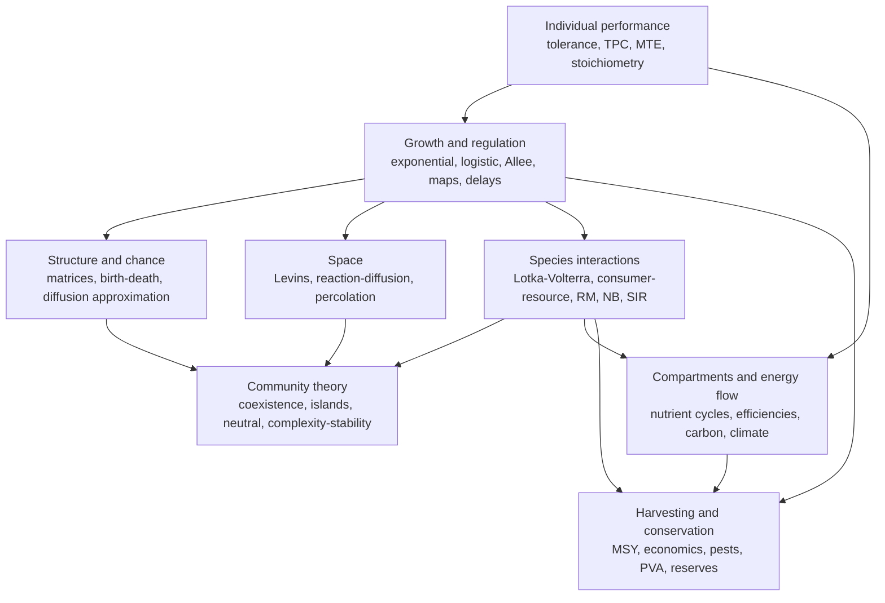
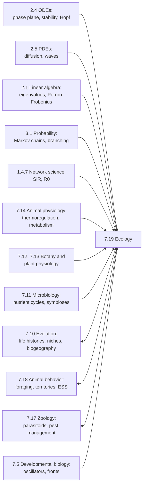

Fifty-four chapters have treated ecology one level at a time: how a lizard's body temperature follows the sun, why a vole population cycles, when two competitors can coexist, how much of the sunlight falling on a lake ends up in a pike, why a fragmented landscape loses its species decades after the forest was cut. This final chapter does not repeat them. It follows the hierarchy set out in [7.19.1](/7.19.1#sec-1.2), from the individual through the population, the interacting species, the **ecological community**, the **ecosystem** and the **landscape** to the biosphere and its management, and asks three questions: what each level contributes and how the levels are connected; which models and which mathematics recur across chapters that seem to have nothing in common; and what remains unresolved.

Section 55.1 retraces the main line of the course level by level and collects the bridges between levels. Section 55.2 arranges the models of the course in eight families, with their equations, equilibria, stability conditions and ecological meaning, and Section 55.3 the mathematical tools they share: equilibria and linearization, invasion thresholds, bifurcations, Lyapunov functions, stochastic processes and partial differential equations. Section 55.4 draws out the themes that cut across levels, Section 55.5 the connections with other courses, and Section 55.6 lists open questions.

## 55.1. The Levels of the Course

### 55.1.1. The Main Line

The course is organized by the levels of organization of [7.19.1](/7.19.1#sec-1.2.1), each larger and slower than the one below. At every level the same question is asked in a different currency: what determines the distribution and abundance of organisms (Definition 1.1.1), measured first as the performance of an individual, then as the numbers in a population, the composition of a community and the fluxes of energy and matter through an ecosystem.

| Level | Chapters | Central question | Central quantities | Representative results |
|---|---|---|---|---|
| Individual | [7.19.2](/7.19.2)–[7.19.7](/7.19.7) | How do conditions and resources set performance and tolerance? | Tolerance curve, thermal performance curve, water and heat budgets, metabolic rate, elemental ratios | Law of tolerance (Definition 2.4.2), Sharpe–Schoolfield optimum (Proposition 4.1.1), $B = B_0M^{3/4}\mathrm{e}^{-E/(k_{\mathrm{B}}T)}$ (Definition 6.6.1), threshold elemental ratio (Proposition 6.4.1) |
| Population | [7.19.8](/7.19.8)–[7.19.21](/7.19.21) | What determines abundance, its fluctuations and its spatial distribution? | $N$, $r$, $\lambda$, $R_0$, $K$, life tables, projection matrices, extinction risk, occupancy | Euler–Lotka equation (Theorem 9.4.1), logistic and its generalizations (Section [10.2](/7.19.10#sec-10.2)), chaos in discrete time (Section [12.3](/7.19.12#sec-12.3)), Perron–Frobenius (Theorem 14.3.1), Levins model (Theorem 16.3.1), Fisher–KPP speed (Theorem 17.3.2) |
| Interacting species | [7.19.22](/7.19.22)–[7.19.30](/7.19.30) | How do competition, predation, parasitism and mutualism affect abundance and coexistence? | Competition coefficients, $R^*$, functional responses, $R_0$ of a pathogen | Four outcomes of competition (Theorem 22.4.3), $R^*$ rule (Theorem 23.4.1), paradox of enrichment (Definition 26.2.1), Nicholson–Bailey instability (Theorem 27.2.1), $p > 1 - 1/R_0$ (Proposition 28.3.2), Turing instability (Theorem 30.3.1) |
| Community | [7.19.31](/7.19.31)–[7.19.39](/7.19.39) | What processes determine the composition, diversity, structure and dynamics of communities? | Diversity indices, species–area exponent $z$, $\theta$, connectance, trophic levels | Hill numbers (Formula 31.3.1), equilibrium theory of islands (Proposition 34.2.1), Ewens sampling formula (Theorem 37.3.1), May's criterion (Proposition 38.4.1), folds and early warnings (Propositions 39.4.2, 39.4.3) |
| Ecosystem and globe | [7.19.40](/7.19.40)–[7.19.47](/7.19.47) | How do energy flow and matter cycle through living and nonliving components, and how do they shape climate? | GPP, NPP, NEP, efficiencies, pools, fluxes, turnover times, radiative forcing | Compartment systems (Theorem 45.2.1), stock = input × transit time (Proposition 45.2.2), efficiencies as products (Proposition 43.3.1), Carpenter bistability (Proposition 46.2.2), climate sensitivity (Proposition 47.1.2) |
| Landscape | [7.19.48](/7.19.48)–[7.19.49](/7.19.49) | How does spatial pattern control ecological processes? | Patch, corridor, matrix, grain and extent, connectivity, percolation threshold | Core area (Proposition 48.2.1), percolation (Definition 49.2.1), effective resistance (Proposition 49.3.1), MaxEnt (Proposition 49.5.1) |
| Applied ecology | [7.19.50](/7.19.50)–[7.19.54](/7.19.54) | How can ecological theory guide the use and protection of nature? | MSY, MEY, EIL, extinction rates, coverage of reserves, LER | Biodiversity–function partition (Proposition 50.5.2), greedy reserve selection (Theorem 52.2.1), fragility of quotas (Proposition 53.1.2), modified golden rule (Theorem 53.2.1), LER of intercrops (Proposition 54.1.1) |

The figure shows the architecture of the course. Each level contributed a family of models of its own, but the population models are reused at every level above: the logistic term reappears in competition, predation and harvesting; the matrix of a structured population reappears as the community matrix and as the matrix of a compartment system; dispersal and diffusion reappear in metapopulations, invasions, spatial competition, metacommunities and landscapes. Applied ecology uses almost all families, because practical problems do not respect the boundaries of levels.

### 55.1.2. How the Levels Are Connected

Hierarchy theory predicts that the level below supplies the mechanism and the level above the constraints ([7.19.1](/7.19.1#sec-1.2.2)). The course contains many explicit derivations of one level from the next, which are its most valuable results, because they replace a phenomenological parameter by a measurable mechanism.

| Bridge | Lower level | Higher-level consequence | Where |
|---|---|---|---|
| Vital rates to growth | Age-specific survival and fecundity $l_x$, $m_x$ | $r$ from the Euler–Lotka equation, $\lambda_1$ and the **stable age distribution** | Theorem 9.4.1, Theorem 14.3.2 |
| Birth and death to regulation | Linear density dependence of $b$ and $d$ | Logistic equation with $K$ where they cross | Proposition 10.2.1, Proposition 11.3.1 |
| Metabolism to demography and diversity | $B \propto M^{3/4}\mathrm{e}^{-E/(k_{\mathrm{B}}T)}$ | $r_{\max} \propto M^{-1/4}$, density $\propto M^{-3/4}$, $\ln S = C - E/(k_{\mathrm{B}}T)$ | Proposition 6.6.3, Proposition 35.3.1 |
| Behavior to dynamics | Time budget of a searching predator | Disc equation, saturating isocline, paradox of enrichment | Proposition 25.4.1, Theorem 26.1.1 |
| Consumption to competition | Overlap of resource use | Lotka–Volterra competition with $\alpha_{ij}$ proportional to overlap; $R^*$ | Proposition 23.4.1, Theorem 23.4.1 |
| Shared enemies to competition | Prey sharing a predator | **Apparent competition** with Lotka–Volterra form | Proposition 39.3.1 |
| Stoichiometry to cycling | Elemental ratios of consumers and their food | Which element is recycled; critical C:N of decomposition | Proposition 6.4.1, Proposition 44.3.1 |
| Patches to regions | Local extinction and colonization | Regional occupancy, extinction debt, island equilibria | Theorem 16.3.1, Theorem 16.4.1, Proposition 34.2.1 |
| Individuals in space to populations | Random walk with diffusion coefficient $D$ | Spreading speed $2\sqrt{rD}$, critical patch size $\pi\sqrt{D/r}$ | Theorem 17.3.2, Theorem 17.4.1 |
| Species to ecosystem function | Monoculture yields and relative yields | Sampling and complementarity effects | Propositions 50.5.1, 50.5.2 |
| Populations to stability of aggregates | Variances and covariances of species | Portfolio effect: community variability falls with richness | Proposition 38.5.1 |
| Ecosystem fluxes to climate | Pools and exchange of carbon | Airborne fraction, forcing, warming | Proposition 45.5.1, Proposition 47.1.2 |
| Economics to stocks | Price, cost and discount rate | Open-access overfishing, liquidation of slow species | Proposition 53.2.2, Theorem 53.2.1 |

The constraints from above are as important. Climate determines the **biome** through physiological thresholds of the dominant plants ([7.19.41](/7.19.41#sec-41.1.4)); the regional species pool bounds local richness ([7.19.35](/7.19.35#sec-35.5)) and is the starting point of community assembly ([7.19.37](/7.19.37#sec-37.1)); the landscape decides which patches a metapopulation can reach ([7.19.49](/7.19.49#sec-49.3)); and the economics of harvesting decides how hard a population is pushed ([7.19.53](/7.19.53#sec-53.2)). A population model with a fixed $K$, a community model with a fixed pool and an ecosystem model with a fixed climate are each valid only on time scales short compared with the dynamics of the level above.

## 55.2. The Model Families of the Course

The models of the course fall into eight families, distinguished by what they keep track of. The equations below are written in the notation of the chapters where they are derived; "stable" means locally asymptotically stable unless stated otherwise.

### 55.2.1. Individual Performance and Energetics

The individual chapters model how a single organism responds to its environment. These models are mostly static response functions rather than dynamical systems, but they supply the parameters of everything above.

| Model | Form | Key result | Where |
|---|---|---|---|
| Limiting factors | $y = \min_i f_i(x_i)$, Blackman plateau, co-limitation $\prod_i g_i(x_i)$ | Shape of isoclines distinguishes the laws | Section [2.4](/7.19.2#sec-2.4) |
| Tolerance as performance | Equal-area trade-off between breadth and peak | Optimal breadth = root-mean-square deviation of the environment | Proposition 2.4.1 |
| Thermal performance curve | Arrhenius rise with reversible enzyme inactivation | Unique optimum a few degrees below collapse | Proposition 4.1.1 |
| Soil heat wave | Heat equation with periodic surface temperature | Damping depth $\sqrt{2\kappa/\omega}$ | Proposition 3.3.1 |
| Degree-day rule, TSD | Linear development rate; sigmoid sex ratio | $N(T - C) = K$; fluctuations raise effective temperature | Section [4.2](/7.19.4#sec-4.2), Proposition 4.6.1 |
| Fire regimes | Constant hazard of fire | Exponential stand-age distribution; window of fire intervals for obligate seeders | Propositions 5.6.1, 5.6.2 |
| Stoichiometry | Homeostatic consumer, $y = c\,x^{1/H}$ | Threshold elemental ratio; growth rate hypothesis | Propositions 6.4.1, 6.4.2 |
| Metabolic theory | Space-filling, area-preserving network | $3/4$ exponent; $r_{\max}$, mortality and density scaling | Theorem 6.6.1, Propositions 6.6.2, 6.6.3 |

### 55.2.2. Growth and Regulation

The core of population ecology is a single equation for the total number, $\dot N = Nf(N)$ or $N_{t+1} = F(N_t)$, in which the per capita growth rate $f$ carries all the biology.

| Model | Equation | Equilibria and stability | Ecological meaning | Where |
|---|---|---|---|---|
| Exponential, geometric | $\dot N = rN$; $N_{t+1} = \lambda N_t$ | None besides $0$ | Growth without limits; $\lambda = \mathrm{e}^r$ | Proposition 10.1.1 |
| Logistic | $\dot N = rN(1 - N/K)$ | $K$ globally stable, return time $1/r$ | Linear decline of per capita growth | Formula 10.2.1, Proposition 10.2.3 |
| θ-logistic, Gompertz | $r[1 - (N/K)^\theta]$; $c\ln(K/N)$ | $K$ stable at rate $\theta r$ or $c$ | Curvature of density dependence | Proposition 10.3.1 |
| Strong Allee effect | $rN(1 - N/K)(N - A)/K$ | $0$ and $K$ stable, $A$ a threshold; collapse at $m_c = (1 - a)^2/4$ | Mate finding, group defense | Propositions 10.3.2, 10.3.3 |
| Discrete maps | Ricker, discrete logistic, Beverton–Holt, Hassell | Stable iff $\lvert F'(N^*)\rvert < 1$; cycles from $r = 2$, chaos from $r_\infty$ | Overcompensation with nonoverlapping generations | Theorem 12.1.1, Proposition 12.1.2 |
| Delayed logistic | $\dot N = rN[1 - N(t - T)/K]$ | Hopf at $rT = \pi/2$, cycles of period about $4T$ | Development time, resource recovery | Theorem 13.1.1 |
| Autoregressive model | $r_t = \beta_0 + \beta_1X_{t-1} + \beta_2X_{t-2} + u_t$, $X = \ln N$ | Cycles iff $\beta_2 < -\tfrac14(1 + \beta_1)^2$ | Direct and delayed density dependence in time series | Proposition 13.4.1 |
| Self-thinning, final yield | $1/\bar w = A + Bd$; $\bar w = Cd^{-3/2}$ | — | Density effects in plants | Propositions 11.4.1, 11.4.2 |

The sequence logistic → maps → delays shows that the same density dependence can give a stable equilibrium, damped oscillations, cycles or chaos, depending only on how fast and how late it acts: $r$, $rT$ or the slope $F'(N^*)$ are dimensionless measures of the strength of feedback relative to its delay.

### 55.2.3. Structure and Chance

Real populations consist of individuals that differ in age, stage and fate. Two extensions of the scalar models keep track of these differences: matrices for deterministic structure, stochastic processes for the finiteness of numbers.

| Model | Equation | Key result | Where |
|---|---|---|---|
| Life table, renewal equation | $\sum\mathrm{e}^{-rx}l_xm_x = 1$ | Unique real dominant root; stable age distribution $\propto \mathrm{e}^{-rx}l_x$ | Theorem 9.4.1 |
| Projection matrix | $\boldsymbol{n}(t + 1) = A\boldsymbol{n}(t)$ | $\lambda_1$, $\boldsymbol{w}$, $\boldsymbol{v}$; convergence at rate $\rho = \lambda_1/\lvert\lambda_2\rvert$ | Theorems 14.3.1, 14.3.2, Definition 14.3.2 |
| Sensitivity and elasticity | $s_{ij} = v_iw_j/\boldsymbol{v}^{\mathsf T}\boldsymbol{w}$, $e_{ij} = a_{ij}s_{ij}/\lambda_1$ | Elasticities sum to 1 | Theorems 14.4.1, 14.4.2 |
| Continuous age | McKendrick–von Foerster equation | Solved along characteristics; Lotka's renewal equation | Definition 14.6.1 |
| Linear birth–death process | Rates $bN$, $dN$ | Extinction probability $(d/b)^{N_0}$ for $b > d$ | Theorem 15.1.1 |
| Regulated stochastic population | Birth–death with density dependence | Extinction certain; mean time grows exponentially in $K$ | Theorem 15.1.2 |
| Random environment | $N_{t+1} = \lambda_tN_t$ | Long-run growth $\mathbb{E}[\ln\lambda] \le \ln\mathbb{E}[\lambda]$ | Theorem 15.2.1 |
| Diffusion approximation | Brownian motion of $\ln N$ with drift $\mu$, variance $\sigma^2$ | Quasi-extinction probability $\mathrm{e}^{-2\mu x_d/\sigma^2}$ | Theorem 15.2.2 |
| Sampling models | Hypergeometric, Poisson, negative binomial | Lincoln–Petersen as maximum likelihood; index of dispersion | Propositions 8.3.1, 8.4.1, 8.4.2 |
| Bet hedging | Germination fraction $g$ in a random environment | $g^* = p - (1 - p)s/(Y - s)$ | Theorem 19.1.2 |

Structured and stochastic models changed management more than any other family: elasticities showed that saving loggerhead nests could not reverse a decline driven by the survival of juveniles ([7.19.14](/7.19.14#sec-14.4.1)), and **population viability analysis** (Definition 15.5.1) is now the standard way to compare options for threatened species.

### 55.2.4. Space

Space enters the course in three idealizations: discrete patches that are occupied or empty, continuous densities that diffuse, and lattices of sites.

| Model | Equation | Key result | Where |
|---|---|---|---|
| Levins | $\dot p = cp(1 - p) - ep$ | Persistence iff $c > e$; $p^* = 1 - e/c$ | Theorem 16.3.1 |
| Habitat destruction | $\dot p = cp(1 - D - p) - ep$ | Extinction when $D = 1 - e/c$; extinction debt | Theorem 16.4.1 |
| Metapopulation capacity | Spatially realistic Levins | Persistence iff $\lambda_M > e/c$ | Proposition 16.5.1 |
| Competition–colonization | Hierarchical Levins model | Inferior competitor persists if it colonizes much better | Theorem 16.6.1 |
| Fisher–KPP | $u_t = Du_{xx} + ru(1 - u/K)$ | Invasion speed $2\sqrt{rD}$ (pulled front) | Theorems 17.3.1, 17.3.2 |
| Allee front | $f = ru(1 - u)(u - a)$ | Pushed front, speed $(1 - 2a)\sqrt{rD/2}$ | Proposition 17.3.3 |
| Integrodifference | $N_{t+1} = k * F(N_t)$ | Fat-tailed kernels accelerate spread | Definition 17.3.2 |
| KISS, heterogeneous habitat | $u_t = D\Delta u + ru$ with hostile boundary; $u_t = d\Delta u + u(m - u)$ | $L_{\mathrm{c}} = \pi\sqrt{D/r}$; persistence iff principal eigenvalue $> 0$ | Theorems 17.4.1, 17.4.2, Proposition 17.5.1 |
| Advection | $u_t = Du_{xx} - vu_x + f(u)$ | Persistence against a current iff $v < 2\sqrt{rD}$ and the reach is long enough | Theorem 17.6.1 |
| Turing instability | Two-species reaction–diffusion | Stable without diffusion, unstable band of wave numbers with it | Theorem 30.3.1 |
| Klausmeier model | Water and plants on a slope | Banded vegetation; patterns extend persistence | Section [30.4](/7.19.30#sec-30.4) |
| Percolation, lattices | Random maps; contact process | $p_{\mathrm{c}} = 0.593$; tree threshold $1/(z - 1)$ | Definition 49.2.1, Proposition 49.2.1, Section [30.5](/7.19.30#sec-30.5) |
| Circuit theory | Graph Laplacian of a resistance surface | Effective resistance counts parallel routes | Proposition 49.3.1 |

All the continuous results scale with the single length $\sqrt{D/r}$, the distance an individual diffuses in the characteristic time $1/r$ of the population; all the patch results turn on the ratio of colonization to extinction.

### 55.2.5. Species Interactions

The interaction chapters couple two or more growth equations through a term that represents the encounter of individuals.

| Interaction | Model | Key result | Where |
|---|---|---|---|
| Competition | Lotka–Volterra, scaled $a = \alpha_{12}K_2/K_1$, $b = \alpha_{21}K_1/K_2$ | Four outcomes; coexistence iff $a, b < 1$, then globally stable | Theorems 22.4.2, 22.4.3, Proposition 22.4.1 |
| $n$ competitors | $\dot x_i = x_i(b_i - \sum_j a_{ij}x_j)$ | Global stability if $WA + A^{\mathsf T}W$ is positive definite | Theorem 22.5.1 |
| Consumer–resource | MacArthur's model; chemostat; two essential resources | $\alpha_{ij}$ from overlap; lowest $R^*$ wins; coexistence on two resources | Proposition 23.4.1, Theorems 23.4.1, 23.4.2 |
| Coexistence theory | Invasion growth rates | $\rho < \kappa_1/\kappa_2 < 1/\rho$; storage effect | Theorem 23.5.1, Proposition 23.5.1 |
| Predation, classical | Lotka–Volterra predator–prey | Neutral cycles with a conserved quantity; averages equal the equilibrium; Volterra principle | Propositions 25.1.1, 25.2.1, Theorem 25.1.1 |
| Predation, logistic prey | Linear response, logistic prey | Predator persists iff $N^* < K$; then globally stable | Proposition 25.3.1 |
| Predation, saturating | **Rosenzweig–MacArthur model** | Graphical criterion; Hopf at $\kappa_{\mathrm{H}} = 1 + 2x^*$; **paradox of enrichment** | Theorem 26.1.1, Proposition 26.1.1 |
| Predator-mediated coexistence | Two prey, one predator | Inferior prey persists for intermediate predator mortality | Proposition 26.3.1 |
| Hosts and parasitoids | **Nicholson–Bailey model**; May's negative binomial model | Unstable for every $\lambda > 1$; stabilized by aggregation, $k < 1$, $\mathrm{CV}^2 > 1$ | Theorems 27.2.1, 27.3.1, Proposition 27.3.1 |
| Microparasites | SIR with births and deaths | Endemic $s^* = 1/R_0$; elimination iff $p > 1 - 1/R_0$; regulation iff $\alpha > r$ | Propositions 28.3.1, 28.3.2, 28.4.1 |
| Macroparasites | Aggregated burden | Stable regulation for finite $k$ | Proposition 28.4.2 |
| Mutualism | Lotka–Volterra; saturating benefits | Unbounded if $ab > 1$; obligate mutualists bistable with a saddle-node | Theorem 29.5.1, Propositions 29.5.1, 29.5.2 |
| Food chain | Lotka–Volterra chain | Alternating response to productivity; global stability | Proposition 39.2.1, Theorem 39.2.1 |
| Apparent competition | Two prey, shared predator | Reduces to Lotka–Volterra competition | Proposition 39.3.1 |

Two lessons run through the table. First, the outcome of an interaction is decided by the balance of self-limitation and interaction: competitors coexist when intraspecific competition exceeds interspecific competition, a predator–prey equilibrium is stabilized by self-limitation of the prey and destabilized by saturation of the predator, and a mutualism is bounded only if the benefits saturate. Second, the neutral cycles of the classical **Lotka–Volterra model** are structurally unstable (Section [25.1.4](/7.19.25#sec-25.1.4)); every biological detail added to them, logistic prey, saturation, interference, refuges, aggregation, decides between a stable point and a stable cycle, which is why so much of the interaction chapters concerns stabilizing mechanisms.

### 55.2.6. Community Theory

Community models deal with many species at once and therefore either aggregate them (counting species instead of individuals) or treat them statistically.

| Model | Key result | Where |
|---|---|---|
| Species packing | $S = (fR - o)/(n - o)$ | Proposition 35.1.1 |
| Limiting similarity | Three species coexist in a narrowing window of $K_2/K_1$ as overlap rises | Proposition 23.2.2 |
| Random placement | Species–area curve from sampling alone | Proposition 34.1.1 |
| **Theory of island biogeography** | Unique, globally stable $S^*$; time to equilibrium; isolation steepens $z$ | Propositions 34.2.1, 34.2.3, 34.2.4 |
| Successional mosaic | Richness peaks at intermediate disturbance; mortality alone does not stabilize | Propositions 33.3.1, 33.3.3 |
| Markov succession | $\boldsymbol{\pi}_{t+1} = \boldsymbol{\pi}_tP$ converges to a stationary composition at rate $\lambda_2$ | Proposition 36.4.1 |
| Mass effects | Alpha richness maximal at intermediate dispersal | Proposition 37.2.1 |
| **Unified neutral theory of biodiversity** | Ecological drift, Ewens sampling formula, log-series with $\alpha = \theta$; beta-binomial local abundances | Proposition 37.3.1, Theorem 37.3.1, Proposition 37.3.2 |
| Random community matrices | Circular and elliptic laws; May's criterion $\sigma\sqrt{SC} < d$ | Theorems 38.4.1, 38.4.2, Propositions 38.4.1, 38.4.2 |
| Statistical averaging | Community variability falls, population variability rises with richness | Proposition 38.5.1 |
| Fractional trophic levels | $(I - Q)\boldsymbol{t} = \boldsymbol{1}$ | Proposition 38.1.1 |
| Diversity measurement | Hill numbers, Chao1 lower bound, beta diversity | Formula 31.3.1, Proposition 31.3.1, Definition 31.4.1 |

Neutral theory and coexistence theory form the two ends of a continuum ([7.19.37](/7.19.37#sec-37.5)): neutral theory is the point at which niche and fitness differences in Theorem 23.5.1 both vanish, so that drift, dispersal and speciation alone shape the community. The island theory and the neutral theory have the same architecture, a balance between arrival and loss, at the level of species and of individuals respectively.

### 55.2.7. Compartments, Energy Flow and Climate

Ecosystem ecology replaces species by pools of energy or elements and populations by fluxes. Its models are mostly linear, and their analysis rests on the properties of compartmental matrices.

| Model | Equation | Key result | Where |
|---|---|---|---|
| Closed nutrient cycle | Plants and a free nutrient pool | $N^* = km/(\mu - m)$, independent of total nutrient; always stable | Proposition 40.4.1 |
| Compartment system | $\dot{\boldsymbol{x}} = A\boldsymbol{x} + \boldsymbol{b}$ | $\boldsymbol{x}^* = (-A)^{-1}\boldsymbol{b}$; stock = input × mean transit time | Theorem 45.2.1, Propositions 45.2.1, 45.2.2 |
| Decomposition | $\dot X = L - kX$; continuum of qualities | Steady state $L/k$; apparent $k$ declining with age | Propositions 44.5.1, 44.5.2 |
| Energy flow | Grazer and decomposer systems | Efficiencies multiply; chain length $\lesssim 1 + \ln(P_1/P_{\min})/\ln(1/\tau)$ | Propositions 43.3.1, 43.5.1, 43.5.2 |
| Stand development | Two carbon pools | NEP negative after disturbance, positive when young, zero at equilibrium | Proposition 42.1.1 |
| Limits to production | Miami model; critical depth | $\min\{\mathrm{NPP}_T, \mathrm{NPP}_P\}$; spring bloom when the mixed layer is shallower than the critical depth | Propositions 42.5.1, 42.5.2 |
| Carbon box model | Four reservoirs | Long-term airborne fraction about 0.15–0.2 | Proposition 45.5.1 |
| Lake phosphorus | Vollenweider; Carpenter | Linear response to loading; bistability and irreversible eutrophication | Propositions 46.2.1, 46.2.2, Corollary 46.2.1 |
| Lake vegetation | Scheffer model | Folded equilibrium curve, hysteresis | Proposition 39.4.1 |
| Radiative balance | Layer models; forcing and feedback | $T_{\mathrm{s}} = (n + 1)^{1/4}T_{\mathrm{e}}$; equilibrium and transient sensitivity | Propositions 47.1.1, 47.1.2 |
| Daisyworld | Two daisy types on a planet | Regulation over a range of luminosity, collapse and hysteresis beyond it | Section [40.4.3](/7.19.40#sec-40.4.3) |
| Treatment wetland, river | First-order removal; Streeter–Phelps | Oxygen sag with critical deficit proportional to load | Formula 54.3.1, Proposition 54.2.1 |

### 55.2.8. Harvesting and Conservation

The applied chapters reuse the models of the population and interaction chapters with an added control: a harvest, a spray, a reserve or an introduction.

| Problem | Model | Key result | Where |
|---|---|---|---|
| Sustainable yield | Logistic, θ-logistic surplus production | **Maximum sustainable yield** $rK/4$ at $K/2$ for the logistic | Proposition 53.1.1 |
| Fixed quota | $\dot x = x(1 - x) - h$ | Equilibria merge at the MSY (saddle-node); slow initial decline | Propositions 53.1.2, 53.1.3 |
| Fixed effort | Schaefer model | Stable; CPUE linear in effort | Propositions 53.1.4, 53.1.5 |
| Hyperstability | Catchability rising at low stock | Fold and abrupt collapse | Proposition 53.1.6 |
| Economics | Gordon–Schaefer; discounting | MEY below MSY effort; open access at twice MEY effort; liquidation if $\delta \ge r$ | Propositions 53.2.1, 53.2.2, Theorem 53.2.1 |
| Rarity value | Price rising as stock falls | Removes the economic brake on overexploitation | Proposition 51.5.1 |
| Pests | Optimal density; spraying a pest and its enemy | Eradication rarely economic; resurgence under broad-spectrum sprays | Propositions 53.3.1, 53.3.2 |
| Biomagnification | Uptake, elimination and growth dilution | $\mathrm{BMF} \to \alpha/\varepsilon$ for persistent chemicals | Proposition 53.3.3 |
| Intercropping | Lotka–Volterra crops | $\mathrm{LER} > 1$ whenever the crops coexist stably | Proposition 54.1.1 |
| Reserve selection | Maximal coverage | Greedy choice achieves $\ge 1 - 1/\mathrm{e}$ of the optimum | Theorem 52.2.1 |
| Extinction | Sighting record; species–area loss | $p = (t_n/T)^n$; predicted loss $1 - (1 - h)^z$ | Proposition 51.1.1, Eq. (51.2) |
| Reserve design | Nested biotas | A single large reserve holds more species | Proposition 34.5.1 |

## 55.3. The Mathematical Tools

### 55.3.1. Equilibria and Linearization

Almost every analysis in the course begins by finding equilibria and linearizing around them, with the tools of [2.4.11](/2.4.11). The criterion takes different forms in different settings, but it is always a condition on the eigenvalues of a linear operator.

| Setting | Linear operator | Stability condition | Examples |
|---|---|---|---|
| One ODE | $f'(N^*)$ | $f'(N^*) < 0$ | Logistic (Proposition 10.2.3), Levins (Theorem 16.3.1) |
| One map | $F'(N^*)$ | $\lvert F'(N^*)\rvert < 1$ | Theorem 12.1.1 |
| Two ODEs | Jacobian $J$ | $\operatorname{tr}J < 0$, $\det J > 0$ | Competition (Theorem 22.4.1), predation (Proposition 26.1.1) |
| Two-dimensional map | Jacobian $J$ | Jury conditions $\lvert\operatorname{tr}J\rvert < 1 + \det J$, $\det J < 1$ | Lemma 27.2.1 |
| Delay equation | Characteristic equation $z\mathrm{e}^z = -rT$ | All roots with $\operatorname{Re} z < 0$ | Theorem 13.1.1 |
| $n$ species | Community matrix | All eigenvalues with negative real part | Section [22.5](/7.19.22#sec-22.5), Section [38.4](/7.19.38#sec-38.4) |
| Structured population | Projection matrix $A$ | $\lambda_1 < 1$ (decline) or $> 1$ (growth) | Theorem 14.3.1 |
| Compartments | Compartmental matrix | Outflow-connected: all eigenvalues negative | Theorem 45.2.1 |
| Reaction–diffusion | $J - k^2\operatorname{diag}(D_1, D_2)$ for each wave number $k$ | Stable for all $k$; otherwise Turing band | Theorem 30.3.1 |

The eigenvalues carry more than a yes-or-no answer. Their real parts give return times, which measure **resilience** (Definition 38.3.1) and lengthen near bifurcations (Definition 39.4.2); their imaginary parts give the periods of damped oscillations; and the ratio of the two leading eigenvalues gives the rate at which a structured population forgets its initial state (Definition 14.3.2). The ecological meaning of a Jacobian entry is always a per capita effect of one species on another, which is why the same algebra describes a pair of competitors, a food web and the flow of carbon between reservoirs.

### 55.3.2. Invasion and Persistence Thresholds

A second tool is even more widely used than linearization: a population, a species or a pathogen persists if it can increase when rare. Each chapter derived this criterion under a different name.

| Quantity | Persistence or invasion iff | Where |
|---|---|---|
| Net reproductive rate, dominant eigenvalue | $R_0 > 1$, $\lambda_1 > 1$ | Theorem 9.4.1, Theorem 14.3.1 |
| Stochastic growth rate | $\mathbb{E}[\ln\lambda] > 0$ | Theorem 15.2.1 |
| Colonization and extinction | $c > e$; $\lambda_M > e/c$ | Theorem 16.3.1, Proposition 16.5.1 |
| Principal eigenvalue of a habitat | $\lambda_1(d, m) > 0$; $L > \pi\sqrt{D/r}$ | Proposition 17.5.1, Theorem 17.4.1 |
| Predator in a prey population | $N^* < K$ | Proposition 25.3.1 |
| Resource competitor | Lowest $R^*$ | Theorem 23.4.1 |
| Competitor invading a resident | $\alpha_{ij}K_j < K_i$, i.e. mutual invasibility | Theorem 22.4.3, Theorem 23.5.1 |
| Pathogen in a host population | $R_0 = \beta N/(\alpha + \mu + \gamma) > 1$, i.e. $N > N_{\mathrm{T}}$ | Definition 28.2.2 |
| Habitat on a random map | $p > p_{\mathrm{c}}$ | Definition 49.2.1 |

In a deterministic model each of these thresholds is a transcritical **bifurcation** at which a boundary equilibrium (absence) exchanges stability with an interior one (presence). The invasion criterion is also the foundation of coexistence theory (Section [23.5.1](/7.19.23#sec-23.5.1)) and of the evolutionary stability of strategies, which links the ecological chapters with **evolutionarily stable strategy** arguments in [7.18.25](/7.18.25) and [7.10.16](/7.10.16).

### 55.3.3. Bifurcations

Four kinds of bifurcation organize the qualitative changes met in the course.

![The four kinds of bifurcation met in the course, each drawn for one of its models; solid lines stable, dashed lines unstable. A: transcritical, Levins metapopulation with habitat destruction (Theorem 16.4.1): occupancy falls linearly to zero and the empty state becomes stable. B: saddle-node with hysteresis, the Carpenter lake model (Proposition 46.2.2): between the two folds the lake has an oligotrophic and a eutrophic state, and a change of phosphorus input across a fold causes a jump that is not reversed by returning the input. C: transcritical and Hopf, the Rosenzweig–MacArthur model (Proposition 26.1.1): the predator invades when the prey's carrying capacity exceeds the predator's break-even density, the equilibrium loses stability at the Hopf point, and with further enrichment the cycles deepen, carrying prey to very low minima (logarithmic axis). D: period doubling, the Ricker map (Section [12.3](/7.19.12#sec-12.3)): stable equilibrium, 2-cycle from r = 2 and chaos from about 2.69.](./plots/bifurcations.py)

| Bifurcation | Signature | Instances in the course |
|---|---|---|
| Transcritical | Exchange of stability between absence and presence; gradual change | All the thresholds of Section 55.3.2; habitat destruction (Theorem 16.4.1); vaccination threshold (Proposition 28.3.2) |
| Saddle-node (fold) | Stable and unstable equilibria merge; abrupt collapse and hysteresis | Allee effect with mortality (Proposition 10.3.3), obligate mutualism (Proposition 29.5.2), Klausmeier vegetation (Section [30.4.2](/7.19.30#sec-30.4.2)), Scheffer lake (Proposition 39.4.1), Carpenter lake (Proposition 46.2.2), fixed quota (Proposition 53.1.2), hyperstable fishery (Proposition 53.1.6), Daisyworld and ice-albedo feedback (Sections [40.4.3](/7.19.40#sec-40.4.3), [47.1.4](/7.19.47#sec-47.1.4)) |
| Hopf | Equilibrium gives way to a limit cycle | Delayed logistic (Theorem 13.1.1), Rosenzweig–MacArthur (Proposition 26.1.1) |
| Period doubling | Cycles of period 2, 4, …, then chaos | Discrete-time models (Proposition 12.3.1), with universal constants (Definition 12.5.1) |

Two further instabilities are of a different kind. In a Turing instability (Theorem 30.3.1) diffusion destabilizes a spatially uniform state that is stable without it, and patterns appear at a preferred wavelength; in the Nicholson–Bailey model (Theorem 27.2.1) the equilibrium is unstable for every parameter value, so there is no bifurcation to find, only mechanisms that remove the instability. The ecological significance of the classification lies in what can be anticipated: a transcritical change is gradual and reversible, a fold is abrupt and hysteretic, a Hopf bifurcation produces oscillations whose troughs bring extinction risk, and near folds and Hopf points the leading eigenvalue approaches zero, so that **critical slowing down** (Proposition 39.4.3) can give warning.

### 55.3.4. Lyapunov Functions and Global Stability

Linearization is local. The course proved global stability in many models with one function, introduced by Volterra:

$$
V(\boldsymbol{x}) = \sum_i w_i\left(x_i - x_i^* - x_i^*\ln\frac{x_i}{x_i^*}\right), \qquad w_i > 0.
$$

Each term is convex, zero at $x_i = x_i^*$ and positive elsewhere, and its time derivative along solutions of $\dot x_i = x_ig_i(\boldsymbol{x})$ is $\sum_iw_i(x_i - x_i^*)g_i(\boldsymbol{x})$. When the per capita growth rates are linear, $g(\boldsymbol{x}) = -A(\boldsymbol{x} - \boldsymbol{x}^*)$, this becomes the quadratic form $-\tfrac12(\boldsymbol{x} - \boldsymbol{x}^*)^{\mathsf T}(WA + A^{\mathsf T}W)(\boldsymbol{x} - \boldsymbol{x}^*)$, which is the content of Goh's theorem (Theorem 22.5.1). The same function, with suitable weights, gives:

- global stability of the logistic equilibrium (Proposition 10.2.3) and of two coexisting competitors (Proposition 22.4.1);
- the conserved quantity of the Lotka–Volterra predator–prey model, where the quadratic form vanishes because the interaction matrix is skew-symmetric (Proposition 25.1.1), and global stability once the prey is self-limited (Proposition 25.3.1);
- global stability of the Lotka–Volterra food chain, with weights $w_{i+1} = w_i/e_i$ that make the interaction skew-symmetric (Theorem 39.2.1);
- global stability of MacArthur's consumer–resource model, through Goh's theorem with $W = \operatorname{diag}(1/b_i)$ (Proposition 23.4.1), and of the endemic equilibrium of the SIR model (Proposition 28.3.1);
- in space, a Lyapunov functional showing that diffusion cannot destroy weak-competition coexistence (Theorem 30.1.1).

Other global tools appeared where Lyapunov functions are not available: the Dulac criterion and the Poincaré–Bendixson theorem, which exclude cycles in two-species competition (Theorem 22.4.2) and give the periodic orbits of the Rosenzweig–MacArthur model beyond the Hopf point (Proposition 26.1.1), monotone convergence for one-dimensional equations and cobweb diagrams for maps (Definition 12.2.1). The general lesson is that the Lotka–Volterra structure, per capita growth rates that are linear in densities, is the reason why so many ecological models admit complete global analyses; saturating responses break the structure, and with it the guarantee of global stability.

### 55.3.5. Stochastic Processes

Randomness enters the course at three levels: in the fates of individuals, in the environment and in sampling.

| Process | Ecological use | Where |
|---|---|---|
| Birth–death processes and branching processes | Extinction of small populations; establishment of invaders, propagule pressure $1 - (d/b)^{N_0}$ | Theorems 15.1.1, 15.1.2, Section [51.4.2](/7.19.51#sec-51.4.2) |
| Random products and the diffusion approximation | Growth in a random environment; quasi-extinction | Theorems 15.2.1, 15.2.2 |
| Markov chains | Succession; ecological drift; neutral communities | Proposition 36.4.1, Proposition 37.3.1, Theorem 37.3.1 |
| Autoregressive models | Density dependence in time series; noise and chaos | Definition 13.4.1, Section [12.6.3](/7.19.12#sec-12.6.3) |
| Ornstein–Uhlenbeck approximation | Variance and autocorrelation near a tipping point | Proposition 39.4.3 |
| Poisson and negative binomial counts | Spatial pattern, aggregation of parasites and of parasitoid attacks | Propositions 8.4.1, 8.4.2, Formula 27.3.1, Section [28.1.3](/7.19.28#sec-28.1.3) |
| Random matrices | Stability of large communities | Theorems 38.4.1, 38.4.2 |
| Sampling theory | Abundance estimation, unseen species, rarefaction | Proposition 8.3.1, Proposition 31.3.1 |

Two results recur. Variability lowers long-run growth, because growth multiplies and the geometric mean is smaller than the arithmetic mean (Theorem 15.2.1); this is why bet hedging pays (Theorem 19.1.2). And aggregation, the overdispersion of encounters, stabilizes: aggregated parasitoid attacks (Theorem 27.3.1), aggregated macroparasites (Proposition 28.4.2) and aggregated competitors (Section [23.6](/7.19.23#sec-23.6)) all work by concentrating interactions on a minority of individuals.

### 55.3.6. Partial Differential Equations

The partial differential equations of the course are of three types: diffusion for movement and heat, transport for age, and their combinations with local dynamics. Their analysis uses the methods of [2.5](/2.5) and [2.5.7](/2.5.7): separation of variables and Fourier modes, traveling waves, characteristics, and principal eigenvalues.

| Method | Question answered | Where |
|---|---|---|
| Fundamental solution and mean squared displacement | Estimating $D$; Skellam's linear spread | Section [17.1.2](/7.19.17#sec-17.1.2), Proposition 17.2.1 |
| Traveling waves and linear determinacy | Invasion speeds; competitive invasion waves | Theorems 17.3.1, 17.3.2, Section [30.1.2](/7.19.30#sec-30.1.2) |
| Eigenvalue problems on bounded domains | Critical patch size, persistence in heterogeneous habitats, the drift paradox | Theorems 17.4.1, 17.5.2, 17.6.1 |
| Fourier modes of the linearization | Turing patterns | Theorem 30.3.1 |
| Characteristics | McKendrick–von Foerster equation | Definition 14.6.1 |
| Periodic boundary forcing | Heat wave in soil | Proposition 3.3.1 |
| Explicit and implicit schemes | Numerical solution and its stability | Proposition 17.7.1 |

The discrete counterparts are equally important: integrodifference equations (Definition 17.3.2), coupled map lattices for host–parasitoid systems (Section [27.4](/7.19.27#sec-27.4)), cellular automata for fire spread (Section [49.4.1](/7.19.49#sec-49.4.1)) and the graph Laplacian of circuit theory (Proposition 49.3.1), which is the discrete analog of the diffusion operator on a landscape.

## 55.4. Themes Across Levels

### 55.4.1. Feedback and Density Dependence

**Density dependence** (Definition 11.2.1) is the course's version of **negative feedback**, and it reappears under other names at each level. A population is regulated when per capita growth falls with density (Definition 13.2.1); two species coexist when each limits itself more than it limits the other (Theorem 22.4.3, Theorem 23.5.1); a community keeps many tree species when host-specific enemies make recruitment negatively density dependent (Definition 37.4.1); an ecosystem holds its nutrient pool when uptake rises with supply (Proposition 40.4.1). The corresponding **positive feedback** produces Allee effects in populations (Definition 10.3.2), priority effects in communities (Definition 37.1.2), and **alternative stable states** in lakes, reefs, drylands and climates (Definition 39.4.1). The timing of feedback matters as much as its sign: delayed negative feedback causes cycles in single populations (Theorem 13.1.1), predator–prey systems (Section [25.1](/7.19.25#sec-25.1)) and host–parasitoid systems (Theorem 27.2.1).

### 55.4.2. Space and Scale

Space is the course's most general source of persistence and coexistence. Local extinction is offset by colonization in a **metapopulation** (Definition 16.2.1), locally unstable host–parasitoid and predator–prey interactions persist regionally (Section [27.4](/7.19.27#sec-27.4), Section [26.5.3](/7.19.26#sec-26.5.3)), competitors coexist through a competition–colonization trade-off (Theorem 16.6.1) or in heterogeneous habitats (Section [30.1.3](/7.19.30#sec-30.1.3)), and species sort along gradients in a **metacommunity** (Definition 37.2.1). Space also brings its own thresholds: the critical patch size (Definition 17.4.1), the percolation threshold of habitat (Definition 49.2.1), the extinction threshold under habitat destruction (Theorem 16.4.1), and the speed at which climate moves compared with the speed at which species spread (Definition 47.3.1).

Scale is the observational side of the same fact. Dispersion patterns depend on quadrat size (Section [8.4.1](/7.19.8#sec-8.4.1)), species richness on area (Definition 34.1.1), beta diversity on the grain of sampling (Section [31.4](/7.19.31#sec-31.4)), the relationship between productivity and richness on the spatial extent (Section [35.3.6](/7.19.35#sec-35.3.6)), and landscape metrics on grain and extent (Definition 48.4.1). Nonlinear averaging (Section [49.6](/7.19.49#sec-49.6)) explains why a model calibrated at one scale cannot simply be applied at another.

### 55.4.3. Chance and Fluctuation

Fluctuations act through **Jensen's inequality** wherever a response is nonlinear. Performance in a fluctuating thermal environment differs from performance at the mean temperature (Section [4.1.3](/7.19.4#sec-4.1.3), Proposition 4.6.1); the optimal tolerance breadth depends on the variance of the environment (Proposition 2.4.1); long-run growth depends on the geometric mean (Theorem 15.2.1); and fluctuations allow coexistence through the **storage effect** (Definition 23.5.2) and relative nonlinearity. Fluctuations also blur inference: noise makes chaos hard to detect (Section [12.6.3](/7.19.12#sec-12.6.3)), short noisy series bias tests of density dependence (Section [13.4.3](/7.19.13#sec-13.4.3)), and many regime shifts give no warning (Section [39.4.4](/7.19.39#sec-39.4.4)). **Demographic stochasticity** finally sets the scale below which deterministic models fail, because small populations die out by chance even when they are expected to grow (Theorem 15.1.1).

### 55.4.4. Energy, Matter and Stoichiometry

Energy and matter connect the individual to the biosphere through a small number of conserved quantities. Metabolism sets the pace of life from individuals to populations and communities (Definition 6.6.1, Proposition 6.6.3, Proposition 35.3.1). Energy is degraded at each transfer, so **ecological pyramids** of energy are always upright and food chains short (Definition 43.4.1, Proposition 43.5.2); matter is conserved and cycles, so stocks are fluxes multiplied by transit times (Proposition 45.2.2). Elemental ratios couple the two: the **Redfield ratio** (Definition 6.4.2), the threshold elemental ratios of consumers (Proposition 6.4.1) and decomposers (Proposition 44.3.1), and the coupling of nitrogen and phosphorus limitation (Section [46.4](/7.19.46#sec-46.4)) decide which element limits production and which is recycled. **Ecological stoichiometry** (Definition 6.4.1) is therefore the bridge between population and ecosystem ecology, as the metabolic theory is the bridge between physiology and macroecology.

### 55.4.5. Thresholds, Hysteresis and Management

The bifurcations of Section 55.3.3 have a practical side that the applied chapters develop. Harvesting at the **maximum sustainable yield** puts a fixed-quota fishery at a fold (Proposition 53.1.2); hyperstable catch rates hide the approach to the fold (Proposition 53.1.6); open access and discounting push stocks toward it (Propositions 53.2.2, 53.2.1); eutrophication and its reversal follow a hysteresis loop (Corollary 46.2.1). The general recommendations are the same in every case: manage the slow variables that set resilience rather than the fast ones (Section [39.4.5](/7.19.39#sec-39.4.5)), treat model optima as limits rather than targets (Section [53.2.4](/7.19.53#sec-53.2.4)), and value reversible over irreversible choices.

## 55.5. Ecology and the Other Courses

The mathematics of the course is taken from the mathematics courses and applied in full: phase-plane analysis, stability and the Hopf bifurcation from [2.4.11](/2.4.11), first integrals from [2.4.14](/2.4.14), the heat equation and reaction–diffusion from [2.5.7](/2.5.7), eigenvalues and eigenvectors from [2.1.6](/2.1.6), and probability from [3.1](/3.1). The **Lotka–Volterra model** and the **Fisher–KPP equation** were first met as models of oscillators and fronts in [7.5.23](/7.5.23); the SIR model and the **basic reproduction number** come from [1.4.7](/1.4.7).

Among the biological courses, the boundaries were drawn by level. Physiological mechanisms of tolerance belong to [7.14](/7.14) and [7.13](/7.13), and the course used them only for their consequences for distribution and abundance. Microbial processes of the nutrient cycles belong to [7.11.30](/7.11.30), and the course treated their budgets at the scale of ecosystems and the globe. Individual decisions, foraging, territoriality and the **ideal free distribution**, belong to [7.18](/7.18); the course treated their consequences for populations, through functional responses (Section [25.4](/7.19.25#sec-25.4)) and territorial regulation (Section [21.4](/7.19.21#sec-21.4)). Evolutionary theory of life histories, niches and biogeography belongs to [7.10](/7.10), notably [7.10.15](/7.10.15), [7.10.17](/7.10.17) and [7.10.30](/7.10.30); the course measured these processes and followed their population and community consequences. The relation with evolution runs in both directions: character displacement (Section [23.3.2](/7.19.23#sec-23.3.2)), spatial sorting at invasion fronts (Section [17.3.4](/7.19.17#sec-17.3.4)), the evolution of virulence (Section [28.5](/7.19.28#sec-28.5)) and rapid shifts of phenology and body size under warming (Section [47.3](/7.19.47#sec-47.3)) are ecological and evolutionary at once.

## 55.6. Open Questions

The course closes with a list of questions on which current research concentrates and on which the models of the course give partial answers.

1. Prediction. Intrinsic dynamics limit prediction even in deterministic models (the Lyapunov exponent sets the horizon, Definition 12.4.1), early warning signals are not reliable for every kind of transition (Section [39.4.4](/7.19.39#sec-39.4.4)), and species distribution models must extrapolate to climates that have no present analog (Section [49.5.4](/7.19.49#sec-49.5.4)). Whether ecology can become a predictive science on the time scales of management, by iterative forecasting with data assimilation, is open.
2. Coexistence in species-rich communities. Coexistence theory (Section [23.5](/7.19.23#sec-23.5)) partitions mechanisms cleanly for two species, but measuring niche and fitness differences for hundreds of tropical trees, and judging how much of their diversity is nearly neutral (Section [37.5](/7.19.37#sec-37.5)), remains difficult.
3. Complexity and stability. May's criterion (Proposition 38.4.1) predicts that large random communities are unstable; which features of real food webs, weak interactions, long loops, compartments, body-size structure, overcome this, and how much they matter compared with adaptive behavior ([Section 38.4.4](/7.19.38#sec-38.4.4)), is not settled.
4. Habitat amount and configuration. Whether fragmentation per se, beyond the loss of habitat, reduces biodiversity is disputed (Section [49.2.2](/7.19.49#sec-49.2.2)); the answer decides between many small and few large reserves (Section [34.5.1](/7.19.34#sec-34.5.1)).
5. Universality of scaling. The 3/4 exponent of metabolism and the temperature dependence of rates are central to the metabolic theory, but observed exponents vary among groups (Section [6.6.2](/7.19.6#sec-6.6.2)), and how far macroecological patterns follow from metabolism alone is debated.
6. Scaling up. The step from individuals to populations is well understood for unstructured models; the steps from populations to communities and from communities to ecosystem functions still rely on aggregation whose errors are hard to bound (Section [49.6](/7.19.49#sec-49.6)), and the experimental relationship between biodiversity and function has not been fully transferred to real landscapes (Section [50.5.5](/7.19.50#sec-50.5.5)).
7. The biodiversity crisis. Current extinction rates are far above background (Section [51.1.2](/7.19.51#sec-51.1.2)), but the size of the extinction debt, the time scale of its payment (Definition 16.4.1) and the number of species that remain undescribed (Section [50.2.3](/7.19.50#sec-50.2.3)) are uncertain, which makes the scale of a sixth mass extinction hard to judge.
8. Global change. Species shift their ranges more slowly than climate in many regions (Section [47.3.1](/7.19.47#sec-47.3.1)), phenologies change at different rates across trophic levels (Section [19.4](/7.19.19#sec-19.4)), biomes may cross tipping points (Section [41.5](/7.19.41#sec-41.5)), and the future of the land carbon sink (Section [45.5.3](/7.19.45#sec-45.5.3)) depends on the balance of fertilization, warming and disturbance. These are the problems on which the models of all levels must be combined.

## Summary

| Level | Main models | Main tools |
|---|---|---|
| Individual (7.19.2–7.19.7) | Tolerance curves, thermal performance, stoichiometric homeostasis, metabolic scaling | Response functions, Jensen's inequality, allometry |
| Population (7.19.8–7.19.21) | Logistic and its generalizations, discrete maps, delays, matrices, stochastic extinction, Levins, Fisher–KPP | Linearization, cobwebs and bifurcations, Perron–Frobenius, birth–death processes, diffusion and eigenvalue problems |
| Interacting species (7.19.22–7.19.30) | Lotka–Volterra competition and predation, consumer–resource, Rosenzweig–MacArthur, Nicholson–Bailey, SIR, mutualism, spatial competition, Turing | Isoclines, trace–determinant and Jury criteria, Lyapunov functions, Hopf bifurcation, invasion criteria |
| Community (7.19.31–7.19.39) | Diversity indices, island biogeography, neutral theory, coexistence theory, random community matrices, food chains, regime shifts | Sampling theory, Markov chains, random matrices, folds and critical slowing down |
| Ecosystem and globe (7.19.40–7.19.47) | Compartment models, decomposition, energy flow and efficiencies, carbon and phosphorus box models, radiative balance | Linear systems with compartmental matrices, transit times, saddle-node bifurcations |
| Landscape (7.19.48–7.19.49) | Patch geometry, percolation, circuit theory, fire automata, species distribution models | Graph theory, spatial statistics, maximum likelihood |
| Applied (7.19.50–7.19.54) | MSY and harvest economics, pest management, biomagnification, LER, reserve selection | Optimization, bioeconomics, the models of all levels |

- The levels of the course are linked by explicit derivations: vital rates give $r$ and $\lambda_1$, birth and death rates give $K$, metabolism gives $r_{\max}$ and richness, foraging gives functional responses, resource use gives competition coefficients, extinction and colonization give regional occupancy, and pools and fluxes give the carbon budget (Section 55.1.2).
- The models form eight families (Section 55.2); the population families recur at every higher level.
- Stability is always a condition on the eigenvalues of a linear operator (Section 55.3.1); persistence is always a positive growth rate when rare, a transcritical threshold (Section 55.3.2).
- Four bifurcations organize qualitative change: transcritical (gradual thresholds), saddle-node (collapse and hysteresis), Hopf (cycles) and period doubling (chaos) (Section 55.3.3).
- The Volterra function proves global stability whenever per capita growth is linear in densities (Section 55.3.4).
- Recurring themes: density dependence and feedback, space and scale, fluctuations through Jensen's inequality, energy and stoichiometry, thresholds and hysteresis in management (Section 55.4).
- Open questions concern prediction, coexistence of many species, complexity and stability, fragmentation, scaling, the biodiversity crisis and global change (Section 55.6).

## Questions

1. Show that the persistence conditions $c > e$ of the Levins model, $N > N_{\mathrm{T}}$ of a density-dependent pathogen and $N^* < K$ of a predator with logistic prey are the same mathematical statement.

   **Answer** In each case the system has a boundary equilibrium at which one component is absent: an empty landscape ($p = 0$), a disease-free host population ($I = 0$), a predator-free prey population ($P = 0$, $N = K$). Linearizing the equation of the absent component at that equilibrium gives its per capita growth rate when rare: $c - e$ for occupancy (Theorem 16.3.1), $\beta N - (\alpha + \mu + \gamma)$ for infected hosts, which is positive iff $R_0 > 1$, i.e. $N > N_{\mathrm{T}}$ (Definition 28.2.2), and $caK - m$ for predators, which is positive iff $K > N^* = m/(ca)$ (Proposition 25.3.1). The component invades iff this rate is positive, and at the threshold the boundary equilibrium and the interior equilibrium exchange stability: a transcritical bifurcation.

2. Why does the function $V = \sum_iw_i(x_i - x_i^* - x_i^*\ln(x_i/x_i^*))$ prove global stability for the logistic equation, two competitors and the Lotka–Volterra food chain, but not for the Rosenzweig–MacArthur model?

   **Answer** Along solutions of $\dot x_i = x_ig_i(\boldsymbol{x})$, $\dot V = \sum_iw_i(x_i - x_i^*)g_i(\boldsymbol{x})$. If $g$ is linear, $g = -A(\boldsymbol{x} - \boldsymbol{x}^*)$, then $\dot V$ is the quadratic form $-\tfrac12(\boldsymbol{x} - \boldsymbol{x}^*)^{\mathsf T}(WA + A^{\mathsf T}W)(\boldsymbol{x} - \boldsymbol{x}^*)$, which is negative definite whenever $WA + A^{\mathsf T}W$ is positive definite (Theorem 22.5.1). For the logistic equation $A = r/K > 0$; for competing species with $a, b < 1$ suitable weights exist (Proposition 22.4.1); in the food chain the weights $w_{i+1} = w_i/e_i$ make the off-diagonal part skew-symmetric, leaving only the self-limitation of the basal level on the diagonal (Theorem 39.2.1). In the Rosenzweig–MacArthur model the predator's per capita growth depends on prey through the saturating term $N/(1 + ahN)$, so $g$ is not linear; indeed the model has an unstable equilibrium and a limit cycle beyond the Hopf point (Proposition 26.1.1), so no such function can exist there.

3. Saddle-node bifurcations appear in the chapters on Allee effects, mutualism, lakes, harvesting and climate. What do these situations have in common, and what does that imply for management?

   **Answer** Each has a positive feedback that makes the net rate of change a non-monotone function of the state: per capita growth rising with density at low density (Allee effect, Proposition 10.3.3), benefits that grow with the partner's density (obligate mutualism, Proposition 29.5.2), internal phosphorus loading or turbidity that increase with eutrophication (Propositions 46.2.2, 39.4.1), catch rates that do not fall as the stock falls (Proposition 53.1.6), or albedo that rises as ice spreads (Section [47.1.4](/7.19.47#sec-47.1.4)). Changing a slow parameter (mortality, loading, quota, forcing) moves the curve until a stable and an unstable equilibrium merge. The consequences are the same: collapse is abrupt, it is not reversed by restoring the parameter (hysteresis), the approach is signaled at best by critical slowing down (Proposition 39.4.3), and management should keep a safety margin from the fold and act on the variables that set resilience (Section [39.4.5](/7.19.39#sec-39.4.5)).

4. The length $\sqrt{D/r}$ appears in the invasion speed, the critical patch size and the persistence of a species in a moving climate. Explain why, and state the three results in terms of it.

   **Answer** $D$ has dimensions $\mathrm{length}^2/\mathrm{time}$ and $r$ has dimensions $1/\mathrm{time}$, so $\sqrt{D/r}$ is the only length and $\sqrt{rD} = r\sqrt{D/r}$ the only speed that can be formed from them (Section [17.1.3](/7.19.17#sec-17.1.3)): the distance that an individual diffuses in the characteristic time $1/r$ of the population, and that distance per unit time. The invasion speed is $2\sqrt{rD}$ (Theorem 17.3.2); a patch with lethal surroundings must be longer than $\pi\sqrt{D/r}$ (Theorem 17.4.1); and a species keeps pace with a habitat moving at speed $q$ iff $q < 2\sqrt{rD}$ (Section [17.6.2](/7.19.17#sec-17.6.2)), which links the reaction–diffusion chapter to the velocity of climate change (Definition 47.3.1).

5. A manager must decide how to protect a declining frog that lives in a network of ponds and is infected by chytrid. Which models of the course would you combine, and what would each contribute?

   **Answer** A stage-structured matrix model (Section [14.2](/7.19.14#sec-14.2)) identifies which vital rates the decline is most sensitive to (Theorem 14.4.1), and its stochastic version in a population viability analysis (Definition 15.5.1) ranks management options by the risk of quasi-extinction. A disease model is needed because a pathogen with frequency-dependent transmission or an environmental reservoir, as in chytridiomycosis, need not fade out as its host declines and can drive it extinct (Section [28.6](/7.19.28#sec-28.6)); the threshold host density and the regulation condition $\alpha > r$ of Proposition 28.4.1, derived for density-dependent transmission, then give no protection. The pond network calls for a spatially realistic metapopulation model: the metapopulation capacity (Proposition 16.5.1) shows which ponds most raise regional persistence, and circuit theory (Proposition 49.3.1) where connections matter. Finally, connecting ponds can also spread the pathogen, so the spatial and disease models must be combined rather than used separately; no single family of the course answers the question.
