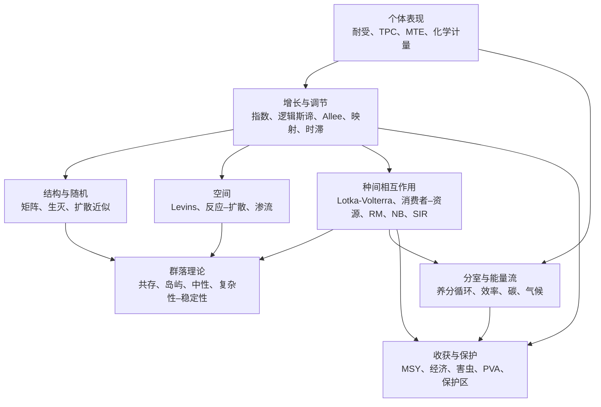
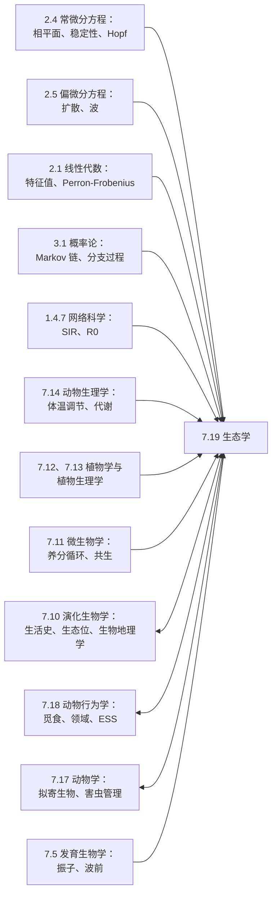

五十四章按层次逐级讲解了生态学：蜥蜴的体温如何随太阳变化，田鼠种群为何周期波动，两个竞争者何时能够共存，落在湖面上的阳光有多少最终进入一条狗鱼体内，为什么破碎化的景观在森林被砍伐几十年之后仍在失去物种。这最后一章不重复这些内容。它沿着 [7.19.1](/7.19.1#sec-1.2) 建立的层次，从个体经由种群、相互作用的物种、**生物群落**、**生态系统**和**景观**，直到生物圈及其管理，提出三个问题：每个层次提供了什么，层次之间如何联系；哪些模型和哪些数学在看似毫无共同之处的各章中反复出现；还有什么尚未解决。

55.1 节按层次回顾课程的主线，并汇集层次之间的桥梁。55.2 节把课程中的模型归为八个模型族，给出它们的方程、平衡点、稳定性条件和生态学意义；55.3 节讨论它们共用的数学工具：平衡点与线性化、入侵阈值、分岔、Lyapunov 函数、随机过程和偏微分方程。55.4 节提炼贯穿各层次的主题，55.5 节讨论与其他课程的联系，55.6 节列出尚未解决的问题。

## 55.1. 课程的层次

### 55.1.1. 主线

课程按 [7.19.1](/7.19.1#sec-1.2.1) 的组织层次编排，每个层次都比下一层更大、更慢。在每个层次上，同一个问题都以不同的“通货”提出：什么决定生物的分布与多度（定义 1.1.1）。它先以个体的表现度量，然后是种群的数量、群落的组成，以及流过生态系统的能量与物质通量。

| 层次 | 章 | 核心问题 | 核心量 | 代表性结果 |
|---|---|---|---|---|
| 个体 | [7.19.2](/7.19.2)–[7.19.7](/7.19.7) | 条件与资源如何决定表现与耐受？ | 耐受曲线、热性能曲线、水与热收支、代谢率、元素比 | 耐受性定律（定义 2.4.2）、Sharpe–Schoolfield 最适温度（命题 4.1.1）、$B = B_0M^{3/4}\mathrm{e}^{-E/(k_{\mathrm{B}}T)}$（定义 6.6.1）、阈值元素比（命题 6.4.1） |
| 种群 | [7.19.8](/7.19.8)–[7.19.21](/7.19.21) | 什么决定多度、它的波动及其空间分布？ | $N$、$r$、$\lambda$、$R_0$、$K$、寿命表、投影矩阵、灭绝风险、占据率 | Euler–Lotka 方程（定理 9.4.1）、逻辑斯谛及其推广（[10.2](/7.19.10#sec-10.2) 节）、离散时间的混沌（[12.3](/7.19.12#sec-12.3) 节）、Perron–Frobenius 定理（定理 14.3.1）、Levins 模型（定理 16.3.1）、Fisher–KPP 速度（定理 17.3.2） |
| 相互作用的物种 | [7.19.22](/7.19.22)–[7.19.30](/7.19.30) | 竞争、捕食、寄生与互利共生如何影响多度与共存？ | 竞争系数、$R^*$、功能反应、病原体的 $R_0$ | 竞争的四种结局（定理 22.4.3）、$R^*$ 规则（定理 23.4.1）、富营养化悖论（定义 26.2.1）、Nicholson–Bailey 不稳定性（定理 27.2.1）、$p > 1 - 1/R_0$（命题 28.3.2）、图灵不稳定性（定理 30.3.1） |
| 群落 | [7.19.31](/7.19.31)–[7.19.39](/7.19.39) | 什么过程决定群落的组成、多样性、结构与动态？ | 多样性指数、种–面积指数 $z$、$\theta$、连接度、营养级 | Hill 数（公式 31.3.1）、岛屿平衡理论（命题 34.2.1）、Ewens 抽样公式（定理 37.3.1）、May 判据（命题 38.4.1）、折叠与预警信号（命题 39.4.2、39.4.3） |
| 生态系统与全球 | [7.19.40](/7.19.40)–[7.19.47](/7.19.47) | 能量流与物质循环如何穿过生物与非生物组分，又如何塑造气候？ | GPP、NPP、NEP、效率、库、通量、周转时间、辐射强迫 | 分室系统（定理 45.2.1）、存量 = 输入 × 通过时间（命题 45.2.2）、效率连乘（命题 43.3.1）、Carpenter 双稳态（命题 46.2.2）、气候敏感度（命题 47.1.2） |
| 景观 | [7.19.48](/7.19.48)–[7.19.49](/7.19.49) | 空间格局如何控制生态过程？ | 斑块、廊道、基质、粒度与幅度、连通性、渗流阈值 | 核心区（命题 48.2.1）、渗流（定义 49.2.1）、有效电阻（命题 49.3.1）、MaxEnt（命题 49.5.1） |
| 应用生态学 | [7.19.50](/7.19.50)–[7.19.54](/7.19.54) | 生态学理论如何指导自然的利用与保护？ | MSY、MEY、EIL、灭绝速率、保护区的覆盖、LER | 生物多样性–功能的划分（命题 50.5.2）、贪心法选择保护区（定理 52.2.1）、配额的脆弱性（命题 53.1.2）、修正的黄金法则（定理 53.2.1）、间作的 LER（命题 54.1.1） |

这张图显示了课程的结构。每个层次都贡献了自己的一个模型族，但种群模型在其上的每个层次都被重复使用：逻辑斯谛项重现于竞争、捕食和收获；结构化种群的矩阵重现为群落矩阵和分室系统的矩阵；扩散与扩散过程重现于集合种群、入侵、空间竞争、集合群落和景观。应用生态学几乎用到所有模型族，因为实际问题不会遵守层次的边界。

### 55.1.2. 层次之间如何联系

等级理论预言，下一层提供机制，上一层提供约束（[7.19.1](/7.19.1#sec-1.2.2)）。课程中有许多从下一层明确推导上一层的例子，它们是课程最有价值的结果，因为它们把唯象参数换成了可以测量的机制。

| 桥梁 | 下一层 | 上一层的结果 | 出处 |
|---|---|---|---|
| 生命率到增长 | 年龄特异的存活率与繁殖力 $l_x$、$m_x$ | 由 Euler–Lotka 方程得到 $r$，以及 $\lambda_1$ 和**稳定年龄分布** | 定理 9.4.1、定理 14.3.2 |
| 出生与死亡到调节 | $b$ 和 $d$ 的线性密度制约 | 两者相交处带 $K$ 的逻辑斯谛方程 | 命题 10.2.1、命题 11.3.1 |
| 代谢到种群统计与多样性 | $B \propto M^{3/4}\mathrm{e}^{-E/(k_{\mathrm{B}}T)}$ | $r_{\max} \propto M^{-1/4}$，密度 $\propto M^{-3/4}$，$\ln S = C - E/(k_{\mathrm{B}}T)$ | 命题 6.6.3、命题 35.3.1 |
| 行为到动态 | 搜寻型捕食者的时间预算 | 圆盘方程、饱和的等斜线、富营养化悖论 | 命题 25.4.1、定理 26.1.1 |
| 消费到竞争 | 资源利用的重叠 | 竞争系数 $\alpha_{ij}$ 与重叠成正比的 Lotka–Volterra 竞争；$R^*$ | 命题 23.4.1、定理 23.4.1 |
| 共同的天敌到竞争 | 共用一种捕食者的猎物 | Lotka–Volterra 形式的**似然竞争** | 命题 39.3.1 |
| 化学计量到循环 | 消费者及其食物的元素比 | 哪种元素被再循环；分解的临界 C:N | 命题 6.4.1、命题 44.3.1 |
| 斑块到区域 | 局部灭绝与定居 | 区域占据率、灭绝债务、岛屿平衡 | 定理 16.3.1、定理 16.4.1、命题 34.2.1 |
| 空间中的个体到种群 | 扩散系数为 $D$ 的随机游走 | 扩展速度 $2\sqrt{rD}$，临界斑块大小 $\pi\sqrt{D/r}$ | 定理 17.3.2、定理 17.4.1 |
| 物种到生态系统功能 | 单种栽培的产量与相对产量 | 抽样效应与互补效应 | 命题 50.5.1、50.5.2 |
| 种群到集合体的稳定性 | 物种的方差与协方差 | 组合效应：群落变异性随丰富度下降 | 命题 38.5.1 |
| 生态系统通量到气候 | 碳库与交换 | 空气中存留比例、强迫、变暖 | 命题 45.5.1、命题 47.1.2 |
| 经济到存量 | 价格、成本与贴现率 | 开放获取的过度捕捞、生长缓慢物种的清算式开采 | 命题 53.2.2、定理 53.2.1 |

来自上一层的约束同样重要。气候通过优势植物的生理阈值决定**生物群系**（[7.19.41](/7.19.41#sec-41.1.4)）；区域物种库限制局部丰富度（[7.19.35](/7.19.35#sec-35.5)），也是群落构建的起点（[7.19.37](/7.19.37#sec-37.1)）；景观决定一个集合种群能到达哪些斑块（[7.19.49](/7.19.49#sec-49.3)）；收获的经济学决定种群被压榨到什么程度（[7.19.53](/7.19.53#sec-53.2)）。$K$ 固定的种群模型、物种库固定的群落模型和气候固定的生态系统模型，都只在比上一层动态短得多的时间尺度上有效。

## 55.2. 课程的模型族

课程中的模型分为八个族，区分的依据是它们追踪什么。下面的方程采用推导它们的各章的记号；除非另有说明，“稳定”指局部渐近稳定。

### 55.2.1. 个体表现与能量学

个体各章为单个生物对环境的响应建模。这些模型多为静态的响应函数，而不是动力系统，但它们为其上的一切提供参数。

| 模型 | 形式 | 关键结果 | 出处 |
|---|---|---|---|
| 限制因子 | $y = \min_i f_i(x_i)$，Blackman 平台，共同限制 $\prod_i g_i(x_i)$ | 等斜线的形状区分各个定律 | [2.4](/7.19.2#sec-2.4) 节 |
| 作为表现的耐受 | 宽度与峰值之间的等面积权衡 | 最优宽度 = 环境的均方根偏差 | 命题 2.4.1 |
| 热性能曲线 | Arrhenius 上升加可逆的酶失活 | 唯一的最适点，比崩溃点低几度 | 命题 4.1.1 |
| 土壤热浪 | 表面温度周期变化的热方程 | 阻尼深度 $\sqrt{2\kappa/\omega}$ | 命题 3.3.1 |
| 日度法则、TSD | 线性发育速率；S 形性比 | $N(T - C) = K$；波动提高有效温度 | [4.2](/7.19.4#sec-4.2) 节、命题 4.6.1 |
| 火情 | 恒定的火危险率 | 指数分布的林龄；专性种子更新植物的火间隔窗口 | 命题 5.6.1、5.6.2 |
| 化学计量 | 内稳态的消费者，$y = c\,x^{1/H}$ | 阈值元素比；生长速率假说 | 命题 6.4.1、6.4.2 |
| 代谢理论 | 充满空间、保持面积的网络 | $3/4$ 指数；$r_{\max}$、死亡率与密度的标度 | 定理 6.6.1、命题 6.6.2、6.6.3 |

### 55.2.2. 增长与调节

种群生态学的核心是关于总数的一个方程，$\dot N = Nf(N)$ 或 $N_{t+1} = F(N_t)$，其中人均增长率 $f$ 承载了全部生物学内容。

| 模型 | 方程 | 平衡点与稳定性 | 生态学意义 | 出处 |
|---|---|---|---|---|
| 指数、几何 | $\dot N = rN$；$N_{t+1} = \lambda N_t$ | 除 $0$ 外没有 | 没有限制的增长；$\lambda = \mathrm{e}^r$ | 命题 10.1.1 |
| 逻辑斯谛 | $\dot N = rN(1 - N/K)$ | $K$ 全局稳定，回复时间 $1/r$ | 人均增长率线性下降 | 公式 10.2.1、命题 10.2.3 |
| θ-logistic、Gompertz | $r[1 - (N/K)^\theta]$；$c\ln(K/N)$ | $K$ 稳定，速率为 $\theta r$ 或 $c$ | 密度制约的曲率 | 命题 10.3.1 |
| 强 Allee 效应 | $rN(1 - N/K)(N - A)/K$ | $0$ 与 $K$ 稳定，$A$ 为阈值；$m_c = (1 - a)^2/4$ 时崩溃 | 配偶寻找、群体防御 | 命题 10.3.2、10.3.3 |
| 离散映射 | Ricker、离散逻辑斯谛、Beverton–Holt、Hassell | 稳定当且仅当 $\lvert F'(N^*)\rvert < 1$；$r = 2$ 起出现周期，$r_\infty$ 起出现混沌 | 世代不重叠时的过补偿 | 定理 12.1.1、命题 12.1.2 |
| 时滞逻辑斯谛 | $\dot N = rN[1 - N(t - T)/K]$ | $rT = \pi/2$ 处 Hopf，周期约为 $4T$ 的循环 | 发育时间、资源恢复 | 定理 13.1.1 |
| 自回归模型 | $r_t = \beta_0 + \beta_1X_{t-1} + \beta_2X_{t-2} + u_t$，$X = \ln N$ | 出现循环当且仅当 $\beta_2 < -\tfrac14(1 + \beta_1)^2$ | 时间序列中的直接与延迟密度制约 | 命题 13.4.1 |
| 自疏、最终产量 | $1/\bar w = A + Bd$；$\bar w = Cd^{-3/2}$ | — | 植物中的密度效应 | 命题 11.4.1、11.4.2 |

逻辑斯谛 → 映射 → 时滞这一序列表明，同一种密度制约可以给出稳定平衡、阻尼振荡、循环或混沌，取决于它作用得多快、多晚：$r$、$rT$ 或斜率 $F'(N^*)$ 是反馈强度相对于其延迟的无量纲度量。

### 55.2.3. 结构与随机

真实的种群由年龄、阶段和命运各不相同的个体组成。标量模型的两种推广追踪这些差异：用矩阵处理确定性的结构，用随机过程处理数量的有限性。

| 模型 | 方程 | 关键结果 | 出处 |
|---|---|---|---|
| 寿命表、更新方程 | $\sum\mathrm{e}^{-rx}l_xm_x = 1$ | 唯一的实主导根；稳定年龄分布 $\propto \mathrm{e}^{-rx}l_x$ | 定理 9.4.1 |
| 投影矩阵 | $\boldsymbol{n}(t + 1) = A\boldsymbol{n}(t)$ | $\lambda_1$、$\boldsymbol{w}$、$\boldsymbol{v}$；以速率 $\rho = \lambda_1/\lvert\lambda_2\rvert$ 收敛 | 定理 14.3.1、14.3.2，定义 14.3.2 |
| 敏感度与弹性 | $s_{ij} = v_iw_j/\boldsymbol{v}^{\mathsf T}\boldsymbol{w}$，$e_{ij} = a_{ij}s_{ij}/\lambda_1$ | 弹性之和为 1 | 定理 14.4.1、14.4.2 |
| 连续年龄 | McKendrick–von Foerster 方程 | 沿特征线求解；Lotka 更新方程 | 定义 14.6.1 |
| 线性生灭过程 | 速率 $bN$、$dN$ | $b > d$ 时灭绝概率为 $(d/b)^{N_0}$ | 定理 15.1.1 |
| 受调节的随机种群 | 带密度制约的生灭 | 灭绝必然发生；平均时间随 $K$ 指数增长 | 定理 15.1.2 |
| 随机环境 | $N_{t+1} = \lambda_tN_t$ | 长期增长率 $\mathbb{E}[\ln\lambda] \le \ln\mathbb{E}[\lambda]$ | 定理 15.2.1 |
| 扩散近似 | $\ln N$ 的 Brown 运动，漂移 $\mu$、方差 $\sigma^2$ | 准灭绝概率 $\mathrm{e}^{-2\mu x_d/\sigma^2}$ | 定理 15.2.2 |
| 抽样模型 | 超几何、Poisson、负二项 | 作为极大似然估计的 Lincoln–Petersen 估计；离散指数 | 命题 8.3.1、8.4.1、8.4.2 |
| 两面下注 | 随机环境中的萌发比例 $g$ | $g^* = p - (1 - p)s/(Y - s)$ | 定理 19.1.2 |

结构化模型与随机模型对管理的改变比其他任何模型族都大：弹性分析表明，保护蠵龟的巢无法扭转由幼体存活率驱动的下降（[7.19.14](/7.19.14#sec-14.4.1)），而**种群生存力分析**（定义 15.5.1）如今是比较濒危物种各种方案的标准方法。

### 55.2.4. 空间

空间以三种理想化进入课程：被占据或空置的离散斑块、会扩散的连续密度，以及格点的点阵。

| 模型 | 方程 | 关键结果 | 出处 |
|---|---|---|---|
| Levins | $\dot p = cp(1 - p) - ep$ | 续存当且仅当 $c > e$；$p^* = 1 - e/c$ | 定理 16.3.1 |
| 生境破坏 | $\dot p = cp(1 - D - p) - ep$ | $D = 1 - e/c$ 时灭绝；灭绝债务 | 定理 16.4.1 |
| 集合种群容量 | 空间真实的 Levins 模型 | 续存当且仅当 $\lambda_M > e/c$ | 命题 16.5.1 |
| 竞争–定居 | 等级式 Levins 模型 | 劣势竞争者若定居能力强得多则得以续存 | 定理 16.6.1 |
| Fisher–KPP | $u_t = Du_{xx} + ru(1 - u/K)$ | 入侵速度 $2\sqrt{rD}$（拉动型波前） | 定理 17.3.1、17.3.2 |
| Allee 波前 | $f = ru(1 - u)(u - a)$ | 推动型波前，速度 $(1 - 2a)\sqrt{rD/2}$ | 命题 17.3.3 |
| 积分差分 | $N_{t+1} = k * F(N_t)$ | 厚尾核加速扩展 | 定义 17.3.2 |
| KISS、异质生境 | 边界致死的 $u_t = D\Delta u + ru$；$u_t = d\Delta u + u(m - u)$ | $L_{\mathrm{c}} = \pi\sqrt{D/r}$；续存当且仅当主特征值 $> 0$ | 定理 17.4.1、17.4.2，命题 17.5.1 |
| 平流 | $u_t = Du_{xx} - vu_x + f(u)$ | 逆流续存当且仅当 $v < 2\sqrt{rD}$ 且河段足够长 | 定理 17.6.1 |
| 图灵不稳定性 | 两物种反应–扩散 | 没有扩散时稳定，有扩散时出现不稳定的波数带 | 定理 30.3.1 |
| Klausmeier 模型 | 坡面上的水与植物 | 带状植被；斑图延长续存 | [30.4](/7.19.30#sec-30.4) 节 |
| 渗流、点阵 | 随机地图；接触过程 | $p_{\mathrm{c}} = 0.593$；树的阈值 $1/(z - 1)$ | 定义 49.2.1、命题 49.2.1，[30.5](/7.19.30#sec-30.5) 节 |
| 电路理论 | 阻力面的图 Laplace 算子 | 有效电阻计入并联的路径 | 命题 49.3.1 |

所有连续的结果都以同一个长度 $\sqrt{D/r}$ 为尺度，即个体在种群的特征时间 $1/r$ 内扩散的距离；所有斑块的结果都取决于定居率与灭绝率之比。

### 55.2.5. 种间相互作用

相互作用各章通过一个代表个体相遇的项，把两个或更多的增长方程耦合起来。

| 相互作用 | 模型 | 关键结果 | 出处 |
|---|---|---|---|
| 竞争 | Lotka–Volterra，标度化 $a = \alpha_{12}K_2/K_1$，$b = \alpha_{21}K_1/K_2$ | 四种结局；共存当且仅当 $a, b < 1$，此时全局稳定 | 定理 22.4.2、22.4.3，命题 22.4.1 |
| $n$ 个竞争者 | $\dot x_i = x_i(b_i - \sum_j a_{ij}x_j)$ | 若 $WA + A^{\mathsf T}W$ 正定则全局稳定 | 定理 22.5.1 |
| 消费者–资源 | MacArthur 模型；恒化器；两种必需资源 | 由重叠得到 $\alpha_{ij}$；$R^*$ 最低者获胜；两种资源上的共存 | 命题 23.4.1，定理 23.4.1、23.4.2 |
| 共存理论 | 入侵增长率 | $\rho < \kappa_1/\kappa_2 < 1/\rho$；储存效应 | 定理 23.5.1，命题 23.5.1 |
| 经典捕食 | Lotka–Volterra 捕食者–猎物 | 带守恒量的中性循环；平均值等于平衡点；Volterra 原理 | 命题 25.1.1、25.2.1，定理 25.1.1 |
| 逻辑斯谛猎物的捕食 | 线性反应，逻辑斯谛猎物 | 捕食者续存当且仅当 $N^* < K$；此时全局稳定 | 命题 25.3.1 |
| 饱和的捕食 | **Rosenzweig–MacArthur 模型** | 图解判据；$\kappa_{\mathrm{H}} = 1 + 2x^*$ 处 Hopf；**富营养化悖论** | 定理 26.1.1，命题 26.1.1 |
| 捕食者介导的共存 | 两种猎物、一种捕食者 | 捕食者死亡率适中时劣势猎物续存 | 命题 26.3.1 |
| 宿主与拟寄生物 | **Nicholson–Bailey 模型**；May 的负二项模型 | 对每个 $\lambda > 1$ 不稳定；由聚集稳定，$k < 1$，$\mathrm{CV}^2 > 1$ | 定理 27.2.1、27.3.1，命题 27.3.1 |
| 微寄生物 | 带出生与死亡的 SIR | 地方性平衡 $s^* = 1/R_0$；消除当且仅当 $p > 1 - 1/R_0$；调节当且仅当 $\alpha > r$ | 命题 28.3.1、28.3.2、28.4.1 |
| 大寄生物 | 聚集的寄生负荷 | 有限的 $k$ 给出稳定调节 | 命题 28.4.2 |
| 互利共生 | Lotka–Volterra；饱和的收益 | $ab > 1$ 时无界；专性互利共生者双稳，伴有鞍结分岔 | 定理 29.5.1，命题 29.5.1、29.5.2 |
| 食物链 | Lotka–Volterra 链 | 对生产力的交替响应；全局稳定 | 命题 39.2.1，定理 39.2.1 |
| 似然竞争 | 两种猎物、共同的捕食者 | 化为 Lotka–Volterra 竞争 | 命题 39.3.1 |

表中贯穿着两条教训。第一，相互作用的结局由自我限制与相互作用的平衡决定：种内竞争强于种间竞争时竞争者共存；捕食者–猎物平衡点被猎物的自我限制稳定，被捕食者的饱和破坏；只有收益饱和时互利共生才有界。第二，经典的 **Lotka–Volterra 模型**的中性循环在结构上是不稳定的（[25.1.4](/7.19.25#sec-25.1.4) 节）；加在其上的每一个生物学细节，如逻辑斯谛猎物、饱和、干扰、避难所、聚集，都决定了结局是稳定点还是稳定循环，这就是相互作用各章的大量篇幅都在讨论稳定化机制的原因。

### 55.2.6. 群落理论

群落模型同时处理许多物种，因此要么把它们聚合起来（数物种而不是数个体），要么作统计处理。

| 模型 | 关键结果 | 出处 |
|---|---|---|
| 物种堆积 | $S = (fR - o)/(n - o)$ | 命题 35.1.1 |
| 极限相似性 | 随着重叠增大，三个物种共存的 $K_2/K_1$ 窗口变窄 | 命题 23.2.2 |
| 随机放置 | 仅由抽样得到的种–面积曲线 | 命题 34.1.1 |
| **岛屿生物地理学理论** | 唯一且全局稳定的 $S^*$；到达平衡的时间；隔离使 $z$ 变陡 | 命题 34.2.1、34.2.3、34.2.4 |
| 演替镶嵌 | 丰富度在中等干扰时最高；仅有死亡不能稳定 | 命题 33.3.1、33.3.3 |
| Markov 演替 | $\boldsymbol{\pi}_{t+1} = \boldsymbol{\pi}_tP$ 以速率 $\lambda_2$ 收敛到平稳组成 | 命题 36.4.1 |
| 质量效应 | α 丰富度在中等扩散时最大 | 命题 37.2.1 |
| **生物多样性中性理论** | 生态漂变、Ewens 抽样公式、$\alpha = \theta$ 的对数级数；局部多度的 beta 二项分布 | 命题 37.3.1，定理 37.3.1，命题 37.3.2 |
| 随机群落矩阵 | 圆律与椭圆律；May 判据 $\sigma\sqrt{SC} < d$ | 定理 38.4.1、38.4.2，命题 38.4.1、38.4.2 |
| 统计平均 | 随丰富度增加，群落变异性下降，种群变异性上升 | 命题 38.5.1 |
| 分数营养级 | $(I - Q)\boldsymbol{t} = \boldsymbol{1}$ | 命题 38.1.1 |
| 多样性测度 | Hill 数、Chao1 下界、β 多样性 | 公式 31.3.1，命题 31.3.1，定义 31.4.1 |

中性理论与共存理论是一个连续谱的两端（[7.19.37](/7.19.37#sec-37.5)）：中性理论是定理 23.5.1 中生态位差异与适合度差异同时消失的点，此时只有漂变、扩散和物种形成塑造群落。岛屿理论与中性理论有相同的结构，即到达与损失之间的平衡，分别发生在物种和个体的层次上。

### 55.2.7. 分室、能量流与气候

生态系统生态学以能量或元素的库代替物种，以通量代替种群。它的模型大多是线性的，分析依赖分室矩阵的性质。

| 模型 | 方程 | 关键结果 | 出处 |
|---|---|---|---|
| 封闭的养分循环 | 植物与自由养分库 | $N^* = km/(\mu - m)$，与养分总量无关；总是稳定 | 命题 40.4.1 |
| 分室系统 | $\dot{\boldsymbol{x}} = A\boldsymbol{x} + \boldsymbol{b}$ | $\boldsymbol{x}^* = (-A)^{-1}\boldsymbol{b}$；存量 = 输入 × 平均通过时间 | 定理 45.2.1，命题 45.2.1、45.2.2 |
| 分解 | $\dot X = L - kX$；连续的质量谱 | 稳态 $L/k$；表观 $k$ 随年龄下降 | 命题 44.5.1、44.5.2 |
| 能量流 | 牧食者与分解者系统 | 效率连乘；链长 $\lesssim 1 + \ln(P_1/P_{\min})/\ln(1/\tau)$ | 命题 43.3.1、43.5.1、43.5.2 |
| 林分发育 | 两个碳库 | NEP 在干扰后为负，幼龄时为正，平衡时为零 | 命题 42.1.1 |
| 生产的限制 | Miami 模型；临界深度 | $\min\{\mathrm{NPP}_T, \mathrm{NPP}_P\}$；混合层浅于临界深度时出现春季水华 | 命题 42.5.1、42.5.2 |
| 碳箱式模型 | 四个库 | 长期空气中存留比例约 0.15–0.2 | 命题 45.5.1 |
| 湖泊磷 | Vollenweider；Carpenter | 对负荷的线性响应；双稳态与不可逆的富营养化 | 命题 46.2.1、46.2.2，推论 46.2.1 |
| 湖泊植被 | Scheffer 模型 | 折叠的平衡曲线，滞后 | 命题 39.4.1 |
| 辐射平衡 | 层模型；强迫与反馈 | $T_{\mathrm{s}} = (n + 1)^{1/4}T_{\mathrm{e}}$；平衡与瞬态敏感度 | 命题 47.1.1、47.1.2 |
| 雏菊世界 | 行星上的两种雏菊 | 在一定光度范围内调节，超出后崩溃与滞后 | [40.4.3](/7.19.40#sec-40.4.3) 节 |
| 处理湿地、河流 | 一级去除；Streeter–Phelps | 氧垂曲线，临界亏缺与负荷成正比 | 公式 54.3.1，命题 54.2.1 |

### 55.2.8. 收获与保护

应用各章重用种群与相互作用各章的模型，并增加一个控制：收获、喷药、保护区或引入。

| 问题 | 模型 | 关键结果 | 出处 |
|---|---|---|---|
| 可持续产量 | 逻辑斯谛、θ-logistic 剩余产量 | 逻辑斯谛在 $K/2$ 处的**最大持续产量** $rK/4$ | 命题 53.1.1 |
| 固定配额 | $\dot x = x(1 - x) - h$ | 平衡点在 MSY 处合并（鞍结）；起初下降缓慢 | 命题 53.1.2、53.1.3 |
| 固定努力 | Schaefer 模型 | 稳定；CPUE 与努力线性相关 | 命题 53.1.4、53.1.5 |
| 超稳定 | 资源低时捕获能力上升 | 折叠与突然崩溃 | 命题 53.1.6 |
| 经济学 | Gordon–Schaefer；贴现 | MEY 的努力低于 MSY；开放获取的努力为 MEY 的两倍；$\delta \ge r$ 时清算式开采 | 命题 53.2.1、53.2.2，定理 53.2.1 |
| 稀有价值 | 价格随存量下降而上升 | 去除对过度开发的经济制动 | 命题 51.5.1 |
| 害虫 | 最优密度；对害虫及其天敌喷药 | 根除很少合算；广谱喷药下出现再猖獗 | 命题 53.3.1、53.3.2 |
| 生物放大 | 吸收、消除与生长稀释 | 持久性化学品的 $\mathrm{BMF} \to \alpha/\varepsilon$ | 命题 53.3.3 |
| 间作 | Lotka–Volterra 作物 | 只要作物稳定共存就有 $\mathrm{LER} > 1$ | 命题 54.1.1 |
| 保护区选择 | 最大覆盖 | 贪心选择达到最优值的 $\ge 1 - 1/\mathrm{e}$ | 定理 52.2.1 |
| 灭绝 | 目击记录；种–面积损失 | $p = (t_n/T)^n$；预测的损失 $1 - (1 - h)^z$ | 命题 51.1.1，式 (51.2) |
| 保护区设计 | 嵌套的生物区系 | 单个大保护区容纳更多物种 | 命题 34.5.1 |

## 55.3. 数学工具

### 55.3.1. 平衡点与线性化

课程中几乎每一个分析都从求平衡点并在其附近线性化开始，所用工具见 [2.4.11](/2.4.11)。判据在不同情形下形式不同，但总是关于某个线性算子特征值的条件。

| 情形 | 线性算子 | 稳定性条件 | 例子 |
|---|---|---|---|
| 一个常微分方程 | $f'(N^*)$ | $f'(N^*) < 0$ | 逻辑斯谛（命题 10.2.3）、Levins（定理 16.3.1） |
| 一个映射 | $F'(N^*)$ | $\lvert F'(N^*)\rvert < 1$ | 定理 12.1.1 |
| 两个常微分方程 | Jacobi 矩阵 $J$ | $\operatorname{tr}J < 0$，$\det J > 0$ | 竞争（定理 22.4.1）、捕食（命题 26.1.1） |
| 二维映射 | Jacobi 矩阵 $J$ | Jury 条件 $\lvert\operatorname{tr}J\rvert < 1 + \det J$，$\det J < 1$ | 引理 27.2.1 |
| 时滞方程 | 特征方程 $z\mathrm{e}^z = -rT$ | 所有根满足 $\operatorname{Re} z < 0$ | 定理 13.1.1 |
| $n$ 个物种 | 群落矩阵 | 所有特征值的实部为负 | [22.5](/7.19.22#sec-22.5) 节、[38.4](/7.19.38#sec-38.4) 节 |
| 结构化种群 | 投影矩阵 $A$ | $\lambda_1 < 1$（下降）或 $> 1$（增长） | 定理 14.3.1 |
| 分室 | 分室矩阵 | 与出流连通：所有特征值为负 | 定理 45.2.1 |
| 反应–扩散 | 对每个波数 $k$ 的 $J - k^2\operatorname{diag}(D_1, D_2)$ | 对所有 $k$ 稳定；否则出现图灵带 | 定理 30.3.1 |

特征值所包含的不止是“是”或“否”的回答。它们的实部给出回复时间，度量**恢复力**（定义 38.3.1），并在分岔点附近变长（定义 39.4.2）；虚部给出阻尼振荡的周期；两个最大特征值之比给出结构化种群忘记初始状态的速率（定义 14.3.2）。Jacobi 矩阵元素的生态学含义始终是一个物种对另一个物种的人均效应，因此同一套代数既描述一对竞争者，也描述食物网和各个库之间的碳流。

### 55.3.2. 入侵与续存阈值

第二种工具比线性化用得更广：种群、物种或病原体只要在稀少时能够增加就能续存。各章以不同的名称推导了这一判据。

| 量 | 续存或入侵当且仅当 | 出处 |
|---|---|---|
| 净繁殖率、主导特征值 | $R_0 > 1$，$\lambda_1 > 1$ | 定理 9.4.1、定理 14.3.1 |
| 随机增长率 | $\mathbb{E}[\ln\lambda] > 0$ | 定理 15.2.1 |
| 定居与灭绝 | $c > e$；$\lambda_M > e/c$ | 定理 16.3.1、命题 16.5.1 |
| 生境的主特征值 | $\lambda_1(d, m) > 0$；$L > \pi\sqrt{D/r}$ | 命题 17.5.1、定理 17.4.1 |
| 猎物种群中的捕食者 | $N^* < K$ | 命题 25.3.1 |
| 资源竞争者 | $R^*$ 最低 | 定理 23.4.1 |
| 入侵常驻种的竞争者 | $\alpha_{ij}K_j < K_i$，即相互入侵 | 定理 22.4.3、定理 23.5.1 |
| 宿主种群中的病原体 | $R_0 = \beta N/(\alpha + \mu + \gamma) > 1$，即 $N > N_{\mathrm{T}}$ | 定义 28.2.2 |
| 随机地图上的生境 | $p > p_{\mathrm{c}}$ | 定义 49.2.1 |

在确定性模型中，这些阈值每一个都是跨临界**分岔**，边界平衡点（缺失）与内部平衡点（存在）在此交换稳定性。入侵判据也是共存理论（[23.5.1](/7.19.23#sec-23.5.1) 节）和策略的演化稳定性的基础，后者把生态学各章与 [7.18.25](/7.18.25) 和 [7.10.16](/7.10.16) 中的**演化稳定策略**论证联系起来。

### 55.3.3. 分岔

四类分岔组织了课程中遇到的定性变化。

 节）：稳定平衡，$r = 2$ 起出现 2 周期，约 2.69 起出现混沌。](./plots/bifurcations.py)

| 分岔 | 特征 | 课程中的实例 |
|---|---|---|
| 跨临界 | 缺失与存在之间交换稳定性；渐变 | 55.3.2 节的所有阈值；生境破坏（定理 16.4.1）；疫苗接种阈值（命题 28.3.2） |
| 鞍结（折叠） | 稳定与不稳定平衡点合并；突然崩溃与滞后 | 带死亡率的 Allee 效应（命题 10.3.3）、专性互利共生（命题 29.5.2）、Klausmeier 植被（[30.4.2](/7.19.30#sec-30.4.2) 节）、Scheffer 湖泊（命题 39.4.1）、Carpenter 湖泊（命题 46.2.2）、固定配额（命题 53.1.2）、超稳定的渔业（命题 53.1.6）、雏菊世界与冰–反照率反馈（[40.4.3](/7.19.40#sec-40.4.3) 节、[47.1.4](/7.19.47#sec-47.1.4) 节） |
| Hopf | 平衡点让位于极限环 | 时滞逻辑斯谛（定理 13.1.1）、Rosenzweig–MacArthur（命题 26.1.1） |
| 倍周期 | 2、4、……周期的循环，然后是混沌 | 离散时间模型（命题 12.3.1），带普适常数（定义 12.5.1） |

另有两种不稳定性属于不同的类型。在图灵不稳定性（定理 30.3.1）中，扩散使一个没有它时稳定的空间均匀状态失稳，并在某个偏好的波长上出现斑图；在 Nicholson–Bailey 模型（定理 27.2.1）中，平衡点对每一个参数值都不稳定，因此没有分岔可找，只有消除不稳定性的机制。这一分类的生态学意义在于可以预见什么：跨临界的变化是渐变且可逆的，折叠是突然且有滞后的，Hopf 分岔产生振荡，其低谷带来灭绝风险；在折叠点和 Hopf 点附近，主导特征值趋于零，因此**临界减速**（命题 39.4.3）可以给出预警。

### 55.3.4. Lyapunov 函数与全局稳定性

线性化是局部的。课程用 Volterra 引入的一个函数证明了许多模型的全局稳定性：

$$
V(\boldsymbol{x}) = \sum_i w_i\left(x_i - x_i^* - x_i^*\ln\frac{x_i}{x_i^*}\right), \qquad w_i > 0.
$$

每一项都是凸的，在 $x_i = x_i^*$ 处为零，其余处为正；沿 $\dot x_i = x_ig_i(\boldsymbol{x})$ 的解，它对时间的导数为 $\sum_iw_i(x_i - x_i^*)g_i(\boldsymbol{x})$。当人均增长率是线性的，$g(\boldsymbol{x}) = -A(\boldsymbol{x} - \boldsymbol{x}^*)$ 时，它成为二次型 $-\tfrac12(\boldsymbol{x} - \boldsymbol{x}^*)^{\mathsf T}(WA + A^{\mathsf T}W)(\boldsymbol{x} - \boldsymbol{x}^*)$，这就是 Goh 定理（定理 22.5.1）的内容。同一个函数配以适当的权重，还给出：

- 逻辑斯谛平衡点（命题 10.2.3）和两个共存竞争者（命题 22.4.1）的全局稳定性；
- Lotka–Volterra 捕食者–猎物模型的守恒量，其中二次型因相互作用矩阵斜对称而为零（命题 25.1.1），以及猎物自我限制后的全局稳定性（命题 25.3.1）；
- Lotka–Volterra 食物链的全局稳定性，权重 $w_{i+1} = w_i/e_i$ 使相互作用斜对称（定理 39.2.1）；
- MacArthur 消费者–资源模型的全局稳定性，通过 $W = \operatorname{diag}(1/b_i)$ 的 Goh 定理（命题 23.4.1），以及 SIR 模型地方性平衡点的全局稳定性（命题 28.3.1）；
- 在空间中，用 Lyapunov 泛函证明扩散不能破坏弱竞争的共存（定理 30.1.1）。

在 Lyapunov 函数不可用时，课程还用了其他全局工具：Dulac 判据与 Poincaré–Bendixson 定理，它们排除两物种竞争中的周期轨道（定理 22.4.2），并给出 Rosenzweig–MacArthur 模型在 Hopf 点之外的周期轨道（命题 26.1.1）；一维方程的单调收敛，以及映射的蛛网图（定义 12.2.1）。一般的教训是：Lotka–Volterra 结构，即人均增长率对密度是线性的，是许多生态学模型能够完整地做全局分析的原因；饱和的响应破坏了这一结构，也就破坏了全局稳定性的保证。

### 55.3.5. 随机过程

随机性在课程中进入三个层次：个体的命运、环境和抽样。

| 过程 | 生态学用途 | 出处 |
|---|---|---|
| 生灭过程与分支过程 | 小种群的灭绝；入侵者的建立，繁殖体压力 $1 - (d/b)^{N_0}$ | 定理 15.1.1、15.1.2，[51.4.2](/7.19.51#sec-51.4.2) 节 |
| 随机乘积与扩散近似 | 随机环境中的增长；准灭绝 | 定理 15.2.1、15.2.2 |
| Markov 链 | 演替；生态漂变；中性群落 | 命题 36.4.1、命题 37.3.1、定理 37.3.1 |
| 自回归模型 | 时间序列中的密度制约；噪声与混沌 | 定义 13.4.1，[12.6.3](/7.19.12#sec-12.6.3) 节 |
| Ornstein–Uhlenbeck 近似 | 临界点附近的方差与自相关 | 命题 39.4.3 |
| Poisson 与负二项计数 | 空间格局，寄生物与拟寄生物攻击的聚集 | 命题 8.4.1、8.4.2，公式 27.3.1，[28.1.3](/7.19.28#sec-28.1.3) 节 |
| 随机矩阵 | 大群落的稳定性 | 定理 38.4.1、38.4.2 |
| 抽样理论 | 多度估计、未见物种、稀疏化 | 命题 8.3.1、命题 31.3.1 |

有两个结果反复出现。变异性降低长期增长，因为增长是连乘，几何平均小于算术平均（定理 15.2.1）；这就是两面下注有利的原因（定理 19.1.2）。而聚集，即相遇的过度离散，起稳定作用：聚集的拟寄生物攻击（定理 27.3.1）、聚集的大寄生物（命题 28.4.2）和聚集的竞争者（[23.6](/7.19.23#sec-23.6) 节）都是通过把相互作用集中在少数个体上起作用的。

### 55.3.6. 偏微分方程

课程中的偏微分方程有三类：描述运动与热的扩散、描述年龄的输运，以及它们与局部动态的结合。它们的分析使用 [2.5](/2.5) 和 [2.5.7](/2.5.7) 的方法：分离变量与 Fourier 模、行波、特征线和主特征值。

| 方法 | 回答的问题 | 出处 |
|---|---|---|
| 基本解与均方位移 | 估计 $D$；Skellam 的线性扩展 | [17.1.2](/7.19.17#sec-17.1.2) 节，命题 17.2.1 |
| 行波与线性确定性 | 入侵速度；竞争性入侵波 | 定理 17.3.1、17.3.2，[30.1.2](/7.19.30#sec-30.1.2) 节 |
| 有界区域上的特征值问题 | 临界斑块大小、异质生境中的续存、漂移悖论 | 定理 17.4.1、17.5.2、17.6.1 |
| 线性化的 Fourier 模 | 图灵斑图 | 定理 30.3.1 |
| 特征线 | McKendrick–von Foerster 方程 | 定义 14.6.1 |
| 周期的边界强迫 | 土壤中的热浪 | 命题 3.3.1 |
| 显式与隐式格式 | 数值解及其稳定性 | 命题 17.7.1 |

离散的对应物同样重要：积分差分方程（定义 17.3.2）、宿主–拟寄生物系统的耦合映射格子（[27.4](/7.19.27#sec-27.4) 节）、火蔓延的元胞自动机（[49.4.1](/7.19.49#sec-49.4.1) 节）和电路理论的图 Laplace 算子（命题 49.3.1），后者是景观上扩散算子的离散类比。

## 55.4. 跨层次的主题

### 55.4.1. 反馈与密度制约

**密度制约**（定义 11.2.1）是课程中的**负反馈**，它在每个层次上以别的名称重现。当人均增长率随密度下降时，种群受到调节（定义 13.2.1）；当每个物种对自己的限制强于对对方的限制时，两个物种共存（定理 22.4.3、定理 23.5.1）；当宿主专一的天敌使补充呈负密度制约时，群落保有许多树种（定义 37.4.1）；当吸收随供给上升时，生态系统保持其养分库（命题 40.4.1）。相应的**正反馈**在种群中产生 Allee 效应（定义 10.3.2），在群落中产生优先效应（定义 37.1.2），在湖泊、珊瑚礁、旱地和气候中产生**替代稳态**（定义 39.4.1）。反馈的时机与它的符号同样重要：延迟的负反馈引起单个种群（定理 13.1.1）、捕食者–猎物系统（[25.1](/7.19.25#sec-25.1) 节）和宿主–拟寄生物系统（定理 27.2.1）的循环。

### 55.4.2. 空间与尺度

空间是课程中续存与共存最一般的来源。**集合种群**中局部灭绝由定居抵消（定义 16.2.1），局部不稳定的宿主–拟寄生物与捕食者–猎物相互作用在区域上续存（[27.4](/7.19.27#sec-27.4) 节、[26.5.3](/7.19.26#sec-26.5.3) 节），竞争者通过竞争–定居权衡（定理 16.6.1）或在异质生境中（[30.1.3](/7.19.30#sec-30.1.3) 节）共存，物种沿梯度在**集合群落**中分选（定义 37.2.1）。空间还带来自己的阈值：临界斑块大小（定义 17.4.1）、生境的渗流阈值（定义 49.2.1）、生境破坏下的灭绝阈值（定理 16.4.1），以及气候移动速度与物种扩展速度之比（定义 47.3.1）。

尺度是同一事实在观测上的一面。扩散格局取决于样方大小（[8.4.1](/7.19.8#sec-8.4.1) 节），物种丰富度取决于面积（定义 34.1.1），β 多样性取决于抽样的粒度（[31.4](/7.19.31#sec-31.4) 节），生产力与丰富度的关系取决于空间幅度（[35.3.6](/7.19.35#sec-35.3.6) 节），景观指数取决于粒度与幅度（定义 48.4.1）。非线性平均（[49.6](/7.19.49#sec-49.6) 节）解释了为什么在一个尺度上标定的模型不能简单地用于另一个尺度。

### 55.4.3. 随机与波动

凡是响应为非线性之处，波动都通过 **Jensen 不等式**起作用。波动的热环境中的表现不同于平均温度下的表现（[4.1.3](/7.19.4#sec-4.1.3) 节，命题 4.6.1）；最优耐受宽度取决于环境的方差（命题 2.4.1）；长期增长取决于几何平均（定理 15.2.1）；波动通过**储存效应**（定义 23.5.2）和相对非线性使共存成为可能。波动也模糊推断：噪声使混沌难以检测（[12.6.3](/7.19.12#sec-12.6.3) 节），短而嘈杂的序列使密度制约检验产生偏差（[13.4.3](/7.19.13#sec-13.4.3) 节），许多稳态转换并无预警（[39.4.4](/7.19.39#sec-39.4.4) 节）。**种群统计随机性**最终规定了确定性模型失效的尺度，因为即使预期增长，小种群也会因偶然而灭绝（定理 15.1.1）。

### 55.4.4. 能量、物质与化学计量

能量与物质通过少数几个守恒量把个体与生物圈联系起来。代谢设定了从个体到种群和群落的生活节律（定义 6.6.1、命题 6.6.3、命题 35.3.1）。能量在每次传递中被耗散，因此能量的**生态锥体**总是正立的，食物链总是很短（定义 43.4.1、命题 43.5.2）；物质守恒并且循环，因此存量是通量乘以通过时间（命题 45.2.2）。元素比把两者耦合起来：**Redfield 比**（定义 6.4.2）、消费者（命题 6.4.1）和分解者（命题 44.3.1）的阈值元素比，以及氮限制与磷限制的耦合（[46.4](/7.19.46#sec-46.4) 节），决定哪种元素限制生产、哪种元素被再循环。因此，**生态化学计量学**（定义 6.4.1）是种群生态学与生态系统生态学之间的桥梁，正如代谢理论是生理学与宏观生态学之间的桥梁。

### 55.4.5. 阈值、滞后与管理

55.3.3 节的分岔有应用的一面，应用各章对此作了展开。按**最大持续产量**收获使固定配额的渔业处于折叠点（命题 53.1.2）；超稳定的渔获率掩盖了对折叠点的逼近（命题 53.1.6）；开放获取与贴现把存量推向它（命题 53.2.2、53.2.1）；富营养化及其逆转沿滞后环进行（推论 46.2.1）。各种情形下的一般建议相同：管理那些决定恢复力的慢变量，而不是快变量（[39.4.5](/7.19.39#sec-39.4.5) 节）；把模型的最优点当作极限而不是目标（[53.2.4](/7.19.53#sec-53.2.4) 节）；珍视可逆的选择胜于不可逆的选择。

## 55.5. 生态学与其他课程

课程的数学取自数学课程并充分加以应用：相平面分析、稳定性与 Hopf 分岔来自 [2.4.11](/2.4.11)，首次积分来自 [2.4.14](/2.4.14)，热方程与反应–扩散来自 [2.5.7](/2.5.7)，特征值与特征向量来自 [2.1.6](/2.1.6)，概率论来自 [3.1](/3.1)。**Lotka–Volterra 模型**与 **Fisher–KPP 方程**最初是在 [7.5.23](/7.5.23) 中作为振子与波前的模型遇到的；SIR 模型与**基本再生数**来自 [1.4.7](/1.4.7)。

在生物学课程之中，边界按层次划分。耐受的生理机制属于 [7.14](/7.14) 和 [7.13](/7.13)，本课程只用到它们对分布与多度的后果。养分循环的微生物过程属于 [7.11.30](/7.11.30)，本课程在生态系统和全球的尺度上处理它们的收支。个体的决策、觅食、领域性和**理想自由分布**属于 [7.18](/7.18)；本课程处理它们对种群的后果，即通过功能反应（[25.4](/7.19.25#sec-25.4) 节）和领域性调节（[21.4](/7.19.21#sec-21.4) 节）。生活史、生态位与生物地理学的演化理论属于 [7.10](/7.10)，特别是 [7.10.15](/7.10.15)、[7.10.17](/7.10.17) 和 [7.10.30](/7.10.30)；本课程测量这些过程，并追踪它们在种群与群落层次上的后果。与演化的关系是双向的：性状替换（[23.3.2](/7.19.23#sec-23.3.2) 节）、入侵前沿的空间分选（[17.3.4](/7.19.17#sec-17.3.4) 节）、毒力的演化（[28.5](/7.19.28#sec-28.5) 节）以及变暖下物候与体型的快速变化（[47.3](/7.19.47#sec-47.3) 节）同时是生态学的，也是演化的。

## 55.6. 尚未解决的问题

课程以一份问题清单作结，当前的研究集中在这些问题上，课程中的模型对它们给出了部分回答。

1. 预测。即使在确定性模型中，内在动态也限制预测（Lyapunov 指数决定预测的时间范围，定义 12.4.1）；预警信号并非对每一类转变都可靠（[39.4.4](/7.19.39#sec-39.4.4) 节）；物种分布模型必须外推到目前没有类似情形的气候（[49.5.4](/7.19.49#sec-49.5.4) 节）。生态学能否通过结合数据同化的迭代预测，成为在管理的时间尺度上可预测的科学，尚无定论。
2. 物种丰富的群落中的共存。共存理论（[23.5](/7.19.23#sec-23.5) 节）对两个物种能把机制清晰地划分，但要测量数百种热带树木的生态位差异与适合度差异，并判断它们的多样性有多少近乎中性（[37.5](/7.19.37#sec-37.5) 节），仍然困难。
3. 复杂性与稳定性。May 判据（命题 38.4.1）预言大型随机群落不稳定；真实食物网的哪些特征，如弱相互作用、长环、分室、体型结构，克服了这一点，它们相对于适应性行为有多重要（[38.4.4](/7.19.38#sec-38.4.4) 节），尚无定论。
4. 生境的数量与配置。破碎化本身，在生境丧失之外，是否降低生物多样性，存在争议（[49.2.2](/7.19.49#sec-49.2.2) 节）；答案决定应选许多小保护区还是少数大保护区（[34.5.1](/7.19.34#sec-34.5.1) 节）。
5. 标度的普适性。代谢的 $3/4$ 指数与速率的温度依赖是代谢理论的核心，但观测到的指数因类群而异（[6.6.2](/7.19.6#sec-6.6.2) 节），宏观生态格局在多大程度上仅由代谢推出，仍有争论。
6. 尺度上推。从个体到种群的步骤对无结构模型已经理解得很好；从种群到群落、从群落到生态系统功能的步骤仍依赖聚合，其误差难以界定（[49.6](/7.19.49#sec-49.6) 节），而生物多样性与功能的实验关系尚未完全推广到真实景观（[50.5.5](/7.19.50#sec-50.5.5) 节）。
7. 生物多样性危机。当前的灭绝速率远高于背景速率（[51.1.2](/7.19.51#sec-51.1.2) 节），但灭绝债务的大小、偿还的时间尺度（定义 16.4.1）和尚未描述的物种数量（[50.2.3](/7.19.50#sec-50.2.3) 节）都不确定，这使得第六次大灭绝的规模难以判断。
8. 全球变化。在许多地区，物种分布区的移动慢于气候（[47.3.1](/7.19.47#sec-47.3.1) 节），物候在不同营养级之间以不同速率变化（[19.4](/7.19.19#sec-19.4) 节），生物群系可能越过临界点（[41.5](/7.19.41#sec-41.5) 节），陆地碳汇的未来（[45.5.3](/7.19.45#sec-45.5.3) 节）取决于施肥、变暖与干扰的平衡。这些是必须把所有层次的模型结合起来的问题。

## 小结

| 层次 | 主要模型 | 主要工具 |
|---|---|---|
| 个体（7.19.2–7.19.7） | 耐受曲线、热性能、化学计量内稳态、代谢标度 | 响应函数、Jensen 不等式、异速生长 |
| 种群（7.19.8–7.19.21） | 逻辑斯谛及其推广、离散映射、时滞、矩阵、随机灭绝、Levins、Fisher–KPP | 线性化、蛛网图与分岔、Perron–Frobenius、生灭过程、扩散与特征值问题 |
| 相互作用的物种（7.19.22–7.19.30） | Lotka–Volterra 竞争与捕食、消费者–资源、Rosenzweig–MacArthur、Nicholson–Bailey、SIR、互利共生、空间竞争、图灵 | 等斜线、迹–行列式与 Jury 判据、Lyapunov 函数、Hopf 分岔、入侵判据 |
| 群落（7.19.31–7.19.39） | 多样性指数、岛屿生物地理学、中性理论、共存理论、随机群落矩阵、食物链、稳态转换 | 抽样理论、Markov 链、随机矩阵、折叠与临界减速 |
| 生态系统与全球（7.19.40–7.19.47） | 分室模型、分解、能量流与效率、碳与磷箱式模型、辐射平衡 | 分室矩阵的线性系统、通过时间、鞍结分岔 |
| 景观（7.19.48–7.19.49） | 斑块几何、渗流、电路理论、火的自动机、物种分布模型 | 图论、空间统计、极大似然 |
| 应用（7.19.50–7.19.54） | MSY 与收获经济学、害虫管理、生物放大、LER、保护区选择 | 最优化、生物经济学、各层次的模型 |

- 课程的各层次由明确的推导联系起来：生命率给出 $r$ 和 $\lambda_1$，出生率与死亡率给出 $K$，代谢给出 $r_{\max}$ 与丰富度，觅食给出功能反应，资源利用给出竞争系数，灭绝与定居给出区域占据率，库与通量给出碳收支（55.1.2 节）。
- 模型形成八个族（55.2 节）；种群的模型族在每个更高的层次上重现。
- 稳定性总是关于某个线性算子特征值的条件（55.3.1 节）；续存总是稀少时的增长率为正，即跨临界阈值（55.3.2 节）。
- 四种分岔组织了定性变化：跨临界（渐变的阈值）、鞍结（崩溃与滞后）、Hopf（循环）和倍周期（混沌）（55.3.3 节）。
- 只要人均增长率对密度是线性的，Volterra 函数就能证明全局稳定性（55.3.4 节）。
- 反复出现的主题：密度制约与反馈、空间与尺度、通过 Jensen 不等式起作用的波动、能量与化学计量、管理中的阈值与滞后（55.4 节）。
- 尚未解决的问题涉及预测、多物种共存、复杂性与稳定性、破碎化、标度、生物多样性危机和全球变化（55.6 节）。

## 思考题

1. 证明 Levins 模型的续存条件 $c > e$、密度制约病原体的 $N > N_{\mathrm{T}}$ 和逻辑斯谛猎物的捕食者的 $N^* < K$ 是同一个数学命题。

   **答** 在每种情形下，系统都有一个某分量缺失的边界平衡点：空景观（$p = 0$）、无病的宿主种群（$I = 0$）、无捕食者的猎物种群（$P = 0$，$N = K$）。在该平衡点处对缺失分量的方程线性化，得到它稀少时的人均增长率：占据率为 $c - e$（定理 16.3.1），受感染宿主为 $\beta N - (\alpha + \mu + \gamma)$，它为正当且仅当 $R_0 > 1$，即 $N > N_{\mathrm{T}}$（定义 28.2.2），捕食者为 $caK - m$，它为正当且仅当 $K > N^* = m/(ca)$（命题 25.3.1）。该分量入侵当且仅当此速率为正，在阈值处边界平衡点与内部平衡点交换稳定性：这是一个跨临界分岔。

2. 为什么函数 $V = \sum_iw_i(x_i - x_i^* - x_i^*\ln(x_i/x_i^*))$ 能证明逻辑斯谛方程、两个竞争者和 Lotka–Volterra 食物链的全局稳定性，却不能证明 Rosenzweig–MacArthur 模型的？

   **答** 沿 $\dot x_i = x_ig_i(\boldsymbol{x})$ 的解，$\dot V = \sum_iw_i(x_i - x_i^*)g_i(\boldsymbol{x})$。若 $g$ 是线性的，$g = -A(\boldsymbol{x} - \boldsymbol{x}^*)$，则 $\dot V$ 是二次型 $-\tfrac12(\boldsymbol{x} - \boldsymbol{x}^*)^{\mathsf T}(WA + A^{\mathsf T}W)(\boldsymbol{x} - \boldsymbol{x}^*)$，只要 $WA + A^{\mathsf T}W$ 正定，它就负定（定理 22.5.1）。对逻辑斯谛方程，$A = r/K > 0$；对 $a, b < 1$ 的竞争物种，存在合适的权重（命题 22.4.1）；在食物链中，权重 $w_{i+1} = w_i/e_i$ 使非对角部分斜对称，只在对角线上留下基础营养级的自我限制（定理 39.2.1）。在 Rosenzweig–MacArthur 模型中，捕食者的人均增长率通过饱和项 $N/(1 + ahN)$ 依赖猎物，因此 $g$ 不是线性的；事实上，该模型在 Hopf 点之外有一个不稳定的平衡点和一个极限环（命题 26.1.1），所以这里不可能存在这样的函数。

3. 鞍结分岔出现在 Allee 效应、互利共生、湖泊、收获和气候各章中。这些情形有什么共同点，这对管理意味着什么？

   **答** 每一种都有一个正反馈，使净变化率成为状态的非单调函数：低密度时人均增长率随密度上升（Allee 效应，命题 10.3.3）、收益随伙伴密度增长（专性互利共生，命题 29.5.2）、内部磷负荷或浑浊度随富营养化增加（命题 46.2.2、39.4.1）、渔获率不随存量下降而下降（命题 53.1.6），或反照率随冰的扩展而上升（[47.1.4](/7.19.47#sec-47.1.4) 节）。改变一个慢参数（死亡率、负荷、配额、强迫）会使曲线移动，直到一个稳定与一个不稳定的平衡点合并。后果是相同的：崩溃是突然的，恢复参数不能使它逆转（滞后），至多由临界减速给出预警（命题 39.4.3），管理应与折叠点保持安全距离，并作用于决定恢复力的变量（[39.4.5](/7.19.39#sec-39.4.5) 节）。

4. 长度 $\sqrt{D/r}$ 出现在入侵速度、临界斑块大小和物种在移动气候中的续存里。解释原因，并用它表述这三个结果。

   **答** $D$ 的量纲是长度$^2$/时间，$r$ 的量纲是 1/时间，所以 $\sqrt{D/r}$ 是由它们能构成的唯一长度，$\sqrt{rD} = r\sqrt{D/r}$ 是唯一的速度（[17.1.3](/7.19.17#sec-17.1.3) 节）：前者是个体在种群的特征时间 $1/r$ 内扩散的距离，后者是该距离除以时间。入侵速度为 $2\sqrt{rD}$（定理 17.3.2）；周围致死的斑块必须长于 $\pi\sqrt{D/r}$（定理 17.4.1）；物种跟得上以速度 $q$ 移动的生境当且仅当 $q < 2\sqrt{rD}$（[17.6.2](/7.19.17#sec-17.6.2) 节），这把反应–扩散一章与气候变化的速度（定义 47.3.1）联系起来。

5. 一位管理者要决定如何保护一种生活在池塘网络中、被壶菌感染且数量下降的蛙。你会结合课程中的哪些模型，各自有什么贡献？

   **答** 阶段结构的矩阵模型（[14.2](/7.19.14#sec-14.2) 节）找出下降对哪些生命率最敏感（定理 14.4.1），它的随机版本用于种群生存力分析（定义 15.5.1），按准灭绝的风险对管理方案排序。需要疾病模型，因为具有频率依赖传播或环境储存库的病原体，如壶菌病，不会随宿主的减少而消退，可以使宿主灭绝（[28.6](/7.19.28#sec-28.6) 节）；由密度依赖传播导出的宿主阈值密度和命题 28.4.1 的调节条件 $\alpha > r$，此时并不提供保护。池塘网络需要空间真实的集合种群模型：集合种群容量（命题 16.5.1）显示哪些池塘最能提高区域续存，电路理论（命题 49.3.1）显示连接在哪里重要。最后，连通池塘也可能传播病原体，所以空间模型与疾病模型必须结合使用，而不能分开使用；课程中没有任何一个模型族能单独回答这个问题。
