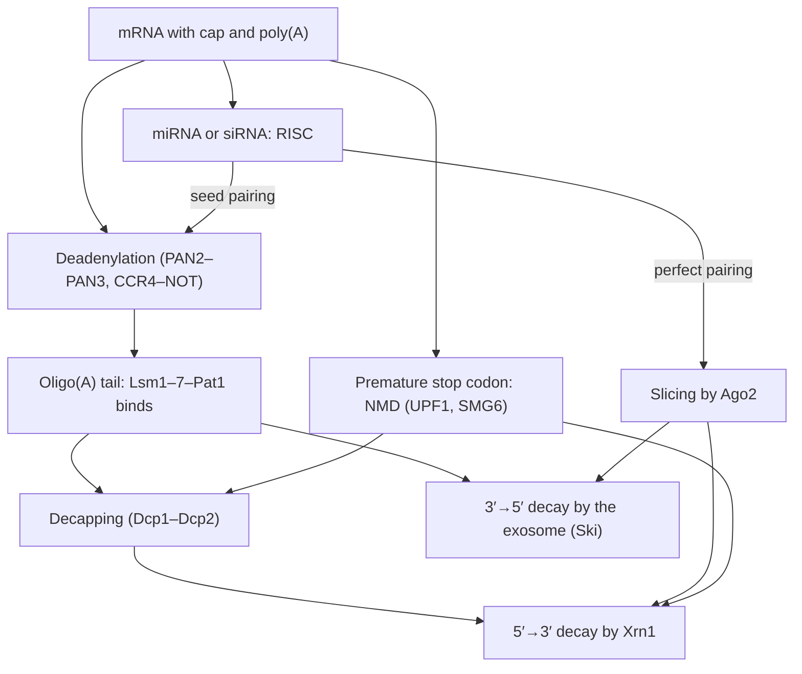

The amount of an mRNA in a cell is set by two rates, its synthesis and its destruction, and the second is regulated as much as the first. A bacterial mRNA lasts a few minutes, a mammalian mRNA from minutes to days, and the same mRNA can be stabilized or destroyed twentyfold in response to a signal. Degradation also sets how quickly the level of an mRNA can change, which is why the mRNAs of regulators are short-lived. This chapter begins with the kinetics (18.1), treats the machinery of decay in **eukaryotes** and bacteria (18.2) and the cytoplasmic granules in which mRNAs are stored or destroyed (18.3), and an example of sequence-specific control, the iron-responsive elements (18.4). The second half is about **noncoding RNA** ([7.2.2](/7.2.2)) as a regulator: RNA interference and its guide RNAs, siRNAs and microRNAs (18.5–18.6), small RNAs that direct **chromatin** silencing and defend the germ line (18.7), long **noncoding RNAs** (18.8), and the regulatory RNAs of bacteria, riboswitches and small RNAs (18.9). The control of translation itself, including microRNA effects on initiation, is taken up in [7.2.20](/7.2.20); the systematic theory of expression dynamics and noise in [7.2.22](/7.2.22).

## 18.1. The Kinetics of mRNA Levels

### 18.1.1. Synthesis and First-Order Decay

Most mRNAs decay with **first-order reaction** kinetics ([6.1.7](/6.1.7)): each molecule has a constant probability per unit time of being destroyed, independent of its age, at least to a first approximation.

**Definition 18.1.1** The **mRNA half-life** $t_{1/2}$ is the time in which half of the molecules of an mRNA species present at a given moment are degraded; for first-order decay with rate constant $k_{\mathrm{deg}}$, $t_{1/2} = \ln 2/k_{\mathrm{deg}}$, and the mean lifetime of a molecule is $1/k_{\mathrm{deg}} = t_{1/2}/\ln 2$.

**Formula 18.1.1 (Synthesis and decay)** If an mRNA is made at a constant rate $k_{\mathrm{syn}}$ (molecules per unit time per cell) and degraded with rate constant $k_{\mathrm{deg}}$, its number $m$ obeys
$$
\frac{\mathrm{d}m}{\mathrm{d}t} = k_{\mathrm{syn}} - k_{\mathrm{deg}}\,m, \tag{18.1}
$$
with **steady state** $m^* = k_{\mathrm{syn}}/k_{\mathrm{deg}}$. After a change of the rates at $t = 0$ from an initial value $m_0$,
$$
m(t) = m^* + (m_0 - m^*)\,\mathrm{e}^{-k_{\mathrm{deg}}t}. \tag{18.2}
$$
In a growing cell, dilution by growth at specific rate $\mu$ adds to degradation: $k_{\mathrm{deg}}$ is replaced by $k_{\mathrm{deg}} + \mu$.

Three consequences follow. (1) The steady-state level is proportional to the half-life: an mRNA that is twice as stable is twice as abundant at the same transcription rate. Genome-wide, in mammalian cells, half-lives vary about 100-fold and synthesis rates about 1000-fold, so both matter. (2) The time to reach halfway to a new steady state is the half-life, whatever the synthesis rate: after transcription is switched on, $m$ reaches $50\,\%$ of $m^*$ in $t_{1/2}$ and $90\,\%$ in $3.3\,t_{1/2}$; after it is switched off, the same holds for the decline. The response time of a gene is therefore set by degradation (and dilution), not by transcription. (3) A short half-life is expensive: maintaining $m^*$ molecules costs $k_{\mathrm{syn}} = k_{\mathrm{deg}}m^*$ transcripts per unit time, so fast responses are paid for in synthesis.

| Organism or mRNA | Typical half-life |
|---|---|
| *E. coli*, most mRNAs | $2$–$8\,\mathrm{min}$ (median about $5\,\mathrm{min}$ at $37^\circ\mathrm{C}$) |
| Budding yeast | median about $10$–$20\,\mathrm{min}$ (method dependent) |
| Mammalian cells | median several hours (about $9\,\mathrm{h}$ in mouse fibroblasts); from $< 30\,\mathrm{min}$ to $> 1\,\mathrm{d}$ |
| *FOS*, *MYC*, cytokine mRNAs | $10$–$30\,\mathrm{min}$ |
| β-globin mRNA in erythroid cells | more than $10\,\mathrm{h}$ |

The mRNAs of transcription factors, signaling proteins and cytokines, whose levels must change within an hour, are among the least stable, and the mRNAs of housekeeping and structural proteins among the most stable, as expected from the second consequence. Bacteria, which must adapt within a generation of $20$–$60\,\mathrm{min}$, have uniformly short-lived mRNAs.

![Kinetics of mRNA levels, Eq. (18.2). A: approach to a new steady state after transcription is switched on (solid) and decline after it is switched off (dashed) for half-lives of 3 min, 30 min and 8 h on a logarithmic time axis; each curve crosses one half at its half-life. B: a change of stability alone: the half-life of a transferrin-receptor-like mRNA falls 20-fold, from 4 h to 12 min, during a period of high iron and then returns; the level falls quickly to 1/20 and recovers slowly, because each response proceeds at the new degradation rate. C: metabolic labeling: the labeled fraction of an mRNA rises as 1 − exp(−(k_deg + μ)t), independently of the synthesis rate, for half-lives of 30 min, 4 h and 16 h with dilution by growth (doubling time 24 h)](./plots/mrna-kinetics.py)

### 18.1.2. Measuring Half-Lives

Half-lives were first measured by blocking transcription (actinomycin D in animal cells, rifampicin in bacteria, a temperature-sensitive Pol II in yeast) and following the decline of each mRNA by **Northern blot** ([7.2.6](/7.2.6)) or later by microarrays and sequencing. The inhibitors themselves disturb the cell, and stress responses stabilize many mRNAs. Metabolic labeling avoids this.

**Example 18.1.1 (Approach to equilibrium)** Cells are given a modified nucleoside such as 4-thiouridine (4sU), which is incorporated into new RNA and can be separated biochemically or detected by sequencing as a T→C conversion after chemical treatment (SLAM-seq). Starting labeling at $t = 0$, the labeled molecules of an mRNA in steady state follow Eq. (18.2) with $m_0 = 0$, and the unlabeled ones decay as $m^*\mathrm{e}^{-(k_{\mathrm{deg}}+\mu)t}$; the labeled fraction is
$$
f(t) = 1 - \mathrm{e}^{-(k_{\mathrm{deg}} + \mu)t},
$$
independent of $k_{\mathrm{syn}}$. A single time point gives the half-life of every mRNA from the ratio of labeled to total reads: if $f = 0.5$ after $2\,\mathrm{h}$ in cells doubling every $24\,\mathrm{h}$, then $k_{\mathrm{deg}} + \mu = \ln 2/2\,\mathrm{h}$, $\mu = \ln 2/24\,\mathrm{h}$, and $t_{1/2} = \ln 2/k_{\mathrm{deg}} = 1/(1/2 - 1/24)\,\mathrm{h} \approx 2.2\,\mathrm{h}$. Large studies of this kind (Schwanhäusser and colleagues, 2011) found a median mRNA half-life of about $9\,\mathrm{h}$ in mouse fibroblasts, and proteins with a median of about $46\,\mathrm{h}$, so that in such cells the dynamics of protein levels is usually limited by the protein ([7.2.22](/7.2.22)).

## 18.2. Pathways of mRNA Decay

### 18.2.1. Deadenylation-Dependent Decay in Eukaryotes

The two ends of a eukaryotic mRNA, the cap and the poly(A) tail with its binding protein ([7.2.17](/7.2.17)), protect it; decay begins when one of them is removed.

**Definition 18.2.1** **Deadenylation** is the shortening of the poly(A) tail of an mRNA by $3' \to 5'$ exonucleases (deadenylases); **decapping** is the hydrolytic removal of the $\mathrm{m^7GDP}$ of the cap by the decapping enzyme Dcp2, leaving a $5'$-monophosphate RNA.

The main pathway, worked out in yeast by Parker and colleagues, has three stages:

1. Deadenylation. The PAN2–PAN3 complex trims long tails, and the CCR4–NOT complex, whose catalytic **subunits** Ccr4 and Caf1 (CNOT6/6L and CNOT7/8) are the main deadenylases, shortens the tail further. This is usually the rate-limiting step, and its rate differs between mRNAs; the tail acts as a timer of the mRNA's life.
2. Decapping. When the tail is reduced to about $10$–$12$ A in yeast (about $25$ in mammals), PABPC can no longer bind, and the Lsm1–7–Pat1 complex binds the $3'$ end and recruits Dcp1–Dcp2 with **activators** such as Dhh1 (DDX6) and Edc3. Decapping is irreversible.
3. Exonucleolytic decay. The cytoplasmic $5' \to 3'$ **exonuclease** Xrn1 degrades the decapped mRNA; alternatively, or in addition, the mRNA is degraded $3' \to 5'$ by the exosome, and the leftover cap is hydrolyzed by the scavenger enzyme DcpS.

**Definition 18.2.2** The **RNA exosome** is a conserved multiprotein complex with a nine-subunit barrel that threads RNA to the $3' \to 5'$ exonuclease and endonuclease Rrp44 (Dis3) and, in the nucleus, Rrp6; with its cofactors (the Ski complex in the cytoplasm, the TRAMP and NEXT complexes in the nucleus) it degrades mRNAs, processes and degrades stable RNAs, and removes aberrant transcripts.

In the nucleus the exosome removes the spliced-out **introns**, the downstream products of $3'$-end cleavage not destroyed by Xrn2 ([7.2.17](/7.2.17)), unstable promoter-upstream and **enhancer** RNAs, and **pre-mRNAs** that fail to be processed; it trims the $3'$ ends of 5.8S rRNA and **snoRNAs**.

### 18.2.2. Surveillance Pathways

Specialized pathways destroy mRNAs that cannot be translated correctly.

**Definition 18.2.3 (Nonsense-Mediated Decay)** **Nonsense-mediated decay** (NMD) is the rapid degradation of mRNAs that contain a premature termination codon. In mammals a stop codon is recognized as premature when it lies more than about $50$–$55\,\mathrm{nt}$ upstream of the last exon–exon junction, so that an exon junction complex remains on the mRNA after the ribosome terminates.

The first round of translation removes the **exon junction complexes** ([7.2.16](/7.2.16)) from the coding region. If a ribosome terminates while a complex remains downstream, the termination factors eRF1–eRF3 interact with the **helicase** UPF1, which is bridged to the junction complex by UPF2 and UPF3; UPF1 is phosphorylated by the kinase SMG1 and recruits the **endonuclease** SMG6 and the SMG5–SMG7 adaptors, which bring in decapping and deadenylation. NMD protects cells from truncated proteins encoded by mutant alleles (about a third of disease-causing alleles introduce premature stops), and it is also used for regulation: many alternatively spliced isoforms contain premature stop codons and are degraded, which couples **splicing** to expression ("regulated unproductive splicing"), and **SR proteins** regulate their own levels this way. Related pathways destroy mRNAs without a stop codon (non-stop decay: the ribosome reaches the poly(A) and stalls) and mRNAs on which ribosomes stall within the coding sequence (no-go decay, triggered by collided ribosomes).

### 18.2.3. Bacterial mRNA Decay

Bacterial mRNAs have neither caps nor stable poly(A). In *E. coli*, decay begins with endonucleolytic cleavage by RNase E, a membrane-associated enzyme that forms the degradosome with the $3' \to 5'$ exonuclease polynucleotide phosphorylase (PNPase), the RNA helicase RhlB and enolase. RNase E prefers **substrates** with a $5'$-monophosphate; Belasco and colleagues (Celesnik, Deana and Belasco, 2007) showed that the pyrophosphohydrolase RppH converts the $5'$-triphosphate of primary transcripts to a monophosphate, the bacterial equivalent of decapping, which then stimulates RNase E cleavage. The fragments are degraded by the $3' \to 5'$ exonucleases PNPase, RNase II and RNase R; $3'$ **hairpins** (such as **intrinsic terminators**, [7.2.10](/7.2.10)) block these exonucleases, and short poly(A) tails added by **poly(A) polymerase** I help them start. *Bacillus subtilis* uses RNase Y and the $5' \to 3'$ exonuclease RNase J instead. Translation protects bacterial mRNAs: ribosomes cover cleavage sites, which is why untranslated mRNAs, or mRNAs whose translation is repressed by small RNAs (18.9), decay quickly.

The statement that bacterial mRNAs are destroyed mainly by $3' \to 5'$ exonucleases is incomplete: the exonucleases are blocked by $3'$ structures and act mostly on fragments, and the rate-limiting step for most mRNAs is endonucleolytic cleavage by RNase E.

## 18.3. P-Bodies and Stress Granules

Cytoplasmic mRNAs that are not being translated assemble with proteins into microscopically visible granules without membranes, which are biomolecular condensates formed by many **weak interactions** ([7.2.21](/7.2.21)).

**Definition 18.3.1** A **processing body** (P-body) is a cytoplasmic ribonucleoprotein granule, present in unstressed cells, that concentrates translationally repressed mRNAs with the decapping machinery (Dcp1–Dcp2, DDX6, Edc3, Lsm1–7, Pat1), Xrn1, the CCR4–NOT deadenylase and the miRNA-silencing protein GW182. A **stress granule** is a cytoplasmic granule that forms when translation initiation is inhibited, containing mRNAs stalled in initiation together with small ribosomal subunits, initiation factors (eIF3, eIF4F), PABPC and RNA-binding proteins such as G3BP1/2 and TIA-1.

P-bodies were named for their enrichment in decay enzymes, but decay does not require them: mRNA decay continues when P-bodies are disassembled by depleting scaffolding proteins (Eulalio and colleagues, 2007), and purified P-bodies contain mostly intact, repressed mRNAs. P-bodies are therefore sites of storage and of reversible repression as much as of decay; their size grows when decay or translation initiation is inhibited, because more mRNAs are released from polysomes.

**Example 18.3.1 (Relief of repression from P-bodies)** In the human hepatoma line Huh7, the mRNA of the amino-acid **transporter** CAT-1 is repressed by the liver-specific microRNA miR-122 and concentrated in P-bodies. Bhattacharyya, Filipowicz and colleagues (2006) starved the cells of amino acids and found that CAT-1 mRNA left P-bodies and moved into polysomes, and its translation increased, although miR-122 was still present. The release required the RNA-binding protein HuR, which moved from the nucleus to the cytoplasm during stress, and its **binding site** in the CAT-1 $3'$ UTR. A miRNA-repressed mRNA can thus be stored and reactivated without new transcription.

Stress granules form within minutes when initiation is blocked, by phosphorylation of eIF2α during heat shock, oxidative stress or viral infection ([7.2.20](/7.2.20)) or by inhibitors of eIF4A; polysomes run off, and the released mRNAs, still bound to initiation complexes, condense with G3BP1/2, whose deletion prevents granule formation. When the stress ends, stress granules dissolve and the stored mRNAs return to translation. Several RNA-binding proteins with low-complexity **domains** that are found in stress granules (FUS, TDP-43, hnRNP A1) carry mutations in amyotrophic lateral sclerosis and frontotemporal dementia, which promote the conversion of liquid granules into solid aggregates ([7.2.21](/7.2.21)).

## 18.4. Sequence-Specific Control of Stability

Specific mRNAs are stabilized or destabilized by proteins and small RNAs that bind sequences mostly in their $3'$ UTRs, the longer of which ([7.2.17](/7.2.17)) carry more regulatory sites.

**Definition 18.4.1** An **AU-rich element** (ARE) is a sequence of $50$–$150\,\mathrm{nt}$ in the $3'$ UTR of an mRNA containing repeats of $\mathrm{AUUUA}$ in a U-rich context, which targets the mRNA for rapid deadenylation and decay when bound by destabilizing proteins.

Shaw and Kamen (1986) inserted the AU-rich $3'$ UTR sequence of the cytokine GM-CSF into the stable β-globin mRNA, which then became unstable; AREs occur in the mRNAs of about $5$–$8\,\%$ of human genes, among them many cytokines and **proto-oncogenes**. Tristetraprolin (TTP) binds AREs and recruits CCR4–NOT; HuR (ELAVL1) competes and stabilizes. Signals regulate these proteins by phosphorylation: during inflammation, the kinase MK2 phosphorylates TTP, which then releases the mRNA of tumor necrosis factor α, whose level rises; mice lacking TTP overproduce TNF-α and develop inflammatory disease. Other determinants of stability are codon usage (mRNAs rich in codons decoded by abundant tRNAs are translated faster and are more stable), the methylation of adenosines to $\mathrm{N^6}$-methyladenosine ($\mathrm{m^6A}$), which recruits the reader protein YTHDF2 and CCR4–NOT, and microRNAs (18.6).

**Definition 18.4.2** An **iron-responsive element** (IRE) is a stem-loop of about $30\,\mathrm{nt}$ with a conserved $\mathrm{CAGUGN}$ loop and an unpaired C on the $5'$ side of the stem, found in untranslated regions of mRNAs of iron metabolism, to which iron-regulatory proteins (IRP1 and IRP2) bind when cellular iron is low.

The iron-regulatory system shows how one binding event can have opposite effects, depending on where the element lies (figure). Cells need iron but are poisoned by free iron, and they coordinate uptake (by the transferrin **receptor**, TfR) with storage (in ferritin).

**Example 18.4.1 (Iron regulates the stability of transferrin receptor mRNA)** Müllner and Kühn (1988) measured TfR mRNA in cells treated with an iron source or an iron chelator, in the presence and absence of transcription inhibitors. Iron regulated the half-life of TfR mRNA, not its rate of synthesis: the mRNA was very stable at low iron and decayed about 20-fold faster at high iron. The response mapped to the $3'$ UTR, which contains five IREs (A–E). Casey and colleagues (1989) analyzed deletion constructs: deleting IREs A and E and the large central loop did not change the response, but removing IREs A and B, or D and E, or all five IREs made the mRNA constitutively stable, so that IREs B and D are part of the "rapid turnover determinant" for decay. Removing one C from each IRE (construct TRS-4), which prevents IRP binding, made the mRNA constitutively unstable. The IREs are thus both the target of decay and, when bound by IRP, protected from it. Decay begins with an endonucleolytic cleavage within the IRE region, more than $1\,\mathrm{kb}$ from the $3'$ end, followed by degradation of the cut mRNA.

In iron-replete cells IRP1 contains a $[\mathrm{4Fe}\text{-}\mathrm{4S}]$ cluster and acts as the cytosolic aconitase, an enzyme of the citrate cycle that cannot bind RNA; at low iron it loses the cluster and becomes an IRE-binding protein. IRP2 has no cluster and is degraded at high iron by the iron-sensing **ubiquitin** ligase FBXL5. So at low iron IRPs bind IREs; at high iron they do not. In the TfR mRNA, bound IRPs protect the $3'$ UTR from cleavage: low iron increases receptor synthesis and iron uptake. In the ferritin mRNA, a single IRE lies in the $5'$ UTR within about $40\,\mathrm{nt}$ of the cap; bound IRP blocks the recruitment of the 43S **preinitiation complex**, so low iron represses ferritin synthesis and storage ([7.2.20](/7.2.20)). The same switch regulates translation of the mRNAs of erythroid aminolevulinate synthase (**heme** synthesis) and the iron exporter ferroportin through $5'$ IREs, and the stability of the divalent metal transporter DMT1 mRNA through a $3'$ IRE.

![Iron-responsive elements. A: at low iron (left), iron-regulatory proteins bind the single IRE in the 5′ UTR of ferritin mRNA, blocking the recruitment of the 43S complex, and the five IREs in the 3′ UTR of transferrin-receptor mRNA, protecting it from endonucleolytic cleavage; at high iron (right), IRP1 binds a [4Fe-4S] cluster and becomes aconitase, IRP2 is degraded, ferritin mRNA is translated and TfR mRNA is cut and degraded. B: a steady-state model (Example 18.4.1): active IRP declines with iron, IRE occupancy follows a binding curve, ferritin synthesis is proportional to the unoccupied fraction and TfR mRNA to 1/(k₀ + k_c(1 − θ)) with a 20-fold range of decay rates; uptake and storage respond in opposite directions to the same signal](./plots/ire-irp.py)

In the model of the figure, the steady-state level of TfR mRNA is $m^* = k_{\mathrm{syn}}/(k_0 + k_{\mathrm{c}}(1-\theta))$, where $\theta$ is the fraction of time its IREs are occupied, $k_{\mathrm{c}}$ the rate constant of cleavage of the unprotected mRNA and $k_0$ that of the IRE-independent decay. Its range is bounded by $(k_0 + k_{\mathrm{c}})/k_0$, the 20-fold change in half-life, while ferritin synthesis, proportional to $1 - \theta$, responds in the opposite direction. Because the TfR response works through stability, it is fast in one direction and slow in the other (figure of 18.1, panel B): iron overload lowers TfR mRNA within an hour, while recovery from it takes most of a day.

## 18.5. RNA Interference

### 18.5.1. Discovery

In the 1990s, antisense RNA was used to inhibit genes in many organisms, with variable success, and two unexplained phenomena were recorded. Plant biologists who introduced extra copies of a pigment gene (chalcone synthase) into petunias to deepen the purple color obtained, in a substantial fraction of plants, white or variegated flowers in which both the transgene and the endogenous gene were silenced (Napoli, Lemieux and Jorgensen, 1990; "cosuppression"); the silencing acted on the mRNA and was called post-transcriptional gene silencing. In the nematode *C. elegans*, Guo and Kemphues (1995) found that injected sense RNA silenced the *par-1* gene as well as antisense RNA did, which no antisense mechanism could explain.

**Example 18.5.1 (Double-stranded RNA is the trigger)** Fire, Mello and colleagues (1998) injected *C. elegans* with purified single-stranded sense or antisense RNA, or with annealed double-stranded RNA, corresponding to the muscle gene *unc-22*, whose loss causes a twitching phenotype. Double-stranded RNA was at least ten times more potent than either strand alone; the residual activity of single-stranded preparations was due to contaminating double strands. A few molecules of dsRNA per cell sufficed, the effect spread to other tissues and to the progeny, dsRNA against intron or **promoter** sequences had no effect, and the target mRNA disappeared from the cytoplasm. The silencing was therefore post-transcriptional, sequence-specific and catalytic or amplified. Fire and Mello received the 2006 Nobel Prize.

**Definition 18.5.1 (RNA Interference)** **RNA interference** (RNAi) is the sequence-specific silencing of gene expression triggered by double-stranded RNA, in which short RNAs derived from the dsRNA guide an Argonaute protein to complementary RNAs.

### 18.5.2. Mechanism

The steps were found biochemically in *Drosophila* embryo extracts and cultured cells, and in plants. Hamilton and Baulcombe (1999) detected RNAs of about $25\,\mathrm{nt}$ of both polarities in silenced plants; Zamore, Tuschl, Sharp and Bartel (2000) showed that dsRNA in fly extracts was cut into $21$–$23$-nt pieces that directed cleavage of the target; Bernstein, Hannon and colleagues (2001) identified the dsRNA-specific ribonuclease Dicer; and Elbashir, Tuschl and colleagues (2001) showed that synthetic $21$-nt duplexes with $2$-nt $3'$ overhangs silence genes in mammalian cells, where long dsRNA instead triggers an interferon response through the kinase PKR. The pathway is:

1. Dicing. Dicer, an RNase III-family enzyme with two catalytic domains and a PAZ domain that binds the end of the dsRNA, cuts dsRNA into duplexes of $21$–$23\,\mathrm{bp}$ with $2$-nt $3'$ overhangs and $5'$-phosphates. In flies Dicer-2 with R2D2 makes siRNAs and Dicer-1 makes miRNAs.
2. Loading and strand selection. The duplex is loaded into an Argonaute protein. One strand, the guide, is retained; the other, the passenger, is cleaved by Argonaute and discarded. The guide is usually the strand whose $5'$ end is less stably paired in the duplex (Schwarz and colleagues; Khvorova and colleagues, 2003), a thermodynamic asymmetry that is used to design effective siRNAs.
3. Targeting. The mature complex, the RNA-induced silencing complex (RISC), uses the guide to find complementary RNA. With extensive complementarity, Argonaute cuts the target between the nucleotides paired with guide positions 10 and 11, the fragments are degraded by Xrn1 and the exosome, and RISC is released to cut more targets: one guide destroys many mRNAs.

**Definition 18.5.2** A **small interfering RNA** (siRNA) is a $21$–$23$-nt RNA, generated by Dicer from long double-stranded RNA or supplied as a synthetic duplex, that guides an Argonaute protein to cleave fully complementary target RNAs. An **Argonaute** protein is the effector of RNA silencing that binds a small guide RNA by its $5'$ end (MID domain) and $3'$ end (PAZ domain) and, in its PIWI domain, which has the RNase H fold, cleaves target RNA paired with the guide.

Liu, Hannon and colleagues (2004) showed that in mammals Ago2 is the "slicer": mice lacking Ago2 die as embryos, cells from them cannot cleave targets with siRNAs, and mutation of the catalytic residues of its PIWI domain abolishes cleavage; Song, Joshua-Tor and colleagues (2004) solved the structure of an archaeal Argonaute and found the RNase H fold. Of the four human Argonautes, only Ago2 slices.

In worms and plants, but not flies or mammals, RNAi is amplified: RNA-dependent RNA polymerases (RdRPs) use the target mRNA as template to make secondary siRNAs, sometimes spreading beyond the region of the original trigger ("transitive RNAi"); this explains the potency and spread found by Fire and Mello. The natural functions of RNAi are defense against viruses (plants and invertebrates, whose antiviral RNAi is countered by viral suppressor proteins), control of transposons, and the formation of heterochromatin (18.7). As a tool, RNAi made loss-of-function screens possible in animal cells before CRISPR ([7.2.24](/7.2.24)), and siRNA drugs, chemically modified and delivered to the liver in lipid nanoparticles or conjugated to *N*-acetylgalactosamine, were approved from 2018 (patisiran, for transthyretin amyloidosis).

## 18.6. MicroRNAs

### 18.6.1. Discovery

**Example 18.6.1 (lin-4 represses lin-14)** In *C. elegans*, the gene *lin-14* must be turned off after the first larval stage for normal development; mutations in *lin-4* prevent this, and the larvae repeat early stages. Lee, Feinbaum and Ambros (1993) cloned *lin-4* and found that it encodes no protein but two small RNAs, of $22$ and $61\,\mathrm{nt}$, the longer folding into a hairpin; Wightman, Ha and Ruvkun (1993) found that the $3'$ UTR of *lin-14* mRNA contains seven sites partly complementary to the $22$-nt *lin-4* RNA and is necessary and sufficient for repression. LIN-14 protein fell sharply during the L1 stage although, in the first analyses, the level of *lin-14* mRNA and its association with polysomes barely changed (Olsen and Ambros, 1999), which suggested a block of translation after initiation; later work (Bagga, Pasquinelli and colleagues, 2005) showed that *lin-14* mRNA also decreases. Ambros and Ruvkun received the 2024 Nobel Prize.

For seven years *lin-4* appeared to be a worm curiosity. Then Reinhart, Ruvkun and colleagues (2000) found a second worm small RNA, let-7, that controls a later developmental transition, and Pasquinelli and colleagues (2000) found that let-7 is conserved in sequence from worms to humans. Within a year, cloning of small RNAs revealed hundreds of such RNAs in animals and plants.

**Definition 18.6.1 (MicroRNA)** A **microRNA** (miRNA) is an endogenous small RNA of about $22\,\mathrm{nt}$, processed from a hairpin within a longer transcript, that guides an Argonaute protein to partially (in animals) or nearly fully (in plants) complementary sites in target mRNAs and represses their expression.

### 18.6.2. Biogenesis

![MicroRNAs. A: the canonical biogenesis pathway: Pol II transcribes a capped and polyadenylated pri-miRNA; in the nucleus the Microprocessor (Drosha with DGCR8) cuts at the base of its hairpin to release a 60–70-nt pre-miRNA, which Exportin-5 with Ran-GTP exports; in the cytoplasm Dicer with TRBP removes the loop, leaving a ~22-nt duplex, one strand of which is loaded into Argonaute while the passenger strand is degraded; miRISC with GW182 represses target mRNAs; mirtrons are excised by the spliceosome instead of Drosha. B: anatomy of let-7a paired with a target: position 1 is held by Argonaute and is unpaired (an A in the target is favored opposite it), the seed (positions 2–8) pairs with the target, the central region (9–12) is usually unpaired, the supplementary region (13–16) can add pairing and the tail (17–22) is buried in Argonaute; below, site types in order of typical efficacy: 8mer, 7mer-m8, 7mer-A1 and 6mer](./plots/mirna.py)

Animal miRNAs are made in two processing steps, one in the nucleus and one in the cytoplasm, each by an RNase III enzyme. Most miRNA genes are transcribed by Pol II as long primary transcripts (pri-miRNAs) that are capped and polyadenylated and may contain several miRNAs (clusters, such as miR-17~92) or lie in introns of protein-coding genes. The Microprocessor, Drosha with two molecules of its RNA-binding partner DGCR8, recognizes the junction between the single-stranded flanks and the stem of the hairpin and cuts about $11\,\mathrm{bp}$ from it, releasing the pre-miRNA. Exportin-5 recognizes the $2$-nt $3'$ overhang left by Drosha and exports the pre-miRNA with Ran-GTP. Dicer, measuring from that end, cuts about $22\,\mathrm{nt}$ away and removes the loop. One strand of the duplex enters an Argonaute protein (Ago1–4 in humans), selected by the thermodynamic asymmetry of the duplex ends and by a preference for U or A at its $5'$ end; the other, called miR*, is usually degraded, although for some miRNAs both arms are used (named -5p and -3p). Mirtrons are short introns whose excised and debranched lariats ([7.2.16](/7.2.16)) fold directly into pre-miRNA hairpins, bypassing Drosha, and miR-451 bypasses Dicer: its short hairpin is cut by Ago2 itself. In plants a single enzyme, DCL1, carries out both cuts in the nucleus, and the miRNA is $2'$-O-methylated at its $3'$ end by HEN1.

The human genome encodes several hundred confidently annotated miRNA genes (about 500–600 in curated databases, and about 2000 entries in the larger miRBase catalog, many of them doubtful). The statement in some lecture notes that miRNAs make up $2\,\%$ of the mammalian genome is not correct: miRNA genes are about $1$–$2\,\%$ of the number of genes, and their mature sequences a negligible fraction of the genome.

### 18.6.3. Target Recognition

**Definition 18.6.2 (Seed Sequence)** The **seed sequence** of a microRNA is its nucleotides $2$–$8$, counted from the $5'$ end, whose pairing with a target site is the main determinant of target recognition in animals.

Argonaute holds the guide so that nucleotides 2–8 are preorganized in a nearly A-form helix, exposed to the solvent and ready to pair, while nucleotide 1 sits in a pocket of the MID domain and cannot pair (Schirle, Sheu-Gruttadauria and MacRae, 2014). Target search therefore begins with the seed: Argonaute first samples short complementary stretches, and full pairing beyond the seed is rare in animals. Comparative genomics and transcriptome analyses (Bartel and colleagues) established a hierarchy of site types: an 8mer site pairs with nucleotides 2–8 and has an A opposite nucleotide 1 (recognized by a pocket of Argonaute), a 7mer-m8 site pairs with 2–8, a 7mer-A1 site pairs with 2–7 and has the A, and a 6mer pairs with 2–7. Pairing of nucleotides 13–16 (the supplementary region) can strengthen weak seed sites. Most functional sites are in $3'$ UTRs, in accessible regions, often near the ends of long UTRs and away from the stop codon, where translating ribosomes would displace RISC.

Seed pairing allows one miRNA to have hundreds of targets, and one mRNA to be targeted by many miRNAs. Friedman, Burge and Bartel (2009) estimated that more than $60\,\%$ of human protein-coding genes have conserved sites for at least one miRNA. The repression of a typical target is modest, usually less than twofold; strong effects come from combinations of sites and miRNAs, or from abundant miRNAs on targets with several sites, as for lin-14. miRNAs have been interpreted as fine-tuners that confer robustness: they buffer fluctuations in target expression and sharpen developmental transitions, and the phenotypes of many single miRNA knockouts are mild or appear only under stress. Some are essential: mice lacking Dicer or DGCR8 die as embryos, miR-1 is required in muscle, let-7 and lin-4 time worm development, and miR-122, which makes up most of the miRNA in liver, is required by hepatitis C virus, which binds it at its $5'$ end (a target of antisense drugs).

### 18.6.4. Mechanism of Repression

**Definition 18.6.3** The complex of a guide RNA with an Argonaute protein, with or without associated proteins, is the **RNA-induced silencing complex** (RISC); with a miRNA guide it is called miRISC.

In plants, where pairing is usually extensive, miRISC slices the target, like an siRNA. In animals, with seed pairing, Argonaute does not slice; instead it binds GW182 (TNRC6A–C in humans), a protein with glycine–tryptophan repeats that recruits the deadenylase complexes CCR4–NOT and PAN2–PAN3. The mRNA is deadenylated, decapped and degraded by Xrn1 (18.2), and CCR4–NOT, through the helicase DDX6, also represses translation initiation, in part by displacing eIF4A from the cap complex. Early experiments suggested several mechanisms: blocked initiation, blocked elongation, cotranslational degradation of the nascent protein, or mRNA decay. Measurements of both mRNA levels and ribosome occupancy by **ribosome profiling** ([7.2.6](/7.2.6)) in mammalian cells resolved the question for steady state: Guo, Ingolia, Weissman and Bartel (2010) found that $66$–$90\,\%$ of the repression of protein output by a miRNA was explained by decreased mRNA levels. Translational repression precedes decay and dominates shortly after a miRNA is induced, and in some systems (early zebrafish and fly embryos, which lack efficient decay) it can be the main effect. Vasudevan, Tong and Steitz (2007) reported that in quiescent cells some miRNAs (miR369-3 on the tumor necrosis factor α ARE, with Ago2 and FXR1) activate translation; this effect appears limited to particular conditions and is not part of the general mechanism.

**Formula 18.6.1 (A miRNA as an added decay pathway)** If a miRNA with free concentration $r$ binds a target site rapidly with dissociation constant $K$, and a bound target is degraded with rate constant $\gamma$ while the miRISC is recycled, the target obeys Eq. (18.1) with an effective degradation rate constant
$$
k_{\mathrm{deg}}' = k_{\mathrm{deg}} + \gamma\,\frac{r}{r + K} \approx k_{\mathrm{deg}} + \gamma\,\frac{r}{K}\quad (r \ll K),
$$
so the steady state is reduced by the fold repression $k_{\mathrm{deg}}'/k_{\mathrm{deg}}$, independent of the target's transcription rate, and the response time is shortened by the same factor.

A miRNA that is recycled therefore acts catalytically, lowering the slope of target output against target transcription without a threshold. This changes when the regulator is consumed together with its target (18.9). It also changes when the targets are so abundant that they sequester the miRNA: an mRNA or circular RNA with many sites can act as a "sponge" that reduces the free miRNA, as the circRNA CDR1as does for miR-7 ([7.2.16](/7.2.16)). Whether natural levels of ordinary mRNAs compete for miRNAs in this way, as the "competing endogenous RNA" hypothesis proposed, is doubtful: quantitative measurements indicate that changing a single target's level by physiological amounts rarely shifts the occupancy of the many other sites of an abundant miRNA.

## 18.7. siRNAs, piRNAs and RNA-Directed Heterochromatin

Small RNAs can silence genes at the level of chromatin, by guiding Argonaute to nascent transcripts on the chromosome.

**Example 18.7.1 (RNAi forms heterochromatin at centromeres)** In fission yeast, the outer repeats (*otr*, with *dg* and *dh* elements) of the centromeres are **heterochromatin** ([7.2.4](/7.2.4)) marked by methylation of histone H3 at lysine 9 (by the methyltransferase Clr4) and bound by the HP1 protein Swi6. Volpe, Martienssen and colleagues (2002) found that deleting the genes for Dicer (*dcr1*), Argonaute (*ago1*) or RNA-dependent RNA polymerase (*rdp1*) caused loss of H3K9 methylation and Swi6 from the repeats, derepression of reporter genes inserted there, and accumulation of transcripts of both strands of the repeats; small RNAs from the repeats were abundant in wild-type cells. Reverse-strand transcripts are always present, and forward transcripts, made by Pol II in S phase or by Rdp1, pair with them to form dsRNA. Dicer converts it to siRNAs, which are loaded into Ago1 in the RITS complex (RNA-induced transcriptional silencing: Ago1, the chromodomain protein Chp1 and Tas3; Verdel, Moazed and colleagues, 2004). RITS binds nascent repeat transcripts by base pairing and recruits Clr4, whose H3K9 methylation is bound by Chp1 and Swi6; RITS also recruits Rdp1 (in the RDRC complex) to make more dsRNA. The loop is self-reinforcing: siRNAs direct H3K9 methylation, and H3K9 methylation holds RITS on the chromatin where it makes more siRNAs. Heterochromatin is required for cohesion and accurate segregation of chromosomes, and the mutants missegregate chromosomes.

Plants use a related pathway to methylate DNA: in RNA-directed DNA methylation, the plant-specific polymerase Pol IV makes transcripts of transposons and repeats, RDR2 makes them double-stranded, DCL3 cuts them into $24$-nt siRNAs, and AGO4 with these siRNAs binds scaffold transcripts made by Pol V and recruits the DNA methyltransferase DRM2 ([7.2.15](/7.2.15)). Flies and mammals make endogenous siRNAs from transposons, overlapping transcripts and long hairpins as well, in the soma of flies and in mouse oocytes.

**Definition 18.7.1** **PIWI-interacting RNAs** (piRNAs) are small RNAs of $24$–$31\,\mathrm{nt}$, made from single-stranded precursors without Dicer and bound by the PIWI subfamily of Argonaute proteins, that silence transposons in the animal germ line.

piRNAs come mainly from piRNA clusters, long genomic regions full of transposon fragments (in flies, *flamenco* and *42AB*), which serve as a heritable record of past invasions. Their $3'$ ends are $2'$-O-methylated. In the *Drosophila* germ line, piRNAs are amplified by the ping-pong cycle (Brennecke, Hannon and colleagues; Gunawardane, Siomi and colleagues, 2007): Aubergine, guided by an antisense piRNA (usually with U at position 1), cleaves a transposon mRNA, and the cleavage product becomes a sense piRNA loaded into Ago3, which in turn cleaves cluster transcripts to make more antisense piRNAs; the two populations overlap by exactly 10 nt, which places an A at position 10 of the sense piRNAs. The nuclear PIWI protein Piwi (MIWI2 in mice) uses piRNAs to recognize nascent transposon transcripts and recruit H3K9 methylation and, in mammals, de novo DNA methylation, silencing the transposons transcriptionally. Mice lacking MIWI2 or MILI are sterile, with derepressed transposons in the male germ line.

| Class | Length | Made by | Argonaute | Pairing | Main action |
|---|---|---|---|---|---|
| siRNA | $21$–$23\,\mathrm{nt}$ (24 in plant RdDM) | Dicer from long dsRNA | AGO (Ago2 in mammals) | Full | Slicing; chromatin silencing (RITS, RdDM) |
| miRNA | about $22\,\mathrm{nt}$ | Drosha, then Dicer, from hairpins | Ago1–4 | Seed (animals), near-full (plants) | Deadenylation, decay, translational repression |
| piRNA | $24$–$31\,\mathrm{nt}$ | Dicer-independent; ping-pong | PIWI (Piwi, Aub, Ago3; MIWI, MILI, MIWI2) | Extensive | Transposon slicing; transcriptional silencing in the germ line |

## 18.8. Long Noncoding RNAs

**Definition 18.8.1** A **long noncoding RNA** (lncRNA) is a transcript longer than $200\,\mathrm{nt}$ that does not encode a protein; the length cutoff is operational, separating them from the small RNAs.

The human genome has about 20,000 lncRNA genes in current annotations, roughly as many as protein-coding genes ([7.2.2](/7.2.2)). As a class, lncRNAs are made by Pol II, are often capped, spliced and polyadenylated, and are expressed at lower levels, more specifically to tissues, and with less sequence conservation than mRNAs; many are enriched in the nucleus. Their mechanisms are classified by where they act (in *cis*, on the locus from which they are transcribed, or in *trans*, elsewhere) and by what they do: as guides that bring proteins to particular chromatin regions, as scaffolds that assemble complexes or nuclear bodies, as decoys that sequester proteins or miRNAs, and as signals whose transcription, rather than product, is what matters.

**Example 18.8.1 (Xist and X inactivation)** In female mammals, one of the two X chromosomes is silenced in every somatic cell to equalize the dose of X-linked genes with males. The silenced X expresses the $17\,\mathrm{kb}$ lncRNA *Xist*, which is necessary and sufficient for inactivation in *cis*: deletion of *Xist* prevents silencing of that chromosome, and an inducible *Xist* transgene on an autosome silences the autosomal genes around it. *Xist* RNA coats the chromosome from which it is made, spreading from its site of transcription along regions close in three-dimensional space. Distinct repeats of the RNA recruit distinct activities: the A-repeat binds the protein SPEN, which recruits the histone deacetylase HDAC3 and is required for gene silencing; the B and C repeats bind hnRNP K, which recruits the Polycomb complex PRC1, whose ubiquitylation of histone H2A then recruits PRC2 and H3K27 trimethylation ([7.2.15](/7.2.15)). The silent state is then locked by DNA methylation of CpG-island promoters and is maintained through cell divisions even when *Xist* is later removed. The choice of which X to silence is regulated in *cis* by the antisense transcript *Tsix*, which overlaps *Xist* on the opposite strand ([7.2.2](/7.2.2)) and represses it on the future active X.

Other well-studied lncRNAs include *NEAT1*, the scaffold of nuclear paraspeckles, and *MALAT1*, abundant in nuclear speckles; *HOTAIR*, proposed to repress the *HOXD* locus in *trans* through PRC2, although its knockout in mice gave milder and partly conflicting results; and *Airn*, whose silencing of the imprinted *Igf2r* gene requires transcription through the *Igf2r* promoter but not the RNA product. Many lncRNA functions reported from knockdown experiments have not been confirmed by genetic deletion, and the fraction of lncRNAs with biological functions, as opposed to transcriptional noise, is unknown.

## 18.9. Riboswitches and Bacterial Small RNAs

### 18.9.1. Riboswitches

**Definition 18.9.1 (Riboswitch)** A **riboswitch** is a structured element, usually in the $5'$ untranslated region of a bacterial mRNA, consisting of an aptamer that binds a specific small metabolite and an expression platform whose alternative structures, selected by ligand binding, control transcription termination, translation initiation, splicing or RNA stability of the same mRNA.

Breaker, Nudler and colleagues (2002) showed that the leaders of the *E. coli* mRNAs for thiamine and coenzyme B₁₂ synthesis bind thiamine pyrophosphate and adenosylcobalamin directly, without proteins, with dissociation constants in the nanomolar range, and that binding changes the RNA's structure. More than 40 classes are now known, sensing enzyme cofactors (thiamine pyrophosphate, flavin mononucleotide, S-adenosylmethionine, cobalamin), amino acids (lysine, glycine), purines (guanine, adenine, which differ by a single C/U in the aptamer that pairs with the ligand), second messengers (cyclic di-GMP), metal ions and fluoride; they control about $2\,\%$ of the genes of *B. subtilis*. The logic is that of **attenuation** of the *trp* operon ([7.2.11](/7.2.11)), with the metabolite rather than a stalled ribosome selecting between alternative hairpins: in a transcriptional riboswitch, the ligand-bound aptamer allows an intrinsic terminator to form (or prevents it); in a translational one, the bound aptamer sequesters the Shine–Dalgarno sequence. Most riboswitches turn off genes whose products make or import the ligand, a feedback loop at the RNA level.

Transcriptional riboswitches face a race: the aptamer must bind the ligand in the seconds between its synthesis and that of the terminator. Wickiser, Crothers and colleagues (2005) found that the FMN riboswitch of *B. subtilis* responds to FMN at concentrations far above its equilibrium $K_D$, because binding does not reach equilibrium during the transcription window; polymerase pausing between aptamer and terminator lengthens the window and lowers the effective threshold. Such kinetic control is the counterpart, for an RNA switch, of the kinetic coupling of splicing to elongation ([7.2.16](/7.2.16)). In eukaryotes, thiamine pyrophosphate riboswitches in fungi and plants control alternative splicing, and the *glmS* riboswitch of Gram-positive bacteria is a **ribozyme** ([7.1.8](/7.1.8)) activated by glucosamine-6-phosphate, which cleaves its own mRNA. Riboswitches are targets for antibiotics: roseoflavin and the synthetic ribocil act on the FMN riboswitch.

### 18.9.2. Bacterial Small RNAs

**Definition 18.9.2** Bacterial **small RNAs** (sRNAs) are noncoding RNAs of $50$–$300\,\mathrm{nt}$ that regulate the translation or stability of target mRNAs by imperfect base pairing; *trans*-encoded sRNAs, transcribed far from their targets, usually require the RNA chaperone Hfq.

The first was MicF (Mizuno, Chou and Inouye, 1984), an antisense RNA that represses the outer-membrane porin OmpF. *E. coli* has more than a hundred sRNAs, most made in response to stress. They pair with $7$–$12$ nucleotides near the ribosome-binding site of their targets, with Hfq, a hexameric Sm-like protein, accelerating pairing and protecting the sRNA. Most repress: pairing blocks ribosome binding and recruits RNase E, which degrades sRNA and mRNA together. Some activate: DsrA and RprA pair with the leader of *rpoS* mRNA, opening a hairpin that otherwise hides its Shine–Dalgarno sequence, and so raise the stationary-phase σ factor ([7.2.10](/7.2.10)). RyhB, made when iron is scarce, represses the mRNAs of iron-storage and iron-using proteins (such as superoxide dismutase SodB), the bacterial analog of the IRE–IRP system (18.4) achieved with an RNA. Other regulatory RNAs act on other machines: 6S RNA mimics an open promoter and sequesters σ⁷⁰ holoenzyme in stationary phase; tmRNA rescues ribosomes stalled on mRNAs without stop codons by acting first as a tRNA and then as an mRNA ([7.2.20](/7.2.20)); *cis*-encoded antisense RNAs, such as RNA I of plasmid ColE1, control plasmid copy number; and CRISPR RNAs guide bacterial immunity ([7.2.24](/7.2.24)).

Because an sRNA is degraded with its target, it acts stoichiometrically rather than catalytically, with distinctive quantitative consequences.

**Formula 18.9.1 (Threshold-linear regulation by titration)** Let target mRNA be made at rate $\alpha$ and decay with rate constant $\beta$, let the sRNA be made at rate $\alpha_{\mathrm{r}}$ and decay with rate constant $\delta$, and let the pair bind with dissociation constant $K$ and be degraded together with rate constant $\gamma$. In the limit of tight binding and fast co-degradation ($K \to 0$, $\gamma \gg \beta, \delta$), the steady-state level of free target is
$$
t^* \approx \frac{\max(0,\ \alpha - \alpha_{\mathrm{r}})}{\beta}. \tag{18.3}
$$
Below the threshold $\alpha = \alpha_{\mathrm{r}}$, almost every target molecule is captured and destroyed by an sRNA molecule; above it, the excess of target escapes, and output grows linearly with slope $1/\beta$.

Levine, Hwa and colleagues (2007) measured this threshold-linear response for RyhB and its targets in single *E. coli* cells, and Mukherji, van Oudenaarden and colleagues (2011) found a similar threshold for a miRNA in mammalian cells at low target levels, where the miRNA is effectively consumed. The two modes have different uses (figure): catalytic repression scales output by a constant factor, whereas stoichiometric repression silences targets strongly when they are weakly transcribed, ignores them when they are strongly transcribed, and buffers fluctuations near the threshold; a weaker interaction (larger $K$) smooths the threshold. Since the sRNA is consumed, its targets also compete for it, so that a strongly induced target can relieve the repression of the others.

![Catalytic versus stoichiometric repression (dimensionless model of Formulas 18.6.1 and 18.9.1, β = δ = 1, α_r = 10, γ = 10). A: free target against target transcription rate: without regulator the output is α/β (grey); a recycled, miRNA-like regulator lowers the slope by a constant factor (blue, K = 50, about threefold); a co-degraded, sRNA-like regulator with tight binding (K = 0.1) gives a threshold-linear response, with almost no free target until α exceeds α_r (red), and with weak binding (K = 10) a smoothed threshold (dashed). B: fold repression for the same cases: constant for the catalytic regulator, very strong below the threshold and weak above it for the stoichiometric one](./plots/titration.py)

## Summary

| Topic | Key points |
|---|---|
| Kinetics (Definition 18.1.1, Formula 18.1.1) | $\mathrm{d}m/\mathrm{d}t = k_{\mathrm{syn}} - k_{\mathrm{deg}}m$, $m^* = k_{\mathrm{syn}}/k_{\mathrm{deg}}$, response time $\sim t_{1/2} = \ln 2/k_{\mathrm{deg}}$, dilution $+\mu$; *E. coli* minutes, mammals hours (median $\sim 9\,\mathrm{h}$), regulators short-lived; metabolic labeling $f = 1 - \mathrm{e}^{-(k_{\mathrm{deg}}+\mu)t}$ (Example 18.1.1) |
| Decay (Definitions 18.2.1–18.2.3) | Deadenylation (PAN2–PAN3, CCR4–NOT) → Lsm1–7–Pat1 → decapping (Dcp2) → Xrn1, or exosome $3' \to 5'$; NMD by UPF1 and EJC rule ($> 50$–$55\,\mathrm{nt}$ upstream of last junction), non-stop and no-go decay; bacteria: RppH, RNase E degradosome, PNPase, RNase II |
| Granules (Definition 18.3.1, Example 18.3.1) | P-bodies (storage and decay, not required for decay), stress granules (G3BP, eIF2α phosphorylation), CAT-1 release by HuR |
| Specific elements (Definitions 18.4.1–18.4.2, Example 18.4.1) | AREs, TTP versus HuR; IREs: IRP1 (aconitase when iron-replete) and IRP2; TfR $3'$ IREs: stability, 20-fold; ferritin $5'$ IRE: translation; opposite responses |
| RNAi (Definitions 18.5.1–18.5.2, Example 18.5.1) | dsRNA trigger (Fire and Mello); Dicer → $21$–$23$-nt duplexes with $2$-nt overhangs; asymmetry selects the guide; Ago2 slices between 10 and 11; RdRP amplification in worms and plants; antiviral, transposons; siRNA drugs |
| miRNA (Definitions 18.6.1–18.6.3, Example 18.6.1) | *lin-4*/*lin-14*, let-7; Drosha–DGCR8, Exportin-5, Dicer, Ago; seed 2–8, site types 8mer > 7mer-m8 > 7mer-A1 > 6mer; $> 60\,\%$ of genes targeted, modest repression; GW182 → deadenylation and decay ($66$–$90\,\%$ of the effect), translational repression; catalytic action (Formula 18.6.1) |
| Chromatin and germ line (Definition 18.7.1, Example 18.7.1) | *S. pombe* RITS, Clr4, Swi6, Rdp1 feedback; plant RdDM (Pol IV/V, 24 nt, AGO4); piRNAs: clusters, ping-pong (1U/10A), transcriptional silencing by Piwi/MIWI2 |
| lncRNA (Definition 18.8.1, Example 18.8.1) | $> 200\,\mathrm{nt}$; *cis*/*trans*; guide, scaffold, decoy, signal; *Xist*: A-repeat–SPEN–HDAC3, hnRNP K–PRC1–PRC2, *Tsix*; many functions unconfirmed |
| Bacterial RNA regulators (Definitions 18.9.1–18.9.2, Formula 18.9.1) | Riboswitches: aptamer + platform, termination or SD sequestration, kinetic control (FMN); sRNAs with Hfq, RNase E co-degradation, DsrA activation, RyhB; threshold-linear $t^* \approx \max(0, \alpha - \alpha_{\mathrm{r}})/\beta$ |

## Questions

1. A transcription factor's mRNA has a half-life of $20\,\mathrm{min}$ and its protein of $30\,\mathrm{min}$; a housekeeping mRNA has $10\,\mathrm{h}$ and its protein $50\,\mathrm{h}$. In cells doubling every $24\,\mathrm{h}$, estimate how long each protein takes to reach half of a new steady state after its gene is induced, and explain why the first gene is well suited to a regulator.

   **Answer** For each species the effective rate constant is $k = \ln 2/t_{1/2} + \mu$ with $\mu = \ln 2/24\,\mathrm{h}$. For the regulator, $k_m = \ln2/0.33\,\mathrm{h} + 0.029 = 2.1 + 0.03\,\mathrm{h^{-1}}$ and $k_p = 1.39 + 0.03\,\mathrm{h^{-1}}$; the protein follows the mRNA with a delay of the order of $1/k_m + 1/k_p \approx 0.5 + 0.7 \approx 1.2\,\mathrm{h}$, so it reaches half its new level in roughly $1\,\mathrm{h}$. For the housekeeping gene, $k_m = 0.069 + 0.029 = 0.098\,\mathrm{h^{-1}}$ and $k_p = 0.014 + 0.029 = 0.043\,\mathrm{h^{-1}}$; the protein, limited by its slower rate, takes of the order of $1/0.098 + 1/0.043 \approx 33\,\mathrm{h}$ (a half-time of about one day). Short half-lives at both levels let the regulator's concentration follow a signal within an hour and return when the signal stops, at the cost of continuous synthesis; a stable protein would integrate signals over days.

2. In the 4sU experiment of Example 18.1.1, an mRNA is $80\,\%$ labeled after $1\,\mathrm{h}$. What is its half-life? Why is it hard to measure half-lives much longer than the cell doubling time by this method?

   **Answer** $1 - \mathrm{e}^{-(k+\mu)\cdot 1\,\mathrm{h}} = 0.8$ gives $k + \mu = \ln 5 = 1.61\,\mathrm{h^{-1}}$; with $\mu = 0.029\,\mathrm{h^{-1}}$, $k = 1.58\,\mathrm{h^{-1}}$ and $t_{1/2} = \ln2/k \approx 26\,\mathrm{min}$. For very stable mRNAs, $k \ll \mu$, and the labeled fraction is set almost entirely by dilution: $f(t) \approx 1 - \mathrm{e}^{-(\mu + k)t}$ with $k$ a small correction to $\mu$. The estimate of $k$ is then the difference of two similar numbers and is dominated by errors in $\mu$ and in $f$; in practice such mRNAs are reported as "longer than" a limit.

3. A mutation deletes the binding site for the exon junction complex in a cell line, so that EJCs are no longer deposited. Predict the effect on (a) an mRNA with a premature stop codon $200\,\mathrm{nt}$ upstream of its last exon junction, and (b) an mRNA with a premature stop codon in its last exon. Which result already applies to wild-type cells?

   **Answer** (a) In wild-type cells this mRNA is a substrate of NMD, because an EJC remains downstream of the terminating ribosome; without EJCs it is no longer recognized efficiently (EJC-independent NMD, triggered by long $3'$ UTRs, can still act weakly), so it is stabilized and the truncated protein accumulates. (b) A stop codon in the last exon has no downstream EJC even in wild-type cells, so the mRNA escapes EJC-dependent NMD in both cases; this is why nonsense mutations in last exons often produce truncated proteins that may act as dominant negatives, whereas upstream nonsense mutations usually behave as null alleles.

4. The TfR mRNA in a cell has a half-life of $4\,\mathrm{h}$ at low iron and $12\,\mathrm{min}$ at high iron, with constant synthesis. Starting at the low-iron steady state, iron is added for $2\,\mathrm{h}$ and then removed. Compute the mRNA level at the end of the iron pulse and $2\,\mathrm{h}$ after its removal, relative to the initial level.

   **Answer** Let $m_{\mathrm{low}}^* = 1$; then $m_{\mathrm{high}}^* = 12/240 = 0.05$. During iron, $k = \ln2/0.2\,\mathrm{h} = 3.47\,\mathrm{h^{-1}}$, so after $2\,\mathrm{h}$, $m = 0.05 + 0.95\,\mathrm{e}^{-6.93} \approx 0.05 + 0.001 = 0.051$. After removal, $k = \ln2/4 = 0.173\,\mathrm{h^{-1}}$ and $m = 1 + (0.051 - 1)\mathrm{e}^{-0.347} = 1 - 0.949 \times 0.707 \approx 0.33$. The level falls 20-fold within an hour but recovers only to a third in $2\,\mathrm{h}$ and needs about $13\,\mathrm{h}$ ($3.3$ half-lives) to come within $10\,\%$ of the initial level: regulation of stability gives asymmetric dynamics.

5. A researcher designs an siRNA against a mouse mRNA, and finds that one strand silences the target strongly while the reverse orientation of the same duplex (the other strand as guide) represses hundreds of unrelated mRNAs modestly. Explain both observations and how siRNA design avoids the second.

   **Answer** Strong silencing occurs when the intended guide is loaded into Ago2 and pairs fully with its target, which is sliced. The off-target effects are miRNA-like: whichever strand is loaded acts through its seed (positions 2–8), and every mRNA with a seed match in its $3'$ UTR is modestly repressed, here by the other strand (the passenger) being loaded in a fraction of complexes. Designs therefore make the guide's $5'$ end less stably paired than the passenger's (an A or U at guide position 1, a G or C at the other end), chemically modify the passenger so that it cannot be loaded (for example by blocking its $5'$-phosphorylation), choose guide sequences whose seeds have few matches in $3'$ UTRs, and use low concentrations; off-target effects of the guide's own seed can be reduced by modifications in the seed region.

6. Use Formula 18.6.1 to estimate the fold repression of a target with one 8mer site by a miRNA present at $r = 2\,\mathrm{nM}$ with an effective $K = 10\,\mathrm{nM}$, if bound targets are degraded with $\gamma = 5k_{\mathrm{deg}}$. How does repression change for a target with three such sites, if each bound site contributes independently?

   **Answer** Occupancy of one site is $r/(r+K) = 2/12 = 0.167$, so $k_{\mathrm{deg}}' = k_{\mathrm{deg}}(1 + 5 \times 0.167) = 1.83\,k_{\mathrm{deg}}$: about $1.8$-fold repression, typical of a single site. With three independent sites, each contributing $\gamma \times 0.167$, $k_{\mathrm{deg}}' = k_{\mathrm{deg}}(1 + 3 \times 0.833) = 3.5\,k_{\mathrm{deg}}$, about $3.5$-fold. Multiple sites (and cooperative spacing, which adds more than independently when sites are $8$–$40\,\mathrm{nt}$ apart) are how miRNAs achieve strong effects such as *lin-4* on *lin-14*.

7. In the fission yeast experiment of Example 18.7.1, why must silencing at the centromeric repeats involve transcription of the very region to be silenced? Propose an experiment that tests whether the siRNAs act on nascent RNA or on DNA.

   **Answer** RITS finds its targets by base pairing of the siRNA, which can occur only with RNA (or single-stranded DNA); the repeats must therefore be transcribed at a low level, and the nascent transcripts, still attached to chromatin by Pol II, are the platform on which RITS, Clr4 and Rdp1 assemble. The paradox that silencing needs transcription is resolved by the fact that a little transcription, in S phase when heterochromatin is relaxed, feeds the siRNA loop. Test: tether RITS to a nascent transcript of a euchromatic gene by an RNA-binding tag (for example λN peptide on Tas3 and boxB sites in the RNA) and ask whether H3K9 methylation and silencing are established; or mutate Pol II (the *rpb7* or *rpb2* mutants that are defective in centromeric silencing while transcribing normally) to test whether transcription by Pol II is required; and target an siRNA to a sequence present in the DNA but removed from the RNA by splicing: silencing of an intron-spanning sequence only in its unspliced form would indicate an RNA target.

8. Using Eq. (18.3), describe how the expression of two targets of the same sRNA, A and B, changes when the transcription of A rises from $0.5\,\alpha_{\mathrm{r}}$ to $2\alpha_{\mathrm{r}}$ while that of B stays at $0.5\,\alpha_{\mathrm{r}}$. Why does a catalytic regulator not show this coupling?

   **Answer** With both targets competing for the sRNA, the threshold applies to their combined transcription: free sRNA exists only while $\alpha_A + \alpha_B < \alpha_{\mathrm{r}}$. Initially $\alpha_A + \alpha_B = \alpha_{\mathrm{r}}$, at the threshold: both targets are strongly repressed. When $\alpha_A = 2\alpha_{\mathrm{r}}$, the total $2.5\,\alpha_{\mathrm{r}}$ far exceeds the sRNA production, the sRNA is consumed by both targets in proportion to their binding, and roughly $1.5\,\alpha_{\mathrm{r}}/\beta$ of free target escapes, shared between A and B; B, whose transcription did not change, is derepressed because A titrates away the sRNA. A catalytic regulator is not consumed, so its free concentration does not depend on how many targets it destroys (as long as the targets do not sequester it); each target sees the same fold repression, and the targets are independent.
