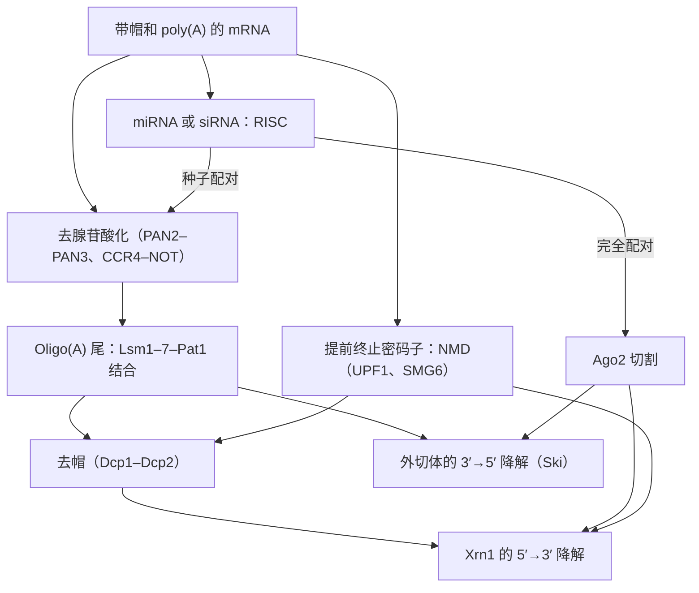

细胞中某种 mRNA 的量由合成与降解两个速率决定，而降解与合成一样受到调控。细菌的 mRNA 只存活数分钟，哺乳动物的 mRNA 从数分钟到数天不等，同一种 mRNA 还可以在信号作用下稳定或被破坏二十倍。降解还决定了 mRNA 水平能以多快的速度改变，这就是调控因子的 mRNA 寿命短的原因。本章先讨论动力学（18.1），再讨论**真核生物**和细菌的降解机器（18.2）、mRNA 被储存或销毁所在的胞质颗粒（18.3），以及序列特异性控制的一个例子，即铁反应元件（18.4）。后半部分讨论作为调控者的**非编码 RNA**（[7.2.2](/7.2.2)）：RNA 干扰及其引导 RNA，即 siRNA 与微 RNA（18.5–18.6），指导**染色质**沉默并保卫生殖系的小 RNA（18.7），长**非编码 RNA**（18.8），以及细菌的调控 RNA，即核糖开关与小 RNA（18.9）。翻译本身的控制，包括微 RNA 对起始的影响，见 [7.2.20](/7.2.20)；表达动力学与噪声的系统理论见 [7.2.22](/7.2.22)。

## 18.1. mRNA 水平的动力学

### 18.1.1. 合成与一级降解

大多数 mRNA 按**一级反应**动力学（[6.1.7](/6.1.7)）降解：至少在一级近似下，每个分子在单位时间内被破坏的概率是常数，与其年龄无关。

**定义 18.1.1** **mRNA 半衰期** $t_{1/2}$ 是某一时刻存在的某种 mRNA 的分子有一半被降解所需的时间；对于速率常数为 $k_{\mathrm{deg}}$ 的一级降解，$t_{1/2} = \ln 2/k_{\mathrm{deg}}$，分子的平均寿命为 $1/k_{\mathrm{deg}} = t_{1/2}/\ln 2$。

**公式 18.1.1（合成与降解）** 若一种 mRNA 以恒定速率 $k_{\mathrm{syn}}$（每个细胞每单位时间的分子数）合成，并以速率常数 $k_{\mathrm{deg}}$ 降解，则其分子数 $m$ 满足
$$
\frac{\mathrm{d}m}{\mathrm{d}t} = k_{\mathrm{syn}} - k_{\mathrm{deg}}\,m, \tag{18.1}
$$
其**稳态**为 $m^* = k_{\mathrm{syn}}/k_{\mathrm{deg}}$。速率在 $t = 0$ 时改变，初值为 $m_0$，则
$$
m(t) = m^* + (m_0 - m^*)\,\mathrm{e}^{-k_{\mathrm{deg}}t}. \tag{18.2}
$$
在生长的细胞中，比生长速率 $\mu$ 引起的稀释叠加在降解上：以 $k_{\mathrm{deg}} + \mu$ 代替 $k_{\mathrm{deg}}$。

由此得到三个推论。（1）稳态水平与半衰期成正比：在转录速率相同时，稳定性高一倍的 mRNA 丰度也高一倍。在全基因组范围内，哺乳动物细胞中半衰期相差约 100 倍，合成速率相差约 1000 倍，因此两者都重要。（2）无论合成速率如何，达到新稳态一半所需的时间都是半衰期：转录开启后，$m$ 在 $t_{1/2}$ 内达到 $m^*$ 的 $50\,\%$，在 $3.3\,t_{1/2}$ 内达到 $90\,\%$；转录关闭后，下降过程同样如此。因此基因的响应时间由降解（和稀释）决定，而不是由转录决定。（3）短半衰期代价高昂：维持 $m^*$ 个分子，每单位时间需要合成 $k_{\mathrm{syn}} = k_{\mathrm{deg}}m^*$ 个转录本，所以快速响应是用合成来换取的。

| 生物或 mRNA | 典型半衰期 |
|---|---|
| *E. coli*，大多数 mRNA | $2$–$8\,\mathrm{min}$（$37^\circ\mathrm{C}$ 时中位数约 $5\,\mathrm{min}$） |
| 芽殖酵母 | 中位数约 $10$–$20\,\mathrm{min}$（随方法而异） |
| 哺乳动物细胞 | 中位数数小时（小鼠成纤维细胞约 $9\,\mathrm{h}$）；从 $< 30\,\mathrm{min}$ 到 $> 1\,\mathrm{d}$ |
| *FOS*、*MYC*、细胞因子的 mRNA | $10$–$30\,\mathrm{min}$ |
| 红系细胞中的 β-珠蛋白 mRNA | 超过 $10\,\mathrm{h}$ |

转录因子、信号蛋白和细胞因子的 mRNA 水平必须在一小时内改变，属于最不稳定的 mRNA；持家蛋白和结构蛋白的 mRNA 则属于最稳定的，这与第二个推论相符。细菌必须在 $20$–$60\,\mathrm{min}$ 的一代之内适应环境，其 mRNA 一律寿命很短。

### 18.1.2. 半衰期的测量

半衰期最早是通过阻断转录（动物细胞用放线菌素 D，细菌用利福平，酵母用温度敏感的 Pol II）并用 **Northern 印迹**（[7.2.6](/7.2.6)）、后来用微阵列和测序跟踪各 mRNA 的下降来测量的。抑制剂本身会扰乱细胞，应激反应会使许多 mRNA 稳定。代谢标记避免了这一问题。

**例 18.1.1（趋近平衡）** 给细胞提供一种修饰核苷，如 4-硫尿苷（4sU），它被掺入新合成的 RNA，可用生化方法分离，或经化学处理后通过测序检出 T→C 转换（SLAM-seq）。从 $t = 0$ 开始标记，稳态下某种 mRNA 的标记分子遵循式 (18.2)，$m_0 = 0$，未标记分子按 $m^*\mathrm{e}^{-(k_{\mathrm{deg}}+\mu)t}$ 衰减；标记分数为
$$
f(t) = 1 - \mathrm{e}^{-(k_{\mathrm{deg}} + \mu)t},
$$
与 $k_{\mathrm{syn}}$ 无关。单个时间点即可由标记读数与总读数之比给出每种 mRNA 的半衰期：若在每 $24\,\mathrm{h}$ 倍增的细胞中 $2\,\mathrm{h}$ 后 $f = 0.5$，则 $k_{\mathrm{deg}} + \mu = \ln 2/2\,\mathrm{h}$，$\mu = \ln 2/24\,\mathrm{h}$，$t_{1/2} = \ln 2/k_{\mathrm{deg}} = 1/(1/2 - 1/24)\,\mathrm{h} \approx 2.2\,\mathrm{h}$。这类大规模研究（Schwanhäusser 等，2011）发现小鼠成纤维细胞中 mRNA 半衰期的中位数约为 $9\,\mathrm{h}$，蛋白质的中位数约为 $46\,\mathrm{h}$，所以在这类细胞中蛋白质水平的动力学通常受蛋白质本身的限制（[7.2.22](/7.2.22)）。

## 18.2. mRNA 的降解途径

### 18.2.1. 真核生物中依赖去腺苷酸化的降解

真核 mRNA 的两端，即帽和带结合蛋白的 poly(A) 尾（[7.2.17](/7.2.17)），保护着它；其中一个被去除时，降解就开始了。

**定义 18.2.1** **去腺苷酸化**是 $3' \to 5'$ 外切核酸酶（去腺苷酸酶）缩短 mRNA 的 poly(A) 尾；**去帽**是脱帽酶 Dcp2 水解去除帽中的 $\mathrm{m^7GDP}$，留下带 $5'$ 单磷酸的 RNA。

主要途径由 Parker 等人在酵母中阐明，分为三个阶段：

1. 去腺苷酸化。PAN2–PAN3 复合物修剪长尾，CCR4–NOT 复合物进一步缩短尾，其催化**亚基** Ccr4 和 Caf1（CNOT6/6L 和 CNOT7/8）是主要的去腺苷酸酶。这通常是限速步骤，其速率因 mRNA 而异；尾起着 mRNA 生命计时器的作用。
2. 去帽。当尾缩短到酵母中约 $10$–$12$ 个 A（哺乳动物中约 $25$ 个）时，PABPC 不能再结合，Lsm1–7–Pat1 复合物结合 $3'$ 端，并与 Dhh1（DDX6）、Edc3 等**激活因子**一起招募 Dcp1–Dcp2。去帽是不可逆的。
3. 外切核酸酶降解。胞质 $5' \to 3'$ **外切核酸酶** Xrn1 降解已去帽的 mRNA；或者另外，由外切体沿 $3' \to 5'$ 方向降解 mRNA，剩下的帽被清道夫酶 DcpS 水解。

**定义 18.2.2** **RNA 外切体**是保守的多蛋白复合物，具有由九个亚基组成的桶状结构，把 RNA 穿入 $3' \to 5'$ 外切核酸酶和内切核酸酶 Rrp44（Dis3）以及在细胞核中的 Rrp6；它与其辅因子（细胞质中的 Ski 复合物，细胞核中的 TRAMP 和 NEXT 复合物）一起降解 mRNA，加工和降解稳定的 RNA，并清除异常转录本。

在细胞核中，外切体清除剪接下来的**内含子**、未被 Xrn2 破坏的 $3'$ 端切割下游产物（[7.2.17](/7.2.17)）、不稳定的启动子上游 RNA 和**增强子** RNA，以及未能完成加工的**前体 mRNA**；它还修剪 5.8S rRNA 和**核仁小 RNA**的 $3'$ 端。

### 18.2.2. 监控途径

一些专门的途径破坏不能被正确翻译的 mRNA。

**定义 18.2.3（无义介导的 mRNA 降解）** **无义介导的 mRNA 降解**（NMD）是含有提前终止密码子的 mRNA 的快速降解。在哺乳动物中，终止密码子位于最后一个外显子–外显子连接点上游超过约 $50$–$55\,\mathrm{nt}$ 处时被识别为提前终止，这样核糖体终止之后，mRNA 上仍留有外显子连接复合物。

翻译的第一轮把**外显子连接复合物**（[7.2.16](/7.2.16)）从编码区上清除。如果核糖体终止时下游仍有复合物，终止因子 eRF1–eRF3 就与**解旋酶** UPF1 相互作用，UPF1 经 UPF2 和 UPF3 与连接复合物相桥联；UPF1 被激酶 SMG1 磷酸化，招募**内切核酸酶** SMG6 和 SMG5–SMG7 接头蛋白，后者引入去帽和去腺苷酸化。NMD 保护细胞免受突变等位基因编码的截短蛋白之害（约三分之一的致病等位基因引入提前终止），它也用于调控：许多可变剪接异构体含有提前终止密码子而被降解，这使**RNA 剪接**与表达偶联（"受调控的无产出剪接"），**SR 蛋白**就以这种方式调节自身水平。相关途径破坏没有终止密码子的 mRNA（无终止降解：核糖体到达 poly(A) 而停滞）以及核糖体在编码序列内停滞的 mRNA（无进展降解，由碰撞的核糖体触发）。

### 18.2.3. 细菌 mRNA 的降解

细菌 mRNA 既没有帽，也没有稳定的 poly(A)。在*大肠杆菌*中，降解始于 RNase E 的内切切割；RNase E 是一种与膜相关的酶，与 $3' \to 5'$ 外切核酸酶多核苷酸磷酸化酶（PNPase）、RNA 解旋酶 RhlB 和烯醇化酶一起形成降解体。RNase E 偏好带 $5'$ 单磷酸的**底物**；Belasco 等人（Celesnik、Deana 和 Belasco，2007）证明，焦磷酸水解酶 RppH 把初级转录本的 $5'$ 三磷酸转变为单磷酸，这是细菌中相当于去帽的步骤，随后刺激 RNase E 的切割。片段被 $3' \to 5'$ 外切核酸酶 PNPase、RNase II 和 RNase R 降解；$3'$ **发夹结构**（如**内在终止子**，[7.2.10](/7.2.10)）阻挡这些外切核酸酶，**poly(A) 聚合酶** I 添加的短 poly(A) 尾则帮助它们起始。*枯草芽孢杆菌*（*Bacillus subtilis*）改用 RNase Y 和 $5' \to 3'$ 外切核酸酶 RNase J。翻译保护细菌 mRNA：核糖体覆盖切割位点，所以未被翻译的 mRNA，或翻译被小 RNA 抑制的 mRNA（18.9），降解很快。

认为细菌 mRNA 主要由 $3' \to 5'$ 外切核酸酶破坏的说法并不完整：外切核酸酶被 $3'$ 端结构阻挡，主要作用于片段，而对大多数 mRNA，限速步骤是 RNase E 的内切切割。

## 18.3. P 小体与应激颗粒

未被翻译的胞质 mRNA 与蛋白质组装成显微镜下可见的无膜颗粒，它们是由许多**非共价相互作用**（[7.2.21](/7.2.21)）形成的生物分子凝聚体。

**定义 18.3.1** **P 小体**是存在于未受应激细胞中的胞质核糖核蛋白颗粒，它把翻译被抑制的 mRNA 与脱帽机器（Dcp1–Dcp2、DDX6、Edc3、Lsm1–7、Pat1）、Xrn1、CCR4–NOT 去腺苷酸酶和 miRNA 沉默蛋白 GW182 浓缩在一起。**应激颗粒**是翻译起始被抑制时形成的胞质颗粒，含有停滞在起始阶段的 mRNA，以及小核糖体亚基、起始因子（eIF3、eIF4F）、PABPC 和 G3BP1/2、TIA-1 等 RNA 结合蛋白。

P 小体因富含降解酶而得名，但降解并不需要它们：耗尽支架蛋白使 P 小体解体时，mRNA 降解仍继续进行（Eulalio 等，2007），纯化的 P 小体主要含有完整的、被抑制的 mRNA。因此 P 小体既是降解的场所，也是储存和可逆抑制的场所；降解或翻译起始被抑制时，P 小体变大，因为有更多的 mRNA 从多核糖体中释放出来。

**例 18.3.1（从 P 小体解除抑制）** 在人肝癌细胞系 Huh7 中，氨基酸**转运蛋白** CAT-1 的 mRNA 被肝特异的微 RNA miR-122 抑制，并集中在 P 小体中。Bhattacharyya、Filipowicz 等人（2006）使细胞饥饿缺乏氨基酸，发现 CAT-1 mRNA 离开 P 小体进入多核糖体，翻译增加，尽管 miR-122 仍然存在。这种释放需要 RNA 结合蛋白 HuR（应激时它从细胞核移到细胞质）及其在 CAT-1 $3'$ UTR 中的**结合部位**。因此，被 miRNA 抑制的 mRNA 可以被储存，并在没有新转录的情况下重新激活。

当起始被阻断时，应激颗粒在数分钟内形成：热休克、氧化应激或病毒感染使 eIF2α 磷酸化（[7.2.20](/7.2.20)），或使用 eIF4A 抑制剂；多核糖体跑完而解体，释放出来的 mRNA 仍与起始复合物结合，与 G3BP1/2 一起凝聚，敲除 G3BP1/2 会阻止颗粒形成。应激结束时，应激颗粒溶解，储存的 mRNA 回到翻译。应激颗粒中发现的几种带低复杂度**结构域**的 RNA 结合蛋白（FUS、TDP-43、hnRNP A1）在肌萎缩侧索硬化和额颞叶痴呆中带有突变，这些突变促进液态颗粒转变为固态聚集体（[7.2.21](/7.2.21)）。

## 18.4. 稳定性的序列特异性控制

特定的 mRNA 被结合在其序列（主要在 $3'$ UTR 中，更长的 $3'$ UTR（[7.2.17](/7.2.17)）带有更多调控位点）上的蛋白质和小 RNA 稳定或去稳定。

**定义 18.4.1** **富含 AU 元件**（ARE）是 mRNA $3'$ UTR 中长 $50$–$150\,\mathrm{nt}$、在富含 U 的背景中含有 $\mathrm{AUUUA}$ 重复的序列，被去稳定蛋白结合时，使 mRNA 快速去腺苷酸化和降解。

Shaw 和 Kamen（1986）把细胞因子 GM-CSF 富含 AU 的 $3'$ UTR 序列插入稳定的 β-珠蛋白 mRNA，使其变得不稳定；约 $5$–$8\,\%$ 的人类基因的 mRNA 中有 ARE，其中有许多细胞因子和**原癌基因**。Tristetraprolin（TTP）结合 ARE 并招募 CCR4–NOT；HuR（ELAVL1）与之竞争并起稳定作用。信号通过磷酸化调节这些蛋白：在炎症中，激酶 MK2 使 TTP 磷酸化，TTP 随即释放肿瘤坏死因子 α 的 mRNA，使其水平上升；缺乏 TTP 的小鼠过量产生 TNF-α 并发生炎症性疾病。稳定性的其他决定因素有密码子使用（富含由丰富 tRNA 解码的密码子的 mRNA 翻译更快，也更稳定）、腺苷甲基化为 $\mathrm{N^6}$-甲基腺苷（$\mathrm{m^6A}$）（它招募读取蛋白 YTHDF2 和 CCR4–NOT），以及微 RNA（18.6）。

**定义 18.4.2** **铁反应元件**（IRE）是约 $30\,\mathrm{nt}$ 的茎环，带有保守的 $\mathrm{CAGUGN}$ 环，茎的 $5'$ 侧有一个未配对的 C，见于铁代谢相关 mRNA 的非翻译区；细胞内铁含量低时，铁调节蛋白（IRP1 和 IRP2）与之结合。

铁调节系统显示，同一次结合事件可以有相反的效应，取决于元件所在的位置（见图）。细胞需要铁，但游离铁有毒，所以细胞要协调摄取（通过转铁蛋白**受体** TfR）与储存（在铁蛋白中）。

**例 18.4.1（铁调节转铁蛋白受体 mRNA 的稳定性）** Müllner 和 Kühn（1988）在有和没有转录抑制剂的情况下，测量了用铁源或铁螯合剂处理的细胞中的 TfR mRNA。铁调节的是 TfR mRNA 的半衰期，而不是其合成速率：低铁时 mRNA 非常稳定，高铁时衰变快约 20 倍。该响应定位于含五个 IRE（A–E）的 $3'$ UTR。Casey 等人（1989）分析了缺失构建体：缺失 IRE A 和 E 以及中央的大环不改变响应，但去除 IRE A 和 B、或 D 和 E、或全部五个 IRE，使 mRNA 组成性稳定，说明 IRE B 和 D 是降解的"快速周转决定簇"的一部分。从每个 IRE 中去除一个 C（构建体 TRS-4）会阻止 IRP 结合，使 mRNA 组成性不稳定。因此 IRE 既是降解的靶标，又在被 IRP 结合时受其保护。降解始于 IRE 区内的内切切割，该处距 $3'$ 端超过 $1\,\mathrm{kb}$，随后被切开的 mRNA 被降解。

在铁充足的细胞中，IRP1 含有 $[\mathrm{4Fe}\text{-}\mathrm{4S}]$ 簇，作为胞质乌头酸酶（柠檬酸循环中的一个酶）而起作用，不能结合 RNA；铁少时它失去铁硫簇，成为 IRE 结合蛋白。IRP2 没有铁硫簇，在高铁时被感知铁的**泛素**连接酶 FBXL5 降解。因此低铁时 IRP 结合 IRE，高铁时则不结合。在 TfR mRNA 中，结合的 IRP 保护 $3'$ UTR 免于切割：低铁增加受体合成和铁摄取。在铁蛋白 mRNA 中，单个 IRE 位于 $5'$ UTR 中，距帽约 $40\,\mathrm{nt}$ 之内；结合的 IRP 阻断 43S **前起始复合物**的招募，所以低铁抑制铁蛋白的合成和铁储存（[7.2.20](/7.2.20)）。同一开关通过 $5'$ IRE 调节红系氨基乙酰丙酸合酶（**血红素**合成）和铁输出蛋白 ferroportin 的 mRNA 的翻译，并通过 $3'$ IRE 调节二价金属转运蛋白 DMT1 mRNA 的稳定性。

![铁反应元件。A：低铁（左）时，铁调节蛋白结合铁蛋白 mRNA 5′ UTR 中的单个 IRE，阻断 43S 复合物的招募，并结合转铁蛋白受体 mRNA 3′ UTR 中的五个 IRE，保护其免受内切切割；高铁（右）时，IRP1 结合 [4Fe-4S] 簇而成为乌头酸酶，IRP2 被降解，铁蛋白 mRNA 被翻译，TfR mRNA 被切割并降解。B：稳态模型（例 18.4.1）：活性 IRP 随铁下降，IRE 占据度遵循结合曲线，铁蛋白合成与未占据的分数成正比，TfR mRNA 为 1/(k₀ + k_c(1 − θ))，降解速率的变化范围为 20 倍；摄取与储存对同一信号作出相反的响应](./plots/ire-irp.py)

在图中的模型里，TfR mRNA 的稳态水平为 $m^* = k_{\mathrm{syn}}/(k_0 + k_{\mathrm{c}}(1-\theta))$，其中 $\theta$ 是其 IRE 被占据的时间分数，$k_{\mathrm{c}}$ 是未受保护的 mRNA 的切割速率常数，$k_0$ 是不依赖 IRE 的降解速率常数。其变化范围以 $(k_0 + k_{\mathrm{c}})/k_0$ 为界，即半衰期的 20 倍变化，而铁蛋白合成与 $1 - \theta$ 成正比，响应方向相反。由于 TfR 的响应通过稳定性起作用，所以它在一个方向上快、另一个方向上慢（18.1 的图，面板 B）：铁过载在一小时内降低 TfR mRNA，而从中恢复需要将近一天。

## 18.5. RNA 干扰

### 18.5.1. 发现

20 世纪 90 年代，反义 RNA 被用来抑制许多生物中的基因，成效不一，并记录到两个无法解释的现象。植物学家把色素基因（查尔酮合酶）的额外拷贝导入矮牵牛以加深紫色，结果相当比例的植株开出白色或杂色的花，其中转基因和内源基因都被沉默（Napoli、Lemieux 和 Jorgensen，1990；"共抑制"）；沉默作用于 mRNA，被称为转录后基因沉默。在线虫 *C. elegans* 中，Guo 和 Kemphues（1995）发现注射正义 RNA 和反义 RNA 一样能使 *par-1* 基因沉默，任何反义机制都无法解释这一点。

**例 18.5.1（双链 RNA 是触发物）** Fire、Mello 等人（1998）给 *C. elegans* 注射对应于肌肉基因 *unc-22*（其缺失导致抽搐表型）的纯化单链正义或反义 RNA，或退火的双链 RNA。双链 RNA 的效力至少是任一单链的十倍；单链制剂的残余活性来自污染的双链。每个细胞只需几个 dsRNA 分子就足够，效应扩散到其他组织和后代，针对内含子或**启动子**序列的 dsRNA 没有效果，靶 mRNA 从细胞质中消失。因此，沉默是转录后的、序列特异的，并且是催化性的或被放大的。Fire 和 Mello 获得 2006 年诺贝尔奖。

**定义 18.5.1（RNA 干扰）** **RNA 干扰**（RNAi）是由双链 RNA 触发的序列特异性基因表达沉默，其中来自 dsRNA 的短 RNA 引导 Argonaute 蛋白结合互补的 RNA。

### 18.5.2. 机制

各个步骤是在*果蝇*（*Drosophila*）胚胎提取物和培养细胞以及植物中通过生化方法发现的。Hamilton 和 Baulcombe（1999）在沉默的植物中检测到约 $25\,\mathrm{nt}$ 的两种极性的 RNA；Zamore、Tuschl、Sharp 和 Bartel（2000）证明，果蝇提取物中的 dsRNA 被切成 $21$–$23$ nt 的片段，指导靶标的切割；Bernstein、Hannon 等人（2001）鉴定了 dsRNA 特异的核糖核酸酶 Dicer；Elbashir、Tuschl 等人（2001）证明带 $2$ nt $3'$ 突出端的合成 $21$ nt 双链体能使哺乳动物细胞中的基因沉默，而长 dsRNA 在那里则通过激酶 PKR 触发干扰素反应。其途径如下：

1. 切割。Dicer 是 RNase III 家族的酶，有两个催化结构域和一个结合 dsRNA 末端的 PAZ 结构域，把 dsRNA 切成 $21$–$23\,\mathrm{bp}$、带 $2$ nt $3'$ 突出端和 $5'$ 磷酸的双链体。在果蝇中，Dicer-2 与 R2D2 产生 siRNA，Dicer-1 产生 miRNA。
2. 装载与链选择。双链体被装载到 Argonaute 蛋白中。一条链（引导链）被保留；另一条（乘客链）被 Argonaute 切开并丢弃。引导链通常是双链体中 $5'$ 端配对较不稳定的那条链（Schwarz 等；Khvorova 等，2003），这种热力学不对称性被用于设计有效的 siRNA。
3. 靶向。成熟的复合物，即 RNA 诱导的沉默复合物（RISC），用引导链寻找互补的 RNA。互补程度高时，Argonaute 在与引导链第 10 和 11 位配对的核苷酸之间切割靶标，片段被 Xrn1 和外切体降解，RISC 被释放去切割更多的靶标：一条引导链破坏许多 mRNA。

**定义 18.5.2** **小干扰 RNA**（siRNA）是长 $21$–$23$ nt 的 RNA，由 Dicer 从长双链 RNA 产生或以合成双链体提供，引导 Argonaute 蛋白切割完全互补的靶 RNA。**Argonaute 蛋白**是 RNA 沉默的效应蛋白，它以 $5'$ 端（MID 结构域）和 $3'$ 端（PAZ 结构域）结合小的引导 RNA，并在具有 RNase H 折叠的 PIWI 结构域中切割与引导链配对的靶 RNA。

Liu、Hannon 等人（2004）证明在哺乳动物中 Ago2 是"切割酶"：缺乏 Ago2 的小鼠在胚胎期死亡，来自它们的细胞不能用 siRNA 切割靶标，突变其 PIWI 结构域的催化残基会使切割丧失；Song、Joshua-Tor 等人（2004）解出了一种古菌 Argonaute 的结构，发现了 RNase H 折叠。人类的四种 Argonaute 中，只有 Ago2 能切割。

在线虫和植物中（果蝇和哺乳动物中没有），RNAi 被放大：依赖 RNA 的 RNA 聚合酶（RdRP）以靶 mRNA 为模板产生次级 siRNA，有时扩散到最初触发区域之外（"传递性 RNAi"）；这解释了 Fire 和 Mello 发现的效力与扩散。RNAi 的天然功能是抵御病毒（植物和无脊椎动物，其抗病毒 RNAi 被病毒的抑制蛋白对抗）、控制转座子，以及形成异染色质（18.7）。作为工具，RNAi 在 CRISPR（[7.2.24](/7.2.24)）之前使动物细胞中的功能丧失筛选成为可能；siRNA 药物经化学修饰并以脂质纳米颗粒递送到肝脏，或与 *N*-乙酰半乳糖胺缀合，自 2018 年起获批准（patisiran，用于转甲状腺素蛋白淀粉样变性）。

## 18.6. 微 RNA

### 18.6.1. 发现

**例 18.6.1（lin-4 抑制 lin-14）** 在 *C. elegans* 中，基因 *lin-14* 必须在第一幼虫期之后关闭才能正常发育；*lin-4* 的突变阻止这一点，幼虫重复早期阶段。Lee、Feinbaum 和 Ambros（1993）克隆了 *lin-4*，发现它不编码蛋白质，而编码两个小 RNA，长 $22$ 和 $61\,\mathrm{nt}$，较长的折叠成发夹；Wightman、Ha 和 Ruvkun（1993）发现 *lin-14* mRNA 的 $3'$ UTR 含有七个与 $22$ nt 的 *lin-4* RNA 部分互补的位点，并且是抑制的必要且充分条件。LIN-14 蛋白在 L1 期急剧下降，而在最初的分析中 *lin-14* mRNA 的水平及其与多核糖体的结合几乎没有变化（Olsen 和 Ambros，1999），这提示翻译在起始之后被阻断；后来的工作（Bagga、Pasquinelli 等，2005）表明 *lin-14* mRNA 也减少。Ambros 和 Ruvkun 获得 2024 年诺贝尔奖。

七年间，*lin-4* 似乎只是线虫的一个特例。随后 Reinhart、Ruvkun 等人（2000）发现了线虫的第二个小 RNA，let-7，它控制较晚的发育转变，Pasquinelli 等人（2000）发现 let-7 的序列从线虫到人都是保守的。一年之内，小 RNA 的克隆揭示了动物和植物中数百种这样的 RNA。

**定义 18.6.1（微 RNA）** **微 RNA**（miRNA）是长约 $22\,\mathrm{nt}$ 的内源小 RNA，由较长转录本中的发夹加工而来，引导 Argonaute 蛋白结合靶 mRNA 中部分（动物）或几乎完全（植物）互补的位点，并抑制其表达。

### 18.6.2. 生物发生

动物的 miRNA 经两个加工步骤产生，一个在细胞核，一个在细胞质，各由一种 RNase III 酶完成。大多数 miRNA 基因由 Pol II 转录成带帽和 poly(A) 的长初级转录本（pri-miRNA），可含有数个 miRNA（簇，如 miR-17~92），或位于蛋白质编码基因的内含子中。Microprocessor，即 Drosha 与两分子其 RNA 结合伴侣 DGCR8，识别单链侧翼与发夹茎之间的连接处，在距其约 $11\,\mathrm{bp}$ 处切割，释放出 pre-miRNA。Exportin-5 识别 Drosha 留下的 $2$ nt $3'$ 突出端，与 Ran-GTP 一起输出 pre-miRNA。Dicer 从该末端起量，在约 $22\,\mathrm{nt}$ 处切割并去除环。双链体的一条链进入 Argonaute 蛋白（人类的 Ago1–4），由双链体两端的热力学不对称性以及 $5'$ 端偏好 U 或 A 所决定；另一条称为 miR*，通常被降解，不过对某些 miRNA 两条臂都被利用（分别命名为 -5p 和 -3p）。Mirtron 是短内含子，其被切下并去分支的套索（[7.2.16](/7.2.16)）直接折叠成 pre-miRNA 发夹，绕过 Drosha；miR-451 绕过 Dicer：它的短发夹由 Ago2 自己切割。在植物中，单一的酶 DCL1 在细胞核中完成两次切割，miRNA 的 $3'$ 端被 HEN1 作 $2'$-O-甲基化。

人类基因组编码数百个确定注释的 miRNA 基因（经整理的数据库中约 500–600 个，较大的 miRBase 目录中约 2000 条，其中许多可疑）。有时见到的“miRNA 占哺乳动物基因组的 $2\,\%$”的说法并不正确：miRNA 基因约占基因数目的 $1$–$2\,\%$，其成熟序列只占基因组的极小一部分。

### 18.6.3. 靶标识别

**定义 18.6.2（种子序列）** 微 RNA 的**种子序列**是从 $5'$ 端起数的第 $2$–$8$ 位核苷酸，它与靶位点的配对是动物中靶标识别的主要决定因素。

Argonaute 持引导链的方式使第 2–8 位核苷酸预先组织成近乎 A 型的螺旋，暴露于溶剂中，随时可以配对，而第 1 位核苷酸位于 MID 结构域的一个口袋中，不能配对（Schirle、Sheu-Gruttadauria 和 MacRae，2014）。因此靶标搜索从种子开始：Argonaute 先对短的互补片段取样，在动物中很少有超出种子的完全配对。比较基因组学和转录组分析（Bartel 等）确立了位点类型的层级：8mer 位点与第 2–8 位配对，且与第 1 位相对的是 A（由 Argonaute 的一个口袋识别）；7mer-m8 位点与第 2–8 位配对；7mer-A1 位点与第 2–7 位配对并带有那个 A；6mer 与第 2–7 位配对。第 13–16 位（补充区）的配对可以加强较弱的种子位点。大多数功能性位点位于 $3'$ UTR 的可接近区域，常靠近长 UTR 的末端并远离终止密码子，因为翻译中的核糖体会把 RISC 置换下来。

种子配对使一个 miRNA 可以有数百个靶标，一个 mRNA 也可以被许多 miRNA 靶向。Friedman、Burge 和 Bartel（2009）估计，超过 $60\,\%$ 的人类蛋白质编码基因对至少一种 miRNA 有保守位点。典型靶标受到的抑制是适度的，通常不到两倍；强效应来自位点和 miRNA 的组合，或来自丰富的 miRNA 作用于带多个位点的靶标，如 lin-14。miRNA 被解释为赋予稳健性的微调器：它们缓冲靶标表达的波动并使发育转变更加陡峭，许多单个 miRNA 敲除的表型较轻，或只在应激下出现。有些是必需的：缺乏 Dicer 或 DGCR8 的小鼠在胚胎期死亡，miR-1 为肌肉所必需，let-7 和 lin-4 为线虫发育计时，miR-122 占肝脏 miRNA 的大部分，为丙型肝炎病毒所必需，病毒在其 $5'$ 端与之结合（反义药物的靶标）。

### 18.6.4. 抑制的机制

**定义 18.6.3** 引导 RNA 与 Argonaute 蛋白形成的复合物（无论是否带有相关蛋白）称为 **RNA 诱导的沉默复合物**（RISC）；以 miRNA 为引导链时称为 miRISC。

在植物中，配对通常很广泛，miRISC 像 siRNA 一样切割靶标。在动物中，由于是种子配对，Argonaute 不切割；它转而结合 GW182（人类中的 TNRC6A–C），一种带甘氨酸–色氨酸重复的蛋白，招募去腺苷酸酶复合物 CCR4–NOT 和 PAN2–PAN3。mRNA 被去腺苷酸化、去帽并被 Xrn1 降解（18.2），而 CCR4–NOT 通过解旋酶 DDX6 也抑制翻译起始，部分是通过把 eIF4A 从帽复合物上置换下来。早期实验提示有几种机制：起始被阻断、延伸被阻断、新生蛋白的共翻译降解，或 mRNA 衰变。在哺乳动物细胞中，用**核糖体图谱**（[7.2.6](/7.2.6)）同时测量 mRNA 水平和核糖体占据，就稳态而言解决了这一问题：Guo、Ingolia、Weissman 和 Bartel（2010）发现，miRNA 对蛋白质产出抑制的 $66$–$90\,\%$ 可由 mRNA 水平的降低解释。翻译抑制先于衰变，在 miRNA 被诱导后不久占主导，在一些系统中（缺乏高效降解的早期斑马鱼和果蝇胚胎），它可以是主要效应。Vasudevan、Tong 和 Steitz（2007）报道，在静止细胞中，一些 miRNA（miR369-3，作用于肿瘤坏死因子 α 的 ARE，与 Ago2 和 FXR1 一起）激活翻译；这种效应似乎只限于特定条件，不属于一般机制。

**公式 18.6.1（作为附加降解途径的 miRNA）** 设游离浓度为 $r$ 的 miRNA 以解离常数 $K$ 快速结合靶位点，结合的靶标以速率常数 $\gamma$ 降解，而 miRISC 被循环利用，则靶标满足式 (18.1)，其有效降解速率常数为
$$
k_{\mathrm{deg}}' = k_{\mathrm{deg}} + \gamma\,\frac{r}{r + K} \approx k_{\mathrm{deg}} + \gamma\,\frac{r}{K}\quad (r \ll K),
$$
所以稳态被降低的倍数，即抑制倍数，为 $k_{\mathrm{deg}}'/k_{\mathrm{deg}}$，与靶标的转录速率无关，响应时间也缩短相同的倍数。

因此，被循环利用的 miRNA 起催化作用，降低靶标产出对靶标转录的斜率，而没有阈值。当调控因子与其靶标一起被消耗时，情形就不同了（18.9）。当靶标丰度高到足以隔离 miRNA 时，情形也不同：带有许多位点的 mRNA 或环状 RNA 可以充当"海绵"，降低游离 miRNA，如环状 RNA CDR1as 对 miR-7 的作用（[7.2.16](/7.2.16)）。普通 mRNA 的天然水平是否像"竞争性内源 RNA"假说所提出的那样以这种方式竞争 miRNA 是值得怀疑的：定量测量表明，把单个靶标的水平改变生理量级，很少会改变丰富 miRNA 的许多其他位点的占据度。

## 18.7. siRNA、piRNA 与 RNA 指导的异染色质

小 RNA 可以通过引导 Argonaute 结合染色体上的新生转录本，在染色质水平上使基因沉默。

**例 18.7.1（RNAi 在着丝粒处形成异染色质）** 在裂殖酵母中，着丝粒的外侧重复序列（*otr*，含 *dg* 和 *dh* 元件）是**异染色质**（[7.2.4](/7.2.4)），带有组蛋白 H3 第 9 位赖氨酸的甲基化标记（由甲基转移酶 Clr4 完成），并被 HP1 蛋白 Swi6 结合。Volpe、Martienssen 等人（2002）发现，缺失 Dicer（*dcr1*）、Argonaute（*ago1*）或依赖 RNA 的 RNA 聚合酶（*rdp1*）的基因，会使重复序列上的 H3K9 甲基化和 Swi6 丧失，插入其中的报告基因去抑制，并使重复序列两条链的转录本积累；野生型细胞中有丰富的来自重复序列的小 RNA。反向链转录本始终存在，正向转录本由 Pol II 在 S 期或由 Rdp1 产生，与反向转录本配对形成 dsRNA。Dicer 把它转变为 siRNA，装载到 RITS 复合物中的 Ago1 上（RNA 诱导的转录沉默：Ago1、染色质结构域蛋白 Chp1 和 Tas3；Verdel、Moazed 等，2004）。RITS 通过碱基配对结合新生的重复序列转录本，并招募 Clr4，其 H3K9 甲基化被 Chp1 和 Swi6 结合；RITS 还招募 Rdp1（在 RDRC 复合物中）以产生更多的 dsRNA。这个环是自我强化的：siRNA 指导 H3K9 甲基化，H3K9 甲基化把 RITS 固定在染色质上，使之产生更多 siRNA。异染色质是染色体黏连和准确分离所必需的，突变体会发生染色体错误分离。

植物用相关的途径使 DNA 甲基化：在 RNA 指导的 DNA 甲基化中，植物特有的聚合酶 Pol IV 产生转座子和重复序列的转录本，RDR2 使之成为双链，DCL3 把它们切成 $24$ nt 的 siRNA，带有这些 siRNA 的 AGO4 结合由 Pol V 产生的支架转录本，并招募 DNA 甲基转移酶 DRM2（[7.2.15](/7.2.15)）。果蝇和哺乳动物也从转座子、重叠转录本和长发夹产生内源 siRNA，见于果蝇的体细胞和小鼠卵母细胞。

**定义 18.7.1** **piRNA** 是长 $24$–$31\,\mathrm{nt}$ 的小 RNA，由单链前体不经 Dicer 产生，与 Argonaute 蛋白的 PIWI 亚家族结合，使动物生殖系中的转座子沉默。

piRNA 主要来自 piRNA 簇，即充满转座子片段的长基因组区域（果蝇中的 *flamenco* 和 *42AB*），它们是过去入侵事件的可遗传记录。其 $3'$ 端被 $2'$-O-甲基化。在*果蝇*生殖系中，piRNA 通过乒乓循环被扩增（Brennecke、Hannon 等；Gunawardane、Siomi 等，2007）：Aubergine 在反义 piRNA（第 1 位通常为 U）的引导下切割转座子 mRNA，切割产物成为装载到 Ago3 的正义 piRNA，后者反过来切割簇转录本以产生更多反义 piRNA；两个群体恰好重叠 10 nt，使正义 piRNA 的第 10 位为 A。核内 PIWI 蛋白 Piwi（小鼠中为 MIWI2）用 piRNA 识别新生的转座子转录本并招募 H3K9 甲基化，在哺乳动物中还招募从头 DNA 甲基化，使转座子在转录水平沉默。缺乏 MIWI2 或 MILI 的小鼠不育，雄性生殖系中的转座子被去抑制。

| 类别 | 长度 | 产生者 | Argonaute | 配对 | 主要作用 |
|---|---|---|---|---|---|
| siRNA | $21$–$23\,\mathrm{nt}$（植物 RdDM 中为 24） | Dicer 切割长 dsRNA | AGO（哺乳动物中为 Ago2） | 完全 | 切割；染色质沉默（RITS、RdDM） |
| miRNA | 约 $22\,\mathrm{nt}$ | Drosha，然后 Dicer，由发夹产生 | Ago1–4 | 种子（动物），近乎完全（植物） | 去腺苷酸化、衰变、翻译抑制 |
| piRNA | $24$–$31\,\mathrm{nt}$ | 不依赖 Dicer；乒乓循环 | PIWI（Piwi、Aub、Ago3；MIWI、MILI、MIWI2） | 广泛 | 转座子切割；生殖系中的转录沉默 |

## 18.8. 长非编码 RNA

**定义 18.8.1** **长非编码 RNA**（lncRNA）是长于 $200\,\mathrm{nt}$ 且不编码蛋白质的转录本；长度界限是操作性的，用于把它们与小 RNA 区分开。

按目前的注释，人类基因组约有 20,000 个 lncRNA 基因，与蛋白质编码基因数目大致相当（[7.2.2](/7.2.2)）。作为一类，lncRNA 由 Pol II 合成，常被加帽、剪接和多聚腺苷酸化，表达水平比 mRNA 低，组织特异性更强，序列保守性更低；许多在细胞核中富集。其机制按作用位置分类（*顺式*，作用于转录它的基因座；或*反式*，作用于别处），也按作用方式分类：作为引导者把蛋白质带到特定的染色质区域，作为支架组装复合物或核体，作为诱饵隔离蛋白质或 miRNA，以及作为信号，起作用的是其转录而不是产物。

**例 18.8.1（Xist 与 X 失活）** 在雌性哺乳动物中，每个体细胞里两条 X 染色体之一被沉默，使 X 连锁基因的剂量与雄性相等。被沉默的 X 表达 $17\,\mathrm{kb}$ 的 lncRNA *Xist*，它是顺式失活的必要且充分条件：缺失 *Xist* 使该染色体不能被沉默，常染色体上可诱导的 *Xist* 转基因使其周围的常染色体基因沉默。*Xist* RNA 包被产生它的染色体，从转录位点沿着三维空间中相近的区域扩散。RNA 中不同的重复序列招募不同的活性：A 重复序列结合蛋白 SPEN，后者招募组蛋白去乙酰化酶 HDAC3，是基因沉默所必需的；B 和 C 重复序列结合 hnRNP K，后者招募 Polycomb 复合物 PRC1，其对组蛋白 H2A 的泛素化随后招募 PRC2 和 H3K27 三甲基化（[7.2.15](/7.2.15)）。沉默状态随后被 CpG 岛启动子的 DNA 甲基化锁定，即使 *Xist* 后来被去除，也能在细胞分裂中维持。选择沉默哪条 X 由反义转录本 *Tsix* 顺式调控，*Tsix* 在相反的链上与 *Xist* 重叠（[7.2.2](/7.2.2)），并在将来的活性 X 上抑制 *Xist*。

其他研究得较多的 lncRNA 有：*NEAT1*，核旁斑的支架；*MALAT1*，在核斑中丰富；*HOTAIR*，被提出经 PRC2 反式抑制 *HOXD* 基因座，不过它在小鼠中的敲除结果较轻微，且部分相互矛盾；以及 *Airn*，它对印记基因 *Igf2r* 的沉默需要转录通过 *Igf2r* 启动子，但不需要 RNA 产物。许多根据敲低实验报道的 lncRNA 功能尚未被遗传缺失所证实，具有生物学功能的 lncRNA（而不是转录噪声）所占的比例也不清楚。

## 18.9. 核糖开关与细菌小 RNA

### 18.9.1. 核糖开关

**定义 18.9.1（核糖开关）** **核糖开关**是通常位于细菌 mRNA $5'$ 非翻译区的结构元件，由结合特定小分子代谢物的适配体和表达平台组成；表达平台的备选结构由配体结合所选择，控制同一 mRNA 的转录终止、翻译起始、剪接或 RNA 稳定性。

Breaker、Nudler 等人（2002）证明，*E. coli* 硫胺素和辅酶 B₁₂ 合成相关 mRNA 的前导序列无需蛋白质，直接结合硫胺素焦磷酸和腺苷钴胺素，解离常数在纳摩尔范围，且结合改变 RNA 的结构。现已知有 40 多类，感应酶辅因子（硫胺素焦磷酸、黄素单核苷酸、S-腺苷甲硫氨酸、钴胺素）、氨基酸（赖氨酸、甘氨酸）、嘌呤（鸟嘌呤、腺嘌呤，它们在与配体配对的适配体中只差一个 C/U）、第二信使（环二 GMP）、金属离子和氟化物；它们控制约 $2\,\%$ 的*枯草芽孢杆菌*（*B. subtilis*）基因。其逻辑与 *trp* 操纵子的**衰减**（[7.2.11](/7.2.11)）相同，只是由代谢物而不是停滞的核糖体在备选发夹之间作出选择：在转录核糖开关中，结合配体的适配体允许内在终止子形成（或阻止其形成）；在翻译核糖开关中，结合的适配体隔离 Shine–Dalgarno 序列。大多数核糖开关关闭其产物合成或输入该配体的基因，这是 RNA 水平上的反馈回路。

转录核糖开关面临一场竞赛：适配体必须在其合成与终止子合成之间的数秒内结合配体。Wickiser、Crothers 等人（2005）发现，*枯草芽孢杆菌*的 FMN 核糖开关对 FMN 的响应浓度远高于其平衡 $K_D$，因为在转录窗口内结合尚未达到平衡；适配体与终止子之间的聚合酶暂停延长了窗口并降低了有效阈值。这种动力学控制对于 RNA 开关而言，相当于剪接与延伸的动力学偶联（[7.2.16](/7.2.16)）。在真核生物中，真菌和植物的硫胺素焦磷酸核糖开关控制可变剪接，革兰氏阳性细菌的 *glmS* 核糖开关是一种被葡糖胺-6-磷酸激活的**核酶**（[7.1.8](/7.1.8)），切割自身的 mRNA。核糖开关是抗生素的靶标：roseoflavin 和合成的 ribocil 作用于 FMN 核糖开关。

### 18.9.2. 细菌小 RNA

**定义 18.9.2** **细菌小 RNA**（sRNA）是长 $50$–$300\,\mathrm{nt}$ 的非编码 RNA，通过不完全的碱基配对调节靶 mRNA 的翻译或稳定性；*反式*编码的 sRNA（转录位置远离其靶标）通常需要 RNA 分子伴侣 Hfq。

第一个是 MicF（Mizuno、Chou 和 Inouye，1984），一种抑制外膜孔蛋白 OmpF 的反义 RNA。*E. coli* 有一百多种 sRNA，大多在应激反应中产生。它们与靶标核糖体结合位点附近的 $7$–$12$ 个核苷酸配对，Hfq（一种六聚体的类 Sm 蛋白）加速配对并保护 sRNA。多数 sRNA 起抑制作用：配对阻断核糖体结合并招募 RNase E，后者把 sRNA 和 mRNA 一起降解。有些起激活作用：DsrA 和 RprA 与 *rpoS* mRNA 的前导序列配对，打开原本隐藏其 Shine–Dalgarno 序列的发夹，从而提高稳定期 σ 因子的水平（[7.2.10](/7.2.10)）。RyhB 在铁缺乏时产生，抑制铁储存蛋白和用铁蛋白（如超氧化物歧化酶 SodB）的 mRNA，是 IRE–IRP 系统（18.4）在细菌中以 RNA 实现的类似物。其他调控 RNA 作用于别的机器：6S RNA 模拟开放启动子，在稳定期隔离 σ⁷⁰ 全酶；tmRNA 通过先充当 tRNA、后充当 mRNA 来解救停滞在没有终止密码子的 mRNA 上的核糖体（[7.2.20](/7.2.20)）；*顺式*编码的反义 RNA，如质粒 ColE1 的 RNA I，控制质粒拷贝数；CRISPR RNA 引导细菌的免疫（[7.2.24](/7.2.24)）。

由于 sRNA 与其靶标一起被降解，它以化学计量方式而不是催化方式起作用，并带来独特的定量结果。

**公式 18.9.1（滴定产生的阈值–线性调节）** 设靶 mRNA 以速率 $\alpha$ 合成并以速率常数 $\beta$ 衰变，sRNA 以速率 $\alpha_{\mathrm{r}}$ 合成并以速率常数 $\delta$ 衰变，两者以解离常数 $K$ 结合并以速率常数 $\gamma$ 一起降解。在紧密结合和快速共降解的极限下（$K \to 0$，$\gamma \gg \beta, \delta$），游离靶标的稳态水平为
$$
t^* \approx \frac{\max(0,\ \alpha - \alpha_{\mathrm{r}})}{\beta}. \tag{18.3}
$$
低于阈值 $\alpha = \alpha_{\mathrm{r}}$ 时，几乎每个靶分子都被一个 sRNA 分子捕获并破坏；高于阈值时，过量的靶标逃脱，输出以斜率 $1/\beta$ 线性增长。

Levine、Hwa 等人（2007）在单个 *E. coli* 细胞中测量了 RyhB 及其靶标的这种阈值–线性响应，Mukherji、van Oudenaarden 等人（2011）在哺乳动物细胞中靶标水平低、miRNA 实际上被消耗时，发现了 miRNA 的类似阈值。两种模式有不同的用途（见图）：催化式抑制把输出乘以一个常数因子，而化学计量式抑制在靶标转录弱时强烈使之沉默，在转录强时则不予理会，并缓冲阈值附近的波动；较弱的相互作用（较大的 $K$）使阈值变平滑。由于 sRNA 被消耗，其靶标也相互竞争它，所以一个被强烈诱导的靶标可以解除对其他靶标的抑制。

## 小结

| 主题 | 要点 |
|---|---|
| 动力学（定义 18.1.1，公式 18.1.1） | $\mathrm{d}m/\mathrm{d}t = k_{\mathrm{syn}} - k_{\mathrm{deg}}m$，$m^* = k_{\mathrm{syn}}/k_{\mathrm{deg}}$，响应时间 $\sim t_{1/2} = \ln 2/k_{\mathrm{deg}}$，稀释 $+\mu$；*E. coli* 为数分钟，哺乳动物为数小时（中位数 $\sim 9\,\mathrm{h}$），调控因子寿命短；代谢标记 $f = 1 - \mathrm{e}^{-(k_{\mathrm{deg}}+\mu)t}$（例 18.1.1） |
| 降解（定义 18.2.1–18.2.3） | 去腺苷酸化（PAN2–PAN3、CCR4–NOT）→ Lsm1–7–Pat1 → 去帽（Dcp2）→ Xrn1，或外切体 $3' \to 5'$；NMD 由 UPF1 和 EJC 规则（位于最后一个连接点上游 $> 50$–$55\,\mathrm{nt}$）决定，无终止降解与无进展降解；细菌：RppH、RNase E 降解体、PNPase、RNase II |
| 颗粒（定义 18.3.1，例 18.3.1） | P 小体（储存和降解，降解并不需要它）、应激颗粒（G3BP，eIF2α 磷酸化）、HuR 使 CAT-1 释放 |
| 特异元件（定义 18.4.1–18.4.2，例 18.4.1） | ARE，TTP 与 HuR；IRE：IRP1（铁充足时为乌头酸酶）和 IRP2；TfR $3'$ IRE：稳定性，20 倍；铁蛋白 $5'$ IRE：翻译；响应相反 |
| RNAi（定义 18.5.1–18.5.2，例 18.5.1） | dsRNA 触发物（Fire 和 Mello）；Dicer → $21$–$23$ nt 带 $2$ nt 突出端的双链体；不对称性选择引导链；Ago2 在第 10 和 11 位之间切割；线虫和植物中的 RdRP 扩增；抗病毒、转座子；siRNA 药物 |
| miRNA（定义 18.6.1–18.6.3，例 18.6.1） | *lin-4*/*lin-14*，let-7；Drosha–DGCR8、Exportin-5、Dicer、Ago；种子第 2–8 位，位点类型 8mer > 7mer-m8 > 7mer-A1 > 6mer；$> 60\,\%$ 的基因被靶向，抑制适度；GW182 → 去腺苷酸化与衰变（占效应的 $66$–$90\,\%$）、翻译抑制；催化作用（公式 18.6.1） |
| 染色质与生殖系（定义 18.7.1，例 18.7.1） | *S. pombe* RITS、Clr4、Swi6、Rdp1 反馈；植物 RdDM（Pol IV/V、24 nt、AGO4）；piRNA：簇、乒乓循环（1U/10A）、Piwi/MIWI2 的转录沉默 |
| lncRNA（定义 18.8.1，例 18.8.1） | $> 200\,\mathrm{nt}$；*顺式*/*反式*；引导、支架、诱饵、信号；*Xist*：A 重复序列–SPEN–HDAC3、hnRNP K–PRC1–PRC2、*Tsix*；许多功能未被证实 |
| 细菌 RNA 调控因子（定义 18.9.1–18.9.2，公式 18.9.1） | 核糖开关：适配体 + 平台、终止或 SD 隔离、动力学控制（FMN）；带 Hfq 的 sRNA、RNase E 共降解、DsrA 激活、RyhB；阈值–线性 $t^* \approx \max(0, \alpha - \alpha_{\mathrm{r}})/\beta$ |

## 思考题

1. 某转录因子的 mRNA 半衰期为 $20\,\mathrm{min}$，其蛋白为 $30\,\mathrm{min}$；某持家基因的 mRNA 为 $10\,\mathrm{h}$，其蛋白为 $50\,\mathrm{h}$。在每 $24\,\mathrm{h}$ 倍增的细胞中，估计其基因被诱导后，每种蛋白达到新稳态一半各需多长时间，并解释为什么第一个基因适合作为调控因子。

   **答** 对每个物种，有效速率常数为 $k = \ln 2/t_{1/2} + \mu$，$\mu = \ln 2/24\,\mathrm{h}$。对调控因子，$k_m = \ln2/0.33\,\mathrm{h} + 0.029 = 2.1 + 0.03\,\mathrm{h^{-1}}$，$k_p = 1.39 + 0.03\,\mathrm{h^{-1}}$；蛋白跟随 mRNA，延迟的量级为 $1/k_m + 1/k_p \approx 0.5 + 0.7 \approx 1.2\,\mathrm{h}$，所以它大约在 $1\,\mathrm{h}$ 内达到新水平的一半。对持家基因，$k_m = 0.069 + 0.029 = 0.098\,\mathrm{h^{-1}}$，$k_p = 0.014 + 0.029 = 0.043\,\mathrm{h^{-1}}$；蛋白受其较慢的速率限制，所需时间量级为 $1/0.098 + 1/0.043 \approx 33\,\mathrm{h}$（半时间约为一天）。两个层次上的短半衰期使调控因子的浓度能在一小时内跟随信号，并在信号停止后恢复，代价是持续合成；稳定的蛋白则会在数天内整合信号。

2. 在例 18.1.1 的 4sU 实验中，某 mRNA 在 $1\,\mathrm{h}$ 后被标记了 $80\,\%$。它的半衰期是多少？为什么用这种方法很难测量比细胞倍增时间长得多的半衰期？

   **答** $1 - \mathrm{e}^{-(k+\mu)\cdot 1\,\mathrm{h}} = 0.8$ 给出 $k + \mu = \ln 5 = 1.61\,\mathrm{h^{-1}}$；取 $\mu = 0.029\,\mathrm{h^{-1}}$，得 $k = 1.58\,\mathrm{h^{-1}}$，$t_{1/2} = \ln2/k \approx 26\,\mathrm{min}$。对于非常稳定的 mRNA，$k \ll \mu$，标记分数几乎完全由稀释决定：$f(t) \approx 1 - \mathrm{e}^{-(\mu + k)t}$，$k$ 只是对 $\mu$ 的一个很小的修正。于是 $k$ 的估计是两个相近数值之差，主要受 $\mu$ 和 $f$ 的误差支配；实际中这类 mRNA 报告为"长于"某一界限。

3. 某细胞系中有一个突变缺失了外显子连接复合物的结合位点，使 EJC 不再沉积。预测其对以下两者的影响：(a) 在最后一个外显子连接点上游 $200\,\mathrm{nt}$ 处有提前终止密码子的 mRNA；(b) 在最后一个外显子中有提前终止密码子的 mRNA。哪一个结果已经适用于野生型细胞？

   **答** (a) 在野生型细胞中，这种 mRNA 是 NMD 的底物，因为终止的核糖体下游仍留有 EJC；没有 EJC 时它不再被有效识别（由长 $3'$ UTR 触发的不依赖 EJC 的 NMD 仍可微弱起作用），所以它被稳定，截短的蛋白积累。(b) 最后一个外显子中的终止密码子下游没有 EJC，即使在野生型细胞中也是如此，所以两种情形下这种 mRNA 都逃过依赖 EJC 的 NMD；这就是为什么最后一个外显子中的无义突变常产生可能起显性负作用的截短蛋白，而上游的无义突变通常表现为无效等位基因。

4. 某细胞中 TfR mRNA 在低铁时半衰期为 $4\,\mathrm{h}$，高铁时为 $12\,\mathrm{min}$，合成速率恒定。从低铁稳态开始，加入铁 $2\,\mathrm{h}$ 然后撤去。计算铁脉冲结束时以及撤去后 $2\,\mathrm{h}$ 的 mRNA 水平（相对于初始水平）。

   **答** 令 $m_{\mathrm{low}}^* = 1$；则 $m_{\mathrm{high}}^* = 12/240 = 0.05$。有铁期间，$k = \ln2/0.2\,\mathrm{h} = 3.47\,\mathrm{h^{-1}}$，所以 $2\,\mathrm{h}$ 后 $m = 0.05 + 0.95\,\mathrm{e}^{-6.93} \approx 0.05 + 0.001 = 0.051$。撤去之后，$k = \ln2/4 = 0.173\,\mathrm{h^{-1}}$，$m = 1 + (0.051 - 1)\mathrm{e}^{-0.347} = 1 - 0.949 \times 0.707 \approx 0.33$。水平在一小时内下降 20 倍，但在 $2\,\mathrm{h}$ 内只恢复到三分之一，需要约 $13\,\mathrm{h}$（$3.3$ 个半衰期）才能回到初始水平的 $10\,\%$ 以内：稳定性调控给出不对称的动力学。

5. 一位研究者针对一个小鼠 mRNA 设计了 siRNA，发现一条链强烈地使靶标沉默，而同一双链体的反向取向（另一条链作引导链）适度抑制了数百个无关的 mRNA。解释这两个观察结果，以及 siRNA 设计如何避免第二种情况。

   **答** 当预期的引导链被装载到 Ago2 并与其靶标完全配对时，靶标被切割，发生强沉默。脱靶效应是类 miRNA 的：无论哪条链被装载，都通过其种子（第 2–8 位）起作用，每个在 $3'$ UTR 中有种子匹配的 mRNA 都被适度抑制，这里是由于另一条链（乘客链）在一部分复合物中被装载。因此设计时使引导链的 $5'$ 端比乘客链的配对更不稳定（引导链第 1 位为 A 或 U，另一端为 G 或 C），对乘客链作化学修饰使其不能被装载（例如阻断其 $5'$ 磷酸化），选择种子在 $3'$ UTR 中匹配很少的引导序列，并使用低浓度；引导链自身种子的脱靶效应可以通过种子区的修饰降低。

6. 用公式 18.6.1 估算：浓度为 $r = 2\,\mathrm{nM}$、有效 $K = 10\,\mathrm{nM}$ 的 miRNA 对带一个 8mer 位点的靶标的抑制倍数，设结合的靶标以 $\gamma = 5k_{\mathrm{deg}}$ 降解。对带有三个这样位点的靶标，若每个结合位点独立起作用，抑制将如何变化？

   **答** 一个位点的占据度为 $r/(r+K) = 2/12 = 0.167$，所以 $k_{\mathrm{deg}}' = k_{\mathrm{deg}}(1 + 5 \times 0.167) = 1.83\,k_{\mathrm{deg}}$：约 $1.8$ 倍抑制，是单个位点的典型值。有三个独立位点，每个贡献 $\gamma \times 0.167$，$k_{\mathrm{deg}}' = k_{\mathrm{deg}}(1 + 3 \times 0.833) = 3.5\,k_{\mathrm{deg}}$，约 $3.5$ 倍。多个位点（以及位点相距 $8$–$40\,\mathrm{nt}$ 时的协同间隔，其作用大于独立相加）是 miRNA 取得强效应的方式，例如 *lin-4* 对 *lin-14* 的作用。

7. 在例 18.7.1 的裂殖酵母实验中，为什么着丝粒重复序列处的沉默必须涉及对待沉默区域本身的转录？提出一个实验，检验 siRNA 作用于新生 RNA 还是 DNA。

   **答** RITS 通过 siRNA 的碱基配对找到靶标，而这只能与 RNA（或单链 DNA）发生；因此重复序列必须在低水平上被转录，仍通过 Pol II 附着在染色质上的新生转录本就是 RITS、Clr4 和 Rdp1 组装的平台。沉默需要转录这一矛盾，由如下事实解决：在 S 期异染色质松弛时发生少量转录，为 siRNA 环供料。检验：用 RNA 结合标签（例如 Tas3 上的 λN 肽和 RNA 中的 boxB 位点）把 RITS 拴到常染色质基因的新生转录本上，看是否建立 H3K9 甲基化和沉默；或突变 Pol II（着丝粒沉默有缺陷但转录正常的 *rpb7* 或 *rpb2* 突变体），检验是否需要 Pol II 的转录；并把 siRNA 靶向 DNA 中存在、但在 RNA 中被剪接去除的序列：若横跨内含子的序列只在未剪接的形式中被沉默，就提示靶标是 RNA。

8. 用式 (18.3) 描述：同一 sRNA 的两个靶标 A 和 B，当 A 的转录从 $0.5\,\alpha_{\mathrm{r}}$ 升至 $2\alpha_{\mathrm{r}}$，而 B 的转录保持在 $0.5\,\alpha_{\mathrm{r}}$ 时，它们的表达如何变化。为什么催化式调控因子不表现出这种耦合？

   **答** 两个靶标竞争 sRNA 时，阈值适用于它们的总转录：只有当 $\alpha_A + \alpha_B < \alpha_{\mathrm{r}}$ 时才有游离 sRNA。起初 $\alpha_A + \alpha_B = \alpha_{\mathrm{r}}$，恰在阈值上：两个靶标都被强烈抑制。当 $\alpha_A = 2\alpha_{\mathrm{r}}$ 时，总量 $2.5\,\alpha_{\mathrm{r}}$ 远超 sRNA 的产生，sRNA 被两个靶标按其结合比例消耗，约 $1.5\,\alpha_{\mathrm{r}}/\beta$ 的游离靶标逃脱，由 A 和 B 分摊；转录没有改变的 B 被去抑制，因为 A 把 sRNA 滴定走了。催化式调控因子不被消耗，所以其游离浓度不取决于它破坏多少靶标（只要靶标不隔离它）；每个靶标看到的抑制倍数相同，靶标之间相互独立。
