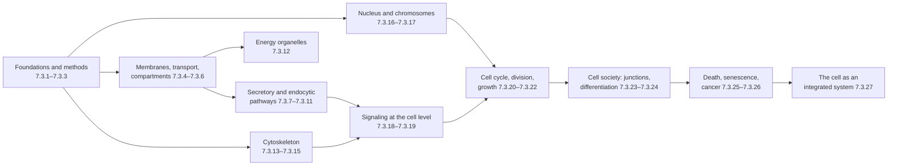

A cell is the smallest system that can take in matter and energy from its surroundings and use them to make a copy of itself. Biochemistry ([7.1](/7.1)) described the molecules and reactions from which cells are built, and molecular biology ([7.2](/7.2)) the flow of genetic information. Cell biology asks how these parts are arranged in space and coordinated in time so that the whole behaves as one unit: how membranes divide the cell into compartments with different chemistries, how proteins find the compartment where they work, how the cytoskeleton gives the cell shape, force and internal transport, how signals are received and integrated, how the cell decides to grow, divide, differentiate or die, and how cells cooperate in a tissue. The theme of this course is that the cell is an integrated system: no organelle, pathway or filament makes sense alone, and many of its properties (its size, the number of its organelles, the timing of its cycle, the sharpness of its decisions) arise from the interaction of parts and can be written as simple quantitative models. This chapter lays the foundation: the history and content of the cell theory (1.1), why the cell is the unit of life (1.2), the scale of cells and the numbers inside them (1.3), the diversity of cells (1.4), viruses as the non-cellular exception (1.5), the origin of the eukaryotic cell (1.6), and the model organisms and the plan of the course (1.7). The next two chapters introduce the methods by which cells are seen ([7.3.2](/7.3.2)) and taken apart ([7.3.3](/7.3.3)).

## 1.1. The Cell Theory

### 1.1.1. Microscopes and the Discovery of Cells

Cells are too small to be seen with the naked eye, whose limit of resolution is about $0.1\,\mathrm{mm}$, so their discovery followed the invention of the microscope. The first compound microscopes, with an objective and an eyepiece, were made in the Netherlands around 1590 (traditionally attributed to the spectacle makers Hans and Zacharias Janssen), and Galileo Galilei used one to describe insects in the 1610s. In 1665 Robert Hooke described in *Micrographia* the boxlike compartments of a thin slice of cork, seen through a compound microscope, and called them "cells" (Latin *cellula*, a small room). What he saw were the empty walls of dead plant cells. From 1674 the Dutch draper Antonie van Leeuwenhoek, using single-lens microscopes of his own making that magnified about 50 to 275 times, described living cells: freshwater protists ("animalcules"), sperm, red blood cells (including the nucleated ones of fish) and, in 1683, bacteria from dental plaque; he reported them in letters to the Royal Society of London, which elected him a Fellow in 1680. For about 160 years after Hooke little was added, because the simple lenses of the time suffered from chromatic and spherical aberration; only achromatic objectives, which became available in the 1820s and 1830s, showed the contents of cells reliably. The nucleus was recognized as a regular feature of cells by Robert Brown in 1831, in orchid epidermis, and Gabriel Valentin described the nucleolus in nerve cells in 1836.

### 1.1.2. Schleiden, Schwann and Virchow

By the 1830s improved achromatic objectives made the contents of cells visible, and the cell theory was the product of many observers rather than of two: Henri Dutrochet (1824) and Charles-François Brisseau de Mirbel had already described plant and animal tissues as made of cells, and Jan Evangelista Purkyně and his students described cells and nuclei in many animal tissues. In 1838 the botanist Matthias Schleiden concluded that plants are composed of cells and develop from a single cell; in 1839 the zoologist Theodor Schwann extended the conclusion to animals. They were wrong, however, about where new cells come from: both held that cells crystallize out of an unstructured fluid (the "cytoblastema"), beginning with the nucleus, a theory of *free cell formation*. Robert Remak showed in 1852, from the embryos of frogs and chicks, that new cells arise only by the division of existing cells, in development as well as in disease. Rudolf Virchow, who had first accepted free cell formation, adopted the conclusion in 1855 and made it the basis of *cellular pathology* (1858): disease is a disturbance of cells. His aphorism *omnis cellula e cellula* ("every cell from a cell") had been coined by François-Vincent Raspail in 1825, and the experimental evidence was largely Remak's; but Virchow's authority made it the third tenet of the theory.

**Definition 1.1.1 (Cell Theory)** The **cell theory** states that (1) all organisms are composed of one or more cells; (2) the cell is the basic unit of structure and function of organisms; and (3) all cells arise from preexisting cells by division.

Modern biology adds three statements that the nineteenth century could not make: every cell contains its hereditary information in DNA and passes it to its daughters at division; all cells have essentially the same chemical composition and use the same basic metabolism (the universal features of [7.1.1](/7.1.1)); and the energy flow of life takes place within cells. The third tenet raises the question that the theory itself cannot answer: how the first cell arose. That question, and the protocell models that address it, belong to the origin of life ([7.2.23](/7.2.23)).

### 1.1.3. From Cytology to Cell Biology

With fixation, staining and the oil-immersion objective, the late nineteenth century described the main structures visible in the light microscope: mitosis in animal cells (Walther Flemming, 1879–1882) and in plants (Eduard Strasburger); meiosis (Edouard van Beneden, 1883, in *Ascaris*); the centrosome (van Beneden and Theodor Boveri, 1887–1888); mitochondria, first described by Richard Altmann (1890) as "bioblasts" and named by Carl Benda (1898); and the Golgi apparatus (Camillo Golgi, 1898). Ernst Ruska and Max Knoll built the first transmission electron microscope in 1931–1933 (Ruska shared the 1986 Nobel Prize in Physics), and Siemens sold the first commercial instruments in 1939. Between 1940 and 1970 two new methods, the electron microscope and the separation of cell components by centrifugation ([7.3.3](/7.3.3)), revealed the endoplasmic reticulum, ribosomes, lysosomes and peroxisomes and connected each structure with a function; Albert Claude, Christian de Duve and George Palade shared the 1974 Nobel Prize in Physiology or Medicine for this work. Since the 1980s the methods of molecular biology and of fluorescent proteins in living cells ([7.3.2](/7.3.2)) have turned the study of cells into a molecular and quantitative science.

The history is often divided into four periods, each opened by a method, and the levels at which cells are studied follow the same sequence.

| Period | Opened by | Level of observation | Main results |
|---|---|---|---|
| 1665 to the 1830s | Compound and single-lens microscopes | Light-microscopic (micrometres) | Discovery of cells, protists, bacteria, nucleus |
| 1830s to the 1930s | Achromatic objectives, fixation and staining, the microtome | Light-microscopic | Cell theory; mitosis, meiosis, chromosomes, centrosome, mitochondria, Golgi apparatus; cytology as a discipline |
| 1930s to the 1970s | Electron microscope, ultracentrifuge, radioactive tracers | Ultrastructural (nanometres) | Membranes and organelles described and assigned functions; cytology becomes cell biology |
| Since the 1970s | Recombinant DNA, monoclonal antibodies, fluorescent proteins, genomics, cryo-EM | Molecular | Mechanisms of sorting, signaling, the cycle, death; quantitative and systems cell biology |

The molecular period rests on the discoveries of molecular biology ([7.2](/7.2)): the isolation of "nuclein" from pus cells by Friedrich Miescher (1869), the identification of DNA as the genetic material by Oswald Avery and colleagues (1944) and by Alfred Hershey and Martha Chase (1952) ([7.2.1](/7.2.1)), the double helix (James Watson and Francis Crick, 1953, from X-ray data of Rosalind Franklin and Maurice Wilkins), the central dogma (Crick, 1958) and the genetic code (1961–1966); recombinant DNA (Paul Berg and colleagues, 1972; Stanley Cohen and Herbert Boyer, 1973), the **polymerase chain reaction** (Kary Mullis, 1983; Nobel Prize in Chemistry 1993) and the Human Genome Project (1990–2003, draft sequence 2001, with a Chinese contribution of about 1% of the sequence on the short arm of chromosome 3 from 1999). The first gene therapy, for adenosine deaminase deficiency (a severe combined immunodeficiency), was given to a four-year-old girl at the US National Institutes of Health in 1990. The table lists Nobel Prizes for discoveries that are central to this course.

| Year | Laureates | Discovery | Chapter |
|---|---|---|---|
| 1906 | Camillo Golgi, Santiago Ramón y Cajal | Structure of the nervous system; Golgi's silver stain also revealed the Golgi apparatus | [7.3.9](/7.3.9) |
| 1974 | Albert Claude, Christian de Duve, George Palade | Structural and functional organization of the cell | [7.3.3](/7.3.3), [7.3.7](/7.3.7) |
| 1999 | Günter Blobel | Signals that target proteins | [7.3.6](/7.3.6) |
| 2001 | Leland Hartwell, Tim Hunt, Paul Nurse | Key regulators of the cell cycle | [7.3.20](/7.3.20) |
| 2002 | Sydney Brenner, H. Robert Horvitz, John Sulston | Genetic regulation of organ development and programmed cell death | [7.3.25](/7.3.25) |
| 2003 (Chemistry) | Peter Agre, Roderick MacKinnon | Water channels; structure of ion channels | [7.3.5](/7.3.5) |
| 2004 | Richard Axel, Linda Buck | Odorant receptors | [7.1.14](/7.1.14) |
| 2006 | Andrew Fire, Craig Mello | RNA interference | [7.2.18](/7.2.18), [7.3.3](/7.3.3) |
| 2007 | Mario Capecchi, Martin Evans, Oliver Smithies | Gene targeting in mice | [7.3.3](/7.3.3) |
| 2008 (Chemistry) | Osamu Shimomura, Martin Chalfie, Roger Tsien | Green fluorescent protein | [7.3.2](/7.3.2) |
| 2009 | Elizabeth Blackburn, Carol Greider, Jack Szostak | Telomeres and telomerase | [7.3.25](/7.3.25) |
| 2012 | John Gurdon, Shinya Yamanaka | Reprogramming of mature cells to pluripotency | [7.3.24](/7.3.24) |
| 2013 | James Rothman, Randy Schekman, Thomas Südhof | Machinery of vesicle traffic | [7.3.8](/7.3.8) |
| 2014 (Chemistry) | Eric Betzig, Stefan Hell, William Moerner | Super-resolution fluorescence microscopy | [7.3.2](/7.3.2) |
| 2016 | Yoshinori Ohsumi | Mechanisms of autophagy | [7.3.11](/7.3.11) |
| 2017 (Chemistry) | Jacques Dubochet, Joachim Frank, Richard Henderson | Cryo-electron microscopy | [7.3.3](/7.3.3) |
| 2019 | William Kaelin, Peter Ratcliffe, Gregg Semenza | How cells sense and adapt to oxygen | [7.3.26](/7.3.26) |
| 2021 | David Julius, Ardem Patapoutian | Receptors for temperature and touch | [7.3.5](/7.3.5) |

Prizes without a field are in Physiology or Medicine.

**Definition 1.1.2** The study of the structure, function and behavior of cells, including how their components are organized, how they interact and how their activities are regulated, is called **cell biology**.

## 1.2. Why the Cell Is the Unit of Life

### 1.2.1. Structure, Function, Reproduction and Development

The cell is the unit of life in five senses, each of which recurs in this course.

| Sense | Statement | Example |
|---|---|---|
| Structure | All organisms are made of cells; no smaller unit is alive on its own | An adult human contains about $3\times10^{13}$ cells, 84% of them red blood cells by number |
| Function | Metabolism, transport and response take place in cells | A hepatocyte carries out glycogen storage, detoxification and secretion of plasma proteins |
| Reproduction and inheritance | Organisms reproduce through cells; genetic information passes from cell to cell | The egg and sperm are the only bridge between generations |
| Growth and development | A multicellular organism develops from one cell by division and differentiation | The human zygote gives rise to more than 200 morphologically distinct cell types |
| Potency | A cell can contain everything needed to build a whole organism | Plant regeneration from single cells, cloning by nuclear transfer |

The last row rests on the principle of *genomic equivalence*: as a rule the somatic cells of an organism carry the same genome, and they differ because they express different genes. John Gurdon showed in 1962 that the nucleus of a differentiated intestinal cell of a *Xenopus* tadpole, transplanted into an enucleated egg, could direct the development of a swimming tadpole and, in some cases, a fertile frog. The sheep Dolly, born on 5 July 1996 at the Roslin Institute, was cloned from the nucleus of an adult mammary cell. In 2006 Kazutoshi Takahashi and Shinya Yamanaka reprogrammed mouse fibroblasts into pluripotent stem cells with four transcription factors (Oct4, Sox2, Klf4 and c-Myc); Gurdon and Yamanaka shared the 2012 Nobel Prize. Differentiation, potency and reprogramming are the subject of [7.3.24](/7.3.24).

### 1.2.2. The Basic Properties of Cells

Every cell, from a bacterium to a neuron, has the properties listed below. They are also a map of the course, since each is treated in one or more chapters.

| Property | What it requires | Chapters |
|---|---|---|
| Bounded and organized | A plasma membrane; in eukaryotes internal compartments | [7.3.4](/7.3.4)–[7.3.12](/7.3.12) |
| Carries a genetic program and uses it | DNA, transcription, translation | [7.2](/7.2), [7.3.16](/7.3.16)–[7.3.17](/7.3.17) |
| Acquires and transforms energy | Metabolism, ion gradients, ATP | [7.1](/7.1), [7.3.5](/7.3.5), [7.3.12](/7.3.12) |
| Moves and changes shape | The cytoskeleton and motor proteins | [7.3.13](/7.3.13)–[7.3.15](/7.3.15) |
| Senses and responds | Receptors and signaling networks | [7.3.18](/7.3.18)–[7.3.19](/7.3.19) |
| Reproduces itself | Growth, the cell cycle and division | [7.3.20](/7.3.20)–[7.3.22](/7.3.22) |
| Regulates itself | Feedback at every level | throughout |
| Dies | Programmed or accidental death | [7.3.25](/7.3.25) |

All cells share three components: a plasma membrane, DNA as the genetic material with RNA as its working copy, and **ribosomes** that translate RNA into protein. Eukaryotic cells add membrane-bounded internal compartments. Prokaryotic and eukaryotic cells share much more than these three components: the same chemical composition and basic metabolism, membranes built on the same plan, the same genetic code and the same logic of gene expression, ribosomes, enzymes as catalysts, reproduction by division, and in most species the ability to move.

Morphologically, a eukaryotic cell has three parts: the plasma membrane; the nucleus, bounded by the nuclear envelope and containing one or more nucleoli; and the cytoplasm, the organelles together with the cytosol in which they lie. Functionally, it can be described as three interlocking structural systems: a membrane system of lipids and proteins (the plasma membrane and the internal membranes, [7.3.4](/7.3.4)–[7.3.12](/7.3.12)); a genetic information system of nucleic acids and proteins (chromatin, the nucleolus, ribosomes, [7.3.16](/7.3.16)–[7.3.17](/7.3.17)); and the cytoskeleton, built of protein polymers ([7.3.13](/7.3.13)–[7.3.15](/7.3.15)).

**Definition 1.2.1** A discrete structure within a cell that has a characteristic composition and carries out a specific function is called an **organelle**. Membrane-enclosed organelles (nucleus, mitochondria, chloroplasts, endoplasmic reticulum, Golgi apparatus, endosomes, lysosomes, peroxisomes) are bounded by one or two lipid bilayers; other organelles (the nucleolus, the centrosome, ribosomes in older usage) have no membrane.

Many organelles without a membrane are **biomolecular condensates** ([7.2.21](/7.2.21)), held together by multivalent weak interactions.

## 1.3. Scale and Numbers

### 1.3.1. The Size of Cells

The objects of cell biology span eight orders of magnitude, from a covalent bond ($0.15\,\mathrm{nm}$) to the largest single cells. Typical sizes are: small molecules about $1\,\mathrm{nm}$; globular proteins $2$–$10\,\mathrm{nm}$; ribosomes $25$–$30\,\mathrm{nm}$; viruses $20$–$300\,\mathrm{nm}$; bacteria $1$–$5\,\mu\mathrm{m}$; most animal cells $10$–$30\,\mu\mathrm{m}$; plant cells $10$–$100\,\mu\mathrm{m}$. Exceptions are instructive: a frog egg is about $1.2\,\mathrm{mm}$ across, a motor neuron's axon can be a metre long, and the sulfur bacterium *Thiomargarita namibiensis* reaches $0.75\,\mathrm{mm}$. The methods that can resolve each range (the subject of [7.3.2](/7.3.2) and [7.3.3](/7.3.3)) define what can be learned about it. Within one organism, egg cells are much larger than somatic cells (a human egg is about $100$–$120\,\mu\mathrm{m}$ across, a hepatocyte about $20$–$30\,\mu\mathrm{m}$, a red blood cell $7$–$8\,\mu\mathrm{m}$).

Cell shape follows function and is set mainly by the cytoskeleton and by contacts with neighbors and the extracellular matrix: neurons are branched and elongated, red blood cells biconcave discs, epithelial cells columnar, cuboidal or flat, and the guard cells of plant stomata kidney-shaped. In unicellular organisms the shape is often set by an extracellular wall, shell or pellicle (the slipper shape of *Paramecium*, the spindle shape of *Euglena*). Shape is not fixed: smooth muscle cells, spindle-shaped in tissue, become flat and polygonal when grown on a culture dish ([7.3.3](/7.3.3)).

### 1.3.2. What Limits the Size of a Cell

Three constraints limit cell size. First, a cell must contain enough genes and molecules to replicate itself, which sets the lower limit (1.3.4). Second, one genome can supply the mRNA for only a limited volume of cytoplasm: the volume of the nucleus and the amount of DNA scale with cell size, and very large cells are often polyploid or multinucleate (the nuclear–cytoplasmic ratio). Third, and most generally, a cell exchanges matter with its surroundings through its surface and distributes it inside by diffusion. The surface-to-volume ratio of a sphere is $3/R$, so a larger cell has less membrane per unit of cytoplasm, and the time for a molecule to diffuse a distance $x$ grows as $x^2/6D$, as computed in [Example 1.1.1 of 7.1.1](/7.1.1#sec-1.1.2). These two facts can be combined into a model for the largest cell that diffusion can supply.

**Formula 1.3.1 (Diffusion-Limited Radius)** Consider a spherical cell of radius $R$ that consumes a substrate (here $\ce{O2}$) uniformly at a volumetric rate $q$ (in $\mathrm{mol\,m^{-3}\,s^{-1}}$), with the substrate supplied only by diffusion from a constant surface concentration $c_0$. At steady state the **reaction-diffusion equation** reduces to $D\nabla^2 c = q$; its solution that is finite at the center and equals $c_0$ at $r = R$ is

$$
c(r) = c_0 - \frac{q}{6D}\left(R^2 - r^2\right). \tag{1.1}
$$
The concentration is lowest at the center, $c(0) = c_0 - qR^2/6D$, and the center is still supplied only if $R$ does not exceed

$$
R_{\max} = \sqrt{\frac{6Dc_0}{q}}. \tag{1.2}
$$

**Example 1.3.1** For $\ce{O2}$, $D \approx 2\times10^{-9}\,\mathrm{m^2\,s^{-1}}$ and, in air-saturated water at $37\,^\circ\mathrm{C}$, $c_0 \approx 0.2\,\mathrm{mol\,m^{-3}}$. *E. coli* growing rapidly in air consumes about $20\,\mathrm{mmol}$ of $\ce{O2}$ per gram of dry mass per hour, about $10^6$ molecules per cell per second, or $q \approx 1.7\,\mathrm{mol\,m^{-3}\,s^{-1}}$; Eq. (1.2) gives $R_{\max} \approx 40\,\mu\mathrm{m}$, forty times the actual size of the bacterium. A cultured mammalian cell consumes about $80\,\mathrm{amol}\,\mathrm{s^{-1}}$ in a volume of $3000\,\mu\mathrm{m}^3$, so $q \approx 0.03\,\mathrm{mol\,m^{-3}\,s^{-1}}$ and $R_{\max} \approx 300\,\mu\mathrm{m}$.

![Diffusion and cell size. A: steady-state O₂ profiles c(r)/c₀ = 1 − (R/R_max)²(1 − r²/R²) inside respiring spheres of radius 0.5, 0.8 and 1.0 R_max; at R = R_max the center just reaches zero. B: the maximal radius R_max = (6Dc₀/q)^½ against the rate of O₂ consumption, with the values for E. coli (about 40 µm) and a cultured mammalian cell (about 300 µm); the squares show their actual radii, well below the limit. C: the surface-to-volume ratio 3/R falls a thousandfold from Mycoplasma to the giant bacterium Thiomargarita](./plots/diffusion-limited-size.py)

The model explains several facts at once. Most cells are well below $R_{\max}$ because they also need rapid exchange of nutrients and signals, which diffuse more slowly than $\ce{O2}$, and because the cytoplasm is crowded (**macromolecular crowding** lowers $D$ for proteins five- to tenfold). The same equation, applied to a tissue rather than a cell, gives the depth to which $\ce{O2}$ penetrates from a capillary, about $100$–$200\,\mu\mathrm{m}$; this is why capillaries are seldom farther apart and why tumors larger than a millimetre or two must induce new blood vessels ([7.3.26](/7.3.26)). Cells that are very large escape the limit by changing their geometry rather than violating it: *Thiomargarita* is filled with a central vacuole and keeps its cytoplasm in a layer a few micrometres thick; neurons and muscle fibers are long and thin and move material actively along the cytoskeleton ([7.3.14](/7.3.14)); eukaryotic cells as a whole replace diffusion over long distances with vesicle traffic and motor-driven transport.

### 1.3.3. Copy Numbers

Concentrations in a cell are numbers of molecules divided by a small volume. In a volume $V$, a concentration $c$ corresponds to $N = cVN_{\mathrm{A}}$ molecules: $1\,\mathrm{nM}$ is about one molecule in *E. coli* ($1\,\mu\mathrm{m}^3$, [Example 1.5.1 of 7.2.1](/7.2.1#sec-1.5.3)), about $1800$ in a HeLa cell and $6\times10^{8}$ in a frog oocyte. The typical contents of a bacterium and a human cell (about $3\times10^6$ and $10^9$–$10^{10}$ protein molecules, $10^4$ and $10^6$–$10^7$ ribosomes) are tabulated in [7.2.1](/7.2.1#sec-1.5.3). By mass a cell is about $70\,\%$ water, most of it free solvent and a few percent bound in the hydration shells of macromolecules; four elements (H, O, C, N) make up more than $99\,\%$ of its atoms, inorganic ions about $1\,\%$ of its mass, and proteins, nucleic acids, polysaccharides and lipids more than $90\,\%$ of its dry mass ([7.1.1](/7.1.1#sec-1.2.1)). A human cell expresses some $10^4$ different proteins at any time, out of about $20\,000$ protein-coding genes.

Small numbers have two consequences for the cell as a system. A regulator present at a few molecules per cell is subject to large relative fluctuations ([7.2.22](/7.2.22)), and a reaction that requires two rare partners to meet is slow. Compartments counter both problems: confining a reaction to an organelle that occupies a few percent of the cell's volume raises the concentrations of its components by the same factor, and scaffolds and condensates raise local concentrations further. Compartmentalization is therefore as much a quantitative solution as a structural one ([7.3.6](/7.3.6)).

### 1.3.4. The Smallest Cells

The smallest free-living cells, the mycoplasmas, are about $0.3\,\mu\mathrm{m}$ across and lack a cell wall. *Mycoplasma genitalium* has a genome of $580\,\mathrm{kb}$ with 525 genes (482 encoding proteins), most of them essential. Comparative genomics (Mushegian and Koonin, 1996) suggested that about 250 protein-coding genes might suffice for a cell living in a rich medium, and the J. Craig Venter Institute built a synthetic cell, JCVI-syn3.0 (2016), whose chemically synthesized genome of $531\,\mathrm{kb}$ has 473 genes; about a third of them still have no known function. A minimal cell must therefore contain at least a few hundred kinds of protein, a few hundred thousand macromolecules and enough volume to hold them, which is why no cell is much smaller than about $0.2\,\mu\mathrm{m}$. Genome sizes span a far wider range than cell sizes: from about $0.1\,\mathrm{Mb}$ in bacterial endosymbionts of insects, which depend on their host, and $0.58\,\mathrm{Mb}$ in *M. genitalium* to about $16\,\mathrm{Mb}$ in the largest bacterial genomes (myxobacteria); and from $2.3\,\mathrm{Mb}$ in parasitic microsporidia to some $150\,000\,\mathrm{Mb}$ in the plants *Paris japonica* and *Tmesipteris oblanceolata*, most of it repetitive DNA ([7.2.2](/7.2.2)).

## 1.4. Bacteria, Archaea and Eukaryotes

### 1.4.1. Prokaryotic and Eukaryotic Cells

The fundamental division among cells is between **prokaryotes** (bacteria and archaea), which have no nucleus, and **eukaryotes**, which do ([7.1.1](/7.1.1#sec-1.1.1)). The table compares them; some statements of older textbooks (prokaryotes have no cytoskeleton; their chromosome is "naked" DNA) are no longer correct.

| Feature | Prokaryotes | Eukaryotes |
|---|---|---|
| Size | Usually $1$–$5\,\mu\mathrm{m}$ | Usually $10$–$100\,\mu\mathrm{m}$; $10^3$–$10^4$ times the volume |
| Nucleus | None; DNA in a nucleoid in contact with the cytoplasm | Nucleus bounded by a double membrane with pores |
| Chromosomes | Usually one circular chromosome (some species have two or more, or linear ones), compacted by nucleoid-associated proteins; often **plasmids** | Several to many linear chromosomes packaged with histones into chromatin |
| Transcription and translation | Coupled in the same compartment | Separated: transcription and RNA processing in the nucleus, translation in the cytoplasm |
| Genes | Compact genomes with little repetitive DNA; introns rare (a few self-splicing ones); related genes often in operons, some genes overlap | Much noncoding and repetitive DNA; most genes split by introns; one gene per transcript as a rule |
| Gene expression | mRNA translated without processing; regulation mainly at transcription (operons) | Capping, splicing and polyadenylation; regulation at many levels (chromatin, transcription, RNA processing, translation, protein modification) |
| DNA replication | Can start new rounds before the previous one ends, at any time in the cycle | Restricted to S phase, once per cycle ([7.3.20](/7.3.20)) |
| Internal membranes | Rare (thylakoids of cyanobacteria, magnetosomes, anammoxosomes) | Endomembrane system, mitochondria, plastids |
| Cytoskeleton | Homologs of tubulin (FtsZ), actin (MreB, ParM) and intermediate filaments (crescentin) | Microtubules, actin filaments, intermediate filaments and motor proteins |
| Ribosomes | 70S (30S + 50S) | 80S (40S + 60S) in the cytosol; 70S-like in mitochondria and chloroplasts |
| Cell division | Binary fission, with a contractile FtsZ ring | Mitosis (or meiosis) and cytokinesis |
| Cell wall | **Peptidoglycan** (bacteria); S-layers or pseudopeptidoglycan (archaea); absent in mycoplasmas | None (animals), cellulose and pectin (plants), chitin (fungi) |
| Extrachromosomal DNA | Plasmids | Mitochondrial and plastid DNA; plasmids in some fungi |
| Endocytosis and phagocytosis | Absent | Common |

Both groups move with structures called flagella, but these are unrelated machines, an example of convergent function.

| | Bacterial flagellum | Eukaryotic flagellum (and cilium) |
|---|---|---|
| Filament | Helical polymer of flagellin, outside the cell | Axoneme of microtubules (9 + 2 doublets) covered by the plasma membrane |
| Motor | Rotary motor in the envelope | Dynein arms along the axoneme |
| Energy | Proton (or $\ce{Na+}$) gradient | ATP hydrolysis |
| Motion | Rotation of a rigid helix | Bending waves |

The archaeal "flagellum", the archaellum, is a third independent solution: a rotary motor driven by ATP, related to type IV pili. Eukaryotic cilia are treated in [7.3.14](/7.3.14).

Bacteria are the most abundant and widespread cells. By shape they are cocci (spheres, single or in pairs, chains and clusters), bacilli (rods) and spiral forms (curved vibrios, rigid spirilla and flexible spirochetes), mostly $0.5$–$5\,\mu\mathrm{m}$ across. Their structures are of two kinds: those every bacterium has (envelope, plasma membrane, nucleoid, ribosomes) and those found only in some species.

| Structure | Composition and properties | Function |
|---|---|---|
| Cell wall | **Peptidoglycan** (murein): glycan chains of alternating N-acetylglucosamine (NAG) and N-acetylmuramic acid (NAM) joined by β(1→4) bonds, with a short peptide on each NAM; peptides of neighboring chains are cross-linked directly (*E. coli*) or through a pentaglycine bridge (*Staphylococcus aureus*), making one bag-shaped molecule around the cell | Resists turgor and sets the shape of the cell; target of penicillins and lysozyme ([7.1.8](/7.1.8)) |
| Gram-positive envelope | Thick wall ($20$–$80\,\mathrm{nm}$, many layers of peptidoglycan) threaded by teichoic acids | Retains the crystal violet–iodine stain (purple) |
| Gram-negative envelope | Thin peptidoglycan ($2$–$7\,\mathrm{nm}$) in the periplasm between the plasma membrane and an outer membrane, whose outer leaflet is **lipopolysaccharide** (endotoxin) and which contains porins | Outer membrane is a permeability barrier (antibiotic resistance); does not retain the stain and takes up the pink counterstain |
| Plasma membrane | Phospholipid bilayer about $8\,\mathrm{nm}$ thick with the respiratory chain, ATP synthase and transporters; infolded into photosynthetic membranes in some species | All the membrane functions of a eukaryotic cell: transport, energy conversion, lipid and wall synthesis |
| Nucleoid | Irregular region of low electron density holding the chromosome, without a membrane | Replication and transcription |
| Ribosomes | 70S; $10^4$–$7\times10^4$ per cell depending on growth rate; most free, some bound to the plasma membrane while they make membrane and secreted proteins | Translation; the 30S subunit is the target of streptomycin and tetracycline, the 50S subunit of chloramphenicol and erythromycin |
| Plasmids | Small circular DNA molecules replicating independently, carrying a few to a few hundred genes (resistance, toxins, conjugation); some integrate into the chromosome | Spread of resistance; vectors of genetic engineering ([7.2.5](/7.2.5)) |
| Capsule | Polysaccharide (sometimes polypeptide) layer outside the wall | Protection against desiccation and phagocytosis; adhesion to host surfaces; a virulence factor (pneumococci) |
| Flagella | Helical filaments of flagellin turned by a rotary motor | Swimming and chemotaxis |
| Pili (fimbriae) | Thin protein filaments, unrelated to motility by swimming | Adhesion to host cells and surfaces (common pili); DNA transfer in conjugation (F or sex pilus); twitching motility (type IV pili) |
| Endospores | Dormant, dehydrated cells formed inside the mother cell by *Bacillus* and *Clostridium* when nutrients run out, with a thick cortex, protein coats and calcium dipicolinate | Survive boiling, desiccation and radiation for years; germinate when conditions improve (anthrax, tetanus, botulism) |

![Bacterial cell envelopes and cell shapes. A: the Gram-positive envelope, a cytoplasmic membrane with integral proteins under a thick (20–80 nm) multilayer peptidoglycan wall threaded by wall teichoic acids (linked to peptidoglycan) and lipoteichoic acids (anchored in the membrane). B: the Gram-negative envelope, an inner membrane, a periplasm with a thin (2–7 nm) peptidoglycan layer tied to the outer membrane by Braun's lipoprotein, and the asymmetric outer membrane (phospholipid inner leaflet; lipopolysaccharide outer leaflet of lipid A, core oligosaccharide and O-antigen) with porin channels. The thick wall retains the crystal violet–iodine complex, the thin one does not. C: cell shapes and arrangements, colored by Gram reaction](./plots/bacterial-envelopes.py)

Older textbooks describe the mesosome, a coiled infolding of the plasma membrane of Gram-positive bacteria seen in thin sections, as a bacterial organelle for respiration or division. Mesosomes are artifacts of chemical fixation: they are absent from cells frozen rapidly without fixatives (freeze-substitution and cryo-electron microscopy, [7.3.3](/7.3.3)), and appear when the membrane is damaged during preparation.

Several groups of bacteria are of special interest to cell biology because they sit at the limits of cellular life.

- Mycoplasmas, the smallest free-living cells ($0.2$–$0.3\,\mu\mathrm{m}$), have no cell wall, so they are pleomorphic, pass through filters that retain other bacteria and are insensitive to penicillin. Their membranes contain sterols taken up from the host or the medium (they cannot make them), which makes them sensitive to agents that bind sterols such as digitonin and saponins. *Mycoplasma pneumoniae* lives attached to the respiratory epithelium; mycoplasmas are frequent, invisible contaminants of cell cultures ([7.3.3](/7.3.3)).
- Chlamydiae are obligate intracellular bacteria ($0.2$–$0.3\,\mu\mathrm{m}$ in their infectious form, the elementary body) with a cell wall nearly devoid of peptidoglycan. They multiply as larger reticulate bodies inside a vacuole of the host cell and import much of their ATP from it, which earned them the name of "energy parasites". The agent of trachoma, *Chlamydia trachomatis*, first thought to be a large virus, was first isolated in culture by Tang Feifan and colleagues, in the yolk sac of chick embryos, in 1955–1956 (published 1957).
- Rickettsiae, transmitted by lice, ticks and fleas (typhus, spotted fevers), are obligate intracellular α-proteobacteria. They are among the closest living relatives of the ancestor of mitochondria; the genome of *Rickettsia prowazekii* (Andersson and colleagues, 1998) resembles a reduced mitochondrial genome (1.6.2).
- Cyanobacteria ("blue-green algae") carry out oxygenic photosynthesis with two photosystems, as plants do, in internal thylakoid membranes derived from the plasma membrane, but have no chloroplasts; they are the ancestors of chloroplasts (1.6.3). They are among the largest prokaryotes, from $1$ to several tens of micrometres, have large genomes, and many form filaments of cells with a division of labor, such as the nitrogen-fixing heterocysts of *Anabaena* and *Nostoc* ([7.1.27](/7.1.27)).

### 1.4.2. Three Domains, Two Primary Lineages

Carl Woese compared the sequences of the small-subunit ribosomal RNA (16S in prokaryotes, 18S in eukaryotes), which is present in every cell and evolves slowly, and found in 1977 that the prokaryotes comprise two groups as different from each other as either is from eukaryotes: Bacteria and Archaea. Archaea resemble bacteria in cell size, the absence of a nucleus and the organization of their genes into operons, but resemble eukaryotes in the machinery of information processing: their RNA polymerase, the TATA-binding protein and transcription factors of the TFIIB family, the initiation factors of translation and, in many species, histones. Their membranes are unique: isoprenoid chains linked by ether bonds to glycerol 1-phosphate, the mirror image of the glycerol 3-phosphate of bacterial and eukaryotic lipids, sometimes forming monolayers of membrane-spanning tetraethers that tolerate temperatures above $100\,^\circ\mathrm{C}$. As discussed in 1.6, eukaryotes appear to have arisen from within the Archaea, so the tree of life has two primary lineages and the eukaryotes are a chimeric third.

| Feature | Bacteria | Archaea | Eukaryotes |
|---|---|---|---|
| Cell wall | Peptidoglycan with muramic acid and D-amino acids | No peptidoglycan: pseudopeptidoglycan (pseudomurein), protein S-layers or glycoproteins | Cellulose, chitin or none |
| Membrane lipids | Fatty acids ester-linked to glycerol 3-phosphate; bilayer | Isoprenoids ether-linked to glycerol 1-phosphate; bilayer, monolayer or mixed | As in bacteria, with sterols |
| Initiator amino acid | *N*-Formylmethionine | Methionine | Methionine (formylmethionine in organelles) |
| Sensitivity to chloramphenicol, streptomycin | Sensitive | Insensitive | Insensitive (cytosolic ribosomes) |
| RNA polymerase | One, simple (five subunits) | One, eukaryote-like (about twelve subunits) | Three nuclear (Pol I, II, III) |
| Histones | None | In many species | Yes |
| Introns | Rare | In some tRNA and rRNA genes | In most protein-coding genes |

Many archaea live at the physical extremes of life, which is how they were first known: methanogens in anoxic sediments and guts, extreme halophiles in saturated brines, and thermoacidophiles and hyperthermophiles in hot springs and deep-sea hydrothermal vents. *Pyrolobus fumarii* grows between $90$ and $113\,^\circ\mathrm{C}$ (optimum $106\,^\circ\mathrm{C}$), and *Methanopyrus kandleri* strain 116 grows at up to $122\,^\circ\mathrm{C}$ under high pressure (Takai and colleagues, 2008), the current record. The upper temperature limit for growth falls with cellular complexity: about $122\,^\circ\mathrm{C}$ for archaea, $95\,^\circ\mathrm{C}$ for bacteria (*Aquifex*), $60$–$62\,^\circ\mathrm{C}$ for fungi, $55$–$60\,^\circ\mathrm{C}$ for algae, about $56\,^\circ\mathrm{C}$ for protozoa, about $45\,^\circ\mathrm{C}$ for vascular plants and $38$–$45\,^\circ\mathrm{C}$ for fish and other aquatic animals. Archaea are nevertheless not only extremophiles: ammonia-oxidizing archaea are among the most abundant cells in the oceans and soils, and the Asgard archaea of 1.6 live in ordinary marine sediments. The name archaebacteria (ancient bacteria) is misleading on both counts; archaea are neither bacteria nor demonstrably older than them.

The recognition of the archaea changed the classification of living things, which had been based on visible structure.

| System | Author | Groups |
|---|---|---|
| Three kingdoms | Ernst Haeckel (1866) | Plantae, Animalia, Protista (including bacteria) |
| Five kingdoms | Robert Whittaker (1969) | Monera (prokaryotes), Protista, Fungi, Plantae, Animalia |
| Six kingdoms | after Woese and Fox (1977) | Eubacteria, Archaebacteria, Protista, Fungi, Plantae, Animalia |
| Three domains | Carl Woese, Otto Kandler and Mark Wheelis (1990) | Bacteria, Archaea, Eukarya |
| Two domains | Phylogenomics since the 2010s | Bacteria and Archaea, with eukaryotes nested within the Archaea (1.6.2) |

The first complete archaeal genome, that of the methanogen *Methanocaldococcus jannaschii* (Bult and colleagues, 1996), confirmed the mosaic of bacterial-like metabolic genes and eukaryote-like information-processing genes. "Protista" is no longer a taxon: protists are the eukaryotes that are not plants, animals or fungi, and they fall into several deep branches of the eukaryotic tree.

### 1.4.3. Plant and Animal Cells

Animal and plant cells share the eukaryotic plan, but plants have structures that reflect a sessile, photosynthetic life.

| Structure | Plant cells | Animal cells |
|---|---|---|
| Cell wall | Cellulose wall; adjacent cells joined by plasmodesmata ([7.3.23](/7.3.23)) | None; extracellular matrix and cell junctions |
| Plastids | Chloroplasts and other plastids ([7.3.12](/7.3.12)) | None |
| Vacuole | Large central vacuole (up to 90% of the volume), lytic and storing; turgor ([7.3.11](/7.3.11)) | Small lysosomes |
| Centrosome | No centrioles in flowering plants and conifers; spindles form without them (mosses, ferns, cycads and *Ginkgo* make centrioles only for their motile sperm) | Centrosome with a pair of centrioles |
| Cytokinesis | Cell plate built from the phragmoplast ([7.3.21](/7.3.21)) | Contractile ring |
| Peroxisomes | Also glyoxysomes and leaf peroxisomes of photorespiration | Peroxisomes |
| Direct communication between cells | Plasmodesmata through the walls | Gap junctions ([7.3.23](/7.3.23)) |
| Storage carbohydrate | Starch, in plastids | Glycogen, in the cytosol |

## 1.5. Viruses

### 1.5.1. Structure and Genomes

Viruses were first recognized at the end of the nineteenth century as infectious agents that passed through filters that retained bacteria (tobacco mosaic virus, Dmitri Ivanovsky 1892 and Martinus Beijerinck 1898). They lie outside the cell theory: they have genes but no cellular structure and no metabolism of their own.

**Definition 1.5.1** An infectious particle consisting of a nucleic acid genome (DNA or RNA, single- or double-stranded) enclosed in a protein coat (the capsid), sometimes surrounded by a lipid envelope derived from a host membrane, that can replicate only inside a living host cell, using the host's ribosomes and metabolism, is called a **virus**.

A virus genome is either DNA or RNA, never both, and encodes from two or three proteins to more than a thousand. The capsid is assembled from many copies of one or a few proteins, grouped into morphological units called *capsomeres*; the capsid together with the genome it encloses is the *nucleocapsid*; and the complete, infectious extracellular particle, with its envelope if it has one, is the *virion*. Envelopes are pieces of a host membrane (plasma membrane, ER, Golgi or nuclear envelope, depending on where the virus buds) into which viral glycoproteins are inserted, the receptor-binding and fusion proteins that let the virion attach to and enter its next host cell. Because a small genome can encode only a few coat proteins, capsids are built by repeating identical subunits with symmetry (Crick and Watson, 1956).

| Symmetry | Arrangement | Shapes | Examples |
|---|---|---|---|
| Helical | Subunits wound in a helix around the genome | Rods and filaments; flexible helical nucleocapsids inside an envelope (bullet-shaped or pleomorphic) | Tobacco mosaic virus; rabies (bullet-shaped), influenza and measles viruses |
| Icosahedral | Closed shell of 20 triangular faces, $60T$ subunits | Spherical | Poliovirus, adenovirus, herpesvirus capsids |
| Complex | Neither, or both combined | Brick-shaped; head and tail | Poxviruses; phage T4 (icosahedral head, helical tail) |

By host, viruses are animal, plant, fungal, protist and bacterial viruses; viruses of bacteria are called bacteriophages. A virus is alive only in the cell. Its life cycle has an extracellular phase, the inert virion, and an intracellular phase in five steps: attachment to a receptor on the host surface, entry (by membrane fusion or endocytosis, [7.3.10](/7.3.10)) and uncoating, replication of the genome and synthesis of viral proteins with host machinery, assembly of new virions, and release by lysis or budding.

Virus genomes are classified by the way they produce mRNA (David Baltimore, 1971), the step that every virus must accomplish with the host's ribosomes:

| Class | Genome | Route to mRNA | Examples |
|---|---|---|---|
| I | dsDNA | Transcription | Herpesviruses, adenoviruses, poxviruses, phage T4 |
| II | ssDNA | DNA synthesis to dsDNA, then transcription | Parvoviruses, phage φX174 |
| III | dsRNA | Transcription by a viral RNA-dependent RNA polymerase | Rotaviruses |
| IV | (+)ssRNA | Genome is itself mRNA | Poliovirus, coronaviruses |
| V | (−)ssRNA | Transcription by a packaged viral polymerase | Influenza, measles, rabies |
| VI | (+)ssRNA with DNA intermediate | **Reverse transcription**, integration | HIV and other retroviruses |
| VII | dsDNA with RNA intermediate | Transcription, then reverse transcription | Hepatitis B virus |

Infection ends in one of two ways: a lytic infection, in which the virus multiplies and kills the cell, or a latent or integrated state in which the viral genome persists in the host (as the prophage of a **temperate phage** in **lysogeny**, [7.2.11](/7.2.11), or as an integrated provirus). Viruses range from about $20\,\mathrm{nm}$ (parvoviruses, with genes for two proteins) to the giant mimiviruses and pandoraviruses, with particles larger than $0.5\,\mu\mathrm{m}$ and genomes of $1$–$2.5\,\mathrm{Mb}$, larger than those of some bacteria. Their biology, diversity and role in disease are treated in microbiology ([7.11](/7.11)).

### 1.5.2. Origins, Viroids and Prions

How viruses arose is unresolved, and the hypotheses are not exclusive: viruses may have escaped from cellular genomes as mobile elements that acquired a coat (the escape hypothesis, favored for retroviruses, whose genes resemble those of retrotransposons, [7.2.9](/7.2.9)); they may descend from parasitic cells that lost their cellular machinery (the reduction hypothesis, considered for the giant viruses); or viral lineages may predate the last universal common ancestor of cells (the virus-first hypothesis, supported by capsid folds shared by viruses of all three domains). Whatever their origin, viruses depend on cells today.

Two infectious agents are even simpler. *Viroids*, discovered by Theodor Diener in 1971 as the cause of potato spindle tuber disease, are circular single-stranded RNAs of $250$–$400$ nucleotides that encode no protein and are replicated by host RNA polymerase. The potato spindle tuber viroid has 359 nucleotides, extensively base-paired into a rod about $40$–$50\,\mathrm{nm}$ long. Having no coat and no means of entering an intact cell, viroids spread between plants through wounds, by grafting, by insects and through pollen and seed, and then from cell to cell through plasmodesmata. A **prion** ([7.1.6](/7.1.6)) is an infectious protein: a misfolded conformation that converts the normal form of the same protein and propagates without any nucleic acid.

The prion protein PrP is encoded by a host gene, *PRNP* (on human chromosome 20; *Prnp* on mouse chromosome 2), and is made by every person; the normal form $\mathrm{PrP^C}$ is a GPI-anchored glycoprotein on the surface of neurons and other cells ([7.3.6](/7.3.6)). Both $\mathrm{PrP^C}$ and the disease form $\mathrm{PrP^{Sc}}$ have the same sequence (about 210 residues after the removal of the signal sequence and GPI signal from a precursor of 253), but $\mathrm{PrP^C}$ is about $40\,\%$ α helix with little β sheet, whereas $\mathrm{PrP^{Sc}}$ is rich in β sheet (about $40\,\%$, measured by infrared spectroscopy), resistant to proteases and insoluble, and accumulates as amyloid that kills neurons and leaves the brain spongy. Mice lacking *Prnp* are healthy and cannot be infected with scrapie (Büeler, Weissmann and colleagues, 1993): the agent needs the host protein to replicate. Prion diseases can therefore be sporadic, inherited or acquired, a combination unique among infectious diseases.

| Human disease | Origin |
|---|---|
| Sporadic Creutzfeldt–Jakob disease (CJD), about $85\,\%$ of cases | Spontaneous conversion of normal PrP, about one case per million people per year |
| Familial CJD, Gerstmann–Sträussler–Scheinker syndrome, fatal familial insomnia | Dominant mutations in *PRNP* that favor misfolding |
| Kuru | Ritual consumption of the dead among the Fore people of Papua New Guinea |
| Iatrogenic CJD | Contaminated growth hormone from human pituitaries, grafts, surgical instruments |
| Variant CJD | Eating beef from cattle with bovine spongiform encephalopathy |

## 1.6. The Origin of the Eukaryotic Cell

### 1.6.1. The Time Scale

Cells have existed for at least $3.5$ billion years (stromatolites and microfossils, with chemical traces perhaps older). For more than a billion years all cells were prokaryotes. Oxygenic photosynthesis by cyanobacteria raised the atmospheric $\ce{O2}$ concentration in the Great Oxidation Event about $2.4$ billion years ago. The oldest fossils that are clearly eukaryotic are about $1.6$–$1.7$ billion years old: acritarchs (organic-walled microfossils with ornamented walls, which require a cytoskeleton and endomembranes to build) from the Changcheng Group of North China and from northern Australia; older candidates, such as the coiled ribbon *Grypania* (about $1.87$ billion years), are of uncertain nature. Molecular clocks place the last common ancestor of living eukaryotes at roughly $1.8$–$2$ billion years ago.

**Definition 1.6.1** The most recent cell from which all living eukaryotes descend is called the **last eukaryotic common ancestor** (LECA).

Comparative genomics shows that LECA was already a complex cell: it had a nucleus with pores, a mitochondrion, an endomembrane system with ER, Golgi apparatus and endosomes, a cytoskeleton with microtubules, actin and motor proteins, cilia, mitosis and meiosis. The transition from prokaryote to LECA, called eukaryogenesis, left no living intermediates, so it must be reconstructed from genomes and from present-day prokaryotes that show some eukaryotic features.

### 1.6.2. An Archaeal Host and a Bacterial Endosymbiont

The **endosymbiotic theory** ([7.1.1](/7.1.1#sec-1.4.4)) explains the origin of mitochondria and chloroplasts. Mitochondria are similar in size to small bacteria, divide by fission, have two membranes, a circular genome and bacterial-type ribosomes, and their genes are most closely related to those of α-proteobacteria. Every eukaryote examined either has mitochondria or has reduced organelles derived from them (hydrogenosomes and mitosomes); the one known exception, the oxymonad *Monocercomonoides*, lost its mitochondria secondarily. The acquisition of the mitochondrion was therefore part of eukaryogenesis, not a later event.

The evidence for the endosymbiotic origin of mitochondria and plastids is of several independent kinds: both have two membranes, the inner one of bacterial type; both have circular genomes not packaged by histones, whose genes are most similar to those of α-proteobacteria (mitochondria) and cyanobacteria (plastids); their ribosomes are 70S-type, start translation with formylmethionine and are inhibited by chloramphenicol and streptomycin, like those of bacteria; they divide by fission with bacterial-derived proteins (FtsZ in plastids); and intermediate forms exist, such as the plastid of the glaucophyte *Cyanophora paradoxa* (the cyanelle), which still has a peptidoglycan wall between its two membranes. The alternative, an autogenous origin of all eukaryotic membranes by infolding of the plasma membrane of a single cell, explains the endomembrane system and the nuclear envelope (1.6.2), but not the genomes of mitochondria and plastids.

The identity of the host has been clarified in the last decade. Metagenomic sequencing of deep-sea sediments (Spang and colleagues, 2015) found the Asgard archaea, whose genomes encode many proteins previously thought unique to eukaryotes: homologs of actin and its regulators (profilin, gelsolin), small GTPases of the Ras and Rab families, components of the ESCRT machinery that remodels membranes, and ubiquitin-conjugating systems. In 2020, after a culture effort of twelve years, Hiroyuki Imachi and colleagues isolated the first Asgard archaeon, *Prometheoarchaeum syntrophicum*: a small, slow-growing anaerobe (doubling time about two to three weeks) that lives in obligate metabolic partnership with bacteria and extends long, branching membrane protrusions. Phylogenies place eukaryotes within the Asgard archaea, closest to the Heimdallarchaeia. Accordingly, the genes of eukaryotes for information processing (replication, transcription, translation) are largely archaeal, whereas many genes for metabolism and membrane lipids are bacterial: eukaryotes have hybrid genomes, and the switch to bacterial-type lipids is one of the unexplained steps.

Two classes of models describe how the partners came together. In phagocytosis-first models the host was already a complex cell with a cytoskeleton and endomembranes that engulfed bacteria as food, and one of them escaped digestion. In syntrophy or "inside-out" models (Baum and Baum, 2014; Imachi and colleagues, 2020) a prokaryotic host exchanged metabolites with bacteria attached to its surface; its protrusions grew around the partner and fused, enclosing it, and the internal membranes so formed became the ER and the nuclear envelope. The second class fits the metabolism and morphology of the Asgard archaea and does not require phagocytosis before mitochondria, which supplied the energy for the expansion of the genome and of the cell (Lane and Martin, 2010). Both remain hypotheses.

![One current model of eukaryogenesis, a hypothesis rather than an observation. 1: an Asgard archaeon with membrane protrusions in metabolic partnership with an α-proteobacterium. 2: the protrusions surround the partner. 3: their fusion encloses the endosymbiont, and the internal membranes so formed give rise to the endomembrane system and the nuclear envelope. 4: the last eukaryotic common ancestor, with nucleus, ER and mitochondria. 5: in the lineage leading to plants and algae a cyanobacterium was engulfed later and became the chloroplast](./plots/eukaryogenesis.py)

### 1.6.3. Chloroplasts and the Spread of Plastids

Chloroplasts arose from a cyanobacterium engulfed by a eukaryote that already had mitochondria, probably by phagocytosis, at least $1.2$ billion years ago. This primary endosymbiosis gave rise to the Archaeplastida: green algae and land plants, red algae and glaucophytes, whose plastids have two membranes. Photosynthesis then spread by secondary endosymbiosis, the uptake of a eukaryotic alga by another eukaryote; this is why the plastids of diatoms, brown algae and dinoflagellates have three or four membranes, and why the malaria parasite, a relative of dinoflagellates, carries a nonphotosynthetic plastid, the apicoplast, which is a target of antimalarial drugs. Endosymbiosis can still be observed: Kwang Jeon found in 1966 that bacteria infecting a laboratory culture of *Amoeba proteus* became, within a few years, required for the survival of their host; and in 2024 the nitrogen-fixing cyanobacterium UCYN-A, a symbiont of the marine alga *Braarudosphaera bigelowii*, was shown to divide in step with its host and to import host-encoded proteins, the defining features of an organelle (the "nitroplast"). The biology of the organelles of bacterial origin, their protein import and their genomes are treated in [7.3.12](/7.3.12).

## 1.7. Model Organisms and the Systems View

### 1.7.1. Model Organisms

All living cells descend from a common ancestor, and many of their mechanisms have been conserved for more than a billion years. The genes for cyclin-dependent kinases are an example: Melanie Lee and Paul Nurse showed in 1987 that the human *CDK1* gene could replace the cell-cycle gene *cdc2* in fission yeast ([7.3.20](/7.3.20)). The *Pax6* gene of mammals (mutated in human aniridia) and its *Drosophila* homolog *eyeless* control eye development in both, and the mouse gene expressed in the fly induces ectopic fly eyes (Halder, Callaerts and Gehring, 1995). Because of such conservation, a few species can stand for many.

**Definition 1.7.1** A species that is studied intensively because it is easy to grow, breed and manipulate genetically, with the expectation that what is learned from it applies to other organisms, is called a **model organism**.

| Organism | Genome (bp) | Protein-coding genes | Why it is used |
|---|---|---|---|
| *Escherichia coli* (bacterium) | $4.6\times10^6$ | 4300 | Divides in 20 minutes; genetics of replication, transcription, regulation |
| *Saccharomyces cerevisiae* (budding yeast) | $12.5\times10^6$ | 6600 | Eukaryote with haploid and diploid phases; cell cycle, secretion, autophagy, systematic deletion libraries |
| *Schizosaccharomyces pombe* (fission yeast) | $12.6\times10^6$ | 5100 | Divides by fission at constant length; cell cycle and size control |
| *Arabidopsis thaliana* (plant) | $135\times10^6$ | 27,000 | Small plant, eight-week generation; plant cell biology and development |
| *Caenorhabditis elegans* (nematode) | $100\times10^6$ | 20,000 | 959 somatic cells with an invariant lineage; apoptosis, RNAi |
| *Drosophila melanogaster* (fruit fly) | $180\times10^6$ | 14,000 | Genetics of development and signaling pathways |
| *Danio rerio* (zebrafish) | $1.4\times10^9$ | 26,000 | Transparent embryos; live imaging of vertebrate development |
| *Mus musculus* (mouse) | $2.8\times10^9$ | 20,000 | Mammalian genetics; knockout and conditional knockout lines ([7.3.3](/7.3.3)) |
| *Homo sapiens*: cultured cells (HeLa, HEK293, iPS cells) | $3.1\times10^9$ | 20,000 | Human cell biology, imaging, screens ([7.3.3](/7.3.3)) |

Other species are chosen because one feature is exaggerated: the *Xenopus* egg, large enough to inject and to make cell-free extracts that carry out the cell cycle; the squid giant axon for the action potential; the green alga *Chlamydomonas* for cilia and photosynthesis. The limits of models must be kept in mind: mice are not small humans, and cultured cell lines have often lost the regulation of the tissue they came from.

### 1.7.2. The Systems View and the Plan of the Course

A cell is not a bag of independent machines. Its parts are coupled: the rate at which a cell grows must match the rate at which it divides, or it will shrink or swell; the area of the plasma membrane is set by a balance of exocytosis and endocytosis; the number and size of organelles scale with the size of the cell; a decision to divide engages DNA replication, chromosome condensation, the cytoskeleton and the nuclear envelope in a fixed order. The coupling is often described as a set of interlocking networks: a metabolic network of enzymes and substrates, a transport network of carriers and vesicles, a network of membranes continuous by fusion and contact, the cytoskeletal network that connects the plasma membrane, organelles and nucleus mechanically, and a signal-transduction network that ties them to the environment.

Biology has oscillated between two attitudes to such systems. Vitalism held that living things obey forces beyond chemistry and physics; it was refuted step by step, from the synthesis of urea (Friedrich Wöhler, 1828) and fermentation in cell-free yeast extract (Eduard Buchner, 1897) to the reconstitution of cellular processes from purified parts ([7.3.3](/7.3.3)). Reductionism, the explanation of the whole by the properties of its parts, has been the most productive method of cell biology. But knowing all the parts is not knowing the system: the behaviors that matter (a switch, an oscillation, a maintained size) arise from how the parts interact, and they are lost when the parts are studied one at a time. Systems biology adds the complementary step of putting the parts back together, quantitatively. A few recurring pairs of concepts organize the material of every chapter: structure and function, gene and phenotype, signal and response, and homology (shared ancestry, as of the eukaryotic and archaeal information machinery) versus analogy (shared function without shared ancestry, as of the bacterial and eukaryotic flagella).

Three flows run through every cell, and decisions are built on them; the chapters follow this order.

| Flow | Carriers | Where in the course |
|---|---|---|
| Matter | Transport across membranes, protein sorting, vesicle traffic | Membranes and compartments, [7.3.4](/7.3.4)–[7.3.12](/7.3.12) |
| Force and shape | Polymerizing filaments, motor proteins, adhesion | Cytoskeleton, [7.3.13](/7.3.13)–[7.3.15](/7.3.15); junctions, [7.3.23](/7.3.23) |
| Information | Genes, signals, feedback loops | Nucleus, [7.3.16](/7.3.16)–[7.3.17](/7.3.17); signaling, [7.3.18](/7.3.18)–[7.3.19](/7.3.19) |
| Decisions | Switches and clocks built from feedback | Cell cycle, [7.3.20](/7.3.20)–[7.3.22](/7.3.22); fate, death and cancer, [7.3.24](/7.3.24)–[7.3.26](/7.3.26) |

Throughout, wherever a mechanism can be written as a model (a diffusion problem, a set of rate equations, a feedback loop with a threshold), the chapters give its equations, the biological meaning of its parameters and a simulation, as in Formula 1.3.1. The models are deliberately small. Their purpose is to show which features of a mechanism produce which behavior (why a switch is all-or-none, why a size is maintained, why a process takes the time it does), and to connect cell biology with the mathematics of [2.4](/2.4) and the systems biology of [7.9](/7.9). The course closes by assembling them into a picture of the cell as an integrated system ([7.3.27](/7.3.27)).

## Summary

| Topic | Key points |
|---|---|
| Cell theory (Definition 1.1.1) | All organisms consist of cells; the cell is the unit of structure and function; all cells come from cells by division. Hooke 1665 (cork), Leeuwenhoek 1674–1683 (protists, bacteria), Brown 1831 (nucleus), Schleiden 1838, Schwann 1839 (with the error of free cell formation), Remak 1852, Virchow 1855 |
| Cell biology (Definition 1.1.2) | Four periods: discovery (1665–1830s), cell theory and cytology (1830s–1930s; mitosis, centrosome, mitochondria, Golgi), ultrastructure (EM from 1931–1939, fractionation; Nobel 1974), molecular cell biology (since the 1970s); three levels of study: light-microscopic, ultrastructural, molecular; Nobel Prizes from Golgi (1906) to Piezo (2021) |
| Unit of life | Structure, function, reproduction, development, potency; genomic equivalence (Gurdon 1962, Dolly 1996, iPS cells 2006); organelles (Definition 1.2.1) |
| Size | From $0.15\,\mathrm{nm}$ bonds to millimetre eggs; diffusion-limited radius $R_{\max} = \sqrt{6Dc_0/q}$ (Formula 1.3.1): about $40\,\mu\mathrm{m}$ for *E. coli* and $300\,\mu\mathrm{m}$ for a mammalian cell (Example 1.3.1); large cells change geometry or use active transport |
| Numbers | $N = cVN_{\mathrm{A}}$: $1\,\mathrm{nM}$ is one molecule per bacterium; compartments raise local concentrations; the smallest cells have about 500 genes (JCVI-syn3.0: 473) |
| Prokaryotes and eukaryotes | Nucleoid vs nucleus; compact genomes, operons, no processing vs introns, repetitive DNA, multilevel regulation; prokaryotes have cytoskeletal homologs (FtsZ, MreB); 70S vs 80S ribosomes; unrelated flagella. Bacterial structures: peptidoglycan wall (Gram-positive thick with teichoic acids; Gram-negative thin with an LPS outer membrane), nucleoid, ribosomes, plasmids, capsule, flagella, pili, endospores; mesosomes are fixation artifacts; mycoplasmas (no wall), chlamydiae and rickettsiae (obligate intracellular), cyanobacteria (oxygenic photosynthesis) |
| Archaea | Ether-linked isoprenoid lipids, no peptidoglycan, methionine initiator, eukaryote-like RNA polymerase and histones; hyperthermophiles up to $122\,^\circ\mathrm{C}$ but also abundant in ordinary habitats; classification from three kingdoms (Haeckel) and five (Whittaker) to three domains (Woese 1990) and two |
| Viruses (Definition 1.5.1) | DNA or RNA genome in a capsid of capsomeres (nucleocapsid; with envelope, the virion); helical, icosahedral or complex symmetry; attachment, entry, replication, assembly, release; seven Baltimore classes; lytic or latent; viroids (RNA only, PSTVd 359 nt) and prions (protein only; host *PRNP* gene, α-rich $\mathrm{PrP^C}$ vs β-rich $\mathrm{PrP^{Sc}}$; sporadic, inherited and acquired disease) |
| Eukaryogenesis | LECA (Definition 1.6.1) about $1.8$–$2$ billion years ago, already complex; oldest eukaryotic fossils (acritarchs) $1.6$–$1.7$ billion years; Asgard archaeal host plus α-proteobacterial endosymbiont; evidence for endosymbiosis (two membranes, bacterial-type genomes and 70S ribosomes, fission, the cyanelle); hybrid genomes; chloroplasts by primary and secondary endosymbiosis |
| Model organisms (Definition 1.7.1) | *E. coli*, yeasts, *Arabidopsis*, *C. elegans*, *Drosophila*, zebrafish, mouse, human cell lines; conservation (*CDK1* replaces *cdc2*, *Pax6*/*eyeless*) |
| Systems view | Interlocking metabolic, transport, membrane, cytoskeletal and signaling networks; matter, force, information and decisions are coupled; reductionism plus reconstruction; small quantitative models identify which interactions produce which behavior |

## Questions

1. Which parts of the original cell theory of Schleiden and Schwann were wrong, and what evidence corrected them?

   **Answer** Schleiden and Schwann were right that plants and animals consist of cells, but they believed that new cells form by crystallization from a structureless fluid, beginning with the nucleus (free cell formation). Remak showed in 1852 from embryos that cells multiply only by division of preexisting cells; Virchow extended this to pathology in 1855. The later observations of mitosis by Flemming and Strasburger showed the mechanism and that the nucleus itself divides rather than condensing anew.

2. A spherical protist of radius $50\,\mu\mathrm{m}$ consumes $\ce{O2}$ at $q = 0.05\,\mathrm{mol\,m^{-3}\,s^{-1}}$. Using $D = 2\times10^{-9}\,\mathrm{m^2\,s^{-1}}$ and $c_0 = 0.2\,\mathrm{mol\,m^{-3}}$, what is the $\ce{O2}$ concentration at its center? How would the answer change if the cell kept the same volume but became a flat disc $10\,\mu\mathrm{m}$ thick?

   **Answer** By Eq. (1.1), $c(0) = c_0 - qR^2/6D = 0.2 - 0.05\times(5\times10^{-5})^2/(1.2\times10^{-8}) = 0.2 - 0.0104 \approx 0.19\,\mathrm{mol\,m^{-3}}$: the center is well supplied ($R_{\max} = \sqrt{6Dc_0/q} \approx 220\,\mu\mathrm{m}$). For a flat slab of thickness $2h$ supplied from both faces, the one-dimensional solution is $c(0) = c_0 - qh^2/2D$; with $h = 5\,\mu\mathrm{m}$ the drop is $0.05\times(5\times10^{-6})^2/(4\times10^{-9}) \approx 3\times10^{-4}\,\mathrm{mol\,m^{-3}}$, thirty times smaller. Flattening or elongating a cell reduces the diffusion distance without reducing its volume, which is how very large cells cope.

3. A transcription factor is present at $5\,\mathrm{nM}$ in the nucleus of a yeast cell (nuclear volume about $3\,\mu\mathrm{m}^3$) and at the same concentration in the nucleus of a HeLa cell (about $500\,\mu\mathrm{m}^3$). How many molecules does each nucleus contain, and why might the yeast cell's response to this factor be noisier?

   **Answer** $N = cVN_{\mathrm{A}} = 5\times10^{-9}\,\mathrm{mol\,L^{-1}}\times3\times10^{-15}\,\mathrm{L}\times6.0\times10^{23}\,\mathrm{mol^{-1}} \approx 9$ molecules in yeast, and $5\times10^{-9}\times5\times10^{-13}\times6.0\times10^{23} \approx 1500$ in HeLa. For a Poisson number, the relative fluctuation is $1/\sqrt{N}$: about $33\%$ in yeast and $2.6\%$ in HeLa. Regulators at the same concentration are far more variable from cell to cell in small cells, a consequence of 1.3.3.

4. Is a virus alive? Give arguments on both sides using the cell theory and the basic properties of cells (1.2.2).

   **Answer** Against: a virus particle is not a cell, has no metabolism, makes no ATP and has no ribosomes; it cannot reproduce outside a host, so by the cell theory it is not an organism. For: a virus has a genome, is replicated, mutates and evolves by natural selection, and some giant viruses encode parts of the translation machinery. The usual resolution is that the virus particle is an inert transmission form, while the infected cell (sometimes called the virocell) is the living state of the virus; in either case viruses depend on cells, consistent with the theory.

5. List three kinds of evidence that mitochondria descend from bacteria and two that the host of the endosymbiont was an archaeon.

   **Answer** For a bacterial origin of mitochondria: they have their own circular genome whose genes are most similar to those of α-proteobacteria; they have 70S-type ribosomes sensitive to some antibacterial antibiotics and initiate translation with formylmethionine; they divide by fission and have a double membrane whose inner membrane contains bacterial-type lipids such as cardiolipin and proteins homologous to bacterial ones (respiratory chain, β-barrel outer-membrane proteins). For an archaeal host: the eukaryotic machinery of replication, transcription and translation is homologous to that of archaea; phylogenies of these genes place eukaryotes within the Asgard archaea, whose genomes also encode eukaryote-specific proteins (actin regulators, ESCRT, small GTPases).

6. Predict the effect of (a) penicillin, which blocks the cross-linking of peptidoglycan, (b) lysozyme, which cuts the NAM–NAG bond, and (c) chloramphenicol, which inhibits the 50S ribosomal subunit, on a Gram-positive bacterium, a Gram-negative bacterium, a mycoplasma, a methanogenic archaeon and a human cell in culture.

   **Answer** (a) Penicillin kills growing Gram-positive bacteria, whose wall is exposed; Gram-negative bacteria are less sensitive because the outer membrane limits access (broad-spectrum derivatives cross it through porins). Mycoplasmas have no wall, archaea have none of peptidoglycan, and human cells have no wall at all, so none of them is affected. (b) Lysozyme digests the exposed wall of Gram-positive bacteria (in a hypotonic medium they lyse; in an isotonic one they become protoplasts); the outer membrane protects Gram-negative bacteria unless it is first permeabilized (with EDTA); pseudopeptidoglycan has β(1→3) bonds and talosaminuronic acid instead of muramic acid, so archaea resist it; mycoplasmas and human cells have no substrate. (c) Chloramphenicol stops protein synthesis in all bacteria, including mycoplasmas, but not in archaea, whose ribosomes are insensitive; in human cells it spares cytosolic 80S ribosomes but inhibits mitochondrial ribosomes, which is the basis of its toxicity to bone marrow, a consequence of the bacterial origin of mitochondria (1.6.2).
