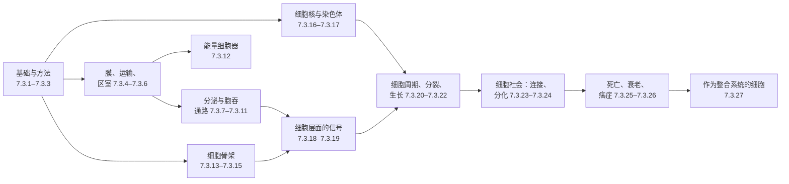

细胞是能够从环境中摄取物质与能量、并用它们复制自身的最小系统。生物化学（[7.1](/7.1)）描述了构成细胞的分子与反应，分子生物学（[7.2](/7.2)）描述了遗传信息的流动。细胞生物学要回答的是：这些组成部分如何在空间中排布、在时间上协调，使整体成为一个单元——膜怎样把细胞分隔成化学环境各异的区室，蛋白质怎样找到自己发挥作用的区室，**细胞骨架**怎样赋予细胞形状、力与胞内运输，信号怎样被接收和整合，细胞怎样决定生长、分裂、分化或死亡，细胞又怎样在组织中协作。本课程的主线是：细胞是一个整合的系统，任何细胞器、通路或纤维离开整体都无从理解；细胞的许多性质（大小、细胞器数量、周期的节律、决定的锐利程度）来自各部分的相互作用，并可以写成简单的定量模型。本章奠定基础：细胞学说的历史与内容（1.1），细胞为什么是生命的单位（1.2），细胞的尺度与其中的分子数量（1.3），细胞的多样性（1.4），作为非细胞例外的病毒（1.5），真核细胞的起源（1.6），以及模式生物与课程的结构（1.7）。接下来的两章介绍观察细胞（[7.3.2](/7.3.2)）与拆解细胞（[7.3.3](/7.3.3)）的方法。

## 1.1. 细胞学说

### 1.1.1. 显微镜与细胞的发现

细胞太小，肉眼无法看见（肉眼的**分辨极限**约为 $0.1\,\mathrm{mm}$），所以细胞的发现要等显微镜发明之后。最早的复式显微镜带有物镜与目镜，约 1590 年出现在荷兰（传统上归功于眼镜匠 Hans 与 Zacharias Janssen），Galileo Galilei 在 17 世纪 10 年代用它描述昆虫。1665 年，Robert Hooke 在《显微图谱》（*Micrographia*）中记述了复式显微镜下软木薄片中的盒状小室，称之为"细胞"（拉丁文 *cellula*，小房间）；他看到的其实是死亡植物细胞空的细胞壁。1674 年起，荷兰布商 Antonie van Leeuwenhoek 用自制的、放大约 50 至 275 倍的单透镜显微镜描述了活细胞：淡水原生生物（"微动物"）、精子、红细胞（包括鱼类有核的红细胞），并在 1683 年观察到牙垢中的细菌；他的观察以信件形式报告给伦敦皇家学会，学会于 1680 年选他为会员。此后约 160 年间进展甚少，因为当时的简单透镜存在色差与球差；直到 19 世纪 20—30 年代消色差物镜问世，才能可靠地看清细胞内容物。1831 年 Robert Brown 在兰花表皮中确认细胞核是细胞的常见结构，1836 年 Gabriel Valentin 在神经细胞中描述了**核仁**。

### 1.1.2. Schleiden、Schwann 与 Virchow

19 世纪 30 年代，改进的消色差物镜使细胞内容物清晰可见，细胞学说是许多观察者共同的成果，而不仅仅属于两个人：Henri Dutrochet（1824）与 Charles-François Brisseau de Mirbel 已经把动植物组织描述为由细胞构成，Jan Evangelista Purkyně 及其学生则在多种动物组织中描述了细胞与细胞核。1838 年植物学家 Matthias Schleiden 得出结论：植物由细胞构成，并由单个细胞发育而来；1839 年动物学家 Theodor Schwann 把这一结论推广到动物。但他们在新细胞的来源上是错误的：两人都认为细胞从无结构的液体（"细胞原质"，cytoblastema）中结晶出来，先出现细胞核，这就是*自由细胞形成*学说。Robert Remak 在 1852 年从蛙与鸡的胚胎证明，无论在发育还是在疾病中，新细胞都只来自已有细胞的分裂。Rudolf Virchow 起初接受自由细胞形成，1855 年采纳了这一结论，并以此作为*细胞病理学*（1858）的基础：疾病是细胞的紊乱。他的格言 *omnis cellula e cellula*（"一切细胞来自细胞"）是 François-Vincent Raspail 于 1825 年首创的，实验证据主要来自 Remak；但 Virchow 的权威使它成为学说的第三条原理。

**定义 1.1.1（细胞学说）** **细胞学说**（cell theory）主张：（1）一切生物都由一个或多个细胞组成；（2）细胞是生物结构与功能的基本单位；（3）一切细胞都由已有的细胞分裂而来。

现代生物学增加了 19 世纪无法提出的三点：每个细胞都把遗传信息储存在 DNA 中，并在分裂时传给子细胞；所有细胞的化学组成基本相同，使用相同的基本代谢（见 [7.1.1](/7.1.1) 的共同特征）；生命的能量流动发生在细胞之内。第三条原理引出了学说本身无法回答的问题：第一个细胞是怎样产生的。这一问题以及相关的**原细胞**模型属于生命起源的范畴（[7.2.23](/7.2.23)）。

### 1.1.3. 从细胞学到细胞生物学

借助固定、染色与油浸物镜，19 世纪后期的研究描述了光学显微镜下可见的主要结构：动物细胞（Walther Flemming，1879—1882）与植物细胞（Eduard Strasburger）的**有丝分裂**；**减数分裂**（Edouard van Beneden，1883，蛔虫）；**中心体**（van Beneden 与 Theodor Boveri，1887—1888）；**线粒体**，由 Richard Altmann（1890）首先描述为"生命粒"（bioblast），由 Carl Benda（1898）命名；以及**高尔基体**（Camillo Golgi，1898）。Ernst Ruska 与 Max Knoll 于 1931—1933 年建成第一台**透射电子显微镜**（Ruska 分享了 1986 年诺贝尔物理学奖），西门子公司在 1939 年出售了第一批商品仪器。1940 至 1970 年间，电子显微镜与离心分离细胞组分（[7.3.3](/7.3.3)）这两种新方法揭示了**内质网**、**核糖体**、**溶酶体**与**过氧化物酶体**，并把每种结构与功能联系起来；Albert Claude、Christian de Duve 与 George Palade 因这一工作分享了 1974 年诺贝尔生理学或医学奖。20 世纪 80 年代以来，分子生物学方法与活细胞中的荧光蛋白（[7.3.2](/7.3.2)）使细胞研究成为一门分子的、定量的科学。

这段历史常被分为四个时期，每个时期都由一种方法开启，研究细胞的层次也依同样的顺序推进。

| 时期 | 开启的方法 | 观察层次 | 主要成果 |
|---|---|---|---|
| 1665 年至 19 世纪 30 年代 | 复式与单透镜显微镜 | 光学显微（微米） | 发现细胞、原生生物、细菌、细胞核 |
| 19 世纪 30 年代至 20 世纪 30 年代 | 消色差物镜、固定与染色、切片机 | 光学显微 | 细胞学说；有丝分裂、减数分裂、**染色体**、中心体、线粒体、高尔基体；细胞学成为一门学科 |
| 20 世纪 30 年代至 70 年代 | 电子显微镜、超速离心机、放射性示踪 | 超微结构（纳米） | 描述膜与细胞器并确定其功能；细胞学发展为细胞生物学 |
| 20 世纪 70 年代以来 | 重组 DNA、单克隆抗体、荧光蛋白、基因组学、**冷冻电镜** | 分子 | 分选、信号转导、细胞周期、细胞死亡的机制；定量与系统细胞生物学 |

分子时期建立在分子生物学（[7.2](/7.2)）的发现之上：Friedrich Miescher 从脓细胞中分离出"核素"（1869）；Oswald Avery 等（1944）以及 Alfred Hershey 与 Martha Chase（1952）确认 DNA 是遗传物质（[7.2.1](/7.2.1)）；**双螺旋**（James Watson 与 Francis Crick，1953，依据 Rosalind Franklin 与 Maurice Wilkins 的 X 射线数据）；**中心法则**（Crick，1958）与**遗传密码**（1961—1966）；重组 DNA（Paul Berg 等，1972；Stanley Cohen 与 Herbert Boyer，1973）；**聚合酶链式反应**（Kary Mullis，1983；1993 年诺贝尔化学奖）；以及人类基因组计划（1990—2003，2001 年发表草图，其中中国承担了约 1% 的序列，即自 1999 年起测定的 3 号染色体短臂部分）。1990 年，美国国立卫生研究院为一名四岁女孩实施了第一例基因治疗，病因是腺苷脱氨酶缺乏（一种严重联合免疫缺陷）。下表列出与本课程核心内容相关的诺贝尔奖。

| 年份 | 获奖者 | 发现 | 章节 |
|---|---|---|---|
| 1906 | Camillo Golgi，Santiago Ramón y Cajal | 神经系统的结构；Golgi 的银染法也显示了高尔基体 | [7.3.9](/7.3.9) |
| 1974 | Albert Claude，Christian de Duve，George Palade | 细胞的结构与功能组织 | [7.3.3](/7.3.3)，[7.3.7](/7.3.7) |
| 1999 | Günter Blobel | 引导蛋白质定位的信号 | [7.3.6](/7.3.6) |
| 2001 | Leland Hartwell，Tim Hunt，Paul Nurse | **细胞周期**的关键调控因子 | [7.3.20](/7.3.20) |
| 2002 | Sydney Brenner，H. Robert Horvitz，John Sulston | 器官发育与**程序性细胞死亡**的遗传调控 | [7.3.25](/7.3.25) |
| 2003（化学奖） | Peter Agre，Roderick MacKinnon | 水通道；**离子通道**的结构 | [7.3.5](/7.3.5) |
| 2004 | Richard Axel，Linda Buck | 气味受体 | [7.1.14](/7.1.14) |
| 2006 | Andrew Fire，Craig Mello | **RNA 干扰** | [7.2.18](/7.2.18)，[7.3.3](/7.3.3) |
| 2007 | Mario Capecchi，Martin Evans，Oliver Smithies | 小鼠的基因打靶 | [7.3.3](/7.3.3) |
| 2008（化学奖） | Osamu Shimomura，Martin Chalfie，Roger Tsien | 绿色荧光蛋白 | [7.3.2](/7.3.2) |
| 2009 | Elizabeth Blackburn，Carol Greider，Jack Szostak | **端粒**与**端粒酶** | [7.3.25](/7.3.25) |
| 2012 | John Gurdon，Shinya Yamanaka | 成熟细胞的**重编程**与**多能性** | [7.3.24](/7.3.24) |
| 2013 | James Rothman，Randy Schekman，Thomas Südhof | 囊泡运输的机器 | [7.3.8](/7.3.8) |
| 2014（化学奖） | Eric Betzig，Stefan Hell，William Moerner | 超分辨**荧光显微术** | [7.3.2](/7.3.2) |
| 2016 | Yoshinori Ohsumi | **自噬**的机制 | [7.3.11](/7.3.11) |
| 2017（化学奖） | Jacques Dubochet，Joachim Frank，Richard Henderson | 冷冻电子显微术 | [7.3.3](/7.3.3) |
| 2019 | William Kaelin，Peter Ratcliffe，Gregg Semenza | 细胞如何感知并适应氧气 | [7.3.26](/7.3.26) |
| 2021 | David Julius，Ardem Patapoutian | 温度与触觉的受体 | [7.3.5](/7.3.5) |

未注明领域的奖项均为生理学或医学奖。

**定义 1.1.2** 研究细胞的结构、功能与行为，包括其组分如何组织、如何相互作用、其活动如何调控的学科，称为**细胞生物学**。

## 1.2. 细胞为什么是生命的单位

### 1.2.1. 结构、功能、繁殖与发育

细胞在五个意义上是生命的单位，每一个意义在本课程中都会反复出现。

| 意义 | 表述 | 例子 |
|---|---|---|
| 结构 | 一切生物都由细胞构成；更小的单位不能独立存活 | 成年人约含 $3\times10^{13}$ 个细胞，按数量计其中 84% 是红细胞 |
| 功能 | 代谢、运输与应答都在细胞中进行 | 肝细胞完成**糖原**储存、解毒与血浆蛋白的分泌 |
| 繁殖与遗传 | 生物通过细胞繁殖；遗传信息由细胞传给细胞 | 卵与精子是两代之间唯一的桥梁 |
| 生长与发育 | 多细胞生物由一个细胞经分裂与分化发育而来 | 人的受精卵产生 200 多种形态各异的细胞类型 |
| 潜能 | 细胞可以包含建造整个生物所需的一切 | 单个植物细胞再生成植株，**体细胞核移植**克隆 |

最后一行依据的是基因组等价性（genomic equivalence）原则：通常一个生物体的体细胞携带相同的基因组，它们的差别来自表达了不同的基因。John Gurdon 在 1962 年证明，把非洲爪蟾（*Xenopus*）蝌蚪分化的肠细胞核移入去核的卵中，可以指导发育出会游泳的蝌蚪，有时还能发育为可育的成蛙。1996 年 7 月 5 日在罗斯林研究所出生的绵羊多莉，则是由成年乳腺细胞的细胞核克隆而来。2006 年，Kazutoshi Takahashi 与 Shinya Yamanaka 用四个转录因子（Oct4、Sox2、Klf4 与 c-Myc）把小鼠成纤维细胞重编程为多能**干细胞**；Gurdon 与 Yamanaka 分享了 2012 年诺贝尔奖。分化、潜能与重编程是 [7.3.24](/7.3.24) 的主题。

### 1.2.2. 细胞的基本性质

从细菌到神经元，每个细胞都具有下列性质。它们同时也是本课程的地图，因为每一项都在一个或多个章节中讨论。

| 性质 | 所需条件 | 章节 |
|---|---|---|
| 有边界、有组织 | 质膜；真核生物还有内部区室 | [7.3.4](/7.3.4)–[7.3.12](/7.3.12) |
| 携带并使用遗传程序 | DNA、转录、翻译 | [7.2](/7.2)，[7.3.16](/7.3.16)–[7.3.17](/7.3.17) |
| 获取并转化能量 | 代谢、离子梯度、ATP | [7.1](/7.1)，[7.3.5](/7.3.5)，[7.3.12](/7.3.12) |
| 运动并改变形状 | 细胞骨架与**马达蛋白** | [7.3.13](/7.3.13)–[7.3.15](/7.3.15) |
| 感知并应答 | 受体与信号网络 | [7.3.18](/7.3.18)–[7.3.19](/7.3.19) |
| 自我繁殖 | 生长、细胞周期与分裂 | [7.3.20](/7.3.20)–[7.3.22](/7.3.22) |
| 自我调节 | 各层次的反馈 | 贯穿全书 |
| 死亡 | 程序性死亡或意外死亡 | [7.3.25](/7.3.25) |

所有细胞都有三种共同的组分：质膜，作为遗传物质的 DNA 及其工作拷贝 RNA，以及把 RNA 翻译为蛋白质的**核糖体**。真核细胞还有膜包被的内部区室。原核细胞与真核细胞的共性远不止这三点：相同的化学组成与基本代谢、按同一方案构建的膜、相同的遗传密码与基因表达的逻辑、核糖体、作为催化剂的酶、以分裂方式繁殖，以及大多数物种具有运动能力。

从形态上看，真核细胞有三部分：质膜；由**核被膜**包围、含一个或多个核仁的细胞核；以及细胞质，即各细胞器连同它们所在的胞质溶胶。从功能上看，它可以描述为三个相互联锁的结构系统：由脂质与蛋白质构成的膜系统（质膜与内膜，[7.3.4](/7.3.4)–[7.3.12](/7.3.12)）；由核酸与蛋白质构成的遗传信息系统（**染色质**、核仁、核糖体，[7.3.16](/7.3.16)–[7.3.17](/7.3.17)）；以及由蛋白质多聚体构成的细胞骨架（[7.3.13](/7.3.13)–[7.3.15](/7.3.15)）。

**定义 1.2.1** 细胞内具有特定组成、执行特定功能的离散结构，称为**细胞器**。膜包被的细胞器（细胞核、线粒体、叶绿体、内质网、高尔基体、内体、溶酶体、过氧化物酶体）由一层或两层脂双层包围；其他细胞器（核仁、中心体，以及旧用法中的核糖体）没有膜。

许多无膜细胞器是**生物大分子凝聚体**（[7.2.21](/7.2.21)），由多价的**非共价相互作用**维系在一起。

## 1.3. 尺度与数量

### 1.3.1. 细胞的大小

细胞生物学的研究对象跨越八个数量级，从共价键（$0.15\,\mathrm{nm}$）到最大的单个细胞。典型尺寸如下：小分子约 $1\,\mathrm{nm}$；**球状蛋白** $2$–$10\,\mathrm{nm}$；核糖体 $25$–$30\,\mathrm{nm}$；病毒 $20$–$300\,\mathrm{nm}$；细菌 $1$–$5\,\mu\mathrm{m}$；大多数动物细胞 $10$–$30\,\mu\mathrm{m}$；植物细胞 $10$–$100\,\mu\mathrm{m}$。例外同样有启发性：蛙卵直径约 $1.2\,\mathrm{mm}$，运动神经元的轴突可长达一米，硫细菌纳米比亚嗜硫珠菌（*Thiomargarita namibiensis*）可达 $0.75\,\mathrm{mm}$。能分辨各个尺度范围的方法（[7.3.2](/7.3.2) 与 [7.3.3](/7.3.3) 的主题）决定了我们能对它了解多少。在同一生物体内，卵细胞远大于体细胞（人的卵细胞直径约 $100$–$120\,\mu\mathrm{m}$，肝细胞约 $20$–$30\,\mu\mathrm{m}$，红细胞 $7$–$8\,\mu\mathrm{m}$）。

细胞的形状与功能相适应，主要由细胞骨架以及与邻近细胞和**细胞外基质**的接触决定：神经元分支而细长，红细胞是双凹圆盘，上皮细胞呈柱状、立方形或扁平，植物气孔的保卫细胞呈肾形。单细胞生物的形状常由胞外的壁、壳或表膜决定（草履虫的拖鞋形，眼虫的纺锤形）。形状并非固定不变：平滑肌细胞在组织中呈梭形，在培养皿中生长时则变得扁平而呈多边形（[7.3.3](/7.3.3)）。

### 1.3.2. 什么限制了细胞的大小

三个约束限制了细胞的大小。第一，细胞必须含有足够的基因与分子来复制自身，这决定了下限（1.3.4）。第二，一个基因组只能为有限体积的细胞质提供 **mRNA**：细胞核的体积与 DNA 的量随细胞大小而变化，很大的细胞常是多倍体或多核的（核质比）。第三，也是最一般的约束：细胞通过表面与环境交换物质，并通过扩散在内部分配物质。球体的表面积与体积之比是 $3/R$，所以细胞越大，单位细胞质的膜越少；分子扩散距离 $x$ 所需的时间按 $x^2/6D$ 增长，如 [7.1.1 的例 1.1.1](/7.1.1#sec-1.1.2) 所算。把这两个事实结合起来，就可以建立扩散所能供养的最大细胞的模型。

**公式 1.3.1（扩散限制半径）** 考虑半径为 $R$ 的球形细胞，它以体积速率 $q$（单位 $\mathrm{mol\,m^{-3}\,s^{-1}}$）均匀消耗某底物（这里是 $\ce{O2}$），底物只靠从恒定表面浓度 $c_0$ 的扩散来供应。稳态下**反应扩散方程**化为 $D\nabla^2 c = q$；其在中心有限、在 $r = R$ 处等于 $c_0$ 的解为

$$
c(r) = c_0 - \frac{q}{6D}\left(R^2 - r^2\right). \tag{1.1}
$$
浓度在中心最低，$c(0) = c_0 - qR^2/6D$，只有当 $R$ 不超过

$$
R_{\max} = \sqrt{\frac{6Dc_0}{q}}. \tag{1.2}
$$
时，中心才仍有供应。

**例 1.3.1** 对 $\ce{O2}$，$D \approx 2\times10^{-9}\,\mathrm{m^2\,s^{-1}}$，在 $37\,^\circ\mathrm{C}$ 空气饱和的水中 $c_0 \approx 0.2\,\mathrm{mol\,m^{-3}}$。在空气中快速生长的 *E. coli* 每克干重每小时消耗约 $20\,\mathrm{mmol}$ 的 $\ce{O2}$，即每个细胞每秒约 $10^6$ 个分子，$q \approx 1.7\,\mathrm{mol\,m^{-3}\,s^{-1}}$；由式 (1.2) 得 $R_{\max} \approx 40\,\mu\mathrm{m}$，是这种细菌实际尺寸的四十倍。培养的哺乳动物细胞在 $3000\,\mu\mathrm{m}^3$ 的体积中每秒消耗约 $80\,\mathrm{amol}$，故 $q \approx 0.03\,\mathrm{mol\,m^{-3}\,s^{-1}}$，$R_{\max} \approx 300\,\mu\mathrm{m}$。

这一模型同时解释了几个事实。大多数细胞远小于 $R_{\max}$，因为它们还需要与营养物和信号快速交换，而后者的扩散比 $\ce{O2}$ 慢，而且细胞质十分拥挤（**大分子拥挤**使蛋白质的 $D$ 降低五到十倍）。把同一方程用于组织而不是细胞，可得 $\ce{O2}$ 从毛细血管穿透的深度，约 $100$–$200\,\mu\mathrm{m}$；这就是毛细血管很少相距更远的原因，也是大于一两毫米的肿瘤必须诱导新血管生成的原因（[7.3.26](/7.3.26)）。特别大的细胞通过改变几何形状而不是违背这一限制来摆脱它：嗜硫珠菌被中央液泡充满，把细胞质保持在几微米厚的一层；神经元与肌纤维又长又细，沿细胞骨架主动运输物质（[7.3.14](/7.3.14)）；真核细胞总体上以囊泡运输与马达驱动的运输取代长距离扩散。

### 1.3.3. 拷贝数

细胞中的浓度就是分子数除以很小的体积。在体积 $V$ 中，浓度 $c$ 对应 $N = cVN_{\mathrm{A}}$ 个分子：$1\,\mathrm{nM}$ 在 *E. coli*（$1\,\mu\mathrm{m}^3$，[7.2.1 的例 1.5.1](/7.2.1#sec-1.5.3)）中约为一个分子，在 HeLa 细胞中约 $1800$ 个，在蛙卵母细胞中为 $6\times10^{8}$ 个。细菌与人细胞的典型内含物（蛋白质分子分别约 $3\times10^6$ 与 $10^9$–$10^{10}$ 个，核糖体分别约 $10^4$ 与 $10^6$–$10^7$ 个）列于 [7.2.1](/7.2.1#sec-1.5.3)。按质量计，细胞约 $70\,\%$ 是水，其中大部分是自由溶剂，几个百分点结合在大分子的水化层中；四种元素（H、O、C、N）占其原子的 $99\,\%$ 以上，无机离子约占质量的 $1\,\%$，蛋白质、核酸、多糖与脂质占干重的 $90\,\%$ 以上（[7.1.1](/7.1.1#sec-1.2.1)）。在约 $20\,000$ 个蛋白质编码基因中，人的细胞在任一时刻表达约 $10^4$ 种不同的蛋白质。

数量小对作为系统的细胞有两个后果。每个细胞中只有几个分子的调节因子会有很大的相对涨落（[7.2.22](/7.2.22)），需要两个稀有分子相遇的反应则进行得很慢。区室化可以对付这两个问题：把反应限制在只占细胞体积百分之几的细胞器中，可使其组分的浓度提高同样的倍数，而支架和凝聚体则进一步提高局部浓度。因此区室化既是结构上的解决办法，也是定量上的解决办法（[7.3.6](/7.3.6)）。

### 1.3.4. 最小的细胞

最小的自由生活细胞是支原体，直径约 $0.3\,\mu\mathrm{m}$，没有细胞壁。生殖支原体（*Mycoplasma genitalium*）的基因组为 $580\,\mathrm{kb}$，有 525 个基因（482 个编码蛋白质），其中大多数是必需的。比较基因组学（Mushegian 与 Koonin，1996）提示，在营养丰富的培养基中生活的细胞大约有 250 个蛋白质编码基因就够了；J. Craig Venter 研究所构建了合成细胞 JCVI-syn3.0（2016），其化学合成的基因组为 $531\,\mathrm{kb}$，有 473 个基因，其中约三分之一功能仍然未知。因此最小的细胞必须至少含有几百种蛋白质、几十万个大分子和足以容纳它们的体积，这就是没有哪种细胞比约 $0.2\,\mu\mathrm{m}$ 小很多的原因。基因组大小的范围比细胞大小宽得多：从依赖宿主的昆虫细菌内共生体的约 $0.1\,\mathrm{Mb}$、生殖支原体的 $0.58\,\mathrm{Mb}$，到最大的细菌基因组（粘细菌）的约 $16\,\mathrm{Mb}$；从寄生的微孢子虫的 $2.3\,\mathrm{Mb}$，到植物日本重楼（*Paris japonica*）与 *Tmesipteris oblanceolata* 的约 $150\,000\,\mathrm{Mb}$，其中大部分是重复 DNA（[7.2.2](/7.2.2)）。

## 1.4. 细菌、古菌与真核生物

### 1.4.1. 原核细胞与真核细胞

细胞之间最根本的分界是**原核生物**（细菌与古菌，无细胞核）与**真核生物**（有细胞核）之间的分界（[7.1.1](/7.1.1#sec-1.1.1)）。下表对二者作比较；旧教科书中的一些说法（原核生物没有细胞骨架，染色体是"裸露"的 DNA）已不再正确。

| 特征 | 原核生物 | 真核生物 |
|---|---|---|
| 大小 | 通常 $1$–$5\,\mu\mathrm{m}$ | 通常 $10$–$100\,\mu\mathrm{m}$；体积大 $10^3$–$10^4$ 倍 |
| 细胞核 | 无；DNA 位于与细胞质接触的拟核中 | 有双层膜包围、带核孔的细胞核 |
| 染色体 | 通常为一条环状染色体（有些物种有两条或更多，或为线状），由拟核相关蛋白压缩；常有**质粒** | 数条至许多条线状染色体，与组蛋白包装成染色质 |
| 转录与翻译 | 在同一区室中偶联 | 分隔：转录与 RNA 加工在细胞核，翻译在细胞质 |
| 基因 | 基因组紧凑，重复 DNA 少；内含子罕见（少数自剪接内含子）；相关基因常组成操纵子，有些基因重叠 | 非编码与重复 DNA 多；多数基因被内含子分割；通常一个转录物只含一个基因 |
| 基因表达 | mRNA 不经加工即被翻译；调控主要在转录水平（操纵子） | 加帽、剪接与多聚腺苷酸化；在多个层次调控（染色质、转录、RNA 加工、翻译、蛋白质修饰） |
| DNA 复制 | 可在前一轮结束前开始新一轮，在周期的任何时间进行 | 限于 S 期，每个周期一次（[7.3.20](/7.3.20)） |
| 内膜 | 罕见（蓝细菌的类囊体、磁小体、厌氧氨氧化体） | 内膜系统、线粒体、质体 |
| 细胞骨架 | 微管蛋白（FtsZ）、肌动蛋白（MreB、ParM）与中间丝（新月柄杆菌蛋白，crescentin）的同源物 | 微管、肌动蛋白丝、中间丝与马达蛋白 |
| 核糖体 | 70S（30S + 50S） | 胞质溶胶中为 80S（40S + 60S）；线粒体与叶绿体中为类 70S |
| 细胞分裂 | 二分裂，有可收缩的 FtsZ 环 | 有丝分裂（或减数分裂）与胞质分裂 |
| 细胞壁 | **肽聚糖**（细菌）；S 层或假肽聚糖（古菌）；支原体无 | 无（动物）、纤维素与果胶（植物）、几丁质（真菌） |
| 染色体外 DNA | 质粒 | 线粒体与质体 DNA；某些真菌有质粒 |
| 胞吞作用与吞噬作用 | 无 | 常见 |

两类生物都借助称为鞭毛的结构运动，但它们是互不相关的两种机器，是功能趋同的例子。

| | 细菌鞭毛 | 真核鞭毛（及纤毛） |
|---|---|---|
| 丝 | 鞭毛蛋白的螺旋多聚体，位于细胞之外 | 微管轴丝（9 + 2 二联管），外覆质膜 |
| 马达 | 位于被膜中的旋转马达 | 沿轴丝分布的动力蛋白臂 |
| 能量 | 质子（或 $\ce{Na+}$）梯度 | ATP 水解 |
| 运动 | 刚性螺旋的旋转 | 弯曲波 |

古菌的"鞭毛"，即古菌鞭毛（archaellum），是第三种独立的方案：由 ATP 驱动的旋转马达，与 IV 型菌毛相关。真核纤毛见 [7.3.14](/7.3.14)。

细菌是数量最多、分布最广的细胞。按形状分为球菌（球形，单个、成对、成链或成簇）、杆菌（杆状）与螺旋形（弯曲的弧菌、刚性的螺菌和柔软的螺旋体），大多数直径 $0.5$–$5\,\mu\mathrm{m}$。它们的结构有两类：每种细菌都有的（被膜、质膜、拟核、核糖体）与只见于某些物种的。

| 结构 | 组成与性质 | 功能 |
|---|---|---|
| 细胞壁 | **肽聚糖**（胞壁质）：由 N-乙酰葡糖胺（NAG）与 N-乙酰胞壁酸（NAM）交替、以 β(1→4) 键连接的聚糖链，每个 NAM 上有一条短肽；相邻聚糖链的短肽直接交联（*E. coli*）或通过五甘氨酸桥交联（金黄色葡萄球菌 *Staphylococcus aureus*），形成包围细胞的一个袋状大分子 | 抵抗膨压并决定细胞形状；青霉素与溶菌酶的靶标（[7.1.8](/7.1.8)） |
| 革兰氏阳性菌被膜 | 厚壁（$20$–$80\,\mathrm{nm}$，肽聚糖层数多），其中穿插磷壁酸 | 保留结晶紫–碘染色（紫色） |
| 革兰氏阴性菌被膜 | 薄的肽聚糖层（$2$–$7\,\mathrm{nm}$），位于质膜与外膜之间的周质中；外膜的外小叶是**脂多糖**（内毒素），含孔蛋白 | 外膜是通透性屏障（抗生素抗性）；不保留染色，被复染成粉红色 |
| 质膜 | 约 $8\,\mathrm{nm}$ 厚的磷脂双层，含呼吸链、ATP 合酶与转运蛋白；某些物种内陷形成光合膜 | 真核细胞膜的全部功能：运输、能量转换、脂质与细胞壁的合成 |
| 拟核 | 电子密度低的不规则区域，容纳染色体，无膜 | 复制与转录 |
| 核糖体 | 70S；每个细胞 $10^4$–$7\times10^4$ 个，取决于生长速率；多数游离，少数在合成膜蛋白与分泌蛋白时结合在质膜上 | 翻译；30S 亚基是链霉素与四环素的靶标，50S 亚基是氯霉素与红霉素的靶标 |
| 质粒 | 独立复制的小环状 DNA 分子，带有几个至几百个基因（抗性、毒素、接合）；有些整合到染色体中 | 抗性的传播；基因工程的载体（[7.2.5](/7.2.5)） |
| 荚膜 | 壁外的多糖（有时为多肽）层 | 防止干燥与吞噬；黏附宿主表面；毒力因子（肺炎球菌） |
| 鞭毛 | 鞭毛蛋白构成的螺旋丝，由旋转马达驱动 | 游动与趋化 |
| 菌毛 | 细的蛋白质丝，与游动无关 | 黏附宿主细胞与表面（普通菌毛）；接合时的 DNA 转移（F 菌毛或性菌毛）；颤动运动（IV 型菌毛） |
| 芽孢 | *Bacillus* 与 *Clostridium* 在营养耗尽时于母细胞内形成的休眠、脱水细胞，有厚的皮层、蛋白质外壳与吡啶二羧酸钙 | 可耐受煮沸、干燥与辐射多年；条件改善时萌发（炭疽、破伤风、肉毒中毒） |

旧教科书把间体（mesosome）描述为革兰氏阳性菌质膜的卷曲内陷，在薄切片中可见，是细菌用于呼吸或分裂的细胞器。间体是化学固定造成的假象：在不用固定剂而快速冷冻的细胞中见不到它们（冷冻置换与冷冻电子显微术，[7.3.3](/7.3.3)），膜在制样过程中受损时才会出现。

有几类细菌对细胞生物学特别有意义，因为它们处在细胞生命的极限上。

- 支原体是最小的自由生活细胞（$0.2$–$0.3\,\mu\mathrm{m}$），没有细胞壁，因而形态多变，能通过截留其他细菌的滤器，对青霉素不敏感。它们的膜含有从宿主或培养基摄取的固醇（自己不能合成），因而对洋地黄皂苷与皂角苷等结合固醇的试剂敏感。肺炎支原体（*Mycoplasma pneumoniae*）附着在呼吸道上皮上生活；支原体是细胞培养中常见而不可见的污染物（[7.3.3](/7.3.3)）。
- 衣原体是专性胞内寄生细菌（感染形式即原体，$0.2$–$0.3\,\mu\mathrm{m}$），细胞壁几乎不含肽聚糖。它们在宿主细胞的液泡内以较大的网状体形式增殖，并从宿主输入大量 ATP，因而被称为"能量寄生物"。沙眼的病原体沙眼衣原体（*Chlamydia trachomatis*）起初被认为是大病毒，汤飞凡等于 1955—1956 年首次在鸡胚卵黄囊中培养分离出来（1957 年发表）。
- 立克次体由虱、蜱与蚤传播（斑疹伤寒、斑点热），是专性胞内寄生的 α-变形菌。它们是线粒体祖先现存最近的亲缘之一；普氏立克次体（*Rickettsia prowazekii*）的基因组（Andersson 等，1998）类似缩减的线粒体基因组（1.6.2）。
- 蓝细菌（"蓝绿藻"）与植物一样用两个光系统进行产氧光合作用，场所是源自质膜的内部类囊体膜，但没有叶绿体；它们是叶绿体的祖先（1.6.3）。它们是最大的原核生物之一，从 $1$ 微米到几十微米，基因组大，许多形成有分工的细胞丝，如 *Anabaena* 与 *Nostoc* 的固氮异形胞（[7.1.27](/7.1.27)）。

### 1.4.2. 三域、两大主干谱系

Carl Woese 比较了小亚基核糖体 RNA（原核生物为 16S，真核生物为 18S）的序列，这种 RNA 存在于每个细胞中且进化缓慢；他在 1977 年发现，原核生物包含两个类群，它们彼此之间的差异与它们各自同真核生物的差异一样大：细菌与古菌。古菌在细胞大小、无细胞核以及基因组织成操纵子方面与细菌相似，但在信息处理的机器上与真核生物相似：它们的 RNA 聚合酶、TATA 结合蛋白与 TFIIB 家族的转录因子、翻译起始因子，以及许多物种中的组蛋白。它们的膜独一无二：异戊二烯链通过醚键连接在 1-磷酸甘油上，是细菌与真核生物脂质的 3-磷酸甘油的镜像，有时形成跨膜四醚的单层，可耐受 $100\,^\circ\mathrm{C}$ 以上的温度。如 1.6 所述，真核生物似乎起源于古菌内部，所以生命之树有两大主干谱系，真核生物是嵌合的第三支。

| 特征 | 细菌 | 古菌 | 真核生物 |
|---|---|---|---|
| 细胞壁 | 含胞壁酸与 D-氨基酸的肽聚糖 | 无肽聚糖：假肽聚糖（假胞壁质）、蛋白质 S 层或糖蛋白 | 纤维素、几丁质或无 |
| 膜脂 | 脂肪酸酯键连接于 3-磷酸甘油；双层 | 异戊二烯醚键连接于 1-磷酸甘油；双层、单层或混合 | 同细菌，另有固醇 |
| 起始氨基酸 | *N*-甲酰甲硫氨酸 | 甲硫氨酸 | 甲硫氨酸（细胞器中为甲酰甲硫氨酸） |
| 对氯霉素、链霉素的敏感性 | 敏感 | 不敏感 | 不敏感（胞质核糖体） |
| RNA 聚合酶 | 一种，简单（五个亚基） | 一种，类真核（约十二个亚基） | 三种核内酶（Pol I、II、III） |
| 组蛋白 | 无 | 许多物种有 | 有 |
| 内含子 | 罕见 | 见于某些 tRNA 与 rRNA 基因 | 见于多数蛋白质编码基因 |

许多古菌生活在生命的物理极限处，它们最初就是这样被认识的：厌氧沉积物与肠道中的产甲烷菌，饱和盐水中的极端嗜盐菌，以及温泉与深海热泉中的嗜热嗜酸菌与超嗜热菌。*Pyrolobus fumarii* 在 $90$ 至 $113\,^\circ\mathrm{C}$ 之间生长（最适 $106\,^\circ\mathrm{C}$），*Methanopyrus kandleri* 116 株在高压下可在高达 $122\,^\circ\mathrm{C}$ 生长（Takai 等，2008），是目前的纪录。生长的温度上限随细胞复杂程度而降低：古菌约 $122\,^\circ\mathrm{C}$，细菌 $95\,^\circ\mathrm{C}$（产液菌 *Aquifex*），真菌 $60$–$62\,^\circ\mathrm{C}$，藻类 $55$–$60\,^\circ\mathrm{C}$，原生动物约 $56\,^\circ\mathrm{C}$，维管植物约 $45\,^\circ\mathrm{C}$，鱼类与其他水生动物 $38$–$45\,^\circ\mathrm{C}$。然而古菌并非只是极端环境生物：氨氧化古菌是海洋与土壤中数量最多的细胞之一，1.6 中的 Asgard 古菌生活在普通的海洋沉积物中。"古细菌"（archaebacteria，古老的细菌）这一名称在两方面都有误导：古菌既不是细菌，也没有证据表明比细菌更古老。

对古菌的认识改变了原先以可见结构为依据的生物分类。

| 系统 | 提出者 | 类群 |
|---|---|---|
| 三界 | Ernst Haeckel（1866） | 植物界、动物界、原生生物界（含细菌） |
| 五界 | Robert Whittaker（1969） | 原核生物界（Monera）、原生生物界、真菌界、植物界、动物界 |
| 六界 | Woese 与 Fox 之后（1977） | 真细菌界、古细菌界、原生生物界、真菌界、植物界、动物界 |
| 三域 | Carl Woese、Otto Kandler 与 Mark Wheelis（1990） | 细菌域、古菌域、真核域 |
| 二域 | 2010 年代以来的系统发生基因组学 | 细菌域与古菌域，真核生物嵌套在古菌之内（1.6.2） |

第一个完整的古菌基因组是产甲烷菌詹氏甲烷球菌（*Methanocaldococcus jannaschii*，Bult 等，1996），证实了类细菌的代谢基因与类真核的信息处理基因镶嵌共存。"原生生物"不再是一个分类单元：原生生物是不属于植物、动物或真菌的真核生物，分属真核生物树的几个深层分支。

### 1.4.3. 植物细胞与动物细胞

动物与植物细胞共有真核生物的结构方案，但植物具有反映固着、光合生活方式的结构。

| 结构 | 植物细胞 | 动物细胞 |
|---|---|---|
| 细胞壁 | 纤维素壁；相邻细胞由胞间连丝连接（[7.3.23](/7.3.23)） | 无；有细胞外基质与细胞连接 |
| 质体 | 叶绿体与其他质体（[7.3.12](/7.3.12)） | 无 |
| 液泡 | 大的中央液泡（可占体积的 90%），具溶解与储存功能；膨压（[7.3.11](/7.3.11)） | 小的溶酶体 |
| 中心体 | 开花植物与针叶树没有中心粒；纺锤体不依赖中心粒形成（苔藓、蕨类、苏铁与银杏 *Ginkgo* 只为能游动的精子形成中心粒） | 中心体含一对中心粒 |
| 胞质分裂 | 由成膜体构建细胞板（[7.3.21](/7.3.21)） | 收缩环 |
| 过氧化物酶体 | 另有乙醛酸循环体与光呼吸的叶过氧化物酶体 | 过氧化物酶体 |
| 细胞间的直接通讯 | 穿过细胞壁的胞间连丝 | 间隙连接（[7.3.23](/7.3.23)） |
| 储存的碳水化合物 | 淀粉，在质体中 | 糖原，在胞质溶胶中 |

## 1.5. 病毒

### 1.5.1. 结构与基因组

病毒在 19 世纪末被首次认识，它们是能通过截留细菌的滤器的感染因子（烟草花叶病毒，Dmitri Ivanovsky 1892，Martinus Beijerinck 1898）。它们处在细胞学说之外：有基因，但没有细胞结构，也没有自己的代谢。

**定义 1.5.1** 由核酸基因组（DNA 或 RNA，单链或双链）包裹在蛋白质外壳（衣壳）中构成、有时外面还有来自宿主膜的脂质包膜、只能在活的宿主细胞内利用宿主的核糖体与代谢进行复制的感染性颗粒，称为**病毒**。

病毒基因组要么是 DNA 要么是 RNA，不会两者兼有，编码的蛋白质从两三个到一千多个不等。衣壳由一种或几种蛋白质的许多拷贝装配而成，组成称为壳粒（capsomere）的形态单位；衣壳连同其包裹的基因组称为核衣壳（nucleocapsid）；完整的、有感染性的胞外颗粒（若有包膜则连同包膜）称为病毒粒子（virion）。包膜是宿主膜（质膜、内质网、高尔基体或核被膜，取决于病毒出芽的位置）的片段，其中插入了病毒糖蛋白，即让病毒粒子附着并进入下一个宿主细胞的受体结合蛋白与融合蛋白。由于小基因组只能编码少数几种外壳蛋白，衣壳是由相同亚基按对称性重复构建的（Crick 与 Watson，1956）。

| 对称性 | 排列 | 形状 | 例子 |
|---|---|---|---|
| 螺旋对称 | 亚基绕基因组缠绕成螺旋 | 杆状与丝状；包膜内的柔性螺旋核衣壳（子弹形或多形） | 烟草花叶病毒；狂犬病毒（子弹形）、流感病毒与麻疹病毒 |
| 二十面体对称 | 由 20 个三角形面构成的封闭壳，$60T$ 个亚基 | 球形 | 脊髓灰质炎病毒、腺病毒、疱疹病毒的衣壳 |
| 复合对称 | 二者都不是，或二者结合 | 砖形；头与尾 | 痘病毒；噬菌体 T4（二十面体头部，螺旋尾部） |

按宿主，病毒分为动物、植物、真菌、原生生物与细菌的病毒；细菌的病毒称为噬菌体。病毒只有在细胞内才是活的。其生活周期包括胞外阶段（无活性的病毒粒子）与分五步的胞内阶段：附着于宿主表面的受体，进入（通过膜融合或胞吞作用，[7.3.10](/7.3.10)）与脱壳，基因组的复制并借助宿主机器合成病毒蛋白，新病毒粒子的装配，以及通过裂解或出芽释放。

病毒基因组按产生 mRNA 的方式分类（David Baltimore，1971），这是每种病毒都必须借助宿主核糖体完成的步骤：

| 类别 | 基因组 | 产生 mRNA 的途径 | 例子 |
|---|---|---|---|
| I | dsDNA | 转录 | 疱疹病毒、腺病毒、痘病毒、噬菌体 T4 |
| II | ssDNA | 先合成 dsDNA，再转录 | 细小病毒、噬菌体 φX174 |
| III | dsRNA | 由病毒的 RNA 依赖的 RNA 聚合酶转录 | 轮状病毒 |
| IV | (+)ssRNA | 基因组本身就是 mRNA | 脊髓灰质炎病毒、冠状病毒 |
| V | (−)ssRNA | 由包装在病毒粒子中的病毒聚合酶转录 | 流感病毒、麻疹病毒、狂犬病毒 |
| VI | (+)ssRNA，经 DNA 中间体 | **逆转录**、整合 | HIV 与其他逆转录病毒 |
| VII | dsDNA，经 RNA 中间体 | 转录，然后逆转录 | 乙型肝炎病毒 |

感染以两种方式之一结束：裂解性感染，病毒增殖并杀死细胞；或潜伏或整合状态，病毒基因组留存在宿主中（如**温和噬菌体**在**溶原性**中的原噬菌体，[7.2.11](/7.2.11)，或整合的前病毒）。病毒的大小从约 $20\,\mathrm{nm}$（细小病毒，基因只编码两种蛋白质）到巨型的拟菌病毒与潘多拉病毒，其颗粒大于 $0.5\,\mu\mathrm{m}$，基因组 $1$–$2.5\,\mathrm{Mb}$，比某些细菌的还大。它们的生物学、多样性及在疾病中的作用在微生物学（[7.11](/7.11)）中讨论。

### 1.5.2. 起源、类病毒与朊病毒

病毒是怎样起源的尚无定论，几种假说并不互相排斥：病毒可能是从细胞基因组中逃逸、获得外壳的可移动元件（逃逸假说，逆转录病毒支持这一说法，它们的基因与逆转录转座子相似，[7.2.9](/7.2.9)）；可能来自丢失了细胞机器的寄生细胞（退化假说，针对巨型病毒）；也可能病毒谱系早于细胞的最后共同祖先（病毒先行假说，由三个域的病毒共有的衣壳折叠所支持）。无论起源如何，今天的病毒都依赖细胞。

还有两种更简单的感染因子。类病毒（viroid）由 Theodor Diener 于 1971 年发现，是马铃薯纺锤块茎病的病因，是 $250$–$400$ 个核苷酸的环状单链 RNA，不编码蛋白质，由宿主 RNA 聚合酶复制。马铃薯纺锤块茎类病毒有 359 个核苷酸，大范围碱基配对成长约 $40$–$50\,\mathrm{nm}$ 的杆状。类病毒没有外壳，也无法进入完整的细胞，于是通过伤口、嫁接、昆虫以及花粉与种子在植物间传播，再通过胞间连丝在细胞间扩散。**朊病毒**（[7.1.6](/7.1.6)）是感染性蛋白质：它是错误折叠的构象，能使同一蛋白质的正常形式转变为这种构象，不需要任何核酸就能传播。

朊病毒蛋白 PrP 由宿主基因 *PRNP*（人位于 20 号染色体，小鼠 *Prnp* 位于 2 号染色体）编码，每个人都会合成；正常形式 $\mathrm{PrP^C}$ 是位于神经元及其他细胞表面的 GPI 锚定糖蛋白（[7.3.6](/7.3.6)）。$\mathrm{PrP^C}$ 与致病形式 $\mathrm{PrP^{Sc}}$ 的序列相同（从 253 个残基的前体去除信号序列与 GPI 信号后约 210 个残基），但 $\mathrm{PrP^C}$ 约 $40\,\%$ 为 α 螺旋，几乎没有 β 折叠，而 $\mathrm{PrP^{Sc}}$ 富含 β 折叠（红外光谱测得约 $40\,\%$），抗蛋白酶、不溶，并积累成杀死神经元、使脑呈海绵状的淀粉样物。缺少 *Prnp* 的小鼠健康，且不会被瘙痒病感染（Büeler、Weissmann 等，1993）：这种因子需要宿主蛋白才能复制。因此朊病毒病可以是散发的、遗传的或获得性的，这种组合在感染性疾病中是独一无二的。

| 人类疾病 | 起因 |
|---|---|
| 散发型克雅氏病（CJD），约占病例的 $85\,\%$ | 正常 PrP 的自发转变，每年约百万分之一 |
| 家族型 CJD、格斯特曼–施特劳斯勒–沙因克尔综合征、致死性家族性失眠症 | *PRNP* 中促进错误折叠的显性突变 |
| 库鲁病 | 巴布亚新几内亚 Fore 人的食用死者仪式 |
| 医源性 CJD | 污染的人垂体生长激素、移植物、手术器械 |
| 变异型 CJD | 食用患牛海绵状脑病的牛肉 |

## 1.6. 真核细胞的起源

### 1.6.1. 时间尺度

细胞至少已存在 $35$ 亿年（叠层石与微化石，化学痕迹可能更早）。在十多亿年的时间里，所有细胞都是原核生物。蓝细菌的产氧光合作用在约 $24$ 亿年前的大氧化事件中提高了大气 $\ce{O2}$ 的浓度。最古老的明确属于真核生物的化石约有 $16$–$17$ 亿年：疑源类（具装饰性壁的有机壁微化石，构建它们需要细胞骨架与内膜），出自华北的长城群与澳大利亚北部；更古老的候选者，如卷曲的带状化石 *Grypania*（约 $18.7$ 亿年），其性质尚不确定。分子钟把现存真核生物的最后共同祖先定在大约 $18$–$20$ 亿年前。

**定义 1.6.1** 现存所有真核生物由之而来的最近的细胞，称为**真核生物最近共同祖先**（LECA）。

比较基因组学表明，LECA 已经是一个复杂的细胞：它有带核孔的细胞核、线粒体、含内质网、高尔基体与内体的内膜系统，含微管、肌动蛋白与马达蛋白的细胞骨架，纤毛，有丝分裂与减数分裂。从原核生物到 LECA 的过渡称为真核生物发生（eukaryogenesis），没有留下现存的中间型，所以只能依据基因组以及现今具有某些真核特征的原核生物来重建。

### 1.6.2. 古菌宿主与细菌内共生体

**内共生学说**（[7.1.1](/7.1.1#sec-1.4.4)）解释线粒体与叶绿体的起源。线粒体的大小与小型细菌相近，以分裂方式增殖，有两层膜、环状基因组与细菌型核糖体，其基因与 α-变形菌的最为接近。所检查过的每种真核生物，要么有线粒体，要么有由它们衍生的退化细胞器（氢化酶体与线粒体残迹体，mitosome）；唯一已知的例外，即氧单胞虫 *Monocercomonoides*，是后来才丢失了线粒体。因此获得线粒体是真核生物发生的一部分，而不是后来的事件。

线粒体与质体内共生起源的证据有几种彼此独立的类型：二者都有两层膜，内膜为细菌型；二者都有未被组蛋白包装的环状基因组，其基因与 α-变形菌（线粒体）和蓝细菌（质体）的最相似；它们的核糖体是 70S 型，用甲酰甲硫氨酸起始翻译，被氯霉素与链霉素抑制，与细菌的相同；它们以分裂方式增殖，使用细菌来源的蛋白质（质体中为 FtsZ）；并且存在中间型，如灰藻 *Cyanophora paradoxa* 的质体（蓝小体，cyanelle），其两层膜之间仍有肽聚糖壁。另一种说法是，所有真核膜都由单个细胞质膜内陷而自生，它可以解释内膜系统与核被膜（1.6.2），却不能解释线粒体与质体的基因组。

宿主的身份在最近十年里得到澄清。对深海沉积物的宏基因组测序（Spang 等，2015）发现了 Asgard 古菌，其基因组编码许多原先被认为真核生物所特有的蛋白质：肌动蛋白及其调节因子（抑制蛋白 profilin、凝溶胶蛋白 gelsolin）的同源物，Ras 与 Rab 家族的小 GTP 酶，重塑膜的 ESCRT 机器的组分，以及泛素缀合系统。2020 年，Hiroyuki Imachi 等经过十二年的培养努力，分离出第一株 Asgard 古菌 *Prometheoarchaeum syntrophicum*：一种小型、生长缓慢的厌氧菌（倍增时间约两到三周），与细菌处于专性的代谢伙伴关系，并伸出长而分支的膜突起。系统发生树把真核生物置于 Asgard 古菌之内，与海姆达尔古菌纲（Heimdallarchaeia）最为接近。相应地，真核生物的信息处理（复制、转录、翻译）基因大多来自古菌，而许多代谢与膜脂的基因则来自细菌：真核生物拥有杂合的基因组，转向细菌型脂质是尚未解释的步骤之一。

有两类模型描述伙伴如何结合。在吞噬先行模型中，宿主已经是具有细胞骨架与内膜的复杂细胞，它吞入细菌作食物，其中一个逃脱了消化。在互养或"由内向外"模型中（Baum 与 Baum，2014；Imachi 等，2020），原核宿主与附着在其表面的细菌交换代谢物；它的突起绕着伙伴生长并融合，把它包裹起来，由此形成的内膜成为内质网与核被膜。第二类模型符合 Asgard 古菌的代谢与形态，并且不要求在线粒体之前就有吞噬作用，而线粒体为基因组与细胞的扩张提供了能量（Lane 与 Martin，2010）。两者都仍是假说。

### 1.6.3. 叶绿体与质体的扩散

叶绿体起源于一个已经有线粒体的真核生物所吞入的蓝细菌，可能通过吞噬作用，时间至少在 $12$ 亿年前。这次初级内共生产生了古色素体生物（Archaeplastida）：绿藻与陆生植物、红藻与灰藻，它们的质体有两层膜。光合作用随后经次级内共生扩散，即一个真核生物吞入另一个真核藻类；这就是硅藻、褐藻与甲藻的质体有三层或四层膜的原因，也是疟原虫（甲藻的近亲）带有一个不进行光合作用的质体，即顶质体（apicoplast），并成为抗疟药物靶标的原因。内共生现在仍可观察到：Kwang Jeon 在 1966 年发现，感染实验室培养的变形虫 *Amoeba proteus* 的细菌在几年内成为宿主存活所必需；2024 年证明，固氮蓝细菌 UCYN-A 是海洋藻类 *Braarudosphaera bigelowii* 的共生体，它与宿主同步分裂，并输入宿主编码的蛋白质，这是细胞器的决定性特征（"固氮体"，nitroplast）。细菌起源的细胞器的生物学、蛋白质输入及其基因组见 [7.3.12](/7.3.12)。

## 1.7. 模式生物与系统观

### 1.7.1. 模式生物

所有活细胞都来自共同祖先，其许多机制已保守了十多亿年。细胞周期蛋白依赖性激酶的基因就是一例：Melanie Lee 与 Paul Nurse 在 1987 年证明，人的 *CDK1* 基因可以代替裂殖酵母的细胞周期基因 *cdc2*（[7.3.20](/7.3.20)）。哺乳动物的 *Pax6* 基因（在人无虹膜症中突变）及其果蝇同源基因 *eyeless* 在两者中都控制眼的发育，在果蝇中表达的小鼠基因可诱导出异位的果蝇眼（Halder、Callaerts 与 Gehring，1995）。由于这样的保守性，少数几个物种可以代表许多物种。

**定义 1.7.1** 因易于培养、繁殖和遗传操作而被深入研究，并期望由此获得的知识适用于其他生物的物种，称为**模式生物**。

| 生物 | 基因组（bp） | 蛋白质编码基因 | 用途 |
|---|---|---|---|
| 大肠杆菌 *Escherichia coli*（细菌） | $4.6\times10^6$ | 4300 | 20 分钟分裂一次；复制、转录、调控的遗传学 |
| 酿酒酵母 *Saccharomyces cerevisiae*（芽殖酵母） | $12.5\times10^6$ | 6600 | 有单倍体与二倍体阶段的真核生物；细胞周期、分泌、自噬、系统性缺失文库 |
| 粟酒裂殖酵母 *Schizosaccharomyces pombe*（裂殖酵母） | $12.6\times10^6$ | 5100 | 以恒定长度二分裂；细胞周期与大小控制 |
| 拟南芥 *Arabidopsis thaliana*（植物） | $135\times10^6$ | 27,000 | 小型植物，世代周期八周；植物细胞生物学与发育 |
| 秀丽隐杆线虫 *Caenorhabditis elegans*（线虫） | $100\times10^6$ | 20,000 | 959 个体细胞，谱系不变；细胞凋亡、RNAi |
| 黑腹果蝇 *Drosophila melanogaster*（果蝇） | $180\times10^6$ | 14,000 | 发育与信号通路的遗传学 |
| 斑马鱼 *Danio rerio* | $1.4\times10^9$ | 26,000 | 胚胎透明；脊椎动物发育的活体成像 |
| 小鼠 *Mus musculus* | $2.8\times10^9$ | 20,000 | 哺乳动物遗传学；敲除与条件性敲除品系（[7.3.3](/7.3.3)） |
| 智人 *Homo sapiens*：培养细胞（HeLa、HEK293、iPS 细胞） | $3.1\times10^9$ | 20,000 | 人细胞生物学、成像、筛选（[7.3.3](/7.3.3)） |

另一些物种被选用，是因为其某一特征被夸大：非洲爪蟾（*Xenopus*）的卵大到可以注射，也可以制备能进行细胞周期的无细胞提取物；枪乌贼巨轴突用于动作电位研究；绿藻衣藻（*Chlamydomonas*）用于纤毛与光合作用研究。必须记住模型的局限：小鼠不是缩小的人，培养的细胞系往往已丧失来源组织中的调控。

### 1.7.2. 系统观与课程的结构

细胞不是一袋互相独立的机器。它的各部分是耦合的：细胞的生长速率必须与分裂速率匹配，否则就会缩小或膨胀；质膜的面积由胞吐与胞吞作用的平衡决定；细胞器的数量与大小随细胞大小而按比例变化；分裂的决定以固定的顺序调动 DNA 复制、染色体凝缩、细胞骨架与核被膜。这种耦合常被描述为一套相互联锁的网络：酶与底物构成的代谢网络，载体与囊泡构成的运输网络，通过融合与接触而连续的膜网络，在力学上连接质膜、细胞器与细胞核的细胞骨架网络，以及把它们与环境联系起来的信号转导网络。

生物学对这类系统有过两种态度的摇摆。活力论认为生物遵循化学与物理之外的力；它被一步步驳倒，从尿素的合成（Friedrich Wöhler，1828）、无细胞酵母提取物中的发酵（Eduard Buchner，1897），到用纯化的组分重建细胞过程（[7.3.3](/7.3.3)）。还原论，即用部分的性质解释整体，一直是细胞生物学最富成效的方法。但是知道所有部分并不等于了解系统：重要的行为（开关、振荡、维持的大小）来自各部分如何相互作用，一次只研究一个部分时这些行为就丢失了。系统生物学则补上了互补的一步，即把各部分重新定量地组合起来。几对反复出现的概念组织着每一章的内容：结构与功能、基因与表型、信号与应答，以及同源（共同的祖先，如真核生物与古菌的信息处理机器）与同功（功能相同而祖先不同，如细菌与真核生物的鞭毛）。

三种流动贯穿每个细胞，决定建立在它们之上；各章按这个顺序展开。

| 流动 | 载体 | 在课程中的位置 |
|---|---|---|
| 物质 | 跨膜运输、蛋白质分选、囊泡运输 | 膜与区室，[7.3.4](/7.3.4)–[7.3.12](/7.3.12) |
| 力与形状 | 聚合的纤维、马达蛋白、黏附 | 细胞骨架，[7.3.13](/7.3.13)–[7.3.15](/7.3.15)；细胞连接，[7.3.23](/7.3.23) |
| 信息 | 基因、信号、反馈环 | 细胞核，[7.3.16](/7.3.16)–[7.3.17](/7.3.17)；信号转导，[7.3.18](/7.3.18)–[7.3.19](/7.3.19) |
| 决定 | 由反馈构建的开关与时钟 | 细胞周期，[7.3.20](/7.3.20)–[7.3.22](/7.3.22)；命运、死亡与癌症，[7.3.24](/7.3.24)–[7.3.26](/7.3.26) |

在整个课程中，凡是机制可以写成模型的地方（扩散问题、一组速率方程、带阈值的反馈环），各章都给出方程、参数的生物学意义和模拟，如公式 1.3.1。这些模型有意做得很小。它们的目的是说明机制的哪些特征产生哪些行为（开关为什么是全或无的，大小为什么能够维持，一个过程为什么需要这么长的时间），并把细胞生物学与 [2.4](/2.4) 的数学和 [7.9](/7.9) 的系统生物学联系起来。课程最后把它们汇集成作为整合系统的细胞的图景（[7.3.27](/7.3.27)）。

## 小结

| 主题 | 要点 |
|---|---|
| 细胞学说（定义 1.1.1） | 一切生物由细胞构成；细胞是结构与功能的单位；细胞都由细胞分裂而来。Hooke 1665（软木）、Leeuwenhoek 1674—1683（原生生物、细菌）、Brown 1831（细胞核）、Schleiden 1838、Schwann 1839（带有自由细胞形成的错误）、Remak 1852、Virchow 1855 |
| 细胞生物学（定义 1.1.2） | 四个时期：发现（1665—19 世纪 30 年代）、细胞学说与细胞学（19 世纪 30 年代—20 世纪 30 年代；有丝分裂、中心体、线粒体、高尔基体）、超微结构（1931—1939 年起的电镜、分级分离；1974 年诺贝尔奖）、分子细胞生物学（20 世纪 70 年代以来）；三个研究层次：光学显微、超微结构、分子；从 Golgi（1906）到 Piezo（2021）的诺贝尔奖 |
| 生命的单位 | 结构、功能、繁殖、发育、潜能；基因组等价性（Gurdon 1962，多莉 1996，iPS 细胞 2006）；细胞器（定义 1.2.1） |
| 大小 | 从 $0.15\,\mathrm{nm}$ 的键到毫米级的卵；扩散限制半径 $R_{\max} = \sqrt{6Dc_0/q}$（公式 1.3.1）：*E. coli* 约 $40\,\mu\mathrm{m}$，哺乳动物细胞约 $300\,\mu\mathrm{m}$（例 1.3.1）；大细胞改变几何形状或使用主动运输 |
| 数量 | $N = cVN_{\mathrm{A}}$：$1\,\mathrm{nM}$ 相当于每个细菌一个分子；区室提高局部浓度；最小的细胞约有 500 个基因（JCVI-syn3.0：473） |
| 原核生物与真核生物 | 拟核与细胞核；紧凑的基因组、操纵子、无加工，对内含子、重复 DNA、多层次调控；原核生物有细胞骨架同源物（FtsZ、MreB）；70S 与 80S 核糖体；互不相关的鞭毛。细菌的结构：肽聚糖壁（革兰氏阳性菌厚、含磷壁酸；革兰氏阴性菌薄、外有含 LPS 的外膜）、拟核、核糖体、质粒、荚膜、鞭毛、菌毛、芽孢；间体是固定的假象；支原体（无壁）、衣原体与立克次体（专性胞内寄生）、蓝细菌（产氧光合作用） |
| 古菌 | 醚键连接的异戊二烯脂质，无肽聚糖，甲硫氨酸起始，类真核的 RNA 聚合酶与组蛋白；超嗜热菌可至 $122\,^\circ\mathrm{C}$，但在普通生境中也很丰富；分类从三界（Haeckel）、五界（Whittaker）到三域（Woese 1990）与二域 |
| 病毒（定义 1.5.1） | 衣壳（由壳粒组成）中的 DNA 或 RNA 基因组（核衣壳；加包膜即为病毒粒子）；螺旋、二十面体或复合对称；附着、进入、复制、装配、释放；七个 Baltimore 类别；裂解或潜伏；类病毒（只有 RNA，PSTVd 359 nt）与朊病毒（只有蛋白质；宿主 *PRNP* 基因，富含 α 的 $\mathrm{PrP^C}$ 与富含 β 的 $\mathrm{PrP^{Sc}}$；散发、遗传与获得性疾病） |
| 真核生物发生 | LECA（定义 1.6.1）约在 $18$–$20$ 亿年前，已很复杂；最古老的真核化石（疑源类）$16$–$17$ 亿年；Asgard 古菌宿主加 α-变形菌内共生体；内共生的证据（两层膜、细菌型基因组与 70S 核糖体、分裂、蓝小体）；杂合基因组；叶绿体经初级与次级内共生 |
| 模式生物（定义 1.7.1） | *E. coli*、酵母、拟南芥、线虫、果蝇、斑马鱼、小鼠、人细胞系；保守性（*CDK1* 替代 *cdc2*，*Pax6*/*eyeless*） |
| 系统观 | 相互联锁的代谢、运输、膜、细胞骨架与信号网络；物质、力、信息与决定相互耦合；还原论加重建；小的定量模型找出哪些相互作用产生哪些行为 |

## 思考题

1. Schleiden 与 Schwann 的原始细胞学说有哪些部分是错误的？什么证据纠正了它们？

   **答** Schleiden 与 Schwann 关于动植物由细胞构成的看法是对的，但他们认为新细胞由无结构的液体结晶而成，先出现细胞核（自由细胞形成）。Remak 在 1852 年从胚胎证明，细胞只由已有细胞的分裂增殖；Virchow 在 1855 年把这一点推广到病理学。后来 Flemming 与 Strasburger 对有丝分裂的观察显示了其机制，并说明细胞核本身是分裂的，而不是重新凝聚而成。

2. 一个半径 $50\,\mu\mathrm{m}$ 的球形原生生物以 $q = 0.05\,\mathrm{mol\,m^{-3}\,s^{-1}}$ 消耗 $\ce{O2}$。取 $D = 2\times10^{-9}\,\mathrm{m^2\,s^{-1}}$，$c_0 = 0.2\,\mathrm{mol\,m^{-3}}$，其中心的 $\ce{O2}$ 浓度是多少？如果细胞体积不变而变成 $10\,\mu\mathrm{m}$ 厚的扁平圆盘，答案会怎样变化？

   **答** 由式 (1.1)，$c(0) = c_0 - qR^2/6D = 0.2 - 0.05\times(5\times10^{-5})^2/(1.2\times10^{-8}) = 0.2 - 0.0104 \approx 0.19\,\mathrm{mol\,m^{-3}}$：中心供应充足（$R_{\max} = \sqrt{6Dc_0/q} \approx 220\,\mu\mathrm{m}$）。对于厚度 $2h$、两面供应的平板，一维解为 $c(0) = c_0 - qh^2/2D$；取 $h = 5\,\mu\mathrm{m}$，下降量为 $0.05\times(5\times10^{-6})^2/(4\times10^{-9}) \approx 3\times10^{-4}\,\mathrm{mol\,m^{-3}}$，小了三十倍。把细胞压扁或拉长可以在不减小体积的情况下缩短扩散距离，非常大的细胞就是这样应对的。

3. 一个转录因子在酵母细胞核（体积约 $3\,\mu\mathrm{m}^3$）中的浓度为 $5\,\mathrm{nM}$，在 HeLa 细胞核（约 $500\,\mu\mathrm{m}^3$）中浓度相同。两个细胞核各含多少个分子？为什么酵母细胞对这一因子的应答可能噪声更大？

   **答** $N = cVN_{\mathrm{A}} = 5\times10^{-9}\,\mathrm{mol\,L^{-1}}\times3\times10^{-15}\,\mathrm{L}\times6.0\times10^{23}\,\mathrm{mol^{-1}} \approx 9$ 个分子（酵母），HeLa 中为 $5\times10^{-9}\times5\times10^{-13}\times6.0\times10^{23} \approx 1500$ 个。对 Poisson 分布的数目，相对涨落为 $1/\sqrt{N}$：酵母约 $33\%$，HeLa 为 $2.6\%$。浓度相同的调节因子在小细胞中细胞间的变异要大得多，这是 1.3.3 的结论。

4. 病毒是活的吗？请利用细胞学说与细胞的基本性质（1.2.2）从正反两方面论证。

   **答** 反方：病毒颗粒不是细胞，没有代谢，不产生 ATP，也没有核糖体；它不能在宿主之外繁殖，所以按细胞学说它不是生物。正方：病毒有基因组，能被复制，会突变，并通过自然选择进化，一些巨型病毒还编码翻译机器的部分组分。通常的解决办法是：病毒颗粒是无活性的传播形式，而被感染的细胞（有时称为病毒细胞，virocell）是病毒的活的状态；无论哪种说法，病毒都依赖细胞，与学说一致。

5. 列出线粒体来自细菌的三类证据，以及内共生体的宿主是古菌的两类证据。

   **答** 线粒体的细菌起源：它们有自己的环状基因组，其基因与 α-变形菌的最为相似；它们有 70S 型核糖体，对某些抗细菌抗生素敏感，并以甲酰甲硫氨酸起始翻译；它们以分裂方式增殖，并有双层膜，内膜含有心磷脂等细菌型脂质以及与细菌同源的蛋白质（呼吸链、β 桶状外膜蛋白）。古菌宿主：真核生物的复制、转录与翻译机器与古菌的同源；这些基因的系统发生树把真核生物置于 Asgard 古菌之内，其基因组还编码真核生物特有的蛋白质（肌动蛋白调节因子、ESCRT、小 GTP 酶）。

6. 预测（a）青霉素（阻断肽聚糖的交联）、（b）溶菌酶（切断 NAM–NAG 键）和（c）氯霉素（抑制 50S 核糖体亚基）对革兰氏阳性菌、革兰氏阴性菌、支原体、产甲烷古菌与培养的人细胞的作用。

   **答** （a）青霉素杀死生长中的革兰氏阳性菌，其细胞壁暴露在外；革兰氏阴性菌较不敏感，因为外膜限制了药物的进入（广谱衍生物通过孔蛋白穿过外膜）。支原体没有壁，古菌没有肽聚糖，人细胞完全没有壁，所以它们都不受影响。（b）溶菌酶消化革兰氏阳性菌暴露的细胞壁（在低渗介质中细菌裂解，在等渗介质中变成原生质体）；外膜保护革兰氏阴性菌，除非先使其通透（用 EDTA）；假肽聚糖含 β(1→3) 键与塔罗糖胺糖醛酸而不是胞壁酸，所以古菌对它有抗性；支原体与人细胞没有底物。（c）氯霉素阻止所有细菌（包括支原体）的蛋白质合成，但不影响核糖体不敏感的古菌；在人细胞中它不影响胞质 80S 核糖体，却抑制线粒体核糖体，这是它对骨髓有毒性的基础，也是线粒体具有细菌起源的结果（1.6.2）。
