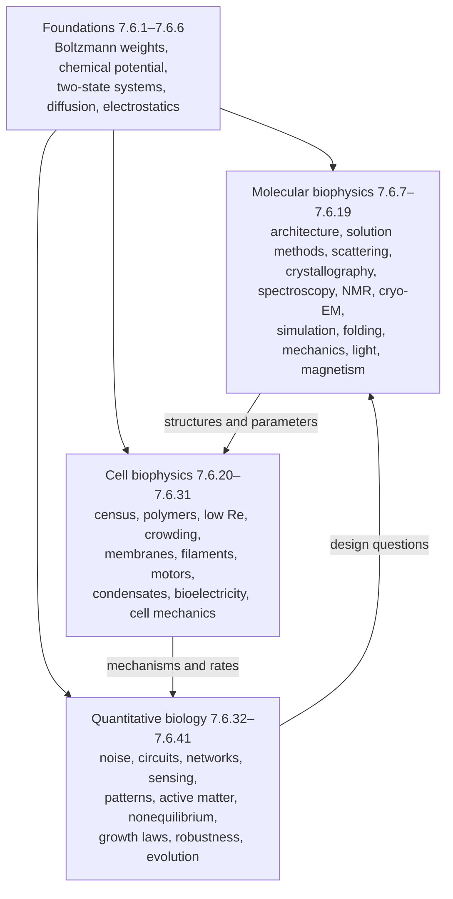

The forty-one chapters of this course have treated living matter at every scale from the vibration of a bond to the evolution of a population. This chapter collects what they built. It does not add new results: it lays the models side by side, points out the few mathematical structures that keep returning in different biological costumes, gathers the numbers that an estimate needs, compares the experimental methods, and closes with the questions that the field has not answered. Every equation and number here is taken from the chapter that develops it, and the references (Theorem 27.4.1, Eq. (5.2), [7.6.30](/7.6.30#sec-30.6)) lead back to the derivations. The chapter ends the course in the way chapter 22 of *Physical Biology of the Cell* ends that book: with the map drawn so far, and with an honest list of where the map is wrong or blank.

## 42.1. The Organization of Biophysics

### 42.1.1. Three Directions on One Foundation

The course divided biophysics into three directions, distinguished by scale and by the kind of law sought ([7.6.1](/7.6.1#sec-1.1.2)). *Molecular biophysics* (7.6.7–7.6.19) determines the structures of macromolecules and the physics of the methods that determine them, and uses them to understand folding, recognition and the interaction of molecules with light and magnetic fields. *Cell biophysics* (7.6.20–7.6.31) deals with dimensional physical quantities at the scale of cells: forces in piconewtons, bending rigidities, viscosities, membrane potentials. *Quantitative biology* (7.6.32–7.6.41) seeks dimensionless regularities that hold across systems: noise, the dynamics of circuits, the precision of sensing, the cost of being out of equilibrium, growth laws, robustness and the statistics of evolution. The three rest on one foundation (7.6.1–7.6.6): the statistical physics of the cell, from the **Boltzmann distribution** and the **chemical potential** to **random walks** and electrostatics in water.

The arrows describe how the parts use one another. Structures and measured parameters of molecules feed the mechanical and electrical models of cells (the gating charge of a channel in the **Hodgkin–Huxley model**, the step and stall force of a motor); the mechanisms of cells supply the rates and nonlinearities of the circuit and network models; and the questions of quantitative biology, why this design and what it costs, send us back to molecules, as when the **thermodynamic uncertainty relation** bounds what a motor's chemistry must dissipate (Theorem 38.4.1).

### 42.1.2. Physical Concepts as the Organizing Thread

Biology textbooks organize their subject by systems and organisms; this course, like *Physical Biology of the Cell*, has organized it largely by physical concepts. The same idea therefore appears in chapters that are far apart in biology, and a biological system appears in several chapters, each looking at it through a different model. The *E. coli* cell is the clearest example: it is the standard ruler of the census (7.6.20), a swimmer at low **Reynolds number** (7.6.22), a crowded solution (7.6.23), a pressurized vessel protected by MscL (7.6.25), a sensor near the **Berg–Purcell limit** (7.6.35), a reaction–diffusion system that finds its middle (7.6.36) and a growing machine obeying the **bacterial growth laws** (7.6.39). The scale map below places the models of the course on axes of length and time; most processes cluster near the two diagonals of diffusion and directed transport, which is one sense in which a few physical clocks organize the cell.

![The models of the course placed by their characteristic length and time, with chapter numbers (7.6.n); colors mark molecular biophysics, cell biophysics and quantitative biology. The values are those of the chapters: a retinal isomerization in 200 fs, a rotational correlation time of 14 ns for a protein of radius 2.5 nm, an 8 nm kinesin step every 10 ms, an F₁ step at 130 Hz, MscL relieving an osmotic shock in about 100 ms, a Min oscillation of 60 s, a mitotic trigger wave of 60 µm/min, an action potential near 20 m/s, a doubling time near an hour, condensate coarsening over weeks. Evolution (7.6.41) occupies a band because it has no length scale of its own. Dashed lines: diffusion times L²/6D for a small molecule in water (1000 µm²/s) and a protein in cytoplasm (10 µm²/s); dotted line: transport at 1 µm/s; for the protein, directed transport wins beyond L* = 6D/v = 60 µm](./plots/scale-map.py)

## 42.2. Mathematical Structures That Recur

A small number of mathematical structures carry most of the course. The table lists them; the subsections show how each reappears.

| Structure | Core equation | Appears in |
|---|---|---|
| Boltzmann weights, two-state switches | $p = 1/(1 + \mathrm{e}^{\beta(\Delta G_0 - qX)})$ | 2, 3, 4, 8, 16, 17, 19, 25, 30, 31, 35, 41 |
| Master equations, dwell times | $\dot{\boldsymbol{p}} = \boldsymbol{p}W$; hidden steps from $\langle\tau\rangle^2/\operatorname{Var}\tau$ | 5, 12, 15, 16, 27, 28, 30, 32, 38 |
| Diffusion, drift, first passage | $\partial_tc = D\nabla^2c$, $D\gamma = k_{\mathrm{B}}T$, Kramers rate | 5, 8, 11, 12, 13, 17, 20, 22, 23, 26, 35 |
| Ratchets | rectified fluctuations, no current at equilibrium | 2, 26, 27, 28, 38 |
| Fourier space | measurement of transforms; stability of modes | 9, 10, 12, 13, 14, 24, 26, 29, 36 |
| Fluctuations as measurement | response = fluctuation$/k_{\mathrm{B}}T$ | 2, 5, 8, 9, 17, 23, 24, 26 |
| Feedback and bifurcations | fixed points, saddle-node and Hopf bifurcations | 30, 31, 33, 34, 35, 36, 40 |
| Cost of nonequilibrium function | cycle affinity, entropy production, TUR | 2, 3, 17, 27, 35, 38 |
| Continuum elasticity and flow | bending energy $\frac{\kappa}{2}\int c^2$, Stokes flow | 21, 22, 24, 25, 26, 31 |

### 42.2.1. Boltzmann Weights and Two-State Switches

The most frequently used model of the course is the **two-state system** (Definition 4.1.1): a molecule with two free-energy basins whose difference $\Delta G = \Delta G_0 - qX$ is shifted by a control variable $X$ through a conjugate property $q$ (Theorem 4.1.1). The probability of the second state is a logistic function with midpoint $\Delta G_0/q$ and a 10–90 % width of $4.4\,k_{\mathrm{B}}T/q$. Changing the names of $X$ and $q$ turns it into a dozen models:

| System | Control $X$ | Conjugate $q$ | Where |
|---|---|---|---|
| Mechanosensitive channel MscL | tension $\tau$ | area change $\Delta A \approx 20\,\mathrm{nm^2}$ | Formula 4.2.1, Theorem 25.4.1 |
| Voltage-gated channel | voltage $V$ | gating charge $ze$, $z \approx 13$ (*Shaker*) | Formula 4.2.2, [7.6.30](/7.6.30#sec-30.3) |
| Thermosensitive channel | temperature $T$ | entropy $\Delta S = \Delta H/T_{1/2}$ | Formula 4.2.3 |
| Protein or RNA unfolding | temperature, denaturant | $\Delta H$, $m$ value | Formula 8.2.1, [7.6.16](/7.6.16#sec-16.1) |
| Hairpin under force | force $F$ | extension $\Delta x$ | Formula 17.4.2 |
| Ligand binding | $\ln c$ | number of ligands $n$ | Theorem 3.3.1, Eq. (3.16) |
| Chemoreceptor cluster | $\ln c$ | free energy per receptor times $N$ | Formula 35.5.1 |
| Hair-cell transduction channel | bundle deflection | gating force $z$ | Theorem 31.5.1 |
| Magnetosome chain | field $B$ | moment $m$ (Langevin form) | Theorem 19.2.1 |
| Genotype under selection | fitness | population size as inverse temperature | Theorem 41.3.1 |

The collapse in panel F of the figure is the statement that these systems differ only in their conjugate charge. Sharpness requires a large $q$: a channel that switches over $1\,\mathrm{mV}$ would need a gating charge of more than $100\,e$, which is why steep biological responses are built from coupled units, either by Ising-type interactions (Theorem 4.4.1) or by a common conformational switch, the **MWC model** (Formula 4.5.1), which reappears in hemoglobin, the nicotinic receptor (Example 4.5.1) and the chemoreceptor array of bacteria (Theorem 35.5.1). The thermodynamic model of gene regulation (Example 3.3.1) and the occupancy of binding sites in a genome of decoys ([7.6.41](/7.6.41#sec-41.3)) are the same statistical mechanics with $X = \ln c$. The analogy reaches evolution: under weak mutation the stationary distribution of genotypes is a **Boltzmann distribution** with the population size as inverse temperature (Theorem 41.3.1).

![One law for many switches. A–D: two-state systems of the course against their own control variables, with the parameters of the chapters: MscL opened by tension (ΔG₀ = 50 kBT, ΔA = 20 nm², half-open near 10 mN/m), a voltage-gated channel with the Shaker gating charge z = 13 against V − V₁/₂, a TRPV1-like heat sensor (ΔH = 420 kJ/mol, half-open at 42 °C), and the P5ab RNA hairpin under force (transition near 14.5 pN, Δx = 18 nm); arrows mark the 10–90 % widths 4.4 kBT/q. E: ligand binding is a two-state system in ln c: a single site switches over 81-fold in concentration, an all-or-none tetramer over 3-fold. F: plotted against the free-energy bias −βΔG = β(qX − ΔG₀), all curves fall on one logistic function](./plots/two-state.py)

### 42.2.2. Master Equations, Dwell Times and Hidden Steps

Whenever a molecule has discrete states and makes random transitions between them, the **master equation** (Definition 5.5.1) describes it. The course used it for a hopping particle, from which drift and diffusion follow (Definition 5.5.2); for folding as a birth–death chain, the **Zwanzig model** (Theorem 16.2.1); for motors (Formula 27.3.1, Theorem 27.3.2); for channels, whose dwell-time distributions are sums of exponentials, one per state (Theorem 30.3.1); for the molecular simulations coarse-grained into **Markov state models** (Definition 15.4.1); for the copy numbers of molecules in a cell, the **chemical master equation** (Definition 32.2.2); and, in its most general form, for **nonequilibrium steady states** of networks with cycles (Definition 38.1.1).

One consequence was derived four times in different language. The waiting time for a process of $n$ sequential exponential steps has relative variance at least $1/n$, so the measured statistics give a lower bound on the number of hidden steps: from single-molecule dwell times (Proposition 12.1.1), from the waiting times of a Poisson process (Theorem 32.1.1), from motor steps, where $n_{\min} = \langle\tau\rangle^2/\operatorname{Var}\tau$ (Theorem 27.4.1) and the **randomness parameter** $r = 2D/Va$ (Definition 27.4.1) gives $r \approx 1/2$ for kinesin (Example 27.4.1), and from the aging of microtubules, whose catastrophe times are gamma distributed with about three steps ([7.6.26](/7.6.26#sec-26.4)). The same idea, that fluctuations reveal what averages hide, organizes [7.6.32](/7.6.32#sec-32.8): burst sizes, numbers of states and the order of mutation and selection in the **Luria–Delbrück distribution** (Theorem 32.8.1). The inference of states and rates from noisy trajectories with **hidden Markov models** (Algorithm 12.5.1) closes the loop between theory and single-molecule data.

### 42.2.3. Diffusion, Drift and First Passage

The **random walk** (Theorem 5.1.1), its continuum limit, the diffusion equation (Eq. (5.2)), and the **Einstein relation** $D\gamma = k_{\mathrm{B}}T$ (Theorem 5.3.1) appear in almost every chapter, often unannounced:

- Rotational diffusion sets the correlation time $\tau_{\mathrm{rot}} = \eta V/k_{\mathrm{B}}T$ (Formula 5.3.2), which is read out by fluorescence anisotropy as about $0.42\,\mathrm{ns\,kDa^{-1}}$ (Definition 11.5.2), by NMR relaxation as $0.5$–$0.6\,\mathrm{ns\,kDa^{-1}}$ (Definition 13.3.1; the difference is the hydration shell) and by flow birefringence (Definition 8.7.4). The same $\tau_{\mathrm{c}}$ makes large proteins hard for NMR, because $T_2 \propto 1/\tau_{\mathrm{c}}$ (Theorem 13.3.1).
- Translational diffusion is measured by DLS from the decay $g_1 = \mathrm{e}^{-q^2D\tau}$ (Theorem 8.11.1), by FCS from $\tau_{\mathrm{D}} = w_0^2/4D$ (Theorem 12.6.1), by FRAP (Formula 5.2.2) and by single-particle tracking (Formula 12.3.2); in each case the Stokes–Einstein relation converts $D$ to a size.
- Diffusion to an absorber, $J = 4\pi Dac_0$ (Formula 5.2.3), gives the diffusion-limited rate constant $\approx 7\times10^9\,\mathrm{M^{-1}\,s^{-1}}$ (Example 5.2.1), the encounter time in a cell, seconds at $1\,\mathrm{nM}$ (Eq. (20.4)), the speed of facilitated target search (Theorem 17.8.1), the counting noise of a receptor, $(\delta c/c)^2 = 1/(4\pi DacT)$ (Theorem 35.1.1), and the current through a single channel limited by access, $2\pi Dac$ ([7.6.30](/7.6.30#sec-30.2)).
- Mean **first-passage times** (Theorem 5.6.1) and the **Kramers rate** (Theorem 5.6.2) give barrier crossing in folding, with a prefactor of $10^6$–$10^7\,\mathrm{s^{-1}}$ ([7.6.16](/7.6.16#sec-16.2)), bond rupture under force in the **Bell model** (Theorem 17.5.1), the dwell of DNA in a nanopore as an inverse-Gaussian first passage (Formula 12.7.2), the time of microtubule search and capture (Theorem 26.4.1) and the switching time between stable states of a noisy circuit, $\propto \mathrm{e}^{\Omega\Delta\phi}$ (Theorem 32.7.1).
- The comparison of diffusion with directed motion, the **Péclet number** (Definition 5.2.1), explains why bacteria do not gain by stirring (Example 5.2.2), why large cells need motors beyond $L^* = 6D/v$ ([7.6.5](/7.6.5#sec-5.1.3)), and why swimming pays only beyond $2D/U \approx 70\,\mu\mathrm{m}$ ([7.6.22](/7.6.22#sec-22.5)). In crowded and viscoelastic media the walk becomes **anomalous diffusion** (Definition 23.3.1).

### 42.2.4. Ratchets: Rectifying Thermal Motion

A recurring question was how a molecule can turn random thermal motion into directed motion or work. The answer, given first for **Maxwell's demon** (Definition 2.4.1) and the Szilard engine (Definition 2.4.2), reconciled with the second law by the Landauer bound (Theorem 2.4.1), is the same every time: it cannot at equilibrium, and it can when a free-energy source breaks detailed balance. A **Feynman ratchet** produces no current in any periodic potential at equilibrium (Theorem 27.2.1); a flashing ratchet, driven by switching the potential, does (Formula 27.2.1). The mathematics then repeats with different molecules:

| Ratchet | Velocity or force | Where |
|---|---|---|
| Polymerization ratchet (ideal) | $v = (D/\delta)\,\omega^2/(\mathrm{e}^\omega - 1 - \omega)$, $\omega = F\delta/k_{\mathrm{B}}T$ | Theorem 26.5.1 |
| Elastic Brownian ratchet | filament bending fluctuations open gaps, $\cos\theta^* = 1/\omega$ | Definition 26.5.1, Formula 26.5.2 |
| Translocation ratchet | $v = (2D/d)(w^2/2)/(\mathrm{e}^w - w - 1)$, the same function | Theorem 28.5.1 |
| Reversible binding ratchet | stalls at $(k_{\mathrm{B}}T/d)\ln(1 + c/K_{\mathrm{d}})$ | Formula 28.5.1 |
| Fₒ of ATP synthase | protonation ratchet driven by $\Delta p$ | [7.6.28](/7.6.28#sec-28.3) |

The ideal polymerization and translocation ratchets give the same function of the dimensionless load, because both describe a diffusing object whose backward motion is blocked every time it advances by one step. The thermodynamic bound is also common to all: a motor or ratchet driven by a free energy $\Delta\mu$ per step of length $a$ stalls at $F = \Delta\mu/a$ (Formula 27.1.1, Theorem 27.3.1), and a polymerizing filament at $(k_{\mathrm{B}}T/\delta)\ln(c/C_{\mathrm{c}})$ (Formula 26.5.1).

### 42.2.5. Fourier Space

Almost every structural method measures a Fourier transform, and the differences between the methods are differences in what part of the transform is measured and what is lost.

| Method | What is measured | What is lost | How it is recovered | Where |
|---|---|---|---|---|
| SAXS, light scattering | $\lvert A(\boldsymbol{q})\rvert^2$, orientationally averaged | phases and orientations | models with restraints | Formula 9.3.1, Theorem 9.3.1 |
| Crystallography | $\lvert F(\boldsymbol{h})\rvert$ at reciprocal-lattice points | phases | isomorphous replacement, anomalous scattering, molecular replacement, direct methods | Theorem 10.3.1, Definition 10.4.1 |
| Fiber diffraction | layer lines of the helix transform | phases, orientation about the axis | helical selection rule | Theorem 10.5.1 |
| Electron microscopy | image = inverse transform of the exit wave, modulated by the CTF | CTF zeros, orientations | defocus series, Bayesian refinement | Theorem 14.2.1, Theorem 14.4.1 |
| 3D reconstruction | projections = central sections | missing wedge in tomography | many orientations | Theorem 14.6.1 |
| NMR, MRI | free induction decay, k-space | nothing (complex signal) | Fourier transform | Formula 13.2.1, Theorem 13.8.1 |
| Light microscopy | spatial frequencies up to $2\mathrm{NA}/\lambda$ | higher frequencies | localization, STED, SIM | Formula 12.2.1, [7.6.12](/7.6.12#sec-12.4) |
| DLS, FCS, optical traps | correlation functions and power spectra | — | fitting decays and Lorentzians | Theorem 8.11.1, Theorem 12.6.1, Formula 17.2.2 |

Fourier modes are also the natural coordinates of stability analysis. Thermal undulations of a membrane, $\langle\lvert h_q\rvert^2\rangle = k_{\mathrm{B}}T/A(\kappa q^4 + \sigma q^2)$ (Formula 24.3.1), and of a filament (Formula 26.1.1) measure bending rigidities mode by mode; the growth rate $\sigma(q)$ of a perturbation decides spinodal decomposition in the **Cahn–Hilliard equation** (Theorem 29.3.1), Turing patterns, oscillatory and conserved instabilities ([7.6.36](/7.6.36#sec-36.2)), the **Swift–Hohenberg equation** (Definition 36.2.1) and the instability of active nematics ([7.6.37](/7.6.37#sec-37.6)). The resolution criteria of the methods, the Crowther criterion $N \approx \pi D/d$ (Eq. (14.7)), Nyquist sampling and the number of independent parameters in a SAXS curve (Definition 9.8.1), are sampling theorems in Fourier space.

### 42.2.6. Fluctuations as Measurements

At equilibrium the response of a system to a small force equals its spontaneous fluctuation divided by $k_{\mathrm{B}}T$ (Eq. (2.7)), and the course used this repeatedly to turn noise into a measuring instrument:

| Fluctuation | Measured quantity | Where |
|---|---|---|
| Enthalpy fluctuations | heat capacity $C_p = \langle\delta H^2\rangle/k_{\mathrm{B}}T^2$ in DSC | Theorem 8.2.1 |
| Bead position in a trap | stiffness $\kappa = k_{\mathrm{B}}T/\langle x^2\rangle$, corner frequency | Example 2.3.2, Formula 5.4.1, Formula 17.2.2 |
| Bead under magnetic tweezers | force $F = k_{\mathrm{B}}Tl/\langle\delta x^2\rangle$ | Formula 17.3.1 |
| Concentration fluctuations | molar mass and $A_2$, $Kc/R_0 = 1/M + 2A_2c$ | Theorem 9.2.1 |
| Density fluctuations of water | absolute SAXS calibration | Formula 9.9.1 |
| Membrane and filament shapes | $\kappa$, $\ell_{\mathrm{p}}$ | Formula 24.3.1, Formula 26.1.1 |
| Copy-number fluctuations | burst size and frequency, feedback | Theorem 32.4.1, Eq. (32.17) |
| Violation of the relation | active forces in cytoplasm below $10\,\mathrm{Hz}$ | Definition 23.3.2, Formula 23.3.1 |

The last row turns the relation around: where the **fluctuation–dissipation theorem** fails, the system is driven, and the size of the violation measures the activity. The same logic, extended by the fluctuation theorems, measures the torque of F₁ from its fluctuations (Formula 28.2.2, Example 38.3.2) and bounds hidden dissipation from observed currents (Theorem 38.4.1).

### 42.2.7. Feedback, Bistability and Oscillation

Positive feedback makes switches, negative feedback with delay makes oscillators, and the combination makes excitable systems: this rule of signs ([7.6.33](/7.6.33#sec-33.1.1)) runs through the dynamical chapters. A sodium current that activates itself makes the membrane bistable (Proposition 30.4.1) and, with slower potassium feedback, excitable, with a **Hopf bifurcation** at the onset of repetitive firing ([7.6.30](/7.6.30#sec-30.6)); hair cells poise their active bundles near a Hopf point and amplify faint sounds with a compressive $F^{1/3}$ response (Proposition 31.5.1); the **genetic toggle switch** is bistable beyond a critical expression rate (Theorem 33.3.1); the Goodwin loop needs a loop gain above $\sec(\pi/N)^N$ to oscillate (Theorem 33.5.1); the embryonic cell cycle oscillates because positive feedback makes the Cdk1 nullcline N-shaped, and without that loop the oscillation is damped, and the yeast cell cycle crosses **saddle-node bifurcations** as cells grow ([7.6.34](/7.6.34#sec-34.2)). Negative feedback also lowers sensitivity, by $1/(1 + L)$ (Formula 40.1.1), and noise, $F = 1/(1 + H)$ (Eq. (32.17)); its integral form produces **perfect adaptation** (Theorem 35.6.1), whose robustness was the first case study of biological **robustness** (Definition 40.1.1). Spatially extended bistable systems propagate fronts at a speed set by diffusion and reaction, and the formula is the same for a nerve and for a frog egg: the front of the bistable **cable equation** moves at $v = (\lambda/\tau)\sqrt{k/2}\,(1 - 2\alpha)$ (Proposition 30.5.1), a **trigger wave** at $v = \sqrt{Dk/2}\,(1 - 2a)$ (Theorem 36.5.1), and the two coincide with $D = \lambda^2/\tau$.

### 42.2.8. The Cost of Being Away from Equilibrium

At equilibrium every elementary transition is balanced by its reverse (Theorem 3.5.1), no cycle carries a current (Theorem 38.1.1), and many biological functions are impossible. The course met the same theorem in five forms:

| Function | Equilibrium limit | With dissipation $\Delta\mu$ per cycle | Where |
|---|---|---|---|
| Directed motion | no current in a periodic potential | stall at $\Delta\mu/a$ | Theorem 27.2.1, Theorem 27.3.1 |
| Discrimination | error $f_0 = \mathrm{e}^{-\Delta\Delta G/k_{\mathrm{B}}T}$ | down to $\sim f_0^2$ with proofreading | Proposition 17.9.1, [7.6.38](/7.6.38#sec-38.5) |
| Amplification | Hill-type gain bounded by cooperativity | ultrasensitivity of cycles | Theorem 35.5.2 |
| Adaptation | not exact | exact by integral feedback | Theorem 35.6.1 |
| Timekeeping | no coherent oscillation | precision $\varepsilon^2M = \coth(\mathcal{A}/2Nk_{\mathrm{B}}T)/N$ | Formula 38.4.1 |
| Information erasure | — | $\ge k_{\mathrm{B}}T\ln 2$ per bit | Theorem 2.4.1 |

The general accounting is the **entropy production** of a Markov network, which in a steady state is the sum of cycle currents times cycle affinities (Formula 38.2.1); a cycle coupled to ATP hydrolysis has an affinity of about $20\,k_{\mathrm{B}}T$, because cells hold $[\mathrm{ATP}]/[\mathrm{ADP}]$ many orders of magnitude from equilibrium (Example 3.2.1). The **fluctuation theorem** (Theorem 38.3.1), of which the **Jarzynski equality** (Theorem 17.6.1) and the **Crooks fluctuation theorem** (Theorem 17.6.2) are the versions for driving from equilibrium, and the thermodynamic uncertainty relation (Theorem 38.4.1) turn this accounting into bounds that experiments can test on single molecules. At the scale of organisms the same balance, $\mathrm{d}_{\mathrm{i}}S \ge 0$ with entropy exported to the environment (Eq. (2.12)), explains why a human turns over about $30\,\mathrm{kg}$ of ATP a day (Example 2.5.2).

### 42.2.9. Continuum Elasticity and Flow

Below the scale of molecules the course replaced atoms by continua with a few moduli. A rod, a polymer and a membrane store bending energy quadratic in curvature, and the ratio of the bending modulus to $k_{\mathrm{B}}T$ is a length: the **persistence length** $\ell_{\mathrm{p}} = \kappa/k_{\mathrm{B}}T$ of DNA ($50\,\mathrm{nm}$), actin ($10$–$17\,\mu\mathrm{m}$) and microtubules ($1$–$6\,\mathrm{mm}$) (Proposition 21.3.1, [7.6.26](/7.6.26#sec-26.1)); a membrane with **bending rigidity** $\kappa \approx 20\,k_{\mathrm{B}}T$ has no such length, which is why vesicles of any size cost $8\pi\kappa$ (Example 24.4.1). The same elastic sheet, deformed around a protein by **hydrophobic mismatch**, gives the line tension that gates MscL (Theorem 25.2.1, Theorem 25.4.1); the same beam theory gives **Euler buckling** of filaments (Theorem 26.2.1); the same Hertz contact law measures cells by AFM (Definition 31.2.1). Fluids at low Reynolds number obey the linear and reversible **Stokes flow** (Proposition 22.4.1), from which come Stokes' law, the frictional coefficients of the hydrodynamic methods ([7.6.8](/7.6.8#sec-8.7)), the **scallop theorem** (Theorem 22.5.1) and the drag that loads F₁ through its actin filament in experiments (Example 22.4.2). Where molecular structure matters, continuum models fail: in the hydration repulsion of packed DNA (Formula 21.7.1), in the discrete steps of motors and in the selectivity filter of a channel ([7.6.30](/7.6.30#sec-30.2)).

## 42.3. An Index of Models

The tables list the main models of the course with their defining equation, the scale at which they are used and where they are developed. They are an index, not a substitute for the derivations, which contain the assumptions and the limits.

Foundations (7.6.1–7.6.6):

| Model | Equation | Scale | Where |
|---|---|---|---|
| Target theory | $f = 1 - \mathrm{e}^{-\sigma D}$ | nm targets, radiation dose | Definition 1.2.1 |
| Viral dynamics | infected cells and virions, half-lives hours and 1.5 days | patients, days | Formula 1.6.1, Theorem 1.6.1 |
| Boltzmann distribution | $p_i = \mathrm{e}^{-\beta E_i}/Z$, $F = -k_{\mathrm{B}}T\ln Z$ | any equilibrium subsystem | Theorem 2.2.1, Formula 2.2.1 |
| Landauer bound | $k_{\mathrm{B}}T\ln 2$ per erased bit | information processing | Theorem 2.4.1 |
| Entropy balance | $\mathrm{d}S = \mathrm{d}_{\mathrm{e}}S + \mathrm{d}_{\mathrm{i}}S$, $\mathrm{d}_{\mathrm{i}}S \ge 0$ | cells to the Earth | Eq. (2.12) |
| Dilute solution | $\mu = \mu^\circ + k_{\mathrm{B}}T\ln(c/c^\circ)$ | solutes | Formula 3.1.1 |
| Mass action | $\prod(c_i/c^\circ)^{\nu_i} = K = \mathrm{e}^{-\Delta G^\circ/k_{\mathrm{B}}T}$ | reactions | Theorem 3.2.1 |
| Lattice model of binding | $p = c/(c + K_{\mathrm{d}})$, $K_{\mathrm{d}} = c_0\mathrm{e}^{\Delta\varepsilon/k_{\mathrm{B}}T}$ | receptors, promoters | Theorem 3.3.1 |
| Proton-motive force | $\Delta p = \Delta\Psi - 61.5\,\mathrm{mV}\,\Delta\mathrm{pH}$ | energy-transducing membranes | Formula 3.4.1 |
| Detailed balance | $k_+/k_- = \mathrm{e}^{-\Delta G^\circ/k_{\mathrm{B}}T}$ | elementary steps at equilibrium | Theorem 3.5.1 |
| Two-state system | $p_1 = 1/(1 + \mathrm{e}^{\beta\Delta G})$, $\Delta G = \Delta G_0 - qX$ | channels, hairpins, receptors | Formula 4.1.1, Theorem 4.1.1 |
| Ising dimer | $\mathcal{Z} = 1 + 2x + \omega x^2$, $n_{\mathrm{H}} = 2/(1 + \mathrm{e}^{\beta J/2})$ | cooperative sites | Formula 4.4.1, Theorem 4.4.1 |
| MWC model | $p_{\mathrm{A}} = (1 + c/K_{\mathrm{A}})^n/[(1 + c/K_{\mathrm{A}})^n + L(1 + c/K_{\mathrm{I}})^n]$ | allosteric proteins | Formula 4.5.1 |
| Random walk | $\langle r^2\rangle = Na^2 = 2dDt$ | molecules, cells, polymers | Theorem 5.1.1 |
| Diffusion equation | $\partial_tc = D\nabla^2c$ | concentration fields | Eq. (5.2), Formula 5.2.1 |
| Diffusive capture | $J = 4\pi Dac_0$ | absorbers, receptors | Formula 5.2.3 |
| Einstein relation | $D\gamma = k_{\mathrm{B}}T$, $D = k_{\mathrm{B}}T/6\pi\eta a$ | Brownian particles | Theorem 5.3.1, Eq. (5.3) |
| Langevin equation | friction plus white noise of strength $2\gamma k_{\mathrm{B}}T$ | beads, molecules | Definition 5.4.1, Theorem 5.4.1 |
| Master and Fokker–Planck equations | hopping gives $v = a(k_+ - k_-)$, $D = a^2(k_+ + k_-)/2$ | any discrete or continuous Markov process | Definitions 5.5.1–5.5.2 |
| Kramers rate | $k = \sqrt{U''_aU''_b}\,\mathrm{e}^{-\Delta U/k_{\mathrm{B}}T}/2\pi\gamma$ | barrier crossing | Theorem 5.6.2 |
| Coulomb in water | $U = z_1z_2k_{\mathrm{B}}T\ell_{\mathrm{B}}/r$, $\ell_{\mathrm{B}} = 0.71\,\mathrm{nm}$ | ions, charged groups | Eq. (6.2), Definition 6.2.1 |
| Born solvation | $\Delta G = (z^2\ell_{\mathrm{B}}^{\mathrm{vac}}/2a)(1/\varepsilon_2 - 1/\varepsilon_1)k_{\mathrm{B}}T$ | burying a charge | Formula 6.2.1 |
| Poisson–Boltzmann | $\nabla^2y = \kappa^2\sinh y$, $\lambda_{\mathrm{D}} = 0.304/\sqrt I\,\mathrm{nm}$ | salt solutions | Formula 6.4.1, Eq. (6.3) |
| Counterion condensation | $\theta = 1 - 1/z\xi$, $\xi = 4.2$ for DNA | polyelectrolytes | Theorem 6.4.1 |

Molecular biophysics (7.6.7–7.6.19):

| Model | Equation | Scale | Where |
|---|---|---|---|
| Screw symmetry of repeats | $\cos\theta = (\operatorname{tr}R - 1)/2$ | helices | Theorem 7.2.1 |
| Quasi-equivalence | $T = h^2 + hk + k^2$, $60T$ subunits | icosahedral capsids | [7.6.7](/7.6.7#sec-7.5.2) |
| Two-state thermogram | peak $\Delta H^2/4RT_{\mathrm{m}}^2$; ratio $\Delta H_{\mathrm{vH}}/\Delta H_{\mathrm{cal}}$ | DSC | Formula 8.2.1, Formula 8.2.2 |
| Stability curve | $\Delta G(T)$ with $\Delta C_p$; cold denaturation | proteins | Formula 8.3.1 |
| Wiseman isotherm | $c = nK_{\mathrm{a}}[\mathrm{M}]_{\mathrm{t}}$, measurable for $1 < c < 1\,000$ | ITC | Definition 8.4.2 |
| Svedberg equation | $s = M(1 - \bar v\rho)/N_{\mathrm{A}}f$ | AUC | Formula 8.8.1 |
| Zimm equation | $Kc/R_0 = 1/M + 2A_2c$ | SLS | Theorem 9.2.1, Formula 9.2.3 |
| Guinier law | $I \approx I(0)\,\mathrm{e}^{-q^2R_{\mathrm{g}}^2/3}$ | SAXS, $qR_{\mathrm{g}} \lesssim 1.3$ | Theorem 9.4.1 |
| Porod law | $I \simeq 2\pi(\Delta\rho)^2S/q^4$ | SAXS, $qD \gg 1$ | Theorem 9.6.1 |
| Laue condition, Bragg's law | $\boldsymbol{S} = \boldsymbol{H}_{hkl}$, $2d\sin\theta = \lambda$ | crystals | Theorem 10.2.1, Theorem 10.2.2 |
| Electron density | $\rho(\boldsymbol{x}) = \frac1V\sum_{\boldsymbol{h}}\lvert F\rvert\cos(2\pi\boldsymbol{h}\cdot\boldsymbol{x} - \varphi)$ | crystals | Theorem 10.3.1 |
| Beer–Lambert law | $A = \varepsilon cl$ | absorption | Theorem 11.1.1 |
| Exciton dimer | $E_\pm = E_0 \pm V_{12}$ | coupled chromophores | Theorem 11.2.1 |
| Förster transfer | $E = 1/[1 + (R/R_0)^6]$, $R_0 = 2$–$8\,\mathrm{nm}$ | donor–acceptor pairs | Theorem 11.5.4, Formula 11.5.3 |
| Localization precision | $\sigma_{\mathrm{loc}} \ge s/\sqrt N$ | single emitters | Theorem 12.3.1 |
| FCS | $G(\tau) = \langle N\rangle^{-1}(1 + \tau/\tau_{\mathrm{D}})^{-1}(1 + \tau/\omega^2\tau_{\mathrm{D}})^{-1/2}$ | nM, µs–s | Theorem 12.6.1 |
| Bloch equations | precession, $T_1$, $T_2$ | nuclear spins | Theorem 13.2.1 |
| BPP relaxation | $J(\omega) = \frac25\tau_{\mathrm{c}}/(1 + \omega^2\tau_{\mathrm{c}}^2)$ | ps–ns motion | Definition 13.3.1, Theorem 13.3.1 |
| Chemical exchange | $R_{\mathrm{ex}} = p_{\mathrm{A}}p_{\mathrm{B}}\Delta\omega^2/k_{\mathrm{ex}}$ | µs–ms motion | Formula 13.6.1 |
| Linderstrøm-Lang exchange | $\Delta G_{\mathrm{op}} = RT\ln P$ (EX2) | s–months | Definitions 13.6.5–13.6.6 |
| Contrast transfer | $\chi = \pi\lambda\Delta fk^2 - \frac{\pi}{2}C_{\mathrm{s}}\lambda^3k^4$ | cryo-EM | Formula 14.4.1, Theorem 14.4.1 |
| Projection–slice theorem | FT of a projection = central section | 3D reconstruction | Theorem 14.6.1 |
| Resolution | $\mathrm{FSC} = \mathrm{SNR}/(1 + \mathrm{SNR})$; $\ln N = B/2d^2 + \mathrm{const}$ | maps | Theorem 14.9.1, Eq. (14.15) |
| Molecular dynamics | $m\ddot{\boldsymbol{r}} = -\nabla U$, velocity Verlet, $\Delta t = 1$–$2\,\mathrm{fs}$ | fs–µs | Algorithm 15.2.1 |
| Markov state model | $\boldsymbol{p}(t + k\tau) = \boldsymbol{p}(t)T(\tau)^k$ | µs–s from short runs | Definition 15.4.1 |
| Potts model, DCA | maximum-entropy couplings, $J \approx -C^{-1}$ | sequence families | Definition 15.5.1, Eq. (15.11) |
| RNA folding by dynamic programming | non-crossing pairs, $O(n^3)$ | secondary structure | Algorithm 15.6.1 |
| Zwanzig model | $\tau = \sum_j\sum_{i\ge j}\pi_i/(d_j\pi_j)$ | folding kinetics | Theorem 16.2.1 |
| Random-energy model | $k_{\mathrm{B}}T_{\mathrm{g}} = \Delta E/\sqrt{2S_0}$, fold if $T_{\mathrm{f}} > T_{\mathrm{g}}$ | landscapes | Formula 16.2.1 |
| φ-value analysis | $\phi = \Delta\Delta G^\ddagger/\Delta\Delta G_{\mathrm{U}}$ | transition states | Definition 16.3.1 |
| Worm-like chain under force | Marko–Siggia interpolation | DNA, unfolded proteins | Formula 17.4.1 |
| Bell model | $k = k_0\mathrm{e}^{Fx^\ddagger/k_{\mathrm{B}}T}$, $F^* = (k_{\mathrm{B}}T/x^\ddagger)\ln(rx^\ddagger/k_0k_{\mathrm{B}}T)$ | bonds under load | Definition 17.5.1, Theorem 17.5.1 |
| Jarzynski equality | $\langle\mathrm{e}^{-W/k_{\mathrm{B}}T}\rangle = \mathrm{e}^{-\Delta F/k_{\mathrm{B}}T}$ | single-molecule pulling | Theorem 17.6.1 |
| Facilitated diffusion | $\tau_{\mathrm{s}} = (M/n)(\tau_{1\mathrm{D}} + \tau_{3\mathrm{D}})$ | target search | Theorem 17.8.1 |
| Kinetic proofreading | $f_0 \ge f \gtrsim f_0^2$ with driving | discrimination | Proposition 17.9.1 |
| Marcus theory | $\Delta G^\ddagger = (\Delta G^\circ + \lambda)^2/4\lambda$ | electron transfer | Theorem 18.4.1 |
| Frequency of seeing | Poisson threshold of $5$–$7$ photons | vision | Theorem 18.6.1 |
| Magnetotaxis | alignment $\coth\xi - 1/\xi$, $mB \approx 15\,k_{\mathrm{B}}T$ | bacteria | Theorem 19.2.1 |
| Radical pair mechanism | spin-selective singlet yield | µs spin dynamics | Theorem 19.4.1 |

Cell biophysics (7.6.20–7.6.31):

| Model | Equation | Scale | Where |
|---|---|---|---|
| Encounter time | $1/(4\pi Dac)$, spacing $c^{-1/3}$ | cells | Formula 20.2.1, Eq. (20.4) |
| Partition noise | $\langle(I_1 - I_2)^2\rangle = \alpha(I_1 + I_2)$ | division | Proposition 20.1.1 |
| Freely jointed and worm-like chains | $\langle R^2\rangle = 2\ell_{\mathrm{p}}L - 2\ell_{\mathrm{p}}^2(1 - \mathrm{e}^{-L/\ell_{\mathrm{p}}})$ | DNA, chromatin | Proposition 21.1.1, Formula 21.3.1 |
| Flory scaling | $R \propto N^\nu$, $\nu = 1/2$, $0.588$, $1/3$ | polymers | Proposition 21.4.1 |
| Looping | $J = P(\boldsymbol{0})/N_{\mathrm{A}}$, optimum $\approx 550\,\mathrm{bp}$ | gene regulation | Definition 21.5.1 |
| Contact probability | $P(s) \propto s^{-3\nu}$ | Hi-C | Proposition 21.6.1 |
| Navier–Stokes, Reynolds number | $\operatorname{Re} = \rho UL/\eta$ | flows | Definition 22.1.2, Definition 22.3.1 |
| Hagen–Poiseuille | $Q = \pi\Delta p\,d^4/128\eta l$ | vessels | Formula 22.2.1 |
| Scallop theorem | reciprocal strokes give no net motion | swimmers | Theorem 22.5.1 |
| Crowded binding | $K_{\mathrm{d}}(\varphi)/K_{\mathrm{d}}(0) = (1 - \varphi)^r$ | cytoplasm | Formula 23.2.1 |
| Depletion force | $W = -\Pi V_{\mathrm{ov}}$ | colloids, chromatin | Definition 23.2.2 |
| Critical micelle concentration | $X_N = N(X_1/X_{\mathrm{c}})^N$ | amphiphiles | Proposition 24.1.1 |
| Helfrich energy | bending $\kappa \approx 20\,k_{\mathrm{B}}T$, stretching $K_A \approx 0.24\,\mathrm{N\,m^{-1}}$ | membranes | Definitions 24.2.2–24.2.5 |
| Tethers | $r = \sqrt{\kappa/2\sigma}$, $f = 2\pi\sqrt{2\kappa\sigma}$ | membrane tubes | Formula 24.3.3 |
| Thickness deformation | $u = U\mathrm{e}^{-y}(\cos y + \sin y)$, $\lambda^{-1} \approx 1\,\mathrm{nm}$ | around proteins | Theorem 25.2.1 |
| MscL gating | $\tau^* = \mathcal{K}U^2/(R_{\mathrm{o}} + R_{\mathrm{c}})$ | channels in bilayers | Theorem 25.4.1 |
| Piezo dome | $\tau_{\mathrm{d}} = 8\pi\kappa/A_{\mathrm{d}}$ | eukaryotic channels | Theorem 25.6.1 |
| Euler buckling | $F_{\mathrm{c}} = \pi^2EI/L^2$ | filaments | Theorem 26.2.1 |
| Equilibrium polymerization | $c_n = \sigma C_{\mathrm{c}}x^n$ | filaments | Theorem 26.3.1 |
| Polymerization force | $F_{\mathrm{s}} = (k_{\mathrm{B}}T/\delta)\ln(c/C_{\mathrm{c}})$ | actin, microtubules | Formula 26.5.1 |
| One-state motor | $V = a(k_+ - k_-)$, $D = \frac{a^2}{2}(k_+ + k_-)$, stall at $\Delta\mu/a$ | motors | Formula 27.3.1, Theorem 27.3.1 |
| Motor efficiency bound | $\eta \le [1 + Vk_{\mathrm{B}}T/DF]^{-1}$ | motors | Formula 27.5.2 |
| Tug of war | load sharing and instability of opposed teams | cargo transport | Definition 27.6.1, Formula 27.6.2 |
| Hill relation, cross-bridge model | $(F + a)(v + b) = (F_0 + a)b$ | muscle | Definition 27.7.1, Definition 27.7.2 |
| Rotary motors | $\tau_{\max} = \Delta\mu/\Delta\theta$; synthesis iff $(n_c/3)e\Delta p > \Delta G_{\mathrm{p}}$ | F₁Fₒ, flagellar motor | Formula 28.1.1, Formula 28.3.1 |
| Isodesmic and nucleated assembly | no threshold, or $c^* = 1/K$ | filaments, capsids | Proposition 29.1.1 |
| Flory–Huggins, Cahn–Hilliard | $\sigma(q) = -Mq^2(f'' + \kappa q^2)$ | condensates | Theorem 29.2.1, Theorem 29.3.1 |
| Coarsening | $\langle R\rangle^3 \propto t$ | emulsions | Theorem 29.3.2 |
| Active emulsions | stable size when reactions remove material $\propto R^3$ | centrosomes | Proposition 29.5.1 |
| Goldman–Hodgkin–Katz | constant-field current and voltage equations | membranes | Theorem 30.2.1 |
| Cable equation | $\lambda^2V'' = \tau\dot V + V$, $\lambda = \sqrt{aR_{\mathrm{m}}/2R_{\mathrm{i}}}$ | axons, dendrites | Theorem 30.5.1 |
| Hodgkin–Huxley model | $m^3h$, $n^4$ gates | action potentials | Definitions 30.6.1–30.6.2 |
| Hertz contact | $F = \frac43\frac{E}{1 - \nu^2}\sqrt R\,\delta^{3/2}$ | AFM on cells | Definition 31.2.1 |
| Molecular clutch | motors, slip bonds, substrate spring; optimal stiffness | adhesions | Definitions 31.3.1–31.3.2 |
| Gating spring | negative stiffness, Hopf amplifier $r = F^{1/3}$ | hair cells | Theorem 31.5.1, Proposition 31.5.1 |

Quantitative biology (7.6.32–7.6.41):

| Model | Equation | Scale | Where |
|---|---|---|---|
| Chemical master equation | propensities from the stochastic law of mass action | copy numbers | Definition 32.2.2, Eq. (32.1) |
| Two-state promoter | $F = 1 + rk_-/(\lambda(\lambda + \gamma))$ | transcription | Theorem 32.3.1 |
| Bursts | negative binomial, $\langle n\rangle = ab$, $F = 1 + b$ | gene expression | Theorem 32.4.1 |
| Gillespie algorithm | exponential waiting with $a_0$, reaction with probability $a_j/a_0$ | simulation | Algorithm 32.5.1 |
| Linear noise approximation | $JC + CJ^{\mathsf T} + D = 0$ | large copy numbers | Definition 32.6.2 |
| Luria–Delbrück | $G(z) = \exp[m(1 - z)z^{-1}\ln(1 - z)]$, tail $m/r^2$ | mutation | Theorem 32.8.1 |
| Toggle switch | bistable for $\alpha > \alpha_{\mathrm{c}}$ | synthetic circuits | Theorem 33.3.1 |
| Goodwin oscillator | gain $> \sec(\pi/N)^N$ | negative loops | Theorem 33.5.1 |
| Hopf normal form | $\dot r = \mu r - r^3$, amplitude $\sqrt\mu$ | oscillators | Theorem 33.5.2 |
| Hopfield network | patterns as attractors, capacity $0.138N$ | memory | Definition 33.7.1 |
| Cell-cycle models | N-shaped nullcline; Boolean network with a global attractor | cell cycle | Eq. (34.2), Eq. (34.4) |
| Flux balance analysis | $S\boldsymbol{v} = \boldsymbol{0}$, maximize biomass | metabolism | Definition 34.4.2 |
| Berg–Purcell limit | $(\delta c/c)^2 = 1/(4\pi DacT)$ | receptors | Theorem 35.1.1 |
| Chemotactic drift | $v_{\mathrm{d}} = \kappa v^2\partial_x\ln c$ | run and tumble | Formula 35.4.1 |
| Receptor cluster | $a = [1 + \mathrm{e}^{N\Delta F}]^{-1}$ | chemoreceptor arrays | Formula 35.5.1 |
| Integral feedback | $\dot m = V_R - V_Ba/(a + K_B)$, $a^*$ independent of $c$ | adaptation | Theorem 35.6.1 |
| Swift–Hohenberg | $\sigma = \varepsilon - (q_{\mathrm{c}}^2 - q^2)^2$ | stripes, hexagons | Definition 36.2.1, Theorem 36.2.1 |
| Mass-conserved reaction–diffusion | unstable where nullcline slope $< -D_a/D_b$ | polarity, Min | Theorem 36.4.1 |
| Trigger waves | $v = \sqrt{Dk/2}(1 - 2a)$; Fisher $2\sqrt{Dk}$ | waves over mm | Theorem 36.5.1 |
| Active Brownian particle | $D_{\mathrm{eff}} = D_{\mathrm{t}} + v_0^2\tau_{\mathrm{r}}/2$ (2D) | swimmers | Theorem 37.2.1 |
| Fixed versus moving agents | no 2D order for fixed agents; Toner–Tu order for moving ones | flocks | Theorem 37.4.1, Definition 37.4.2 |
| Motility-induced phase separation | unstable when $(\rho v)' < 0$ | active suspensions | Theorem 37.5.1 |
| Nonequilibrium steady states | Kolmogorov criterion; cycle affinity | Markov networks | Theorem 38.1.1, Definition 38.1.2 |
| Entropy production | $\dot S_{\mathrm{tot}} = \frac{k_{\mathrm{B}}}{2}\sum J_{ij}\ln(w_{ij}p_j/w_{ji}p_i)$ | any Markov network | Theorem 38.2.1 |
| Fluctuation theorem | $P(\Sigma)/P(-\Sigma) = \mathrm{e}^{\Sigma/k_{\mathrm{B}}}$ | trajectories | Theorem 38.3.1 |
| Thermodynamic uncertainty relation | $\operatorname{Var}(\mathcal{J}_t)\langle\Delta S_{\mathrm{tot}}\rangle/\langle\mathcal{J}_t\rangle^2 \ge 2k_{\mathrm{B}}$ | currents | Theorem 38.4.1 |
| Monod's law, chemostat | $\lambda = \lambda_{\max}s/(K_s + s)$ | populations | Formula 39.1.1, Formula 39.1.2 |
| Growth laws | $\phi_R = \phi_R^0 + \lambda/\kappa_t$; $\phi_R = \phi_R^{\max} - \lambda/\kappa_n$ | proteome allocation | Formulas 39.2.1–39.2.2 |
| Overflow metabolism | acetate excretion above $\lambda_{\mathrm{c}} \approx 0.76\,\mathrm{h^{-1}}$ | metabolism | Formula 39.4.1 |
| Logarithmic sensitivity | $S = \partial\ln y/\partial\ln p$; feedback $1/(1 + L)$ | robustness | Definition 40.1.2, Formula 40.1.1 |
| Pareto front | optima on the convex hull of archetypes | trade-offs | Theorem 40.4.1 |
| Alignment statistics | $E = Kmn\mathrm{e}^{-\lambda S}$ | sequence comparison | Theorem 41.2.1 |
| Sequence evolution as statistical mechanics | $F^{N-1}$ stationary distribution | binding sites | Theorem 41.3.1 |
| Multiple resistance | $N\mu^k$ pre-existing $k$-fold mutants | therapy | Formula 41.5.1 |

## 42.4. Numbers to Remember

Order-of-magnitude reasoning, the method that *Physical Biology of the Cell* calls drawing the map to scale, needs a few numbers at hand. The values below are those used in the chapters, for a cell or solution near $25$–$37\,^\circ\mathrm{C}$.

| Quantity | Value | Where |
|---|---|---|
| Thermal energy | $k_{\mathrm{B}}T = 4.1\,\mathrm{pN\,nm} = 2.5\,\mathrm{kJ\,mol^{-1}}$; $k_{\mathrm{B}}T/e = 25.7\,\mathrm{mV}$ ($26.7$ at $37\,^\circ\mathrm{C}$) | [7.6.6](/7.6.6#sec-6.1.1), [7.6.4](/7.6.4#sec-4.2.2) |
| Tenfold change | $2.3\,k_{\mathrm{B}}T$ of free energy; $61.5\,\mathrm{mV}$ per decade at $37\,^\circ\mathrm{C}$ | Formula 4.1.1, Eq. (3.9) |
| Bonds | covalent $\sim 150\,k_{\mathrm{B}}T$; hydrogen bond net $1$–$2\,k_{\mathrm{B}}T$ in water; $K_{\mathrm{d}} = 1\,\mathrm{nM}$ is $-20.7\,k_{\mathrm{B}}T$ | [7.6.6](/7.6.6#sec-6.3.1), Eq. (3.12) |
| Fuel | ATP hydrolysis $\approx 20\,k_{\mathrm{B}}T$ in cells ($-12$ at standard state); $7.5\,k_{\mathrm{B}}T$ per proton across $200\,\mathrm{mV}$ | Example 3.2.1, Example 3.4.1 |
| Photon | $93\,k_{\mathrm{B}}T$ at $500\,\mathrm{nm}$ | Formula 18.1.1 |
| Electrostatics | Bjerrum length $0.71\,\mathrm{nm}$; Debye length $0.78\,\mathrm{nm}$ at $150\,\mathrm{mM}$ | Definition 6.2.1, Eq. (6.3) |
| Forces | $k_{\mathrm{B}}T/\mathrm{nm} \approx 4\,\mathrm{pN}$; motors $1$–$10\,\mathrm{pN}$, unfolding $10$–$300\,\mathrm{pN}$, covalent $\sim 2\,\mathrm{nN}$; actin and microtubule polymerization $7$ and $30\,\mathrm{pN}$ | [7.6.17](/7.6.17#sec-17.1), Formula 26.5.1 |
| Torques | F₁ $40\,\mathrm{pN\,nm}$; flagellar motor $\approx 1300\,\mathrm{pN\,nm}$ | [7.6.28](/7.6.28#sec-28.2), Example 22.5.2 |
| *E. coli* | $1\,\mathrm{fL}$, $3\times10^6$ proteins, $2\times10^4$ ribosomes; one copy $\approx 2\,\mathrm{nM}$; protein spacing $7\,\mathrm{nm}$ | Example 20.1.1, Definition 20.2.1 |
| Diffusion | GFP in water $87$, in cytoplasm $8$ (*E. coli*) to $20$–$30\,\mu\mathrm{m^2\,s^{-1}}$ (mammalian cells); diffusion limit $\approx 7\times10^9\,\mathrm{M^{-1}\,s^{-1}}$ | [7.6.5](/7.6.5#sec-5.1.3), Example 5.2.1 |
| Rotation | $\tau_{\mathrm{rot}} = 14\,\mathrm{ns}$ for $a = 2.5\,\mathrm{nm}$; $0.42$–$0.6\,\mathrm{ns\,kDa^{-1}}$ | Formula 5.3.2, Definition 11.5.2, Definition 13.3.1 |
| Barrier crossing | Kramers prefactor $10^6$–$10^8\,\mathrm{s^{-1}}$; folding speed limit $N/100\,\mu\mathrm{s}$ | Example 5.6.1, Formula 16.3.1 |
| Polymers | DNA $0.34\,\mathrm{nm}$ per bp, $\ell_{\mathrm{p}} = 50\,\mathrm{nm} = 150\,\mathrm{bp}$; actin $\ell_{\mathrm{p}} \approx 10$–$17\,\mu\mathrm{m}$; microtubule $1$–$6\,\mathrm{mm}$ | [7.6.21](/7.6.21#sec-21.3), [7.6.26](/7.6.26#sec-26.1) |
| Membranes | $\kappa \approx 20\,k_{\mathrm{B}}T$; $K_A \approx 0.24\,\mathrm{N\,m^{-1}}$; lysis at $5$–$10\,\mathrm{mN\,m^{-1}}$; $c_{\mathrm{m}} \approx 1\,\mu\mathrm{F\,cm^{-2}}$ | [7.6.24](/7.6.24#sec-24.2), Example 24.3.1, [7.6.30](/7.6.30#sec-30.1) |
| Fluid | water $\eta = 1\,\mathrm{mPa\,s}$; $\operatorname{Re} \approx 10^{-5}$ for a bacterium; coasting distance below $0.01\,\mathrm{nm}$ | Example 22.3.2 |
| Osmotic pressure | $2.4\,\mathrm{atm}$ per $100\,\mathrm{mM}$ | Example 2.3.3 |
| Rates of machines | replisome $1000\,\mathrm{bp\,s^{-1}}$, RNA polymerase $40$–$80\,\mathrm{nt\,s^{-1}}$, ribosome $12$–$20\,\mathrm{aa\,s^{-1}}$; channels $10^6$–$10^8$ ions per second | Example 20.5.1, [7.6.20](/7.6.20#sec-20.7) |
| Lifetimes | *E. coli* mRNA $\sim 5\,\mathrm{min}$; most bacterial proteins diluted by growth | Proposition 20.5.1 |
| Spectroscopy | $^1\mathrm{H}$ at $14.1\,\mathrm{T}$: $600\,\mathrm{MHz}$, polarization $\sim 5\times10^{-5}$; electrons at $300\,\mathrm{kV}$: $\lambda = 1.97\,\mathrm{pm}$ | Definition 13.1.1, Example 14.1.1 |
| Fidelity | about $0.003$ mutations per genome per replication in DNA microbes; near one in RNA viruses | [7.6.41](/7.6.41#sec-41.1) |

Two pieces of advice from the course belong with the table. Estimates amplify errors in proportion to the powers involved, so a factor of two in a radius is a factor of eight in a count ([7.6.20](/7.6.20#sec-20.7)); and an estimate that fails is informative, as the yeast proteome example of 7.6.20 and the target-theory size of the gene ([7.6.1](/7.6.1#sec-1.2.2)) showed.

## 42.5. Experimental Methods Compared

Each method in the course was derived from the physics of its signal. The table collects them by the question they answer.

| Method | Physical principle | What it gives | Size and conditions | Where |
|---|---|---|---|---|
| DSC, ITC | heat capacity as enthalpy fluctuation; heat of binding | $\Delta H$, $\Delta C_p$, $T_{\mathrm{m}}$; $K$, $n$, $\Delta H$ | any size; $\mu\mathrm{W}$ signals | [7.6.8](/7.6.8#sec-8.2), [7.6.8](/7.6.8#sec-8.4) |
| Sedimentation | Svedberg and Lamm equations; equilibrium gradient | $s$, $M$, association, shape | kDa–MDa | [7.6.8](/7.6.8#sec-8.8) |
| DLS, viscosity | intensity correlation; intrinsic viscosity | $R_{\mathrm{h}}$, polydispersity; shape | nm–µm | [7.6.8](/7.6.8#sec-8.11) |
| SLS, SEC–MALS | Rayleigh ratio from concentration fluctuations | absolute $M$, $A_2$, $R_{\mathrm{g}}$ | solutions | [7.6.9](/7.6.9#sec-9.2) |
| SAXS, SANS | Fourier transform of contrast, orientationally averaged | $R_{\mathrm{g}}$, $M$, $p(r)$, shape, ensembles | any size, $5$–$25$ parameters | [7.6.9](/7.6.9#sec-9.10) |
| X-ray crystallography | diffraction by a lattice, phases from heavy atoms, anomalous scatterers or models | atomic models, $0.5$–$3.5\,\text{Å}$ | crystals, no upper size limit | [7.6.10](/7.6.10#sec-10.13.4) |
| UV–vis, CD, IR, Raman | transition dipoles; optical activity; vibrations | concentration, secondary structure, melting | solutions, films | [7.6.11](/7.6.11#sec-11.6) |
| Fluorescence, anisotropy, FRET | excited-state kinetics, rotation, $R^{-6}$ transfer | environment, binding, distances $2$–$8\,\mathrm{nm}$ | nM–µM | [7.6.11](/7.6.11#sec-11.5) |
| Single-molecule fluorescence | photon-limited localization, smFRET, FCS | positions to nm, distances, dwell times | pM–nM, immobilized or diffusing | [7.6.12](/7.6.12#sec-12.8) |
| Nanopores | ionic current blockade | sequence, size | single molecules | [7.6.12](/7.6.12#sec-12.7) |
| Solution NMR | spin precession, relaxation, NOE, RDC, exchange | ensembles, dynamics ps–months, weak binding | best $< 30$–$50\,\mathrm{kDa}$; methyl-TROSY to $\sim 1\,\mathrm{MDa}$ | [7.6.13](/7.6.13#sec-13.9) |
| EPR, DEER | electron spin resonance, dipolar coupling | distance distributions $1.8$–$10\,\mathrm{nm}$ | no size limit, spin labels | [7.6.13](/7.6.13#sec-13.7) |
| HDX (NMR, MS) | amide exchange from open states | opening free energies, interfaces | residues (NMR), peptides (MS) | Definitions 13.6.5–13.6.6 |
| Single-particle cryo-EM | weak-phase contrast, CTF, projection–slice, Bayesian refinement | atomic models, $1.2$–$4\,\text{Å}$; several states | $\gtrsim 40$–$100\,\mathrm{kDa}$ | [7.6.14](/7.6.14#sec-14.14) |
| Cryo-ET | tilt series, subtomogram averaging | structures in situ, $1$–$3\,\mathrm{nm}$, $3$–$10\,\text{Å}$ averaged | cells and lamellae | [7.6.14](/7.6.14#sec-14.11) |
| Simulation and prediction | force fields, sampling, coevolution, deep learning | trajectories, free energies, predicted models | fs–ms; any sequence | [7.6.15](/7.6.15) |
| Force spectroscopy | optical and magnetic tweezers, AFM | forces $0.1$–$1000\,\mathrm{pN}$, steps, energy landscapes | single molecules | [7.6.17](/7.6.17#sec-17.2) |
| Patch clamp | current through one channel | conductance, gating kinetics | single channels, $10\,\mu\mathrm{s}$ | [7.6.30](/7.6.30#sec-30.2) |
| Cell mechanics | AFM indentation, traction force microscopy, tension sensors | moduli, traction maps, molecular forces | cells and tissues | [7.6.31](/7.6.31#sec-31.2) |

The figure compares the structural and dynamical methods on the two axes that usually decide the choice: the spatial detail they reach as a function of the size of the molecule, and the time scales over which they can follow change. No method covers the whole plane, which is why the field has moved to integrative modeling that combines sparse data from several methods in one Bayesian model ([7.6.15](/7.6.15#sec-15.9)), increasingly starting from predicted structures.

![Methods of molecular biophysics compared. A: spatial detail against molecular mass, with the values of the comparison tables of 7.6.10, 7.6.13, 7.6.14 and 7.6.12: X-ray crystallography 0.5–3.5 Å from peptides to viruses; solution NMR (atomic precision of restrained ensembles) best below about 50 kDa, with methyl-TROSY dynamics to about 1 MDa (dotted); single-particle cryo-EM 1.2–4 Å above about 40 kDa; cryo-ET 1–3 nm in tomograms and 3–10 Å by subtomogram averaging; SAXS 10–30 Å (overall shape) for any size; smFRET (dashed) measures one distance with 1–5 Å precision, not a map. Lysozyme, hemoglobin and the ribosome are marked for scale. B: time windows over which each method follows change: time-resolved crystallography from 100 fs pulses at XFELs to mix-and-inject seconds; NMR from ps relaxation to exchange over months; time-resolved SAXS from ps to s; smFRET from ns within bursts to minutes on surfaces; hydrogen–deuterium exchange from seconds to months; cryo-EM and cryo-ET separate states by classification but give equilibrium snapshots](./plots/methods.py)

Three physical limits recur in the comparison. Radiation damage limits the dose and hence the signal per molecule in crystallography ($\approx 30\,\mathrm{MGy}$, Formula 10.7.1) and cryo-EM (critical exposure about $4\,\mathrm{e^-}/\text{Å}^2$ at $3\,\text{Å}$, [7.6.14](/7.6.14#sec-14.3)); photon or electron counting limits precision as $1/\sqrt N$ in localization (Theorem 12.3.1), smFRET (Proposition 12.5.1) and cryo-EM averaging (Theorem 14.9.1); and the size of a molecule sets its tumbling time, which helps cryo-EM and SAXS and hurts NMR.

## 42.6. A Short History in Experiments

The timeline places the experiments and models that recur in the course, from the discovery of X-ray diffraction to the Nobel Prize for structure prediction. Two features stand out. Methods came in waves, each opened by a physical idea (diffraction, magnetic resonance, low-dose electron imaging, single-molecule detection, deep learning) and each followed by decades of refinement. And quantitative models of cellular processes, from Hodgkin and Huxley's equations to the growth laws, became common only once measurements of single cells and single molecules made their predictions testable.

![Experiments and models that shaped biophysics, 1912–2024, with the chapters (7.6.n) where they appear. Left: molecular biophysics (diffraction, the first structures, spectroscopic rulers, the PDB, electron crystallography and vitrification, NMR structures, optical tweezers, single-molecule FRET, the test of the Jarzynski equality, localization microscopy, the cryo-EM resolution revolution, AlphaFold2 and the Nobel Prizes of 2017 and 2024). Right: cell biophysics and quantitative biology (the Hodgkin–Huxley model, the patch clamp, kinesin steps, the rotation of F₁, liquid P granules; the fluctuation test, the growth observations of Schaechter, Maaløe and Kjeldgaard, kinetic proofreading, the Berg–Purcell limit, robust adaptation, the repressilator, intrinsic and extrinsic noise) and, in gray, the physicists' early arguments that the gene is a molecule](./plots/timeline.py)

## 42.7. Open Problems

### 42.7.1. Maps Drawn to Scale

*Physical Biology of the Cell* ends with an image that also describes this course. A qualitative biological model is like a sketch that shows the relative positions of places; a quantitative model is a map drawn to scale, which gives the distances between them and can be checked against measurement. Many biological results are already quantitative, plotted as functional relations between variables, and the authors argue that a theory that is to be "for or against" such data, in Darwin's phrase, has to answer them quantitatively. The course has tried to do this at three levels of resolution, as the book describes: order-of-magnitude estimates first (the census of 7.6.20, the numbers of 42.4), then analytical models simple enough to give scaling laws and dimensionless criteria (the Péclet number, the Berg–Purcell limit, the growth laws), and finally numerical simulation where analysis fails (molecular dynamics, Cahn–Hilliard and reaction–diffusion simulations, stochastic simulation with the **Gillespie algorithm**). The value of a simulation is partly that it forbids vagueness: every interaction must be specified before the program can run.

### 42.7.2. When the Map Is Wrong

A model does not have to fit every feature of the data to be useful, and the way it fails is often the most informative result. Physics offers the classic case: the classical prediction of a constant heat capacity of solids failed at low temperature, and the failure led, through Einstein's and Debye's models, to the quantum theory of solids. The course has its own examples.

| Model | Where it fails | What the failure taught | Where |
|---|---|---|---|
| Target theory | the gene came out a few nm across | the target is the spread of damage, but the gene is a molecule | [7.6.1](/7.6.1#sec-1.2.2) |
| Two-state hemoglobin (MWC) | real hemoglobin has many substates | cooperativity needs only a concerted switch; mechanism needs conformational observables | Definition 4.4.2, [7.6.4](/7.6.4#sec-4.5.4) |
| Single Boltzmann fit of a channel | underestimates the gating charge | the channel has several sequential transitions | Remark 4.2.1 |
| Ideal polymerization and translocation ratchets | measured stall forces are below ideal | forces are shared unequally, filaments bend, and not every step is rectified | [7.6.26](/7.6.26#sec-26.5), [7.6.28](/7.6.28#sec-28.6) |
| Equilibrium binding of transcription factors | some regulation is kinetic or energy consuming | proofreading and nonequilibrium regulation | [7.6.38](/7.6.38#sec-38.5) |
| Turing's mechanism for animal patterns | the examples Turing chose use other mechanisms | the idea of diffusion-driven instability itself was right and productive | [7.6.36](/7.6.36#sec-36.2) |
| Rate equations for small numbers | mean copy numbers miss noise and switching | the chemical master equation and bursts | Remark 32.2.1 |

A second lesson of the same section of the book is that two competing simple models are often each partly right, as were the chemical and the electrical theories of synaptic transmission. The course met this with induced fit and conformational selection in binding (Formula 17.7.1), the concerted and sequential models of allostery ([7.6.4](/7.6.4#sec-4.5.4)), and the power stroke and Brownian ratchet pictures of motors ([7.6.27](/7.6.27#sec-27.2)), where the useful question was not which model is true but which experiment distinguishes them.

### 42.7.3. Difficulties

Following Darwin's chapter "Difficulties on Theory", *Physical Biology of the Cell* lists the ways in which its approach falls short. Most apply to this course as well.

| Difficulty | The problem | Where it appears in the course |
|---|---|---|
| Spherical cows | every model is a caricature; the right level of detail depends on the question | the same *E. coli* modeled as a sphere, a sack of solution, a swimmer and a growth law (42.1.2) |
| Modeler's fantasy | models need mechanisms that experiments have not shown | proposed gating motions of voltage sensors ([7.6.30](/7.6.30#sec-30.3)), quantum coherence in light harvesting ([7.6.19](/7.6.19#sec-19.6)) |
| Is it biologically interesting? | quantitative models may only confirm what is known | the regulatory roles of small RNAs were found without models |
| Uses and abuses of statistical mechanics | equilibrium ideas are used because the mathematics is easy | equilibrium binding models of regulation versus the nonequilibrium functions of 7.6.38 |
| Out of equilibrium | no general theory of systems far from equilibrium | stochastic thermodynamics (7.6.38) and active matter (7.6.37) are partial answers |
| Continuum mechanics | how far beams, sheets and fluids describe molecular assemblies | membranes around proteins at $\lambda^{-1} \approx 1\,\mathrm{nm}$ (Theorem 25.2.1), packed DNA (Formula 21.7.1) |
| Too many parameters | detailed network models have more parameters than can be measured | sloppy parameters ([7.6.40](/7.6.40#sec-40.1)); robust designs that work for most parameter sets (Example 40.2.1) |
| Missing facts | models depend on facts still being discovered | structures of states that are invisible to ensemble methods ([7.6.13](/7.6.13#sec-13.6)) |
| The myth of "the" cell | individual cells and molecules differ | noise (7.6.32), single-molecule heterogeneity ([7.6.12](/7.6.12#sec-12.1)), strains and conditions |
| Not enough thinking | the brain is barely touched | the biophysics of neurons ends at the action potential (7.6.30); networks belong to [7.16](/7.16) |

The book's own answer to the first two difficulties applies here: a model earns its place if it makes predictions that distinguish between mechanisms and if its assumptions are stated explicitly enough that one can tell which predictions depend on which assumptions. The answer to "too many parameters" that the course found most convincing is structural: some functions, such as exact adaptation by **integral feedback** or the global attractor of the yeast cell cycle, depend on the topology of a network rather than on its parameters ([7.6.40](/7.6.40#sec-40.2)).

### 42.7.4. Questions for the Next Decades

The questions of the field can be grouped, as in the report *Physics of Life* (2022) quoted in [7.6.1](/7.6.1#sec-1.2.5), into four. The course gives the tools for each and leaves each open.

| Question | What the course established | What remains open |
|---|---|---|
| What physics problems must organisms solve? | limits of sensing near Berg–Purcell (7.6.35), motors at their thermodynamic bounds (7.6.27–7.6.28), swimming at low Re (7.6.22) | how close to physical limits evolution pushes, and at what cost; the physics of organism–environment interactions |
| How do living systems represent and process information? | information theory of signaling (Theorem 35.3.1), costs of accuracy and timekeeping (7.6.38) | general bounds that combine energy, speed, accuracy and information in networks; the physics of neural computation |
| How do macroscopic functions emerge from many constituents? | condensates (7.6.29), patterns and waves (7.6.36), active matter (7.6.37), tissue mechanics (7.6.31) | a theory of nonequilibrium matter as general as equilibrium thermodynamics; the control of size and shape of organelles and tissues |
| How do living systems navigate the space of parameters? | robustness and designability (7.6.40, 7.6.16), fitness landscapes and drug resistance (7.6.41) | predicting evolution; the relation between robustness and evolvability |

Within molecular biophysics, structure prediction has largely solved the problem of the folded state of single chains ([7.6.15](/7.6.15#sec-15.5)), and the open problems have moved to what a single structure does not show: conformational ensembles and their populations, the kinetics of transitions, disordered proteins, complexes in their cellular context seen by cryo-electron tomography ([7.6.14](/7.6.14#sec-14.11)), and the design of molecules that perform functions out of equilibrium. Within cell biophysics, the shapes, fusion and fission of organelles, the target search of DNA-binding proteins in eukaryotic chromatin and the uses of adhesion in building multicellular organisms are among the topics that *Physical Biology of the Cell* names as ripe for physical analysis.

## 42.8. Connections to Later Courses

Several courses continue where this one stops.

- [Biostatistics](/7.7) supplies the statistical inference that the single-molecule and single-cell chapters require: fitting mean squared displacements and dwell-time distributions, maximum-likelihood localization, model selection for multiexponential kinetics, and the inference of hidden Markov models from noisy trajectories.
- [Bioinformatics](/7.8) treats the algorithms whose physics was outlined here: structure prediction and the Potts model of coevolution, dynamic programming for RNA secondary structure, sequence alignment and its extreme-value statistics, and position weight matrices as energy models of binding.
- [Systems biology](/7.9) develops the general theory of networks: the master equation and stochastic simulation, the dynamical analysis of circuits, the MWC model and ultrasensitivity, the Berg–Purcell limit and adaptation by integral feedback, growth laws and robustness, network motifs and synchronization of oscillators.
- [Computational neuroscience](/7.16) begins where 7.6.30 ends: simplified neuron models, synapses, networks and learning built on the cable equation and the Hodgkin–Huxley model.

## Summary

- Biophysics has three directions, molecular biophysics, cell biophysics and quantitative biology, on one foundation of statistical physics (42.1.1); organizing by physical concept means that one system, such as *E. coli*, appears under many models, and that the models cluster around the clocks of diffusion and directed transport (42.1.2).
- Nine structures recur (42.2): the **two-state system** with its universal logistic response and width $4.4\,k_{\mathrm{B}}T/q$ (Theorem 4.1.1) and its cooperative extension, the MWC model (Formula 4.5.1); master equations, with the number of hidden steps bounded by dwell-time statistics (Theorem 27.4.1, Proposition 12.1.1, Theorem 32.1.1); diffusion, the Einstein relation and first passage (Theorem 5.3.1, Formula 5.2.3, Theorem 5.6.2); ratchets, which need a broken detailed balance (Theorem 27.2.1) and share one force–velocity function (Theorem 26.5.1, Theorem 28.5.1); Fourier space in measurement and stability (Theorem 10.3.1, Theorem 14.6.1, Theorem 29.3.1); fluctuations as measurements (Eq. (2.7), Theorem 8.2.1) and their violation as a measure of activity (Formula 23.3.1); feedback, bistability and oscillation, with the same front speed for a nerve and a trigger wave (Proposition 30.5.1, Theorem 36.5.1); the cost of nonequilibrium function (Theorem 38.1.1, Proposition 17.9.1, Theorem 38.4.1); and continuum elasticity and Stokes flow (Proposition 21.3.1, Theorem 25.2.1, Proposition 22.4.1).
- The model index (42.3) lists about 130 models with their equations, scales and derivations; the numbers of 42.4 ($k_{\mathrm{B}}T = 4.1\,\mathrm{pN\,nm}$, ATP $\approx 20\,k_{\mathrm{B}}T$, $1\,\mathrm{nM} \approx 1$ copy per *E. coli*, $D \approx 10\,\mu\mathrm{m^2\,s^{-1}}$ in cytoplasm, $\ell_{\mathrm{p}} = 50\,\mathrm{nm}$ for DNA, $\kappa \approx 20\,k_{\mathrm{B}}T$ for membranes) suffice for most estimates.
- The methods (42.5) measure transforms, correlations and counts; their reach in size, resolution and time is complementary, and their common limits are radiation damage, counting statistics and tumbling time, which is why structural biology has become integrative.
- The history of the field (42.6) is a sequence of physical ideas that opened methods, followed by quantitative models once single cells and molecules could be measured.
- Open problems (42.7): models are maps that are useful when drawn to scale and informative when wrong; the main difficulties are the right level of detail, too many parameters, the reliance on equilibrium ideas and the missing theory of systems far from equilibrium, and the diversity of cells; the next questions concern the physical limits of organisms, information, emergence and evolution.
- Biostatistics, bioinformatics, systems biology and computational neuroscience ([7.7](/7.7), [7.8](/7.8), [7.9](/7.9), [7.16](/7.16)) continue from here (42.8).

## Questions

1. A molecular switch is to go from 10 % to 90 % activity over a change of only $1\,\mathrm{mV}$ in membrane potential at $25\,^\circ\mathrm{C}$. What gating charge would a single two-state channel need, and how do biological systems obtain steep responses without such charges? Compare with the *Shaker* channel and with the tension sensitivity of MscL.

   **Answer** The 10–90 % width of a two-state system is $4.4\,k_{\mathrm{B}}T/q$ (Theorem 4.1.1), so $ze = 4.4\,k_{\mathrm{B}}T/(1\,\mathrm{mV})$ and $z = 4.4\times25.7 = 113$ elementary charges. *Shaker*, with $z \approx 13$, switches over $4.4\times25.7/13 = 8.7\,\mathrm{mV}$; MscL, with $\Delta A = 20\,\mathrm{nm^2}$, over $4.4\times4.1/20 = 0.9\,\mathrm{mN\,m^{-1}}$ around $10\,\mathrm{mN\,m^{-1}}$, about 9 % of its midpoint. Steeper responses come from coupling: an MWC-type concerted switch of $n$ subunits (Formula 4.5.1) or an Ising-type interaction multiplies the effective charge, a receptor cluster of $N$ units has gain up to $N/4$ (Theorem 35.5.1), and driven cycles give ultrasensitivity beyond any equilibrium bound (Theorem 35.5.2). The hair cell combines a gating spring with negative stiffness and a Hopf bifurcation (Theorem 31.5.1, Proposition 31.5.1).

2. The rotational correlation time of a 50 kDa protein is quoted as $21\,\mathrm{ns}$ in 7.6.11 and $25$–$30\,\mathrm{ns}$ in 7.6.13. Where do the two numbers come from, why do they differ, and what does this time mean for fluorescence anisotropy and for NMR?

   **Answer** Both come from rotational diffusion of a sphere, $\tau_{\mathrm{rot}} = \eta V/k_{\mathrm{B}}T$ (Formula 5.3.2). The anisotropy value $0.42\,\mathrm{ns\,kDa^{-1}}$ (Definition 11.5.2) uses the dry volume from the partial specific volume, giving $50\times0.42 = 21\,\mathrm{ns}$; the NMR value $0.5$–$0.6\,\mathrm{ns\,kDa^{-1}}$ (Definition 13.3.1) includes the hydration shell, which enlarges the hydrodynamic volume by up to about half (0.35 g of water per gram of protein against $\bar v \approx 0.73\,\mathrm{mL\,g^{-1}}$, [7.6.8](/7.6.8#sec-8.6)), giving $25$–$30\,\mathrm{ns}$. For fluorescence, a dye with a $4\,\mathrm{ns}$ lifetime on this protein keeps most of its anisotropy, $r = r_0/(1 + \tau/\tau_{\mathrm{rot}}) \approx 0.84r_0$ (Theorem 11.5.3), so binding of a small labeled ligand to the protein is easily detected. For NMR, $T_2 \propto 1/\tau_{\mathrm{c}}$ through $J(0)$ (Theorem 13.3.1), so lines broaden in proportion to the mass, which sets the size limit that deuteration and TROSY push back.

3. A vesicle must be moved $1\,\mathrm{mm}$ along an axon. Compare the time by one-dimensional diffusion with $D = 0.1\,\mu\mathrm{m^2\,s^{-1}}$ (a vesicle in cytoplasm) and by kinesin at $1\,\mu\mathrm{m\,s^{-1}}$, and find the distance at which the two are equal. How does the answer illustrate the Péclet number?

   **Answer** Diffusion: $t = L^2/2D = (10^3\,\mu\mathrm{m})^2/(0.2\,\mu\mathrm{m^2\,s^{-1}}) = 5\times10^6\,\mathrm{s}$, about two months. Motor: $t = L/v = 10^3\,\mathrm{s}$, 17 minutes. The times are equal at $L^* = 2D/v = 0.2\,\mu\mathrm{m}$ (the one-dimensional form of the crossover of [7.6.5](/7.6.5#sec-5.1.3) and [7.6.20](/7.6.20#sec-20.7)). The ratio of the two times is $L/L^* = vL/2D$, essentially the Péclet number $vL/D$ (Definition 5.2.1): for a large, slowly diffusing cargo, directed transport wins beyond a fraction of a micrometer, while for a small protein ($D = 10\,\mu\mathrm{m^2\,s^{-1}}$) the crossover is $20\,\mu\mathrm{m}$.

4. Dwell times between steps of a motor have a mean of $10\,\mathrm{ms}$ and a standard deviation of $7\,\mathrm{ms}$. What can be concluded about its mechanism, and which other chapters use the same argument?

   **Answer** $n_{\min} = \langle\tau\rangle^2/\operatorname{Var}\tau = 100/49 = 2.04$ (Theorem 27.4.1): at least two rate-limiting steps per mechanical step, as for kinesin with randomness near $1/2$ (Example 27.4.1). A single exponential step would give a standard deviation equal to the mean. The same argument counts hidden steps from single-molecule dwell times (Proposition 12.1.1), gives the gamma distribution of the waiting time for the $k$-th Poisson event (Theorem 32.1.1), reveals the multistep aging of microtubules before catastrophe ([7.6.26](/7.6.26#sec-26.4)) and the multiexponential dwell times of channels with several closed states (Theorem 30.3.1). It is a lower bound: unequal steps or branches give a smaller ratio.

5. Use the thermodynamic uncertainty relation to find the minimum free energy that a motor with randomness parameter $r = 0.5$ must dissipate per step. Is kinesin, which uses one ATP per step, close to this bound?

   **Answer** For the step count $n$, $\operatorname{Var}(n) = r\langle n\rangle$ at long times (Definition 27.4.1). The TUR (Theorem 38.4.1) gives $\langle\Delta S_{\mathrm{tot}}\rangle \ge 2k_{\mathrm{B}}\langle n\rangle^2/\operatorname{Var}(n) = 2k_{\mathrm{B}}\langle n\rangle/r$, so the dissipation per step is at least $2k_{\mathrm{B}}T/r = 4\,k_{\mathrm{B}}T$. Kinesin spends about $20\,k_{\mathrm{B}}T$ per step (Example 3.2.1), five times the bound, at zero load; under load part of it becomes work ($F\times8\,\mathrm{nm}$, $\approx 12\,k_{\mathrm{B}}T$ at $6\,\mathrm{pN}$), and the bound applies to the remaining dissipation together with the precision. The bound also works backwards: from a measured $r$ and the step rate one obtains a lower limit on the dissipation without knowing the chemistry ([7.6.38](/7.6.38#sec-38.4)).

6. Explain in one or two sentences each what part of a Fourier transform is measured, and what is lost, in SAXS, X-ray crystallography, single-particle cryo-EM and NMR, and how the missing information is recovered.

   **Answer** SAXS measures the orientational average of $\lvert A(\boldsymbol{q})\rvert^2$ (Theorem 9.3.1): phases and orientations are both lost, leaving a one-dimensional curve with $5$–$25$ independent parameters (Definition 9.8.1), so three-dimensional models need restraints. Crystallography measures $\lvert F(\boldsymbol{h})\rvert$ at reciprocal-lattice points of an oriented crystal: only the phases are lost (the **phase problem**), recovered by heavy atoms, anomalous scattering, molecular replacement or direct methods ([7.6.10](/7.6.10#sec-10.9)). Cryo-EM records real-space images whose transform is the exit wave modulated by the CTF (Theorem 14.4.1): phases are kept, but information near CTF zeros is lost and orientations are unknown, recovered by combining defocus values and by Bayesian estimation of orientations, after which the projection–slice theorem fills Fourier space (Theorem 14.6.1). NMR records the complex free induction decay, whose Fourier transform is the spectrum (Formula 13.2.1), so nothing is lost in the transform itself; structure comes from distances and angles (NOE, RDC) rather than from an image.

7. A bacterium with a receptor patch of effective radius $a = 1\,\mu\mathrm{m}$ measures a small attractant at $c = 1\,\mu\mathrm{M}$ ($D = 1000\,\mu\mathrm{m^2\,s^{-1}}$) for $T = 1\,\mathrm{s}$. What is the best possible relative precision? How is this number related to the diffusive flux to an absorbing sphere?

   **Answer** $c = 1\,\mu\mathrm{M} = 6.0\times10^{20}\,\mathrm{m^{-3}} = 602\,\mu\mathrm{m^{-3}}$, so $DacT = 1000\times1\times602\times1 = 6.0\times10^5$ and $\delta c/c = (4\pi DacT)^{-1/2} = (7.6\times10^6)^{-1/2} = 3.6\times10^{-4}$ (Theorem 35.1.1). The factor $4\pi DacT$ is the number of molecules that a perfectly absorbing sphere of radius $a$ would capture in time $T$ (Formula 5.2.3); the precision of counting is the Poisson error $1/\sqrt{N}$ of that number. Receptors cover only a small fraction of the surface but capture almost the full flux (Formula 35.1.1), and binding that is not followed by absorption doubles the variance unless the cell uses only the binding times (Theorems 35.1.2–35.1.3).

8. Show that the speed of a front in the bistable cable equation, $v = (\lambda/\tau)\sqrt{k/2}(1 - 2\alpha)$, and the speed of a bistable trigger wave, $v = \sqrt{Dk'/2}(1 - 2a)$, are the same formula. What does the correspondence predict for the dependence of conduction speed on axon diameter, and why does a mitotic wave not depend on the size of the egg?

   **Answer** The cable equation $\lambda^2V'' = \tau\dot V + V$ with a bistable current is the reaction–diffusion equation $\dot V = (\lambda^2/\tau)V'' + f(V)/\tau$, that is, $D = \lambda^2/\tau$ and a rate $k' = k/\tau$; then $\sqrt{Dk'/2} = \sqrt{\lambda^2k/2\tau^2} = (\lambda/\tau)\sqrt{k/2}$, identical to Proposition 30.5.1, and $a = \alpha$ is the threshold. Since $\lambda = \sqrt{aR_{\mathrm{m}}/2R_{\mathrm{i}}} \propto \sqrt{d}$ and $\tau$ does not depend on diameter, unmyelinated axons conduct with $v \propto \sqrt{d}$ (Theorem 30.5.1). For a trigger wave the speed depends only on $D$ and the kinetics, not on the size of the medium: a mitotic wave travels at about $60\,\mu\mathrm{m\,min^{-1}}$ (Example 36.5.1) and crosses a $1.2\,\mathrm{mm}$ frog egg in about 20 minutes, whereas diffusion alone would need $L^2/2D$, many hours.

9. (Experimental design) How would you test whether a process in a living cell, for example the fluctuations of a membrane-bound protein cluster or the beating of a cilium, is driven out of equilibrium? List three independent tests from the course.

   **Answer** (a) Compare spontaneous fluctuations with the response to a small applied force: at equilibrium they are related by the fluctuation–dissipation theorem (Eq. (2.7)), and a violation, as found in cytoplasm below $10\,\mathrm{Hz}$, signals active forces and measures their spectrum (Formula 23.3.1). (b) Look for circulating probability currents: in a coarse-grained state space (for example the first two shape modes of a cilium), a nonzero net rotation of trajectories violates detailed balance; on a discrete network the Kolmogorov criterion (Theorem 38.1.1) and a nonzero cycle affinity (Definition 38.1.2) decide. (c) Use precision: the TUR (Theorem 38.4.1) turns the mean and variance of any observed current, such as the number of beats, into a lower bound on entropy production; a bound much greater than zero proves driving, and comparison with the ATP consumption tests whether the observed current captures most of the dissipation. Inhibiting ATP production (or using a nonhydrolyzable analog) and observing whether the signatures disappear is the control.

10. (Method choice) A 150 kDa membrane transporter is thought to alternate between inward- and outward-open states, with a third, rarely populated, state. Which combination of methods from this course would you use to determine the structures, the populations and the rates, and why?

    **Answer** Structures: single-particle cryo-EM in nanodiscs, with classification to separate the states (above the size limit, no crystals needed; [7.6.14](/7.6.14#sec-14.7)); crystallography of stabilized mutants can add high-resolution ligand complexes; predicted models give starting points ([7.6.15](/7.6.15#sec-15.5)). Populations: DEER distance distributions between spin labels on the two sides, measured under different ligand conditions in membranes (Formula 13.7.1), or smFRET histograms (Definition 12.5.1). Rates: smFRET trajectories analyzed with hidden Markov models (Algorithm 12.5.1) for ms–s transitions; methyl-TROSY NMR relaxation dispersion or CEST to detect and characterize the rare state (Definition 13.6.4), since an invisible state with a population of a few percent cannot be classified reliably in cryo-EM. HDX-MS maps which segments become protected in each condition (Definitions 13.6.5–13.6.6). An integrative model combines them ([7.6.15](/7.6.15#sec-15.9)).

11. Using Eq. (1.2) with $\tau_0 = 10^{-14}\,\mathrm{s}$, find the barrier height that gives a lifetime of one year, and relate it to the dissociation constant of a binding equilibrium with the same free-energy difference at standard state. What does the comparison say about the meaning of "stable" in biology?

    **Answer** $W/k_{\mathrm{B}}T = \ln(\tau/\tau_0) = \ln(3.15\times10^7/10^{-14}) = \ln(3.15\times10^{21}) = 49.5$, about $50\,k_{\mathrm{B}}T$ (consistent with the lifetime of a year or two at $50\,k_{\mathrm{B}}T$ in [7.6.1](/7.6.1#sec-1.2.3)), or $1.3\,\mathrm{eV}$ at $300\,\mathrm{K}$. A standard free energy of $-50\,k_{\mathrm{B}}T$ would correspond to $K_{\mathrm{d}} = \mathrm{e}^{-50}\,\mathrm{M} = 2\times10^{-22}\,\mathrm{M}$, far beyond any noncovalent complex ($1\,\mathrm{nM}$ is $20.7\,k_{\mathrm{B}}T$, Eq. (3.12)). Biological stability on long times is therefore kinetic and covalent (barriers of bonds) or maintained actively (repair, turnover, proofreading), not a property of noncovalent equilibria, which relax in seconds to hours; this is Schrödinger's argument for the gene and the reason that cells pay continuously to keep their structures.
