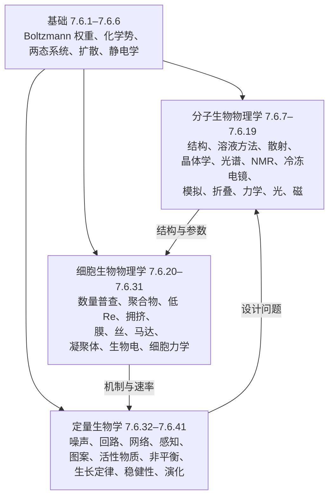

本课程的四十一章讨论了从一根化学键的振动到一个群体的演化之间每一个尺度上的生命物质。本章把这些成果汇集起来。它不增加新的结果：把各个模型并排放在一起，指出在不同的生物学外衣下反复出现的少数几种数学结构，汇集估算所需的数字，比较各种实验方法，最后列出这一领域尚未回答的问题。这里的每个方程和数字都取自推导它的那一章，引用（定理 27.4.1、式 (5.2)、[7.6.30](/7.6.30#sec-30.6)）指向相应的推导。本章结束全课程的方式，与《细胞的物理生物学》（*Physical Biology of the Cell*）第 22 章结束那本书的方式相同：给出迄今画成的地图，并坦率列出地图上有误或空白的地方。

## 42.1. 生物物理学的组织

### 42.1.1. 同一基础上的三个方向

课程按尺度和所寻求的定律类型，把生物物理学分为三个方向（[7.6.1](/7.6.1#sec-1.1.2)）。*分子生物物理学*（7.6.7–7.6.19）测定大分子的结构，研究测定结构的方法所依据的物理，并用结构理解折叠、识别以及分子与光和磁场的相互作用。*细胞生物物理学*（7.6.20–7.6.31）处理细胞尺度上有量纲的物理量：皮牛顿量级的力、弯曲刚度、黏度、膜电位。*定量生物学*（7.6.32–7.6.41）寻求在不同系统间普遍成立的无量纲规律：噪声、回路的动力学、感知的精度、偏离平衡的代价、生长定律、稳健性与演化的统计。三者建立在同一个基础（7.6.1–7.6.6）之上，即细胞的统计物理：从 **Boltzmann 分布**和**化学势**到**随机行走**以及水中的静电学。

箭头表示各部分如何相互利用。分子的结构与实测参数供给细胞的力学与电学模型（通道在 **Hodgkin–Huxley 模型**中的门控电荷，马达的步长与停滞力）；细胞的机制为回路与网络模型提供速率和非线性；而定量生物学提出的问题，即为什么是这种设计、代价是什么，又把我们带回分子，例如**热力学不确定关系**限制了马达的化学反应必须耗散多少能量（定理 38.4.1）。

### 42.1.2. 以物理概念为组织线索

生物学教科书按系统和生物体组织内容；本课程与《细胞的物理生物学》一样，主要按物理概念组织。因此，同一个想法会出现在生物学上相距甚远的各章，而同一个生物系统也会出现在多个章节中，每次用不同的模型来看它。大肠杆菌（*E. coli*）是最清楚的例子：它是数量普查的标准尺子（7.6.20），是低 **Reynolds 数**下的游动者（7.6.22），是拥挤的溶液（7.6.23），是由 MscL 保护的受压容器（7.6.25），是接近 **Berg–Purcell 极限**的传感器（7.6.35），是找到自己中点的反应–扩散系统（7.6.36），也是遵循**细菌生长定律**的生长机器（7.6.39）。下面的尺度图把课程中的模型放在长度和时间的坐标轴上；多数过程聚集在扩散与定向运输这两条对角线附近，这就是少数几个物理时钟组织细胞的一层含义。

## 42.2. 反复出现的数学结构

少数几种数学结构承载了课程的大部分内容。下表列出它们，各小节说明每一种如何再次出现。

| 结构 | 核心方程 | 出现于 |
|---|---|---|
| Boltzmann 权重，两态开关 | $p = 1/(1 + \mathrm{e}^{\beta(\Delta G_0 - qX)})$ | 2, 3, 4, 8, 16, 17, 19, 25, 30, 31, 35, 41 |
| 主方程，停留时间 | $\dot{\boldsymbol{p}} = \boldsymbol{p}W$；由 $\langle\tau\rangle^2/\operatorname{Var}\tau$ 得隐藏步骤数 | 5, 12, 15, 16, 27, 28, 30, 32, 38 |
| 扩散，漂移，首达时间 | $\partial_tc = D\nabla^2c$，$D\gamma = k_{\mathrm{B}}T$，Kramers 速率 | 5, 8, 11, 12, 13, 17, 20, 22, 23, 26, 35 |
| 棘轮 | 整流的涨落，平衡时无电流 | 2, 26, 27, 28, 38 |
| Fourier 空间 | 变换的测量；模式的稳定性 | 9, 10, 12, 13, 14, 24, 26, 29, 36 |
| 作为测量的涨落 | 响应 = 涨落$/k_{\mathrm{B}}T$ | 2, 5, 8, 9, 17, 23, 24, 26 |
| 反馈与分岔 | 不动点，鞍结分岔与 Hopf 分岔 | 30, 31, 33, 34, 35, 36, 40 |
| 非平衡功能的代价 | 循环亲和势，熵产生，TUR | 2, 3, 17, 27, 35, 38 |
| 连续介质弹性与流动 | 弯曲能 $\frac{\kappa}{2}\int c^2$，Stokes 流 | 21, 22, 24, 25, 26, 31 |

### 42.2.1. Boltzmann 权重与两态开关

课程中使用最频繁的模型是**两态系统**（定义 4.1.1）：分子有两个自由能势阱，其差 $\Delta G = \Delta G_0 - qX$ 随控制变量 $X$ 通过共轭性质 $q$ 而移动（定理 4.1.1）。第二个态的概率是 logistic 函数，中点为 $\Delta G_0/q$，10–90 % 的宽度为 $4.4\,k_{\mathrm{B}}T/q$。只要改换 $X$ 与 $q$ 的名称，它就变成十几种模型：

| 系统 | 控制量 $X$ | 共轭量 $q$ | 出处 |
|---|---|---|---|
| 机械敏感通道 MscL | 张力 $\tau$ | 面积变化 $\Delta A \approx 20\,\mathrm{nm^2}$ | 公式 4.2.1，定理 25.4.1 |
| 电压门控通道 | 电压 $V$ | 门控电荷 $ze$，$z \approx 13$（*Shaker*） | 公式 4.2.2，[7.6.30](/7.6.30#sec-30.3) |
| 温度敏感通道 | 温度 $T$ | 熵 $\Delta S = \Delta H/T_{1/2}$ | 公式 4.2.3 |
| 蛋白质或 RNA 去折叠 | 温度，变性剂 | $\Delta H$，$m$ 值 | 公式 8.2.1，[7.6.16](/7.6.16#sec-16.1) |
| 受力下的发夹 | 力 $F$ | 伸长 $\Delta x$ | 公式 17.4.2 |
| 配体结合 | $\ln c$ | 配体数 $n$ | 定理 3.3.1，式 (3.16) |
| 趋化受体簇 | $\ln c$ | 每个受体的自由能乘以 $N$ | 公式 35.5.1 |
| 毛细胞换能通道 | 纤毛束偏转 | 门控力 $z$ | 定理 31.5.1 |
| 磁小体链 | 磁场 $B$ | 磁矩 $m$（Langevin 形式） | 定理 19.2.1 |
| 选择下的基因型 | 适合度 | 群体大小作为逆温度 | 定理 41.3.1 |

图中 F 面板上的曲线重合，说明这些系统只在共轭电荷上有所不同。陡峭的响应需要大的 $q$：若通道要在 $1\,\mathrm{mV}$ 内完成开关，需要超过 $100\,e$ 的门控电荷，所以陡峭的生物学响应由耦合的单元构成：要么靠 Ising 型相互作用（定理 4.4.1），要么靠共同的构象开关，即**协同模型**（MWC 模型，公式 4.5.1），它在血红蛋白、烟碱受体（例 4.5.1）和细菌的趋化受体阵列（定理 35.5.1）中再次出现。基因调控的热力学模型（例 3.3.1）与布满诱饵位点的基因组中结合位点的占据（[7.6.41](/7.6.41#sec-41.3)）是同一套统计力学，只是 $X = \ln c$。这一类比还延伸到演化：弱突变下基因型的稳态分布是以群体大小作为逆温度的 **Boltzmann 分布**（定理 41.3.1）。

### 42.2.2. 主方程、停留时间与隐藏步骤

只要分子有离散的状态并在状态之间随机跃迁，就可以用**主方程**（定义 5.5.1）描述。课程在以下场合用到它：跳跃的粒子，由此得到漂移和扩散（定义 5.5.2）；折叠作为生灭链，即 **Zwanzig 模型**（定理 16.2.1）；马达（公式 27.3.1，定理 27.3.2）；通道，其停留时间分布是指数之和，每个状态一项（定理 30.3.1）；粗粒化为 **Markov 态模型**的分子模拟（定义 15.4.1）；细胞内分子的拷贝数，即**化学主方程**（定义 32.2.2）；以及最一般的形式，带有环的网络的**非平衡稳态**（定义 38.1.1）。

有一个推论用不同的语言推导了四次。由 $n$ 个连续的指数步骤组成的过程，其等待时间的相对方差至少为 $1/n$，因此测得的统计量给出隐藏步骤数的下界：来自单分子停留时间（命题 12.1.1），来自 Poisson 过程的等待时间（定理 32.1.1），来自马达的步进，此时 $n_{\min} = \langle\tau\rangle^2/\operatorname{Var}\tau$（定理 27.4.1），**随机性参数** $r = 2D/Va$（定义 27.4.1）对驱动蛋白给出 $r \approx 1/2$（例 27.4.1），也来自微管的老化，其灾变时间服从约三步的 gamma 分布（[7.6.26](/7.6.26#sec-26.4)）。同一个想法，即涨落揭示平均值所隐藏的东西，也组织了 [7.6.32](/7.6.32#sec-32.8)：**Luria–Delbrück 分布**中的爆发大小、状态数以及突变与选择的先后次序（定理 32.8.1）。用**隐 Markov 模型**从带噪声的轨迹推断状态与速率（算法 12.5.1），使理论与单分子数据首尾相接。

### 42.2.3. 扩散、漂移与首达时间

**随机行走**（定理 5.1.1）、它的连续极限即扩散方程（式 (5.2)）以及 **Einstein 关系** $D\gamma = k_{\mathrm{B}}T$（定理 5.3.1）几乎出现在每一章里，而且常常不加说明：

- 转动扩散决定相关时间 $\tau_{\mathrm{rot}} = \eta V/k_{\mathrm{B}}T$（公式 5.3.2），荧光各向异性读出的值约为 $0.42\,\mathrm{ns\,kDa^{-1}}$（定义 11.5.2），NMR 弛豫读出的值为 $0.5$–$0.6\,\mathrm{ns\,kDa^{-1}}$（定义 13.3.1；差别来自水合层），流动双折射也可测得（定义 8.7.4）。同一个 $\tau_{\mathrm{c}}$ 使大蛋白质难以用 NMR 研究，因为 $T_2 \propto 1/\tau_{\mathrm{c}}$（定理 13.3.1）。
- 平移扩散可由 DLS 从衰减 $g_1 = \mathrm{e}^{-q^2D\tau}$ 测得（定理 8.11.1），由 FCS 从 $\tau_{\mathrm{D}} = w_0^2/4D$ 测得（定理 12.6.1），也可由 FRAP（公式 5.2.2）和单粒子追踪（公式 12.3.2）测得；每种情形都由 Stokes–Einstein 关系把 $D$ 换算为尺寸。
- 向吸收体的扩散 $J = 4\pi Dac_0$（公式 5.2.3）给出受扩散限制的速率常数 $\approx 7\times10^9\,\mathrm{M^{-1}\,s^{-1}}$（例 5.2.1）、细胞内的相遇时间（$1\,\mathrm{nM}$ 时为秒量级，式 (20.4)）、易化靶标搜索的速度（定理 17.8.1）、受体的计数噪声 $(\delta c/c)^2 = 1/(4\pi DacT)$（定理 35.1.1），以及受通路限制的单通道电流 $2\pi Dac$（[7.6.30](/7.6.30#sec-30.2)）。
- 平均**首达时间**（定理 5.6.1）与 **Kramers 速率**（定理 5.6.2）给出折叠中的势垒穿越，指前因子为 $10^6$–$10^7\,\mathrm{s^{-1}}$（[7.6.16](/7.6.16#sec-16.2)）；给出 **Bell 模型**中受力键的断裂（定理 17.5.1）；给出 DNA 在纳米孔中的停留，即逆 Gauss 首达分布（公式 12.7.2）；给出微管搜索与捕获的时间（定理 26.4.1）；也给出带噪声回路在稳定态之间的切换时间 $\propto \mathrm{e}^{\Omega\Delta\phi}$（定理 32.7.1）。
- 扩散与定向运动之比即 **Péclet 数**（定义 5.2.1），它解释了为什么细菌搅拌不会得益（例 5.2.2）、为什么大细胞超过 $L^* = 6D/v$ 就需要马达（[7.6.5](/7.6.5#sec-5.1.3)），以及为什么游动只有超过 $2D/U \approx 70\,\mu\mathrm{m}$ 才划算（[7.6.22](/7.6.22#sec-22.5)）。在拥挤和黏弹性的介质中，行走变为**反常扩散**（定义 23.3.1）。

### 42.2.4. 棘轮：整流热运动

一个反复出现的问题是：分子怎样把随机的热运动变成定向运动或功。答案最初是针对 **Maxwell 妖**（定义 2.4.1）与 Szilard 机（定义 2.4.2）给出的，并由 Landauer 界（定理 2.4.1）与热力学第二定律相协调，每一次都是同一个：平衡时不可能，而当自由能源打破细致平衡时就可能。**Feynman 棘轮**在平衡时于任何周期势中都不产生电流（定理 27.2.1）；由势的开关驱动的闪烁棘轮则会产生电流（公式 27.2.1）。数学上的结构随后在不同分子上重复出现：

| 棘轮 | 速度或力 | 出处 |
|---|---|---|
| 聚合棘轮（理想） | $v = (D/\delta)\,\omega^2/(\mathrm{e}^\omega - 1 - \omega)$，$\omega = F\delta/k_{\mathrm{B}}T$ | 定理 26.5.1 |
| 弹性 Brown 棘轮 | 丝的弯曲涨落打开间隙，$\cos\theta^* = 1/\omega$ | 定义 26.5.1，公式 26.5.2 |
| 转位棘轮 | $v = (2D/d)(w^2/2)/(\mathrm{e}^w - w - 1)$，同一函数 | 定理 28.5.1 |
| 可逆结合棘轮 | 在 $(k_{\mathrm{B}}T/d)\ln(1 + c/K_{\mathrm{d}})$ 处停滞 | 公式 28.5.1 |
| ATP 合酶的 Fₒ | 由 $\Delta p$ 驱动的质子化棘轮 | [7.6.28](/7.6.28#sec-28.3) |

理想的聚合棘轮与转位棘轮给出同一个无量纲负载的函数，因为二者描述的都是一个扩散的物体，它每前进一步，向后的运动就被阻断一次。热力学界限对它们也是共同的：由每步长度为 $a$、自由能为 $\Delta\mu$ 驱动的马达或棘轮，在 $F = \Delta\mu/a$ 处停滞（公式 27.1.1，定理 27.3.1），而聚合的丝在 $(k_{\mathrm{B}}T/\delta)\ln(c/C_{\mathrm{c}})$ 处停滞（公式 26.5.1）。

### 42.2.5. Fourier 空间

几乎每一种结构方法测量的都是 Fourier 变换，各方法的差别在于测得了变换的哪一部分、丢失了什么。

| 方法 | 测量的量 | 丢失的信息 | 如何恢复 | 出处 |
|---|---|---|---|---|
| SAXS，光散射 | 经取向平均的 $\lvert A(\boldsymbol{q})\rvert^2$ | 相位与取向 | 带约束的模型 | 公式 9.3.1，定理 9.3.1 |
| 晶体学 | 倒格点上的 $\lvert F(\boldsymbol{h})\rvert$ | 相位 | 同晶置换、反常散射、分子置换、直接法 | 定理 10.3.1，定义 10.4.1 |
| 纤维衍射 | 螺旋变换的层线 | 相位，绕轴的取向 | 螺旋选择定则 | 定理 10.5.1 |
| 电子显微镜 | 图像 = 出射波的逆变换，受 CTF 调制 | CTF 零点处的信息，取向 | 欠焦系列，Bayes 精修 | 定理 14.2.1，定理 14.4.1 |
| 三维重构 | 投影 = 中心截面 | 断层成像中的缺失楔 | 许多取向 | 定理 14.6.1 |
| NMR，MRI | 自由感应衰减，k 空间 | 无（复信号） | Fourier 变换 | 公式 13.2.1，定理 13.8.1 |
| 光学显微镜 | 至 $2\mathrm{NA}/\lambda$ 的空间频率 | 更高的频率 | 定位、STED、SIM | 公式 12.2.1，[7.6.12](/7.6.12#sec-12.4) |
| DLS，FCS，光镊 | 相关函数与功率谱 | — | 拟合衰减与 Lorentz 线形 | 定理 8.11.1，定理 12.6.1，公式 17.2.2 |

Fourier 模式也是稳定性分析的自然坐标。膜的热起伏 $\langle\lvert h_q\rvert^2\rangle = k_{\mathrm{B}}T/A(\kappa q^4 + \sigma q^2)$（公式 24.3.1）与丝的热起伏（公式 26.1.1）逐个模式地测量弯曲刚度；微扰的增长率 $\sigma(q)$ 决定了 **Cahn–Hilliard 方程**中的旋节分解（定理 29.3.1）、Turing 图案、振荡与守恒型失稳（[7.6.36](/7.6.36#sec-36.2)）、**Swift–Hohenberg 方程**（定义 36.2.1）以及活性向列相的失稳（[7.6.37](/7.6.37#sec-37.6)）。各方法的分辨率判据，即 Crowther 判据 $N \approx \pi D/d$（式 (14.7)）、Nyquist 采样以及 SAXS 曲线中独立参数的个数（定义 9.8.1），都是 Fourier 空间中的采样定理。

### 42.2.6. 作为测量的涨落

在平衡态，系统对小力的响应等于其自发涨落除以 $k_{\mathrm{B}}T$（式 (2.7)），课程多次用这一点把噪声变成测量仪器：

| 涨落 | 测得的量 | 出处 |
|---|---|---|
| 焓涨落 | DSC 中的热容 $C_p = \langle\delta H^2\rangle/k_{\mathrm{B}}T^2$ | 定理 8.2.1 |
| 光阱中小球的位置 | 刚度 $\kappa = k_{\mathrm{B}}T/\langle x^2\rangle$，转折频率 | 例 2.3.2，公式 5.4.1，公式 17.2.2 |
| 磁镊中的小球 | 力 $F = k_{\mathrm{B}}Tl/\langle\delta x^2\rangle$ | 公式 17.3.1 |
| 浓度涨落 | 摩尔质量与 $A_2$，$Kc/R_0 = 1/M + 2A_2c$ | 定理 9.2.1 |
| 水的密度涨落 | SAXS 的绝对标定 | 公式 9.9.1 |
| 膜与丝的形状 | $\kappa$，$\ell_{\mathrm{p}}$ | 公式 24.3.1，公式 26.1.1 |
| 拷贝数涨落 | 爆发的大小与频率，反馈 | 定理 32.4.1，式 (32.17) |
| 对该关系的违背 | $10\,\mathrm{Hz}$ 以下细胞质中的主动力 | 定义 23.3.2，公式 23.3.1 |

最后一行把关系倒过来用：**涨落–耗散定理**失效处，系统受到驱动，违背的大小则度量活性。同样的逻辑经涨落定理推广后，可以从涨落测得 F₁ 的力矩（公式 28.2.2，例 38.3.2），也可以由观测到的流界定隐藏的耗散（定理 38.4.1）。

### 42.2.7. 反馈、双稳态与振荡

正反馈造就开关，带延迟的负反馈造就振荡器，两者结合造就可兴奋系统：这一符号法则（[7.6.33](/7.6.33#sec-33.1.1)）贯穿各动力学章节。自我激活的钠电流使膜成为双稳态（命题 30.4.1），再加上较慢的钾反馈就成为可兴奋的，在重复放电的起始处出现 **Hopf 分岔**（[7.6.30](/7.6.30#sec-30.6)）；毛细胞把主动纤毛束置于 Hopf 点附近，以压缩性的 $F^{1/3}$ 响应放大微弱的声音（命题 31.5.1）；**遗传拨动开关**在表达速率超过临界值后为双稳态（定理 33.3.1）；Goodwin 环要振荡，环增益必须大于 $\sec(\pi/N)^N$（定理 33.5.1）；胚胎细胞周期之所以振荡，是因为正反馈使 Cdk1 零倾线呈 N 形，没有这个环路，振荡就会衰减，而酵母细胞周期随细胞生长越过**鞍结分岔**（[7.6.34](/7.6.34#sec-34.2)）。负反馈还会使灵敏度降低 $1/(1 + L)$ 倍（公式 40.1.1），使噪声降低 $F = 1/(1 + H)$ 倍（式 (32.17)）；其积分形式产生**完全适应**（定理 35.6.1），这一性质的稳健性是**稳健性**研究的第一个案例（定义 40.1.1）。空间延展的双稳态系统以由扩散和反应决定的速度传播波前，神经与蛙卵的公式相同：双稳态**电缆方程**的波前以 $v = (\lambda/\tau)\sqrt{k/2}\,(1 - 2\alpha)$ 运动（命题 30.5.1），**触发波**以 $v = \sqrt{Dk/2}\,(1 - 2a)$ 运动（定理 36.5.1），取 $D = \lambda^2/\tau$ 时两者一致。

### 42.2.8. 偏离平衡的代价

平衡时，每个基本跃迁都与其逆过程相平衡（定理 3.5.1），没有任何回路携带流（定理 38.1.1），许多生物学功能因而不可能实现。课程以五种形式遇到同一个定理：

| 功能 | 平衡极限 | 每个循环耗散 $\Delta\mu$ 后 | 出处 |
|---|---|---|---|
| 定向运动 | 周期势中无电流 | 在 $\Delta\mu/a$ 处停滞 | 定理 27.2.1，定理 27.3.1 |
| 分辨 | 错误率 $f_0 = \mathrm{e}^{-\Delta\Delta G/k_{\mathrm{B}}T}$ | 校对后可降至 $\sim f_0^2$ | 命题 17.9.1，[7.6.38](/7.6.38#sec-38.5) |
| 放大 | Hill 型增益受协同性限制 | 循环的超灵敏性 | 定理 35.5.2 |
| 适应 | 不精确 | 由积分反馈达到精确 | 定理 35.6.1 |
| 计时 | 无相干振荡 | 精度 $\varepsilon^2M = \coth(\mathcal{A}/2Nk_{\mathrm{B}}T)/N$ | 公式 38.4.1 |
| 信息擦除 | — | 每比特 $\ge k_{\mathrm{B}}T\ln 2$ | 定理 2.4.1 |

一般的核算依据 Markov 网络的**熵产生**，在稳态下它等于各回路的流乘以循环亲和势再求和（公式 38.2.1）；与 ATP 水解耦合的回路，亲和势约为 $20\,k_{\mathrm{B}}T$，因为细胞使 $[\mathrm{ATP}]/[\mathrm{ADP}]$ 保持在远离平衡许多个数量级之处（例 3.2.1）。**涨落定理**（定理 38.3.1）及其对由平衡态出发的驱动过程的版本，即 **Jarzynski 等式**（定理 17.6.1）与 **Crooks 涨落定理**（定理 17.6.2），以及热力学不确定关系（定理 38.4.1），把这种核算变成可在单分子上检验的界限。在生物体的尺度上，同样的平衡 $\mathrm{d}_{\mathrm{i}}S \ge 0$ 并把熵输出到环境（式 (2.12)），解释了为什么一个人每天周转约 $30\,\mathrm{kg}$ 的 ATP（例 2.5.2）。

### 42.2.9. 连续介质弹性与流动

在分子的尺度以下，课程用只有少数几个模量的连续介质代替了原子。杆、聚合物和膜储存的弯曲能与曲率成二次关系，弯曲模量与 $k_{\mathrm{B}}T$ 之比是一个长度：DNA（$50\,\mathrm{nm}$）、肌动蛋白（$10$–$17\,\mu\mathrm{m}$）和微管（$1$–$6\,\mathrm{mm}$）的**持久长度** $\ell_{\mathrm{p}} = \kappa/k_{\mathrm{B}}T$（命题 21.3.1，[7.6.26](/7.6.26#sec-26.1)）；**弯曲刚度** $\kappa \approx 20\,k_{\mathrm{B}}T$ 的膜没有这样的长度，所以任何大小的囊泡都花费 $8\pi\kappa$（例 24.4.1）。同一块弹性薄片围绕蛋白质因**疏水失配**而变形，给出门控 MscL 的线张力（定理 25.2.1，定理 25.4.1）；同样的梁理论给出丝的 **Euler 屈曲**（定理 26.2.1）；同样的 Hertz 接触定律让 AFM 得以测量细胞（定义 31.2.1）。低 Reynolds 数的流体服从线性且可逆的 **Stokes 流**（命题 22.4.1），由此得到 Stokes 定律、流体动力学方法中的摩擦系数（[7.6.8](/7.6.8#sec-8.7)）、**扇贝定理**（定理 22.5.1），以及实验中经肌动蛋白丝加载于 F₁ 的拖曳力（例 22.4.2）。当分子结构起作用时，连续介质模型失效：在密堆积 DNA 的水合排斥中（公式 21.7.1）、在马达的离散步进中，以及在通道的选择性过滤器中（[7.6.30](/7.6.30#sec-30.2)）。

## 42.3. 模型索引

下表列出课程的主要模型，给出其定义方程、使用的尺度以及展开它们的位置。它是索引，不能替代推导，因为假设与适用范围写在推导之中。

基础（7.6.1–7.6.6）：

| 模型 | 方程 | 尺度 | 出处 |
|---|---|---|---|
| 靶理论 | $f = 1 - \mathrm{e}^{-\sigma D}$ | nm 靶，辐射剂量 | 定义 1.2.1 |
| 病毒动力学 | 受感染细胞与病毒颗粒，半衰期分别为数小时和 1.5 天 | 患者，天 | 公式 1.6.1，定理 1.6.1 |
| Boltzmann 分布 | $p_i = \mathrm{e}^{-\beta E_i}/Z$，$F = -k_{\mathrm{B}}T\ln Z$ | 任何平衡子系统 | 定理 2.2.1，公式 2.2.1 |
| Landauer 界 | 每擦除一比特 $k_{\mathrm{B}}T\ln 2$ | 信息处理 | 定理 2.4.1 |
| 熵平衡 | $\mathrm{d}S = \mathrm{d}_{\mathrm{e}}S + \mathrm{d}_{\mathrm{i}}S$，$\mathrm{d}_{\mathrm{i}}S \ge 0$ | 从细胞到地球 | 式 (2.12) |
| 稀溶液 | $\mu = \mu^\circ + k_{\mathrm{B}}T\ln(c/c^\circ)$ | 溶质 | 公式 3.1.1 |
| 质量作用 | $\prod(c_i/c^\circ)^{\nu_i} = K = \mathrm{e}^{-\Delta G^\circ/k_{\mathrm{B}}T}$ | 反应 | 定理 3.2.1 |
| 结合的格点模型 | $p = c/(c + K_{\mathrm{d}})$，$K_{\mathrm{d}} = c_0\mathrm{e}^{\Delta\varepsilon/k_{\mathrm{B}}T}$ | 受体，启动子 | 定理 3.3.1 |
| 质子动力势 | $\Delta p = \Delta\Psi - 61.5\,\mathrm{mV}\,\Delta\mathrm{pH}$ | 能量转换膜 | 公式 3.4.1 |
| 细致平衡 | $k_+/k_- = \mathrm{e}^{-\Delta G^\circ/k_{\mathrm{B}}T}$ | 平衡时的基元步骤 | 定理 3.5.1 |
| 两态系统 | $p_1 = 1/(1 + \mathrm{e}^{\beta\Delta G})$，$\Delta G = \Delta G_0 - qX$ | 通道，发夹，受体 | 公式 4.1.1，定理 4.1.1 |
| Ising 二聚体 | $\mathcal{Z} = 1 + 2x + \omega x^2$，$n_{\mathrm{H}} = 2/(1 + \mathrm{e}^{\beta J/2})$ | 协同位点 | 公式 4.4.1，定理 4.4.1 |
| MWC 模型 | $p_{\mathrm{A}} = (1 + c/K_{\mathrm{A}})^n/[(1 + c/K_{\mathrm{A}})^n + L(1 + c/K_{\mathrm{I}})^n]$ | 变构蛋白 | 公式 4.5.1 |
| 随机行走 | $\langle r^2\rangle = Na^2 = 2dDt$ | 分子，细胞，聚合物 | 定理 5.1.1 |
| 扩散方程 | $\partial_tc = D\nabla^2c$ | 浓度场 | 式 (5.2)，公式 5.2.1 |
| 扩散捕获 | $J = 4\pi Dac_0$ | 吸收体，受体 | 公式 5.2.3 |
| Einstein 关系 | $D\gamma = k_{\mathrm{B}}T$，$D = k_{\mathrm{B}}T/6\pi\eta a$ | Brown 粒子 | 定理 5.3.1，式 (5.3) |
| Langevin 方程 | 摩擦加强度为 $2\gamma k_{\mathrm{B}}T$ 的白噪声 | 小球，分子 | 定义 5.4.1，定理 5.4.1 |
| 主方程与 Fokker–Planck 方程 | 跳跃给出 $v = a(k_+ - k_-)$，$D = a^2(k_+ + k_-)/2$ | 任何离散或连续 Markov 过程 | 定义 5.5.1–5.5.2 |
| Kramers 速率 | $k = \sqrt{U''_aU''_b}\,\mathrm{e}^{-\Delta U/k_{\mathrm{B}}T}/2\pi\gamma$ | 势垒穿越 | 定理 5.6.2 |
| 水中的 Coulomb 作用 | $U = z_1z_2k_{\mathrm{B}}T\ell_{\mathrm{B}}/r$，$\ell_{\mathrm{B}} = 0.71\,\mathrm{nm}$ | 离子，带电基团 | 式 (6.2)，定义 6.2.1 |
| Born 溶剂化 | $\Delta G = (z^2\ell_{\mathrm{B}}^{\mathrm{vac}}/2a)(1/\varepsilon_2 - 1/\varepsilon_1)k_{\mathrm{B}}T$ | 埋入电荷 | 公式 6.2.1 |
| Poisson–Boltzmann 方程 | $\nabla^2y = \kappa^2\sinh y$，$\lambda_{\mathrm{D}} = 0.304/\sqrt I\,\mathrm{nm}$ | 盐溶液 | 公式 6.4.1，式 (6.3) |
| 反离子凝聚 | $\theta = 1 - 1/z\xi$，DNA 的 $\xi = 4.2$ | 聚电解质 | 定理 6.4.1 |

分子生物物理学（7.6.7–7.6.19）：

| 模型 | 方程 | 尺度 | 出处 |
|---|---|---|---|
| 重复单元的螺旋对称 | $\cos\theta = (\operatorname{tr}R - 1)/2$ | 螺旋 | 定理 7.2.1 |
| 准等价 | $T = h^2 + hk + k^2$，$60T$ 个亚基 | 二十面体衣壳 | [7.6.7](/7.6.7#sec-7.5.2) |
| 两态热谱图 | 峰值 $\Delta H^2/4RT_{\mathrm{m}}^2$；比值 $\Delta H_{\mathrm{vH}}/\Delta H_{\mathrm{cal}}$ | DSC | 公式 8.2.1，公式 8.2.2 |
| 稳定性曲线 | 含 $\Delta C_p$ 的 $\Delta G(T)$；冷变性 | 蛋白质 | 公式 8.3.1 |
| Wiseman 等温线 | $c = nK_{\mathrm{a}}[\mathrm{M}]_{\mathrm{t}}$，在 $1 < c < 1\,000$ 时可测 | ITC | 定义 8.4.2 |
| Svedberg 方程 | $s = M(1 - \bar v\rho)/N_{\mathrm{A}}f$ | AUC | 公式 8.8.1 |
| Zimm 方程 | $Kc/R_0 = 1/M + 2A_2c$ | SLS | 定理 9.2.1，公式 9.2.3 |
| Guinier 定律 | $I \approx I(0)\,\mathrm{e}^{-q^2R_{\mathrm{g}}^2/3}$ | SAXS，$qR_{\mathrm{g}} \lesssim 1.3$ | 定理 9.4.1 |
| Porod 定律 | $I \simeq 2\pi(\Delta\rho)^2S/q^4$ | SAXS，$qD \gg 1$ | 定理 9.6.1 |
| Laue 条件，Bragg 定律 | $\boldsymbol{S} = \boldsymbol{H}_{hkl}$，$2d\sin\theta = \lambda$ | 晶体 | 定理 10.2.1，定理 10.2.2 |
| 电子密度 | $\rho(\boldsymbol{x}) = \frac1V\sum_{\boldsymbol{h}}\lvert F\rvert\cos(2\pi\boldsymbol{h}\cdot\boldsymbol{x} - \varphi)$ | 晶体 | 定理 10.3.1 |
| Beer–Lambert 定律 | $A = \varepsilon cl$ | 吸收 | 定理 11.1.1 |
| 激子二聚体 | $E_\pm = E_0 \pm V_{12}$ | 耦合的发色团 | 定理 11.2.1 |
| Förster 转移 | $E = 1/[1 + (R/R_0)^6]$，$R_0 = 2$–$8\,\mathrm{nm}$ | 供体–受体对 | 定理 11.5.4，公式 11.5.3 |
| 定位精度 | $\sigma_{\mathrm{loc}} \ge s/\sqrt N$ | 单个发射体 | 定理 12.3.1 |
| FCS | $G(\tau) = \langle N\rangle^{-1}(1 + \tau/\tau_{\mathrm{D}})^{-1}(1 + \tau/\omega^2\tau_{\mathrm{D}})^{-1/2}$ | nM，µs–s | 定理 12.6.1 |
| Bloch 方程 | 进动，$T_1$，$T_2$ | 核自旋 | 定理 13.2.1 |
| BPP 弛豫 | $J(\omega) = \frac25\tau_{\mathrm{c}}/(1 + \omega^2\tau_{\mathrm{c}}^2)$ | ps–ns 运动 | 定义 13.3.1，定理 13.3.1 |
| 化学交换 | $R_{\mathrm{ex}} = p_{\mathrm{A}}p_{\mathrm{B}}\Delta\omega^2/k_{\mathrm{ex}}$ | µs–ms 运动 | 公式 13.6.1 |
| Linderstrøm-Lang 交换 | $\Delta G_{\mathrm{op}} = RT\ln P$（EX2） | s–月 | 定义 13.6.5–13.6.6 |
| 衬度传递 | $\chi = \pi\lambda\Delta fk^2 - \frac{\pi}{2}C_{\mathrm{s}}\lambda^3k^4$ | 冷冻电镜 | 公式 14.4.1，定理 14.4.1 |
| 投影–切片定理 | 投影的 Fourier 变换 = 中心截面 | 三维重构 | 定理 14.6.1 |
| 分辨率 | $\mathrm{FSC} = \mathrm{SNR}/(1 + \mathrm{SNR})$；$\ln N = B/2d^2 + \mathrm{const}$ | 密度图 | 定理 14.9.1，式 (14.15) |
| 分子动力学 | $m\ddot{\boldsymbol{r}} = -\nabla U$，velocity Verlet，$\Delta t = 1$–$2\,\mathrm{fs}$ | fs–µs | 算法 15.2.1 |
| Markov 态模型 | $\boldsymbol{p}(t + k\tau) = \boldsymbol{p}(t)T(\tau)^k$ | 由短轨迹得到 µs–s | 定义 15.4.1 |
| Potts 模型，DCA | 最大熵耦合，$J \approx -C^{-1}$ | 序列家族 | 定义 15.5.1，式 (15.11) |
| 动态规划的 RNA 折叠 | 不交叉配对，$O(n^3)$ | 二级结构 | 算法 15.6.1 |
| Zwanzig 模型 | $\tau = \sum_j\sum_{i\ge j}\pi_i/(d_j\pi_j)$ | 折叠动力学 | 定理 16.2.1 |
| 随机能量模型 | $k_{\mathrm{B}}T_{\mathrm{g}} = \Delta E/\sqrt{2S_0}$，$T_{\mathrm{f}} > T_{\mathrm{g}}$ 时折叠 | 能量景观 | 公式 16.2.1 |
| φ 值分析 | $\phi = \Delta\Delta G^\ddagger/\Delta\Delta G_{\mathrm{U}}$ | 过渡态 | 定义 16.3.1 |
| 受力的蠕虫状链 | Marko–Siggia 插值 | DNA，未折叠蛋白质 | 公式 17.4.1 |
| Bell 模型 | $k = k_0\mathrm{e}^{Fx^\ddagger/k_{\mathrm{B}}T}$，$F^* = (k_{\mathrm{B}}T/x^\ddagger)\ln(rx^\ddagger/k_0k_{\mathrm{B}}T)$ | 受载的键 | 定义 17.5.1，定理 17.5.1 |
| Jarzynski 等式 | $\langle\mathrm{e}^{-W/k_{\mathrm{B}}T}\rangle = \mathrm{e}^{-\Delta F/k_{\mathrm{B}}T}$ | 单分子牵拉 | 定理 17.6.1 |
| 易化扩散 | $\tau_{\mathrm{s}} = (M/n)(\tau_{1\mathrm{D}} + \tau_{3\mathrm{D}})$ | 靶标搜索 | 定理 17.8.1 |
| 动力学校对 | 驱动下 $f_0 \ge f \gtrsim f_0^2$ | 分辨 | 命题 17.9.1 |
| Marcus 理论 | $\Delta G^\ddagger = (\Delta G^\circ + \lambda)^2/4\lambda$ | 电子转移 | 定理 18.4.1 |
| 视觉的看见频率 | $5$–$7$ 个光子的 Poisson 阈值 | 视觉 | 定理 18.6.1 |
| 趋磁性 | 取向 $\coth\xi - 1/\xi$，$mB \approx 15\,k_{\mathrm{B}}T$ | 细菌 | 定理 19.2.1 |
| 自由基对机制 | 自旋选择的单重态产率 | µs 自旋动力学 | 定理 19.4.1 |

细胞生物物理学（7.6.20–7.6.31）：

| 模型 | 方程 | 尺度 | 出处 |
|---|---|---|---|
| 相遇时间 | $1/(4\pi Dac)$，间距 $c^{-1/3}$ | 细胞 | 公式 20.2.1，式 (20.4) |
| 分配噪声 | $\langle(I_1 - I_2)^2\rangle = \alpha(I_1 + I_2)$ | 分裂 | 命题 20.1.1 |
| 自由连接链与蠕虫状链 | $\langle R^2\rangle = 2\ell_{\mathrm{p}}L - 2\ell_{\mathrm{p}}^2(1 - \mathrm{e}^{-L/\ell_{\mathrm{p}}})$ | DNA，染色质 | 命题 21.1.1，公式 21.3.1 |
| Flory 标度 | $R \propto N^\nu$，$\nu = 1/2$，$0.588$，$1/3$ | 聚合物 | 命题 21.4.1 |
| 成环 | $J = P(\boldsymbol{0})/N_{\mathrm{A}}$，最优值 $\approx 550\,\mathrm{bp}$ | 基因调控 | 定义 21.5.1 |
| 接触概率 | $P(s) \propto s^{-3\nu}$ | Hi-C | 命题 21.6.1 |
| Navier–Stokes 方程，Reynolds 数 | $\operatorname{Re} = \rho UL/\eta$ | 流动 | 定义 22.1.2，定义 22.3.1 |
| Hagen–Poiseuille 定律 | $Q = \pi\Delta p\,d^4/128\eta l$ | 血管 | 公式 22.2.1 |
| 扇贝定理 | 往复的划动不产生净运动 | 游动者 | 定理 22.5.1 |
| 拥挤下的结合 | $K_{\mathrm{d}}(\varphi)/K_{\mathrm{d}}(0) = (1 - \varphi)^r$ | 细胞质 | 公式 23.2.1 |
| 排空力 | $W = -\Pi V_{\mathrm{ov}}$ | 胶体，染色质 | 定义 23.2.2 |
| 临界胶束浓度 | $X_N = N(X_1/X_{\mathrm{c}})^N$ | 两亲分子 | 命题 24.1.1 |
| Helfrich 能量 | 弯曲 $\kappa \approx 20\,k_{\mathrm{B}}T$，拉伸 $K_A \approx 0.24\,\mathrm{N\,m^{-1}}$ | 膜 | 定义 24.2.2–24.2.5 |
| 系链 | $r = \sqrt{\kappa/2\sigma}$，$f = 2\pi\sqrt{2\kappa\sigma}$ | 膜管 | 公式 24.3.3 |
| 厚度形变 | $u = U\mathrm{e}^{-y}(\cos y + \sin y)$，$\lambda^{-1} \approx 1\,\mathrm{nm}$ | 蛋白质周围 | 定理 25.2.1 |
| MscL 门控 | $\tau^* = \mathcal{K}U^2/(R_{\mathrm{o}} + R_{\mathrm{c}})$ | 双层中的通道 | 定理 25.4.1 |
| Piezo 穹顶 | $\tau_{\mathrm{d}} = 8\pi\kappa/A_{\mathrm{d}}$ | 真核通道 | 定理 25.6.1 |
| Euler 屈曲 | $F_{\mathrm{c}} = \pi^2EI/L^2$ | 丝 | 定理 26.2.1 |
| 平衡聚合 | $c_n = \sigma C_{\mathrm{c}}x^n$ | 丝 | 定理 26.3.1 |
| 聚合力 | $F_{\mathrm{s}} = (k_{\mathrm{B}}T/\delta)\ln(c/C_{\mathrm{c}})$ | 肌动蛋白，微管 | 公式 26.5.1 |
| 单态马达 | $V = a(k_+ - k_-)$，$D = \frac{a^2}{2}(k_+ + k_-)$，在 $\Delta\mu/a$ 处停滞 | 马达 | 公式 27.3.1，定理 27.3.1 |
| 马达效率界 | $\eta \le [1 + Vk_{\mathrm{B}}T/DF]^{-1}$ | 马达 | 公式 27.5.2 |
| 拔河 | 负载分担与对抗团队的不稳定性 | 货物运输 | 定义 27.6.1，公式 27.6.2 |
| Hill 关系，横桥模型 | $(F + a)(v + b) = (F_0 + a)b$ | 肌肉 | 定义 27.7.1，定义 27.7.2 |
| 旋转马达 | $\tau_{\max} = \Delta\mu/\Delta\theta$；当 $(n_c/3)e\Delta p > \Delta G_{\mathrm{p}}$ 时合成 | F₁Fₒ，鞭毛马达 | 公式 28.1.1，公式 28.3.1 |
| 等价聚集与成核组装 | 无阈值，或 $c^* = 1/K$ | 丝，衣壳 | 命题 29.1.1 |
| Flory–Huggins 理论，Cahn–Hilliard 方程 | $\sigma(q) = -Mq^2(f'' + \kappa q^2)$ | 凝聚体 | 定理 29.2.1，定理 29.3.1 |
| 粗化 | $\langle R\rangle^3 \propto t$ | 乳液 | 定理 29.3.2 |
| 活性乳液 | 反应移除的物质量 $\propto R^3$ 时尺寸稳定 | 中心体 | 命题 29.5.1 |
| Goldman–Hodgkin–Katz 方程 | 恒定场的电流与电压方程 | 膜 | 定理 30.2.1 |
| 电缆方程 | $\lambda^2V'' = \tau\dot V + V$，$\lambda = \sqrt{aR_{\mathrm{m}}/2R_{\mathrm{i}}}$ | 轴突，树突 | 定理 30.5.1 |
| Hodgkin–Huxley 模型 | $m^3h$，$n^4$ 门 | 动作电位 | 定义 30.6.1–30.6.2 |
| Hertz 接触 | $F = \frac43\frac{E}{1 - \nu^2}\sqrt R\,\delta^{3/2}$ | 细胞上的 AFM | 定义 31.2.1 |
| 分子离合器 | 马达，滑移键，基底弹簧；最优刚度 | 黏着 | 定义 31.3.1–31.3.2 |
| 门控弹簧 | 负刚度，Hopf 放大器 $r = F^{1/3}$ | 毛细胞 | 定理 31.5.1，命题 31.5.1 |

定量生物学（7.6.32–7.6.41）：

| 模型 | 方程 | 尺度 | 出处 |
|---|---|---|---|
| 化学主方程 | 由随机质量作用定律得到倾向函数 | 拷贝数 | 定义 32.2.2，式 (32.1) |
| 两态启动子 | $F = 1 + rk_-/(\lambda(\lambda + \gamma))$ | 转录 | 定理 32.3.1 |
| 爆发 | 负二项分布，$\langle n\rangle = ab$，$F = 1 + b$ | 基因表达 | 定理 32.4.1 |
| Gillespie 算法 | 以 $a_0$ 为速率的指数等待，以概率 $a_j/a_0$ 选择反应 | 模拟 | 算法 32.5.1 |
| 线性噪声近似 | $JC + CJ^{\mathsf T} + D = 0$ | 大拷贝数 | 定义 32.6.2 |
| Luria–Delbrück 分布 | $G(z) = \exp[m(1 - z)z^{-1}\ln(1 - z)]$，尾部 $m/r^2$ | 突变 | 定理 32.8.1 |
| 拨动开关 | $\alpha > \alpha_{\mathrm{c}}$ 时双稳态 | 合成回路 | 定理 33.3.1 |
| Goodwin 振荡器 | 增益 $> \sec(\pi/N)^N$ | 负反馈环 | 定理 33.5.1 |
| Hopf 正规形 | $\dot r = \mu r - r^3$，振幅 $\sqrt\mu$ | 振荡器 | 定理 33.5.2 |
| Hopfield 网络 | 图案作为吸引子，容量 $0.138N$ | 记忆 | 定义 33.7.1 |
| 细胞周期模型 | N 形零倾线；有全局吸引子的 Boolean 网络 | 细胞周期 | 式 (34.2)，式 (34.4) |
| 通量平衡分析 | $S\boldsymbol{v} = \boldsymbol{0}$，使生物量最大 | 代谢 | 定义 34.4.2 |
| Berg–Purcell 极限 | $(\delta c/c)^2 = 1/(4\pi DacT)$ | 受体 | 定理 35.1.1 |
| 趋化漂移 | $v_{\mathrm{d}} = \kappa v^2\partial_x\ln c$ | 奔跑与翻滚 | 公式 35.4.1 |
| 受体簇 | $a = [1 + \mathrm{e}^{N\Delta F}]^{-1}$ | 趋化受体阵列 | 公式 35.5.1 |
| 积分反馈 | $\dot m = V_R - V_Ba/(a + K_B)$，$a^*$ 与 $c$ 无关 | 适应 | 定理 35.6.1 |
| Swift–Hohenberg 方程 | $\sigma = \varepsilon - (q_{\mathrm{c}}^2 - q^2)^2$ | 条纹，六边形 | 定义 36.2.1，定理 36.2.1 |
| 质量守恒的反应–扩散 | 在零倾线斜率 $< -D_a/D_b$ 处失稳 | 极性，Min | 定理 36.4.1 |
| 触发波 | $v = \sqrt{Dk/2}(1 - 2a)$；Fisher 波 $2\sqrt{Dk}$ | 毫米尺度的波 | 定理 36.5.1 |
| 活性 Brown 粒子 | $D_{\mathrm{eff}} = D_{\mathrm{t}} + v_0^2\tau_{\mathrm{r}}/2$（二维） | 游动者 | 定理 37.2.1 |
| 固定与运动的个体 | 固定个体在二维无序；运动个体有 Toner–Tu 序 | 集群 | 定理 37.4.1，定义 37.4.2 |
| 运动诱导相分离 | $(\rho v)' < 0$ 时失稳 | 活性悬浮液 | 定理 37.5.1 |
| 非平衡稳态 | Kolmogorov 判据；循环亲和势 | Markov 网络 | 定理 38.1.1，定义 38.1.2 |
| 熵产生 | $\dot S_{\mathrm{tot}} = \frac{k_{\mathrm{B}}}{2}\sum J_{ij}\ln(w_{ij}p_j/w_{ji}p_i)$ | 任何 Markov 网络 | 定理 38.2.1 |
| 涨落定理 | $P(\Sigma)/P(-\Sigma) = \mathrm{e}^{\Sigma/k_{\mathrm{B}}}$ | 轨迹 | 定理 38.3.1 |
| 热力学不确定关系 | $\operatorname{Var}(\mathcal{J}_t)\langle\Delta S_{\mathrm{tot}}\rangle/\langle\mathcal{J}_t\rangle^2 \ge 2k_{\mathrm{B}}$ | 流 | 定理 38.4.1 |
| Monod 定律，恒化器 | $\lambda = \lambda_{\max}s/(K_s + s)$ | 种群 | 公式 39.1.1，公式 39.1.2 |
| 生长定律 | $\phi_R = \phi_R^0 + \lambda/\kappa_t$；$\phi_R = \phi_R^{\max} - \lambda/\kappa_n$ | 蛋白质组分配 | 公式 39.2.1–39.2.2 |
| 溢流代谢 | 超过 $\lambda_{\mathrm{c}} \approx 0.76\,\mathrm{h^{-1}}$ 后排出乙酸 | 代谢 | 公式 39.4.1 |
| 对数灵敏度 | $S = \partial\ln y/\partial\ln p$；反馈 $1/(1 + L)$ | 稳健性 | 定义 40.1.2，公式 40.1.1 |
| Pareto 前沿 | 最优解位于原型的凸包上 | 权衡 | 定理 40.4.1 |
| 比对统计 | $E = Kmn\mathrm{e}^{-\lambda S}$ | 序列比较 | 定理 41.2.1 |
| 作为统计力学的序列演化 | $F^{N-1}$ 稳态分布 | 结合位点 | 定理 41.3.1 |
| 多重耐药 | $N\mu^k$ 个预先存在的 $k$ 重突变体 | 治疗 | 公式 41.5.1 |

## 42.4. 需要记住的数字

数量级推理，即《细胞的物理生物学》所说的按比例绘制地图，需要手边备有一些数字。下列数值取自各章，适用于 $25$–$37\,^\circ\mathrm{C}$ 附近的细胞或溶液。

| 量 | 数值 | 出处 |
|---|---|---|
| 热能 | $k_{\mathrm{B}}T = 4.1\,\mathrm{pN\,nm} = 2.5\,\mathrm{kJ\,mol^{-1}}$；$k_{\mathrm{B}}T/e = 25.7\,\mathrm{mV}$（$37\,^\circ\mathrm{C}$ 时为 $26.7$） | [7.6.6](/7.6.6#sec-6.1.1)，[7.6.4](/7.6.4#sec-4.2.2) |
| 十倍变化 | 自由能 $2.3\,k_{\mathrm{B}}T$；$37\,^\circ\mathrm{C}$ 时每十倍 $61.5\,\mathrm{mV}$ | 公式 4.1.1，式 (3.9) |
| 键 | 共价键 $\sim 150\,k_{\mathrm{B}}T$；氢键在水中净值 $1$–$2\,k_{\mathrm{B}}T$；$K_{\mathrm{d}} = 1\,\mathrm{nM}$ 即 $-20.7\,k_{\mathrm{B}}T$ | [7.6.6](/7.6.6#sec-6.3.1)，式 (3.12) |
| 燃料 | 细胞中 ATP 水解 $\approx 20\,k_{\mathrm{B}}T$（标准态为 $-12$）；质子跨越 $200\,\mathrm{mV}$ 为 $7.5\,k_{\mathrm{B}}T$ | 例 3.2.1，例 3.4.1 |
| 光子 | $500\,\mathrm{nm}$ 处为 $93\,k_{\mathrm{B}}T$ | 公式 18.1.1 |
| 静电学 | Bjerrum 长度 $0.71\,\mathrm{nm}$；$150\,\mathrm{mM}$ 时 Debye 长度 $0.78\,\mathrm{nm}$ | 定义 6.2.1，式 (6.3) |
| 力 | $k_{\mathrm{B}}T/\mathrm{nm} \approx 4\,\mathrm{pN}$；马达 $1$–$10\,\mathrm{pN}$，去折叠 $10$–$300\,\mathrm{pN}$，共价键 $\sim 2\,\mathrm{nN}$；肌动蛋白与微管的聚合力分别为 $7$ 和 $30\,\mathrm{pN}$ | [7.6.17](/7.6.17#sec-17.1)，公式 26.5.1 |
| 力矩 | F₁ $40\,\mathrm{pN\,nm}$；鞭毛马达 $\approx 1300\,\mathrm{pN\,nm}$ | [7.6.28](/7.6.28#sec-28.2)，例 22.5.2 |
| *E. coli* | $1\,\mathrm{fL}$，$3\times10^6$ 个蛋白质，$2\times10^4$ 个核糖体；一个拷贝 $\approx 2\,\mathrm{nM}$；蛋白质间距 $7\,\mathrm{nm}$ | 例 20.1.1，定义 20.2.1 |
| 扩散 | GFP 在水中 $87$，在细胞质中 $8$（*E. coli*）至 $20$–$30\,\mu\mathrm{m^2\,s^{-1}}$（哺乳动物细胞）；扩散极限 $\approx 7\times10^9\,\mathrm{M^{-1}\,s^{-1}}$ | [7.6.5](/7.6.5#sec-5.1.3)，例 5.2.1 |
| 转动 | $a = 2.5\,\mathrm{nm}$ 时 $\tau_{\mathrm{rot}} = 14\,\mathrm{ns}$；$0.42$–$0.6\,\mathrm{ns\,kDa^{-1}}$ | 公式 5.3.2，定义 11.5.2，定义 13.3.1 |
| 势垒穿越 | Kramers 指前因子 $10^6$–$10^8\,\mathrm{s^{-1}}$；折叠的速度极限 $N/100\,\mu\mathrm{s}$ | 例 5.6.1，公式 16.3.1 |
| 聚合物 | DNA 每个碱基对 $0.34\,\mathrm{nm}$，$\ell_{\mathrm{p}} = 50\,\mathrm{nm} = 150\,\mathrm{bp}$；肌动蛋白 $\ell_{\mathrm{p}} \approx 10$–$17\,\mu\mathrm{m}$；微管 $1$–$6\,\mathrm{mm}$ | [7.6.21](/7.6.21#sec-21.3)，[7.6.26](/7.6.26#sec-26.1) |
| 膜 | $\kappa \approx 20\,k_{\mathrm{B}}T$；$K_A \approx 0.24\,\mathrm{N\,m^{-1}}$；在 $5$–$10\,\mathrm{mN\,m^{-1}}$ 处裂解；$c_{\mathrm{m}} \approx 1\,\mu\mathrm{F\,cm^{-2}}$ | [7.6.24](/7.6.24#sec-24.2)，例 24.3.1，[7.6.30](/7.6.30#sec-30.1) |
| 流体 | 水 $\eta = 1\,\mathrm{mPa\,s}$；细菌的 $\operatorname{Re} \approx 10^{-5}$；滑行距离小于 $0.01\,\mathrm{nm}$ | 例 22.3.2 |
| 渗透压 | 每 $100\,\mathrm{mM}$ 为 $2.4\,\mathrm{atm}$ | 例 2.3.3 |
| 分子机器的速率 | 复制体 $1000\,\mathrm{bp\,s^{-1}}$，RNA 聚合酶 $40$–$80\,\mathrm{nt\,s^{-1}}$，核糖体 $12$–$20\,\mathrm{aa\,s^{-1}}$；通道每秒 $10^6$–$10^8$ 个离子 | 例 20.5.1，[7.6.20](/7.6.20#sec-20.7) |
| 寿命 | *E. coli* mRNA $\sim 5\,\mathrm{min}$；多数细菌蛋白质被生长稀释 | 命题 20.5.1 |
| 光谱学 | $14.1\,\mathrm{T}$ 下 $^1\mathrm{H}$：$600\,\mathrm{MHz}$，极化 $\sim 5\times10^{-5}$；$300\,\mathrm{kV}$ 电子：$\lambda = 1.97\,\mathrm{pm}$ | 定义 13.1.1，例 14.1.1 |
| 保真度 | DNA 微生物每次复制每个基因组约 $0.003$ 个突变；RNA 病毒接近一个 | [7.6.41](/7.6.41#sec-41.1) |

课程中的两条建议应与此表放在一起。估算按所涉及的幂次放大误差，所以半径差一倍就是数目差八倍（[7.6.20](/7.6.20#sec-20.7)）；而失败的估算是有信息量的，7.6.20 中酵母蛋白质组的例子和基因的靶理论尺寸（[7.6.1](/7.6.1#sec-1.2.2)）都说明了这一点。

## 42.5. 实验方法的比较

课程中的每种方法都是从其信号的物理出发推导的。下表按它们回答的问题归类。

| 方法 | 物理原理 | 给出什么 | 尺寸与条件 | 出处 |
|---|---|---|---|---|
| DSC，ITC | 热容作为焓涨落；结合热 | $\Delta H$，$\Delta C_p$，$T_{\mathrm{m}}$；$K$，$n$，$\Delta H$ | 任意大小；$\mu\mathrm{W}$ 级信号 | [7.6.8](/7.6.8#sec-8.2)，[7.6.8](/7.6.8#sec-8.4) |
| 沉降 | Svedberg 与 Lamm 方程；平衡梯度 | $s$，$M$，缔合，形状 | kDa–MDa | [7.6.8](/7.6.8#sec-8.8) |
| DLS，黏度 | 强度相关；特性黏度 | $R_{\mathrm{h}}$，多分散性；形状 | nm–µm | [7.6.8](/7.6.8#sec-8.11) |
| SLS，SEC–MALS | 由浓度涨落得到的 Rayleigh 比 | 绝对 $M$，$A_2$，$R_{\mathrm{g}}$ | 溶液 | [7.6.9](/7.6.9#sec-9.2) |
| SAXS，SANS | 衬度的 Fourier 变换，经取向平均 | $R_{\mathrm{g}}$，$M$，$p(r)$，形状，系综 | 任意大小，$5$–$25$ 个参数 | [7.6.9](/7.6.9#sec-9.10) |
| X 射线晶体学 | 晶格衍射，相位来自重原子、反常散射体或模型 | 原子模型，$0.5$–$3.5\,\text{Å}$ | 晶体，尺寸无上限 | [7.6.10](/7.6.10#sec-10.13.4) |
| UV–vis，CD，IR，Raman | 跃迁偶极矩；旋光性；振动 | 浓度，二级结构，熔解 | 溶液，薄膜 | [7.6.11](/7.6.11#sec-11.6) |
| 荧光，各向异性，FRET | 激发态动力学，转动，$R^{-6}$ 转移 | 环境，结合，$2$–$8\,\mathrm{nm}$ 的距离 | nM–µM | [7.6.11](/7.6.11#sec-11.5) |
| 单分子荧光 | 光子受限的定位，smFRET，FCS | nm 级位置，距离，停留时间 | pM–nM，固定或扩散 | [7.6.12](/7.6.12#sec-12.8) |
| 纳米孔 | 离子电流阻断 | 序列，大小 | 单分子 | [7.6.12](/7.6.12#sec-12.7) |
| 溶液 NMR | 自旋进动，弛豫，NOE，RDC，交换 | 系综，ps–月的动力学，弱结合 | 最佳 $< 30$–$50\,\mathrm{kDa}$；甲基 TROSY 可达 $\sim 1\,\mathrm{MDa}$ | [7.6.13](/7.6.13#sec-13.9) |
| EPR，DEER | 电子自旋共振，偶极耦合 | $1.8$–$10\,\mathrm{nm}$ 的距离分布 | 无尺寸限制，自旋标记 | [7.6.13](/7.6.13#sec-13.7) |
| HDX（NMR，MS） | 开放态的酰胺交换 | 开放自由能，界面 | 残基（NMR），肽段（MS） | 定义 13.6.5–13.6.6 |
| 单颗粒冷冻电镜 | 弱相位衬度，CTF，投影–切片，Bayes 精修 | 原子模型，$1.2$–$4\,\text{Å}$；多个状态 | $\gtrsim 40$–$100\,\mathrm{kDa}$ | [7.6.14](/7.6.14#sec-14.14) |
| 冷冻电子断层成像 | 倾转系列，亚断层图平均 | 原位结构，$1$–$3\,\mathrm{nm}$，平均后 $3$–$10\,\text{Å}$ | 细胞与薄片 | [7.6.14](/7.6.14#sec-14.11) |
| 模拟与预测 | 力场，采样，共演化，深度学习 | 轨迹，自由能，预测模型 | fs–ms；任意序列 | [7.6.15](/7.6.15) |
| 力谱 | 光镊与磁镊，AFM | $0.1$–$1000\,\mathrm{pN}$ 的力，步长，能量景观 | 单分子 | [7.6.17](/7.6.17#sec-17.2) |
| 膜片钳 | 单个通道的电流 | 电导，门控动力学 | 单通道，$10\,\mu\mathrm{s}$ | [7.6.30](/7.6.30#sec-30.2) |
| 细胞力学 | AFM 压痕，牵引力显微镜，张力传感器 | 模量，牵引力图，分子力 | 细胞与组织 | [7.6.31](/7.6.31#sec-31.2) |

下图在通常决定方法选择的两个坐标轴上比较结构与动力学方法：它们能达到的空间细节随分子大小如何变化，以及它们能跟踪变化的时间尺度。没有哪一种方法覆盖整个平面，所以这一领域转向整合建模，即把几种方法得到的稀疏数据合并到同一个 Bayes 模型中（[7.6.15](/7.6.15#sec-15.9)），并且越来越多地从预测的结构出发。

比较中反复出现三个物理极限。辐射损伤限制了剂量，从而限制每个分子的信号，在晶体学中约为 $30\,\mathrm{MGy}$（公式 10.7.1），在冷冻电镜中，$3\,\text{Å}$ 处的临界曝光量约为 $4\,\mathrm{e^-}/\text{Å}^2$（[7.6.14](/7.6.14#sec-14.3)）；光子或电子计数把精度限制为 $1/\sqrt N$，在定位（定理 12.3.1）、smFRET（命题 12.5.1）和冷冻电镜平均（定理 14.9.1）中都是如此；分子的大小决定其翻滚时间，这对冷冻电镜和 SAXS 有利，对 NMR 不利。

## 42.6. 实验中的简史

时间线列出课程中反复出现的实验与模型，从 X 射线衍射的发现到结构预测获得 Nobel 奖。有两个特点很突出。方法以浪潮的形式到来，每一波由一个物理思想开启（衍射、磁共振、低剂量电子成像、单分子检测、深度学习），随后是几十年的改进。而细胞过程的定量模型，从 Hodgkin 与 Huxley 的方程到生长定律，要等到单细胞和单分子的测量使其预测可以检验之后，才变得普遍。

## 42.7. 开放问题

### 42.7.1. 按比例绘制的地图

《细胞的物理生物学》以一幅同样可以描述本课程的图景收尾。定性的生物学模型像一幅示意图，只显示各处的相对位置；定量的模型则是按比例绘制的地图，给出各处之间的距离，并可以用测量来检验。许多生物学结果已经是定量的，以变量之间的函数关系绘出，作者们认为，一种要对这样的数据"持赞成或反对意见"（借用 Darwin 的话）的理论，必须定量地回答它们。课程尝试在三个分辨层次上做到这一点，正如该书所述：首先是数量级估算（7.6.20 的数量普查、42.4 的数字），其次是简单到足以给出标度律和无量纲判据的解析模型（Péclet 数、Berg–Purcell 极限、生长定律），最后是分析失效处的数值模拟（分子动力学、Cahn–Hilliard 与反应–扩散模拟、用 **Gillespie 算法**做的随机模拟）。模拟的价值部分在于它不容许含糊：程序运行之前，每一种相互作用都必须明确指定。

### 42.7.2. 地图出错之处

模型不必拟合数据的每一个特征才有用，它失效的方式往往是最有信息量的结果。物理学提供了经典的例子：固体热容为常数的经典预言在低温下失效，这一失败经由 Einstein 和 Debye 的模型，引出了固体的量子理论。课程中也有自己的例子。

| 模型 | 失效之处 | 失败教会了什么 | 出处 |
|---|---|---|---|
| 靶理论 | 得出的基因只有几 nm 宽 | 靶是损伤的扩展范围，但基因是一个分子 | [7.6.1](/7.6.1#sec-1.2.2) |
| 两态血红蛋白（MWC） | 真实的血红蛋白有许多亚态 | 协同性只需要一个协同的开关；要说明机制，则需要构象的可观测量 | 定义 4.4.2，[7.6.4](/7.6.4#sec-4.5.4) |
| 通道的单一 Boltzmann 拟合 | 低估了门控电荷 | 通道有几个相继的转变 | 注 4.2.1 |
| 理想的聚合棘轮与转位棘轮 | 实测的停滞力低于理想值 | 力的分担不均匀，丝会弯曲，且并非每一步都被整流 | [7.6.26](/7.6.26#sec-26.5)，[7.6.28](/7.6.28#sec-28.6) |
| 转录因子的平衡结合 | 有些调控是动力学的或耗能的 | 校对与非平衡调控 | [7.6.38](/7.6.38#sec-38.5) |
| 动物图案的 Turing 机制 | Turing 选的例子用的是其他机制 | 扩散驱动失稳的想法本身是正确且富有成果的 | [7.6.36](/7.6.36#sec-36.2) |
| 小数目下的速率方程 | 平均拷贝数漏掉了噪声与切换 | 化学主方程与爆发 | 注 32.2.1 |

该书同一节的第二个教训是，两个相互竞争的简单模型往往各自部分正确，就像突触传递的化学理论与电学理论那样。课程在结合的诱导契合与构象选择（公式 17.7.1）、变构的协同模型与序贯模型（[7.6.4](/7.6.4#sec-4.5.4)），以及马达的动力冲程与 Brown 棘轮图景（[7.6.27](/7.6.27#sec-27.2)）中都遇到了这种情形，其中有用的问题不是哪个模型为真，而是哪个实验能够区分它们。

### 42.7.3. 困难

仿照 Darwin 的"学说的难点"一章，《细胞的物理生物学》列出了其方法的不足。多数同样适用于本课程。

| 困难 | 问题 | 在课程中出现之处 |
|---|---|---|
| 球形奶牛 | 每个模型都是漫画；合适的细节层次取决于问题 | 同一个 *E. coli* 被建模为球、一袋溶液、游动者和生长定律（42.1.2） |
| 建模者的幻想 | 模型需要实验尚未证实的机制 | 电压感受器的门控运动设想（[7.6.30](/7.6.30#sec-30.3)）、光捕获中的量子相干（[7.6.19](/7.6.19#sec-19.6)） |
| 在生物学上有趣吗？ | 定量模型也许只是证实已知的东西 | 小 RNA 的调控作用是在没有模型的情况下发现的 |
| 统计力学的用处与滥用 | 因为数学简单而使用平衡的想法 | 调控的平衡结合模型与 7.6.38 的非平衡功能 |
| 偏离平衡 | 没有远离平衡系统的一般理论 | 随机热力学（7.6.38）与活性物质（7.6.37）是部分的回答 |
| 连续介质力学 | 梁、薄片和流体在多大程度上描述分子组装体 | 蛋白质周围 $\lambda^{-1} \approx 1\,\mathrm{nm}$ 的膜（定理 25.2.1）、密堆积的 DNA（公式 21.7.1） |
| 参数太多 | 详细的网络模型的参数多于可测量的数目 | 松散参数（[7.6.40](/7.6.40#sec-40.1)）；对多数参数组都有效的稳健设计（例 40.2.1） |
| 事实缺失 | 模型依赖仍在发现中的事实 | 系综方法看不到的状态的结构（[7.6.13](/7.6.13#sec-13.6)） |
| "那个"细胞的神话 | 个体细胞和分子各不相同 | 噪声（7.6.32）、单分子异质性（[7.6.12](/7.6.12#sec-12.1)）、菌株与条件 |
| 思考不足 | 大脑几乎没有触及 | 神经元的生物物理学止于动作电位（7.6.30）；网络属于 [7.16](/7.16) |

该书对前两个困难的回答也适用于此：一个模型如果能做出区分不同机制的预言，并且其假设陈述得足够明确，使人能看出哪些预言依赖哪些假设，它就有存在的价值。对"参数太多"，课程认为最有说服力的回答是结构性的：有些功能，例如由**积分反馈**实现的精确适应或酵母细胞周期的全局吸引子，依赖的是网络的拓扑而不是参数（[7.6.40](/7.6.40#sec-40.2)）。

### 42.7.4. 未来几十年的问题

这一领域的问题可以分为四类，如 2022 年的报告《生命物理学》（*Physics of Life*）所述（见 [7.6.1](/7.6.1#sec-1.2.5)）。课程为每一类提供了工具，也使每一类仍然悬而未决。

| 问题 | 课程已经确立了什么 | 仍然悬而未决的是什么 |
|---|---|---|
| 生物体必须解决哪些物理问题？ | 接近 Berg–Purcell 极限的感知极限（7.6.35）、处于热力学界限的马达（7.6.27–7.6.28）、低 Re 下的游动（7.6.22） | 演化把生物体推近物理极限到什么程度、付出什么代价；生物体与环境相互作用的物理 |
| 生命系统如何表征和处理信息？ | 信号传导的信息论（定理 35.3.1）、精度与计时的代价（7.6.38） | 在网络中把能量、速度、精度与信息结合起来的一般界限；神经计算的物理 |
| 宏观功能如何从许多组分中涌现？ | 凝聚体（7.6.29）、图案与波（7.6.36）、活性物质（7.6.37）、组织力学（7.6.31） | 一种像平衡态热力学那样一般的非平衡物质理论；细胞器与组织的大小和形状的控制 |
| 生命系统如何在参数空间中找到方向？ | 稳健性与可设计性（7.6.40，7.6.16）、适合度景观与耐药性（7.6.41） | 预测演化；稳健性与可演化性之间的关系 |

在分子生物物理学内部，结构预测已经在很大程度上解决了单条链的折叠态问题（[7.6.15](/7.6.15#sec-15.5)），开放的问题转向单一结构所不能显示的东西：构象系综及其布居、跃迁的动力学、无序蛋白质、由冷冻电子断层成像所见的细胞环境中的复合物（[7.6.14](/7.6.14#sec-14.11)），以及设计在非平衡下执行功能的分子。在细胞生物物理学内部，细胞器的形状、融合与分裂，DNA 结合蛋白在真核染色质中的靶标搜索，以及黏着在构建多细胞生物体中的作用，都在《细胞的物理生物学》所列出的、适合做物理分析的课题之列。

## 42.8. 与后续课程的联系

有几门课程从本课程停下的地方继续。

- [生物统计学](/7.7)提供单分子与单细胞各章所需的统计推断：拟合均方位移与停留时间分布、最大似然定位、多指数动力学的模型选择，以及由带噪声的轨迹推断隐 Markov 模型。
- [生物信息学](/7.8)处理这里概述过其物理的算法：结构预测与共演化的 Potts 模型、RNA 二级结构的动态规划、序列比对及其极值统计，以及作为结合能量模型的位置权重矩阵。
- [系统生物学](/7.9)发展网络的一般理论：主方程与随机模拟、回路的动力学分析、MWC 模型与超灵敏性、Berg–Purcell 极限与积分反馈适应、生长定律与稳健性、网络模体与振荡器的同步。
- [计算神经科学](/7.16)从 7.6.30 结束之处开始：建立在电缆方程与 Hodgkin–Huxley 模型之上的简化神经元模型、突触、网络与学习。

## 小结

- 生物物理学有三个方向，即分子生物物理学、细胞生物物理学和定量生物学，建立在统计物理这同一个基础之上（42.1.1）；按物理概念组织，意味着同一个系统（如 *E. coli*）出现在许多模型之下，而这些模型聚集在扩散与定向运输的时钟周围（42.1.2）。
- 九种结构反复出现（42.2）：**两态系统**及其普适的 logistic 响应与宽度 $4.4\,k_{\mathrm{B}}T/q$（定理 4.1.1），以及它的协同推广 MWC 模型（公式 4.5.1）；主方程，隐藏步骤数由停留时间的统计量界定（定理 27.4.1，命题 12.1.1，定理 32.1.1）；扩散、Einstein 关系与首达时间（定理 5.3.1，公式 5.2.3，定理 5.6.2）；棘轮，它们需要打破细致平衡（定理 27.2.1），并共享同一个力–速度函数（定理 26.5.1，定理 28.5.1）；测量与稳定性中的 Fourier 空间（定理 10.3.1，定理 14.6.1，定理 29.3.1）；作为测量的涨落（式 (2.7)，定理 8.2.1）及其被违背时对活性的度量（公式 23.3.1）；反馈、双稳态与振荡，神经与触发波有相同的波前速度（命题 30.5.1，定理 36.5.1）；非平衡功能的代价（定理 38.1.1，命题 17.9.1，定理 38.4.1）；以及连续介质弹性与 Stokes 流（命题 21.3.1，定理 25.2.1，命题 22.4.1）。
- 模型索引（42.3）列出约 130 个模型及其方程、尺度和推导出处；42.4 的数字（$k_{\mathrm{B}}T = 4.1\,\mathrm{pN\,nm}$，ATP $\approx 20\,k_{\mathrm{B}}T$，$1\,\mathrm{nM} \approx$ 每个 *E. coli* 一个拷贝，细胞质中 $D \approx 10\,\mu\mathrm{m^2\,s^{-1}}$，DNA 的 $\ell_{\mathrm{p}} = 50\,\mathrm{nm}$，膜的 $\kappa \approx 20\,k_{\mathrm{B}}T$）足以完成大多数估算。
- 各种方法（42.5）测量的是变换、相关与计数；它们在尺寸、分辨率和时间上的覆盖范围互补，共同的限制是辐射损伤、计数统计和翻滚时间，因此结构生物学已经走向整合。
- 这一领域的历史（42.6）是一连串开启新方法的物理思想，之后在单细胞和单分子可以测量时出现定量模型。
- 开放问题（42.7）：模型是地图，按比例绘制时有用，出错时有信息量；主要的困难是合适的细节层次、参数太多、对平衡想法的依赖、远离平衡系统的理论缺失以及细胞的多样性；接下来的问题涉及生物体的物理极限、信息、涌现与演化。
- 生物统计学、生物信息学、系统生物学和计算神经科学（[7.7](/7.7)、[7.8](/7.8)、[7.9](/7.9)、[7.16](/7.16)）从这里继续（42.8）。

## 思考题

1. 某个分子开关要在 $25\,^\circ\mathrm{C}$ 下膜电位仅变化 $1\,\mathrm{mV}$ 的范围内从 10 % 活性变到 90 %。单个两态通道需要多大的门控电荷？生物系统怎样在没有这种电荷的情况下获得陡峭的响应？请与 *Shaker* 通道以及 MscL 的张力敏感性作比较。

   **答** 两态系统的 10–90 % 宽度为 $4.4\,k_{\mathrm{B}}T/q$（定理 4.1.1），所以 $ze = 4.4\,k_{\mathrm{B}}T/(1\,\mathrm{mV})$，$z = 4.4\times25.7 = 113$ 个基本电荷。*Shaker* 的 $z \approx 13$，在 $4.4\times25.7/13 = 8.7\,\mathrm{mV}$ 内完成开关；MscL 的 $\Delta A = 20\,\mathrm{nm^2}$，在 $10\,\mathrm{mN\,m^{-1}}$ 附近的 $4.4\times4.1/20 = 0.9\,\mathrm{mN\,m^{-1}}$ 内完成开关，约为中点的 9 %。更陡的响应来自耦合：$n$ 个亚基的 MWC 型协同开关（公式 4.5.1）或 Ising 型相互作用使有效电荷成倍增加，$N$ 个单元的受体簇增益可达 $N/4$（定理 35.5.1），而被驱动的循环给出超出任何平衡界限的超灵敏性（定理 35.5.2）。毛细胞则把具有负刚度的门控弹簧与 Hopf 分岔结合起来（定理 31.5.1，命题 31.5.1）。

2. 一个 50 kDa 蛋白质的转动相关时间，在 7.6.11 中为 $21\,\mathrm{ns}$，在 7.6.13 中为 $25$–$30\,\mathrm{ns}$。这两个数字从何而来，为什么不同，这一时间对荧光各向异性和 NMR 意味着什么？

   **答** 两者都来自球体的转动扩散 $\tau_{\mathrm{rot}} = \eta V/k_{\mathrm{B}}T$（公式 5.3.2）。各向异性的值 $0.42\,\mathrm{ns\,kDa^{-1}}$（定义 11.5.2）采用由偏比容得到的干体积，得 $50\times0.42 = 21\,\mathrm{ns}$；NMR 的值 $0.5$–$0.6\,\mathrm{ns\,kDa^{-1}}$（定义 13.3.1）包含水合层，水合层使流体动力学体积增大至多约一半（每克蛋白质 0.35 g 水，对应 $\bar v \approx 0.73\,\mathrm{mL\,g^{-1}}$，[7.6.8](/7.6.8#sec-8.6)），得 $25$–$30\,\mathrm{ns}$。对荧光而言，寿命 $4\,\mathrm{ns}$ 的染料连在这个蛋白质上，保留大部分各向异性，$r = r_0/(1 + \tau/\tau_{\mathrm{rot}}) \approx 0.84r_0$（定理 11.5.3），所以小的标记配体与该蛋白质的结合很容易检测。对 NMR，通过 $J(0)$ 有 $T_2 \propto 1/\tau_{\mathrm{c}}$（定理 13.3.1），所以谱线宽度与质量成正比地增大，这就确定了大小的上限，氘代与 TROSY 把这一上限向外推。

3. 要把一个囊泡沿轴突运送 $1\,\mathrm{mm}$。比较一维扩散（$D = 0.1\,\mu\mathrm{m^2\,s^{-1}}$，即细胞质中的囊泡）与速度为 $1\,\mu\mathrm{m\,s^{-1}}$ 的驱动蛋白所需的时间，并求两者相等时的距离。这个答案怎样体现 Péclet 数？

   **答** 扩散：$t = L^2/2D = (10^3\,\mu\mathrm{m})^2/(0.2\,\mu\mathrm{m^2\,s^{-1}}) = 5\times10^6\,\mathrm{s}$，约两个月。马达：$t = L/v = 10^3\,\mathrm{s}$，17 分钟。两者相等处为 $L^* = 2D/v = 0.2\,\mu\mathrm{m}$（[7.6.5](/7.6.5#sec-5.1.3) 与 [7.6.20](/7.6.20#sec-20.7) 中交叉点的一维形式）。两个时间之比为 $L/L^* = vL/2D$，本质上就是 Péclet 数 $vL/D$（定义 5.2.1）：对于大而扩散缓慢的货物，定向运输在超过零点几微米之后就占优，而对于小蛋白质（$D = 10\,\mu\mathrm{m^2\,s^{-1}}$），交叉点是 $20\,\mu\mathrm{m}$。

4. 马达两步之间的停留时间，均值为 $10\,\mathrm{ms}$，标准差为 $7\,\mathrm{ms}$。能得出关于其机制的什么结论？哪些其他章节用到同样的论证？

   **答** $n_{\min} = \langle\tau\rangle^2/\operatorname{Var}\tau = 100/49 = 2.04$（定理 27.4.1）：每个机械步骤至少有两个限速步骤，就像随机性接近 $1/2$ 的驱动蛋白（例 27.4.1）。单个指数步骤给出的标准差等于均值。同样的论证可以由单分子停留时间数出隐藏的步骤（命题 12.1.1），给出第 $k$ 个 Poisson 事件等待时间的 gamma 分布（定理 32.1.1），揭示微管在灾变之前的多步老化（[7.6.26](/7.6.26#sec-26.4)），以及具有多个关闭态的通道的多指数停留时间（定理 30.3.1）。这只是下界：步骤不相等或有分支会使该比值变小。

5. 用热力学不确定关系求随机性参数 $r = 0.5$ 的马达每步至少必须耗散的自由能。每步用一个 ATP 的驱动蛋白是否接近这一界限？

   **答** 对步数 $n$，长时间下 $\operatorname{Var}(n) = r\langle n\rangle$（定义 27.4.1）。TUR（定理 38.4.1）给出 $\langle\Delta S_{\mathrm{tot}}\rangle \ge 2k_{\mathrm{B}}\langle n\rangle^2/\operatorname{Var}(n) = 2k_{\mathrm{B}}\langle n\rangle/r$，所以每步的耗散至少为 $2k_{\mathrm{B}}T/r = 4\,k_{\mathrm{B}}T$。驱动蛋白每步花费约 $20\,k_{\mathrm{B}}T$（例 3.2.1），在零负载下是界限的五倍；有负载时其中一部分变成功（$F\times8\,\mathrm{nm}$，在 $6\,\mathrm{pN}$ 时 $\approx 12\,k_{\mathrm{B}}T$），界限适用于剩余的耗散与精度之和。这个界限也可以倒过来用：由测得的 $r$ 和步进速率，可以在不知道化学过程的情况下得到耗散的下限（[7.6.38](/7.6.38#sec-38.4)）。

6. 请用一两句话分别说明：在 SAXS、X 射线晶体学、单颗粒冷冻电镜和 NMR 中，测量的是 Fourier 变换的哪一部分，丢失了什么，缺失的信息怎样恢复。

   **答** SAXS 测量 $\lvert A(\boldsymbol{q})\rvert^2$ 的取向平均（定理 9.3.1）：相位与取向都丢失了，只剩下一条有 $5$–$25$ 个独立参数的一维曲线（定义 9.8.1），所以三维模型需要约束。晶体学测量取向确定的晶体在倒格点上的 $\lvert F(\boldsymbol{h})\rvert$：只丢失相位（**相位问题**），由重原子、反常散射、分子置换或直接法恢复（[7.6.10](/7.6.10#sec-10.9)）。冷冻电镜记录实空间的图像，其变换是受 CTF 调制的出射波（定理 14.4.1）：相位保留了，但 CTF 零点附近的信息丢失，且取向未知，靠合并多个欠焦值以及对取向做 Bayes 估计来恢复，然后由投影–切片定理填满 Fourier 空间（定理 14.6.1）。NMR 记录复的自由感应衰减，其 Fourier 变换就是谱（公式 13.2.1），所以变换本身没有丢失任何东西；结构来自距离与角度（NOE、RDC），而不是来自图像。

7. 一个有效半径 $a = 1\,\mu\mathrm{m}$ 的受体斑的细菌，在 $T = 1\,\mathrm{s}$ 内测量浓度 $c = 1\,\mu\mathrm{M}$ 的微量吸引剂（$D = 1000\,\mu\mathrm{m^2\,s^{-1}}$）。最佳的相对精度是多少？这个数与向吸收球的扩散通量有何关系？

   **答** $c = 1\,\mu\mathrm{M} = 6.0\times10^{20}\,\mathrm{m^{-3}} = 602\,\mu\mathrm{m^{-3}}$，所以 $DacT = 1000\times1\times602\times1 = 6.0\times10^5$，$\delta c/c = (4\pi DacT)^{-1/2} = (7.6\times10^6)^{-1/2} = 3.6\times10^{-4}$（定理 35.1.1）。因子 $4\pi DacT$ 是半径为 $a$ 的完全吸收球在时间 $T$ 内捕获的分子数（公式 5.2.3）；计数的精度就是该数目的 Poisson 误差 $1/\sqrt{N}$。受体只覆盖表面的一小部分，却捕获几乎全部的通量（公式 35.1.1），而结合之后没有吸收的情形会使方差加倍，除非细胞只利用结合的时间（定理 35.1.2–35.1.3）。

8. 证明双稳态电缆方程中波前的速度 $v = (\lambda/\tau)\sqrt{k/2}(1 - 2\alpha)$ 与双稳态触发波的速度 $v = \sqrt{Dk'/2}(1 - 2a)$ 是同一个公式。这一对应预言传导速度对轴突直径有怎样的依赖？为什么有丝分裂波不依赖于卵的大小？

   **答** 带双稳态电流的电缆方程 $\lambda^2V'' = \tau\dot V + V$ 就是反应–扩散方程 $\dot V = (\lambda^2/\tau)V'' + f(V)/\tau$，即 $D = \lambda^2/\tau$，速率 $k' = k/\tau$；于是 $\sqrt{Dk'/2} = \sqrt{\lambda^2k/2\tau^2} = (\lambda/\tau)\sqrt{k/2}$，与命题 30.5.1 相同，且 $a = \alpha$ 是阈值。因为 $\lambda = \sqrt{aR_{\mathrm{m}}/2R_{\mathrm{i}}} \propto \sqrt{d}$ 而 $\tau$ 与直径无关，所以无髓鞘轴突的传导速度 $v \propto \sqrt{d}$（定理 30.5.1）。对于触发波，速度只取决于 $D$ 和动力学，而与介质的大小无关：有丝分裂波以约 $60\,\mu\mathrm{m\,min^{-1}}$ 传播，约 20 分钟就穿过 $1.2\,\mathrm{mm}$ 的蛙卵（例 36.5.1），而仅靠扩散则需要 $L^2/2D$，即许多小时。

9. （实验设计）怎样检验活细胞中的某个过程，例如膜结合蛋白簇的涨落或纤毛的摆动，是否被驱动而偏离平衡？请列出课程中的三种独立检验。

   **答** (a) 比较自发涨落与对小外力的响应：平衡时二者由涨落–耗散定理联系（式 (2.7)），违背（如在 $10\,\mathrm{Hz}$ 以下的细胞质中所见）表明存在主动力，并可测出其谱（公式 23.3.1）。(b) 寻找循环的概率流：在粗粒化的状态空间中（例如纤毛形状的前两个模式），轨迹出现非零的净旋转就违背了细致平衡；在离散网络上，由 Kolmogorov 判据（定理 38.1.1）和非零的循环亲和势（定义 38.1.2）来判定。(c) 利用精度：TUR（定理 38.4.1）把任何观测到的流（如摆动的次数）的均值与方差变成熵产生的下界；界限远大于零就证明存在驱动，与 ATP 消耗相比较，可以检验观测到的流是否包含了耗散的大部分。抑制 ATP 的产生（或使用不可水解的类似物）并观察这些特征是否消失，就是对照实验。

10. （方法的选择）一个 150 kDa 的膜转运蛋白被认为在向内开放与向外开放的状态之间交替，另有第三个很少布居的状态。你会用课程中的哪些方法组合来测定结构、布居与速率，为什么？

    **答** 结构：纳米盘中的单颗粒冷冻电镜，用分类分开各个状态（大小超过下限，不需要晶体；[7.6.14](/7.6.14#sec-14.7)）；稳定化突变体的晶体学可以补充高分辨率的配体复合物；预测的模型提供起点（[7.6.15](/7.6.15#sec-15.5)）。布居：膜中不同配体条件下，两侧自旋标记之间的 DEER 距离分布（公式 13.7.1），或 smFRET 直方图（定义 12.5.1）。速率：用隐 Markov 模型分析 smFRET 轨迹（算法 12.5.1），得到 ms–s 的跃迁；用甲基 TROSY NMR 弛豫色散或 CEST 检测并刻画稀有态（定义 13.6.4），因为布居仅百分之几的不可见状态无法在冷冻电镜中可靠地分类。HDX-MS 给出在各条件下哪些片段变得受保护（定义 13.6.5–13.6.6）。整合模型把这些结合起来（[7.6.15](/7.6.15#sec-15.9)）。

11. 用式 (1.2)，取 $\tau_0 = 10^{-14}\,\mathrm{s}$，求寿命为一年的势垒高度，并把它与标准态下具有相同自由能差的结合平衡的解离常数联系起来。这一比较说明"稳定"在生物学中意味着什么？

    **答** $W/k_{\mathrm{B}}T = \ln(\tau/\tau_0) = \ln(3.15\times10^7/10^{-14}) = \ln(3.15\times10^{21}) = 49.5$，约 $50\,k_{\mathrm{B}}T$（与 [7.6.1](/7.6.1#sec-1.2.3) 中 $50\,k_{\mathrm{B}}T$ 的寿命为一两年的量级一致），在 $300\,\mathrm{K}$ 下为 $1.3\,\mathrm{eV}$。标准自由能 $-50\,k_{\mathrm{B}}T$ 对应 $K_{\mathrm{d}} = \mathrm{e}^{-50}\,\mathrm{M} = 2\times10^{-22}\,\mathrm{M}$，远超任何非共价复合物（$1\,\mathrm{nM}$ 为 $20.7\,k_{\mathrm{B}}T$，式 (3.12)）。因此，生物学中长时间的稳定性是动力学的、共价的（键的势垒）或被主动维持的（修复、周转、校对），而不是非共价平衡的性质，后者在数秒到数小时内就会弛豫；这就是 Schrödinger 关于基因的论证，也是细胞为维持其结构而持续付出代价的原因。
