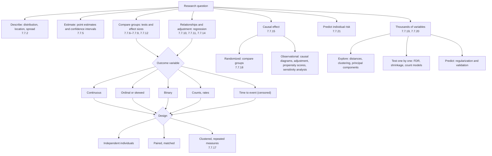
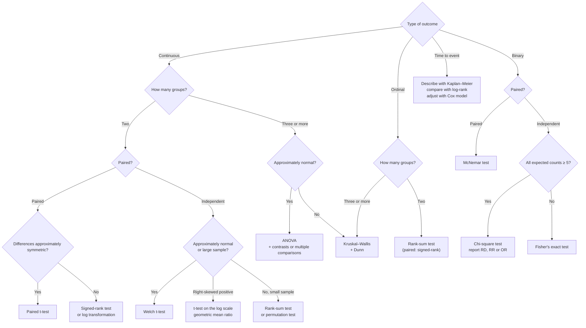
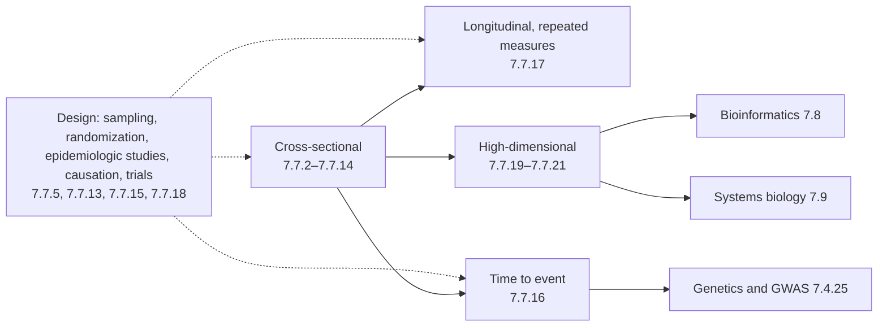

The previous twenty-one chapters covered several dozen methods. In real research the difficulty seldom lies in the computation, since software returns a p-value in one line, but in choosing the right method and in understanding what the result can and cannot show. This chapter introduces no new methods. It reorganizes what has been covered around the question of how to choose: it first gives decision charts and master tables that select a method by research question, outcome type and study design (Section 22.1), then collects the formulas and the numerical values used in hand calculation (Section 22.2), then points out several statistical ideas that recur under different names in different chapters (Section 22.3), retells the course along its five running threads (Section 22.4), lists the most common errors and their consequences (Section 22.5), and finally describes how the course connects to the courses on statistics, genetics, bioinformatics and systems biology (Section 22.6). All numerical values are taken from the chapter that computed them, and the references in the text (Formula 6.2.2, Theorem 20.3.1, Example 15.5.1) lead directly back to the derivation and the conditions.

## 22.1. Three Questions for Choosing a Method

### 22.1.1. Question, Outcome and Design

Three questions must be answered before a method is chosen, and the order cannot be reversed.

1. What is the research question? We may want to describe a set of data ([7.7.2](/7.7.2)); estimate a quantity and state its uncertainty ([7.7.5](/7.7.5)); compare groups ([7.7.6](/7.7.6)–[7.7.9](/7.7.9), [7.7.12](/7.7.12)); characterize relationships among variables while adjusting for other factors ([7.7.10](/7.7.10), [7.7.11](/7.7.11), [7.7.14](/7.7.14)); answer the causal question of what happens if the exposure is changed ([7.7.15](/7.7.15)); or predict risk for a new individual ([7.7.21](/7.7.21)). One regression model can serve adjustment, causation and prediction alike, but the choice of variables, the evaluation of the result and the ways of failing differ among the three ([7.7.21](/7.7.21), Section 21.1).
2. What type is the outcome variable? The **level of measurement** (Definition 1.3.1) determines which operations are meaningful: continuous values, ordered ranks, binary classes, counts and rates, time to an event, and high-dimensional data with thousands of variables per individual. The type of the outcome determines the distribution family of the model and hence the measure of effect: difference in means, odds ratio, rate ratio or hazard ratio.
3. How were the data generated? Was the study a randomized trial or an observational study (Definition 1.5.1)? Are the individuals independent, or are they paired, matched, clustered or measured repeatedly (Definition 7.1.1, Definition 17.1.1)? Are the data cross-sectional, longitudinal or time-to-event (Definition 1.4.1), and is there censoring (Definition 1.4.2)? The design determines the unit of analysis and the variance structure, and it also determines how far the conclusions generalize.

The following chart maps research questions to families of methods; the comparison and modeling branches are developed in Sections 22.1.2 and 22.1.3.

### 22.1.2. Comparing Groups: By Outcome and Design

The table below is the master table of comparison methods for the whole course. Rows are outcome types and columns are designs; each cell gives the method and where it appears. All methods in the table require the unit of analysis to coincide with the experimental unit (Definition 12.7.3): several cells from the same animal, or several measurements on the same person, are not independent observations and belong in the last column.

| Outcome | One sample vs. reference value | Two independent groups | Paired or matched | Three or more groups | Clustered or repeated measures |
|---|---|---|---|---|---|
| Continuous, approximately normal | t-test (Formula 6.2.2), z-test when $\sigma$ is known (Formula 6.2.1); interval (Formula 5.4.1) | Welch t-test (Formula 7.5.1); pooled variance only if the variances are truly similar (Definition 7.3.1) | Paired t-test (Formula 7.2.1) | One-way ANOVA (Formula 12.2.1) + Tukey, Dunnett (Definition 12.3.2) or contrasts (Definition 12.4.1); two-way (Definition 12.5.1); blocks (Definition 12.7.1) | Summary-statistics method (Section 17.2), linear mixed model (Definition 17.4.1), GEE (Definition 17.5.1); crossover design (Formula 17.6.1) |
| Right-skewed positive values (concentrations, titers) | t methods on the log scale | Welch test on the log scale, report the geometric mean ratio (Formula 7.7.1) | Paired t-test on log differences | ANOVA on the log scale | Mixed model on the log scale |
| Ordinal, or severely skewed with a small sample | Sign test (Formula 8.2.1) | Wilcoxon rank-sum test (Formula 8.4.1) | Sign test, Wilcoxon signed-rank test (Formula 8.3.1) | Kruskal–Wallis test (Formula 8.5.1) + Dunn's test (Formula 8.5.2) | Rank test on summary values per experimental unit |
| Binary | Exact binomial test (Formula 6.6.2) or z-test (Formula 6.6.1); Wilson interval (Definition 5.6.1) | Two-proportion z-test = chi-square test (Formulas 9.1.1, 9.1.2); Fisher's exact test when expected counts are small (Definition 9.2.1) | McNemar test (Formula 9.3.1); paired odds ratio $b/c$ (Formula 13.8.1) | $R \times C$ chi-square (Formula 9.5.1); trend test for ordered exposure (Definition 9.6.1) | GEE; sample size multiplied by the design effect (Definition 17.7.1) |
| Counts and rates | Poisson test, SMR (Formula 6.7.1, Definition 6.7.1); exact interval (Formula 5.7.1) | Rate ratio and conditional test (Formula 16.1.1) | — | Trend test over exposure levels (Section 16.1.2) | GEE; negative binomial or quasi-Poisson regression under overdispersion (Section 14.8.3) |
| Time to event (censored) | Kaplan–Meier estimator (Definition 16.5.1), median survival time (Definition 16.5.2) | Log-rank test (Definition 16.6.1) | Stratified Cox model, one stratum per pair ([7.7.16](/7.7.16), Section 16.11) | $k$-group log-rank test; stratified log-rank test (Formula 16.6.1) | — |
| Any statistic | Bootstrap interval (Algorithm 5.10.1) | Permutation test (Definition 8.6.1) | Permutation test with labels exchanged within pairs | Permutation test | Resample at the level of the experimental unit |

A few remarks follow.

- Whether the data are paired or independent is decided by the design, not by the data ([7.7.7](/7.7.7), Section 7.1). For the blood pressure of 15 patients before and after captopril, the paired analysis gives $p = 10^{-6}$ whereas treating the data as independent samples gives only 0.016 (Example 7.2.1). Conversely, treating the 10 cells from one mouse as 10 independent replicates inflates the type I error rate from 0.05 to 0.16–0.45 (Example 12.7.2).
- For a continuous outcome in two independent groups, the Welch test is the default. The two-step procedure of testing for equal variances first and then choosing a t-test is not recommended, because the F-test is extremely sensitive to non-normality ([7.7.7](/7.7.7), Section 7.4). Do not switch to rank methods merely because a normality test is significant: ordinal data, heavy tails and outliers are where rank methods belong ([7.7.8](/7.7.8), Section 8.9).
- Multiple groups are not compared by repeated pairwise t-tests: the 10 comparisons among 5 groups give a familywise error rate of about 0.29 ([7.7.12](/7.7.12), Section 12.1). When there are prespecified questions (a linear trend in dose, each treatment against a control), contrasts or Dunnett's test have far greater power than all post hoc pairwise comparisons.
- A test answers only whether an effect exists; conclusions should be reported as an effect estimate with a confidence interval (Theorem 6.3.1). The effect for a binary outcome is the risk difference, the relative risk or the odds ratio (Definition 13.2.1, interval in Formula 13.2.1), for a rate the rate ratio, and for survival the hazard ratio. Agreement is assessed with Cohen's kappa (Definition 9.8.2), not with the chi-square test.

### 22.1.3. Modeling: The Unity of Regression Models

When several variables must be considered at once, whether to adjust for confounders, estimate a dose–response relationship or describe change over time, each type of outcome has a corresponding regression model. They share one structure: a linear predictor $\boldsymbol{x}^{\mathsf T}\boldsymbol{\beta}$ determines the mean (or the risk) of the outcome through a link function, and after transformation the coefficients are the effect measures adjusted for the other variables.

| Outcome | Model | Link and form | Meaning of $\beta$ | Chapter |
|---|---|---|---|---|
| Continuous | Multiple linear regression (Formula 10.7.1); analysis of covariance (Definition 12.6.1) | Identity: $\mathbb{E}[Y] = \boldsymbol{x}^{\mathsf T}\boldsymbol{\beta}$ | Difference in means | 7.7.10, 7.7.12 |
| Continuous, log scale | Linear regression on $\ln Y$ | $\mathbb{E}[\ln Y] = \boldsymbol{x}^{\mathsf T}\boldsymbol{\beta}$ | $\mathrm{e}^\beta$ is the geometric mean ratio | 7.7.10 |
| Continuous, mechanistic curve | Nonlinear regression: Michaelis–Menten, four-parameter logistic (Definition 11.5.1) | $\mathbb{E}[Y] = f(x; \boldsymbol{\theta})$, Levenberg–Marquardt (Algorithm 11.4.1) | Parameters with mechanistic meaning ($V_{\max}$, $K_{\mathrm{M}}$, $\mathrm{EC}_{50}$) | 7.7.11 |
| Binary | Logistic regression (Definition 14.1.1); probit for dose–response (Definition 14.6.1) | $\operatorname{logit}\mathbb{P}(Y = 1) = \boldsymbol{x}^{\mathsf T}\boldsymbol{\beta}$ | $\mathrm{e}^\beta$ is the adjusted odds ratio (Theorem 14.2.1) | 7.7.14 |
| Binary, matched | Conditional logistic regression (Definition 14.7.1) | Conditional likelihood within matched sets | Odds ratio | 7.7.14 |
| Counts and rates | Poisson regression with an offset (Definition 14.8.1); negative binomial under overdispersion (Definition 20.5.2) | $\ln\mathbb{E}[Y] = \ln T + \boldsymbol{x}^{\mathsf T}\boldsymbol{\beta}$ | $\mathrm{e}^\beta$ is the rate ratio; in RNA-seq, the fold change | 7.7.14, 7.7.20 |
| Time to event | Cox proportional hazards model (Definition 16.7.1) | $h(t \mid \boldsymbol{x}) = h_0(t)\,\mathrm{e}^{\boldsymbol{x}^{\mathsf T}\boldsymbol{\beta}}$, partial likelihood (Theorem 16.7.1) | $\mathrm{e}^\beta$ is the hazard ratio | 7.7.16 |
| Time to event, parametric | Accelerated failure time model (Definition 16.8.1); the Weibull is also a proportional hazards model (Theorem 16.8.1) | $\ln T = \mu + \boldsymbol{x}^{\mathsf T}\boldsymbol{\gamma} + \sigma W$ | $\mathrm{e}^\gamma$ is the time ratio | 7.7.16 |
| Any, repeated measures | Linear mixed model (Definition 17.4.1, 17.4.2); GEE (Definition 17.5.1) | Random intercepts and slopes, or model only the mean with robust standard errors | Conditional effect / marginal effect | 7.7.17 |

The table shows a unity that runs through the whole course. The two-sample t-test is linear regression with a single binary covariate, and analysis of variance is regression with dummy variables only ([7.7.10](/7.7.10), Section 10.7.3). Logistic regression with a single binary covariate gives the odds ratio of a 2×2 table (Example 14.2.1). The stratified analysis of coronary deaths among British doctors is Poisson regression with an interaction term (Example 14.8.1). The log-rank test is the score test in a Cox model with group as the only covariate ([7.7.16](/7.7.16), Question 10). Learning the diagnostics (residuals, influential points, goodness of fit) and the interpretation (adjusted effects, interaction, choice of scale) of one model means learning most of what matters for the whole family.

One caveat is noncollapsibility. In a linear model, adjusting for a prognostic factor unrelated to the exposure leaves the coefficient of the exposure unchanged, whereas odds ratios and hazard ratios do change under such an adjustment ([7.7.13](/7.7.13), Section 13.6.3; Example 16.7.1). The ORs and HRs from different adjustment sets therefore cannot be compared by size in a simple way.

### 22.1.4. A Flowchart for Comparing Two or More Groups

For the most common question, comparison among groups, the master table above can be compressed into a flowchart. Each branch point is a question about the design or the data, not a question about which test is "more significant".

The endpoint of a flowchart is only a test. A complete analysis must also answer whether confounding requires adjustment (if so, move to the regression models of Section 22.1.3), whether the observations are clustered (if so, switch to summaries per experimental unit or a mixed model), and whether several comparisons were made at once (if so, correct for multiplicity; see Section 22.5).

### 22.1.5. Corresponding Functions in Python

The code blocks in this course use the standard Python libraries (scipy, statsmodels, lifelines, scikit-learn, pydeseq2). The table below matches methods to functions; for details see the section on computing in Python in each chapter.

| Method | Function | Chapter |
|---|---|---|
| Descriptive statistics, geometric mean, MAD | `np.mean`, `np.median`, `stats.gmean`, `stats.iqr`, `stats.median_abs_deviation` | 7.7.2 |
| Probabilities and quantiles of distributions | `stats.binom`, `stats.poisson`, `stats.norm`, `stats.t`, `stats.chi2` (`.cdf`, `.sf`, `.isf`) | 7.7.4 |
| Intervals for proportions and Poisson means, bootstrap | `proportion_confint(method="wilson")`, `stats.bootstrap` | 7.7.5 |
| One- and two-sample t, Welch, paired | `stats.ttest_1samp`, `stats.ttest_ind(equal_var=False)`, `stats.ttest_rel` | 7.7.6, 7.7.7 |
| Power and sample size | `TTestIndPower`, `NormalIndPower` | 7.7.6, 7.7.7, 7.7.9 |
| Rank methods and permutation tests | `stats.wilcoxon`, `stats.mannwhitneyu`, `stats.kruskal`, `stats.permutation_test`, `stats.spearmanr` | 7.7.8 |
| Contingency tables | `stats.chi2_contingency`, `stats.fisher_exact`, `mcnemar`, `Table2x2`, `StratifiedTable` | 7.7.9, 7.7.13 |
| Linear regression, ANOVA, multiple comparisons | `smf.ols`, `sm.stats.anova_lm`, `pairwise_tukeyhsd`, `stats.dunnett`, `multipletests` | 7.7.10, 7.7.12 |
| Nonlinear fitting | `scipy.optimize.curve_fit` | 7.7.11 |
| Logistic, Poisson, negative binomial regression | `smf.glm(family=sm.families.Binomial())`, `sm.families.Poisson()`, `smf.negativebinomial` | 7.7.14 |
| Survival analysis | `KaplanMeierFitter`, `logrank_test`, `CoxPHFitter`, `WeibullAFTFitter` | 7.7.16 |
| Mixed models and GEE | `smf.mixedlm`, `smf.gee` | 7.7.17 |
| Meta-analysis | `combine_effects` | 7.7.18 |
| Clustering and principal components | `scipy.cluster.hierarchy.linkage`, `KMeans`, `silhouette_score`, `PCA` | 7.7.19 |
| Multiple testing and differential expression | `multipletests(method="fdr_bh")`, `DeseqDataSet` | 7.7.20 |
| Prediction models and validation | `LogisticRegressionCV`, `cross_val_predict`, `roc_auc_score` | 7.7.21 |

## 22.2. Summary of Formulas

### 22.2.1. Confidence Intervals

| Parameter | Interval | Conditions | Source |
|---|---|---|---|
| Mean | $\bar x \pm t_{n-1,\alpha/2}\, s/\sqrt n$ | Normal or large sample | Formula 5.4.1 |
| Variance | $\left((n-1)s^2/\chi^2_{n-1,\alpha/2},\ (n-1)s^2/\chi^2_{n-1,1-\alpha/2}\right)$ | Strictly normal | Formula 5.5.1 |
| Proportion | Wilson interval; Clopper–Pearson when conservative coverage is needed | Binomial | Definition 5.6.1, 5.6.2 |
| Poisson mean | $\left(\tfrac12\chi^2_{2x,1-\alpha/2},\ \tfrac12\chi^2_{2(x+1),\alpha/2}\right)$ | Rare events | Formula 5.7.1 |
| Difference of two means | $(\bar x_1 - \bar x_2) \pm t_{\nu,\alpha/2}\sqrt{s_1^2/n_1 + s_2^2/n_2}$ | Welch degrees of freedom $\nu$ | Formula 7.5.1 |
| Geometric mean ratio | $\exp(L), \exp(U)$, where $(L, U)$ is the interval for the difference of log means | Logs approximately normal | Formula 7.7.1 |
| Correlation coefficient | $\tanh\!\left(\operatorname{artanh} r \pm z_{\alpha/2}/\sqrt{n - 3}\right)$ | Bivariate normal | Definition 10.2.1 |
| RR, OR | $\exp\!\left(\ln\widehat{\mathrm{RR}} \pm z_{\alpha/2}\sqrt{b/(an_1) + d/(cn_2)}\right)$; $\exp\!\left(\ln\widehat{\mathrm{OR}} \pm z_{\alpha/2}\sqrt{1/a + 1/b + 1/c + 1/d}\right)$ | Large sample | Formula 13.2.1 |
| Survival function | Greenwood variance $\hat S^2\sum d_j/[n_j(n_j - d_j)]$ | Noninformative censoring | Formula 16.5.1 |
| Any statistic | 2.5% and 97.5% quantiles of the bootstrap distribution | i.i.d. | Algorithm 5.10.1 |

With zero events, the one-sided 95% upper limit is about $3/n$ ([7.7.5](/7.7.5), Section 5.6.3).

### 22.2.2. Test Statistics

| Problem | Statistic | Distribution under $H_0$ | Source |
|---|---|---|---|
| One-sample mean | $t = (\bar x - \mu_0)/(s/\sqrt n)$ | $t_{n-1}$ | Formula 6.2.2 |
| Paired | $t = \bar d/(s_d/\sqrt n)$ | $t_{n-1}$ | Formula 7.2.1 |
| Two independent means | $t = (\bar x_1 - \bar x_2)/\sqrt{s_1^2/n_1 + s_2^2/n_2}$ | Approximately $t_\nu$ | Formula 7.5.1 |
| Variance ratio | $F = s_1^2/s_2^2$ | $F_{n_1-1, n_2-1}$ | Formula 7.4.1 |
| Several means | $F = \mathrm{MS}_{\text{between}}/\mathrm{MS}_{\text{within}}$ | $F_{k-1, N-k}$ | Formula 12.2.1 |
| Single proportion | $z = (\hat p - p_0)/\sqrt{p_0(1 - p_0)/n}$ | $\mathcal{N}(0, 1)$ | Formula 6.6.1 |
| 2×2 and $R \times C$ tables | $X^2 = \sum (O - E)^2/E$ | $\chi^2_{(R-1)(C-1)}$ | Formulas 9.1.2, 9.5.1 |
| Paired proportions | $(b - c)^2/(b + c)$ | $\chi^2_1$ | Formula 9.3.1 |
| Stratified 2×2 tables | Mantel–Haenszel | $\chi^2_1$ | Formula 13.6.1 |
| Rank sum | Standardized $W$ | Approximately $\mathcal{N}(0, 1)$ | Formula 8.4.1 |
| Two survival curves | $\left(\sum (O_1 - E_1)\right)^2/\sum V$ | $\chi^2_1$ | Definition 16.6.1 |
| Nested models | $G = 2(\ell_1 - \ell_0)$; in linear models the extra-sum-of-squares $F$ | $\chi^2_{\Delta p}$; $F$ | Definition 14.3.1, Formula 11.6.1 |
| Heterogeneity in meta-analysis | $Q = \sum w_i(\hat\theta_i - \hat\theta)^2$, $I^2 = (Q - (k-1))/Q$ | $\chi^2_{k-1}$ | Definition 18.8.2 |

### 22.2.3. Measures of Effect

| Outcome | Measure | Value for no effect | When to use |
|---|---|---|---|
| Continuous | Difference in means; standardized effect size $d$ (Definition 6.8.1); geometric mean ratio | 0; 0; 1 | The original units are the most direct; standardize for comparisons across studies |
| Binary | Risk difference RD, relative risk RR, odds ratio OR (Definition 13.2.1) | 0, 1, 1 | All three are available for cohort studies and trials; only the OR for case-control studies (Theorem 13.2.1); OR ≈ RR for rare diseases |
| Public health | Attributable fraction among the exposed, population attributable fraction (Definition 13.3.1), number needed to treat NNT (Definition 13.3.2) | 0; $\infty$ | Decisions: for the same RR, a tenfold higher baseline risk gives a tenfold larger RD |
| Rates | Rate ratio IRR (Formula 16.1.1), SMR (Definition 6.7.1) | 1 | Event data with unequal follow-up time |
| Time to event | Hazard ratio HR (Definition 16.7.1), time ratio, median survival time | 1 | Censored data; when proportional hazards fails, report piecewise HRs or restricted mean survival time |
| Diagnosis | Sensitivity, specificity (Definition 3.3.1), predictive values (Definition 3.3.2), likelihood ratios (Definition 3.3.3), AUC (Theorem 3.4.1) | — | Predictive values depend on prevalence (Theorem 3.3.1) |
| Prediction models | Discrimination (Definition 21.6.1), calibration slope and intercept (Definition 21.6.2), Brier score (Definition 21.6.3), net benefit (Definition 21.6.4) | AUC 0.5; slope 1 | Report after internal validation (Algorithm 21.5.1) |

### 22.2.4. Sample Size

The sample size formulas in the individual chapters are all special cases of one form. Suppose the estimator of the effect is approximately normal with variance $v/n$. A two-sided test at level $\alpha$ that detects an effect $\delta$ with power $1 - \beta$ needs

$$
n = \frac{(z_{\alpha/2} + z_\beta)^2\, v}{\delta^2}
$$
(Formula 18.4.1). Here $(z_{0.025} + z_{0.2})^2 = 7.85$ and $(z_{0.025} + z_{0.1})^2 = 10.51$: 90% power requires 34% more subjects than 80% power. The various designs differ only in $v$.

| Design | Sample size per group (or in total) | Source |
|---|---|---|
| One-sample mean | $n = \sigma^2(z_{\alpha/2} + z_\beta)^2/\Delta^2$ | Formula 6.4.2 |
| Estimating a mean to within $\pm E$ | $n = (z_{\alpha/2}\sigma/E)^2$; for a proportion $z_{\alpha/2}^2 p(1-p)/E^2$ | Formula 5.9.1 |
| Two independent groups | $2\sigma^2(z_{\alpha/2} + z_\beta)^2/\Delta^2$ per group | Formula 7.6.1 |
| Paired | $\sigma_d^2(z_{\alpha/2} + z_\beta)^2/\Delta^2$ pairs, $\sigma_d^2 = 2\sigma^2(1 - \rho)$ | Formula 7.6.2 |
| Two proportions | Formula 9.4.1 | Formula 9.4.1 |
| Survival (log-rank, 1:1) | Number of events $d = 4(z_{\alpha/2} + z_\beta)^2/(\ln\mathrm{HR})^2$ | Formula 16.10.1 |
| Loss to follow-up, noncompliance, clustering | $\times 1/(1 - L)$; $\times 1/(1 - d_{\mathrm{in}} - d_{\mathrm{out}})^2$; $\times [1 + (m-1)\rho]$ | Formula 18.4.2, Definition 17.7.1 |
| Prediction model | Computed from the expected shrinkage factor | Formula 21.8.1 |

![The sample sizes computed in the individual chapters are all instances of the same formula (logarithmic horizontal axis; units are total number of participants or events). From top to bottom: a one-sample test of a 20-pound weight change (90% power, Example 6.4.2); a paired design ($\rho = 0.5$) and a two-group independent design that detect a 10 mmHg reduction in blood pressure (Example 7.6.2); the 128 deaths in the veteran trial can detect a hazard ratio of 1.64 with only 80% power (Example 16.10.1); three-group ANOVA with $f = 0.25$ (Example 12.7.3); estimating mean birth weight to within ±100 g (Example 5.9.1); low birth weight 0.25 versus 0.40 (Example 9.4.1); a low-birth-weight prediction model with expected shrinkage factor 0.9 (Example 21.8.1); a 200 g difference in birth weight between two groups (Example 7.6.1); a 25% relative reduction in myocardial infarction from 2.2% (Physicians' Health Study, Example 18.4.1). Unless stated otherwise, power is 80% and two-sided $\alpha = 0.05$. The sample sizes span almost three orders of magnitude, and the differences come entirely from $v$ and $\delta$](./plots/sample-size.py)

Two rules of thumb follow. First, $n$ is inversely proportional to $\delta^2$, so halving the effect requires four times the sample size; the expected effect therefore must not be exaggerated merely to obtain a feasible sample size. Second, reducing $v$ is often cheaper than increasing $n$: pairing and blocking (a randomized block design with littermates is about 7.6 times as efficient as a completely randomized design, Example 12.7.1), adjusting for strong prognostic factors and choosing endpoints with small measurement error all reduce $v$.

### 22.2.5. Numerical Values for Hand Calculation

Without software, the values below suffice for most hand calculations (Section 6.2.3 of [7.7.6](/7.7.6) explains how to read tables).

| Quantity | Value | Use |
|---|---|---|
| $z_{0.025}$, $z_{0.05}$, $z_{0.005}$ | 1.960, 1.645, 2.576 | Two-sided 95%, one-sided 95% or two-sided 90%, two-sided 99% |
| $z_{0.2}$, $z_{0.1}$ | 0.842, 1.282 | 80%, 90% power |
| $(z_{0.025} + z_{0.2})^2$, $(z_{0.025} + z_{0.1})^2$ | 7.85, 10.51 | Sample size |
| $t_{9,0.025}$ | 2.262 | Interval for the mean with $n = 10$ |
| $\chi^2_{1,0.05}$, $\chi^2_{2,0.05}$ | 3.84, 5.99 | Chi-square and likelihood ratio tests |
| $1 - 0.95^{m}$ | 0.40 for $m = 10$ | Familywise error rate of independent tests |
| Upper limit for zero events | $3/n$ | The "rule of three" |
| Design effect | $1 + (m - 1)\rho$ | Clustered data |
| E-value | $\mathrm{RR} + \sqrt{\mathrm{RR}(\mathrm{RR} - 1)}$ | Sensitivity to unmeasured confounding (Definition 15.6.1) |

## 22.3. Recurring Statistical Ideas

Several ideas recur under different names in many chapters. Once they are recognized, the chapters are no longer isolated lists of methods.

| Idea | Core | Appears in |
|---|---|---|
| Levels of variation | The level to which the variance belongs determines the standard error through the number of units at that level | 2, 4, 7, 12, 17, 18, 20 |
| Signal and noise | Statistic = effect / standard error; tests, intervals and power are two sides of the same coin | 5, 6, 7, 16, 18 |
| The 2×2 table | Diagnosis, error types, effect measures, stratification, survival and enrichment are all 2×2 tables | 3, 6, 9, 13, 16, 20 |
| Likelihood | Maximum likelihood estimation, likelihood ratio tests, deviance, partial likelihood | 5, 11, 14, 16, 17, 20 |
| Borrowing strength and shrinkage | Many units share information, pulling unstable individual estimates toward the whole | 5, 17, 18, 20, 21 |
| Adjustment and comparability | Only when the compared groups are comparable in other factors can a difference be attributed to the exposure | 5, 10, 12–15, 18 |
| Log scale | Multiplicative effects become additive on the log scale | 2, 4, 7, 10, 13, 14, 16, 20 |

### 22.3.1. Levels of Variation: Standard Deviation, Standard Error and the Experimental Unit

The **standard deviation** describes the variation between individuals, and the **standard error** $s/\sqrt n$ describes the precision of an estimator ([7.7.2](/7.7.2), Section 2.2.5; Theorem 4.7.1); confusing the two is among the most common mistakes in biomedical papers. A deeper question is what $n$ is. The $n$ in a standard error must be the number of independent experimental units (Definition 12.7.3). When observations within a unit are correlated, the variance of the mean of $m$ observations is $1 + (m - 1)\rho$ times that for independent observations. This **design effect** (Definition 17.7.1) appears four times in the course.

- Pseudoreplication (Definition 12.7.4): with an intraclass correlation of 0.3, treating the cells of a mouse as independent replicates gives a type I error rate of 0.33 (Example 12.7.2).
- Repeated measures and mixed models: the OLS standard error of the slope in sleepstudy is 1.24 whereas the correct value is 1.55 (Example 17.1.1); the **intraclass correlation coefficient** (Definition 17.3.2) also measures the reproducibility of an assay (estradiol 0.91, Example 17.3.1).
- The sample size of a cluster-randomized trial is multiplied by it (Formula 18.4.2).
- In gene set enrichment analysis, correlation among genes inflates the variance of the test statistic by a factor of $1 + (n - 1)\bar\rho$ ([7.7.20](/7.7.20), Section 20.9).

Error must be estimated at the correct level. Duplicate wells in a DNase assay are technical replicates, and their variation (within-run CV 2.1%) is much smaller than the variation between assays (between-run 6.6%, Example 17.3.2); estimating the error of a standard curve from duplicate wells underestimates the uncertainty (Example 11.2.1). **Biological replicates** are the unit of inference.

### 22.3.2. Signal and Noise: Tests, Intervals and Power

Almost every test statistic is "estimated effect / its standard error", which under $H_0$ is approximately standard normal or $t$-distributed. Three consequences follow. First, tests and intervals are dual: a two-sided test rejects $H_0$ if and only if the reference value lies outside the confidence interval (Theorem 6.3.1), so reporting the interval contains all the information in the test and also the size of the effect. Second, power (Definition 6.4.1) is determined by the ratio of effect to noise and by the sample size, and the sample size formula (Section 22.2.4) simply solves it in reverse. Third, the **p-value** (Definition 6.1.2) depends on the effect and the sample size together: in the Physicians' Health Study a risk difference of 0.91 percentage points has $p = 2 \times 10^{-7}$ (Example 9.1.2), while in birthwt a larger difference has $p = 0.026$ (Example 9.1.1). Statistical significance is not practical importance, and non-significance is not the absence of a difference ([7.7.6](/7.7.6), Sections 6.4.4 and 6.8).

Type I and type II errors (Definition 6.1.1) correspond exactly to $1 - {}$specificity and $1 - {}$sensitivity of a diagnostic test. The question of how many significant results among thousands of tests are true is the same Bayes problem as the question of how many positive test results are true (Section 22.3.3).

### 22.3.3. The Many Faces of the 2×2 Table

At least eight problems in this course reduce to a 2×2 table.

| Setting | Rows × columns | Quantity of interest | Source |
|---|---|---|---|
| Diagnostic test | Test result × true state | Sensitivity, specificity, predictive values | Definition 3.3.1, 3.3.2 |
| Hypothesis test | Decision × true state | $\alpha$, $\beta$; FDR in multiple testing | Definition 6.1.1, [7.7.20](/7.7.20) Section 20.1.1 |
| Comparing two proportions | Exposure × outcome | RD, RR, OR; chi-square = $z^2$ | Formula 9.1.2, Definition 13.2.1 |
| Small samples | Same, given the margins | Hypergeometric distribution | Definition 9.2.1 |
| Paired data | First measurement × second measurement | Only the discordant pairs $b$, $c$ carry information | Formula 9.3.1, 13.8.1 |
| Stratified analysis | One table per stratum | Mantel–Haenszel pooling | Formula 13.6.1 |
| Survival comparison | One table per event time | Log-rank = Mantel–Haenszel test stratified by time | Definition 16.6.1 |
| Enrichment analysis | In gene set × significant | One-sided Fisher's exact test | [7.7.20](/7.7.20) Section 20.9 |

Another reading of the same table is the **area under the curve**: the probability that a randomly chosen patient has a higher test value than a randomly chosen non-patient (Theorem 3.4.1). It is the Mann–Whitney statistic $U/(n_1 n_2)$ (Example 8.4.1, AUC 0.893 for the CT score) and also the C-statistic of a logistic model (Example 14.5.1). Judging the PPV of a positive test result (Theorem 3.3.1) and judging how many false discoveries a list of significant genes contains (Example 20.1.1) both use Bayes' formula: when the prior (the prevalence or $\pi_0$) is small, then even for a fairly accurate test most positive results are still false positives.

### 22.3.4. Likelihood

Maximum likelihood takes "which parameter value makes the observed data most probable" as a general principle of estimation (Example 5.3.1). Under normal errors, least squares is maximum likelihood (Theorem 11.1.1). Logistic, Poisson and negative binomial regressions are solved by IRLS. Nested models are compared by the likelihood ratio test and the deviance (Definition 14.3.1, 14.5.1), and intervals for parameters can be obtained from the profile likelihood (Formula 14.3.1). The partial likelihood of the Cox model (Theorem 16.7.1) eliminates the unknown baseline hazard and has the same form as the likelihood of conditional logistic regression. Mixed models use REML ([7.7.17](/7.7.17), Section 17.4.2), and the likelihood of a parametric model for censored data is $\prod h^{\delta}S$ ([7.7.16](/7.7.16), Section 16.8). Likelihood methods remain valid under data missing at random (Definition 17.8.1), which is why mixed models are preferable to complete-case analysis (Example 17.8.1).

### 22.3.5. Borrowing Strength and Shrinkage

When the data contain many similar units, such as many subjects, many trials or many genes, the estimate for each unit can borrow strength from the others: unstable individual estimates are shrunk toward the whole, trading a little bias for a large reduction in variance. The idea appears six times in the course.

| Setting | What is shrunk | Shrunk toward | Source |
|---|---|---|---|
| Bayesian estimation | Response rate | Prior | Example 5.11.1 |
| Linear mixed model | Individual slopes | Population slope (BLUP) | Theorem 17.4.1, Example 17.4.2 (−2.88 → −0.28) |
| Random-effects meta-analysis | Effects of individual trials | Mean of the effect distribution | Definition 18.8.3 |
| Moderated t statistic | Variances of genes | Prior variance across all genes | Definition 20.4.1, Example 20.4.1 |
| Negative binomial dispersion | Dispersion parameters of genes | Trend with the mean | Example 20.5.2 |
| Ridge regression, lasso | Regression coefficients | 0 | [7.7.21](/7.7.21) Section 21.4, Example 21.4.2 |

They share the form of **empirical Bayes** (Definition 20.3.4): first estimate the prior from all units, then carry out Bayesian inference for each unit. The weight of shrinkage is determined by the amount of information: units with fewer observations and more noise are shrunk more.

### 22.3.6. Adjustment and Comparability

Whether a difference between two groups can be attributed to the exposure depends on whether the groups are comparable in the other factors that affect the outcome. **Randomization** (Definition 5.2.1) ensures comparability by design, so that differences between groups can arise only from the treatment or from chance (Theorem 15.3.1); observational studies can only adjust, in the analysis, for measured factors. In the order of their appearance, the adjustment methods in the course are: separate comparisons (FEV by age group, [7.7.7](/7.7.7)), multiple regression (Example 10.7.1), analysis of covariance (Example 12.6.1), standardization (Definition 13.5.2), stratification and Mantel–Haenszel (Formula 13.6.1), matching (Definition 13.8.1), logistic and Poisson regression (Example 14.4.1, 14.8.1), and propensity scores and inverse probability weighting (Definition 15.5.1, 15.5.2). They answer the same question and share the same prerequisite: the adjusted variables are confounders, not mediators or colliders. What to adjust for is decided by the **causal diagram** and the **backdoor criterion** (Theorem 15.4.1), not by p-values or by changes in coefficients.

Adjustment can remove spurious associations and can also reveal masked ones. The coefficient of smoking in the FEV model changes from positive to negative after adjusting for age (Example 10.7.1); in birthwt, adjusting for race increases the effect of smoking from 284 g to 400 g (Example 12.6.1) and the OR from 2.02 to 2.36 (Example 14.4.1). Adjustment handles only measured factors; for unmeasured confounding, methods such as the E-value assess how large it could be (Definition 15.6.1).

### 22.3.7. The Log Scale

Many effects in biology are multiplicative: concentrations and titers change by factors, FEV grows in proportion to height, a drug multiplies the risk by a factor, and gene expression changes by fold. The logarithm turns multiplication into addition, and so the geometric mean is the antilog of the mean of the logs (Example 2.1.1); right-skewed positive data are often approximately normal with stable variance after a log transformation (Example 7.7.1, 10.5.1); the intervals for RR, OR and HR are constructed on the log scale (Formula 13.2.1); the coefficients of logistic, Poisson and Cox models are effects on the log scale; the effect in RNA-seq is the $\log_2$ fold change (Example 20.7.1), and a variance-stabilizing transformation precedes principal component analysis (Example 19.2.1); dose–response curves are symmetric S-shaped curves on the log-dose axis (Definition 11.5.1). Interaction depends on the scale: there may be no interaction on one scale and an interaction on another ([7.7.12](/7.7.12), Section 12.5; Definition 13.6.1).

## 22.4. Review of the Running Threads

### 22.4.1. Smoking and Health

Smoking is the backbone of the whole course, linking description, comparison, confounding, adjustment, causation and prognosis into a single chain of reasoning.

- Description and comparison: among the 654 children of East Boston, the mean FEV is 3.277 L in smokers and 2.566 L in nonsmokers (Example 1.5.1). The two-sample t-test gives $p = 2 \times 10^{-10}$ (Example 7.3.2), the rank-sum test $p = 4 \times 10^{-11}$ (Example 8.4.2), and the bootstrap gives an interval of 1.20–1.36 for the ratio of means (Example 5.10.2). The three methods agree, which shows that the problem lies not in the test.
- Confounding: the scatter plot of FEV against age ([7.7.2](/7.7.2), Section 2.6.1) first revealed the source of the paradox: all 65 smokers are aged 9 or older. After adjusting for age, the coefficient of smoking becomes −0.21 L, and after also adjusting for height and sex, the FEV of smokers is 4.5% lower on the log scale (Example 10.7.1). The causal diagram shows that age and sex are confounders and height is partly a mediator, so the total effect of smoking on FEV should be adjusted for age and sex only, giving −0.154 L (−7.1%, Example 15.4.1).
- Maternal smoking and birth weight: infants of smoking mothers weigh 284 g less on average (Example 7.3.1), and the proportion of low birth weight is 0.405 versus 0.252 (Example 9.1.1, OR 2.02). The direction of confounding here is the opposite: white mothers, who smoke the most, have heavier infants to begin with, so after adjusting for race and weight the effect grows to −400 g (Example 12.6.1) and the adjusted OR is 2.36 (Example 14.4.1). The various propensity score methods mostly give −320 to −380 g, and untruncated inverse probability weighting is distorted by a single individual with weight 42.8 (Example 15.5.1).
- Smoking and lung cancer: the case-control study of Doll and Hill can estimate only the OR, which is 14.0 (3.3–59.3, Example 13.2.2). The British doctors cohort gives a rate ratio of 14.6 and a dose–response that rises monotonically with the amount smoked, 7.7, 13.7, 24.5 (Example 13.7.1); about 93% of lung cancer in smokers is attributable to smoking (Example 13.3.1). For Fisher's "constitutional hypothesis" to hold, an unmeasured factor would need associations with both smoking and lung cancer reaching an E-value of 28.7 (Example 15.6.1), which is the modern form of Cornfield's argument; the Bradford Hill criteria (Definition 13.7.1) organize this evidence.
- Prognosis: in the veteran trial the median survival of patients with advanced lung cancer is only 103 days (standard chemotherapy) and 52 days (test chemotherapy, Example 16.5.1), but the two curves cross and the log-rank test gives $p = 0.93$ (Example 16.6.1). After adjusting for Karnofsky score and cell type the HR for treatment is 1.30 (0.88–1.93, Example 16.7.1), and the effect of the Karnofsky score weakens over time (Example 16.7.2). The 128 deaths can detect a hazard ratio of 1.64 with only 80% power (Example 16.10.1).

![Estimates of the same effect along the smoking thread in the different chapters (points are estimates, segments are 95% intervals, open points are point estimates for which the original chapter did not report an interval). A: the coefficient of smoking for FEV among 654 children varies with the adjustment set; it is +0.71 L unadjusted, becomes negative after adjusting for age, and adjusting for age and sex only gives the total effect (Example 10.7.1, 15.4.1). B: the effect of maternal smoking on birth weight among 189 newborns: crude difference, analysis of covariance, regression adjustment, propensity score stratification and matching, inverse probability weighting (truncated or not) and overlap weights (Example 12.6.1, 15.5.1). C: odds ratio for low birth weight: crude OR, adjusted for race only, adjusted for race and weight, and the 7-variable logistic model (Example 9.1.1, 14.4.1). D: lung cancer, the OR from the Doll–Hill case-control study and the rate ratios from the British doctors cohort relative to never smokers (Example 13.2.2, 13.7.1). E: hazard ratio of test versus standard chemotherapy in the veteran trial, unadjusted and adjusted for Karnofsky score and cell type (Example 16.7.1)](./plots/smoking-chain.py)

The lesson of this thread is that the size and direction of an association depend on who is being compared and on what has been adjusted for. With the same data, the correct analysis is determined by the design and the causal structure, not by which test gives the smaller p-value.

### 22.4.2. Aspirin: One Trial and the Synthesis of Evidence

The Physicians' Health Study randomized 22 071 male physicians to aspirin or placebo (with a 2×2 factorial design that also included beta-carotene, Example 5.2.1). Myocardial infarction occurred in 139/11 037 versus 239/11 034, RR 0.58 (Example 3.1.4), and the two-proportion test gives $z = -5.19$ (Example 9.1.2). The risk difference is −0.91 percentage points and the NNT is 110 (80–177, Example 13.3.2): the relative and the absolute effect convey different information. At the expected event rate, detecting a 25% relative reduction needs about 9800 participants per group (Example 18.4.1). The trial was stopped early for evident benefit; early stopping overestimates the effect and leaves the secondary endpoints unanswerable (Example 18.5.1). The PHS report that aspirin "works only in those over 50" is a warning about subgroup analysis (Example 18.6.1). A meta-analysis of seven primary-prevention trials gives 0.89 (0.84–0.94) with $I^2 = 0$ (Example 18.8.1); in the cumulative analysis by year, the three new trials of 2018 move the relative effect toward 1 while the bleeding risk is 1.42 times higher (Example 18.8.3), and the changed balance of absolute benefit and harm changed the guidelines (Example 18.8.2). Evidence is cumulative and updated, and the significant result of a single trial is not the end point.

### 22.4.3. Diagnosis and Screening

Low-dose CT screening has a sensitivity of 93.8% and a specificity of 73.4%, and at a prevalence of 1.1% the PPV is only 3.8% (Example 3.3.1); the specificity of a COVID-19 antigen test is 99.1%, and at low prevalence the PPV is again determined by the specificity (Example 3.3.2). Diagnostic likelihood ratios turn Bayes' formula into multiplication (Formula 3.3.1). For continuous or ordinal test values we use the ROC curve; the AUC of 0.893 for the CT score (Example 3.4.1) is exactly the $U/(n_1n_2)$ of the rank-sum test (Example 8.4.1), and since sensitivity and specificity are proportions, Wilson intervals should be reported (Example 5.6.2). In a prediction model the same AUC becomes discrimination (Definition 21.6.1), to which calibration (Definition 21.6.2) and clinical net benefit (Definition 21.6.4) are added. The effect of screening cannot be judged by "survival of screen-detected cases": **lead-time bias**, **length bias** and **overdiagnosis** (Definition 18.7.1) all make screening look effective. The NLST used lung cancer mortality in the randomized groups as its endpoint, with a rate ratio of 0.80 (0.70–0.92, Example 16.1.1), and excess diagnoses fell from 119 to 20 cases (Example 18.7.1).

### 22.4.4. Laboratory Assays

The CV of duplicate wells in a DNase ELISA rises at the low-concentration end (Example 2.2.2). The standard curve within the linear range and inverse prediction (Example 10.6.1) generalize to the four-parameter logistic model (Example 11.5.1), and the precision profile gives a quantifiable range of about 0.15–12.5 ng/mL (Definition 11.5.2); the between-run CV of 11 independent assays is 3 times the within-run CV (Example 17.3.2). The enzyme kinetics of puromycin are fitted by nonlinear least squares to the Michaelis–Menten equation, with $V_{\max} = 212.7$ and $K_{\mathrm{M}} = 0.064$, while the Lineweaver–Burk plot biases both downward (Example 11.4.1); the extra-sum-of-squares F-test shows that the treatment changes $V_{\max}$ ($p = 1.6 \times 10^{-6}$) and detects no change in $K_{\mathrm{M}}$ (Example 11.6.2). The ToothGrowth experiment in guinea pigs is used in turn for two-sample comparison (Example 7.3.3, 7.5.1), rank and permutation tests (Example 8.5.1, 8.6.1: the permutation p-value 0.0052 is almost the same as the 0.0053 of the t-test), analysis of variance ($F = 67.4$, Example 12.2.1), the linear trend in dose (explaining 99% of the dose effect, Example 12.4.1) and interaction ($p = 0.022$, Example 12.5.1). The lesson of this thread is addressed to the experimenter: first fix the experimental unit and the levels of replication, then choose the model; use a mechanistic nonlinear model rather than a linearization; and report intervals for the parameters and the range in which the model applies.

### 22.4.5. airway: High-Dimensional Omics

The airway data, with 8 samples and about 60 000 genes, turn the shape "individuals × variables" on its head. After variance stabilization, the first two principal components correspond to dexamethasone treatment (39%) and donor (27%), and the first four together account for 97%, consistent with the 1 + 3 degrees of freedom of the design (Example 19.6.1); the results of hierarchical clustering and k-means vary with the linkage, and the silhouette coefficients are all below 0.25 (Example 19.4.1, 19.5.1). In gene-by-gene testing, 5567 genes have $p < 0.05$, of which about 618 are expected to be false (Example 20.1.1); the negative binomial generalized linear model uses size factors as an offset and shrinks the dispersion parameters toward the trend (Example 20.5.2), and the paired design `~ cell + dex` detects 4691 genes at FDR 0.1 (Example 20.3.1). The same data also give a counterexample for prediction: when the 8 samples are split arbitrarily into two groups, still several hundred genes separate the two groups perfectly, and selecting genes on all samples and then cross-validating gives zero error (Example 21.2.2). When $p \gg n$, exploration looks for structure, inference controls the FDR, and prediction must place every step inside cross-validation.

## 22.5. Common Errors

| Error | Example and consequence | Correct practice | Source |
|---|---|---|---|
| Confusing SD and SE | A bar chart of mean ± SE makes the variation look small | Use the SD to describe individuals and the SE or an interval for the precision of the mean; plot the data points | [7.7.2](/7.7.2) Sections 2.2.5, 2.6.4 |
| Treating paired data as independent | Captopril $p = 10^{-6}$ becomes 0.016 (Example 7.2.1) | Choose a paired method according to the design | Definition 7.1.1 |
| Pseudoreplication | Cells treated as mice, error rate 0.16–0.45 (Example 12.7.2) | Analyze the means per experimental unit or use a mixed model | Definition 12.7.4 |
| Ignoring correlation in repeated measures | Random-intercept model gives a slope standard error of 0.80, the correct value is 1.55 (Example 17.4.1) | Random-slope model, summary-statistics method or GEE | Definition 17.4.2 |
| Multiple tests without correction | 10 t-tests among 5 groups give a familywise error rate of 0.29; 5 interim analyses give 0.14 | Holm, Tukey, Dunnett; FDR; alpha spending function | Definition 12.3.1, Theorem 20.3.1, Definition 18.5.2 |
| Misreading p-values | Taking $p$ as the probability that $H_0$ is true; taking "not significant" as "no difference" | Report effects and intervals; use TOST for equivalence | Definition 6.1.2, Definition 18.3.2 |
| Treating correlation as causation | Smoking children have higher FEV (Example 1.5.1); ecological fallacy (Definition 15.1.1) | Adjust for confounders according to the causal diagram and assess unmeasured confounding | Theorem 15.4.1, Definition 15.6.1 |
| Adjusting for a mediator or collider | Birth weight paradox (Example 15.4.3); Berkson's bias (Example 15.4.2) | Let the backdoor criterion determine the adjustment set | Definition 15.4.2 |
| Looking only at completers | Completers-only slope 7.73, truth 10.47 (Example 17.8.1) | ITT; likelihood methods or multiple imputation | Definition 18.2.2, Definition 17.8.2 |
| Dropping censored subjects | Survival is underestimated | Kaplan–Meier, log-rank, Cox | Definition 16.5.1 |
| Using the correlation coefficient to judge agreement between two methods | An automatic blood pressure monitor reads 14 mmHg higher on average (Example 11.3.1) | Bland–Altman plot and limits of agreement | Definition 11.3.2 |
| Linearizing a nonlinear model | Lineweaver–Burk distorts the errors | Nonlinear least squares | Algorithm 11.4.1 |
| Inference as usual after stepwise selection | In pure noise, 89% of the final models are "significant" (Example 21.3.1) | Fix the variables in advance; penalized regression; report the stability of selection | [7.7.21](/7.7.21) Section 21.3 |
| Evaluating a prediction model on the development data | AUC 0.750 → 0.695 (Example 21.5.1); calibration slope 0.35 with 27 variables (Example 21.4.2) | Cross-validation or bootstrap optimism correction, external validation | Algorithm 21.5.1 |
| Batch confounded with treatment | Treatment and batch cannot be separated | Assign batches at random, balanced design | [7.7.19](/7.7.19) Section 19.7 |
| Selective publication | OR 0.77 for the 35 published trials, 0.84 for all (Example 18.8.4) | Trial registration, prespecified analysis plan | Definition 18.8.5 |

![The consequences of common errors, quantified (values are taken from the chapters). A: actual false-positive rate of analyses with a nominal level of 5%: all 10 pairwise t-tests among 5 groups (Section 12.1), 5 unadjusted interim analyses (Section 18.5), treating the 10 cells of each mouse as independent replicates (3 mice per group, intraclass correlation 0.1, 0.3, 0.5, Example 12.7.2), and the overall F-test of the final model after stepwise selection among 50 noise variables (Example 21.3.1). B: ratio of the reported standard error to the correct standard error when correlation is ignored: ordinary least squares and the random-intercept model in sleepstudy compared with the random-slope model (Example 17.1.1, 17.4.1), and the least-squares fit of a mean squared displacement curve compared with the actual spread among simulated trajectories (Example 11.7.1). C: apparent performance of the birthwt prediction model on the development data compared with the performance after cross-validation and bootstrap optimism correction (Example 21.5.1; the calibration slope of a maximum likelihood logistic model on its development data is 1 by construction). D: calibration slope in nested cross-validation for the maximum likelihood model with 27 candidate variables and for ridge regression (Example 21.4.2)](./plots/error-inflation.py)

Most of these errors are not computational mistakes but a disconnect between analysis and design: the unit of analysis is not the experimental unit, the compared groups are not comparable, the data used for evaluation are not new data, or the reported result was picked from many attempts. For this reason the most effective way to prevent them is to write the analysis plan before looking at the data ([7.7.18](/7.7.18) Section 18.9, [7.7.21](/7.7.21) Section 21.8).

## 22.6. Connections to Other Courses

### 22.6.1. A Map of Data Types

The order of the course is the order of data shapes. Cross-sectional data (7.7.2–7.7.14) have only two dimensions, individuals and variables. Longitudinal data (7.7.17) add time, and the observations on one individual are correlated. Survival data (7.7.16) take time itself as the outcome and come with censoring. In high-dimensional data (7.7.19–7.7.21) the variables far outnumber the individuals. Study design (7.7.5, 7.7.13, 7.7.15, 7.7.18) runs through all of them and determines which questions each kind of data can answer.

![Shapes of the datasets in the course (logarithmic axes). A: individual-level data, number of units $n$ (children, newborns, patients, animals, assay runs, subjects, samples) against the number of variables $p$ recorded for each unit; marker shapes indicate the data type: cross-sectional, repeated measures, time to event, high-dimensional. The airway data have 8 samples and about 60 000 genes (18 899 tested after filtering), far on the other side of the dashed line $p = n$. B: studies used through published summary tables, with their numbers of participants: the CT score (Hanley and McNeil 1982), the Doll–Hill case-control study, the Physicians' Health Study, the British doctors cohort and the NLST](./plots/data-shapes.py)

### 22.6.2. The Statistics Course

This course is the biomedical application of the statistics course ([3](/3)): it covers the conditions, use and interpretation of methods and links back for the mathematical derivations. Probability and distributions are in [3.1](/3.1) (conditional probability and Bayes' formula [3.1.2](/3.1.2), common distributions [3.1.4](/3.1.4), the **central limit theorem** [3.1.13](/3.1.13)); the theory of estimation, intervals and tests is in [3.2](/3.2) (point estimation [3.2.3](/3.2.3), interval estimation [3.2.4](/3.2.4), parametric tests [3.2.5](/3.2.5), nonparametric tests [3.2.6](/3.2.6), Bayesian inference [3.2.7](/3.2.7)); linear regression and analysis of variance are in [3.3](/3.3) (multicollinearity [3.3.10](/3.3.10), model selection [3.3.11](/3.3.11), one-way and two-way analysis of variance [3.3.12](/3.3.12)–[3.3.14](/3.3.14)); principal components, multidimensional scaling, clustering and discriminant analysis are in [3.4](/3.4) ([3.4.5](/3.4.5), [3.4.6](/3.4.6), [3.4.11](/3.4.11); ROC and false discovery rate [3.4.10](/3.4.10), [3.4.12](/3.4.12)); numerical optimization, the EM algorithm, the bootstrap and random numbers are in [3.5](/3.5) ([3.5.4](/3.5.4), [3.5.6](/3.5.6), [3.5.7](/3.5.7), [3.5.8](/3.5.8)). For model evaluation and cross-validation in machine learning see [4.6.2](/4.6.2) and [4.6.7](/4.6.7).

### 22.6.3. The Biology Courses

- Genetics ([7.4](/7.4)): the Hardy–Weinberg test in population genetics is a goodness-of-fit test ([7.4.22](/7.4.22)); the variance components and heritability of quantitative genetics are random-effects models ([7.4.24](/7.4.24), [7.7.17](/7.7.17)); the GWAS threshold of $5 \times 10^{-8}$, the principal-component correction for population stratification, Mendelian randomization and polygenic scores ([7.4.25](/7.4.25)) correspond to the statistical principles of 7.7.20, 7.7.19, 7.7.15 and 7.7.21, respectively.
- Biophysics ([7.6](/7.6)): Poisson noise and stochastic kinetics in cells ([7.6.32](/7.6.32)) are the physical source of the count distributions of 7.7.4; the fit of the mean squared displacement of single-particle trajectories shows the danger of correlated errors (Example 11.7.1).
- Bioinformatics ([7.8](/7.8)): the E-value of alignment and search is a significance problem in large-scale searching and shares its origin with the multiple testing of 7.7.20; the principal components and mixed models of population genomic data ([7.8.13](/7.8.13)) use the methods of 7.7.19 and 7.7.17; the posterior genotype probabilities in variant calling are the Bayes formula of 7.7.3.
- Systems biology ([7.9](/7.9)): the complete RNA-seq workflow ([7.9.2](/7.9.2)) rests on the negative binomial generalized linear model and FDR of 7.7.20, and its numbers agree with the airway analysis; functional annotation and gene set analysis ([7.9.3](/7.9.3)) use the hypergeometric test; single-cell and spatial omics ([7.9.5](/7.9.5), [7.9.6](/7.9.6)) face sparser, higher-dimensional counts, for which pseudobulk and negative binomial models ([7.7.20](/7.7.20), Section 20.8) and dimension reduction and clustering (7.7.19) are the foundation; proteomics and metabolomics ([7.9.9](/7.9.9)) likewise face missing values, batches and multiple testing.

## Summary

- Choosing a method starts with three questions (Section 22.1.1): the research question (description, estimation, comparison, association and adjustment, causation, prediction), the level of measurement of the outcome (Definition 1.3.1), and the design and data structure (experiment versus observation, Definition 1.5.1; pairing, Definition 7.1.1; repeated measures, Definition 17.1.1; censoring, Definition 1.4.2). The unit of analysis must be the experimental unit (Definition 12.7.3).
- The master table of comparisons (Section 22.1.2): continuous outcomes use t methods (Formulas 6.2.2, 7.2.1, 7.5.1) and analysis of variance (Formula 12.2.1); skewed and ordinal outcomes use rank methods (Formulas 8.2.1–8.5.1); binary outcomes use chi-square, Fisher and McNemar tests (Formula 9.1.2, Definition 9.2.1, Formula 9.3.1); counts use Poisson methods (Formulas 6.7.1, 16.1.1); time to event uses Kaplan–Meier and log-rank (Definition 16.5.1, 16.6.1); any statistic can use the bootstrap and permutation (Algorithm 5.10.1, Definition 8.6.1). Welch is the default, and multiple groups are not compared by repeated t-tests.
- Regression models form a family (Section 22.1.3): linear (Formula 10.7.1), nonlinear (Definition 11.5.1), logistic (Theorem 14.2.1), Poisson and negative binomial (Definition 14.8.1, 20.5.2), Cox (Definition 16.7.1), mixed models and GEE (Definition 17.4.1, 17.5.1), whose coefficients are differences in means, ORs, rate ratios and HRs, respectively; the t-test, analysis of variance, the 2×2 table and the log-rank test are special cases.
- Formulas (Section 22.2): tables of intervals, test statistics and effect measures; the sample size unified as $n = (z_{\alpha/2} + z_\beta)^2v/\delta^2$ (Formula 18.4.1), with $7.85$ and $10.51$; the design effect $1 + (m - 1)\rho$ (Definition 17.7.1); the E-value (Definition 15.6.1).
- Recurring ideas (Section 22.3): levels of variation and the experimental unit; statistic = effect / standard error, with the duality of tests and intervals (Theorem 6.3.1); the eight faces of the 2×2 table and AUC = $U/(n_1n_2)$ (Theorem 3.4.1, Example 8.4.1); likelihood (Theorem 11.1.1, 16.7.1); borrowing strength and shrinkage in empirical Bayes (Theorem 17.4.1, Definition 20.3.4, 20.4.1); adjustment and comparability (Theorem 15.3.1, 15.4.1); the log scale.
- Running threads (Section 22.4): the FEV paradox is confounding by age (+0.71 L → −7.1%, Example 10.7.1, 15.4.1); the effect of maternal smoking is masked by race (−284 → −400 g, OR 2.02 → 2.36, Example 12.6.1, 14.4.1, 15.5.1); lung cancer OR 14, rate ratio 14.6, E-value 28.7 (Example 13.2.2, 13.7.1, 15.6.1); aspirin RR 0.58, NNT 110, meta-analysis 0.89 (Example 13.3.2, 18.8.1); the PPV of LDCT of 3.8% (Example 3.3.1); levels of laboratory assays and nonlinear models (Example 11.4.1, 17.3.2); the 4691 genes of airway and overfitting when $p \gg n$ (Example 20.3.1, 21.2.2).
- Common errors (Section 22.5): confusing SD and SE, treating pairs as independent, pseudoreplication (Definition 12.7.4), multiplicity, misreading p-values (Definition 6.1.2), taking correlation for causation, adjusting for mediators or colliders (Definition 15.4.2), looking only at completers, dropping censored subjects, judging agreement by correlation (Definition 11.3.2), linearization, stepwise selection, evaluating on development data (Algorithm 21.5.1), batch confounding, publication bias (Definition 18.8.5). Most are a disconnect between analysis and design, and the remedy is a prespecified analysis plan.
- The map of data shapes: cross-sectional → longitudinal → survival → high-dimensional (Section 22.6.1); the mathematics is in [3.1](/3.1)–[3.5](/3.5), and the applications extend to [7.4.25](/7.4.25), [7.8](/7.8) and [7.9](/7.9).

## Questions

1. A study compares two antihypertensive drugs. The between-individual standard deviation of systolic blood pressure is about 20 mmHg, and the aim is to detect a 10 mmHg difference with 80% power (two-sided $\alpha = 0.05$). Compute the number of participants needed by a parallel-group design and by a crossover design (correlation $\rho = 0.5$ and $0.8$ between the two periods of the same subject), and state the prerequisites of the crossover design.

   **Answer** For the parallel design, each group needs $2 \times 20^2 \times 7.85/10^2 = 62.8$, that is, 63 participants, 126 in total (Formula 7.6.1). The crossover design is equivalent to a paired design, with $\sigma_d^2 = 2\sigma^2(1 - \rho)$: for $\rho = 0.5$, $\sigma_d^2 = 400$ and $n = 400 \times 7.85/100 = 31.4$, so 32 participants; for $\rho = 0.8$, $\sigma_d^2 = 160$ and $n = 12.6$, so 13 participants (Formula 7.6.2). The prerequisites are a stable disease, a reversible treatment effect and a washout period long enough to remove the carryover effect (Definition 17.6.1); carryover should be excluded by the design, not by a preliminary test (the discussion after Formula 17.6.1). The analysis should also use the estimator $(\bar d_1 + \bar d_2)/2$ in which the period effects cancel, not a simple paired t-test.

2. A researcher compares mice of two genotypes, 3 mice per group, with the firing rates of 50 neurons recorded from each mouse. A t-test of 150 cells against 150 cells gives $p = 10^{-5}$. If the intraclass correlation coefficient of cells within the same mouse is 0.3, what is wrong with this analysis? What is the approximate effective sample size? How should the data be analyzed?

   **Answer** Genotype is "assigned" at the level of the mouse, so the experimental unit is the mouse (Definition 12.7.3), and treating the cells as independent replicates is pseudoreplication (Definition 12.7.4). The design effect is $1 + (50 - 1) \times 0.3 = 15.7$ (Definition 17.7.1), so the effective sample size of 150 cells per group is about $150/15.7 = 9.6$, and the degrees of freedom for inference actually come from 3 + 3 mice; in a similar simulation the type I error rate of such an analysis is about 0.33 when the intraclass correlation is 0.3 (Example 12.7.2). The correct approach is to run a t-test on the mean of each mouse (4 degrees of freedom), or to use a mixed model with mouse as a random effect ([7.7.17](/7.7.17), Section 17.4.4); to increase power, add mice, not cells.

3. A screening test has a sensitivity of 90% and a specificity of 95% and is used in a population with a prevalence of 0.5%. Compute the PPV, the NPV and the two likelihood ratios. What is the PPV if the test is used in a high-risk population with a prevalence of 20%? Interpret the result with natural frequencies in 10 000 people.

   **Answer** By Theorem 3.3.1, $\mathrm{PPV} = 0.9 \times 0.005/(0.9 \times 0.005 + 0.05 \times 0.995) = 0.0045/0.05425 = 0.083$ and $\mathrm{NPV} = 0.95 \times 0.995/(0.95 \times 0.995 + 0.1 \times 0.005) = 0.9995$. $\mathrm{LR}^+ = 0.9/0.05 = 18$ and $\mathrm{LR}^- = 0.1/0.95 = 0.105$ (Definition 3.3.3). Among 10 000 people there are 50 patients, of whom 45 are detected; of the 9950 non-patients about 497 are false positives; of the 542 positives only 45 truly have the disease. At a prevalence of 5% the PPV is 0.49, and at 20% it is $0.18/(0.18 + 0.04) = 0.82$: a positive result is far more credible in the high-risk population for the same test (Example 3.3.2).

4. In a case-control study, 40 of the 100 cases and 20 of the 100 controls were exposed. Compute the odds ratio and its 95% interval, and carry out a chi-square test and Fisher's exact test. Can the relative risk be reported? If the exposure is related to age, what is the next step?

   **Answer** $\widehat{\mathrm{OR}} = 40 \times 80/(60 \times 20) = 2.67$ and $\operatorname{Var}(\ln\widehat{\mathrm{OR}}) = 1/40 + 1/60 + 1/20 + 1/80 = 0.104$, so the standard error is 0.323 and the 95% interval is $\exp(0.981 \pm 1.96 \times 0.323) = (1.42, 5.02)$ (Formula 13.2.1). The uncorrected $X^2 = 9.52$ with $p = 0.002$, and Fisher's exact test gives $p = 0.003$ (all expected counts exceed 30, so the two agree). A case-control study samples by disease status, and the proportion of cases is fixed by the investigator, so the risk of disease cannot be estimated and hence neither can the RR, only the OR (Theorem 13.2.1); when the disease is rare the OR approximates the RR. When exposure is related to age and age affects the disease, age is a potential confounder (Definition 13.5.1): stratify by age, pool the ORs with Mantel–Haenszel and test the homogeneity of the stratum ORs (Formulas 13.6.1, 13.6.2), or adjust for age and other variables by logistic regression (Example 14.4.1); if the design matched on age, use the paired OR $b/c$ or conditional logistic regression (Formula 13.8.1, Definition 14.7.1).

5. Explain why the following three pairs of methods are "the same thing": (a) the Mann–Whitney statistic and the area under the ROC curve; (b) the log-rank test and the Mantel–Haenszel test; (c) the hypergeometric enrichment test for a gene set and Fisher's exact test.

   **Answer** (a) $U$ is the number of (patient, non-patient) pairs in which the patient has the larger value (ties count half), and $U/(n_1n_0)$ estimates $\mathbb{P}(X_D > X_N) + \frac12\mathbb{P}(X_D = X_N)$, which is exactly the area under the ROC curve by the trapezoidal rule (Theorem 3.4.1, Example 8.4.1). (b) At each event time the log-rank test sets up a 2×2 table of "group × event or not", computes the expected number of events in the first group and the hypergeometric variance given the margins, and sums across event times (Definition 16.6.1); this is the MH test with the event times as strata (Formula 13.6.1). (c) Enrichment analysis arranges the genes in a 2×2 table of "in the gene set / not × significant / not"; given the margins the number of significant genes in the gene set follows a hypergeometric distribution (Definition 9.2.1), and the one-sided tail probability is the one-sided Fisher's exact test ([7.7.20](/7.7.20), Section 20.9). It assumes that the genes are independent, and correlation among genes inflates the variance.

6. Eight tests have p-values 0.001, 0.008, 0.012, 0.03, 0.04, 0.2, 0.5, 0.9. At the 0.05 level, how many hypotheses do the Bonferroni, Holm and BH methods reject? Give the BH-adjusted p-values. If 10 000 tests are run in which all null hypotheses are true, how many $p < 0.05$ are expected?

   **Answer** The Bonferroni threshold is $0.05/8 = 0.00625$, so only 0.001 is rejected. For Holm, $0.001 \le 0.05/8$ is rejected; $0.008 > 0.05/7 = 0.0071$, so the procedure stops, also rejecting just 1 hypothesis (Definition 12.3.1). For BH, compare $p_{(i)}$ with $0.05\,i/8 = 0.00625, 0.0125, 0.01875, 0.025, \dots$; the largest $i$ with $p_{(i)} \le 0.05\,i/8$ is 3 ($0.012 \le 0.01875$, whereas $0.03 > 0.025$, $0.04 > 0.03125$, and none of the later ones satisfy it), so the first 3 are rejected (Theorem 20.3.1). The BH-adjusted p-values (Definition 20.3.1) are 0.008, 0.032, 0.032, 0.060, 0.064, 0.267, 0.571, 0.9. The p-values of 10 000 true null hypotheses follow $\mathrm{U}(0, 1)$ (Property 20.1.1), so 500 are expected to have $p < 0.05$; the Bonferroni threshold $5 \times 10^{-6}$ keeps the probability of at least one false positive at or below 0.05, whereas the FDR controls the proportion of false discoveries among the rejections.

7. A cohort study finds that the coronary heart disease risk of those who drink 3 or more cups of coffee a day is 1.8 times that of nondrinkers (95% interval 1.2–2.7). The investigators consider adjusting for smoking, blood pressure and "hospitalization". Which should be adjusted for and which not? Compute the E-values of the point estimate and of the lower limit of the interval and interpret them.

   **Answer** Smoking is related to coffee drinking and is also a cause of coronary heart disease, so it is a confounder and should be adjusted for. If coffee affects coronary heart disease by raising blood pressure, blood pressure is a mediator and should not be adjusted for when the total effect is to be estimated. "Hospitalization" is affected both by coffee (or by symptoms related to it) and by coronary heart disease, so it is a collider, and conditioning on it introduces collider bias (Definition 15.4.2, Theorem 15.4.1, Example 15.4.2). E-values: $1.8 + \sqrt{1.8 \times 0.8} = 3.0$; for the lower limit, $1.2 + \sqrt{1.2 \times 0.2} = 1.69$ (Definition 15.6.1). That is, an unmeasured confounder would need associations of about 3-fold with both coffee and coronary heart disease to explain away the observed 1.8 completely, and associations of 1.69-fold would be enough to make the interval include 1. Compared with 28.7 for smoking and lung cancer (Example 15.6.1), this conclusion is far more sensitive to unmeasured confounding.

8. Three randomized trials report RRs (standard errors of the log RR) of 0.80 (0.10), 0.90 (0.05) and 0.70 (0.15). Carry out an inverse-variance fixed-effect meta-analysis and compute $Q$ and $I^2$. How would a random-effects model change the result?

   **Answer** The weights are $w_i = 1/\mathrm{SE}_i^2 = 100, 400, 44.4$, which normalize to 0.18, 0.73, 0.08. The pooled $\ln\mathrm{RR} = \sum w_i\ln\mathrm{RR}_i/\sum w_i = -0.148$, so RR 0.86 with standard error $1/\sqrt{544.4} = 0.043$ and 95% interval 0.79–0.94 (Definition 18.8.1). $Q = 3.23$ with 2 degrees of freedom and $p = 0.20$; $I^2 = (3.23 - 2)/3.23 = 38\%$ (Definition 18.8.2). The DerSimonian–Laird estimate is $\hat\tau^2 = 0.0054$, and the random-effects weights $1/(v_i + \hat\tau^2)$ are closer to equal (Definition 18.8.3): the relative weights of the small trials increase, the pooled estimate moves slightly toward 0.80 and 0.70, and the interval widens. With only three trials the heterogeneity test has very low power, and $p = 0.20$ does not prove that the effects are the same.

9. A study aims to test whether a new therapy can lower the hazard ratio for death to 0.75 (1:1 randomization, 80% power, two-sided $\alpha = 0.05$). How many deaths are needed? If the 2-year mortality is about 30%, roughly how many participants must be recruited? Why can we not simply compare the mean survival time of those who died?

   **Answer** By Schoenfeld's formula, $d = 4 \times 7.85/(\ln 0.75)^2 = 31.4/0.0828 = 379$, about 380 deaths (Formula 16.10.1). If about 30% of people die by 2 years of follow-up, about $380/0.3 \approx 1270$ participants are needed, further multiplied by $1/(1 - L)$ for the loss to follow-up fraction $L$ (Formula 18.4.2). The mean survival time among those who died discards the information in censored subjects: patients who survive to the end of the study are precisely those with the longest survival, so using only the deaths systematically underestimates survival, and the comparison is biased when the proportions censored differ between the groups ([7.7.16](/7.7.16), Section 16.2.2). One should describe with Kaplan–Meier curves, compare with the log-rank test and estimate the HR with a Cox model (Definition 16.5.1, 16.6.1, 16.7.1).

10. A hospital wants to build a risk prediction model from 30 candidate variables using data on 80 patients with an adverse outcome and a number of patients without, and to report an AUC of 0.85 on the same data. Point out the problems and give an improved plan.

    **Answer** There are $80/30 = 2.7$ events per variable. With an EPV this small the model overfits severely, and the calibration slope in new data is far below 1 (0.51 at an EPV of about 2.3, [7.7.21](/7.7.21) Section 21.2.2; 0.35 for the 27-variable birthwt model, Example 21.4.2). The AUC reported on the development data is the apparent performance and overestimates the performance in new patients (Definition 21.5.1; birthwt 0.750 → 0.695, Example 21.5.1). Improvements: estimate the required sample size by Formula 21.8.1; avoid stepwise selection (Example 21.3.1) and use ridge regression, lasso or the elastic net with $\lambda$ chosen by cross-validation; evaluate discrimination and calibration (Definition 21.6.1, 21.6.2) by nested cross-validation or bootstrap optimism correction (Algorithm 21.5.1), with the entire modeling pipeline, including variable selection, inside the resampling; finally, validate externally on data from other hospitals and report the complete model following TRIPOD.

11. An RNA-seq experiment compares drug treatment with control. The plan is to use cells from 3 donors, one treated and one control sample per donor, 6 samples in total; because of sequencer capacity the treated samples are placed in the first batch and the control samples in the second. Point out the problem with the design and give an improved design and analysis model.

    **Answer** Treatment is completely confounded with sequencing batch: any batch effect cannot be distinguished from the treatment effect, and the analysis cannot repair this ([7.7.19](/7.7.19), Section 19.7). Improvement: each batch should contain both treated and control samples, ideally with the pair of samples from each donor in the same batch, and the order of the samples should be randomized (Definition 5.2.1, Definition 12.7.1). The analysis uses a negative binomial generalized linear model with the design `~ donor + treatment` (the same as `~ cell + dex` for airway), with donor as the block, size-factor normalization, dispersion parameters shrunk toward the mean trend, and a Wald or likelihood ratio test followed by BH control of the FDR (Definition 20.5.2, 20.6.1, Theorem 20.3.1). The 3 donors are the number of biological replicates, which determines the precision of the inference; greater sequencing depth cannot substitute for more donors (Definition 12.7.3). First check with a histogram of p-values that the test behaves as expected (Property 20.1.1).

12. A paper reports "birth weight of infants of nonsmoking mothers 3055.7 ± 70.2 g ($n = 115$)" without saying what follows the ±. Is it more likely the standard deviation or the standard error? From this, estimate the range of birth weights of about 95% of infants, and explain which question each of the two quantities answers.

    **Answer** In birthwt the standard deviation of the infants of nonsmoking mothers is 752.7 g (Example 7.3.1), and $752.7/\sqrt{115} = 70.2$, so this is the standard error. If birth weight is approximately normal, about 95% of infants lie within $3055.7 \pm 1.96 \times 752.7$, that is, about 1580–4531 g, whereas $3055.7 \pm 1.96 \times 70.2$, about 2918–3193 g, is only the approximate 95% confidence interval for the population mean birth weight (Formula 5.4.1). The standard deviation describes the variation between individuals and answers "what range does the birth weight of an infant usually fall in"; the standard error describes the precision of the mean, shrinks as $n$ grows, and answers "how accurately has the population mean been estimated" ([7.7.2](/7.7.2), Section 2.2.5). The report should state which one is meant: describe data by mean ± standard deviation, and compare groups by the difference in means with its confidence interval.
