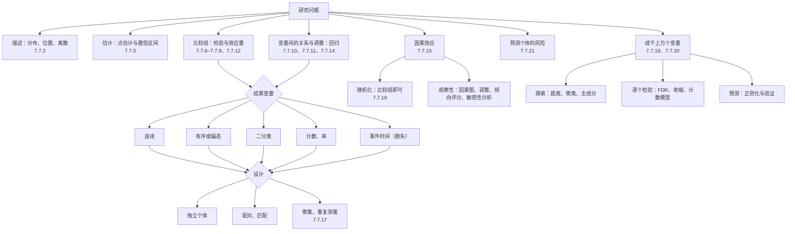
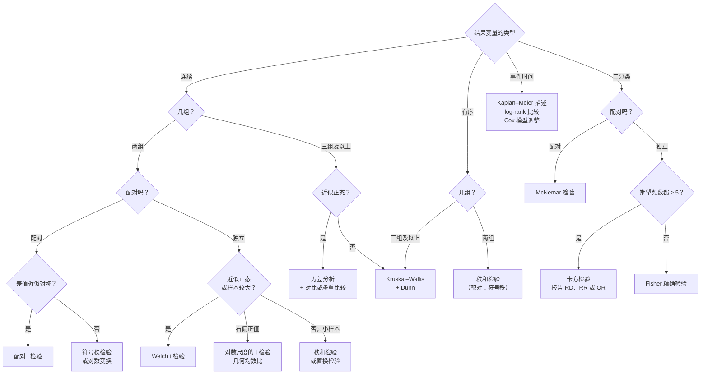
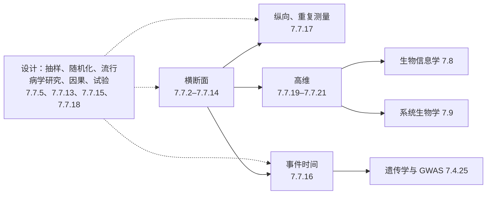

前面二十一章讲了几十种方法。真正做研究时，难处很少在于计算——软件一行代码就能给出 p 值——而在于选对方法，以及读懂结果能说明什么、不能说明什么。本章不引入新的方法，而是把已经讲过的内容按"怎样选择"重新组织：先给出按研究问题、结果变量的类型与研究设计选择方法的决策图和总表（22.1 节），再汇总全课程的公式与手算用的数值（22.2 节），然后指出几种在不同章节以不同名字反复出现的统计思想（22.3 节），沿课程的五条主线把各章串起来复述一遍（22.4 节），列出最常见的错误及其后果（22.5 节），最后说明本课程与统计学、遗传学、生物信息学和系统生物学课程的衔接（22.6 节）。所有数值都取自算出它们的那一章，正文中的引用（公式 6.2.2、定理 20.3.1、例 15.5.1）可以直接跳回原处查看推导与条件。

## 22.1. 选择方法的三个问题

### 22.1.1. 问题、结果与设计

选择方法之前要先回答三个问题，顺序不能颠倒。

1. 研究问题是什么。描述一组数据（[7.7.2](/7.7.2)），估计一个量并给出它的不确定性（[7.7.5](/7.7.5)），比较几组（[7.7.6](/7.7.6)–[7.7.9](/7.7.9)、[7.7.12](/7.7.12)），刻画变量之间的关系并调整其他因素（[7.7.10](/7.7.10)、[7.7.11](/7.7.11)、[7.7.14](/7.7.14)），回答"改变暴露会怎样"的因果问题（[7.7.15](/7.7.15)），还是为新的个体预测风险（[7.7.21](/7.7.21)）。同一个回归模型可以服务于调整、因果与预测三种目的，但变量的选择、结果的评价和失败的方式都不同（[7.7.21](/7.7.21) 21.1 节）。
2. 结果变量是什么类型。**测量尺度**（定义 1.3.1）决定了能做哪些运算：连续的数值、有序等级、二分类、计数与率、事件发生的时间，以及每个个体有成千上万个变量的高维数据。结果变量的类型决定了模型的分布族，进而决定了效应用什么度量——均数差、优势比、率比还是风险比。
3. 数据是怎样产生的。随机化的试验还是观察性研究（定义 1.5.1），独立的个体还是配对、匹配、聚集与重复测量（定义 7.1.1、定义 17.1.1），横断面、纵向还是生存数据（定义 1.4.1），有没有删失（定义 1.4.2）。设计决定了分析的单位与方差的结构，也决定了结论能推广到多远。

下图把研究问题与方法家族对应起来；比较与建模两个分支在 22.1.2、22.1.3 节展开。

### 22.1.2. 比较组：按结果变量与设计

下表是全课程比较方法的总表。行是结果变量的类型，列是设计；每格给出方法与它在各章中的编号。表中的方法都要求分析单位与实验单位一致（定义 12.7.3）：同一只动物的多个细胞、同一个人的多次测量不是独立的观测，属于最后一列。

| 结果变量 | 单样本对参考值 | 两个独立组 | 配对或匹配 | 三组及以上 | 聚集或重复测量 |
|---|---|---|---|---|---|
| 连续，近似正态 | t 检验（公式 6.2.2），$\sigma$ 已知时 z 检验（公式 6.2.1）；区间（公式 5.4.1） | Welch t 检验（公式 7.5.1）；方差确实相近时合并方差（定义 7.3.1） | 配对 t 检验（公式 7.2.1） | 单因素方差分析（公式 12.2.1）+ Tukey、Dunnett（定义 12.3.2）或对比（定义 12.4.1）；双因素（定义 12.5.1）；区组（定义 12.7.1） | 汇总统计量法（17.2 节）、线性混合模型（定义 17.4.1）、GEE（定义 17.5.1）；交叉设计（公式 17.6.1） |
| 右偏的正值（浓度、滴度） | 对数尺度上的 t 方法 | 对数尺度的 Welch 检验，报告几何均数比（公式 7.7.1） | 对数差值的配对 t 检验 | 对数尺度的方差分析 | 对数尺度的混合模型 |
| 有序，或小样本的严重偏态 | 符号检验（公式 8.2.1） | Wilcoxon 秩和检验（公式 8.4.1） | 符号检验、Wilcoxon 符号秩检验（公式 8.3.1） | Kruskal–Wallis 检验（公式 8.5.1）+ Dunn 检验（公式 8.5.2） | 以实验单位的汇总值做秩检验 |
| 二分类 | 精确二项检验（公式 6.6.2）或 z 检验（公式 6.6.1）；Wilson 区间（定义 5.6.1） | 两比例 z 检验 = 卡方检验（公式 9.1.1、9.1.2）；期望频数小时 Fisher 精确检验（定义 9.2.1） | McNemar 检验（公式 9.3.1）；配对优势比 $b/c$（公式 13.8.1） | $R \times C$ 卡方（公式 9.5.1）；有序暴露的趋势检验（定义 9.6.1） | GEE；样本量乘以设计效应（定义 17.7.1） |
| 计数与率 | Poisson 检验、SMR（公式 6.7.1、定义 6.7.1）；精确区间（公式 5.7.1） | 率比与条件检验（公式 16.1.1） | — | 按暴露等级的趋势检验（16.1.2 节） | GEE；过度离散时负二项或拟 Poisson 回归（14.8.3 节） |
| 事件时间（删失） | Kaplan–Meier 估计（定义 16.5.1）、中位生存时间（定义 16.5.2） | log-rank 检验（定义 16.6.1） | 分层 Cox 模型，每对一层（[7.7.16](/7.7.16) 16.11 节） | $k$ 组 log-rank；分层 log-rank（公式 16.6.1） | — |
| 任意统计量 | bootstrap 区间（算法 5.10.1） | 置换检验（定义 8.6.1） | 组内交换标签的置换检验 | 置换检验 | 以实验单位为单位重抽样 |

几点说明：

- 配对与独立的区分由设计决定，不由数据决定（[7.7.7](/7.7.7) 7.1 节）。卡托普利的 15 名患者服药前后的血压，配对分析 $p = 10^{-6}$，误作独立样本只有 0.016（例 7.2.1）；反过来把同一只小鼠的 10 个细胞当作 10 个独立的重复，第一类错误率从 0.05 膨胀到 0.16–0.45（例 12.7.2）。
- 两个独立组的连续结果默认用 Welch 检验；"先做方差齐性检验、再选 t 检验"的两步法不推荐，F 检验对非正态极其敏感（[7.7.7](/7.7.7) 7.4 节）。不要仅因正态性检验显著就换用秩方法：有序数据、重尾与离群值才是秩方法的用武之地（[7.7.8](/7.7.8) 8.9 节）。
- 多组比较不做多次两两 t 检验：5 组的 10 次比较使族错误率约为 0.29（[7.7.12](/7.7.12) 12.1 节）。有预先设定的问题（剂量的线性趋势、各处理与对照）时用对比或 Dunnett 检验，功效远高于事后的全部两两比较。
- 检验只回答"有没有"，结论要以效应估计与置信区间报告（定理 6.3.1）：二分类结局的效应是危险度差、相对危险度或优势比（定义 13.2.1，区间见公式 13.2.1），率的效应是率比，生存的效应是风险比，判读一致性用 Cohen κ（定义 9.8.2）而不是卡方。

### 22.1.3. 建模：回归模型的统一

需要同时考虑几个变量时——调整混杂、估计剂量反应、描述随时间的变化——各类结果变量都有对应的回归模型。它们共享同一个结构：线性预测子 $\boldsymbol{x}^{\mathsf T}\boldsymbol{\beta}$ 通过一个联系函数决定结果的均值（或风险），系数经变换后就是调整其他变量后的效应度量。

| 结果变量 | 模型 | 联系与形式 | $\beta$ 的含义 | 章节 |
|---|---|---|---|---|
| 连续 | 多元线性回归（公式 10.7.1）；协方差分析（定义 12.6.1） | 恒等：$\mathbb{E}[Y] = \boldsymbol{x}^{\mathsf T}\boldsymbol{\beta}$ | 均数差 | 7.7.10、7.7.12 |
| 连续，对数尺度 | 对 $\ln Y$ 的线性回归 | $\mathbb{E}[\ln Y] = \boldsymbol{x}^{\mathsf T}\boldsymbol{\beta}$ | $\mathrm{e}^\beta$ 是几何均数比 | 7.7.10 |
| 连续，机理曲线 | 非线性回归：Michaelis–Menten、四参数 logistic（定义 11.5.1） | $\mathbb{E}[Y] = f(x; \boldsymbol{\theta})$，Levenberg–Marquardt（算法 11.4.1） | 有机理意义的参数（$V_{\max}$、$K_{\mathrm{M}}$、$\mathrm{EC}_{50}$） | 7.7.11 |
| 二分类 | logistic 回归（定义 14.1.1）；剂量反应用 probit（定义 14.6.1） | $\operatorname{logit}\mathbb{P}(Y = 1) = \boldsymbol{x}^{\mathsf T}\boldsymbol{\beta}$ | $\mathrm{e}^\beta$ 是调整的优势比（定理 14.2.1） | 7.7.14 |
| 二分类，匹配 | 条件 logistic 回归（定义 14.7.1） | 匹配组内的条件似然 | 优势比 | 7.7.14 |
| 计数与率 | Poisson 回归与偏移项（定义 14.8.1）；过度离散时负二项（定义 20.5.2） | $\ln\mathbb{E}[Y] = \ln T + \boldsymbol{x}^{\mathsf T}\boldsymbol{\beta}$ | $\mathrm{e}^\beta$ 是率比；RNA-seq 中是倍数变化 | 7.7.14、7.7.20 |
| 事件时间 | Cox 比例风险模型（定义 16.7.1） | $h(t \mid \boldsymbol{x}) = h_0(t)\,\mathrm{e}^{\boldsymbol{x}^{\mathsf T}\boldsymbol{\beta}}$，偏似然（定理 16.7.1） | $\mathrm{e}^\beta$ 是风险比 | 7.7.16 |
| 事件时间，参数 | 加速失效时间模型（定义 16.8.1），Weibull 兼为比例风险模型（定理 16.8.1） | $\ln T = \mu + \boldsymbol{x}^{\mathsf T}\boldsymbol{\gamma} + \sigma W$ | $\mathrm{e}^\gamma$ 是时间比 | 7.7.16 |
| 任意，重复测量 | 线性混合模型（定义 17.4.1、17.4.2）；GEE（定义 17.5.1） | 加入随机截距与斜率，或只对均值建模、稳健标准误 | 条件效应 / 边际效应 | 7.7.17 |

这张表说明了全课程的一个统一：两样本 t 检验是只有一个二分类自变量的线性回归，方差分析是只有虚拟变量的回归（[7.7.10](/7.7.10) 10.7.3 节）；只有一个二分类自变量的 logistic 回归给出 2×2 表的优势比（例 14.2.1）；英国医生冠心病死亡的分层分析是带交互项的 Poisson 回归（例 14.8.1）；log-rank 检验是 Cox 模型中只有组别时的得分检验（[7.7.16](/7.7.16) 思考题 10）。学会一个模型的诊断（残差、影响点、拟合优度）与解释（调整的效应、交互作用、尺度的选择），就学会了这一族模型的大半。

需要注意的是"不可压缩性"：线性模型中，调整一个与暴露无关的预后因素不改变暴露的系数；而优势比与风险比在这种调整下也会改变（[7.7.13](/7.7.13) 13.6.3 节、例 16.7.1）。因此不同调整集给出的 OR、HR 不能简单地比较大小。

### 22.1.4. 两组与多组比较的流程

对最常见的问题——几组之间的比较——可以把上面的总表压缩成一个流程。它的每一个分叉都是一个设计或数据的问题，而不是"哪个检验更显著"的问题。

流程图的终点只是一个检验。完整的分析还要回答：混杂是否需要调整（若是，转到 22.1.3 节的回归模型）；观测是否聚集（若是，换成实验单位的汇总或混合模型）；是否同时做了多个比较（若是，校正多重性，22.5 节）。

### 22.1.5. Python 中的对应函数

本课程的代码块用 Python 的通行库（scipy、statsmodels、lifelines、scikit-learn、pydeseq2）。下表把方法与函数对应起来，具体用法见各章的"用 Python 计算"一节。

| 方法 | 函数 | 章节 |
|---|---|---|
| 描述统计、几何均数、MAD | `np.mean`、`np.median`、`stats.gmean`、`stats.iqr`、`stats.median_abs_deviation` | 7.7.2 |
| 分布的概率与分位数 | `stats.binom`、`stats.poisson`、`stats.norm`、`stats.t`、`stats.chi2`（`.cdf`、`.sf`、`.isf`） | 7.7.4 |
| 比例与 Poisson 的区间、bootstrap | `proportion_confint(method="wilson")`、`stats.bootstrap` | 7.7.5 |
| 单样本与两样本 t、Welch、配对 | `stats.ttest_1samp`、`stats.ttest_ind(equal_var=False)`、`stats.ttest_rel` | 7.7.6、7.7.7 |
| 功效与样本量 | `TTestIndPower`、`NormalIndPower` | 7.7.6、7.7.7、7.7.9 |
| 秩方法与置换检验 | `stats.wilcoxon`、`stats.mannwhitneyu`、`stats.kruskal`、`stats.permutation_test`、`stats.spearmanr` | 7.7.8 |
| 列联表 | `stats.chi2_contingency`、`stats.fisher_exact`、`mcnemar`、`Table2x2`、`StratifiedTable` | 7.7.9、7.7.13 |
| 线性回归、方差分析、多重比较 | `smf.ols`、`sm.stats.anova_lm`、`pairwise_tukeyhsd`、`stats.dunnett`、`multipletests` | 7.7.10、7.7.12 |
| 非线性拟合 | `scipy.optimize.curve_fit` | 7.7.11 |
| logistic、Poisson、负二项回归 | `smf.glm(family=sm.families.Binomial())`、`sm.families.Poisson()`、`smf.negativebinomial` | 7.7.14 |
| 生存分析 | `KaplanMeierFitter`、`logrank_test`、`CoxPHFitter`、`WeibullAFTFitter` | 7.7.16 |
| 混合模型与 GEE | `smf.mixedlm`、`smf.gee` | 7.7.17 |
| Meta 分析 | `combine_effects` | 7.7.18 |
| 聚类与主成分 | `scipy.cluster.hierarchy.linkage`、`KMeans`、`silhouette_score`、`PCA` | 7.7.19 |
| 多重检验与差异表达 | `multipletests(method="fdr_bh")`、`DeseqDataSet` | 7.7.20 |
| 预测模型与验证 | `LogisticRegressionCV`、`cross_val_predict`、`roc_auc_score` | 7.7.21 |

## 22.2. 公式汇总

### 22.2.1. 置信区间

| 参数 | 区间 | 条件 | 出处 |
|---|---|---|---|
| 均数 | $\bar x \pm t_{n-1,\alpha/2}\, s/\sqrt n$ | 正态或大样本 | 公式 5.4.1 |
| 方差 | $\left((n-1)s^2/\chi^2_{n-1,\alpha/2},\ (n-1)s^2/\chi^2_{n-1,1-\alpha/2}\right)$ | 严格正态 | 公式 5.5.1 |
| 比例 | Wilson 区间；需要保守时 Clopper–Pearson | 二项 | 定义 5.6.1、5.6.2 |
| Poisson 均数 | $\left(\tfrac12\chi^2_{2x,1-\alpha/2},\ \tfrac12\chi^2_{2(x+1),\alpha/2}\right)$ | 罕见事件 | 公式 5.7.1 |
| 两均数之差 | $(\bar x_1 - \bar x_2) \pm t_{\nu,\alpha/2}\sqrt{s_1^2/n_1 + s_2^2/n_2}$ | Welch 自由度 $\nu$ | 公式 7.5.1 |
| 几何均数比 | $\exp(L), \exp(U)$，$(L, U)$ 为对数均数差的区间 | 对数近似正态 | 公式 7.7.1 |
| 相关系数 | $\tanh\!\left(\operatorname{artanh} r \pm z_{\alpha/2}/\sqrt{n - 3}\right)$ | 二元正态 | 定义 10.2.1 |
| RR、OR | $\exp\!\left(\ln\widehat{\mathrm{RR}} \pm z_{\alpha/2}\sqrt{b/(an_1) + d/(cn_2)}\right)$；$\exp\!\left(\ln\widehat{\mathrm{OR}} \pm z_{\alpha/2}\sqrt{1/a + 1/b + 1/c + 1/d}\right)$ | 大样本 | 公式 13.2.1 |
| 生存函数 | Greenwood 方差 $\hat S^2\sum d_j/[n_j(n_j - d_j)]$ | 非信息删失 | 公式 16.5.1 |
| 任意统计量 | 自助分布的 2.5% 与 97.5% 分位数 | 独立同分布 | 算法 5.10.1 |

零事件时，95% 单侧上限约为 $3/n$（[7.7.5](/7.7.5) 5.6.3 节）。

### 22.2.2. 检验统计量

| 问题 | 统计量 | $H_0$ 下的分布 | 出处 |
|---|---|---|---|
| 单样本均数 | $t = (\bar x - \mu_0)/(s/\sqrt n)$ | $t_{n-1}$ | 公式 6.2.2 |
| 配对 | $t = \bar d/(s_d/\sqrt n)$ | $t_{n-1}$ | 公式 7.2.1 |
| 两独立均数 | $t = (\bar x_1 - \bar x_2)/\sqrt{s_1^2/n_1 + s_2^2/n_2}$ | 近似 $t_\nu$ | 公式 7.5.1 |
| 方差比 | $F = s_1^2/s_2^2$ | $F_{n_1-1, n_2-1}$ | 公式 7.4.1 |
| 多组均数 | $F = \mathrm{MS}_{\text{组间}}/\mathrm{MS}_{\text{组内}}$ | $F_{k-1, N-k}$ | 公式 12.2.1 |
| 单个比例 | $z = (\hat p - p_0)/\sqrt{p_0(1 - p_0)/n}$ | $\mathcal{N}(0, 1)$ | 公式 6.6.1 |
| 2×2 表、$R \times C$ 表 | $X^2 = \sum (O - E)^2/E$ | $\chi^2_{(R-1)(C-1)}$ | 公式 9.1.2、9.5.1 |
| 配对比例 | $(b - c)^2/(b + c)$ | $\chi^2_1$ | 公式 9.3.1 |
| 分层 2×2 表 | Mantel–Haenszel | $\chi^2_1$ | 公式 13.6.1 |
| 秩和 | $W$ 标准化 | 近似 $\mathcal{N}(0, 1)$ | 公式 8.4.1 |
| 两条生存曲线 | $\left(\sum (O_1 - E_1)\right)^2/\sum V$ | $\chi^2_1$ | 定义 16.6.1 |
| 嵌套模型 | $G = 2(\ell_1 - \ell_0)$；线性模型中额外平方和 $F$ | $\chi^2_{\Delta p}$；$F$ | 定义 14.3.1、公式 11.6.1 |
| Meta 分析的异质性 | $Q = \sum w_i(\hat\theta_i - \hat\theta)^2$，$I^2 = (Q - (k-1))/Q$ | $\chi^2_{k-1}$ | 定义 18.8.2 |

### 22.2.3. 效应的度量

| 结果 | 度量 | 无效应的值 | 何时用 |
|---|---|---|---|
| 连续 | 均数差；标准化的效应量 $d$（定义 6.8.1）；几何均数比 | 0；0；1 | 原始单位最直接；跨研究比较时标准化 |
| 二分类 | 危险度差 RD、相对危险度 RR、优势比 OR（定义 13.2.1） | 0、1、1 | 队列与试验三者都可；病例对照只能 OR（定理 13.2.1）；罕见病时 OR ≈ RR |
| 公共卫生 | 暴露者归因分数、人群归因分数（定义 13.3.1）、需治疗人数 NNT（定义 13.3.2） | 0；$\infty$ | 决策：同样的 RR，基线风险高 10 倍，RD 也大 10 倍 |
| 率 | 率比 IRR（公式 16.1.1）、SMR（定义 6.7.1） | 1 | 随访时间不等的事件数据 |
| 事件时间 | 风险比 HR（定义 16.7.1）、时间比、中位生存时间 | 1 | 删失数据；比例风险不成立时报告分段的 HR 或限制平均生存时间 |
| 诊断 | 灵敏度、特异度（定义 3.3.1）、预测值（定义 3.3.2）、似然比（定义 3.3.3）、AUC（定理 3.4.1） | — | 预测值依赖患病率（定理 3.3.1） |
| 预测模型 | 区分度（定义 21.6.1）、校准斜率与截距（定义 21.6.2）、Brier 分数（定义 21.6.3）、净获益（定义 21.6.4） | AUC 0.5；斜率 1 | 内部验证后报告（算法 21.5.1） |

### 22.2.4. 样本量

各章的样本量公式都是同一个形式的特例。设效应的估计量近似正态，方差为 $v/n$，双侧水平 $\alpha$ 的检验以功效 $1 - \beta$ 检出效应 $\delta$ 需要

$$
n = \frac{(z_{\alpha/2} + z_\beta)^2\, v}{\delta^2}
$$
（公式 18.4.1）。$(z_{0.025} + z_{0.2})^2 = 7.85$，$(z_{0.025} + z_{0.1})^2 = 10.51$：90% 功效比 80% 多用 34% 的样本。各种设计只是 $v$ 不同。

| 设计 | 每组（或总）样本量 | 出处 |
|---|---|---|
| 单样本均数 | $n = \sigma^2(z_{\alpha/2} + z_\beta)^2/\Delta^2$ | 公式 6.4.2 |
| 估计均数到 $\pm E$ | $n = (z_{\alpha/2}\sigma/E)^2$；比例 $z_{\alpha/2}^2 p(1-p)/E^2$ | 公式 5.9.1 |
| 两个独立组 | 每组 $2\sigma^2(z_{\alpha/2} + z_\beta)^2/\Delta^2$ | 公式 7.6.1 |
| 配对 | $\sigma_d^2(z_{\alpha/2} + z_\beta)^2/\Delta^2$ 对，$\sigma_d^2 = 2\sigma^2(1 - \rho)$ | 公式 7.6.2 |
| 两个比例 | 公式 9.4.1 | 公式 9.4.1 |
| 生存（log-rank，1:1） | 事件数 $d = 4(z_{\alpha/2} + z_\beta)^2/(\ln\mathrm{HR})^2$ | 公式 16.10.1 |
| 失访、不依从、整群 | $\times 1/(1 - L)$；$\times 1/(1 - d_{\mathrm{in}} - d_{\mathrm{out}})^2$；$\times [1 + (m-1)\rho]$ | 公式 18.4.2、定义 17.7.1 |
| 预测模型 | 按期望的收缩因子计算 | 公式 21.8.1 |

两条经验：第一，$n$ 与 $\delta^2$ 成反比，效应减半所需的样本量是四倍，因此"预期效应"不能为了凑出可行的样本量而夸大；第二，减小 $v$ 往往比增大 $n$ 便宜——配对与区组（同窝小鼠的随机区组设计效率约为完全随机设计的 7.6 倍，例 12.7.1）、调整强预后因素、选择测量误差小的终点，都是在减小 $v$。

### 22.2.5. 手算常用的数值

竞赛和考试中没有软件时，下面这些数值足以完成大多数计算（[7.7.6](/7.7.6) 6.2.3 节讲了查表的读法）。

| 量 | 值 | 用途 |
|---|---|---|
| $z_{0.025}$、$z_{0.05}$、$z_{0.005}$ | 1.960、1.645、2.576 | 双侧 95%、单侧 95% 或双侧 90%、双侧 99% |
| $z_{0.2}$、$z_{0.1}$ | 0.842、1.282 | 80%、90% 功效 |
| $(z_{0.025} + z_{0.2})^2$、$(z_{0.025} + z_{0.1})^2$ | 7.85、10.51 | 样本量 |
| $t_{9,0.025}$ | 2.262 | $n = 10$ 的均数区间 |
| $\chi^2_{1,0.05}$、$\chi^2_{2,0.05}$ | 3.84、5.99 | 卡方与似然比检验 |
| $1 - 0.95^{m}$ | $m = 10$ 时 0.40 | 独立检验的族错误率 |
| 零事件的上限 | $3/n$ | "三分之一法则" |
| 设计效应 | $1 + (m - 1)\rho$ | 聚集数据 |
| E 值 | $\mathrm{RR} + \sqrt{\mathrm{RR}(\mathrm{RR} - 1)}$ | 未测混杂的敏感性（定义 15.6.1） |

## 22.3. 反复出现的统计思想

几种思想以不同的名字在许多章中出现。认出它们，各章就不再是孤立的方法清单。

| 思想 | 核心 | 出现在 |
|---|---|---|
| 变异的层次 | 方差属于哪一层，标准误就由那一层的单位数决定 | 2、4、7、12、17、18、20 |
| 信号与噪声 | 统计量 = 效应 / 标准误；检验、区间、功效是同一枚硬币 | 5、6、7、16、18 |
| 2×2 表 | 诊断、错误类型、效应度量、分层、生存、富集都是 2×2 表 | 3、6、9、13、16、20 |
| 似然 | 极大似然估计、似然比检验、偏差、偏似然 | 5、11、14、16、17、20 |
| 借力与收缩 | 许多单元共享信息，把不稳定的个别估计拉向整体 | 5、17、18、20、21 |
| 调整与可比性 | 比较的组在其他因素上可比，才能把差别归于暴露 | 5、10、12–15、18 |
| 对数尺度 | 乘法式的效应在对数尺度上变成加法 | 2、4、7、10、13、14、16、20 |

### 22.3.1. 变异的层次：标准差、标准误与实验单位

**标准差**描述个体之间的变异，**标准误** $s/\sqrt n$ 描述估计量的精度（[7.7.2](/7.7.2) 2.2.5 节、定理 4.7.1）；二者的混用是生物医学论文中最常见的错误之一。更深一层的问题是：$n$ 是什么？标准误中的 $n$ 必须是独立的实验单位（定义 12.7.3）的个数。同一单位内的观测相关时，$m$ 个观测的均值的方差是独立时的 $1 + (m - 1)\rho$ 倍，这个**设计效应**（定义 17.7.1）在课程中出现了四次：

- 伪重复（定义 12.7.4）：组内相关 0.3 时，把小鼠的细胞当作独立重复，第一类错误率为 0.33（例 12.7.2）。
- 重复测量与混合模型：sleepstudy 的 OLS 斜率标准误 1.24，正确值 1.55（例 17.1.1）；**组内相关系数**（定义 17.3.2）同时度量检测的再现性（雌二醇 0.91，例 17.3.1）。
- 整群随机试验的样本量要乘以它（公式 18.4.2）。
- 基因集富集分析中基因之间的相关使检验统计量的方差膨胀 $1 + (n - 1)\bar\rho$ 倍（[7.7.20](/7.7.20) 20.9 节）。

误差估计必须来自正确的层次：DNase 的复孔是技术重复，它们的变异（批内 CV 2.1%）远小于测定之间的变异（批间 6.6%，例 17.3.2），用复孔估计标准曲线的误差会低估不确定性（例 11.2.1）；**生物学重复**才是推断的单位。

### 22.3.2. 信号与噪声：检验、区间与功效

几乎每个检验统计量都是"估计的效应 / 它的标准误"，在 $H_0$ 下近似标准正态或 $t$ 分布。由此推出三件事。第一，检验与区间对偶：双侧检验拒绝 $H_0$，当且仅当参考值不在置信区间内（定理 6.3.1），所以报告区间包含了检验的全部信息，还多了效应的大小。第二，功效（定义 6.4.1）由效应与噪声之比和样本量决定，样本量公式（22.2.4 节）只是把它倒过来解。第三，**p 值**（定义 6.1.2）同时依赖效应与样本量：医生健康研究中 0.91 个百分点的风险差 $p = 2 \times 10^{-7}$（例 9.1.2），birthwt 中更大的差别 $p = 0.026$（例 9.1.1）；统计显著不等于实际意义，不显著也不等于没有差别（[7.7.6](/7.7.6) 6.4.4 节、6.8 节）。

第一类与第二类错误（定义 6.1.1）正是诊断试验的 $1 - $ 特异度与 $1 - $ 灵敏度；成千上万个检验中"显著的结果有多少是真的"，与"阳性的检测结果有多少是真的"是同一个 Bayes 问题（22.3.3 节）。

### 22.3.3. 2×2 表的许多面孔

课程中至少有八个问题归结为一张 2×2 表：

| 情境 | 行 × 列 | 关心的量 | 出处 |
|---|---|---|---|
| 诊断试验 | 检测结果 × 真实状态 | 灵敏度、特异度、预测值 | 定义 3.3.1、3.3.2 |
| 假设检验 | 决定 × 真实状态 | $\alpha$、$\beta$；多重检验中的 FDR | 定义 6.1.1、[7.7.20](/7.7.20) 20.1.1 节 |
| 两比例比较 | 暴露 × 结局 | RD、RR、OR；卡方 = $z^2$ | 公式 9.1.2、定义 13.2.1 |
| 小样本 | 同上，给定边际 | 超几何分布 | 定义 9.2.1 |
| 配对数据 | 第一次 × 第二次 | 只有不一致的对 $b$、$c$ 有信息 | 公式 9.3.1、13.8.1 |
| 分层分析 | 每层一张表 | Mantel–Haenszel 合并 | 公式 13.6.1 |
| 生存比较 | 每个事件时刻一张表 | log-rank = 按时间分层的 MH 检验 | 定义 16.6.1 |
| 富集分析 | 在基因集中 × 显著 | 单侧 Fisher 精确检验 | [7.7.20](/7.7.20) 20.9 节 |

同一张表的另一种读法是 **曲线下面积**：随机取一名患者与一名非患者，前者检测值更高的概率（定理 3.4.1），它就是 Mann–Whitney 统计量 $U/(n_1 n_2)$（例 8.4.1，CT 评分的 AUC 0.893），也是 logistic 模型的 C 统计量（例 14.5.1）。判断阳性检测结果的 PPV（定理 3.3.1）与判断显著基因列表中有多少假发现（例 20.1.1），用的都是 Bayes 公式：先验（患病率或 $\pi_0$）很小时，即使检测（检验）相当准确，阳性中的大多数仍是假阳性。

### 22.3.4. 似然

极大似然把"哪个参数值使观测数据最可能出现"作为估计的通用原则（例 5.3.1）。正态误差下最小二乘就是极大似然（定理 11.1.1）；logistic、Poisson 与负二项回归用 IRLS 求解；嵌套模型的比较用似然比检验与偏差（定义 14.3.1、14.5.1）；参数的区间可以用轮廓似然（公式 14.3.1）；Cox 模型的偏似然（定理 16.7.1）消去了未知的基线风险，与条件 logistic 回归的似然同形；混合模型用 REML（[7.7.17](/7.7.17) 17.4.2 节）；删失数据的参数模型的似然是 $\prod h^{\delta}S$（[7.7.16](/7.7.16) 16.8 节）。似然方法在随机缺失下仍然有效（定义 17.8.1），这是混合模型优于完整病例分析的理由（例 17.8.1）。

### 22.3.5. 借力与收缩

数据中有许多相似的单元——许多受试者、许多试验、许多基因——时，每个单元的估计可以从其他单元"借力"：把不稳定的个别估计向整体收缩，用少许偏倚换取方差的大幅减小。课程中这一思想出现了六次：

| 情境 | 收缩的对象 | 收缩向 | 出处 |
|---|---|---|---|
| Bayes 估计 | 有效率 | 先验 | 例 5.11.1 |
| 线性混合模型 | 个人的斜率 | 总体斜率（BLUP） | 定理 17.4.1，例 17.4.2（−2.88 → −0.28） |
| 随机效应 Meta 分析 | 各试验的效应 | 效应分布的均值 | 定义 18.8.3 |
| 调节 t 统计量 | 基因的方差 | 全部基因的先验方差 | 定义 20.4.1，例 20.4.1 |
| 负二项离散参数 | 基因的离散参数 | 均值的趋势 | 例 20.5.2 |
| 岭回归、lasso | 回归系数 | 0 | [7.7.21](/7.7.21) 21.4 节，例 21.4.2 |

它们的共同形式是**经验 Bayes**（定义 20.3.4）：先由全部单元估计先验，再对每个单元做 Bayes 推断。收缩的权重由信息量决定：观测越少、噪声越大的单元收缩越多。

### 22.3.6. 调整与可比性

比较两组的差别能否归于暴露，取决于两组在其他影响结局的因素上是否可比。**随机化**（定义 5.2.1）在设计上保证可比性，使组间的差别只能来自处理或偶然（定理 15.3.1）；观察性研究只能在分析中调整已测量的因素。课程中的调整方法按出现的顺序是：分开比较（按年龄分组的 FEV，[7.7.7](/7.7.7)）、多元回归（例 10.7.1）、协方差分析（例 12.6.1）、标准化（定义 13.5.2）、分层与 Mantel–Haenszel（公式 13.6.1）、匹配（定义 13.8.1）、logistic 与 Poisson 回归（例 14.4.1、14.8.1）、倾向评分与逆概率加权（定义 15.5.1、15.5.2）。它们回答同一个问题，前提也相同：调整的变量是混杂因素，而不是中介变量或对撞因子；该调整什么由**因果图**与**后门准则**（定理 15.4.1）决定，而不由 p 值或系数的变化决定。

调整既能消除虚假的关联，也能揭示被掩盖的关联：FEV 中吸烟的系数调整年龄后由正变负（例 10.7.1）；birthwt 中调整种族后吸烟的效应从 284 g 增大到 400 g（例 12.6.1），OR 从 2.02 升到 2.36（例 14.4.1）。调整只能处理测量了的因素，未测混杂用 E 值等方法评估其可能的大小（定义 15.6.1）。

### 22.3.7. 对数尺度

生物学中的许多效应是乘法式的：浓度与滴度按倍数变化，FEV 随身高按比例增长，药物使风险乘以一个因子，基因表达按倍数改变。对数把乘法变成加法，于是：几何均数是对数的均数的反对数（例 2.1.1）；右偏的正值数据取对数后常近似正态、方差稳定（例 7.7.1、例 10.5.1）；RR、OR、HR 的区间在对数尺度上构造（公式 13.2.1）；logistic、Poisson 与 Cox 模型的系数是对数尺度上的效应；RNA-seq 的效应是 $\log_2$ 倍数变化（例 20.7.1），主成分分析前先做方差稳定化变换（例 19.2.1）；剂量反应曲线在对数剂量轴上是对称的 S 形（定义 11.5.1）。交互作用依赖尺度：在一个尺度上没有交互，在另一个尺度上可能有（[7.7.12](/7.7.12) 12.5 节、定义 13.6.1）。

## 22.4. 主线回顾

### 22.4.1. 吸烟与健康

吸烟是全课程的脊梁，它把描述、比较、混杂、调整、因果与预后串成一条推理链。

- 描述与比较：东波士顿 654 名儿童中，吸烟者的平均 FEV 为 3.277 L，不吸烟者为 2.566 L（例 1.5.1）；两样本 t 检验 $p = 2 \times 10^{-10}$（例 7.3.2），秩和检验 $p = 4 \times 10^{-11}$（例 8.4.2），bootstrap 给出均数之比的区间 1.20–1.36（例 5.10.2）。三种方法结论一致，说明问题不在检验。
- 混杂：FEV 对年龄的散点图（[7.7.2](/7.7.2) 2.6.1 节）第一次揭示了悖论的来源：65 名吸烟者全部在 9 岁及以上。调整年龄后吸烟的系数变为 −0.21 L，再调整身高与性别，对数尺度上吸烟者的 FEV 低 4.5%（例 10.7.1）。因果图说明年龄与性别是混杂、身高部分是中介：吸烟对 FEV 的总效应应只调整年龄与性别，为 −0.154 L（−7.1%，例 15.4.1）。
- 母亲吸烟与出生体重：吸烟母亲的婴儿平均轻 284 g（例 7.3.1），低出生体重的比例 0.405 对 0.252（例 9.1.1，OR 2.02）。这里的混杂方向相反：吸烟最多的白人母亲本来婴儿就较重，调整种族与体重后效应增大到 −400 g（例 12.6.1），调整的 OR 为 2.36（例 14.4.1）；倾向评分的各种方法大多给出 −320 至 −380 g，未截断的逆概率加权被一个权重 42.8 的个体拉偏（例 15.5.1）。
- 吸烟与肺癌：Doll–Hill 的病例对照研究只能估计 OR，为 14.0（3.3–59.3，例 13.2.2）；英国医生队列给出率比 14.6 和随吸烟量单调上升的剂量反应 7.7、13.7、24.5（例 13.7.1），吸烟者的肺癌约 93% 可归因于吸烟（例 13.3.1）。Fisher 的"体质假说"要成立，未测因素与吸烟、肺癌的关联都要达到 E 值 28.7（例 15.6.1），这正是 Cornfield 论证的现代形式；Bradford Hill 准则（定义 13.7.1）把这些证据组织起来。
- 预后：veteran 试验中晚期肺癌患者的中位生存时间只有 103 天（标准化疗）与 52 天（试验化疗，例 16.5.1），但两条曲线交叉，log-rank 检验 $p = 0.93$（例 16.6.1）；调整 Karnofsky 评分与细胞类型后治疗的 HR 为 1.30（0.88–1.93，例 16.7.1），Karnofsky 评分的效应随时间减弱（例 16.7.2）；128 例死亡只能以 80% 功效检出 1.64 的风险比（例 16.10.1）。

这条主线的教训是：一个关联的大小与方向取决于比较的是谁、调整了什么；同样的数据，正确的分析由设计与因果结构决定，而不是由哪个检验给出更小的 p 值决定。

### 22.4.2. 阿司匹林：一项试验与证据综合

医生健康研究把 22 071 名男医生随机分到阿司匹林与安慰剂（以及 β-胡萝卜素的 2×2 析因设计，例 5.2.1）。心肌梗死 139/11 037 对 239/11 034，RR 0.58（例 3.1.4），两比例检验 $z = -5.19$（例 9.1.2）；风险差 −0.91 个百分点，NNT 110（80–177，例 13.3.2）——相对效应与绝对效应给出不同的信息。按预期的事件率，检出 25% 的相对降低每组需要约 9800 人（例 18.4.1）；试验因获益明显而提前终止，提前终止会高估效应并留下次要终点无法回答（例 18.5.1）。PHS 报告"只在 50 岁以上者中有效"是亚组分析的警示（例 18.6.1）。七项一级预防试验的 Meta 分析给出 0.89（0.84–0.94），$I^2 = 0$（例 18.8.1）；按年份累积，2018 年的三项新试验使相对效应向 1 移动，而出血风险 1.42 倍（例 18.8.3），绝对获益与危害的权衡改变了指南（例 18.8.2）。证据是累积和更新的，单项试验的显著结果不是终点。

### 22.4.3. 诊断与筛查

低剂量 CT 筛查的灵敏度 93.8%、特异度 73.4%，在 1.1% 的患病率下 PPV 只有 3.8%（例 3.3.1）；新冠抗原检测的特异度 99.1%，在低流行时 PPV 也由特异度决定（例 3.3.2）。诊断似然比把 Bayes 公式化为乘法（公式 3.3.1）。连续或有序的检测值用 ROC 曲线，CT 评分的 AUC 0.893（例 3.4.1）恰是秩和检验的 $U/(n_1n_2)$（例 8.4.1）；灵敏度与特异度是比例，要报告 Wilson 区间（例 5.6.2）。在预测模型中，同一个 AUC 变成区分度（定义 21.6.1），还要加上校准（定义 21.6.2）与临床净获益（定义 21.6.4）。筛查的效果不能用"筛出病例的生存期"判断：**领先时间偏倚**、**病程长短偏倚**与**过度诊断**（定义 18.7.1）都使筛查看起来有效；NLST 以随机分组的肺癌死亡率为终点，率比 0.80（0.70–0.92，例 16.1.1），超额诊断从 119 例降到 20 例（例 18.7.1）。

### 22.4.4. 实验室测定

DNase ELISA 的复孔 CV 在低浓度端上升（例 2.2.2）；线性范围内的标准曲线与反向预测（例 10.6.1）推广为四参数 logistic 模型（例 11.5.1），精密度曲线给出约 0.15–12.5 ng/mL 的定量范围（定义 11.5.2）；11 次独立测定的批间 CV 是批内的 3 倍（例 17.3.2）。嘌呤霉素的酶动力学用非线性最小二乘拟合 Michaelis–Menten 方程，$V_{\max} = 212.7$、$K_{\mathrm{M}} = 0.064$，Lineweaver–Burk 作图使两者都偏低（例 11.4.1）；额外平方和 F 检验显示处理改变了 $V_{\max}$（$p = 1.6 \times 10^{-6}$），未检出 $K_{\mathrm{M}}$ 的变化（例 11.6.2）。豚鼠的 ToothGrowth 实验依次用于两样本比较（例 7.3.3、例 7.5.1）、秩检验与置换检验（例 8.5.1、例 8.6.1：置换 p 值 0.0052 与 t 检验的 0.0053 几乎相同）、方差分析（$F = 67.4$，例 12.2.1）、剂量的线性趋势（解释了剂量效应的 99%，例 12.4.1）与交互作用（$p = 0.022$，例 12.5.1）。这条主线的教训是给实验者的：先确定实验单位与重复的层次，再选模型；用有机理的非线性模型代替线性化；报告参数的区间与模型的适用范围。

### 22.4.5. airway：高维组学

8 个样本、约 6 万个基因的 airway 数据把"个体 × 变量"的形状倒了过来。方差稳定化之后，主成分分析的前两个分量分别对应地塞米松处理（39%）与供体（27%），前四个合计 97%，与 1 + 3 个设计自由度一致（例 19.6.1）；层次聚类与 k 均值的结果随连接方式而变，轮廓系数都低于 0.25（例 19.4.1、例 19.5.1）。逐个基因的检验中，5567 个基因 $p < 0.05$，其中约 618 个预期是假的（例 20.1.1）；负二项广义线性模型用大小因子作偏移项、离散参数向趋势收缩（例 20.5.2），配对设计 `~ cell + dex` 在 FDR 0.1 下检出 4691 个基因（例 20.3.1）。同一份数据也给出预测的反例：8 个样本任意分成两组，也有几百个基因能把两组完全分开，在全部样本上选基因再做交叉验证给出零错误（例 21.2.2）。$p \gg n$ 时，探索看结构，推断控制 FDR，预测必须把每一步都放进交叉验证。

## 22.5. 常见错误

| 错误 | 例子与后果 | 正确做法 | 出处 |
|---|---|---|---|
| 标准差与标准误混用 | 均数 ± SE 的柱状图让变异显得很小 | 描述个体用 SD，描述均数的精度用 SE 或区间；画出数据点 | [7.7.2](/7.7.2) 2.2.5 节、2.6.4 节 |
| 配对数据当独立 | 卡托普利 $p = 10^{-6}$ 变成 0.016（例 7.2.1） | 按设计选择配对方法 | 定义 7.1.1 |
| 伪重复 | 细胞当作小鼠，错误率 0.16–0.45（例 12.7.2） | 以实验单位的均值或混合模型分析 | 定义 12.7.4 |
| 忽略重复测量的相关 | 随机截距模型的斜率标准误 0.80，正确值 1.55（例 17.4.1） | 随机斜率模型、汇总统计量法或 GEE | 定义 17.4.2 |
| 多次检验不校正 | 5 组 10 次 t 检验族错误率 0.29；5 次期中分析 0.14 | Holm、Tukey、Dunnett；FDR；$\alpha$ 消耗函数 | 定义 12.3.1、定理 20.3.1、定义 18.5.2 |
| 误读 p 值 | 把 $p$ 当作 $H_0$ 为真的概率；"不显著"当作"没有差别" | 报告效应与区间；等效性用 TOST | 定义 6.1.2、定义 18.3.2 |
| 相关当作因果 | 吸烟儿童的 FEV 更高（例 1.5.1）；生态学谬误（定义 15.1.1） | 按因果图调整混杂，评估未测混杂 | 定理 15.4.1、定义 15.6.1 |
| 调整中介或对撞因子 | 出生体重悖论（例 15.4.3）；Berkson 偏倚（例 15.4.2） | 后门准则决定调整集 | 定义 15.4.2 |
| 只看完成者 | 完成者分析的斜率 7.73，真值 10.47（例 17.8.1） | ITT；似然方法或多重插补 | 定义 18.2.2、定义 17.8.2 |
| 丢掉删失者 | 低估生存 | Kaplan–Meier、log-rank、Cox | 定义 16.5.1 |
| 用相关系数判断两种方法一致 | 自动血压计平均高读 14 mmHg（例 11.3.1） | Bland–Altman 图与一致性界限 | 定义 11.3.2 |
| 线性化非线性模型 | Lineweaver–Burk 扭曲误差 | 非线性最小二乘 | 算法 11.4.1 |
| 逐步选择后照常推断 | 纯噪声中 89% 的最终模型"显著"（例 21.3.1） | 事先确定变量；惩罚回归；报告选择的稳定性 | [7.7.21](/7.7.21) 21.3 节 |
| 在开发数据上评价预测模型 | AUC 0.750 → 0.695（例 21.5.1）；27 个变量的校准斜率 0.35（例 21.4.2） | 交叉验证或 bootstrap 乐观度校正，外部验证 | 算法 21.5.1 |
| 批次与处理混杂 | 无法分离处理与批次 | 随机化地分配批次，平衡设计 | [7.7.19](/7.7.19) 19.7 节 |
| 选择性发表 | 已发表的 35 项试验 OR 0.77，全部为 0.84（例 18.8.4） | 试验注册、预先的分析计划 | 定义 18.8.5 |

这些错误大多不是计算错误，而是分析与设计脱节：分析的单位不是实验单位，比较的组不可比，评价的数据不是新数据，或者报告的结果是从许多尝试中挑出来的。正因为如此，防止它们最有效的办法是在看数据之前写好分析计划（[7.7.18](/7.7.18) 18.9 节、[7.7.21](/7.7.21) 21.8 节）。

## 22.6. 与其他课程的联系

### 22.6.1. 数据类型的地图

课程的顺序就是数据形状的顺序：横断面数据（7.7.2–7.7.14）只有个体与变量两维；纵向数据（7.7.17）加上时间，同一个体的观测相关；生存数据（7.7.16）把时间本身作为结局，并带有删失；高维数据（7.7.19–7.7.21）的变量远多于个体。研究设计（7.7.5、7.7.13、7.7.15、7.7.18）贯穿其中，决定了每种数据能回答什么问题。

### 22.6.2. 统计学课程

本课程是统计学课程（[3](/3)）在生物医学中的应用版本：讲方法的条件、用法与解释，数学推导链接过去。概率与分布在 [3.1](/3.1)（条件概率与 Bayes 公式 [3.1.2](/3.1.2)，常见分布 [3.1.4](/3.1.4)，**中心极限定理** [3.1.13](/3.1.13)）；估计、区间与检验的理论在 [3.2](/3.2)（点估计 [3.2.3](/3.2.3)，区间估计 [3.2.4](/3.2.4)，参数检验 [3.2.5](/3.2.5)，非参数检验 [3.2.6](/3.2.6)，Bayes 推断 [3.2.7](/3.2.7)）；线性回归与方差分析在 [3.3](/3.3)（多重共线性 [3.3.10](/3.3.10)，模型选择 [3.3.11](/3.3.11)，单因素与双因素方差分析 [3.3.12](/3.3.12)–[3.3.14](/3.3.14)）；主成分、多维标度、聚类与判别在 [3.4](/3.4)（[3.4.5](/3.4.5)、[3.4.6](/3.4.6)、[3.4.11](/3.4.11)，ROC 与错误发现率 [3.4.10](/3.4.10)、[3.4.12](/3.4.12)）；数值优化、EM 算法、bootstrap 与随机数在 [3.5](/3.5)（[3.5.4](/3.5.4)、[3.5.6](/3.5.6)、[3.5.7](/3.5.7)、[3.5.8](/3.5.8)）。机器学习中的模型评估与交叉验证见 [4.6.2](/4.6.2)、[4.6.7](/4.6.7)。

### 22.6.3. 生物学课程

- 遗传学（[7.4](/7.4)）：群体遗传学的 Hardy–Weinberg 检验是拟合优度检验（[7.4.22](/7.4.22)），数量遗传学的方差分量与遗传力是随机效应模型（[7.4.24](/7.4.24)，[7.7.17](/7.7.17)），GWAS 的 $5 \times 10^{-8}$ 阈值、群体分层的主成分校正、Mendelian 随机化与多基因评分（[7.4.25](/7.4.25)）分别对应 7.7.20、7.7.19、7.7.15 与 7.7.21 的统计原理。
- 生物物理（[7.6](/7.6)）：细胞中的 Poisson 噪声与随机动力学（[7.6.32](/7.6.32)）是 7.7.4 计数分布的物理来源；单粒子轨迹的均方位移拟合说明了相关误差的危险（例 11.7.1）。
- 生物信息学（[7.8](/7.8)）：比对与搜索的 E 值是大规模搜索中的显著性问题，与 7.7.20 的多重检验同源；群体基因组数据的主成分与混合模型（[7.8.13](/7.8.13)）使用 7.7.19、7.7.17 的方法；变异检测的基因型后验是 7.7.3 的 Bayes 公式。
- 系统生物学（[7.9](/7.9)）：RNA-seq 的完整流程（[7.9.2](/7.9.2)）以 7.7.20 的负二项广义线性模型与 FDR 为统计原理，数值与 airway 的分析一致；功能注释与基因集分析（[7.9.3](/7.9.3)）用超几何检验；单细胞与空间组学（[7.9.5](/7.9.5)、[7.9.6](/7.9.6)）面对的是更稀疏、更高维的计数，伪 bulk 与负二项模型（[7.7.20](/7.7.20) 20.8 节）、降维与聚类（7.7.19）是它们的基础；蛋白质组与代谢组（[7.9.9](/7.9.9)）同样面对缺失、批次与多重检验。

## 小结

- 选择方法先问三件事（22.1.1 节）：研究问题（描述、估计、比较、关联与调整、因果、预测），结果变量的测量尺度（定义 1.3.1），设计与数据结构（实验与观察，定义 1.5.1；配对，定义 7.1.1；重复测量，定义 17.1.1；删失，定义 1.4.2）。分析单位必须是实验单位（定义 12.7.3）。
- 比较的总表（22.1.2 节）：连续结果用 t 方法（公式 6.2.2、7.2.1、7.5.1）与方差分析（公式 12.2.1），偏态与有序用秩方法（公式 8.2.1–8.5.1），二分类用卡方、Fisher 与 McNemar（公式 9.1.2、定义 9.2.1、公式 9.3.1），计数用 Poisson 方法（公式 6.7.1、16.1.1），事件时间用 Kaplan–Meier 与 log-rank（定义 16.5.1、16.6.1），任意统计量用 bootstrap 与置换（算法 5.10.1、定义 8.6.1）；默认 Welch，多组不做多次 t 检验。
- 回归模型是一族（22.1.3 节）：线性（公式 10.7.1）、非线性（定义 11.5.1）、logistic（定理 14.2.1）、Poisson 与负二项（定义 14.8.1、20.5.2）、Cox（定义 16.7.1）、混合模型与 GEE（定义 17.4.1、17.5.1），系数分别是均数差、OR、率比、HR；t 检验、方差分析、2×2 表与 log-rank 是它们的特例。
- 公式（22.2 节）：区间、检验统计量与效应度量的表；样本量统一为 $n = (z_{\alpha/2} + z_\beta)^2v/\delta^2$（公式 18.4.1），$7.85$ 与 $10.51$；设计效应 $1 + (m - 1)\rho$（定义 17.7.1）；E 值（定义 15.6.1）。
- 反复出现的思想（22.3 节）：变异的层次与实验单位；统计量 = 效应 / 标准误，检验与区间对偶（定理 6.3.1）；2×2 表的八种面孔与 AUC = $U/(n_1n_2)$（定理 3.4.1、例 8.4.1）；似然（定理 11.1.1、16.7.1）；经验 Bayes 的借力与收缩（定理 17.4.1、定义 20.3.4、20.4.1）；调整与可比性（定理 15.3.1、15.4.1）；对数尺度。
- 主线（22.4 节）：FEV 的悖论是年龄的混杂（+0.71 L → −7.1%，例 10.7.1、15.4.1）；母亲吸烟的效应被种族掩盖（−284 → −400 g，OR 2.02 → 2.36，例 12.6.1、14.4.1、15.5.1）；肺癌 OR 14、率比 14.6、E 值 28.7（例 13.2.2、13.7.1、15.6.1）；阿司匹林 RR 0.58、NNT 110、Meta 分析 0.89（例 13.3.2、18.8.1）；LDCT 的 PPV 3.8%（例 3.3.1）；实验室测定的层次与非线性模型（例 11.4.1、17.3.2）；airway 的 4691 个基因与 $p \gg n$ 的过拟合（例 20.3.1、21.2.2）。
- 常见错误（22.5 节）：SD 与 SE 混用、配对当独立、伪重复（定义 12.7.4）、多重性、误读 p 值（定义 6.1.2）、相关当因果、调整中介或对撞因子（定义 15.4.2）、只看完成者、丢掉删失、用相关判断一致性（定义 11.3.2）、线性化、逐步选择、在开发数据上评价（算法 21.5.1）、批次混杂、发表偏倚（定义 18.8.5）。多数是分析与设计脱节，对策是事先的分析计划。
- 数据形状的地图：横断面 → 纵向 → 生存 → 高维（22.6.1 节）；数学在 [3.1](/3.1)–[3.5](/3.5)，应用延伸到 [7.4.25](/7.4.25)、[7.8](/7.8) 与 [7.9](/7.9)。

## 思考题

1. 一项研究比较两种降压药，收缩压的个体间标准差约 20 mmHg，希望以 80% 功效（双侧 $\alpha = 0.05$）检出 10 mmHg 的差别。分别计算平行组设计与交叉设计（同一受试者两期测量的相关 $\rho = 0.5$ 与 $0.8$）所需的人数，并说明交叉设计的前提。

   **答** 平行组每组 $2 \times 20^2 \times 7.85/10^2 = 62.8$，即 63 人，共 126 人（公式 7.6.1）。交叉设计相当于配对，$\sigma_d^2 = 2\sigma^2(1 - \rho)$：$\rho = 0.5$ 时 $\sigma_d^2 = 400$，$n = 400 \times 7.85/100 = 31.4$，32 人；$\rho = 0.8$ 时 $\sigma_d^2 = 160$，$n = 12.6$，13 人（公式 7.6.2）。前提是疾病稳定、处理效应可逆、洗脱期足以消除遗留效应（定义 17.6.1）；遗留效应应靠设计排除，而不是靠预检验（公式 17.6.1 之后的讨论）。分析时还要用期效应相消的估计 $(\bar d_1 + \bar d_2)/2$，而不是简单的配对 t 检验。

2. 一位研究者比较两种基因型的小鼠，每组 3 只，每只测 50 个神经元的放电频率，用 150 对 150 个细胞做 t 检验得到 $p = 10^{-5}$。若同一只小鼠内细胞的组内相关系数为 0.3，这样的分析问题在哪里？有效样本量大约是多少？应当怎样分析？

   **答** 基因型是在小鼠水平上"分配"的，实验单位是小鼠（定义 12.7.3），把细胞当作独立重复是伪重复（定义 12.7.4）。设计效应 $1 + (50 - 1) \times 0.3 = 15.7$（定义 17.7.1），每组 150 个细胞的有效样本量约为 $150/15.7 = 9.6$，而推断的自由度实际上来自 3 + 3 只小鼠；在类似的模拟中，组内相关 0.3 时这种分析的第一类错误率约为 0.33（例 12.7.2）。正确的做法是以每只小鼠的均值做 t 检验（自由度 4），或用把小鼠作为随机效应的混合模型（[7.7.17](/7.7.17) 17.4.4 节）；要提高功效应增加小鼠而不是细胞。

3. 一种筛查检测的灵敏度 90%、特异度 95%，用于患病率 0.5% 的人群。计算 PPV、NPV 与两个似然比；若在患病率 20% 的高危人群中使用，PPV 是多少？用 10 000 人的自然频率解释结果。

   **答** 由定理 3.3.1，$\mathrm{PPV} = 0.9 \times 0.005/(0.9 \times 0.005 + 0.05 \times 0.995) = 0.0045/0.05425 = 0.083$；$\mathrm{NPV} = 0.95 \times 0.995/(0.95 \times 0.995 + 0.1 \times 0.005) = 0.9995$。$\mathrm{LR}^+ = 0.9/0.05 = 18$，$\mathrm{LR}^- = 0.1/0.95 = 0.105$（定义 3.3.3）。10 000 人中有 50 名患者，45 人检出；9950 名非患者中约 497 人假阳性；阳性的 542 人中只有 45 人真正患病。患病率 5% 时 PPV 为 0.49，20% 时为 $0.18/(0.18 + 0.04) = 0.82$：同一个检测，在高危人群中的阳性结果可信得多（例 3.3.2）。

4. 一项病例对照研究中，100 名病例有 40 人暴露，100 名对照有 20 人暴露。计算优势比及其 95% 区间，做卡方检验与 Fisher 精确检验；能否报告相对危险度？若暴露与年龄有关，下一步怎么做？

   **答** $\widehat{\mathrm{OR}} = 40 \times 80/(60 \times 20) = 2.67$，$\operatorname{Var}(\ln\widehat{\mathrm{OR}}) = 1/40 + 1/60 + 1/20 + 1/80 = 0.104$，标准误 0.323，95% 区间 $\exp(0.981 \pm 1.96 \times 0.323) = (1.42, 5.02)$（公式 13.2.1）。未校正的 $X^2 = 9.52$，$p = 0.002$；Fisher 精确检验 $p = 0.003$（期望频数都在 30 以上，二者一致）。病例对照研究按疾病抽样，病例的比例由研究者决定，不能估计发病风险，因而不能估计 RR，只能估计 OR（定理 13.2.1）；疾病罕见时 OR 近似 RR。暴露与年龄有关而年龄又影响疾病时，年龄是潜在的混杂因素（定义 13.5.1）：按年龄分层，用 Mantel–Haenszel 合并 OR 并检验各层 OR 的齐性（公式 13.6.1、13.6.2），或用 logistic 回归调整年龄等多个变量（例 14.4.1）；若设计时按年龄匹配，则用配对 OR $b/c$ 或条件 logistic 回归（公式 13.8.1、定义 14.7.1）。

5. 说明下面三对方法为什么"是同一个东西"：(a) Mann–Whitney 统计量与 ROC 曲线下面积；(b) log-rank 检验与 Mantel–Haenszel 检验；(c) 基因集的超几何富集检验与 Fisher 精确检验。

   **答** (a) $U$ 是所有（患者, 非患者）对中患者的值更大的对数（相等计一半），$U/(n_1n_0)$ 估计 $\mathbb{P}(X_D > X_N) + \frac12\mathbb{P}(X_D = X_N)$，这正是梯形法 ROC 曲线下的面积（定理 3.4.1、例 8.4.1）。(b) log-rank 检验在每个事件时刻按"组别 × 是否发生事件"排一张 2×2 表，给定边际计算第一组的期望事件数与超几何方差，再跨时刻求和（定义 16.6.1）——这就是以事件时刻为层的 MH 检验（公式 13.6.1）。(c) 富集分析把基因排成"在基因集中 / 不在 × 显著 / 不显著"的 2×2 表，给定边际时基因集中显著基因的个数服从超几何分布（定义 9.2.1），单侧尾概率就是单侧 Fisher 精确检验（[7.7.20](/7.7.20) 20.9 节）；它假设基因相互独立，基因之间的相关使方差膨胀。

6. 8 个检验的 p 值为 0.001、0.008、0.012、0.03、0.04、0.2、0.5、0.9。在 0.05 水平下，Bonferroni、Holm 与 BH 方法各拒绝几个假设？给出 BH 校正 p 值。如果做 10 000 个全部为真的零假设检验，期望有多少个 $p < 0.05$？

   **答** Bonferroni 阈值 $0.05/8 = 0.00625$，只拒绝 0.001。Holm：$0.001 \le 0.05/8$，拒绝；$0.008 > 0.05/7 = 0.0071$，停止，也只拒绝 1 个（定义 12.3.1）。BH：比较 $p_{(i)}$ 与 $0.05\,i/8 = 0.00625, 0.0125, 0.01875, 0.025, \dots$，满足 $p_{(i)} \le 0.05\,i/8$ 的最大 $i$ 是 3（$0.012 \le 0.01875$，而 $0.03 > 0.025$、$0.04 > 0.03125$、其后都不满足），拒绝前 3 个（定理 20.3.1）。BH 校正 p 值（定义 20.3.1）为 0.008、0.032、0.032、0.060、0.064、0.267、0.571、0.9。10 000 个真零假设的 p 值服从 $\mathrm{U}(0, 1)$（性质 20.1.1），期望 500 个 $p < 0.05$；Bonferroni 阈值 $5 \times 10^{-6}$ 使"至少一个假阳性"的概率不超过 0.05，FDR 则控制拒绝中假发现的比例。

7. 一项队列研究发现每天喝咖啡 3 杯以上者的冠心病风险是不喝者的 1.8 倍（95% 区间 1.2–2.7）。研究者考虑调整吸烟、血压与"是否住院"。哪些该调整、哪些不该？计算点估计与区间下限的 E 值并解释。

   **答** 吸烟既与喝咖啡有关，又是冠心病的原因，是混杂因素，应调整；若咖啡通过升高血压影响冠心病，血压是中介变量，估计总效应时不应调整；"是否住院"同时受咖啡（或其相关的症状）与冠心病影响，是对撞因子，以它为条件会引入对撞偏倚（定义 15.4.2、定理 15.4.1，例 15.4.2）。E 值：$1.8 + \sqrt{1.8 \times 0.8} = 3.0$；区间下限 $1.2 + \sqrt{1.2 \times 0.2} = 1.69$（定义 15.6.1）。即一个未测的混杂因素要与咖啡、与冠心病的关联都达到约 3 倍，才能把观察到的 1.8 完全解释掉，达到 1.69 倍就能使区间包含 1。与吸烟和肺癌的 28.7（例 15.6.1）相比，这个结论对未测混杂敏感得多。

8. 三项随机试验报告的 RR（对数 RR 的标准误）为 0.80（0.10）、0.90（0.05）、0.70（0.15）。做逆方差固定效应 Meta 分析，计算 $Q$ 与 $I^2$；随机效应模型会怎样改变结果？

   **答** 权重 $w_i = 1/\mathrm{SE}_i^2 = 100, 400, 44.4$，归一化后为 0.18、0.73、0.08。合并的 $\ln\mathrm{RR} = \sum w_i\ln\mathrm{RR}_i/\sum w_i = -0.148$，RR 0.86，标准误 $1/\sqrt{544.4} = 0.043$，95% 区间 0.79–0.94（定义 18.8.1）。$Q = 3.23$，自由度 2，$p = 0.20$；$I^2 = (3.23 - 2)/3.23 = 38\%$（定义 18.8.2）。DerSimonian–Laird 的 $\hat\tau^2 = 0.0054$，随机效应的权重 $1/(v_i + \hat\tau^2)$ 更接近相等（定义 18.8.3），小试验的权重相对增大，合并估计略向 0.80、0.70 移动，区间变宽。异质性检验的功效在只有三项试验时很低，$p = 0.20$ 不能证明效应相同。

9. 一项研究要检验新疗法能否把死亡的风险比降到 0.75（1:1 随机，80% 功效，双侧 $\alpha = 0.05$）。需要多少例死亡？如果 2 年的死亡率约 30%，大约需要招募多少人？为什么不能只比较死亡者的平均生存时间？

   **答** 由 Schoenfeld 公式，$d = 4 \times 7.85/(\ln 0.75)^2 = 31.4/0.0828 = 379$，约 380 例死亡（公式 16.10.1）。若随访 2 年时约 30% 的人死亡，需要约 $380/0.3 \approx 1270$ 人，再按失访比例 $L$ 乘以 $1/(1 - L)$（公式 18.4.2）。死亡者的平均生存时间丢掉了删失者的信息：存活到研究结束的患者恰恰是生存最长的，只用死亡者会系统地低估生存，而且两组被删失的比例不同时比较会有偏差（[7.7.16](/7.7.16) 16.2.2 节）；应当用 Kaplan–Meier 曲线描述、log-rank 检验比较、Cox 模型估计 HR（定义 16.5.1、16.6.1、16.7.1）。

10. 某医院想用 80 名发生不良结局与若干名未发生者的数据，从 30 个候选变量建立风险预测模型，并在同一批数据上报告 AUC 0.85。指出问题，并给出改进的方案。

    **答** 每变量事件数 $80/30 = 2.7$：EPV 这么小时，模型严重过拟合，在新数据中的校准斜率远小于 1（EPV 约 2.3 时为 0.51，[7.7.21](/7.7.21) 21.2.2 节；birthwt 的 27 变量模型为 0.35，例 21.4.2）。在开发数据上报告的 AUC 是表观性能，高估了新患者中的表现（定义 21.5.1；birthwt 0.750 → 0.695，例 21.5.1）。改进：按公式 21.8.1 估计需要的样本量；不用逐步选择（例 21.3.1），而用岭回归、lasso 或弹性网络，按交叉验证选 $\lambda$；用嵌套交叉验证或 bootstrap 乐观度校正（算法 21.5.1）评价区分度与校准（定义 21.6.1、21.6.2），整个建模流程（包括变量选择）都放在重抽样之内；最后在其他医院的数据上做外部验证，并按 TRIPOD 报告完整的模型。

11. 一个 RNA-seq 实验比较药物处理与对照，计划用 3 名供体的细胞，每名供体处理与对照各一个样本，共 6 个样本；因为测序仪容量，处理样本放在第一批、对照样本放在第二批。指出设计的问题，给出改进的设计与分析模型。

    **答** 处理与测序批次完全混杂：任何批次效应都与处理效应无法区分，分析无法补救（[7.7.19](/7.7.19) 19.7 节）。改进：每批都包含处理与对照，最好每名供体的一对样本放在同一批，并随机化样本的顺序（定义 5.2.1、定义 12.7.1）。分析用负二项广义线性模型，设计 `~ donor + treatment`（与 airway 的 `~ cell + dex` 相同），以供体为区组，大小因子归一化，离散参数向均值趋势收缩，Wald 或似然比检验后按 BH 控制 FDR（定义 20.5.2、20.6.1，定理 20.3.1）。3 名供体是生物学重复的数目，它决定了推断的精度；增加测序深度不能代替增加供体（定义 12.7.3）。先用 p 值直方图检查检验是否正常（性质 20.1.1）。

12. 一篇论文报告"不吸烟母亲的婴儿出生体重为 3055.7 ± 70.2 g（$n = 115$）"，没有说明 ± 后面是什么。它更可能是标准差还是标准误？由此估计约 95% 的婴儿的出生体重范围，并说明两种量各回答什么问题。

    **答** birthwt 中不吸烟母亲的婴儿的标准差是 752.7 g（例 7.3.1），$752.7/\sqrt{115} = 70.2$，所以这是标准误。若出生体重近似正态，约 95% 的婴儿在 $3055.7 \pm 1.96 \times 752.7$，即约 1580–4531 g 之间；而 $3055.7 \pm 1.96 \times 70.2$，即约 2918–3193 g，只是总体平均出生体重的近似 95% 置信区间（公式 5.4.1）。标准差描述个体之间的变异，回答"一个婴儿的出生体重通常在什么范围"；标准误描述均数的精度，随 $n$ 增大而缩小，回答"总体均数估计得有多准"（[7.7.2](/7.7.2) 2.2.5 节）。报告时应写明是哪一个，描述数据用均数 ± 标准差，比较组用均数差及其置信区间。
