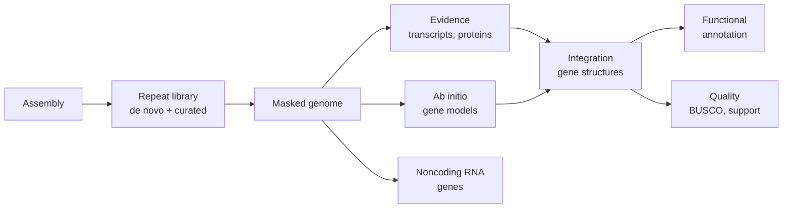

Read mapping ([7.8.10](/7.8.10)) needs a **reference genome**; this chapter is about how a reference is made in the first place. *De novo* assembly reconstructs a genome from **reads** alone, which are short or long, slightly erroneous copies of random stretches of it; annotation then marks the repeats, genes and other elements on the assembled sequence. The geneticist's view of assembly, the shotgun strategy, the **Lander–Waterman model** and the complete human genome, is in [7.4.14](/7.4.14#sec-14.2); here we treat the algorithms. Their mathematics is graph theory: assembly becomes a path problem in a graph built from the reads, either a Hamiltonian path in an overlap graph or an Eulerian trail in a de Bruijn graph ([1.4.2](/1.4.2)), and the difference in complexity between the two explains the history of the field. The data come from [7.8.9](/7.8.9), whose **k-mer spectrum** already estimates the size and heterozygosity of a genome before assembly; the gene models used in annotation are those of [7.8.7](/7.8.7). The assembly of mixtures of genomes is in [7.8.14](/7.8.14#sec-14.3.3), and the local assembly used by variant callers in [7.8.12](/7.8.12).

## 11.1. The Assembly Problem

### 11.1.1. Formulation

**Definition 11.1.1 (Genome Assembly)** Let a genome be a set of strings over $\{\mathrm{A}, \mathrm{C}, \mathrm{G}, \mathrm{T}\}$ (its chromosomes) and let a read be a substring of a chromosome or of its **reverse complement**, copied with errors. **Genome assembly** (de novo assembly) is the reconstruction of the chromosome sequences from a set of reads, without a reference. Its output is a set of **contigs**, gap-free sequences each supported by overlapping reads, and of scaffolds, ordered and oriented contigs with gaps of estimated length ([7.4.14](/7.4.14#sec-14.2.1)).

The first idealization is to ask for the shortest string that contains every read as a substring, the shortest common superstring. It is a poor model for two reasons. Computing it is **NP-hard** ([4.8.11](/4.8.11#sec-11.5)), though greedy merging of the pair of reads with the longest overlap approximates it within a constant factor. More fundamentally, parsimony is the wrong principle: a genome contains repeated sequence, and the shortest superstring collapses all copies of a repeat into one. Modern assemblers therefore do not seek one optimal string but build a graph whose paths are the strings consistent with the reads, simplify it, and output its unambiguous parts.

The second idealization is about sampling. Reads start at approximately uniform random positions, so the number covering a base is approximately Poisson with mean the **sequencing coverage** $c = NL/G$ for $N$ reads of length $L$ on a genome of length $G$. [Formula 14.2.1](/7.4.14#fml-14.2.1) of 7.4.14 gives, for reads joined when they overlap by at least $T$ bases and $\sigma = 1 - T/L$, the expected fraction of uncovered bases $\mathrm{e}^{-c}$ and the expected number of contigs $N\mathrm{e}^{-c\sigma}$. The same argument gives their lengths.

**Formula 11.1.1 (Lander–Waterman Contig Length)** Under the assumptions of the Lander–Waterman model, a contig contains on average $\mathrm{e}^{c\sigma}$ reads, and its expected length is

$$
\bar\ell = L\left(\frac{\mathrm{e}^{c\sigma} - 1}{c} + 1 - \sigma\right).
$$

The first statement follows because each read ends its contig independently with probability $\mathrm{e}^{-c\sigma}$, so the number of reads in a contig is geometric with that success probability; the length adds the spacings between consecutive starts, conditioned to be below $L\sigma$, to the length $L$ of the last read. The number of gaps equals the number of contigs (on a circular genome) and falls exponentially with coverage, while the contig length grows exponentially. The model is an upper bound on what an assembler achieves: it assumes that every overlap can be detected and trusted, and the main reason it fails is repetition.

### 11.1.2. Repeats

A *repeat*, in the sense of assembly, is a string that occurs at two or more places in a genome (on either strand) with at most a small fraction of differences. About half of a large animal or plant genome consists of **repetitive DNA** ([7.2.2](/7.2.2#sec-2.2.1)): **transposons**, tandem arrays such as **satellite DNA**, and segmental duplications.

**Remark 11.1.1** The reads determine the sequence of a repeat but not by themselves the unique sequences that flank each copy: the information that one copy lies between flanks $a$ and $c$ and the other between $b$ and $d$ is carried only by a read, or a read pair, that extends from a flank across the whole repeat into the other flank. Hence a repeat is resolved when it is shorter than the reads (or the pair span) by enough to leave anchoring sequence on both sides, and otherwise the assembly breaks at its boundaries or, worse, joins flanks incorrectly. Assembly quality is therefore governed less by coverage, which is cheap, than by the length of the longest repeats relative to the longest reads. This single principle explains the shift from short to long reads described in Section 11.4.

## 11.2. Overlap–Layout–Consensus

The *overlap–layout–consensus* approach (OLC) has three steps: compute the overlaps between all pairs of reads, lay the reads out along the genome by finding a path through the resulting graph, and compute the consensus sequence of the reads in each part of the layout.

### 11.2.1. The Overlap Graph

**Definition 11.2.1 (Overlap Graph)** The **overlap graph** of a set of reads is the **directed graph** with one vertex per read (and per reverse complement) and an arc $u \to v$ whenever a suffix of $u$ matches a prefix of $v$ over at least $T$ bases with a bounded error rate; the arc is labeled with the length of the overlap. A read contained in another read is removed beforehand, since it adds no information to the layout.

The overlap of two reads is a **semi-global alignment** ([7.8.3](/7.8.3#sec-3.5.5)) in which the unaligned ends of both reads are free. Aligning all pairs costs $O(N^2)$ alignments and is impossible for millions of reads, so candidate pairs are found first by shared $k$-mers or **minimizers** ([7.8.10](/7.8.10)) and only those are aligned. In an error-free genome without repeats, the genome corresponds to a path that visits every read exactly once: a **Hamiltonian path** of the overlap graph ([1.4.2](/1.4.2#sec-2.5)). Finding a Hamiltonian path is **NP-complete** in general, and the early assemblers used greedy heuristics; the string graph removes the need to search.

### 11.2.2. String Graphs and Transitive Reduction

If reads $u, v, w$ follow each other along the genome with $u$ overlapping both $v$ and $w$, the overlap graph has the arcs $u \to v$, $v \to w$ and also $u \to w$. The third arc carries no information that the first two do not, and at coverage $c$ every read has about $c$ such redundant arcs.

**Definition 11.2.2 (String Graph)** An arc $u \to w$ of an overlap graph is **transitive** if there is a vertex $v$ with arcs $u \to v$ and $v \to w$ whose combined offsets agree with that of $u \to w$. The **string graph** is the overlap graph after the removal of all transitive arcs (its **transitive reduction**) and of contained reads.

**Algorithm 11.2.1 (Transitive Reduction)** For each vertex $u$, with its out-arcs sorted by increasing overhang (the part of the target that extends beyond $u$):

1. Mark every out-neighbor of $u$ as reachable.
2. For each out-neighbor $v$ of $u$ in order, and each out-neighbor $w$ of $v$ whose position is consistent with the overlap $u \to w$ (within a small tolerance for errors), mark $w$ as eliminated.
3. Remove the arcs $u \to w$ from $u$ to every eliminated vertex.

The work at $u$ is at most the product of its out-degree and the out-degrees of its neighbors. In an overlap graph from uniform reads the degrees are bounded by a multiple of the coverage, so the reduction takes time linear in the number of arcs.

**Definition 11.2.3 (Unitig)** A **unitig** is a maximal path of a string graph (or of a de Bruijn graph, Section 11.3) whose internal vertices have **in-degree** and **out-degree** $1$. Its sequence is determined without ambiguity by the reads.

After transitive reduction, a region of the genome free of long repeats becomes a single non-branching path, and branching occurs only where a repeat creates overlaps between reads from different places. The layout step is thus reduced from a global search to the compression of non-branching paths into unitigs and the resolution of the branch points with additional information.

### 11.2.3. Consensus

The reads of a unitig are aligned in their layout positions, a multiple alignment of a special kind because the offsets are known, and the base at each position is decided from the column. Majority voting removes random errors effectively.

**Formula 11.2.1 (Majority Consensus Error)** If a position is covered by $c$ reads whose errors at that position are independent, each with probability $\varepsilon < 1/2$, the probability that errors are not in the minority is

$$
\mathbb{P}\bigl(\mathrm{Bin}(c, \varepsilon) \ge c/2\bigr) \le \bigl(4\varepsilon(1 - \varepsilon)\bigr)^{c/2}
$$
by the Chernoff bound, and the probability that a wrong base wins is smaller still, because wrong bases are split among three alternatives.

The error of the consensus thus falls exponentially with coverage, which is why reads with error rates of $10\,\%$ can still give accurate assemblies. The formula assumes independence; errors that recur at the same position in many reads, such as miscounted homopolymer lengths, are not reduced by coverage and remain as the dominant error of long-read consensus. Consensus is refined after assembly by realigning the reads to the draft (*polishing*), sometimes with reads from a second, more accurate technology.

## 11.3. De Bruijn Graphs

### 11.3.1. Graphs of k-mers

For hundreds of millions of short reads, computing overlaps between reads is too costly. The de Bruijn approach avoids overlaps altogether: it breaks reads into **k-mers** ([7.8.9](/7.8.9#sec-9.5)) and lets the overlaps of $k-1$ bases between consecutive $k$-mers define the graph.

**Definition 11.3.1 (De Bruijn Graph)** For a set of reads and an integer $k$, the **de Bruijn graph** has one vertex for each distinct $(k-1)$-mer occurring in the reads and one arc for each distinct $k$-mer $x_1 x_2 \cdots x_k$, from its prefix $x_1 \cdots x_{k-1}$ to its suffix $x_2 \cdots x_k$. Each arc is labeled with its multiplicity, the number of times its $k$-mer occurs in the reads.

The size of the graph depends on the number of distinct $k$-mers, about the genome length plus the number of error $k$-mers, and not on the number of reads, which is what makes the approach scale to deep short-read data. Because the strand of a read is unknown, a $k$-mer and its reverse complement are identified (canonical $k$-mers), and the graph is stored as a bidirected graph in which each vertex has two sides; the assembly paths must enter and leave vertices on opposite sides.

**Theorem 11.3.1** Let $S$ be a string of length $n \ge k$, and let $D$ be the multigraph with one vertex per distinct $(k-1)$-mer of $S$ and one arc for each of the $n - k + 1$ positions of $S$, from the prefix to the suffix of the $k$-mer starting there. Then the arcs taken in the order of their positions form an **Eulerian trail** of $D$.

**Proof** The $k$-mers at positions $i$ and $i + 1$ overlap in the $(k-1)$-mer at position $i + 1$, which is the head of arc $i$ and the tail of arc $i + 1$. The sequence of arcs is therefore a walk; it uses each arc, that is each position, exactly once, so it is a trail containing every arc. $\square$

When the reads contain every $k$-mer of the genome without error, the arc multiplicities of the de Bruijn graph equal the numbers of occurrences in the genome (counting with multiplicity), and Theorem 11.3.1 says that the chromosome is spelled by an Eulerian trail. Whether such a trail exists is decided by the degree condition of [Corollary 2.4.2](/1.4.2#cor-2.4.2), and one is found in time linear in the number of arcs by Hierholzer's algorithm ([1.4.2](/1.4.2#sec-2.4.2)). The reformulation from a Hamiltonian path among reads to an Eulerian trail among $k$-mers turned an intractable search into a linear-time one.

The trail is not unique in general. A $(k-1)$-mer that occurs at two places in the genome becomes a single vertex where two paths meet and diverge, and the graph then has Eulerian trails other than the genome. Assemblers therefore do not output one Eulerian trail; they output the unitigs (Definition 11.2.3) and leave the branch points to be resolved by longer-range information, as Remark 11.1.1 requires.

### 11.3.2. The Choice of k

The parameter $k$ trades repeat resolution against connectivity. A repeat shorter than $k - 1$ bases does not create a shared vertex, so a larger $k$ resolves more repeats. But by Formula 9.5.1 a $k$-mer present once in the genome is contained in about $c_k = c(L - k + 1)/L$ reads, of which a fraction $(1 - \varepsilon)^k$ are error-free; as $k$ approaches the read length, genuine $k$-mers are missed by chance and the graph breaks into pieces. The usable $k$ is therefore large enough that most $(k-1)$-mers are unique, and small enough that the expected error-free $k$-mer coverage $c_k(1 - \varepsilon)^k$ stays well above a few. Short-read assemblers resolve the dilemma by building graphs for several values of $k$ in turn, using the contigs from a small $k$ to fill the gaps of the graph for a larger one. Read pairs add constraints of the form "these two $k$-mers lie about $d$ bases apart", which can be built into the graph itself (paired de Bruijn graphs).

### 11.3.3. Errors, Tips and Bubbles

A sequencing error at one base changes up to $k$ overlapping $k$-mers, almost all of which are absent from the genome; the error peak of the **k-mer spectrum** ([7.8.9](/7.8.9#sec-9.5)) consists of them. Two remedies are used together. Before assembly, $k$-mers are classified as *solid* (multiplicity above a threshold read from the trough of the spectrum) or *weak*, and each read is corrected to the nearest sequence whose $k$-mers are all solid. During assembly, the error patterns that remain have characteristic shapes in the graph.

**Definition 11.3.2 (Tip and Bubble)** In a de Bruijn or string graph, a **tip** is a path that leaves (or enters) the main graph at a vertex and ends at a vertex of degree $1$, shorter than a threshold (typically about $2k$ for de Bruijn graphs). A **bubble** is a pair of internally disjoint paths with the same start and end vertices and similar lengths.

An error near the end of a read produces a tip; an error in its interior produces a bubble whose second path has low multiplicity. Bubbles also arise from genuine differences: at a heterozygous site of a **diploid** genome both paths have about half the coverage of the homozygous sequence, and in a mixture of strains each strain contributes a path ([7.8.14](/7.8.14#sec-14.3.3)).

**Algorithm 11.3.1 (Graph Simplification)** Repeat until no change:

1. Remove tips shorter than the length threshold whose multiplicity is low relative to the branch they leave.
2. For each bubble, compare the multiplicities of its two paths; remove the weaker path if its coverage is low (an error), or, if both are well supported, record the bubble as a variant between haplotypes and keep one path in the primary assembly.
3. Remove arcs whose multiplicity is much lower than that of the arcs adjacent to them (chimeric or erroneous connections).
4. Compress non-branching paths into unitigs.

The thresholds are relative rather than absolute because coverage varies along the genome. Coverage also carries information about copy number: a unitig with about twice the average coverage is likely to be a repeat with two copies, which helps to resolve the branch points around it.

## 11.4. Long Reads and Complete Genomes

### 11.4.1. Long Noisy Reads and Accurate Long Reads

Remark 11.1.1 makes read length the decisive parameter, and long reads from **single-molecule real-time sequencing** and **nanopore sequencing** ([7.8.9](/7.8.9#sec-9.1.2)), of $10$ to over $100\,\mathrm{kb}$, span most repeats outright. Long reads with error rates of several percent do not fit the de Bruijn approach, since few of their $k$-mers are error-free, and they brought overlap–layout–consensus back: overlaps are found by chaining shared minimizers, the reads are corrected against each other by consensus before or after the layout (Formula 11.2.1), and the layout is a string graph. Another strategy builds a graph from the repeated segments themselves (a repeat graph) and threads the reads through it.

Accurate long reads (circular consensus reads of about $15$–$25\,\mathrm{kb}$ with per-base accuracy above $99.9\,\%$) changed the problem again. Their error rate is below the typical heterozygosity of a diploid genome (about $0.1\,\%$ in humans), so two reads that differ at a few positions can be recognized as coming from different haplotypes rather than as erroneous copies of one. Overlaps between reads from different haplotypes can then be rejected, and the string graph separates the two haplotypes over long stretches. Reads of over $100\,\mathrm{kb}$, less accurate, are added to traverse the longest repeats that accurate reads cannot span, by aligning them to the graph built from the accurate reads.

### 11.4.2. Haplotype-Resolved Assembly

A diploid genome contains two copies of each autosome. Classical assemblies give one *primary* sequence that switches between the two **haplotypes** where they differ, together with *alternate* contigs for the divergent regions.

**Definition 11.4.1 (Haplotype-Resolved Assembly)** A **haplotype-resolved assembly** represents each haplotype of a diploid (or polyploid) genome by its own sequence, so that every variant between the haplotypes is assigned to one of them.

Within a stretch connected by reads the phase is given by the reads, but between such stretches it must come from additional information, which is a problem of **haplotype phasing** ([7.8.13](/7.8.13)). Two general sources are used. With sequence data from both parents, $k$-mers present in only one parent label the reads of the child that carry them, so that the reads or the graph can be partitioned by parental origin (trio binning). Without parents, Hi-C contacts (Section 11.5), which link sites on the same molecule over megabases, assign the phased blocks to chromosomes.

### 11.4.3. Telomere-to-Telomere Assemblies and Pangenome Graphs

**Definition 11.4.2 (Telomere-to-Telomere Assembly)** A **telomere-to-telomere assembly** (T2T) represents each chromosome by a single gap-free sequence extending from one **telomere** to the other.

The first complete human genome (2022, [7.4.14](/7.4.14#sec-14.2.2)) showed what gaps had hidden: the centromeric satellite arrays, the arrays of rRNA genes and large segmental duplications are now accessible to read mapping, variant calling and comparative analysis, and a complete assembly can serve as a reference without gaps.

With many complete or nearly complete assemblies of one species, a single linear reference becomes a restriction. A **pangenome** ([7.4.14](/7.4.14#sec-14.2.3)) is represented by a graph.

**Definition 11.4.3 (Pangenome Graph)** A **pangenome graph** is a sequence graph whose vertices are sequence segments and whose arcs join segments that are adjacent in at least one genome, such that each genome of the collection is a path (a walk) through the graph; variants appear as bubbles, and the segments shared by all genomes form the core.

Pangenome graphs are built by aligning the assemblies to each other (all-to-all, or iteratively to a growing graph), and reads can be mapped to them instead of to one linear sequence ([7.8.10](/7.8.10)). The graph structures of assembly and of pangenomes are the same objects: the bubbles of Definition 11.3.2 that an assembler pops as differences between haplotypes are the variants that a pangenome graph keeps.

## 11.5. Scaffolding

**Definition 11.5.1 (Scaffolding)** **Scaffolding** is the ordering and orienting of contigs, and the estimation of the lengths of the gaps between them, from information that links non-adjacent sequences: read pairs, long reads, chromatin contacts or physical maps. Gaps are represented by runs of the symbol N of the estimated length.

As an optimization problem, scaffolding is posed on a graph whose vertices are contigs and whose edges carry the number of linking reads and the implied distance and relative orientation. One seeks an orientation of every contig and a linear order that agrees with as many links as possible. This is NP-hard in general (choosing orientations alone contains a maximum-cut problem), and scaffolders use greedy merging of the best-supported links, with consistency checks, after discarding links from repeated contigs.

### 11.5.1. Read Pairs

A read pair from a fragment of known length distribution, with one read near the end of contig $X$ and the other near the start of contig $Y$, tells that $Y$ follows $X$ in a definite orientation and how far away it is.

**Formula 11.5.1 (Gap Length Estimate)** Let fragment lengths have mean $\mu$ and standard deviation $s$, and let $n$ pairs link contigs $X$ and $Y$, pair $i$ having its reads at distances $a_i$ from the end of $X$ and $b_i$ from the start of $Y$ (each distance measured to the outer end of the read). Then the gap length is estimated by

$$
\hat g = \mu - \frac{1}{n}\sum_{i=1}^n (a_i + b_i),
$$
with standard error approximately $s/\sqrt{n}$.

Each pair gives $g = I_i - a_i - b_i$ with $I_i$ its fragment length, and averaging the $n$ independent fragment lengths gives the mean and the standard error. A negative estimate means that the contigs overlap and were not merged, typically because of an error at their ends. Paired reads from short fragments span only short repeats; libraries of long fragments (several kilobases and more) were used for longer ones before long reads made them largely unnecessary.

### 11.5.2. Chromatin Contacts

**Hi-C** ([7.9.8](/7.9.8)) captures pairs of sites that are close in the three-dimensional nucleus. Two features of its data make it a scaffolding signal on the scale of whole chromosomes. Contacts within a chromosome are far more frequent than contacts between chromosomes, so contigs can be clustered into chromosome groups by their contact counts. Within a chromosome, the contact frequency decays with genomic distance $s$, approximately as a power law $P(s) \propto s^{-\alpha}$ with $\alpha \approx 1$ over distances of about $0.1$–$10\,\mathrm{Mb}$, so the strongest contacts of a contig end are with the sequence that lies next to it. Ordering and orientation are then chosen to maximize the likelihood of the observed contacts,

$$
\log \mathcal{L}(\text{order}, \text{orientation}) = \sum_{\text{contacts } (i, j)} \log P\bigl(s_{ij}\bigr),
$$
where $s_{ij}$ is the distance between the two contacting sites implied by the proposed order and orientation. Orientation is determined by which end of a contig carries the contacts with its neighbor. Misassemblies show up as off-diagonal blocks in the contact map after scaffolding, and the map is inspected and corrected by hand in the final curation of reference genomes.

![Hi-C as a scaffolding signal (schematic). A: the contact frequency between two sites of the same chromosome decays roughly as 1/s with their distance s, while contacts between chromosomes are rare at any distance. B: a contact map of three contigs of one chromosome drawn in a wrong order (C, A, B); strong contacts concentrated at the corners of off-diagonal blocks show which contig ends are truly adjacent (A next to B, B next to C), and the order A, B, C makes the map decay smoothly from the diagonal](./plots/hic-scaffolding.py)

### 11.5.3. Optical Maps

An optical map images long DNA molecules (hundreds of kilobases), stretched in nanochannels, on which a short sequence motif has been fluorescently labeled. The pattern of distances between consecutive labels is a fingerprint of the molecule. Molecules are assembled into consensus maps by their patterns, and the contigs are converted into predicted label patterns from their sequence; aligning the two orders and orients the contigs, estimates large gaps, and exposes misjoins and large structural differences where the patterns disagree. Optical maps and Hi-C are complementary: maps are accurate over hundreds of kilobases, Hi-C reaches the whole chromosome.

## 11.6. Assessing an Assembly

An assembly is judged by three properties: contiguity (how long the pieces are), completeness (how much of the genome is in them) and correctness (how many bases and joins are wrong). No single number captures all three.

### 11.6.1. Contiguity

**Definition 11.6.1 (N50, NG50 and L50)** Sort the contigs (or scaffolds) by decreasing length $\ell_1 \ge \ell_2 \ge \dots$. The **N50** is the length $\ell_j$ of the first contig for which $\ell_1 + \dots + \ell_j$ reaches at least half of the total assembly length; the **L50** is the number $j$ of contigs needed. The **NG50** replaces the total assembly length by an estimate of the genome size $G$. More generally, Nx uses the fraction $x\,\%$ instead of $50\,\%$.

N50 is a length-weighted median: half of the assembled bases lie in contigs of length at least N50. Three properties limit its meaning. It rewards incorrect joins, since merging two contigs wrongly increases it as much as merging them correctly. It depends on the total length of the assembly, so an assembly that omits difficult sequence, or that duplicates sequence by keeping both haplotypes, has a misleading N50; NG50, against a fixed genome size, permits comparison between assemblies of the same genome. And it depends on a single point of the Nx curve; the area under the curve, $\sum_i \ell_i^2 / \sum_i \ell_i$ (auN), uses all of it. Contig and scaffold N50 must be distinguished, since a scaffold N50 can be large while the contigs are short.

### 11.6.2. Completeness

**Definition 11.6.2 (BUSCO Completeness)** For a lineage of organisms, a set of genes that are present in a single copy in nearly all genomes of the lineage is fixed in advance from comparisons of many genomes. **BUSCO** (benchmarking universal single-copy orthologs) assesses a genome assembly, a gene set or a transcriptome by searching for each of these genes and classifying it as complete and single-copy, complete and duplicated, fragmented, or missing; the percentages of the four classes are reported.

The search uses **profile hidden Markov models** of the gene families ([7.8.5](/7.8.5)) and a length criterion for completeness. A high fraction of complete single-copy genes indicates that the gene space is assembled; many duplicated genes in a supposedly haploid representation indicate that haplotypes were kept as separate copies (false duplication); many fragmented genes indicate low contiguity or a high error rate that breaks reading frames. Because the marker genes are single-copy and mostly conserved coding genes, BUSCO says nothing about repeats, centromeres or other noncoding sequence.

### 11.6.3. Correctness

Correctness has two scales. At the level of joins, a *misassembly* is a place where adjacent sequence in the assembly comes from distant places, or opposite strands, of the genome; when a trusted reference exists, misassemblies are counted by aligning the assembly to it, and otherwise they are detected as places where the reads, read pairs, optical maps or Hi-C contacts are inconsistent with the assembly. At the level of bases, the error rate is expressed on the **Phred quality score** scale of [7.8.9](/7.8.9#sec-9.2).

**Definition 11.6.3 (Consensus Quality Value)** The **consensus quality value** of an assembly with per-base error rate $E$ is $\mathrm{QV} = -10\log_{10} E$. A QV of $40$ means one error in $10^4$ bases, a QV of $60$ one in $10^6$.

Without a reference, the error rate is estimated from $k$-mers of accurate reads of the same individual: a $k$-mer of the assembly that never occurs in the reads is very likely to contain an assembly error.

**Formula 11.6.1 (k-mer Estimate of QV)** If a fraction $P$ of the $k$-mers of an assembly is absent from the read set, and errors occur independently at rate $E$ per base, then $1 - P = (1 - E)^k$, so

$$
E = 1 - (1 - P)^{1/k}, \qquad \mathrm{QV} = -10\log_{10} E.
$$

The same counts give a $k$-mer completeness, the fraction of the reliable read $k$-mers (those above the error threshold of the spectrum) found in the assembly, and comparing the multiplicity of each read $k$-mer with its copy number in the assembly shows collapsed repeats (high read multiplicity, one copy) and false duplications (one haplotype's multiplicity, two copies). With parental reads, the parent-specific $k$-mers measure how often a haplotype-resolved assembly switches from one parental haplotype to the other.

## 11.7. Annotating a New Genome

**Definition 11.7.1 (Genome Annotation)** **Genome annotation** is the identification and description of the elements of an assembled genome: its repeats, its protein-coding and noncoding genes with their exon–intron structures, and the functions assigned to the gene products. Structural annotation gives the coordinates of the elements and functional annotation their names and roles; both are recorded in the **GFF format** ([7.8.1](/7.8.1#sec-1.4.2)).

### 11.7.1. Repeats and Masking

Repeats are annotated first because they confuse every later step: transposable elements contain open reading frames for their own proteins, which gene finders would report as genes, and their many copies attract spurious alignments of transcripts and proteins.

**Definition 11.7.2 (Repeat Masking)** **Repeat masking** replaces the bases of the genome that match a library of repeat families either by N (**hard masking**) or by lowercase letters (**soft masking**), so that later analyses ignore them or treat them differently.

The library is the union of curated libraries of known repeat families and a species-specific library built de novo from the assembly itself: segments that occur many times in the genome, found by self-alignment or by high-copy $k$-mers, are clustered into families, extended to full length and classified by their structure (terminal repeats, encoded proteins) as the classes of **transposons** and simple or tandem repeats. Each family is then searched in the genome by sensitive alignment, often with profile models. Soft masking is preferred for gene prediction: seeds are not started in masked sequence, but alignments and gene models may extend into it, so genes that contain old repeat fragments are not lost.

### 11.7.2. Gene Structures from Evidence and Models

Protein-coding genes are found by combining the two approaches of [7.8.7](/7.8.7#sec-7.4.3). Evidence comes from transcripts of the same species, RNA-seq reads aligned to the genome by **spliced alignment** and full-length long-read transcripts, which fix exons and splice sites, and from proteins of related species aligned with spliced protein alignment, which give conserved structures. *Ab initio* **gene prediction** with a **generalized hidden Markov model** ([7.8.7](/7.8.7#sec-7.4.2)) contributes genes without such evidence, but its parameters (codon usage, splice-site models, length distributions) are species-specific and must be trained.

**Algorithm 11.7.1 (Evidence-Based Gene Annotation)** Given a soft-masked genome, transcript data and a protein database of related species:

1. Align the transcripts and proteins to the genome with spliced aligners and assemble the transcript alignments into candidate gene structures.
2. Select a training set of gene structures that are complete and well supported, and train the ab initio predictor on them.
3. Predict genes genome-wide with the trained model, using the aligned evidence as hints that raise the probability of the supported exons, introns and splice sites.
4. Combine the predictions and the evidence-based structures into one gene set, weighting each source by its reliability, and add untranslated regions and alternative isoforms from the transcripts.
5. Filter models without support or with features of transposons, and assess the gene set by BUSCO (Definition 11.6.2) and the fraction of models supported by evidence.

Noncoding RNA genes are annotated separately: transfer RNAs and ribosomal RNAs by specialized searches, and other families with **covariance models** that score sequence and secondary structure together ([7.8.16](/7.8.16#sec-16.4.2)).

### 11.7.3. Functional Annotation

Functions are transferred from characterized proteins by homology: searches against protein databases ([7.8.4](/7.8.4)), recognition of domains and families with profile models ([7.8.5](/7.8.5); the combined domain resources of [7.8.17](/7.8.17#sec-17.6)), and assignment to orthologous groups, from which names, **Gene Ontology** terms ([7.8.2](/7.8.2)) and pathway memberships are taken. Transfer by homology is an inference with known failure modes: annotations propagate errors from one database entry to many, paralogs may have diverged in function, and a domain identifies a biochemical activity rather than a biological role. Each annotation should therefore carry its evidence, and genes without detectable homologs are reported as such rather than forced into a family.

## Summary

| Step | Formulation | Key results |
|---|---|---|
| Problem | strings consistent with the reads (Definition 11.1.1) | shortest superstring is NP-hard and collapses repeats; contigs and gaps by Lander–Waterman (Formula 11.1.1); repeats longer than the reads cannot be resolved by the reads (Remark 11.1.1) |
| Overlap–layout–consensus | overlap graph (Definition 11.2.1), Hamiltonian path | string graph by transitive reduction (Definition 11.2.2, Algorithm 11.2.1), unitigs (Definition 11.2.3), consensus error falls exponentially with coverage (Formula 11.2.1) |
| De Bruijn graph | $(k-1)$-mers and $k$-mers (Definition 11.3.1), Eulerian trail | genome is an Eulerian trail (Theorem 11.3.1), found in linear time; trail not unique at repeats; $k$ trades repeat resolution against coverage $c_k(1-\varepsilon)^k$ |
| Errors | solid and weak $k$-mers; tips and bubbles (Definition 11.3.2) | graph simplification (Algorithm 11.3.1); bubbles also mark heterozygosity |
| Long reads | string graphs of long reads; accurate long reads separate haplotypes | haplotype-resolved (Definition 11.4.1) and telomere-to-telomere assemblies (Definition 11.4.2); pangenome graphs (Definition 11.4.3) |
| Scaffolding | order and orientation of contigs (Definition 11.5.1) | gap length from pairs (Formula 11.5.1); Hi-C contact decay $P(s) \propto s^{-1}$ for order and chromosome assignment; optical maps |
| Evaluation | contiguity, completeness, correctness | N50, NG50, L50 (Definition 11.6.1); BUSCO (Definition 11.6.2); QV (Definition 11.6.3) from $k$-mers (Formula 11.6.1) |
| Annotation | repeats, genes, functions (Definition 11.7.1) | repeat masking first (Definition 11.7.2); evidence plus trained ab initio models (Algorithm 11.7.1); noncoding RNAs by covariance models; function by homology |

The common thread is that assembly is limited by repeats, not by coverage: every advance, from read pairs to long and accurate reads, Hi-C and optical maps, adds information that spans longer repeats, and the graph formulations make explicit which parts of a genome the data determine.

## Questions

1. (Concept) Why is the shortest common superstring of the reads a poor definition of the assembled genome, even if it could be computed quickly?

   **Answer** The superstring is the most parsimonious string containing all reads. A genome with a repeated segment contains it twice, but a superstring in which both copies are merged is shorter and still contains every read whose sequence lies within the repeat or crosses into a flank that the merged copy keeps. Parsimony therefore systematically collapses repeats and can join the flanks of different copies. The correct question is which strings are consistent with the reads, which the graph formulations answer, together with which parts of them are determined (the unitigs).

2. (Calculation) A genome of $100\,\mathrm{Mb}$ is sequenced with reads of $10\,\mathrm{kb}$, and reads are joined when they overlap by at least $1\,\mathrm{kb}$. Under the Lander–Waterman model, find the expected number of contigs, the expected contig length and the expected number of uncovered bases at coverage $5\times$ and $10\times$.

   **Answer** Here $\sigma = 1 - 1/10 = 0.9$. At $c = 5$: $N = cG/L = 5\times10^4$ reads, $N\mathrm{e}^{-4.5} \approx 555$ contigs, expected length $L\bigl((\mathrm{e}^{4.5} - 1)/5 + 0.1\bigr) \approx 10^4 \times 17.9 = 1.79\times10^5$ bases (Formula 11.1.1), and $G\mathrm{e}^{-5} \approx 6.7\times10^5$ uncovered bases. At $c = 10$: $N = 10^5$, $N\mathrm{e}^{-9} \approx 12$ contigs of expected length $10^4\bigl((\mathrm{e}^{9}-1)/10 + 0.1\bigr) \approx 8.1\,\mathrm{Mb}$, and $G\mathrm{e}^{-10} \approx 4.5\times10^3$ uncovered bases. Doubling the coverage reduces the number of contigs about 45-fold; in a real genome the repeats would set a floor that coverage cannot lower.

3. (Concept) Explain why the de Bruijn formulation made short-read assembly practical, and why assemblers nevertheless do not output an Eulerian trail of the graph.

   **Answer** In the overlap graph the genome is a Hamiltonian path, and finding one is NP-complete; computing all pairwise overlaps of $10^8$ reads is also prohibitive. In the de Bruijn graph the genome is an Eulerian trail (Theorem 11.3.1), whose existence is a degree condition and which Hierholzer's algorithm finds in linear time; the graph has about one arc per distinct $k$-mer, independent of read number. But wherever a $(k-1)$-mer occurs more than once, the graph has other Eulerian trails, which rearrange the segments between repeated vertices; the data do not prefer the true one. Outputting an arbitrary trail would introduce false joins, so assemblers output the unitigs, which every trail shares, and resolve branch points only with longer-range information.

4. (Calculation) Short reads of length $150$ with error rate $\varepsilon = 0.005$ are sequenced to $50\times$. Compare $k = 31$ and $k = 101$ by the expected number of error-free reads containing a given genomic $k$-mer. What does $k = 101$ gain and what does it risk?

   **Answer** By Formula 9.5.1, $c_k = 50 \times 120/150 = 40$ for $k = 31$ and $50 \times 50/150 = 16.7$ for $k = 101$. The error-free fractions are $0.995^{31} = 0.856$ and $0.995^{101} = 0.603$, so the expected error-free coverage is $34.2$ and $10.0$. With $k = 101$ every repeat shorter than $100$ bases no longer creates a shared vertex, so the graph is less tangled; but with a Poisson mean of $10$, and more where coverage dips, some genomic $k$-mers have low counts that fall below the solid-$k$-mer threshold or are missed, and the graph breaks into more pieces. Multi-$k$ assembly combines the connectivity of small $k$ with the resolution of large $k$.

5. (Calculation) Reads with error rate $\varepsilon = 0.1$ are used for consensus at coverage $10$, $20$ and $30$. Compute the exact probability that errors are not in the minority at a position, and the Chernoff bound of Formula 11.2.1. Which errors does this calculation not cover?

   **Answer** $\mathbb{P}(\mathrm{Bin}(10, 0.1) \ge 5) = 1.6\times10^{-3}$ against the bound $0.36^{5} = 6.0\times10^{-3}$; for $c = 20$, $7.2\times10^{-6}$ against $3.7\times10^{-5}$; for $c = 30$, $3.6\times10^{-8}$ against $2.2\times10^{-7}$. The error falls exponentially with coverage, and the actual consensus error is lower still because wrong bases rarely agree. The calculation assumes independent errors; systematic errors that recur in many reads at the same position, such as homopolymer length errors, are not reduced by coverage and must be corrected with a different technology or a model of the error.

6. (Calculation) An assembly has contigs of lengths $40, 25, 15, 10, 5, 3, 2$ (in $\mathrm{Mb}$). Compute its N50 and L50, and its NG50 if the genome size is $160\,\mathrm{Mb}$. How does a false join of the two longest contigs change the N50?

   **Answer** The total is $100\,\mathrm{Mb}$, and the cumulative sums are $40, 65, 80, \dots$; half of the total, $50$, is reached by the second contig, so N50 $= 25\,\mathrm{Mb}$ and L50 $= 2$. For NG50 the threshold is $80\,\mathrm{Mb}$, reached by the third contig, so NG50 $= 15\,\mathrm{Mb}$: the assembly lacks $60\,\mathrm{Mb}$ of the genome, which N50 does not show. A false join of the first two contigs gives a contig of $65\,\mathrm{Mb}$, which alone exceeds half of the total, so N50 becomes $65\,\mathrm{Mb}$: contiguity statistics reward misassemblies, and must be read together with measures of correctness.

7. (Calculation) In an assembly, a fraction $P = 10^{-4}$ of the $21$-mers does not occur in accurate reads of the same individual. Estimate the per-base error rate and the QV. Why is the estimate unreliable if the reads come from a different individual?

   **Answer** By Formula 11.6.1, $E = 1 - (1 - 10^{-4})^{1/21} = 4.76\times10^{-6}$ and $\mathrm{QV} = -10\log_{10}E = 53.2$, about one error per $210\,\mathrm{kb}$. The method counts every assembly $k$-mer absent from the reads as an error. Reads from another individual lack the $k$-mers that overlap the variants of the assembled individual, roughly $k$ times the heterozygosity per base, which at a variant rate of $10^{-3}$ is a fraction of about $2\times10^{-2}$ of the $k$-mers, far above the error signal; the QV would be dominated by genetic differences.

8. (Calculation) Twenty-five read pairs from a library with fragment length mean $3\,000$ and standard deviation $300$ link the end of contig $X$ to the start of contig $Y$, and the average of $a_i + b_i$ is $2\,600$. Estimate the gap and its standard error. What would an estimate of $-400$ suggest?

   **Answer** By Formula 11.5.1, $\hat g = 3\,000 - 2\,600 = 400$ bases with standard error $300/\sqrt{25} = 60$, so the gap is estimated as $400 \pm 120$ (approximate $95\,\%$ interval) and is represented by $400$ N symbols. A clearly negative estimate means that the two contigs overlap by about $400$ bases; they were not merged because their ends disagree, for example because of errors, a heterozygous difference or a short repeat, and the overlap should be checked by aligning the contig ends.

9. (Concept) How does the decay of Hi-C contact frequency with distance determine both the order and the orientation of contigs on a chromosome?

   **Answer** Contacts are much more frequent within than between chromosomes, so contigs are first clustered into chromosome groups. Within a group, the frequency of contacts between two sites falls as about $s^{-1}$ with their distance, so the pair of contig ends with the most contacts is most likely adjacent. Each contig has two ends; the contacts with a neighbor are concentrated at the end that faces it, so orientation is chosen to put that end next to the neighbor. A likelihood over all contacts (Section 11.5.2) evaluates complete orders and orientations, and misjoins appear as off-diagonal blocks in the resulting contact map.

10. (Concept) Why is the genome masked for repeats before gene prediction, and why is soft masking usually preferred to hard masking?

    **Answer** Transposable elements encode proteins and have open reading frames with coding statistics, so an ab initio predictor reports many of them as genes; their many copies also make transcripts and proteins align to many places. Masking removes these false genes and spurious alignments. Hard masking replaces bases by N, which destroys real genes that contain or overlap old repeat fragments and breaks alignments across them. Soft masking only marks the bases: aligners do not start seeds there but can extend through them, and gene finders can treat them as less likely coding sequence without forbidding exons in them.

11. (Concept) What does each of the four BUSCO classes indicate about an assembly that is meant to represent one haplotype?

    **Answer** Complete single-copy genes indicate that the conserved gene space is assembled correctly. Complete duplicated genes, beyond the few genuine duplications in the lineage, indicate that the two haplotypes of a region were kept as separate contigs (false duplication) and should be purged. Fragmented genes indicate that contigs break within genes or that base errors disrupt the reading frames, pointing to low contiguity or insufficient polishing. Missing genes indicate either missing sequence (low coverage, unassembled regions) or real gene loss in the species; the two are distinguished by searching the reads or related genomes. None of the classes says anything about repeats or noncoding sequence.
