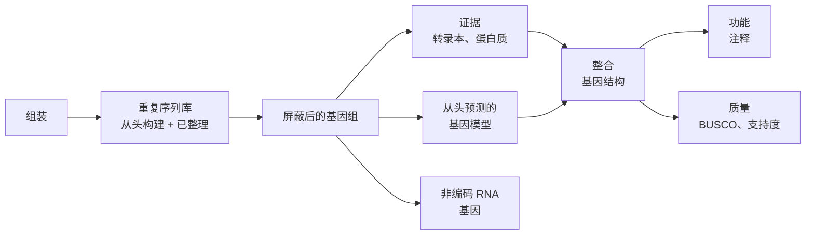

读段比对（[7.8.10](/7.8.10)）需要一个**参考基因组**；本章讲的是参考基因组最初是怎样得到的。从头组装仅凭**读段**重建基因组，这些读段是基因组随机片段的拷贝，或短或长，带有少量错误；注释则在组装好的序列上标出重复序列、基因和其他元件。遗传学家眼中的组装，即鸟枪法策略、**Lander–Waterman 模型**与完整的人类基因组，见 [7.4.14](/7.4.14#sec-14.2)；这里讨论的是算法。其数学是图论：组装成为由读段构建的图上的路径问题，或是重叠图中的哈密顿路，或是 de Bruijn 图中的欧拉迹（[1.4.2](/1.4.2)），二者复杂度的差异解释了这一领域的发展历史。数据来自 [7.8.9](/7.8.9)，其 **k-mer 谱**在组装之前就能估计基因组的大小与杂合度；注释所用的基因模型即 [7.8.7](/7.8.7) 的模型。基因组混合物的组装见 [7.8.14](/7.8.14#sec-14.3.3)，变异检出程序使用的局部组装见 [7.8.12](/7.8.12)。

## 11.1. 组装问题

### 11.1.1. 问题的表述

**定义 11.1.1（基因组组装）** 设基因组是 $\{\mathrm{A}, \mathrm{C}, \mathrm{G}, \mathrm{T}\}$ 上的一组字符串（即其染色体），读段是染色体或其**反向互补序列**的一个子串，复制时带有错误。**基因组组装**（从头组装）是不借助参考序列，由一组读段重建染色体序列。其输出是一组**重叠群**，即每条都由相互重叠的读段支持、没有空缺的序列，以及一组支架，即排好顺序与方向、之间带有估计长度的空缺的重叠群（[7.4.14](/7.4.14#sec-14.2.1)）。

第一种理想化是求包含每条读段为子串的最短字符串，即最短公共超串。它不是一个好的模型，原因有二。其一，计算它是 **NP 难**的（[4.8.11](/4.8.11#sec-11.5)），尽管每次合并重叠最长的一对读段的贪心算法能在常数倍之内近似它。更根本的是，简约原则本身就不对：基因组含有重复序列，而最短超串把一段重复的所有拷贝压缩成一份。因此现代组装程序不去寻找一个最优字符串，而是构建一个图，使其路径就是与读段一致的字符串，再将图化简，输出其中没有歧义的部分。

第二种理想化涉及采样。读段的起点近似均匀随机，所以覆盖某个碱基的读段数近似服从 Poisson 分布，均值为**测序覆盖度** $c = NL/G$，其中 $N$ 条长为 $L$ 的读段取自长为 $G$ 的基因组。7.4.14 的[公式 14.2.1](/7.4.14#fml-14.2.1)指出：重叠至少 $T$ 个碱基的读段被连接，记 $\sigma = 1 - T/L$，则未覆盖碱基的期望比例为 $\mathrm{e}^{-c}$，重叠群的期望个数为 $N\mathrm{e}^{-c\sigma}$。同样的论证也给出重叠群的长度。

**公式 11.1.1（Lander–Waterman 重叠群长度）** 在 Lander–Waterman 模型的假设下，一个重叠群平均含 $\mathrm{e}^{c\sigma}$ 条读段，其期望长度为

$$
\bar\ell = L\left(\frac{\mathrm{e}^{c\sigma} - 1}{c} + 1 - \sigma\right).
$$

第一个结论的理由是：每条读段各自独立地以概率 $\mathrm{e}^{-c\sigma}$ 结束其所在的重叠群，所以重叠群中的读段数服从成功概率为该值的几何分布；长度则等于最后一条读段的长度 $L$ 加上相邻起点之间在小于 $L\sigma$ 的条件下的间距之和。空缺数等于重叠群数（对环状基因组而言），随覆盖度指数下降，而重叠群长度则指数增长。该模型给出的是组装程序所能达到水平的上界：它假设每一处重叠都能被检出且可信，而它失效的主要原因是重复序列。

### 11.1.2. 重复序列

就组装而言，*重复序列*是在基因组中出现两处或更多处（可在任一条链上）、差异只占很小比例的字符串。大型动物或植物基因组的大约一半由**重复 DNA** 构成（[7.2.2](/7.2.2#sec-2.2.1)）：**转座子**、串联阵列（如**卫星 DNA**）以及片段重复。

**注 11.1.1** 读段能确定重复序列本身，却不能由自身确定每个拷贝两侧的唯一序列：某一拷贝位于侧翼 $a$ 与 $c$ 之间、另一拷贝位于 $b$ 与 $d$ 之间，这一信息只由一条读段或一个读段对携带，它须从一侧翼出发，跨越整个重复序列，延伸到另一侧翼。因此，只有当重复序列比读段（或读段对的跨度）短得足以在两侧留下锚定序列时，它才能被解析；否则组装在其边界处中断，更糟时会把侧翼错误地连接起来。组装质量所取决的，与其说是廉价的覆盖度，不如说是最长重复序列相对于最长读段的长度。这一条原则解释了第 11.4 节所述由短读段到长读段的转变。

## 11.2. 重叠–布局–一致

重叠–布局–一致（overlap–layout–consensus）方法，简称 OLC，分三步：计算所有读段对之间的重叠；在所得的图中找出一条路径，沿基因组把读段布局；再对布局中每一部分的读段计算一致序列。

### 11.2.1. 重叠图

**定义 11.2.1（重叠图）** 一组读段的**重叠图**是这样的**有向图**：每条读段（及其反向互补序列）对应一个顶点；若 $u$ 的后缀以有界的错误率与 $v$ 的前缀至少在 $T$ 个碱基上匹配，则有一条弧 $u \to v$，弧以重叠的长度标记。包含在另一条读段之内的读段预先去掉，因为它对布局不提供任何信息。

两条读段的重叠是一种**半全局比对**（[7.8.3](/7.8.3#sec-3.5.5)），两条读段未比对上的末端都不计代价。对所有读段对做比对需要 $O(N^2)$ 次比对，对数百万条读段而言不可能，所以先通过共有的 $k$-mer 或**最小化子**（[7.8.10](/7.8.10)）找出候选对，只对它们做比对。在没有错误、也没有重复序列的基因组中，基因组对应一条恰好经过每条读段一次的路径，即重叠图的**哈密顿路**（[1.4.2](/1.4.2#sec-2.5)）。求哈密顿路一般是 **NP 完全**的，早期的组装程序采用贪心启发式算法；字符串图则免去了搜索。

### 11.2.2. 字符串图与传递归约

若读段 $u, v, w$ 沿基因组依次排列，且 $u$ 与 $v$、$w$ 都重叠，则重叠图中有弧 $u \to v$、$v \to w$，还有弧 $u \to w$。第三条弧所带的信息，前两条已经包含；在覆盖度为 $c$ 时，每条读段约有 $c$ 条这样的冗余弧。

**定义 11.2.2（字符串图）** 重叠图的弧 $u \to w$ 称为**传递的**，若存在顶点 $v$，使弧 $u \to v$ 与 $v \to w$ 的偏移量之和与 $u \to w$ 的偏移量一致。去掉所有传递弧（即做**传递归约**）并去掉被包含的读段之后，重叠图成为**字符串图**。

**算法 11.2.1（传递归约）** 对每个顶点 $u$，将其出弧按悬出量（目标读段伸出 $u$ 之外的部分）递增排序：

1. 把 $u$ 的每个出邻点标记为可达。
2. 对 $u$ 的每个出邻点 $v$，按顺序处理 $v$ 的每个出邻点 $w$：若其位置与重叠 $u \to w$ 一致（允许由错误引起的小误差），就把 $w$ 标记为待消除。
3. 删去从 $u$ 到每个待消除顶点 $w$ 的弧 $u \to w$。

在 $u$ 处的工作量至多是其出度与各邻点出度的乘积。在由均匀读段得到的重叠图中，度数以覆盖度的某个倍数为界，所以归约所需时间与弧数成线性关系。

**定义 11.2.3（Unitig）** **Unitig** 是字符串图（或第 11.3 节的 de Bruijn 图）的一条极大路径，其内部顶点的**入度**与**出度**都为 $1$。其序列由读段毫无歧义地确定。

传递归约之后，基因组中不含长重复序列的区域成为一条不分叉的路径，只有在重复序列使来自不同位置的读段发生重叠之处才出现分叉。于是布局这一步由全局搜索归结为：把不分叉的路径压缩成 unitig，再借助额外信息解析分叉点。

### 11.2.3. 一致序列

一个 unitig 的读段按其布局位置排列，这是一种特殊的多序列比对，因为偏移量是已知的，每个位置的碱基由所在的列决定。多数表决能有效地消除随机错误。

**公式 11.2.1（多数一致序列的错误率）** 若某个位置被 $c$ 条读段覆盖，各读段在该位置的错误相互独立，错误概率均为 $\varepsilon < 1/2$，则由 Chernoff 界，错误不属于少数的概率满足

$$
\mathbb{P}\bigl(\mathrm{Bin}(c, \varepsilon) \ge c/2\bigr) \le \bigl(4\varepsilon(1 - \varepsilon)\bigr)^{c/2}
$$
而错误碱基胜出的概率更小，因为错误碱基分散在另外三种可能之中。

因此一致序列的错误率随覆盖度指数下降，这就是错误率高达 $10\,\%$ 的读段仍能给出精确组装的原因。该公式假设错误相互独立；而在许多读段中于同一位置反复出现的错误，如均聚物长度的计数错误，不会因覆盖度而减少，它们仍是长读段一致序列的主要错误。组装之后还要把读段重新比对到草图上以改进一致序列（*抛光*），有时借助另一种更精确的技术所得的读段。

## 11.3. de Bruijn 图

### 11.3.1. k-mer 图

对数以亿计的短读段而言，计算读段之间的重叠代价太高。de Bruijn 方法则完全避开重叠：它把读段拆成 **k-mer**（[7.8.9](/7.8.9#sec-9.5)），并由相邻 $k$-mer 之间 $k-1$ 个碱基的重叠来定义图。

**定义 11.3.1（de Bruijn 图）** 对一组读段与整数 $k$，**de Bruijn 图**的每个顶点对应读段中出现的一个不同的 $(k-1)$-mer；每个不同的 $k$-mer $x_1 x_2 \cdots x_k$ 对应一条弧，从其前缀 $x_1 \cdots x_{k-1}$ 指向其后缀 $x_2 \cdots x_k$。每条弧以其重数标记，即该 $k$-mer 在读段中出现的次数。

图的大小取决于不同 $k$-mer 的个数，约为基因组长度加上错误 $k$-mer 的个数，而与读段数无关，这使该方法能应用于深度很大的短读段数据。由于读段所在的链未知，一个 $k$-mer 与它的反向互补序列被视为同一个（典范 $k$-mer），图以双向图的形式存储，每个顶点有两侧；组装的路径必须从顶点的一侧进入、从另一侧离开。

**定理 11.3.1** 设 $S$ 是长为 $n \ge k$ 的字符串，$D$ 是这样的多重图：$S$ 的每个不同 $(k-1)$-mer 对应一个顶点，$S$ 的 $n - k + 1$ 个位置各对应一条弧，由始于该位置的 $k$-mer 的前缀指向其后缀。则按位置顺序取的各条弧构成 $D$ 的一条**欧拉迹**。

**证明** 位置 $i$ 与 $i + 1$ 处的 $k$-mer 在位置 $i + 1$ 处的 $(k-1)$-mer 上重叠，它是弧 $i$ 的头，也是弧 $i + 1$ 的尾。所以这个弧的序列是一条途径；它恰好使用每条弧（即每个位置）一次，因此是包含每条弧的迹。$\square$

当读段无误地包含基因组的每个 $k$-mer 时，de Bruijn 图中弧的重数等于该 $k$-mer 在基因组中出现的次数（按重数计），定理 11.3.1 表明，染色体由一条欧拉迹拼写出来。这样的迹是否存在由度数条件判定，见[推论 2.4.2](/1.4.2#cor-2.4.2)，而且可由 Hierholzer 算法在与弧数成线性关系的时间内求出（[1.4.2](/1.4.2#sec-2.4.2)）。把问题由读段间的哈密顿路改写为 $k$-mer 间的欧拉迹，使一个难解的搜索变成了线性时间的搜索。

一般来说，这条迹并不唯一。在基因组中出现于两处的 $(k-1)$-mer 在图中是一个顶点，两条路径在此相遇又分开，于是图中有不同于基因组的其他欧拉迹。所以组装程序不输出某一条欧拉迹，而是输出 unitig（定义 11.2.3），把分叉点留给更长程的信息去解析，这正是注 11.1.1 所要求的。

### 11.3.2. k 的选择

参数 $k$ 在重复序列的解析与连通性之间做权衡。短于 $k - 1$ 个碱基的重复序列不会产生共享的顶点，所以 $k$ 越大，被解析的重复序列越多。但由公式 9.5.1，在基因组中出现一次的 $k$-mer 约包含于 $c_k = c(L - k + 1)/L$ 条读段中，其中无错误的比例为 $(1 - \varepsilon)^k$；当 $k$ 接近读段长度时，真实的 $k$-mer 会因偶然而被漏掉，图断裂成碎片。所以可用的 $k$ 应当足够大，使大多数 $(k-1)$-mer 唯一，又应当足够小，使无错误 $k$-mer 的期望覆盖度 $c_k(1 - \varepsilon)^k$ 远高于几倍。短读段组装程序依次构建对应若干个 $k$ 值的图，以小 $k$ 的重叠群填补较大 $k$ 的图的空缺，从而化解这一两难。读段对增加了形如"这两个 $k$-mer 相距约 $d$ 个碱基"的约束，它们可以直接建入图中（配对 de Bruijn 图）。

### 11.3.3. 错误、末梢分支与气泡

一个碱基上的测序错误会改变至多 $k$ 个相互重叠的 $k$-mer，其中几乎全都不在基因组中；**k-mer 谱**（[7.8.9](/7.8.9#sec-9.5)）中的错误峰就由它们构成。常把两种补救办法并用。组装之前，把 $k$-mer 分为*可靠的*（重数高于从谱的谷底读出的阈值）与*不可靠的*，并把每条读段校正为最近的、其 $k$-mer 全都可靠的序列。组装过程中，残留的错误模式在图中有其特征形状。

**定义 11.3.2（末梢分支与气泡）** 在 de Bruijn 图或字符串图中，**末梢分支**是这样一条路径：它在某个顶点离开（或进入）主图，终止于度为 $1$ 的顶点，且短于一个阈值（对 de Bruijn 图通常约为 $2k$）。**气泡**是两条内部不相交、起点与终点相同、长度相近的路径。

读段末端附近的错误产生末梢分支；读段内部的错误产生气泡，其第二条路径的重数很低。气泡也可来自真实的差异：在**二倍体**基因组的杂合位点，两条路径的覆盖度各约为纯合序列的一半；在菌株的混合物中，每个菌株贡献一条路径（[7.8.14](/7.8.14#sec-14.3.3)）。

**算法 11.3.1（图的化简）** 重复以下步骤直至不再变化：

1. 删去短于长度阈值、且重数相对于其所离开的分支较低的末梢分支。
2. 对每个气泡，比较其两条路径的重数：若较弱的路径覆盖度低（是错误），就删去它；若两条路径都有充分支持，就把该气泡记为单倍型之间的变异，并在主组装中保留其中一条路径。
3. 删去重数远低于相邻弧的弧（嵌合或错误的连接）。
4. 把不分叉的路径压缩成 unitig。

阈值取相对值而非绝对值，因为覆盖度沿基因组是变化的。覆盖度还带有拷贝数的信息：覆盖度约为平均值两倍的 unitig 很可能是有两个拷贝的重复序列，这有助于解析其周围的分叉点。

## 11.4. 长读段与完整基因组

### 11.4.1. 带噪的长读段与高精度长读段

注 11.1.1 使读段长度成为决定性的参数，而**单分子实时测序**与**纳米孔测序**（[7.8.9](/7.8.9#sec-9.1.2)）得到的 $10$ 至 $100\,\mathrm{kb}$ 以上的长读段，能直接跨越大多数重复序列。错误率为百分之几的长读段不适合 de Bruijn 方法，因为它们的 $k$-mer 很少是无错误的，于是重叠–布局–一致方法又重新被采用：通过对共有的最小化子做链接来找出重叠，在布局之前或之后让读段通过一致序列相互校正（公式 11.2.1），布局则是一个字符串图。另一种策略由重复片段本身构建图（重复图），再让读段穿过该图。

高精度长读段（约 $15$–$25\,\mathrm{kb}$ 的环状一致序列读段，每碱基精度高于 $99.9\,\%$）又一次改变了问题。它们的错误率低于二倍体基因组的典型杂合度（人类约 $0.1\,\%$），所以在少数位置上不同的两条读段，可以被识别为来自不同的单倍型，而不是同一序列的带错误拷贝。来自不同单倍型的读段之间的重叠因此可被拒绝，字符串图便在很长的区段上把两条单倍型分开。再加入精度较低但超过 $100\,\mathrm{kb}$ 的读段，把它们比对到由高精度读段构建的图上，以穿过高精度读段无法跨越的最长重复序列。

### 11.4.2. 单倍型分辨组装

二倍体基因组含有每条常染色体的两个拷贝。传统的组装给出一条*主*序列，它在两条**单倍型**不同之处在二者之间切换，同时为差异较大的区域给出*备用*重叠群。

**定义 11.4.1（单倍型分辨组装）** **单倍型分辨组装**用各自独立的序列表示二倍体（或多倍体）基因组的每一条单倍型，使两条单倍型之间的每个变异都归属于其中之一。

在由读段相连的区段之内，相位由读段给出，而区段之间的相位必须来自额外的信息，这是一个**单倍型定相**问题（[7.8.13](/7.8.13)）。通常有两类来源。若有双亲的序列数据，则只在一方亲本中出现的 $k$-mer 可以标记子代中带有它们的读段，于是读段或图可按亲本来源划分（亲子三联体分箱）。没有亲本数据时，可用 Hi-C 接触（第 11.5 节）：它们在数兆碱基的范围内把同一分子上的位点联系起来，从而把定相的区块归属到染色体。

### 11.4.3. 端粒到端粒组装与泛基因组图

**定义 11.4.2（端粒到端粒组装）** **端粒到端粒组装**（T2T）用一条从一个**端粒**延伸到另一个端粒、没有空缺的序列表示每条染色体。

第一个完整的人类基因组（2022 年，[7.4.14](/7.4.14#sec-14.2.2)）显示了空缺曾掩盖了什么：着丝粒的卫星序列阵列、rRNA 基因阵列与大的片段重复，现在都可用于读段比对、变异检出与比较分析，完整的组装可以作为没有空缺的参考序列。

当同一物种有许多完整或接近完整的组装时，单一的线性参考序列就成了限制。**泛基因组**（[7.4.14](/7.4.14#sec-14.2.3)）用一个图来表示。

**定义 11.4.3（泛基因组图）** **泛基因组图**是一种序列图，其顶点是序列片段，其弧连接至少在一个基因组中相邻的片段，使集合中的每个基因组都是穿过该图的一条路径（途径）；变异表现为气泡，所有基因组共有的片段构成核心。

泛基因组图通过组装结果之间的比对来构建（两两之间全部比对，或迭代地加入一个不断增长的图），读段可以比对到它们上面，而不是比对到一条线性序列（[7.8.10](/7.8.10)）。组装与泛基因组的图结构是同一类对象：组装程序当作单倍型差异而弹出的定义 11.3.2 中的气泡，正是泛基因组图所保留的变异。

## 11.5. 支架构建

**定义 11.5.1（支架构建）** **支架构建**是依据连接不相邻序列的信息（读段对、长读段、染色质接触或物理图谱），把重叠群排好顺序、定好方向，并估计它们之间空缺的长度。空缺用一串估计长度的符号 N 表示。

作为一个优化问题，支架构建建立在这样的图上：顶点是重叠群，边带有连接读段的数目以及所蕴含的距离与相对方向。目标是找出每个重叠群的方向与一个线性次序，使之与尽可能多的连接一致。这一般是 NP 难的（仅选取方向就包含最大割问题），支架构建程序在舍弃来自重复重叠群的连接之后，对支持最充分的连接做贪心合并，并做一致性检查。

### 11.5.1. 读段对

来自片段长度分布已知的片段的读段对，若一条读段靠近重叠群 $X$ 的末端、另一条靠近重叠群 $Y$ 的起点，就表明 $Y$ 沿确定的方向跟在 $X$ 之后，以及二者相距多远。

**公式 11.5.1（空缺长度的估计）** 设片段长度的均值为 $\mu$，标准差为 $s$；$n$ 个读段对连接重叠群 $X$ 与 $Y$，第 $i$ 对的两条读段分别距 $X$ 的末端 $a_i$、距 $Y$ 的起点 $b_i$（距离量到读段的外侧末端）。则空缺长度的估计为

$$
\hat g = \mu - \frac{1}{n}\sum_{i=1}^n (a_i + b_i),
$$
标准误约为 $s/\sqrt{n}$。

每个读段对给出 $g = I_i - a_i - b_i$，其中 $I_i$ 是其片段长度；对 $n$ 个独立的片段长度取平均，就得到均值与标准误。估计为负，表明两个重叠群相互重叠却没有被合并，通常是因为它们末端有错误。来自短片段的读段对只能跨越短的重复序列；在长读段使其基本不再必要之前，人们用长片段（数千碱基以上）的文库来跨越更长的重复序列。

### 11.5.2. 染色质接触

**Hi-C**（[7.9.8](/7.9.8)）捕获三维细胞核中相互靠近的位点对。其数据有两个特征，使它成为染色体尺度上的支架构建信号。染色体内的接触远比染色体之间的接触频繁，所以可按接触计数把重叠群聚类成染色体组。在一条染色体之内，接触频率随基因组距离 $s$ 衰减，在约 $0.1$–$10\,\mathrm{Mb}$ 的距离上近似服从幂律 $P(s) \propto s^{-\alpha}$，$\alpha \approx 1$，所以一个重叠群末端最强的接触，是与紧邻它的序列之间的接触。于是选取顺序与方向，使所观测到的接触的似然最大，

$$
\log \mathcal{L}(\text{order}, \text{orientation}) = \sum_{\text{contacts } (i, j)} \log P\bigl(s_{ij}\bigr),
$$
其中 $s_{ij}$ 是由所设顺序与方向所蕴含的、两个相互接触的位点之间的距离。方向由重叠群的哪一端带有与其邻居的接触来决定。错误组装在支架构建之后的接触图中表现为偏离对角线的块，在参考基因组的最终整理中，要对该图做检查并手工修正。

### 11.5.3. 光学图谱

光学图谱对在纳米通道中拉直的长 DNA 分子（数百千碱基）成像，分子上某一短序列基序已被荧光标记。相邻标记之间的距离模式是该分子的指纹。分子按其模式被组装成一致图谱，重叠群则按其序列转换为预测的标记模式；把两者比对，就能确定重叠群的顺序与方向，估计较大的空缺，并在模式不一致之处发现错误连接与大的结构差异。光学图谱与 Hi-C 相互补充：图谱在数百千碱基的范围内是精确的，Hi-C 则能达到整条染色体。

## 11.6. 组装的评价

组装由三个性质来评价：连续性（片段有多长）、完整度（基因组有多少包含在其中）与正确性（有多少碱基与连接是错的）。没有哪一个数能同时刻画这三者。

### 11.6.1. 连续性

**定义 11.6.1（N50、NG50 与 L50）** 把重叠群（或支架）按长度递减排列，$\ell_1 \ge \ell_2 \ge \dots$。**N50** 是第一个使 $\ell_1 + \dots + \ell_j$ 至少达到组装总长一半的重叠群的长度 $\ell_j$；**L50** 是所需重叠群的个数 $j$。**NG50** 以基因组大小 $G$ 的估计值代替组装总长。更一般地，Nx 用 $x\,\%$ 代替 $50\,\%$。

N50 是按长度加权的中位数：组装的碱基中有一半位于长度至少为 N50 的重叠群中。它的含义受三点限制。它奖励错误的连接，因为错误地合并两个重叠群与正确地合并它们对 N50 的提高一样多。它依赖于组装的总长，所以略去困难序列、或保留两条单倍型而使序列重复的组装，其 N50 会产生误导；NG50 以固定的基因组大小为基准，因而可用于比较同一基因组的不同组装。并且它只依赖 Nx 曲线上的一个点；曲线下的面积 $\sum_i \ell_i^2 / \sum_i \ell_i$（auN）则用到曲线的全部。必须区分重叠群 N50 与支架 N50，因为重叠群很短时，支架 N50 也可以很大。

### 11.6.2. 完整度

**定义 11.6.2（BUSCO 完整度）** 对某一谱系的生物，事先通过许多基因组的比较，确定一组在该谱系几乎所有基因组中都以单拷贝存在的基因。**BUSCO**（benchmarking universal single-copy orthologs，通用单拷贝直系同源基因基准）通过搜索其中每个基因，并把它归为完整单拷贝、完整重复、片段化或缺失，来评价基因组组装、基因集或转录组；报告这四类所占的百分比。

搜索使用基因家族的**轮廓隐 Markov 模型**（[7.8.5](/7.8.5)）以及判断完整性的长度标准。完整单拷贝基因的比例高，表明基因空间已被组装；在本应是单倍体的表示中出现许多重复基因，表明单倍型被作为单独的拷贝保留（假重复）；片段化基因多，表明连续性低，或错误率高而打断了阅读框。由于标记基因是单拷贝且大多保守的编码基因，BUSCO 对重复序列、着丝粒或其他非编码序列毫无说明。

### 11.6.3. 正确性

正确性有两个尺度。在连接的层面，*错误组装*是指组装中相邻的序列实际来自基因组中相距很远的位置或相反的链；若有可信的参考序列，就通过把组装比对到参考序列上来统计错误组装，否则就把读段、读段对、光学图谱或 Hi-C 接触与组装不一致的地方检测为错误组装。在碱基的层面，错误率用 [7.8.9](/7.8.9#sec-9.2) 的 **Phred 质量值**尺度表示。

**定义 11.6.3（一致性质量值）** 每碱基错误率为 $E$ 的组装，其**一致性质量值**为 $\mathrm{QV} = -10\log_{10} E$。QV 为 $40$ 表示每 $10^4$ 个碱基有一个错误，QV 为 $60$ 表示每 $10^6$ 个碱基有一个错误。

没有参考序列时，错误率由同一个体的高精度读段的 $k$-mer 来估计：组装中从未在读段中出现的 $k$-mer，极可能含有组装错误。

**公式 11.6.1（QV 的 k-mer 估计）** 若组装的 $k$-mer 中有比例 $P$ 不在读段集中，且错误以每碱基 $E$ 的概率独立发生，则 $1 - P = (1 - E)^k$，于是

$$
E = 1 - (1 - P)^{1/k}, \qquad \mathrm{QV} = -10\log_{10} E.
$$

同样的计数还给出 $k$-mer 完整度，即可靠的读段 $k$-mer（高于谱的错误阈值的那些）中出现在组装里的比例；把每个读段 $k$-mer 的重数与其在组装中的拷贝数相比较，可以显示被压缩的重复序列（读段重数高、只有一个拷贝）与假重复（一条单倍型的重数、两个拷贝）。有了亲本的读段，亲本特异的 $k$-mer 还能度量单倍型分辨组装从一条亲本单倍型切换到另一条的频繁程度。

## 11.7. 注释新基因组

**定义 11.7.1（基因组注释）** **基因组注释**是对已组装基因组的元件加以识别与描述：重复序列、具有外显子–内含子结构的蛋白质编码基因与非编码基因，以及赋予基因产物的功能。结构注释给出元件的坐标，功能注释给出其名称与作用；二者都记录在 **GFF 格式**中（[7.8.1](/7.8.1#sec-1.4.2)）。

### 11.7.1. 重复序列与屏蔽

重复序列最先注释，因为它们会干扰其后的每一步：转座元件含有编码其自身蛋白质的开放阅读框，基因发现程序会把它们报告为基因，而它们的大量拷贝又会吸引转录本与蛋白质的假比对。

**定义 11.7.2（重复序列屏蔽）** **重复序列屏蔽**把基因组中与某个重复家族库匹配的碱基，替换为 N（**硬屏蔽**）或小写字母（**软屏蔽**），使后续分析忽略它们或区别对待它们。

该库由已知重复家族的整理库与一个物种特异的库合并而成，后者由组装本身从头构建：在基因组中多次出现的片段，通过自比对或高拷贝 $k$-mer 找出，聚类为家族，延伸至全长，并按其结构（末端重复、所编码的蛋白质）分类为**转座子**与简单重复或串联重复等类别。然后用灵敏的比对（常借助轮廓模型）在基因组中搜索每个家族。基因预测更倾向于软屏蔽：种子不在被屏蔽的序列中起始，但比对与基因模型可以延伸进入其中，所以含有古老重复片段的基因不会丢失。

### 11.7.2. 由证据与模型得到的基因结构

蛋白质编码基因通过结合 [7.8.7](/7.8.7#sec-7.4.3) 的两类方法找出。证据来自同一物种的转录本，即用**剪接比对**比对到基因组上的 RNA-seq 读段和全长长读段转录本，它们确定外显子与剪接位点；也来自近缘物种的蛋白质，用剪接的蛋白质比对给出保守的结构。用**广义隐 Markov 模型**做的从头**基因预测**（[7.8.7](/7.8.7#sec-7.4.2)）则提供缺乏这类证据的基因，但其参数（密码子使用、剪接位点模型、长度分布）是物种特异的，必须经过训练。

**算法 11.7.1（基于证据的基因注释）** 给定软屏蔽的基因组、转录本数据与近缘物种的蛋白质数据库：

1. 用剪接比对程序把转录本与蛋白质比对到基因组上，并把转录本的比对组装成候选基因结构。
2. 选出完整且支持充分的基因结构作为训练集，在其上训练从头预测程序。
3. 用训练好的模型在全基因组范围内预测基因，把比对得到的证据作为提示，提高有支持的外显子、内含子与剪接位点的概率。
4. 把预测结果与基于证据的结构合并为一个基因集，按各来源的可靠性加权，并由转录本添加非翻译区与可变异构体。
5. 过滤没有支持或具有转座子特征的模型，并用 BUSCO（定义 11.6.2）以及有证据支持的模型所占的比例评价基因集。

非编码 RNA 基因单独注释：转运 RNA 与核糖体 RNA 用专门的搜索，其他家族则用同时对序列与二级结构打分的**协方差模型**（[7.8.16](/7.8.16#sec-16.4.2)）。

### 11.7.3. 功能注释

功能通过同源性，从已有功能鉴定的蛋白质转移而来：在蛋白质数据库中搜索（[7.8.4](/7.8.4)），用轮廓模型识别结构域与家族（[7.8.5](/7.8.5)；[7.8.17](/7.8.17#sec-17.6) 的整合结构域资源），再归入直系同源组，由此得到名称、**基因本体**术语（[7.8.2](/7.8.2)）与所属通路。凭同源性转移是一种有已知失效模式的推断：注释会把数据库中一个条目的错误传播给许多条目，旁系同源基因的功能可能已经分歧，而结构域所标识的是一种生化活性而不是生物学作用。所以每条注释都应附带其证据；检测不到同源物的基因应如实报告为没有同源物，而不应强行归入某个家族。

## 小结

| 步骤 | 表述 | 主要结果 |
|---|---|---|
| 问题 | 与读段一致的字符串（定义 11.1.1） | 最短超串是 NP 难的，并且会压缩重复序列；重叠群与空缺由 Lander–Waterman 模型给出（公式 11.1.1）；长于读段的重复序列无法由读段解析（注 11.1.1） |
| 重叠–布局–一致 | 重叠图（定义 11.2.1）、哈密顿路 | 由传递归约得到字符串图（定义 11.2.2、算法 11.2.1）、unitig（定义 11.2.3）、一致序列的错误率随覆盖度指数下降（公式 11.2.1） |
| de Bruijn 图 | $(k-1)$-mer 与 $k$-mer（定义 11.3.1）、欧拉迹 | 基因组是一条欧拉迹（定理 11.3.1），可在线性时间内求出；在重复序列处迹不唯一；$k$ 在重复序列的解析与覆盖度 $c_k(1-\varepsilon)^k$ 之间权衡 |
| 错误 | 可靠与不可靠的 $k$-mer；末梢分支与气泡（定义 11.3.2） | 图的化简（算法 11.3.1）；气泡也标示杂合性 |
| 长读段 | 长读段的字符串图；高精度长读段把单倍型分开 | 单倍型分辨组装（定义 11.4.1）与端粒到端粒组装（定义 11.4.2）；泛基因组图（定义 11.4.3） |
| 支架构建 | 重叠群的顺序与方向（定义 11.5.1） | 由读段对估计空缺长度（公式 11.5.1）；Hi-C 接触衰减 $P(s) \propto s^{-1}$ 用于定序与分配到染色体；光学图谱 |
| 评价 | 连续性、完整度、正确性 | N50、NG50、L50（定义 11.6.1）；BUSCO（定义 11.6.2）；由 $k$-mer 得到的 QV（定义 11.6.3，公式 11.6.1） |
| 注释 | 重复序列、基因、功能（定义 11.7.1） | 先做重复序列屏蔽（定义 11.7.2）；证据加上经训练的从头模型（算法 11.7.1）；非编码 RNA 用协方差模型；功能由同源性推断 |

贯穿全章的主线是：限制组装的是重复序列，而不是覆盖度。从读段对到长而精确的读段、Hi-C 与光学图谱，每一次进步都是增加了能跨越更长重复序列的信息，而图的表述则明确指出基因组的哪些部分是由数据决定的。

## 思考题

1. （概念）即使能快速算出，为什么读段的最短公共超串仍不是组装基因组的好定义？

   **答** 超串是包含所有读段的最简约的字符串。含有一段重复序列的基因组，该序列出现两次；而把两个拷贝合并的超串更短，却仍包含每一条序列落在重复序列之内、或越入合并后的拷贝所保留的侧翼的读段。所以简约原则系统地压缩重复序列，并可能把不同拷贝的侧翼连接起来。正确的问题是哪些字符串与读段一致，图的表述回答了这一点，并同时说明其中哪些部分是确定的（即 unitig）。

2. （计算）用 $10\,\mathrm{kb}$ 的读段对 $100\,\mathrm{Mb}$ 的基因组测序，重叠至少 $1\,\mathrm{kb}$ 的读段被连接。在 Lander–Waterman 模型下，求覆盖度为 $5\times$ 与 $10\times$ 时重叠群的期望个数、期望长度与未覆盖碱基的期望数。

   **答** 这里 $\sigma = 1 - 1/10 = 0.9$。$c = 5$ 时：$N = cG/L = 5\times10^4$ 条读段，$N\mathrm{e}^{-4.5} \approx 555$ 个重叠群，期望长度 $L\bigl((\mathrm{e}^{4.5} - 1)/5 + 0.1\bigr) \approx 10^4 \times 17.9 = 1.79\times10^5$ 个碱基（公式 11.1.1），未覆盖碱基 $G\mathrm{e}^{-5} \approx 6.7\times10^5$ 个。$c = 10$ 时：$N = 10^5$，$N\mathrm{e}^{-9} \approx 12$ 个重叠群，期望长度 $10^4\bigl((\mathrm{e}^{9}-1)/10 + 0.1\bigr) \approx 8.1\,\mathrm{Mb}$，未覆盖碱基 $G\mathrm{e}^{-10} \approx 4.5\times10^3$ 个。覆盖度加倍使重叠群数减少约 45 倍；在真实的基因组中，重复序列会设置一个覆盖度无法降低的下限。

3. （概念）说明为什么 de Bruijn 表述使短读段组装变得可行，而组装程序为什么仍不输出该图的一条欧拉迹。

   **答** 在重叠图中，基因组是一条哈密顿路，求它是 NP 完全的；而计算 $10^8$ 条读段的全部两两重叠也不可行。在 de Bruijn 图中，基因组是一条欧拉迹（定理 11.3.1），其存在性只是一个度数条件，Hierholzer 算法能在线性时间内求出它；图中每个不同的 $k$-mer 约对应一条弧，与读段数无关。但在 $(k-1)$-mer 出现多于一次之处，图中还有别的欧拉迹，它们把重复顶点之间的片段重新排列；数据并不偏向真实的那一条。输出任意一条迹会引入错误的连接，所以组装程序输出每条迹共有的 unitig，只借助更长程的信息来解析分叉点。

4. （计算）长度 $150$ 的短读段，错误率 $\varepsilon = 0.005$，测序到 $50\times$。通过包含某个给定基因组 $k$-mer 的无错误读段的期望数，比较 $k = 31$ 与 $k = 101$。$k = 101$ 有什么好处，又有什么风险？

   **答** 由公式 9.5.1，$k = 31$ 时 $c_k = 50 \times 120/150 = 40$，$k = 101$ 时 $c_k = 50 \times 50/150 = 16.7$。无错误的比例分别为 $0.995^{31} = 0.856$ 与 $0.995^{101} = 0.603$，所以无错误覆盖度的期望为 $34.2$ 与 $10.0$。取 $k = 101$ 时，短于 $100$ 个碱基的重复序列都不再产生共享顶点，图纠缠得较少；但在 Poisson 均值为 $10$（覆盖度下降处更低）时，一些基因组 $k$-mer 的计数很低，落到可靠 $k$-mer 阈值之下或被漏掉，图断裂成更多片段。多 $k$ 组装把小 $k$ 的连通性与大 $k$ 的分辨力结合起来。

5. （计算）用错误率 $\varepsilon = 0.1$ 的读段，在覆盖度 $10$、$20$ 与 $30$ 时做一致序列。计算某个位置上错误不属于少数的精确概率与公式 11.2.1 的 Chernoff 界。这一计算没有涵盖哪些错误？

   **答** $\mathbb{P}(\mathrm{Bin}(10, 0.1) \ge 5) = 1.6\times10^{-3}$，上界为 $0.36^{5} = 6.0\times10^{-3}$；$c = 20$ 时为 $7.2\times10^{-6}$，上界 $3.7\times10^{-5}$；$c = 30$ 时为 $3.6\times10^{-8}$，上界 $2.2\times10^{-7}$。错误率随覆盖度指数下降，而实际的一致序列错误率更低，因为错误碱基很少一致。这一计算假设错误相互独立；在许多读段中于同一位置反复出现的系统错误，如均聚物长度错误，不会因覆盖度而减少，必须借助另一种技术或错误模型来校正。

6. （计算）一个组装的重叠群长度为 $40, 25, 15, 10, 5, 3, 2$（单位 $\mathrm{Mb}$）。求它的 N50 与 L50，以及基因组大小为 $160\,\mathrm{Mb}$ 时的 NG50。把最长的两个重叠群错误地连接起来，N50 会怎样变化？

   **答** 总长为 $100\,\mathrm{Mb}$，累积和为 $40, 65, 80, \dots$；总长的一半 $50$ 在第二个重叠群处达到，所以 N50 $= 25\,\mathrm{Mb}$，L50 $= 2$。对 NG50，阈值为 $80\,\mathrm{Mb}$，在第三个重叠群处达到，所以 NG50 $= 15\,\mathrm{Mb}$：该组装缺少基因组的 $60\,\mathrm{Mb}$，而 N50 没有显示这一点。把前两个重叠群错误地连接，得到一个 $65\,\mathrm{Mb}$ 的重叠群，它本身就超过总长的一半，于是 N50 变为 $65\,\mathrm{Mb}$：连续性统计量奖励错误组装，必须与正确性的度量一起阅读。

7. （计算）某个组装中，有比例 $P = 10^{-4}$ 的 $21$-mer 不出现在同一个体的高精度读段中。估计每碱基错误率与 QV。如果读段来自另一个个体，为什么这一估计不可靠？

   **答** 由公式 11.6.1，$E = 1 - (1 - 10^{-4})^{1/21} = 4.76\times10^{-6}$，$\mathrm{QV} = -10\log_{10}E = 53.2$，约每 $210\,\mathrm{kb}$ 一个错误。该方法把组装中每个不在读段里的 $k$-mer 都当作错误。来自另一个个体的读段缺少与被组装个体的变异相重叠的 $k$-mer，约为每碱基杂合度的 $k$ 倍；变异率为 $10^{-3}$ 时，这占 $k$-mer 的约 $2\times10^{-2}$，远高于错误信号，QV 会由遗传差异主导。

8. （计算）来自片段长度均值为 $3\,000$、标准差为 $300$ 的文库的 $25$ 个读段对，把重叠群 $X$ 的末端与重叠群 $Y$ 的起点相连，$a_i + b_i$ 的平均值为 $2\,600$。估计空缺及其标准误。若估计值为 $-400$，意味着什么？

   **答** 由公式 11.5.1，$\hat g = 3\,000 - 2\,600 = 400$ 个碱基，标准误为 $300/\sqrt{25} = 60$，所以空缺估计为 $400 \pm 120$（近似 $95\,\%$ 区间），用 $400$ 个符号 N 表示。明显为负的估计表明两个重叠群重叠了约 $400$ 个碱基；它们没有被合并，是因为末端不一致，例如由于错误、杂合差异或短的重复序列，应通过比对重叠群的末端来检查这一重叠。

9. （概念）Hi-C 接触频率随距离的衰减，是怎样同时决定一条染色体上重叠群的顺序与方向的？

   **答** 染色体内的接触远比染色体之间频繁，所以先把重叠群聚类成染色体组。在一个组内，两个位点之间的接触频率随其距离约按 $s^{-1}$ 下降，所以接触最多的那一对重叠群末端最可能相邻。每个重叠群有两端；与邻居的接触集中在朝向它的那一端，所以选取方向，使该端靠近邻居。对全部接触的似然（第 11.5.2 节）评价完整的顺序与方向，错误连接在所得接触图中表现为偏离对角线的块。

10. （概念）为什么在基因预测之前要先对基因组做重复序列屏蔽，为什么通常更倾向于软屏蔽而不是硬屏蔽？

    **答** 转座元件编码蛋白质，具有带编码统计特征的开放阅读框，所以从头预测程序会把其中许多报告为基因；它们的大量拷贝还使转录本与蛋白质比对到许多位置。屏蔽可以去掉这些假基因与假比对。硬屏蔽把碱基替换为 N，会破坏含有或跨越古老重复片段的真实基因，并使跨过它们的比对中断。软屏蔽只标记碱基：比对程序不在那里起始种子，但可以延伸穿过它们，基因发现程序可把它们当作编码可能性较低的序列，而不禁止其中出现外显子。

11. （概念）对于一个本应代表一条单倍型的组装，BUSCO 的四类各说明什么？

    **答** 完整单拷贝基因表明保守的基因空间被正确地组装了。除谱系中少数真实的重复之外，完整重复基因表明某个区域的两条单倍型被保留为单独的重叠群（假重复），应当清除。片段化基因表明重叠群在基因内部断开，或碱基错误破坏了阅读框，指向连续性低或抛光不足。缺失基因表明或是序列缺失（覆盖度低、区域未被组装），或是该物种确实丢失了这个基因；二者可通过搜索读段或近缘基因组加以区分。这四类都不说明重复序列或非编码序列的情况。
