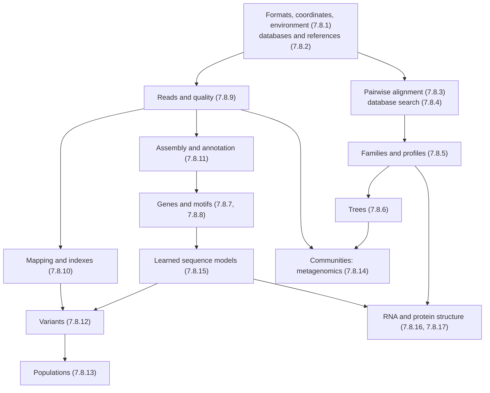

The seventeen chapters of this course have treated biological sequences from the files in which they are stored to the structures into which they fold. This chapter collects what they built. It adds no new methods: it lays the methods side by side, points out the few mathematical structures that return under different names, indexes the problems with their algorithms and tools, gathers the numbers that an estimate needs, follows the running examples of the course through all the chapters at once, and ends with the questions that the field has not answered. Every number is taken from the chapter that computes it, and the references (Algorithm 3.5.1, Theorem 10.2.1, Example 13.6.1) lead back to the derivations. The course was organized around the distinction drawn in [7.8.1](/7.8.1): a model states how the data arise and defines what is optimal, and an algorithm finds the optimum; most of what follows is a catalog of such pairs. The statistics behind the models are in [biostatistics](/7.7), and the networks and omics that begin where the linear structures end are in [systems biology](/7.9).

## 18.1. The Shape of the Course

### 18.1.1. Two Pipelines

The chapters follow two pipelines that share their tools. The first starts from reads: sequencing data are checked and cleaned (7.8.9), placed on a **reference genome** by **read mapping** (7.8.10) or assembled into a new genome ([7.8.11](/7.8.11)), turned into variants (7.8.12), and analyzed across many people (7.8.13) or many organisms in one sample (7.8.14). The second starts from sequences: they are found in databases (7.8.2), compared by **sequence alignment** (7.8.3) and database search (7.8.4), organized into families and profiles (7.8.5) and trees (7.8.6), annotated with genes and regulatory sites (7.8.7–7.8.8), and finally read by learned models (7.8.15) and folded into RNA and protein structures (7.8.16–7.8.17). Files, coordinates and the computing environment (7.8.1) underlie both.

The scope was fixed in [7.8.1](/7.8.1#sec-1.2): linear structures and the semi-linear structures built on them (annotations, alignments, nested pairings, trees, sequence graphs and profiles). What these share is that the important relations lie along a sequence or are determined by a few sequences, so that algorithms can sweep along it. The same property recurs in every section below: it is why **dynamic programming** works on alignments and RNA folds but not on general networks, why indexes of strings answer queries in time independent of the genome size, and why the hidden states of a sequence model can be summed out position by position.

### 18.1.2. The Questions and Their Methods

| Question | Object | Model | Algorithm | Chapters |
|---|---|---|---|---|
| Are two sequences related? | pairwise alignment | substitution scores and gaps | Needleman–Wunsch, Smith–Waterman, Gotoh | 7.8.3 |
| What in a database is related to this? | local alignments | extreme-value statistics | seeds, X-drop extension | 7.8.4 |
| What does a family look like? | MSA, profile | profile HMM | progressive alignment, Viterbi, forward | 7.8.5 |
| How are they related by descent? | tree | substitution model | neighbor joining, pruning, tree search | 7.8.6 |
| Where are the genes and sites? | annotated sequence | Markov models, HMMs, PWMs | Viterbi, EM, convolution of scores | 7.8.7, 7.8.8 |
| What was sequenced, how well? | reads | Phred errors, Poisson coverage | trimming, k-mer counting | 7.8.9 |
| Where does each read come from? | alignment to a reference | errors and repeats | FM-index, minimizers, chaining | 7.8.10 |
| What does this genome carry? | variants | genotype likelihoods | Bayesian genotyping, haplotype calling | 7.8.12 |
| How do genomes differ in a population? | genotype matrix | Hardy–Weinberg, admixture, Li–Stephens | PCA, EM, forward–backward | 7.8.13 |
| Who is in this sample? | reads of a mixture | error model of amplicons, taxonomy | denoising, LCA classification | 7.8.14 |
| What does a sequence do? | sequence-to-function map | neural network | gradient descent, attribution | 7.8.15 |
| How does it fold? | pairing, coordinates | nearest-neighbor energies, learned potentials | Zuker, SCFGs, AlphaFold | 7.8.16, 7.8.17 |

## 18.2. Mathematical Structures That Recur

A handful of mathematical ideas carry most of the course. The table lists them; the subsections show how each reappears.

| Structure | Core idea | Appears in |
|---|---|---|
| Dynamic programming | an optimum over exponentially many objects from optima of nested subproblems | 3, 5, 6, 7, 10, 13, 16 |
| Log-odds scores | a score is the logarithm of a likelihood ratio between a model and a background | 3, 4, 5, 7, 8, 10, 12, 15 |
| Hidden Markov models and grammars | hidden states summed out or maximized position by position | 5, 7, 12, 13, 16 |
| Latent variables, EM and sampling | unobserved labels estimated together with parameters | 6, 8, 13, 14, 16 |
| Indexes and seeds | exact short matches found in time independent of the database size | 1, 2, 4, 10, 14, 17 |
| Graphs and trees | relations between sequences or between their parts | 2, 5, 6, 11, 14 |
| Significance in large searches | the evidence needed grows as the logarithm of the search space | 3, 4, 8, 10, 12, 13, 14 |
| Learned models and their evaluation | flexible predictors judged on data they have not seen | 7, 12, 15, 16, 17 |

### 18.2.1. Dynamic Programming

Dynamic programming solves an optimization over exponentially many candidates (the Delannoy-many alignments of Formula 3.5.1, the parses of a gene, the secondary structures of an RNA) when the score is a sum of local terms and the candidates decompose into nested subproblems that can be ordered so that each is solved before it is needed. The principle, introduced with the **longest common subsequence** in [4.3.1](/4.3.1), appears in the course in five dependency patterns.

| Pattern | Subproblem | Instances | Cost |
|---|---|---|---|
| Two-dimensional grid | best alignment of two prefixes | **Needleman–Wunsch algorithm** (Algorithm 3.5.1, Theorem 3.5.1), **Smith–Waterman algorithm** (Algorithm 3.5.2), **Gotoh's algorithm** (Algorithm 3.5.3), banded extension in BWA-MEM (Algorithm 10.3.1) | $O(mn)$; $O(m + n)$ space by **Hirschberg's algorithm** (Theorem 3.6.1) |
| Trellis of states | best or total probability of a prefix ending in a state | Viterbi for profile HMMs (Algorithm 5.5.1), CpG islands (Definition 7.2.1), GHMM parses (Algorithm 7.4.1), Li–Stephens imputation (Formula 13.4.1), pair HMMs in variant calling (Algorithm 12.2.1) | $O(LK^2)$; $O(Kn)$ for profile HMMs; $O(mK)$ for Li–Stephens; $O(LDK^2)$ with durations |
| Tree in post-order | partial score of a subtree given the state at its root | Fitch (Algorithm 6.4.1), Sankoff, **Felsenstein's pruning algorithm** (Algorithm 6.5.1) | $O(n)$ and $O(ns^2)$ per site |
| Intervals | best structure of a subsequence | **Zuker algorithm** (Algorithm 16.2.1, Theorem 16.2.1), partition function and stochastic traceback (Algorithm 16.2.2), CYK and inside for SCFGs (Definition 16.4.1) | $O(n^3)$ time, $O(n^2)$ memory |
| One-dimensional order | best chain ending at an anchor | colinear chaining (Algorithm 10.3.2), exact PWM score distribution (Algorithm 8.3.1) | $O(hN)$; $O(L \cdot 4 \cdot c\Delta)$ |

![Five dependency patterns of the dynamic programs of the course. In each panel the filled entry is computed from the entries its arrows come from, all computed earlier (shaded). A: pairwise alignment, a cell from three neighbors (Needleman–Wunsch, Smith–Waterman, Gotoh). B: a hidden Markov model, a state at position i from all states at i − 1 (Viterbi and forward, profile HMMs, Li–Stephens). C: a tree, a vertex from its two children in post-order (Felsenstein pruning, Fitch). D: nested pairs, an interval from the interval inside it and from its splits (Zuker, CYK, inside). E: chaining, the best chain ending at an anchor from compatible earlier anchors (minimap2)](./plots/dp-patterns.py)

Three features recur. The same table can be filled with $\max$ and $+$ (the best object), with $+$ and $\times$ (the total probability, as in the **forward algorithm**, the partition function of Algorithm 16.2.2 and the likelihood of Algorithm 6.5.1), or with counts: a pair HMM's Viterbi recursion is Gotoh's algorithm and its forward recursion sums over alignments (7.8.5), and CYK is the Zuker recursion with log probabilities (7.8.16). Traceback recovers the optimum, and stochastic traceback samples from the ensemble (Algorithm 16.2.2). And dynamic programming fails exactly where the decomposition fails: the SP score of many sequences needs a $k$-dimensional lattice and is NP-hard (Theorem 5.1.1), crossing pairs make RNA folding with general pseudoknots NP-hard (Definition 16.1.1), and a tree topology does not decompose into subtrees that can be optimized separately, so tree space must be searched (7.8.6). In each case the field replaced the exact optimum by a heuristic that keeps a dynamic program inside it: progressive alignment along a guide tree (Algorithm 5.3.1), restricted pseudoknot classes, and NNI or SPR moves scored by pruning.

### 18.2.2. Log-Odds Scores and Likelihood Ratios

Almost every score of the course is a **log-odds score**: the logarithm of the probability of the data under a model of the signal divided by its probability under a background ([7.6.41](/7.6.41#def-41.2.1)). This is why scores add over positions, why a score of zero means "no evidence either way", and why the expected score of real sites is a relative entropy (Theorem 8.2.1).

| Score | Signal model | Background | Where |
|---|---|---|---|
| Substitution score $s(a, b) = \lambda^{-1}\ln[p_{ab}/(q_aq_b)]$ | aligned homologous pairs | independent residues | Definition 3.3.1, Definition 3.3.2, Definition 3.3.3 |
| PSSM and PWM $\log_2[p_j(a)/q_a]$ | columns of a family or a motif | background composition | Definition 5.4.1, Formula 8.2.1 |
| CpG island score | first-order Markov chain inside islands | outside islands | Example 7.2.1, Eq. (7.1) |
| Coding score | three-periodic Markov model | homogeneous noncoding model | Definition 7.3.2, Example 7.3.3 |
| Convolutional filter | a weight matrix learned from labels | implicit | Theorem 15.1.1 |
| Masked-marginal score | language model at a masked position | the wild-type residue | Formula 15.5.1 |
| Genotype posterior, GQ, QUAL | genotype likelihoods | prior from heterozygosity | Definition 12.2.1, Formula 12.2.1 |
| Mapping quality | the reported position | all candidate positions | Definition 10.4.1, Formula 10.4.1 |
| ACMG/AMP points | pathogenic | benign, with a prior | Formula 12.8.1 |

Two consequences run through the chapters. Every log-odds matrix implies target frequencies, so the choice of a matrix is the choice of the evolutionary distance one expects to see (BLOSUM62 at $0.58$ bits per pair against PAM250, [7.8.3](/7.8.3#sec-3.3.4)); and a score is only as meaningful as its background, which is why composition-based statistics (7.8.4), low-complexity masking (Definition 4.5.1), dinucleotide-preserving shuffles for motif discovery (7.8.8) and the human background of the CTCF scan (Example 8.3.1) matter as much as the signal model. The Phred scale is the same idea applied to error probabilities: base qualities (**Phred quality score**, 7.8.9), MAPQ, GQ and QUAL are all $-10\log_{10}$ of a probability of being wrong, so ten units are a factor of ten.

### 18.2.3. Hidden Markov Models and Grammars

A **hidden Markov model** describes a sequence whose statistics change according to an unobserved state that follows a **Markov chain**; its theory, with the **Viterbi algorithm**, the forward algorithm and the **Baum–Welch algorithm**, is in [4.6.8](/4.6.8). The course used it six times, each time with a different meaning for the hidden state.

| Model | Hidden state | Emission | Where |
|---|---|---|---|
| CpG island HMM | island or background | bases with first-order dependence | Definition 7.2.1, Example 7.2.2 |
| Splice-site HMM | exon, splice site, intron | bases | Example 7.2.3 |
| Generalized HMM | exon, intron, intergenic segment with explicit duration | whole segments | Definition 7.4.1, Algorithm 7.4.1 |
| Pair HMM | match, insertion, deletion | aligned pairs of residues | 7.8.5, Algorithm 12.2.1 |
| **Profile hidden Markov model** | match, insert, delete state of each column | residues of a family | Definition 5.5.1, Algorithm 5.5.1 |
| Li–Stephens model | the reference haplotype being copied | alleles with mutation | Formula 13.4.1 |

The step from a hidden Markov model, a stochastic regular grammar, to a **stochastic context-free grammar** buys nested pairing at a cost of $O(n^3)$ instead of $O(n)$ per sequence; a **covariance model** is to an RNA family what a profile HMM is to a protein family (Definition 16.4.2). Two lessons recur. Viterbi and posterior decoding answer different questions, and they can disagree: the splice-site posterior of $0.46$ in Example 7.2.3 and the GC-rich false islands of Example 7.2.2 are both reminders that the most probable path is not certain. And a first-order model sees only adjacent bases: CpG islands that are merely GC-rich, coding regions that need fifth-order context (AUC $0.68 \to 0.95$, Example 7.3.3), and the limits of position-independent motifs are what the learned models of 7.8.15 address.

### 18.2.4. Latent Variables: EM and Sampling

Several problems are easy if an unobserved label is known and hard otherwise: the position of a motif site in each sequence, the ancestral population of each allele, the hidden states of an HMM, the structure of an RNA in a training set, the origin of a read classified at a higher rank. The **EM algorithm** alternates between computing the expected labels under the current parameters and re-estimating the parameters from them; it never decreases the likelihood and converges to a local maximum that depends on the start.

| Problem | Latent variable | Method | Where |
|---|---|---|---|
| Motif discovery | site positions (OOPS, ZOOPS, TCM) | EM in MEME; Gibbs sampling | Algorithm 8.4.1, Example 8.4.2, Algorithm 8.4.2 |
| Ancestry proportions | ancestral population of each allele copy | EM, block relaxation in ADMIXTURE | Definition 13.3.2, Algorithm 13.3.1 |
| HMM training | state paths | Baum–Welch | [4.6.8](/4.6.8), 7.8.7 |
| SCFG training | parse trees | inside–outside | Definition 16.4.1 |
| Abundance of species | species of reads assigned to a genus | Bayesian redistribution | Formula 14.3.1, Example 14.3.2 |
| Tree inference | trees and parameters | **Markov chain Monte Carlo** | [7.8.6](/7.8.6#sec-6.6.2) |

The local optima are not a technicality. EM for motifs found all $25$ planted sites in Example 8.4.2 but also converged to shifted versions of the motif from other starts; ADMIXTURE always returns $K$ components whether or not $K$ populations exist (7.8.13). The remedies are the same in every chapter: many starts, comparison of likelihoods, and checks on data where the answer is known.

### 18.2.5. Indexes and Seeds

Exhaustive comparison is impossible at the scale of the data (18.4), and the course met one answer to that problem repeatedly: find short exact matches in an index, and do expensive work only around them. The pigeonhole bound (Theorem 10.1.1) guarantees that a read with $k$ edits contains an exact match of length $\lfloor L/(k+1)\rfloor$, and the chance occurrences of an $s$-mer, $2G/4^s$ (Formula 10.1.1), say how long a seed must be to be informative.

| Index | What it stores | Query | Where |
|---|---|---|---|
| Byte offsets and bins | position of each record or block | region lookup | Formula 1.4.1, Algorithm 1.4.1 |
| Chain files | aligned blocks between assemblies | binary search | Definition 2.2.2, Algorithm 2.2.1 |
| Lookup tables of words | positions of each $W$-mer or neighborhood word | seed hits | Definition 4.3.2, Algorithm 4.3.1, spaced seeds (Definition 4.6.1) |
| Hash tables of $k$-mers | positions or taxa of each $k$-mer | constant time per $k$-mer | 7.8.10, Algorithm 14.3.1 |
| **Suffix array** | sorted suffixes, $\lceil\log_2 n\rceil$ bits per base ($32$ for one human strand) | binary search, $O(m\log n)$ | 7.8.10 |
| **FM-index** | **Burrows–Wheeler transform**, counts, sampled suffix array | backward search, $O(m)$ | Definition 10.2.1, Theorem 10.2.1, Definition 10.2.2, Algorithm 10.2.1, Theorem 10.2.2 |
| **Minimizers** | a sample of $2/(w + 1)$ of the $k$-mers | anchors for chaining | Definition 10.3.1, Formula 10.3.1 |
| Structure alphabets | a string over 3Di states | sequence search on structures | 7.8.17 |

Every index is a trade between memory and time and between sensitivity and speed. The neighborhood threshold $T$ of BLAST moves sensitivity and chance hits together (Example 4.3.1); spaced seeds raise sensitivity at an equal chance rate (Example 4.6.1); a human FM-index fits in about $4\,\mathrm{GB}$ for both strands (Example 10.2.2) where a suffix array needs about $31\,\mathrm{GB}$. Foldseek shows how general the idea is: once structures are written as strings, the whole machinery of sequence search applies to them.

![The work an exhaustive method would do against the work of the method used, for problems of the course at realistic sizes (operation counts on a log scale, from the formulas of the chapters). Exact multiple alignment of 15 sequences of 800 residues, 2^k k² n^k, against progressive alignment, k n² (7.8.5); all 7.9 × 10¹² unrooted trees of 15 taxa against neighbor joining, n³ (7.8.6); counting a 20-mer by scanning both strands of the human genome against 20 steps of backward search (7.8.10); Smith–Waterman of every read of a 30× genome against the genome, 2.9 × 10²⁰ cells, against the factor of about 10⁵ that a seeded aligner must save to finish in hours (7.8.10); a naive forward pass for 10⁶ SNPs and 10⁴ reference haplotypes, m K², against the Li–Stephens recursion, m K (7.8.13); RNA folding of 76 nucleotides with interior loops of any size, n⁴, against loops capped at 30, n³ (7.8.16). The dashed line is one hour at 10¹¹ operations per second](./plots/exhaustive.py)

### 18.2.6. Graphs and Trees

Graphs appeared in the course as the frame of a computation rather than as the object studied (general networks are in [1.4.7](/1.4.7) and [7.9](/7.9)). The edit graph turns an alignment into a path (Formula 3.5.1). The **Gene Ontology** is a directed acyclic graph whose true-path rule propagates annotations upward (Definition 2.5.1, Definition 2.5.2, Formula 2.5.1). A **guide tree** fixes the order of progressive alignment (Definition 5.3.2), and a taxonomy fixes the **lowest common ancestor** to which a shared $k$-mer is assigned (Definition 14.3.1). The **phylogenetic tree** is the object of 7.8.6, whose number grows as $(2n - 5)!!$ (Theorem 6.1.1), whose additive distances are characterized by the four-point condition (Theorem 6.3.1), and whose vertices separate duplications from speciations (Definition 6.1.5). Assembly graphs, in which a genome is a walk that uses the overlaps between reads (the de Bruijn graph of a short sequence was drawn in [7.8.1](/7.8.1#sec-1.2)), and the **pangenome** graphs of [7.8.10](/7.8.10#sec-10.3.4), which encode the alternative paths through a population's genomes, belong to [7.8.11](/7.8.11).

### 18.2.7. Significance in Large Searches

A score means nothing until it is compared with what chance produces in a search of the same size. Four routes to that comparison appeared in the course: shuffling (Formula 3.7.1, Example 3.7.1), an extreme-value theory (the Erdős–Rényi law, Theorem 4.4.1, and the **Gumbel distribution** of local scores, Definition 4.4.1, Eq. (4.1), the basis of the **Karlin–Altschul statistics**), exact computation of a null distribution (the PWM scores of Algorithm 8.3.1, the Hardy–Weinberg test of Formula 13.2.3, the hypergeometric enrichment of Example 8.4.1, the abundance p-value of Algorithm 14.2.1), and resampling (**bootstrap** support, Definition 6.6.1; PERMANOVA, Formula 14.4.2). All of them meet one rule: a search over $N$ candidates expects $N2^{-b}$ chance matches at $b$ bits per candidate, so a significant match must carry about $\log_2 N$ bits, plus $\log_2(1/E)$ for a smaller expected number $E$ of false hits. The **bit score** and the **E-value** of BLAST (Definition 4.4.2, Definition 4.4.3) state this rule directly.

![How much evidence a match must carry to stand out in a large search. A search over N candidates expects N·2^(−b) chance matches at b bits each, so a match needs about log₂ N bits to be expected once by chance (solid line) and log₂ N + 6.6 bits for E = 0.01 (dashed). Points are cases of the course: BLAST queries of 300 residues against Swiss-Prot (42.5 bits, Example 4.4.3) and of 821 residues against 10¹¹ residues (52.9 bits); exact 16- and 20-mer seeds in both strands of the human genome (32 and 40 bits; 1.4 and 0.006 chance hits, Formula 10.1.1); a 20-nt CRISPR guide with an NGG PAM (44 bits), losing log₂ of the size of its mismatch neighborhood with each allowed mismatch (0.00035, 0.62 and 11 chance sites at 0, 2 and 3 mismatches, Example 10.6.1); the CTCF weight matrix at p = 10⁻⁶ per window (19.9 bits, 6200 chance sites, Example 8.3.1); and the genome-wide significance threshold 5 × 10⁻⁸ of association studies, which corresponds to 0.05 over about 10⁶ independent tests](./plots/search-bits.py)

The figure explains several results of the course at once. A 16-mer is the shortest exact seed that is usually unique in the human genome, which is why mappers use seeds of about that length or longer (Example 10.1.1). A 20-nt guide is unique when it must match exactly, but its neighborhood of $32\,551$ sequences within three mismatches removes $15$ bits and leaves about $11$ chance sites (Example 10.6.1). A transcription-factor motif carries far less information than a genome search needs, so even a stringent threshold leaves thousands of matches (Example 8.3.1): binding sites are found among decoys only with help from chromatin, cooperativity and conservation, as the selection theory of [7.6.41](/7.6.41#sec-41.3) predicts. For tests of many hypotheses at once, the same logic gives the Bonferroni threshold and, when one wants to control the fraction of false discoveries rather than their number, the **false discovery rate** ([7.7.20](/7.7.20)), as used for motif scans across many sequences (7.8.8).

### 18.2.8. Learned Models and Their Evaluation

The course moved from models with few explicit assumptions (a PWM, a first-order Markov chain) to models learned from large data: naive Bayes classifiers of 16S sequences (Formula 14.2.1), convolutional networks that rediscover a weight matrix (Theorem 15.1.1, Example 15.2.1), DeepVariant's pileup classifier (7.8.12), protein and genomic **language models** (Definition 15.4.1, Definition 15.4.2), and **AlphaFold** (7.8.17). The convolutional filter is a weight matrix and max pooling finds the best site (Theorem 15.1.1), so the learned models contain the classical ones; what they add is the combination of motifs, long-range context (Formula 15.2.1) and the conservation implicit in millions of sequences.

The evaluation of predictions recurred in every chapter that made them, under different names that measure the same few quantities.

| Quantity | Names in the course | Where |
|---|---|---|
| Fraction of true items found | sensitivity, recall, coverage of islands | Definition 7.5.1, 7.8.12, Example 7.2.2 |
| Fraction of predictions that are true | "specificity" in gene prediction, precision | Definition 7.5.1, Definition 12.5.1 |
| Ranking quality | AUROC, average precision | Example 7.3.3, Example 15.6.2 |
| Agreement with a reference structure | SP and TC accuracy, $Q_3$, RMSD, TM-score, lDDT | Definition 5.3.3, Definition 17.3.1, Definition 17.3.2, Definition 17.4.1 |
| Internal consistency without a truth set | Ti/Tv, het/hom ratio, Mendelian violations | Definition 12.5.2, Definition 12.5.3 |

Two traps are general. Related sequences in the training and test sets make any method look good: a random split gave $100\,\%$ accuracy on a label that could not be predicted at all (Example 15.6.1), and clustering by **sequence identity** before splitting is the cure. And a measure that ignores prevalence hides failure: at $1\,\%$ positives the AUROC stayed $0.988$ while the average precision fell to $0.78$ (Example 15.6.2). The same applies to the benchmarks of variant calling, which cover only the confident regions (Definition 12.5.1), and to the confidence measures of predicted structures, which say how well a model fits the patterns it learned, not whether the protein adopts that conformation (Example 17.4.1).

## 18.3. An Index of Methods

The tables list the main problems of the course with the classical algorithm, the tools in current use and where they are developed. They are an index, not a substitute for the chapters, which give the assumptions and the failure modes.

Sequences, families and trees (7.8.2–7.8.8):

| Problem | Classical algorithm or model | Current tools | Where |
|---|---|---|---|
| Convert coordinates between assemblies | chain files, binary search | liftOver, CrossMap | Definition 2.2.2, Algorithm 2.2.1 |
| Global and local alignment | Needleman–Wunsch, Smith–Waterman, affine gaps | EMBOSS, parasail, Biopython | Algorithm 3.5.1, Algorithm 3.5.2, Algorithm 3.5.3 |
| Substitution scores | PAM as powers of a Markov matrix, BLOSUM from blocks | BLOSUM62 | Algorithm 3.3.1, Algorithm 3.3.2 |
| Database search | FASTA, BLAST, Karlin–Altschul E-values | BLAST+, DIAMOND, MMseqs2 | Algorithm 4.2.1, Algorithm 4.3.1, Definition 4.4.3 |
| Sequence clustering | greedy incremental clustering | CD-HIT, Linclust | Definition 4.7.1, Algorithm 4.7.1 |
| Multiple alignment | center star, progressive alignment | MAFFT, Clustal Omega, FAMSA | Algorithm 5.2.1, Algorithm 5.3.1 |
| Profiles and remote homology | PSSMs, PSI-BLAST, profile HMMs | HMMER, Pfam, HHblits | Definition 5.4.1, Algorithm 5.4.1, Definition 5.5.1 |
| Trees from distances | UPGMA, neighbor joining | FastME, PHYLIP | Algorithm 6.3.1, Algorithm 6.3.2 |
| Trees from characters | Fitch, Sankoff, pruning, Bayesian MCMC | IQ-TREE, RAxML-NG, MrBayes, UShER | Algorithm 6.4.1, Algorithm 6.5.1, Definition 6.6.1 |
| Segmenting a genome | Markov chains, two-state HMM | | Definition 7.1.2, Definition 7.2.1 |
| Gene prediction | periodic Markov models, GHMMs | Prodigal, AUGUSTUS, BRAKER | Definition 7.3.2, Definition 7.4.1, Algorithm 7.4.1 |
| Scanning for a motif | PWM with exact p-values | FIMO, HOMER | Formula 8.2.1, Algorithm 8.3.1 |
| De novo motifs | EM, Gibbs sampling, word enrichment | MEME, STREME, HOMER | Algorithm 8.4.1, Algorithm 8.4.2 |
| Conservation | phylo-HMMs, per-base tests | phastCons, phyloP, GERP | Definition 8.6.2 |

Reads, genomes and populations (7.8.9–7.8.14):

| Problem | Classical algorithm or model | Current tools | Where |
|---|---|---|---|
| Quality trimming | running-sum trimming | fastp, Trimmomatic | Algorithm 9.4.1 |
| UMIs and duplicates | directional clustering; complexity curve | UMI-tools, Picard, samtools markdup | Algorithm 9.3.1, Formula 9.4.1 |
| Genome size from reads | diploid $k$-mer model | Jellyfish, GenomeScope | Formula 9.5.2 |
| Exact matching in a genome | suffix array, BWT, backward search | BWA, Bowtie2 | Algorithm 10.2.1 |
| Short-read mapping | SMEMs, chaining, banded extension | BWA-MEM, Bowtie2 | Algorithm 10.3.1 |
| Long-read and spliced mapping | minimizers, colinear chaining | minimap2, STAR, HISAT2 | Algorithm 10.3.2, Definition 10.3.2 |
| Mapping confidence | posterior over candidate positions | MAPQ | Formula 10.4.1 |
| Off-target sites | exhaustive search within $d$ mismatches | Cas-OFFinder | Formula 10.6.1 |
| Genotyping | genotype likelihoods, Bayesian posterior | bcftools, GATK HaplotypeCaller, DeepVariant | Definition 12.2.1, Formula 12.2.1, Algorithm 12.2.1 |
| Copy number | binary segmentation of depth | CBS, CNVkit | Algorithm 12.6.1 |
| Variant classification | Bayesian point system | ACMG/AMP criteria, VEP | Formula 12.8.1 |
| Sample QC and relatives | inbreeding $\hat F$, KING-robust kinship | PLINK, KING | Formula 13.2.1, Formula 13.2.2 |
| Population structure | PCA of standardized genotypes, admixture by EM | PLINK 2, FlashPCA, ADMIXTURE | Definition 13.3.1, Algorithm 13.3.1 |
| Phasing and imputation | Li–Stephens HMM | SHAPEIT, Beagle, Minimac | Formula 13.4.1, Formula 13.4.2 |
| Association at scale | residualized scans, mixed models, clumping | plink2, REGENIE, BOLT-LMM | Formula 13.5.1, Algorithm 13.5.1 |
| Selection scans | $F_{\mathrm{ST}}$, EHH, iHS | selscan | Formula 13.6.1, Formula 13.6.2 |
| Amplicon denoising | error model and abundance p-value | DADA2, QIIME 2 | Algorithm 14.2.1 |
| Read classification | $k$-mers labeled by LCA | Kraken 2, Bracken, MetaPhlAn | Algorithm 14.3.1, Formula 14.3.1 |
| Genomes from mixtures | binning by composition and coverage | MetaBAT, CheckM | Definition 14.3.2, Formula 14.3.3 |
| Lineages in wastewater | constrained least squares on barcodes | Freyja | Formula 14.6.1 |

Learned models and structures (7.8.15–7.8.17):

| Problem | Classical algorithm or model | Current tools | Where |
|---|---|---|---|
| Regulatory activity from sequence | convolutional networks, dilations, attention | DeepSEA, Basenji, Enformer, Borzoi | Algorithm 15.2.1, Formula 15.2.1 |
| Interpretation | saturation mutagenesis, attributions | TF-MoDISco | Definition 15.3.1 |
| Variant effects | masked-marginal log odds | ESM, EVE, AlphaMissense | Formula 15.5.1 |
| Editing outcomes | microhomology patterns | inDelphi, FORECasT | Algorithm 15.7.1 |
| RNA secondary structure | Zuker, partition function, SHAPE pseudo-energies | ViennaRNA, RNAstructure | Algorithm 16.2.1, Algorithm 16.2.2, Formula 16.3.1 |
| RNA families | covariance models | Infernal, Rfam | Definition 16.4.2 |
| Comparative structure | compensatory mutations, covariation | RNAalifold, R-scape | Definition 16.5.1 |
| miRNA targets | seed site types, accessibility | TargetScan | Definition 16.6.1, Formula 16.6.1 |
| Structure comparison | Kabsch superposition, TM-score | TM-align, DALI, Foldseek | Theorem 17.3.1, Definition 17.3.2 |
| Structure prediction | MSA and pair representations | AlphaFold, ColabFold, ESMFold | Definition 17.4.1, Definition 17.4.2 |
| Function | GO transfer with evidence codes | InterProScan | Definition 17.6.1 |

## 18.4. Numbers to Remember

Order-of-magnitude reasoning decides which method is feasible before any code is written. The values below are those used in the chapters.

| Quantity | Value | Where |
|---|---|---|
| Human genome | $3.1\times10^9$ bp haploid; $6.2\times10^9$ symbols on both strands | [7.8.10](/7.8.10#sec-10.1.1) |
| Other genomes | SARS-CoV-2 $29\,903$ nt; *E. coli* K-12 $4\,641\,652$ bp | Example 2.1.1, Example 7.1.1 |
| A $30\times$ genome | $6.2\times10^8$ reads of $150$ nt; Smith–Waterman of all of them would take about $90$ years | [7.8.10](/7.8.10#sec-10.1.1) |
| Sequencing cost | $10^8$ dollars in 2001, about $10^3$ in 2015, a few hundred in the 2020s; halving every $1.2$ years | Formula 1.1.1 |
| Read errors | Illumina substitutions rising along the read; HiFi about Q30; nanopore about Q20 per read | [7.8.9](/7.8.9#sec-9.1.2) |
| Phred scale | Q20 = $1\,\%$, Q30 = $0.1\,\%$, Q40 = $0.01\,\%$ error | Formula 9.2.1 |
| Indexes | FM-index of both human strands about $4\,\mathrm{GB}$; suffix array $32$ bits per base for one strand, more than $32$ for both | Example 10.2.2 |
| Unique seeds | a $16$-mer has $1.4$ chance occurrences in the human genome, a $20$-mer $0.0056$ | Example 10.1.1 |
| Protein databases | UniProtKB $2.5\times10^8$ sequences, about $10^{11}$ residues; Swiss-Prot $5.7\times10^5$ | [7.8.4](/7.8.4#sec-4.1), Example 4.4.4 |
| BLAST significance | $40$–$50$ bits in a large database; BLOSUM62 carries $0.58$ bits per column | Example 4.4.3 |
| Twilight zone | $20$–$35\,\%$ identity, below which pairwise alignment fails to detect homology | [7.8.3](/7.8.3#sec-3.1.2) |
| Structures | PDB about $2.3\times10^5$ entries; AlphaFold DB over $2\times10^8$ models; about $10^3$ folds | [7.8.2](/7.8.2#sec-2.3), [7.8.17](/7.8.17#sec-17.2) |
| Trees | $(2n - 5)!!$ unrooted trees: $7.9\times10^{12}$ for $15$ taxa | Theorem 6.1.1 |
| Variants per genome | $4$–$5\times10^6$: about $3.5\times10^6$ SNVs, $5$–$6\times10^5$ indels, $2$–$3\times10^4$ SVs | [7.8.12](/7.8.12#sec-12.1) |
| New mutations | about $74$ SNVs per child genome-wide, $0.8$ in the exome | Example 12.9.1 |
| Quality checks | Ti/Tv $2.0$–$2.1$ genome, $3.0$ exome, $0.5$ random | Definition 12.5.2 |
| Biobanks | $5\times10^5$ people, $10^7$ imputed variants: $5\times10^{12}$ genotypes | [7.8.13](/7.8.13#sec-13.1.2) |
| Human gene structure | internal exons median $126$ bp, introns median $1.9$ kb, GT–AG $99\,\%$ | Example 7.4.1 |
| CpG depletion | observed/expected CpG $0.28$ on human chromosome 21, $1.16$ in *E. coli* | Example 7.1.2 |
| Motif information | CTCF $17.2$ bits; splice donor $8.2$ bits, acceptor $9.3$ bits | Example 8.2.2, Example 8.7.1 |
| RNA folding | $O(n^3)$; a tRNA's best structure holds $12\,\%$ of the ensemble | Theorem 16.2.1, Example 16.2.2 |
| Same fold | TM-score above $0.5$; unrelated chains about $0.2$ at any length | Definition 17.3.2, Example 17.3.2 |

![Orders of magnitude of the course, with the chapter (7.8.n) where each value is used. A: lengths of the objects analyzed, from a tRNA of 76 nucleotides and a 150-nt read to the human genome on both strands, 6.2 × 10⁹; eight orders of magnitude separate the shortest from the longest, and most algorithms of the course are designed for one end of that range. B: counts, from the 74 new mutations of one child and the 4.5 × 10⁶ variants of one genome to the 10¹¹ residues of the largest protein databases, the 5 × 10¹² genotypes of a biobank and the 9 × 10¹⁶ bytes of raw data in the Sequence Read Archive](./plots/scale-map.py)

## 18.5. Four Examples Retraced

The course followed a few examples from chapter to chapter ([7.8.1](/7.8.1)). Read together, each is a complete analysis.

### 18.5.1. rs4988235: One Variant Through the Whole Course

The lactase persistence variant $-13910\mathrm{C{>}T}$, whose history under selection was told in [7.4.23](/7.4.23), lies at one-based position $135\,851\,076$ of chromosome 2 in GRCh38, written in five notations in Example 1.4.2; in a FASTA file its base is found by arithmetic on line lengths (Example 1.4.1) and in an indexed file by examining one bin per level (Example 1.4.3). The **liftover** to GRCh37 adds $757\,570$ to give $136\,608\,646$ (Example 2.2.1), and the databases give its derived-allele frequencies, $0.52$ in Europeans and $0.00$ in East Asians (Example 2.4.1). The gene that contains it, *MCM6*, encodes a helicase subunit whose yeast ortholog is $42.5\,\%$ identical over the aligned columns (Example 3.1.1), with a score $81$ standard deviations above shuffles (Example 3.7.1) and an E-value of about $10^{-189}$ against Swiss-Prot (Example 4.4.2); a profile of the MCM6 orthologs scores the paralogs MCM2–7 $40$–$50\,\%$ higher than the human query alone (Example 5.5.1), and their gene tree resolves the orthologs with full support but the order of the ancient duplications only weakly (Example 6.6.1). Around the locus, the CpG island HMM finds the promoter islands of *UBXN4* and *MCM6* and none at *LCT*, a tissue-specific gene regulated by a distant enhancer (Example 7.2.2). A weight-matrix scan of that enhancer shows that the derived T raises the best Oct-1 score covering the variant by $1.56$ bits, the direction but not the size of the effect (Example 8.3.2). In reads, the site appears as a split coverage bar in a genome browser ([7.8.10](/7.8.10#sec-10.5.3)); in a VCF as a biallelic record (Definition 12.4.1); and in HGVS as `NM_005915.6:c.1917+326C>T`, an intron variant of *MCM6* that acts on *LCT* (Example 12.8.1). Across populations it is an $F_{\mathrm{ST}}$ outlier, $0.52$ between Europeans and East Asians against a genome-wide value near $0.1$ (Example 13.6.1), and it sits on a haplotype that extends over more than a megabase, the signature of a recent sweep that Example 13.6.2 reproduces in simulation. One variant thus touched databases, coordinates, alignment, search, profiles, trees, sequence models, motifs, mapping, variant calling, annotation and population genetics; the methods differ, the coordinate system is shared, and most errors in such an analysis arise at the junctions (Definition 1.4.4).

### 18.5.2. HG002: One Genome from Reads to Variants

The reference sample HG002 of the Genome in a Bottle consortium, with his parents HG003 and HG004, carried the resequencing pipeline. Its reads on every major platform illustrated the error profiles of 7.8.9; quality control trimmed adapters and low-quality ends (Algorithm 9.4.1), and the $k$-mer spectrum of a diploid genome showed how size and heterozygosity are read off before any alignment (Formula 9.5.2, Example 9.5.1). The reads were mapped with BWA-MEM and minimap2 (Algorithm 10.3.1, Algorithm 10.3.2), sorted, indexed and duplicate-marked ([7.8.10](/7.8.10#sec-10.5.2)); genotypes were called with the GATK workflow and DeepVariant ([7.8.12](/7.8.12#sec-12.3)); and the result was judged against the benchmark set of the same sample (Definition 12.5.1), by Ti/Tv (Definition 12.5.2) and, because the parents are sequenced too, by Mendelian consistency (Definition 12.5.3). What this example teaches is that every stage has its own measure of error, base quality, mapping quality and genotype quality, and that the errors compound: a per-genotype error of $10^{-4}$ over the $4$–$5\times10^6$ variant sites of a trio gives of the order of a thousand Mendelian violations against about $60$–$80$ true new mutations. Assembly of the same reads into a diploid genome, the alternative to alignment against a reference, is the subject of [7.8.11](/7.8.11). Placed among the 1000 Genomes samples by projection onto their principal components ([7.8.13](/7.8.13#sec-13.3.1)), one genome joins a population.

### 18.5.3. SARS-CoV-2: A Genome from Discovery to Surveillance

The virus was found by shotgun sequencing of total RNA from a patient's lavage fluid and de novo assembly of the reads, whose longest contig was a new betacoronavirus genome of about $30\,\mathrm{kb}$ ([7.8.14](/7.8.14#sec-14.6.2)). Its record became the reference `NC_045512.2` of $29\,903$ nt, in which the spike gene occupies $21\,563$–$25\,384$ and the D614G substitution is A23403G (Example 2.1.1). Hundreds of thousands of genomes were aligned pairwise to that reference rather than by a classical multiple alignment ([7.8.5](/7.8.5#sec-5.3.3)), and with about two substitutions per genome per month, trees of millions of genomes were built by placement (UShER), dated by the clock (Nextstrain) and cut into named lineages (Pango) ([7.8.6](/7.8.6#sec-6.8.3)). In wastewater, where many lineages are mixed, their proportions were recovered from mutation frequencies by constrained least squares on the lineage barcodes, $(0.583, 0.325, 0.092)$ for a true $(0.6, 0.3, 0.1)$ in Example 14.6.1. Each step reused a method of an earlier chapter (metagenomic assembly, database records, alignment, parsimony, the molecular clock) at a scale and speed for which it had not been designed, and the bottleneck moved from computing to data sharing.

### 18.5.4. NGLY1: From a Genome to a Diagnosis

The diagnosis of NGLY1 deficiency, a congenital disorder of deglycosylation found by exome sequencing in 2012 ([7.8.12](/7.8.12#sec-12.9)), shows the interpretation half of the pipeline. The child was sequenced with his parents; the trio design makes new and compound heterozygous variants visible, because a child carries only about $74$ new single-nucleotide mutations genome-wide and $0.8$ in the exome (Example 12.9.1). He carried two loss-of-function variants in *NGLY1*, one from each parent, in a gene then connected with no disease, so the variants were of uncertain significance until further patients with the same unusual phenotype were found; in the Bayesian reading of the ACMG/AMP rules (Formula 12.8.1, Example 12.8.2), each independent family adds evidence that moves a variant across the class boundaries. The structure of the protein now adds evidence of another kind: the AlphaFold model of NGLY1 is confident in its PUB, catalytic and PAW domains (mean **pLDDT** $85.5$, catalytic triad at $88$–$95$) and not in a segment annotated as disordered (Example 17.4.1), so a missense variant can be placed in a structural context and scored by **variant effect prediction** from language models (Formula 15.5.1), while ClinVar records the interpretations made since ([7.8.2](/7.8.2#sec-2.4)). The limiting resource in rare-disease genomics was not sequencing but the matching of patients, and the reanalysis of stored data as knowledge grows ([7.8.1](/7.8.1#sec-1.6)).

## 18.6. A Short History of Methods

The algorithms of the course came in three waves. The first, from the late 1950s to about 1990, built the comparison of sequences on dynamic programming, substitution matrices and the phylogenetic models of a few sequences at a time, when data were counted in thousands of sequences. The second, around 1990–2003, made search and annotation statistical: BLAST and its E-values, profile HMMs, Gibbs and EM motif finders, gene finders and the first genomes. The third, after 2005, answered the flood of short reads with indexes from computer science (the BWT and FM-index, minimizers) and, from about 2015, with learned models trained on the data themselves, culminating in the prediction of protein structure.

![Methods of bioinformatics, 1958–2024, with the chapters (7.8.n) where they appear. Left: algorithms and models, from UPGMA and the Jukes–Cantor model through dynamic-programming alignment, substitution matrices, BLAST and its statistics, profile HMMs and the Burrows–Wheeler transform to the read mappers, denoisers, fast searchers and deep-learning models of the last decade. Right: data, sequencing technology and resources, from Dayhoff's Atlas and GenBank to the human genome, massively parallel, single-molecule and nanopore sequencing, AlphaFold, the complete telomere-to-telomere genome and the human pangenome reference](./plots/timeline.py)

![The fall in the cost of sequencing and the methods that followed it. A: the cost of sequencing one human genome at 30× (rounded values used in 7.8.1, after the NHGRI cost table), compared with a cost halving every two years; the gap that opened after 2007 is the reason why computation, not sequencing, became the limiting step. B: the years in which methods of the course that answered the new data appeared: BLAT and MAFFT (2002), the Li–Stephens model (2003), BWA, Bowtie and the SAM format (2009), HMMER3 (2011), BWA-MEM (2013), DeepSEA (2015), DADA2 (2016), MMseqs2 (2017), minimap2 (2018), Kraken 2 (2019), AlphaFold2 (2020), UShER (2021) and AlphaFold 3 (2024); each replaces exhaustive computation by an index, a seed, a filter, a model or a learned predictor](./plots/cost-methods.py)

## 18.7. Open Problems

### 18.7.1. The Reference

A single **reference genome** is a coordinate system and a bias at once: reads from haplotypes that differ from it map poorly ([7.8.10](/7.8.10#sec-10.4.2)), and variation in its absent or collapsed regions is invisible. The complete T2T-CHM13 genome and the first human pangenome reference ([7.8.2](/7.8.2#sec-2.2.1)) remove much of the second problem, but replacing a linear reference by a graph raises questions the field has not settled: how to name a variant that exists only on some paths, how to keep coordinates stable across releases, how to fit graph alignment into tools and file formats built on linear positions (Definition 1.4.4, Definition 12.8.1), and how large and diverse a pangenome must be to serve populations that are poorly represented in current panels.

### 18.7.2. Reading More Than the Sequence

Long single-molecule reads already span repeats and segmental duplications and read base modifications directly ([7.8.9](/7.8.9#sec-9.1.2)). The open problems are of accuracy and interpretation: base calling of modified bases and of difficult sequence contexts, phasing of whole chromosomes, and the integration of methylation, structural variation and sequence into one representation of an individual genome. As error rates fall, the limiting factor becomes the analysis, which was designed around short reads.

### 18.7.3. Variants of Uncertain Significance

Most rare missense and noncoding variants found in a patient cannot be classified: they are of uncertain significance under the ACMG/AMP rules, and computational predictors, which are correlated with each other, may only count as supporting evidence (Formula 12.8.1). The proportion of such variants is higher in people whose ancestry is poorly represented in reference databases ([7.8.12](/7.8.12#sec-12.8.3)). The routes forward are measurement (multiplexed assays of variant effect, **deep mutational scanning**), calibration of predictors against such measurements, larger and more diverse population data, and the matching of patients across clinics; for regulatory variants, such as rs4988235, prediction from sequence remains weak ([7.8.15](/7.8.15#sec-15.5)).

### 18.7.4. What Learned Models Know

Language models and structure predictors are trained on the products of evolution and of past experiments, and their accuracy outside that distribution is the central question. Homology leakage can make a useless model look perfect (Example 15.6.1); models of regulatory DNA predict between-gene differences in expression far better than between-individual differences ([7.8.15](/7.8.15#sec-15.5)); RNA structure predictors lose their advantage on held-out families ([7.8.16](/7.8.16#sec-16.7)); and a structure model gives one conformation of a protein that may have two (Example 17.3.1). Benchmarks that separate training and test data by homology, that measure calibration, and that compare with simple baselines (a weight matrix, a $k$-mer model) are a methodological problem as much as a technical one.

### 18.7.5. Reproducibility

An analysis is a chain of tools, versions, parameters and reference files, and changing any of them changes the result: the genome build (Definition 2.2.1), the annotation release, the database version that sets an E-value (Definition 4.4.3), the random seed of a tree search or of EM. The practices of [7.8.1](/7.8.1#sec-1.6), versioned environments, workflow managers, checksums and the FAIR principles (Definition 1.6.1), make results reproducible in principle; making them so in practice, including for human data under controlled access, is still largely a matter of discipline rather than of infrastructure.

## 18.8. Connections to Other Courses

The methods of this course are inputs to several others. Systems biology ([7.9](/7.9)) begins where read mapping ends: RNA-seq, single-cell, chromatin and spatial assays are mapped, counted and quality-controlled with the tools of 7.8.9–7.8.10, analyzed with motifs and Gene Ontology annotations (7.8.2, 7.8.8), and integrated into networks whose mathematics is in [1.4.7](/1.4.7). Evolutionary biology ([7.10](/7.10)) uses the trees, substitution models and molecular clocks of 7.8.6, with the coalescent explaining why gene trees differ from species trees. Microbiology and ecology ([7.11](/7.11), [7.19](/7.19)) use the 16S analysis, metagenomics and diversity measures of 7.8.14. Immunology ([7.15](/7.15)) applies alignment and phylogenetics to antibody and T-cell receptor sequences. The statistical foundations, multiple testing, count models and prediction, are in [7.7](/7.7), and the algorithms and learning methods in [4.3](/4.3), [4.6](/4.6) and [4.7](/4.7).

## Summary

- The course follows two pipelines, from reads to variants and populations (7.8.9–7.8.14) and from sequences to families, trees, annotations and structures (7.8.2–7.8.8, 7.8.15–7.8.17), on common formats and coordinates (Definition 1.4.4); its scope is linear and semi-linear structure, and the property that relations lie along a sequence is what makes its algorithms possible (18.1).
- Dynamic programming in five patterns: grids (Algorithm 3.5.1, Algorithm 3.5.2, Algorithm 3.5.3), state trellises (Algorithm 5.5.1, Algorithm 7.4.1, Formula 13.4.1), trees (Algorithm 6.4.1, Algorithm 6.5.1), intervals (Algorithm 16.2.1, Theorem 16.2.1) and chains (Algorithm 10.3.2); max-plus for optima, sum-product for probabilities; NP-hardness where the decomposition fails (Theorem 5.1.1) (18.2.1).
- Scores are log-odds against a background: substitution matrices (Definition 3.3.1), PSSMs and PWMs (Definition 5.4.1, Formula 8.2.1, Theorem 8.2.1), convolutional filters (Theorem 15.1.1), masked marginals (Formula 15.5.1), genotype and mapping posteriors (Formula 12.2.1, Formula 10.4.1), ACMG points (Formula 12.8.1); the Phred scale for all error probabilities (18.2.2).
- Hidden Markov models with six meanings of the hidden state (Definition 7.2.1, Definition 7.4.1, Definition 5.5.1, Formula 13.4.1) and their grammatical extension to nested pairs (Definition 16.4.1, Definition 16.4.2); EM and sampling for latent labels (Algorithm 8.4.1, Algorithm 13.3.1, Formula 14.3.1), with local optima as the common hazard (18.2.3–18.2.4).
- Indexes and seeds avoid exhaustive search: pigeonhole bound (Theorem 10.1.1), BWT and FM-index (Theorem 10.2.1, Algorithm 10.2.1), minimizers (Definition 10.3.1), lookup tables (Algorithm 4.3.1, Algorithm 14.3.1); the reductions reach tens of orders of magnitude (18.2.5).
- Significance: a match in a search over $N$ candidates needs about $\log_2 N$ bits (bit score and E-value, Definition 4.4.2, Definition 4.4.3; Gumbel, Definition 4.4.1); this explains unique 16-mer seeds, the off-target count of guides (Formula 10.6.1) and the thousands of chance motif matches (Example 8.3.1) (18.2.7).
- Learned models contain the classical ones and must be evaluated with homology-aware splits and prevalence-aware measures (Example 15.6.1, Example 15.6.2) (18.2.8).
- The method index (18.3), the numbers of 18.4 ($6.2\times10^8$ reads per $30\times$ genome, $4\,\mathrm{GB}$ FM-index, $40$–$50$ bits for BLAST, $4$–$5\times10^6$ variants and $74$ new mutations per genome, $5\times10^{12}$ biobank genotypes) and the four examples (rs4988235, HG002, SARS-CoV-2, NGLY1, 18.5) summarize the practice.
- Methods came in three waves, dynamic programming and models, statistical search and annotation, and indexes and learned models after the fall in sequencing cost (18.6); the open problems are the reference, reading more than the sequence, variants of uncertain significance, what learned models know and reproducibility (18.7).

## Questions

1. Needleman–Wunsch, the Viterbi algorithm for a profile HMM, Felsenstein's pruning algorithm and the Zuker algorithm are all dynamic programs. For each, name the subproblem, the order in which the table is filled and the cost. Then explain why the same idea fails for the SP-optimal alignment of many sequences, for RNA structures with arbitrary pseudoknots and for finding the maximum-likelihood tree, and what the field does instead.

   **Answer** Needleman–Wunsch: the best score $F(i, j)$ of aligning two prefixes, filled row by row, $O(mn)$ (Algorithm 3.5.1). Profile HMM Viterbi: the best score of $y_1 \cdots y_i$ ending in state $M_k$, $I_k$ or $D_k$, filled by position and column, $O(Kn)$ (Algorithm 5.5.1). Pruning: the partial likelihood $L_v(a)$ of the leaves below vertex $v$ given state $a$, filled in post-order, $O(ns^2)$ per site (Algorithm 6.5.1). Zuker: the minimum free energy $V(i, j)$, $WM$, $W$ of a subsequence, filled by increasing interval length, $O(n^3)$ with capped interior loops (Theorem 16.2.1). The idea needs a decomposition into a polynomial number of nested subproblems. For $k$ sequences the subproblems are $k$-tuples of prefixes, $n^k$ of them, and the problem is NP-hard (Theorem 5.1.1); progressive alignment instead applies pairwise profile alignment along a guide tree (Algorithm 5.3.1). Crossing pairs break the interval decomposition, so general pseudoknots are NP-hard and only restricted classes are solved, in $O(n^5)$–$O(n^6)$. A tree topology is not a sum of independent sub-choices: pruning computes the likelihood of a given tree, but the $(2n - 5)!!$ topologies must be searched by NNI or SPR moves (7.8.6).

2. Show that the scores of a substitution matrix, a position weight matrix and the masked-marginal score of a protein language model are all log-likelihood ratios, and identify in each case the model and the background. What does the relative entropy of BLOSUM62, $0.58$ bits per pair, mean for the length of a significant alignment in a search of Swiss-Prot?

   **Answer** $s(a, b) = \lambda^{-1}\ln[p_{ab}/(q_aq_b)]$ compares aligned pairs in homologs with independent residues (Definition 3.3.1). $W_{jb} = \log_2(p_{jb}/q_b)$ compares the motif column with the background (Formula 8.2.1). $\ln[p(x_i = b \mid x_{\setminus i})/p(x_i = a \mid x_{\setminus i})]$ compares the mutant with the wild type under the model's context-dependent distribution (Formula 15.5.1); the background is the wild-type residue rather than a composition. The relative entropy is the expected score per aligned pair of true homologs at the matrix's target distance. A significant hit needs about $42.5$ bits for a 300-residue query (Example 4.4.3), so $42.5/0.58 \approx 73$ columns of homologs at that distance are needed; this is why short or distant homologs are missed and why lower-entropy matrices are used for distant ones.

3. (Calculation) An exact seed must be long enough that chance matches in the genome are rare. Using $2G/4^s$ with $G = 3.1\times10^9$, find the length $s$ at which one chance occurrence is expected. How many chance occurrences does a 12-mer have, and what does the pigeonhole bound guarantee for a 150-nt read with at most $4$ edits?

   **Answer** $2G/4^s = 1$ gives $s = \log_4(6.2\times10^9) = 32.5/2 = 16.3$. A 12-mer has $6.2\times10^9/4^{12} = 6.2\times10^9/1.68\times10^7 = 370$ chance occurrences (Example 10.1.1), useless as a unique anchor. By Theorem 10.1.1 a read with $k = 4$ edits split into $5$ pieces contains an exact $30$-mer, far above $16$, so exact seeds are almost always informative; real genomes have repeats, which is why seed occurrences are capped and mapping quality is needed (Definition 10.4.1).

4. (Calculation) A BLAST user searches a 300-residue protein against a database of $10^{11}$ residues instead of Swiss-Prot ($2.1\times10^8$). By how many bits must the score threshold rise to keep $E = 0.01$? What raw score with BLOSUM62 and gaps $11 + k$ ($\lambda = 0.267$, $K = 0.041$) does this correspond to?

   **Answer** The threshold is $S' = \log_2(mn/E)$ (Definition 4.4.3). For Swiss-Prot, $\log_2(300 \times 2.1\times10^8/0.01) = 42.5$ bits; for $10^{11}$ residues, $\log_2(300\times10^{11}/0.01) = \log_2(3\times10^{15}) = 51.4$ bits, so $8.9$ bits more, $\log_2(10^{11}/2.1\times10^8) = \log_2 476$. The raw score is $S = (S'\ln 2 + \ln K)/\lambda = (51.4 \times 0.693 + \ln 0.041)/0.267 = (35.6 - 3.19)/0.267 = 121$, against $98$ for Swiss-Prot (Example 4.4.3). Larger databases make the same alignment less significant, which is why searches report the database size and why sensitive searches restrict the database (clustered UniRef, 7.8.4).

5. (Calculation) Using the Bayesian reading of the ACMG/AMP rules with prior $\pi = 0.1$ and one point multiplying the odds by $350^{1/8} = 2.08$ (Formula 12.8.1), compute the posterior probability of pathogenicity for $4$ and $8$ points. Into which classes do they fall, and what does the calculation imply for a variant supported only by several correlated computational predictors?

   **Answer** The prior odds are $0.1/0.9 = 0.111$. With $4$ points the odds are $0.111 \times 350^{1/2} = 0.111 \times 18.7 = 2.08$, posterior $0.675$: below $0.90$, uncertain significance. With $8$ points, odds $0.111 \times 350 = 38.9$, posterior $0.975$: between $0.90$ and $0.99$, likely pathogenic (boundaries at $+6$ and $+10$, Example 12.8.2). Each predictor counts only as one supporting point, and several predictors trained on similar features are not independent evidence: counting four of them would multiply the odds by $2.08^4 = 18.7$ for what is essentially one observation, so the rules count computational evidence once.

6. (Calculation) In a trio, the per-genotype error rate is $10^{-4}$ and each genome has about $4.5\times10^6$ variant sites. Estimate the number of apparent Mendelian violations if an error in any of the three genotypes at a site can produce one, and compare it with the expected number of true new mutations. What does this imply for the search for a de novo variant in a patient?

   **Answer** $3 \times 4.5\times10^6 \times 10^{-4} = 1350$ erroneous genotypes, so of the order of a thousand violations (Definition 12.5.3), against about $74$ true new SNVs genome-wide ($6.2\times10^9 \times 1.2\times10^{-8}$) and $0.8$ in the exome (Example 12.9.1). Most candidate de novo variants are therefore errors, and they are filtered by genotype quality, depth in the parents, mapping quality and inspection of the reads, and confirmed by an independent assay; conversely, after filtering, a damaging de novo variant in a constrained gene is strong evidence because so few are expected.

7. (Calculation) A site is covered by $6$ reads, $3$ of which carry the alternative allele, all at Q30. With the genotype likelihoods of Definition 12.2.1 and the prior of Formula 12.2.1 ($\theta = 10^{-3}$), compute the posterior of the heterozygote and GQ. Compare with $1$ alternative read out of $4$ (Example 12.2.1) and explain why low-coverage studies impute.

   **Answer** $\mathbb{P}(\text{alt read} \mid 0/0) = \varepsilon/3 = 3.3\times10^{-4}$ and $\mathbb{P}(\text{ref read} \mid 0/0) = 0.999$; for $0/1$ each read has probability about $1/2$. $L(0/0) = 0.999^3(3.3\times10^{-4})^3 = 3.7\times10^{-11}$ and $L(0/1) = 0.5^6 = 1.56\times10^{-2}$, so with the prior ($0.9985$ against $10^{-3}$) the posterior odds of $0/0$ are $3.7\times10^{-11}\times0.9985/(1.56\times10^{-5}) = 2.4\times10^{-6}$: the heterozygote has posterior $1 - 2.4\times10^{-6}$, GQ $56$, a confident call. With one alternative read out of four the heterozygote has posterior only $0.16$ and GQ $8$. At low depth each site carries too few reads, but neighboring sites share haplotypes, so the Li–Stephens model borrows strength from a reference panel (Formula 13.4.1, Definition 13.4.2).

8. (Calculation) A suffix array of both strands of the human genome stores an integer for each of $6.2\times10^9$ positions. How many bits does each entry need, and how large is the array if entries are stored in whole bytes? Compute also the size of the BWT at $2$ bits per base, and explain what the FM-index adds to the BWT so that both counting and locating are possible, and at what cost.

   **Answer** Suffix array: $6.2\times10^9 > 2^{32} = 4.3\times10^9$, so each entry needs $\lceil\log_2 n\rceil = 33$ bits, in practice $5$ bytes, and the array takes $6.2\times10^9 \times 5\,\mathrm{B} = 31\,\mathrm{GB}$ ($24.8\,\mathrm{GB}$ would hold $32$-bit entries, which overflow); BWT: $6.2\times10^9 \times 2/8 = 1.55\,\mathrm{GB}$. The FM-index adds the array $C$ of counts of smaller symbols and occurrence counts $\mathrm{Occ}(c, i)$ at checkpoints, so that backward search counts occurrences of a pattern of length $m$ in $O(m)$ steps independent of the genome size (Definition 10.2.2, Algorithm 10.2.1, Theorem 10.2.2); to locate them it keeps a sample of the suffix array, one entry every $s$ rows, and walks at most $s - 1$ LF steps (Theorem 10.2.1) to a sampled row. The total is about $4\,\mathrm{GB}$ (Example 10.2.2): memory is traded for a constant factor in locating time.

9. (Analysis) The course used EM for motif discovery, ancestry estimation, HMM training and SCFG training. For two of these, state the latent variable, the E-step and the M-step, and describe one failure that the chapters showed and how it is detected.

   **Answer** Motif discovery (Algorithm 8.4.1): the latent variable is the start position of the site in each sequence; the E-step computes the posterior probability of each start under the current matrix and background; the M-step re-estimates the matrix from the posterior-weighted counts of all windows. Failure: convergence to a shifted or partial motif from a poor start (Example 8.4.2); detected by running from many starts and comparing likelihoods and by checking on simulated data with planted sites. Admixture (Algorithm 13.3.1): the latent variable is the ancestral population of each allele copy; the E-step computes, for each genotype, the expected number of copies from each population given $Q$ and $F$; the M-step updates the proportions $q_{ik}$ and frequencies $f_{kj}$. Failure: the model returns $K$ components even without discrete ancestral populations, so continuous structure or recent drift appears as admixture; detected by cross-validation over $K$, comparison with PCA (Definition 13.3.1) and with simulations. In both, EM never decreases the likelihood but finds only a local maximum.

10. (Design) A new respiratory virus appears. Describe, chapter by chapter, how the methods of the course would take you from patient samples to its genome, its relatives, its variants and its spread in a city, and name the step at which each kind of error enters.

    **Answer** Shotgun sequencing of total RNA with host depletion, then quality control (Algorithm 9.4.1) and classification of reads against known genomes (Algorithm 14.3.1); unclassified reads are assembled de novo ([7.8.11](/7.8.11)), as for SARS-CoV-2 ([7.8.14](/7.8.14#sec-14.6.2)), and contamination is controlled with blanks. The genome is annotated with ORFs and gene models (7.8.7) and deposited with an accession (Example 2.1.1). Its proteins are searched with BLAST and profile methods to find relatives (Definition 4.4.3, Definition 5.5.1), aligned (7.8.5) and placed on a tree with a substitution model and bootstrap support (7.8.6), which shows its nearest known relatives. Further samples are sequenced by amplicons, mapped to the new reference (7.8.10) and called, with attention to primer artifacts and low-frequency within-host variants (7.8.12); lineages are named on a growing tree by placement and dated by the clock (7.8.6); wastewater mixtures are de-mixed by lineage barcodes (Formula 14.6.1). Errors enter at sequencing (base errors, Formula 9.2.1), contamination and classification (database gaps), assembly (misjoins at repeats or low coverage), mapping (reference bias), calling (amplicon dropout and allele fraction), and inference (long-branch attraction, sampling bias in the tree).
