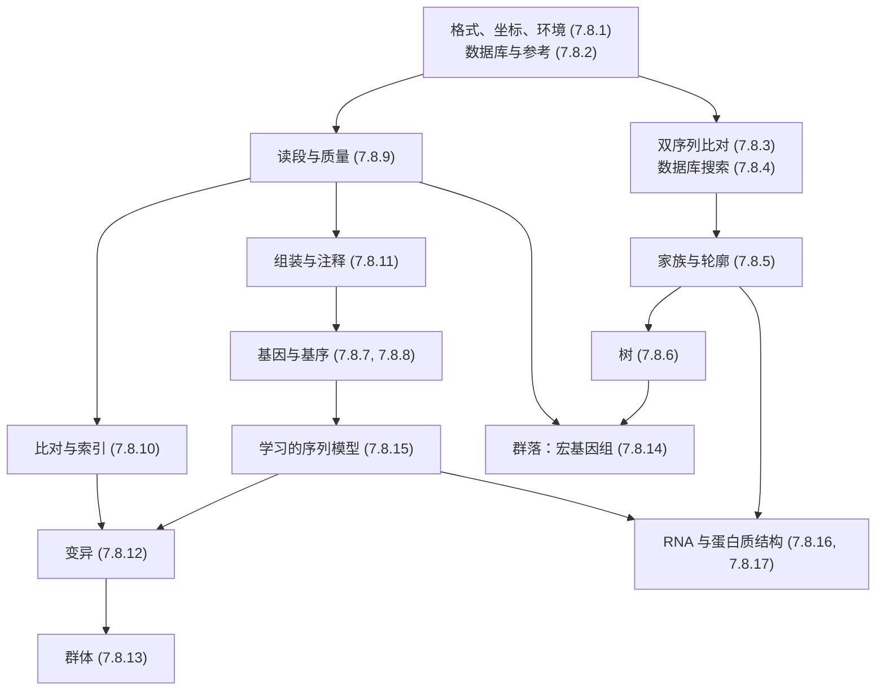

本课程的十七章讲述了生物序列：从存放它们的文件，直到它们折叠成的结构。本章把这些内容汇集起来。它不添加新方法：而是把各种方法并排摆放，指出以不同名称反复出现的几种数学结构，把问题连同其算法与工具编成索引，收集估算所需的数字，把课程中贯穿的例子一次性地沿各章追踪下来，并以这一领域尚未回答的问题结尾。每个数字都取自计算它的那一章，各处引用（算法 3.5.1、定理 10.2.1、例 13.6.1）可以回溯到推导。课程围绕 [7.8.1](/7.8.1) 中作出的区分来组织：模型说明数据如何产生并定义什么是最优，算法则找出最优；以下内容大多是这类“模型–算法”对的目录。模型背后的统计学见[生物统计学](/7.7)，从线性结构终止之处开始的网络与组学见[系统生物学](/7.9)。

## 18.1. 课程的轮廓

### 18.1.1. 两条流程

各章遵循两条共用工具的流程。第一条从读段出发：测序数据经检查与清理（7.8.9），通过**读段比对**（7.8.10）放到**参考基因组**上，或组装成新的基因组（[7.8.11](/7.8.11)），转化为变异（7.8.12），并在许多人（7.8.13）或同一样本中的许多生物（7.8.14）之间分析。第二条从序列出发：在数据库中找到它们（7.8.2），通过**序列比对**（7.8.3）与数据库搜索（7.8.4）作比较，组织成家族与轮廓（7.8.5）和树（7.8.6），用基因与调控位点注释（7.8.7–7.8.8），最后由学习模型读取（7.8.15），并折叠为 RNA 与蛋白质的结构（7.8.16–7.8.17）。文件、坐标与计算环境（7.8.1）是两者的基础。

范围在 [7.8.1](/7.8.1#sec-1.2) 中确定：线性结构以及建立在其上的半线性结构（注释、比对、嵌套配对、树、序列图与轮廓）。它们的共同点是：重要的关系沿着序列分布，或由少数几条序列决定，所以算法可以沿序列扫描。同一性质在下面每一节中反复出现：这就是为什么**动态规划**适用于比对与 RNA 折叠而不适用于一般的网络，为什么字符串的索引回答查询所用的时间与基因组大小无关，以及为什么序列模型的隐状态可以逐位置地求和消去。

### 18.1.2. 问题与方法

| 问题 | 对象 | 模型 | 算法 | 章节 |
|---|---|---|---|---|
| 两条序列有亲缘关系吗？ | 双序列比对 | 替换得分与空位 | Needleman–Wunsch、Smith–Waterman、Gotoh | 7.8.3 |
| 数据库中有什么与它相关？ | 局部比对 | 极值统计 | 种子、X-drop 延伸 | 7.8.4 |
| 一个家族是什么样子？ | MSA、轮廓 | 轮廓 HMM | 渐进比对、Viterbi、前向 | 7.8.5 |
| 它们如何由共同祖先相关联？ | 树 | 替换模型 | 邻接法、剪枝、树搜索 | 7.8.6 |
| 基因与位点在哪里？ | 带注释的序列 | Markov 模型、HMM、PWM | Viterbi、EM、得分的卷积 | 7.8.7、7.8.8 |
| 测了什么，测得多好？ | 读段 | Phred 错误、Poisson 覆盖度 | 修剪、k-mer 计数 | 7.8.9 |
| 每条读段来自何处？ | 与参考的比对 | 错误与重复 | FM 索引、最小化子、链接 | 7.8.10 |
| 这个基因组带有什么？ | 变异 | 基因型似然 | Bayes 基因分型、单倍型检出 | 7.8.12 |
| 群体中基因组如何不同？ | 基因型矩阵 | Hardy–Weinberg、祖先成分、Li–Stephens | PCA、EM、前向–后向 | 7.8.13 |
| 样本里有谁？ | 混合物的读段 | 扩增子的错误模型、分类学 | 去噪、LCA 分类 | 7.8.14 |
| 一条序列做什么？ | 序列到功能的映射 | 神经网络 | 梯度下降、归因 | 7.8.15 |
| 它如何折叠？ | 配对、坐标 | 最近邻能量、学习势 | Zuker、SCFG、AlphaFold | 7.8.16、7.8.17 |

## 18.2. 反复出现的数学结构

少数几个数学思想承载了课程的大部分内容。下表列出它们；各小节说明每个思想如何再次出现。

| 结构 | 核心思想 | 出现于 |
|---|---|---|
| 动态规划 | 由嵌套子问题的最优值得到指数多个对象上的最优值 | 3、5、6、7、10、13、16 |
| 对数优势得分 | 得分是模型与背景之间似然比的对数 | 3、4、5、7、8、10、12、15 |
| 隐 Markov 模型与文法 | 隐状态逐位置求和或取最大 | 5、7、12、13、16 |
| 隐变量、EM 与抽样 | 与参数一起估计未观测的标签 | 6、8、13、14、16 |
| 索引与种子 | 以与数据库大小无关的时间找到精确的短匹配 | 1、2、4、10、14、17 |
| 图与树 | 序列之间或其各部分之间的关系 | 2、5、6、11、14 |
| 大规模搜索中的显著性 | 所需的证据按搜索空间的对数增长 | 3、4、8、10、12、13、14 |
| 学习模型及其评估 | 灵活的预测器，在未见过的数据上评判 | 7、12、15、16、17 |

### 18.2.1. 动态规划

当得分是局部项之和，并且候选对象可分解为嵌套的子问题，而这些子问题可以排序，使每个子问题在需要之前就已解决时，动态规划就能解决在指数多个候选（公式 3.5.1 中 Delannoy 数那么多的比对、基因的剖析、RNA 的二级结构）上的优化问题。这一原理在 [4.3.1](/4.3.1) 中随**最长公共子序列**引入，在课程中以五种依赖模式出现。

| 模式 | 子问题 | 实例 | 代价 |
|---|---|---|---|
| 二维网格 | 两个前缀的最佳比对 | **Needleman–Wunsch 算法**（算法 3.5.1、定理 3.5.1）、**Smith–Waterman 算法**（算法 3.5.2）、**Gotoh 算法**（算法 3.5.3）、BWA-MEM 中的带状延伸（算法 10.3.1） | $O(mn)$；用 **Hirschberg 算法**（定理 3.6.1）空间为 $O(m + n)$ |
| 状态格 | 以某状态结尾的前缀的最佳概率或总概率 | 轮廓 HMM 的 Viterbi（算法 5.5.1）、CpG 岛（定义 7.2.1）、GHMM 剖析（算法 7.4.1）、Li–Stephens 填补（公式 13.4.1）、变异检出中的配对 HMM（算法 12.2.1） | $O(LK^2)$；轮廓 HMM 为 $O(Kn)$；Li–Stephens 为 $O(mK)$；带持续时间时为 $O(LDK^2)$ |
| 后序遍历的树 | 在根处状态给定时子树的部分得分 | Fitch（算法 6.4.1）、Sankoff、**Felsenstein 剪枝算法**（算法 6.5.1） | 每个位点 $O(n)$ 与 $O(ns^2)$ |
| 区间 | 子序列的最佳结构 | **Zuker 算法**（算法 16.2.1、定理 16.2.1）、配分函数与随机回溯（算法 16.2.2）、SCFG 的 CYK 与内向算法（定义 16.4.1） | 时间 $O(n^3)$，内存 $O(n^2)$ |
| 一维次序 | 以某锚点结尾的最佳链 | 共线链接（算法 10.3.2）、PWM 得分的精确分布（算法 8.3.1） | $O(hN)$；$O(L \cdot 4 \cdot c\Delta)$ |

有三个特点反复出现。同一张表可以用 $\max$ 与 $+$（最佳对象）、$+$ 与 $\times$（总概率，如**前向算法**、算法 16.2.2 的配分函数与算法 6.5.1 的似然）填写，或者用计数填写：配对 HMM 的 Viterbi 递推就是 Gotoh 算法，它的前向递推对比对求和（7.8.5），而 CYK 就是取对数概率的 Zuker 递推（7.8.16）。回溯恢复最优解，随机回溯则从系综中抽样（算法 16.2.2）。动态规划恰在分解失效之处失效：多条序列的 SP 得分需要 $k$ 维格点并且是 NP 难的（定理 5.1.1），交叉的碱基对使含一般假结的 RNA 折叠是 NP 难的（定义 16.1.1），树的拓扑不能分解成可分别优化的子树，所以必须搜索树空间（7.8.6）。在每种情形下，这一领域都用启发式方法取代精确的最优，并在其中保留一个动态规划：沿引导树的渐进比对（算法 5.3.1），受限的假结类型，以及用剪枝评分的 NNI 或 SPR 移动。

### 18.2.2. 对数优势得分与似然比

课程中几乎每个得分都是**对数优势比得分**：数据在信号模型下的概率与它在背景下的概率之比的对数（[7.6.41](/7.6.41#def-41.2.1)）。这就是得分可以在各位置上相加、得分为零表示“两边都没有证据”，以及真实位点的期望得分是相对熵（定理 8.2.1）的原因。

| 得分 | 信号模型 | 背景 | 出处 |
|---|---|---|---|
| 替换得分 $s(a, b) = \lambda^{-1}\ln[p_{ab}/(q_aq_b)]$ | 比对的同源对 | 独立的残基 | 定义 3.3.1、定义 3.3.2、定义 3.3.3 |
| PSSM 与 PWM $\log_2[p_j(a)/q_a]$ | 家族或基序的各列 | 背景组成 | 定义 5.4.1、公式 8.2.1 |
| CpG 岛得分 | 岛内的一阶 Markov 链 | 岛外 | 例 7.2.1，式 (7.1) |
| 编码得分 | 三周期 Markov 模型 | 均匀的非编码模型 | 定义 7.3.2、例 7.3.3 |
| 卷积滤波器 | 由标签学得的权重矩阵 | 隐含 | 定理 15.1.1 |
| 掩码边缘得分 | 被掩盖位置处的语言模型 | 野生型残基 | 公式 15.5.1 |
| 基因型后验、GQ、QUAL | 基因型似然 | 来自杂合度的先验 | 定义 12.2.1、公式 12.2.1 |
| 比对质量值 | 报告的位置 | 所有候选位置 | 定义 10.4.1、公式 10.4.1 |
| ACMG/AMP 分数 | 致病 | 良性，带先验 | 公式 12.8.1 |

有两个推论贯穿各章。每个对数优势矩阵都隐含目标频率，所以选择矩阵就是选择预期会看到的进化距离（BLOSUM62 每对 $0.58$ 比特，对 PAM250，[7.8.3](/7.8.3#sec-3.3.4)）；得分的意义只取决于它的背景，所以基于组成的统计（7.8.4）、低复杂度屏蔽（定义 4.5.1）、基序发现中保持二核苷酸组成的打乱（7.8.8）以及 CTCF 扫描的人类背景（例 8.3.1）与信号模型同样重要。Phred 标度是同一思想用于错误概率：碱基质量（**Phred 质量值**，7.8.9）、MAPQ、GQ 与 QUAL 都是出错概率的 $-10\log_{10}$，所以十个单位就是十倍。

### 18.2.3. 隐 Markov 模型与文法

**隐 Markov 模型**描述这样的序列：其统计性质依一个未观测的状态而变化，该状态服从 **Markov 链**；它的理论，连同 **Viterbi 算法**、前向算法与 **Baum–Welch 算法**，见 [4.6.8](/4.6.8)。课程用了它六次，每次隐状态的含义都不同。

| 模型 | 隐状态 | 发射 | 出处 |
|---|---|---|---|
| CpG 岛 HMM | 岛或背景 | 带一阶依赖的碱基 | 定义 7.2.1、例 7.2.2 |
| 剪接位点 HMM | 外显子、剪接位点、内含子 | 碱基 | 例 7.2.3 |
| 广义 HMM | 带显式持续时间的外显子、内含子、基因间区段 | 整个区段 | 定义 7.4.1、算法 7.4.1 |
| 配对 HMM | 匹配、插入、缺失 | 比对的残基对 | 7.8.5、算法 12.2.1 |
| **轮廓隐 Markov 模型** | 每一列的匹配、插入、缺失状态 | 家族的残基 | 定义 5.5.1、算法 5.5.1 |
| Li–Stephens 模型 | 被复制的参考单倍型 | 带突变的等位基因 | 公式 13.4.1 |

从隐 Markov 模型（一种随机的正则文法）到**随机上下文无关文法**，换来了嵌套配对，代价是每条序列的时间从 $O(n)$ 变为 $O(n^3)$；**协方差模型**之于 RNA 家族，正如轮廓 HMM 之于蛋白质家族（定义 16.4.2）。有两点教训反复出现。Viterbi 译码与后验译码回答不同的问题，它们可能不一致：例 7.2.3 中剪接位点的后验 $0.46$ 与例 7.2.2 中富含 GC 的假岛，都提醒我们最可能的路径并不确定。并且一阶模型只看到相邻的碱基：仅仅富含 GC 的 CpG 岛、需要五阶上下文的编码区（AUC $0.68 \to 0.95$，例 7.3.3），以及与位置无关的基序的局限，正是 7.8.15 的学习模型所要处理的。

### 18.2.4. 隐变量：EM 与抽样

有几个问题，在未观测的标签已知时容易，不知道时就难：每条序列中基序位点的位置、每个等位基因的祖先群体、HMM 的隐状态、训练集中 RNA 的结构、被分类到较高阶元的读段的来源。**EM 算法**在按当前参数计算期望标签与据此重新估计参数之间交替；它从不使似然下降，并收敛到依赖起点的局部最大值。

| 问题 | 隐变量 | 方法 | 出处 |
|---|---|---|---|
| 基序发现 | 位点位置（OOPS、ZOOPS、TCM） | MEME 中的 EM；Gibbs 抽样 | 算法 8.4.1、例 8.4.2、算法 8.4.2 |
| 祖先成分 | 每个等位基因拷贝的祖先群体 | EM，ADMIXTURE 中的块松弛 | 定义 13.3.2、算法 13.3.1 |
| HMM 训练 | 状态路径 | Baum–Welch | [4.6.8](/4.6.8)、7.8.7 |
| SCFG 训练 | 剖析树 | 内向–外向算法 | 定义 16.4.1 |
| 物种丰度 | 被分到某个属的读段所属的物种 | Bayes 重分配 | 公式 14.3.1、例 14.3.2 |
| 树的推断 | 树与参数 | **Markov 链 Monte Carlo** | [7.8.6](/7.8.6#sec-6.6.2) |

局部最优不是技术细节。MEME 的 EM 在例 8.4.2 中找到了全部 $25$ 个放入的位点，但从其他起点出发也收敛到基序的平移版本；无论是否真有 $K$ 个群体，ADMIXTURE 总是返回 $K$ 个成分（7.8.13）。各章的补救办法相同：多个起点、比较似然，并在已知答案的数据上检验。

### 18.2.5. 索引与种子

在数据的规模上穷举比较是不可能的（18.4），课程反复遇到对这个问题的一种回答：在索引中找精确的短匹配，只在它们周围做昂贵的工作。鸽巢界（定理 10.1.1）保证带 $k$ 处编辑的读段含有长度 $\lfloor L/(k+1)\rfloor$ 的精确匹配，而 $s$-mer 的偶然出现次数 $2G/4^s$（公式 10.1.1）则说明种子要多长才有信息量。

| 索引 | 存储什么 | 查询 | 出处 |
|---|---|---|---|
| 字节偏移与分箱 | 每条记录或块的位置 | 区域查找 | 公式 1.4.1、算法 1.4.1 |
| 链文件 | 组装版本之间的比对块 | 二分查找 | 定义 2.2.2、算法 2.2.1 |
| 词的查找表 | 每个 $W$-mer 或邻域词的位置 | 种子命中 | 定义 4.3.2、算法 4.3.1，间隔种子（定义 4.6.1） |
| $k$-mer 的哈希表 | 每个 $k$-mer 的位置或类群 | 每个 $k$-mer 常数时间 | 7.8.10、算法 14.3.1 |
| **后缀数组** | 排序的后缀，每个碱基 $32$ 位 | 二分查找，$O(m\log n)$ | 7.8.10 |
| **FM 索引** | **Burrows–Wheeler 变换**、计数、抽样的后缀数组 | 反向搜索，$O(m)$ | 定义 10.2.1、定理 10.2.1、定义 10.2.2、算法 10.2.1、定理 10.2.2 |
| **最小化子** | $k$-mer 中 $2/(w + 1)$ 的样本 | 用于链接的锚点 | 定义 10.3.1、公式 10.3.1 |
| 结构字母表 | 3Di 状态上的字符串 | 对结构的序列搜索 | 7.8.17 |

每种索引都是内存与时间、灵敏度与速度之间的权衡。BLAST 的邻域阈值 $T$ 使灵敏度与偶然命中一起移动（例 4.3.1）；间隔种子在偶然率相同时提高灵敏度（例 4.6.1）；人类的 FM 索引对两条链约需 $4\,\mathrm{GB}$（例 10.2.2），而后缀数组需要 $24.8\,\mathrm{GB}$。Foldseek 说明这一思想有多普遍：结构一旦写成字符串，序列搜索的全套机制就可用于它们。

### 18.2.6. 图与树

图在课程中是作为计算的框架而不是研究对象出现的（一般的网络见 [1.4.7](/1.4.7) 与 [7.9](/7.9)）。编辑图把比对变成路径（公式 3.5.1）。**基因本体**是有向无环图，其真路径规则把注释向上传播（定义 2.5.1、定义 2.5.2、公式 2.5.1）。**引导树**确定渐进比对的次序（定义 5.3.2），分类系统确定共有的 $k$-mer 所归属的**最近公共祖先**（定义 14.3.1）。**系统发生树**是 7.8.6 的对象，其数目按 $(2n - 5)!!$ 增长（定理 6.1.1），其加性距离由四点条件刻画（定理 6.3.1），其顶点把复制与物种形成区分开（定义 6.1.5）。组装图（基因组是利用读段之间重叠的一条途径；短序列的 de Bruijn 图曾在 [7.8.1](/7.8.1#sec-1.2) 中画出）以及 [7.8.10](/7.8.10#sec-10.3.4) 的**泛基因组**图（编码穿过群体各基因组的备选路径）属于 [7.8.11](/7.8.11)。

### 18.2.7. 大规模搜索中的显著性

得分只有与同样大小的搜索中偶然产生的结果相比才有意义。课程中出现了四条比较的途径：打乱（公式 3.7.1、例 3.7.1）、极值理论（Erdős–Rényi 定律，定理 4.4.1，以及局部得分的 **Gumbel 分布**，定义 4.4.1，式 (4.1)，它是 **Karlin–Altschul 统计**的基础）、零分布的精确计算（算法 8.3.1 的 PWM 得分、公式 13.2.3 的 Hardy–Weinberg 检验、例 8.4.1 的超几何富集、算法 14.2.1 的丰度 p 值），以及重抽样（**自助法**支持度，定义 6.6.1；PERMANOVA，公式 14.4.2）。它们都服从同一条规则：在 $N$ 个候选上的搜索，每个候选 $b$ 比特时，期望有 $N2^{-b}$ 个偶然匹配，所以显著的匹配必须携带约 $\log_2 N$ 比特，若期望的假命中数 $E$ 更小，则再加 $\log_2(1/E)$。BLAST 的**比特分**与 **E 值**（定义 4.4.2、定义 4.4.3）直接表述了这条规则。

![一个匹配要在大规模搜索中脱颖而出，必须携带多少证据。在 N 个候选上的搜索，每个候选 b 比特时，期望有 N·2^(−b) 个偶然匹配，所以匹配需要约 log₂ N 比特才使偶然期望一次（实线），对 E = 0.01 需要 log₂ N + 6.6 比特（虚线）。图中的点是课程中的情形：300 个残基的 BLAST 查询对 Swiss-Prot（42.5 比特，例 4.4.3），以及 821 个残基对 10¹¹ 个残基（52.9 比特）；人类基因组两条链中的 16-mer 与 20-mer 精确种子（32 与 40 比特；1.4 与 0.006 个偶然命中，公式 10.1.1）；带 NGG PAM 的 20 nt CRISPR 向导（44 比特），每允许一个错配就损失其错配邻域大小的 log₂（0、2、3 个错配时分别有 0.00035、0.62 与 11 个偶然位点，例 10.6.1）；每个窗口 p = 10⁻⁶ 的 CTCF 权重矩阵（19.9 比特，6200 个偶然位点，例 8.3.1）；以及关联研究的全基因组显著性阈值 5 × 10⁻⁸，它对应约 10⁶ 次独立检验下的 0.05](./plots/search-bits.py)

这个图同时解释了课程中的几个结果。16-mer 是在人类基因组中通常唯一的最短精确种子，所以比对程序使用约这个长度或更长的种子（例 10.1.1）。20 nt 的向导在必须精确匹配时是唯一的，但它在三个错配以内的邻域有 $32\,551$ 条序列，去掉 $15$ 比特，留下约 $11$ 个偶然位点（例 10.6.1）。转录因子基序携带的信息远少于基因组搜索所需，所以即使阈值很严，也留下数千个匹配（例 8.3.1）：结合位点只有借助染色质、协同作用与保守性才能从诱饵中找出，正如 [7.6.41](/7.6.41#sec-41.3) 的选择理论所预言。对于同时检验许多假设，同样的逻辑给出 Bonferroni 阈值；当要控制的是假发现的比例而不是个数时，则给出**错误发现率**（[7.7.20](/7.7.20)），用于对许多序列的基序扫描（7.8.8）。

### 18.2.8. 学习模型及其评估

课程从显式假设很少的模型（PWM、一阶 Markov 链）走向由大量数据学得的模型：16S 序列的朴素 Bayes 分类器（公式 14.2.1），重新发现权重矩阵的卷积网络（定理 15.1.1、例 15.2.1），DeepVariant 的堆叠分类器（7.8.12），蛋白质与基因组**语言模型**（定义 15.4.1、定义 15.4.2），以及 **AlphaFold**（7.8.17）。卷积滤波器就是权重矩阵，最大池化找到最佳位点（定理 15.1.1），所以学习模型包含经典模型；它们增添的是基序的组合、长程上下文（公式 15.2.1）以及数百万条序列所隐含的保守性。

预测的评估在每个作出预测的章节中都出现，名称不同，度量的是同样的几个量。

| 量 | 课程中的名称 | 出处 |
|---|---|---|
| 找到的真实项的比例 | 灵敏度、召回率、岛的覆盖 | 定义 7.5.1、7.8.12、例 7.2.2 |
| 预测中为真的比例 | 基因预测中的“特异性”、精确率 | 定义 7.5.1、定义 12.5.1 |
| 排序质量 | AUROC、平均精确率 | 例 7.3.3、例 15.6.2 |
| 与参考结构的一致程度 | SP 与 TC 准确度、$Q_3$、RMSD、TM-score、lDDT | 定义 5.3.3、定义 17.3.1、定义 17.3.2、定义 17.4.1 |
| 无真值集时的内部一致性 | Ti/Tv、杂合/纯合比、Mendel 违例 | 定义 12.5.2、定义 12.5.3 |

有两个陷阱是普遍的。训练集与测试集中的相关序列使任何方法看起来都不错：随机划分对根本无法预测的标签给出了 $100\,\%$ 的准确率（例 15.6.1），划分之前按**序列一致性**聚类是解药。忽略流行率的度量掩盖了失败：正例为 $1\,\%$ 时，AUROC 仍是 $0.988$，而平均精确率降到 $0.78$（例 15.6.2）。变异检出的基准也是如此，它们只覆盖有把握的区域（定义 12.5.1）；预测结构的置信度度量也是如此，它们说明模型与它所学到的模式吻合得多好，而不是蛋白质是否采取该构象（例 17.4.1）。

## 18.3. 方法索引

下表列出课程的主要问题，以及经典算法、目前使用的工具和它们在哪里展开。它们是索引，不能代替各章，各章给出了假设与失效模式。

序列、家族与树（7.8.2–7.8.8）：

| 问题 | 经典算法或模型 | 目前的工具 | 出处 |
|---|---|---|---|
| 在组装版本之间转换坐标 | 链文件，二分查找 | liftOver、CrossMap | 定义 2.2.2、算法 2.2.1 |
| 全局与局部比对 | Needleman–Wunsch、Smith–Waterman、仿射空位 | EMBOSS、parasail、Biopython | 算法 3.5.1、算法 3.5.2、算法 3.5.3 |
| 替换得分 | PAM 为 Markov 矩阵的幂，BLOSUM 来自区块 | BLOSUM62 | 算法 3.3.1、算法 3.3.2 |
| 数据库搜索 | FASTA、BLAST、Karlin–Altschul E 值 | BLAST+、DIAMOND、MMseqs2 | 算法 4.2.1、算法 4.3.1、定义 4.4.3 |
| 序列聚类 | 贪心增量聚类 | CD-HIT、Linclust | 定义 4.7.1、算法 4.7.1 |
| 多序列比对 | 中心星形、渐进比对 | MAFFT、Clustal Omega、FAMSA | 算法 5.2.1、算法 5.3.1 |
| 轮廓与远同源 | PSSM、PSI-BLAST、轮廓 HMM | HMMER、Pfam、HHblits | 定义 5.4.1、算法 5.4.1、定义 5.5.1 |
| 由距离建树 | UPGMA、邻接法 | FastME、PHYLIP | 算法 6.3.1、算法 6.3.2 |
| 由性状建树 | Fitch、Sankoff、剪枝、Bayes MCMC | IQ-TREE、RAxML-NG、MrBayes、UShER | 算法 6.4.1、算法 6.5.1、定义 6.6.1 |
| 基因组分段 | Markov 链、二态 HMM | | 定义 7.1.2、定义 7.2.1 |
| 基因预测 | 周期 Markov 模型、GHMM | Prodigal、AUGUSTUS、BRAKER | 定义 7.3.2、定义 7.4.1、算法 7.4.1 |
| 扫描基序 | 带精确 p 值的 PWM | FIMO、HOMER | 公式 8.2.1、算法 8.3.1 |
| 从头发现基序 | EM、Gibbs 抽样、词富集 | MEME、STREME、HOMER | 算法 8.4.1、算法 8.4.2 |
| 保守性 | 系统发生 HMM、逐碱基检验 | phastCons、phyloP、GERP | 定义 8.6.2 |

读段、基因组与群体（7.8.9–7.8.14）：

| 问题 | 经典算法或模型 | 目前的工具 | 出处 |
|---|---|---|---|
| 质量修剪 | 滑动和修剪 | fastp、Trimmomatic | 算法 9.4.1 |
| UMI 与重复 | 有向聚类；复杂度曲线 | UMI-tools、Picard、samtools markdup | 算法 9.3.1、公式 9.4.1 |
| 由读段估计基因组大小 | 二倍体 $k$-mer 模型 | Jellyfish、GenomeScope | 公式 9.5.2 |
| 基因组中的精确匹配 | 后缀数组、BWT、反向搜索 | BWA、Bowtie2 | 算法 10.2.1 |
| 短读段比对 | SMEM、链接、带状延伸 | BWA-MEM、Bowtie2 | 算法 10.3.1 |
| 长读段与剪接比对 | 最小化子、共线链接 | minimap2、STAR、HISAT2 | 算法 10.3.2、定义 10.3.2 |
| 比对置信度 | 候选位置上的后验 | MAPQ | 公式 10.4.1 |
| 脱靶位点 | $d$ 个错配以内的穷举搜索 | Cas-OFFinder | 公式 10.6.1 |
| 基因分型 | 基因型似然、Bayes 后验 | bcftools、GATK HaplotypeCaller、DeepVariant | 定义 12.2.1、公式 12.2.1、算法 12.2.1 |
| 拷贝数 | 深度的二元分割 | CBS、CNVkit | 算法 12.6.1 |
| 变异分类 | Bayes 点数系统 | ACMG/AMP 标准、VEP | 公式 12.8.1 |
| 样本质控与亲缘 | 近交系数 $\hat F$、KING-robust 亲缘 | PLINK、KING | 公式 13.2.1、公式 13.2.2 |
| 群体结构 | 标准化基因型的 PCA，用 EM 的祖先成分 | PLINK 2、FlashPCA、ADMIXTURE | 定义 13.3.1、算法 13.3.1 |
| 定相与填补 | Li–Stephens HMM | SHAPEIT、Beagle、Minimac | 公式 13.4.1、公式 13.4.2 |
| 大规模关联 | 残差化扫描、混合模型、聚团 | plink2、REGENIE、BOLT-LMM | 公式 13.5.1、算法 13.5.1 |
| 选择扫描 | $F_{\mathrm{ST}}$、EHH、iHS | selscan | 公式 13.6.1、公式 13.6.2 |
| 扩增子去噪 | 误差模型与丰度 p 值 | DADA2、QIIME 2 | 算法 14.2.1 |
| 读段分类 | 以 LCA 标记的 $k$-mer | Kraken 2、Bracken、MetaPhlAn | 算法 14.3.1、公式 14.3.1 |
| 混合物中的基因组 | 按组成与覆盖度分箱 | MetaBAT、CheckM | 定义 14.3.2、公式 14.3.3 |
| 污水中的谱系 | 条形码上的约束最小二乘 | Freyja | 公式 14.6.1 |

学习模型与结构（7.8.15–7.8.17）：

| 问题 | 经典算法或模型 | 目前的工具 | 出处 |
|---|---|---|---|
| 由序列预测调控活性 | 卷积网络、空洞、注意力 | DeepSEA、Basenji、Enformer、Borzoi | 算法 15.2.1、公式 15.2.1 |
| 解释 | 饱和突变、归因 | TF-MoDISco | 定义 15.3.1 |
| 变异效应 | 掩码边缘对数优势 | ESM、EVE、AlphaMissense | 公式 15.5.1 |
| 编辑结局 | 微同源模式 | inDelphi、FORECasT | 算法 15.7.1 |
| RNA 二级结构 | Zuker、配分函数、SHAPE 伪能量 | ViennaRNA、RNAstructure | 算法 16.2.1、算法 16.2.2、公式 16.3.1 |
| RNA 家族 | 协方差模型 | Infernal、Rfam | 定义 16.4.2 |
| 比较结构 | 补偿突变、共变 | RNAalifold、R-scape | 定义 16.5.1 |
| miRNA 靶标 | 种子位点类型、可及性 | TargetScan | 定义 16.6.1、公式 16.6.1 |
| 结构比较 | Kabsch 叠合、TM-score | TM-align、DALI、Foldseek | 定理 17.3.1、定义 17.3.2 |
| 结构预测 | MSA 与配对表示 | AlphaFold、ColabFold、ESMFold | 定义 17.4.1、定义 17.4.2 |
| 功能 | 带证据代码的 GO 转移 | InterProScan | 定义 17.6.1 |

## 18.4. 需要记住的数字

数量级的推理在写任何代码之前就决定了哪种方法是可行的。下面是各章用到的数值。

| 量 | 值 | 出处 |
|---|---|---|
| 人类基因组 | 单倍体 $3.1\times10^9$ bp；两条链共 $6.2\times10^9$ 个符号 | [7.8.10](/7.8.10#sec-10.1.1) |
| 其他基因组 | SARS-CoV-2 $29\,903$ nt；*E. coli* K-12 $4\,641\,652$ bp | 例 2.1.1、例 7.1.1 |
| $30\times$ 基因组 | $6.2\times10^8$ 条 $150$ nt 的读段；对所有读段作 Smith–Waterman 约需 $90$ 年 | [7.8.10](/7.8.10#sec-10.1.1) |
| 测序成本 | 2001 年 $10^8$ 美元，2015 年约 $10^3$，2020 年代数百；每 $1.2$ 年减半 | 公式 1.1.1 |
| 读段错误 | Illumina 的替换沿读段上升；HiFi 约 Q30；纳米孔每条读段约 Q20 | [7.8.9](/7.8.9#sec-9.1.2) |
| Phred 标度 | Q20 = $1\,\%$，Q30 = $0.1\,\%$，Q40 = $0.01\,\%$ 错误 | 公式 9.2.1 |
| 索引 | 人类两条链的 FM 索引约 $4\,\mathrm{GB}$；后缀数组每个碱基 $32$ 位 | 例 10.2.2 |
| 唯一种子 | $16$-mer 在人类基因组中有 $1.4$ 次偶然出现，$20$-mer 有 $0.0056$ 次 | 例 10.1.1 |
| 蛋白质数据库 | UniProtKB $2.5\times10^8$ 条序列，约 $10^{11}$ 个残基；Swiss-Prot $5.7\times10^5$ | [7.8.4](/7.8.4#sec-4.1)、例 4.4.4 |
| BLAST 显著性 | 大型数据库中 $40$–$50$ 比特；BLOSUM62 每列携带 $0.58$ 比特 | 例 4.4.3 |
| 暮光区 | $20$–$35\,\%$ 一致性，低于此，双序列比对无法检出同源性 | [7.8.3](/7.8.3#sec-3.1.2) |
| 结构 | PDB 约 $2.3\times10^5$ 个条目；AlphaFold DB 超过 $2\times10^8$ 个模型；约 $10^3$ 种折叠 | [7.8.2](/7.8.2#sec-2.3)、[7.8.17](/7.8.17#sec-17.2) |
| 树 | $(2n - 5)!!$ 棵无根树：$15$ 个类群为 $7.9\times10^{12}$ | 定理 6.1.1 |
| 每个基因组的变异 | $4$–$5\times10^6$：约 $3.5\times10^6$ 个 SNV，$5$–$6\times10^5$ 个插入缺失，$2$–$3\times10^4$ 个 SV | [7.8.12](/7.8.12#sec-12.1) |
| 新生突变 | 每个子代基因组约 $74$ 个 SNV，外显子组 $0.8$ 个 | 例 12.9.1 |
| 质量检查 | Ti/Tv：基因组 $2.0$–$2.1$，外显子组 $3.0$，随机 $0.5$ | 定义 12.5.2 |
| 生物样本库 | $5\times10^5$ 人，$10^7$ 个填补的变异：$5\times10^{12}$ 个基因型 | [7.8.13](/7.8.13#sec-13.1.2) |
| 人类基因结构 | 内部外显子中位数 $126$ bp，内含子中位数 $1.9$ kb，GT–AG 占 $99\,\%$ | 例 7.4.1 |
| CpG 缺失 | 观测/期望 CpG：人类 21 号染色体 $0.28$，*E. coli* $1.16$ | 例 7.1.2 |
| 基序信息 | CTCF $17.2$ 比特；剪接供体 $8.2$ 比特，受体 $9.3$ 比特 | 例 8.2.2、例 8.7.1 |
| RNA 折叠 | $O(n^3)$；tRNA 的最佳结构占系综的 $12\,\%$ | 定理 16.2.1、例 16.2.2 |
| 相同折叠 | TM-score 高于 $0.5$；不相关的链在任何长度上约 $0.2$ | 定义 17.3.2、例 17.3.2 |

## 18.5. 回顾四个例子

课程把几个例子一章一章地追踪下去（[7.8.1](/7.8.1)）。合在一起读，每个都是一次完整的分析。

### 18.5.1. rs4988235：一个变异贯穿整个课程

乳糖酶持续性变异 $-13910\mathrm{C{>}T}$ 在选择下的历史见 [7.4.23](/7.4.23)，它位于 GRCh38 的 2 号染色体以 1 为起点的位置 $135\,851\,076$，例 1.4.2 用五种记法写出了它；在 FASTA 文件中，靠对行长的算术找到它的碱基（例 1.4.1），在带索引的文件中，靠逐层检查一个区间（例 1.4.3）。向 GRCh37 的**坐标转换**加上 $757\,570$，得到 $136\,608\,646$（例 2.2.1），数据库给出它的衍生等位基因频率：欧洲人 $0.52$，东亚人 $0.00$（例 2.4.1）。包含它的基因 *MCM6* 编码一个解旋酶亚基，其酵母直系同源物在比对的列上有 $42.5\,\%$ 一致（例 3.1.1），得分比打乱序列高 $81$ 个标准差（例 3.7.1），对 Swiss-Prot 的 E 值约为 $10^{-189}$（例 4.4.2）；MCM6 直系同源物的轮廓给旁系同源物 MCM2–7 的打分，比单独的人类查询序列高 $40$–$50\,\%$（例 5.5.1），它们的基因树以完全的支持度解析了直系同源物，而对古老复制的次序则只有微弱的支持（例 6.6.1）。在该基因座周围，CpG 岛 HMM 找到了 *UBXN4* 与 *MCM6* 的启动子岛，在 *LCT* 处没有，*LCT* 是一个由远端增强子调控的组织特异性基因（例 7.2.2）。对该增强子的权重矩阵扫描表明，衍生的 T 使覆盖该变异的最佳 Oct-1 得分升高 $1.56$ 比特，这显示了效应的方向而没有显示其大小（例 8.3.2）。在读段中，该位点在基因组浏览器中表现为分裂的覆盖度柱（[7.8.10](/7.8.10#sec-10.5.3)）；在 VCF 中是一条双等位基因记录（定义 12.4.1）；用 HGVS 写作 `NM_005915.6:c.1917+326C>T`，是 *MCM6* 的一个作用于 *LCT* 的内含子变异（例 12.8.1）。在各群体之间它是 $F_{\mathrm{ST}}$ 的离群值，欧洲人与东亚人之间为 $0.52$，而全基因组的值接近 $0.1$（例 13.6.1），它位于延伸超过一兆碱基的单倍型上，这是近期选择性清除的特征，例 13.6.2 在模拟中重现了它。一个变异就这样涉及了数据库、坐标、比对、搜索、轮廓、树、序列模型、基序、比对、变异检出、注释与群体遗传学；各方法不同，坐标系是共用的，这类分析中的大多数错误出在接口处（定义 1.4.4）。

### 18.5.2. HG002：一个基因组从读段到变异

Genome in a Bottle 联盟的参考样本 HG002，连同其父母 HG003 与 HG004，承载了重测序流程。它在每个主要平台上的读段说明了 7.8.9 的错误谱；质量控制修剪了接头与低质量末端（算法 9.4.1），二倍体基因组的 $k$-mer 谱显示了在任何比对之前如何读出大小与杂合度（公式 9.5.2、例 9.5.1）。读段用 BWA-MEM 与 minimap2 比对（算法 10.3.1、算法 10.3.2），经排序、建立索引并标记重复（[7.8.10](/7.8.10#sec-10.5.2)）；基因型用 GATK 流程与 DeepVariant 检出（[7.8.12](/7.8.12#sec-12.3)）；结果对照同一样本的基准集（定义 12.5.1）评判，用 Ti/Tv（定义 12.5.2），并且因为父母也被测序，还用 Mendel 一致性（定义 12.5.3）。这个例子说明的是，每个阶段有自己的误差度量：碱基质量、比对质量与基因型质量，并且误差是累积的：对一个三人家系的 $4$–$5\times10^6$ 个变异位点，每个基因型 $10^{-4}$ 的误差给出千量级的 Mendel 违例，而真正的新生突变只有约 $60$–$80$ 个。把同样的读段组装成二倍体基因组，作为对参考基因组比对的替代，是 [7.8.11](/7.8.11) 的主题。通过投影到 1000 Genomes 样本的主成分上（[7.8.13](/7.8.13#sec-13.3.1)），一个基因组归入一个群体。

### 18.5.3. SARS-CoV-2：从发现到监测的一个基因组

这种病毒是通过对一名患者灌洗液中总 RNA 的鸟枪法测序和读段的从头组装发现的，最长的重叠群是一个约 $30\,\mathrm{kb}$ 的新型 β 冠状病毒基因组（[7.8.14](/7.8.14#sec-14.6.2)）。它的记录成为 $29\,903$ nt 的参考序列 `NC_045512.2`，其中刺突基因占据 $21\,563$–$25\,384$，D614G 替换是 A23403G（例 2.1.1）。数十万个基因组是对该参考作成对比对，而不是用经典的多序列比对（[7.8.5](/7.8.5#sec-5.3.3)），每个基因组每月约有两个替换，数百万个基因组的树由放置建成（UShER），由钟定年（Nextstrain），并切成有名称的谱系（Pango）（[7.8.6](/7.8.6#sec-6.8.3)）。在混有许多谱系的污水中，它们的比例由谱系条形码上的约束最小二乘根据突变频率恢复出来，例 14.6.1 中真值 $(0.6, 0.3, 0.1)$ 的估计为 $(0.583, 0.325, 0.092)$。每一步都复用了前面某一章的方法（宏基因组组装、数据库记录、比对、简约法、分子钟），其规模与速度是这些方法原先没有设计过的，瓶颈从计算转向了数据共享。

### 18.5.4. NGLY1：从基因组到诊断

NGLY1 缺乏症是 2012 年通过外显子组测序发现的先天性去糖基化障碍（[7.8.12](/7.8.12#sec-12.9)），它的诊断展示了流程的解释部分。患儿与其父母一起测序；三人家系的设计使新生变异与复合杂合变异可见，因为一个孩子全基因组只带有约 $74$ 个新生的单核苷酸突变，外显子组中是 $0.8$ 个（例 12.9.1）。他带有 *NGLY1* 的两个功能丧失变异，各来自一位亲本，而这个基因当时与任何疾病无关，所以这些变异的意义不明，直到发现了更多有同样不寻常表型的患者；在对 ACMG/AMP 规则的 Bayes 解读中（公式 12.8.1、例 12.8.2），每个独立的家系增添的证据会使变异越过分类的边界。蛋白质的结构现在增添了另一种证据：NGLY1 的 AlphaFold 模型对它的 PUB、催化与 PAW 结构域有把握（平均 **pLDDT** $85.5$，催化三联体为 $88$–$95$），对一段注释为无序的片段则没有把握（例 17.4.1），所以错义变异可以放入结构的背景中，并由语言模型的**变异效应预测**打分（公式 15.5.1），而 ClinVar 记录此后作出的解释（[7.8.2](/7.8.2#sec-2.4)）。罕见病基因组学中的限制性资源不是测序，而是患者的匹配，以及随着知识增长对存储数据的重新分析（[7.8.1](/7.8.1#sec-1.6)）。

## 18.6. 方法简史

课程中的算法来自三次浪潮。第一次从 20 世纪 50 年代末到约 1990 年，以动态规划、替换矩阵和一次只处理少数几条序列的系统发生模型建立序列的比较，当时的数据以数千条序列计。第二次约在 1990–2003 年，使搜索与注释统计化：BLAST 及其 E 值、轮廓 HMM、Gibbs 与 EM 基序发现程序、基因预测程序与最早的基因组。第三次始于 2005 年之后，以计算机科学的索引（BWT 与 FM 索引、最小化子）应对短读段的洪流，并从约 2015 年起，用在数据本身上训练的学习模型，最终达到蛋白质结构的预测。

## 18.7. 尚未解决的问题

### 18.7.1. 参考

单个**参考基因组**既是坐标系，又是一种偏倚：来自与它不同的单倍型的读段比对得差（[7.8.10](/7.8.10#sec-10.4.2)），在它缺失或塌缩的区域中的变异是看不见的。完整的 T2T-CHM13 基因组与第一个人类泛基因组参考（[7.8.2](/7.8.2#sec-2.2.1)）消除了后一问题的大部分，但用图取代线性参考提出了这一领域尚未解决的问题：如何命名只存在于某些路径上的变异，如何使坐标在不同版本之间保持稳定，如何把图比对纳入建立在线性位置之上的工具与文件格式（定义 1.4.4、定义 12.8.1），以及泛基因组要有多大、多样，才能服务于当前面板中代表性不足的群体。

### 18.7.2. 读取序列以外的信息

长的单分子读段已经能跨越重复与片段重复，并直接读出碱基修饰（[7.8.9](/7.8.9#sec-9.1.2)）。未解决的问题在于准确度与解释：修饰碱基与困难序列上下文的碱基识别、整条染色体的定相，以及把甲基化、结构变异与序列整合成个体基因组的一种表示。随着错误率下降，限制因素变成分析，而分析是围绕短读段设计的。

### 18.7.3. 意义不明的变异

患者中发现的大多数罕见错义变异与非编码变异无法分类：按 ACMG/AMP 规则它们的意义不明，而计算预测器彼此相关，只能算作辅助性证据（公式 12.8.1）。在祖先在参考数据库中代表性不足的人群中，这类变异的比例更高（[7.8.12](/7.8.12#sec-12.8.3)）。前进的途径是测量（变异效应的多重检测，**深度突变扫描**）、对照这类测量校准预测器、更大更多样的群体数据，以及跨诊所的患者匹配；对于调控变异（如 rs4988235），由序列作出的预测仍然薄弱（[7.8.15](/7.8.15#sec-15.5)）。

### 18.7.4. 学习模型知道什么

语言模型与结构预测器是在进化的产物与过去的实验上训练的，它们在这一分布之外的准确度是核心问题。同源泄漏可以使无用的模型看起来完美（例 15.6.1）；调控 DNA 的模型预测基因之间的表达差异，远好于预测个体之间的差异（[7.8.15](/7.8.15#sec-15.5)）；RNA 结构预测器在留出的家族上失去优势（[7.8.16](/7.8.16#sec-16.7)）；结构模型对可能有两种构象的蛋白质只给出一种（例 17.3.1）。按同源性分开训练与测试数据、度量校准度、并与简单基线（权重矩阵、$k$-mer 模型）比较的基准，既是技术问题，也是方法学问题。

### 18.7.5. 可重复性

分析是工具、版本、参数与参考文件的链条，改变其中任何一环都会改变结果：基因组版本（定义 2.2.1）、注释的发布版本、决定 E 值的数据库版本（定义 4.4.3）、树搜索或 EM 的随机种子。[7.8.1](/7.8.1#sec-1.6) 的做法——版本化的环境、工作流管理器、校验和与 FAIR 原则（定义 1.6.1）——使结果在原则上可以重复；要在实践中做到这一点，包括对受控访问下的人类数据，仍主要靠自律而不是基础设施。

## 18.8. 与其他课程的联系

本课程的方法是其他几门课程的输入。系统生物学（[7.9](/7.9)）始于读段比对终止之处：RNA-seq、单细胞、染色质与空间检测，用 7.8.9–7.8.10 的工具比对、计数与质量控制，用基序与基因本体注释（7.8.2、7.8.8）分析，并整合成网络，其数学见 [1.4.7](/1.4.7)。进化生物学（[7.10](/7.10)）使用 7.8.6 的树、替换模型与分子钟，并用溯祖理论解释为什么基因树不同于物种树。微生物学与生态学（[7.11](/7.11)、[7.19](/7.19)）使用 7.8.14 的 16S 分析、宏基因组学与多样性度量。免疫学（[7.15](/7.15)）把比对与系统发生学用于抗体与 T 细胞受体序列。统计学基础，即多重检验、计数模型与预测，见 [7.7](/7.7)，算法与学习方法见 [4.3](/4.3)、[4.6](/4.6) 与 [4.7](/4.7)。

## 小结

- 课程遵循两条流程，从读段到变异与群体（7.8.9–7.8.14），以及从序列到家族、树、注释与结构（7.8.2–7.8.8、7.8.15–7.8.17），建立在共同的格式与坐标之上（定义 1.4.4）；它的范围是线性与半线性结构，关系沿序列分布这一性质使它的算法成为可能（18.1）。
- 动态规划的五种模式：网格（算法 3.5.1、算法 3.5.2、算法 3.5.3）、状态格（算法 5.5.1、算法 7.4.1、公式 13.4.1）、树（算法 6.4.1、算法 6.5.1）、区间（算法 16.2.1、定理 16.2.1）与链（算法 10.3.2）；最优值用 max-plus，概率用 sum-product；分解失效处是 NP 难的（定理 5.1.1）（18.2.1）。
- 得分是相对背景的对数优势：替换矩阵（定义 3.3.1）、PSSM 与 PWM（定义 5.4.1、公式 8.2.1、定理 8.2.1）、卷积滤波器（定理 15.1.1）、掩码边缘（公式 15.5.1）、基因型与比对后验（公式 12.2.1、公式 10.4.1）、ACMG 分数（公式 12.8.1）；所有错误概率用 Phred 标度（18.2.2）。
- 隐状态有六种含义的隐 Markov 模型（定义 7.2.1、定义 7.4.1、定义 5.5.1、公式 13.4.1）及其对嵌套配对的文法扩展（定义 16.4.1、定义 16.4.2）；对隐标签用 EM 与抽样（算法 8.4.1、算法 13.3.1、公式 14.3.1），局部最优是共同的危险（18.2.3–18.2.4）。
- 索引与种子避免穷举搜索：鸽巢界（定理 10.1.1）、BWT 与 FM 索引（定理 10.2.1、算法 10.2.1）、最小化子（定义 10.3.1）、查找表（算法 4.3.1、算法 14.3.1）；这些简化达到几十个数量级（18.2.5）。
- 显著性：在 $N$ 个候选上的搜索中，一个匹配需要约 $\log_2 N$ 比特（比特分与 E 值，定义 4.4.2、定义 4.4.3；Gumbel，定义 4.4.1）；这解释了唯一的 16-mer 种子、向导的脱靶数（公式 10.6.1）以及数千个偶然的基序匹配（例 8.3.1）（18.2.7）。
- 学习模型包含经典模型，必须用考虑同源性的划分与考虑流行率的度量来评估（例 15.6.1、例 15.6.2）（18.2.8）。
- 方法索引（18.3）、18.4 的数字（每个 $30\times$ 基因组 $6.2\times10^8$ 条读段、$4\,\mathrm{GB}$ 的 FM 索引、BLAST 的 $40$–$50$ 比特、每个基因组 $4$–$5\times10^6$ 个变异与 $74$ 个新生突变、生物样本库的 $5\times10^{12}$ 个基因型）以及四个例子（rs4988235、HG002、SARS-CoV-2、NGLY1，18.5）概括了实践。
- 方法来自三次浪潮：动态规划与模型、统计的搜索与注释，以及测序成本下降之后的索引与学习模型（18.6）；未解决的问题是参考、读取序列以外的信息、意义不明的变异、学习模型知道什么，以及可重复性（18.7）。

## 思考题

1. Needleman–Wunsch、轮廓 HMM 的 Viterbi 算法、Felsenstein 剪枝算法与 Zuker 算法都是动态规划。对每一个，说出子问题、填表的次序与代价。然后解释为什么同一思想对多序列的 SP 最优比对、对含任意假结的 RNA 结构以及对寻找最大似然树都失效，以及这一领域改用什么办法。

   **答** Needleman–Wunsch：两个前缀比对的最佳得分 $F(i, j)$，逐行填写，$O(mn)$（算法 3.5.1）。轮廓 HMM 的 Viterbi：$y_1 \cdots y_i$ 以状态 $M_k$、$I_k$ 或 $D_k$ 结尾的最佳得分，按位置与列填写，$O(Kn)$（算法 5.5.1）。剪枝：在状态 $a$ 给定时，顶点 $v$ 以下叶子的部分似然 $L_v(a)$，按后序填写，每个位点 $O(ns^2)$（算法 6.5.1）。Zuker：子序列的最小自由能 $V(i, j)$、$WM$、$W$，按区间长度递增填写，内部环有上限时为 $O(n^3)$（定理 16.2.1）。这个思想需要分解成多项式个嵌套的子问题。对 $k$ 条序列，子问题是 $k$ 元的前缀组，共 $n^k$ 个，问题是 NP 难的（定理 5.1.1）；渐进比对改为沿引导树作成对的轮廓比对（算法 5.3.1）。交叉的碱基对破坏了区间分解，所以一般的假结是 NP 难的，只有受限的类型可以在 $O(n^5)$–$O(n^6)$ 内解决。树的拓扑不是独立子选择之和：剪枝计算给定树的似然，但 $(2n - 5)!!$ 种拓扑必须通过 NNI 或 SPR 移动来搜索（7.8.6）。

2. 说明替换矩阵、位置权重矩阵与蛋白质语言模型的掩码边缘得分都是对数似然比，并在每种情形下指出模型与背景。BLOSUM62 的相对熵 $0.58$ 比特每对，对在 Swiss-Prot 中搜索时显著比对的长度意味着什么？

   **答** $s(a, b) = \lambda^{-1}\ln[p_{ab}/(q_aq_b)]$ 把同源物中比对的残基对与独立的残基比较（定义 3.3.1）。$W_{jb} = \log_2(p_{jb}/q_b)$ 把基序的列与背景比较（公式 8.2.1）。$\ln[p(x_i = b \mid x_{\setminus i})/p(x_i = a \mid x_{\setminus i})]$ 在模型依赖上下文的分布下，把突变型与野生型比较（公式 15.5.1）；背景是野生型残基而不是组成。相对熵是在矩阵的目标距离上，真实同源物每个比对对的期望得分。显著的命中，对 300 个残基的查询需要约 $42.5$ 比特（例 4.4.3），所以需要在该距离上有 $42.5/0.58 \approx 73$ 列同源序列；这就是短的或远缘的同源物被漏掉的原因，也是对远缘同源物使用低熵矩阵的原因。

3. （计算）精确种子必须足够长，使基因组中的偶然匹配很少。用 $2G/4^s$ 与 $G = 3.1\times10^9$，求期望一次偶然出现的长度 $s$。$12$-mer 有多少次偶然出现？对至多有 $4$ 处编辑的 150 nt 读段，鸽巢界保证什么？

   **答** $2G/4^s = 1$ 给出 $s = \log_4(6.2\times10^9) = 32.5/2 = 16.3$。$12$-mer 的偶然出现次数为 $6.2\times10^9/4^{12} = 6.2\times10^9/1.68\times10^7 = 370$（例 10.1.1），作为唯一锚点没有用。由定理 10.1.1，带 $k = 4$ 处编辑的读段分成 $5$ 段，含有精确的 $30$-mer，远高于 $16$，所以精确种子几乎总有信息；真实的基因组有重复，这就是限制种子出现次数、并需要比对质量值的原因（定义 10.4.1）。

4. （计算）BLAST 用户把一个 300 个残基的蛋白质，对 $10^{11}$ 个残基的数据库而不是 Swiss-Prot（$2.1\times10^8$）进行搜索。要保持 $E = 0.01$，得分阈值必须提高多少比特？用 BLOSUM62 与空位 $11 + k$（$\lambda = 0.267$，$K = 0.041$），这对应多大的原始得分？

   **答** 阈值是 $S' = \log_2(mn/E)$（定义 4.4.3）。对 Swiss-Prot，$\log_2(300 \times 2.1\times10^8/0.01) = 42.5$ 比特；对 $10^{11}$ 个残基，$\log_2(300\times10^{11}/0.01) = \log_2(3\times10^{15}) = 51.4$ 比特，多 $8.9$ 比特，即 $\log_2(10^{11}/2.1\times10^8) = \log_2 476$。原始得分 $S = (S'\ln 2 + \ln K)/\lambda = (51.4 \times 0.693 + \ln 0.041)/0.267 = (35.6 - 3.19)/0.267 = 121$，而 Swiss-Prot 为 $98$（例 4.4.3）。数据库越大，同一个比对越不显著，所以搜索要报告数据库的大小，灵敏的搜索要限制数据库（聚类的 UniRef，7.8.4）。

5. （计算）用 ACMG/AMP 规则的 Bayes 解读，先验 $\pi = 0.1$，每一分使优势乘以 $350^{1/8} = 2.08$（公式 12.8.1），计算 $4$ 分与 $8$ 分时致病的后验概率。它们分别属于哪些类别？对仅由几个相关的计算预测器支持的变异，这个计算意味着什么？

   **答** 先验优势是 $0.1/0.9 = 0.111$。$4$ 分时优势为 $0.111 \times 350^{1/2} = 0.111 \times 18.7 = 2.08$，后验 $0.675$：低于 $0.90$，意义不明。$8$ 分时，优势 $0.111 \times 350 = 38.9$，后验 $0.975$：介于 $0.90$ 与 $0.99$ 之间，可能致病（边界在 $+6$ 与 $+10$，例 12.8.2）。每个预测器只算作一个辅助分，而在相似特征上训练的几个预测器并不是独立证据：把四个都算上，会使优势乘以 $2.08^4 = 18.7$，而实质上只是一个观测，所以规则把计算证据只计一次。

6. （计算）在一个三人家系中，每个基因型的错误率为 $10^{-4}$，每个基因组约有 $4.5\times10^6$ 个变异位点。若某位点三个基因型中任何一个出错都可能产生一次违例，估计表观的 Mendel 违例数，并与真实新生突变的期望数比较。这对在患者中寻找新生变异意味着什么？

   **答** $3 \times 4.5\times10^6 \times 10^{-4} = 1350$ 个错误的基因型，所以违例为千量级（定义 12.5.3），而全基因组真实的新生 SNV 约 $74$ 个（$6.2\times10^9 \times 1.2\times10^{-8}$），外显子组 $0.8$ 个（例 12.9.1）。所以多数候选的新生变异是错误，要通过基因型质量、亲本的深度、比对质量与对读段的检查来过滤，并用独立检测确认；反过来，过滤之后，约束基因中有害的新生变异是有力的证据，因为期望出现的很少。

7. （计算）一个位点被 $6$ 条读段覆盖，其中 $3$ 条带有替代等位基因，质量都为 Q30。用定义 12.2.1 的基因型似然与公式 12.2.1 的先验（$\theta = 10^{-3}$），计算杂合子的后验与 GQ。与 $4$ 条中有 $1$ 条替代读段的情形比较（例 12.2.1），并解释为什么低覆盖度的研究要作填补。

   **答** $\mathbb{P}(\text{替代读段} \mid 0/0) = \varepsilon/3 = 3.3\times10^{-4}$，$\mathbb{P}(\text{参考读段} \mid 0/0) = 0.999$；对 $0/1$，每条读段的概率约为 $1/2$。$L(0/0) = 0.999^3(3.3\times10^{-4})^3 = 3.7\times10^{-11}$，$L(0/1) = 0.5^6 = 1.56\times10^{-2}$，所以加上先验（$0.9985$ 对 $10^{-3}$），$0/0$ 的后验优势为 $3.7\times10^{-11}\times0.9985/(1.56\times10^{-5}) = 2.4\times10^{-6}$：杂合子的后验为 $1 - 2.4\times10^{-6}$，GQ 为 $56$，是有把握的检出。$4$ 条中有 $1$ 条替代读段时，杂合子的后验只有 $0.16$，GQ 为 $8$。低深度时每个位点的读段太少，但相邻位点共享单倍型，所以 Li–Stephens 模型从参考面板借力（公式 13.4.1、定义 13.4.2）。

8. （计算）人类基因组两条链的后缀数组对 $6.2\times10^9$ 个位置各存一个 $32$ 位整数。计算它的大小，以及每个碱基 $2$ 位的 BWT 的大小，并说明 FM 索引在 BWT 之上增添了什么，使计数与定位都成为可能，代价是什么。

   **答** 后缀数组：$6.2\times10^9 \times 4\,\mathrm{B} = 24.8\,\mathrm{GB}$；BWT：$6.2\times10^9 \times 2/8 = 1.55\,\mathrm{GB}$。FM 索引增添了较小符号的计数数组 $C$ 与检查点处的出现次数 $\mathrm{Occ}(c, i)$，使反向搜索以 $O(m)$ 步数出长度为 $m$ 的模式的出现次数，与基因组大小无关（定义 10.2.2、算法 10.2.1、定理 10.2.2）；为了定位，它保留一个后缀数组样本，每 $s$ 行一项，并最多走 $s - 1$ 步 LF 到达一个被抽样的行（定理 10.2.1）。总共约 $4\,\mathrm{GB}$（例 10.2.2）：以内存换定位时间的一个常数因子。

9. （分析）课程把 EM 用于基序发现、祖先估计、HMM 训练与 SCFG 训练。对其中两个，说明隐变量、E 步与 M 步，并描述各章展示过的一种失效及其检测方法。

   **答** 基序发现（算法 8.4.1）：隐变量是每条序列中位点的起点；E 步在当前矩阵与背景下计算每个起点的后验概率；M 步由所有窗口按后验加权的计数重新估计矩阵。失效：从不好的起点收敛到平移的或不完整的基序（例 8.4.2）；通过从多个起点运行并比较似然，以及在放入位点的模拟数据上检验来发现。祖先成分（算法 13.3.1）：隐变量是每个等位基因拷贝的祖先群体；E 步对每个基因型，在给定 $Q$ 与 $F$ 时计算来自各群体的期望拷贝数；M 步更新比例 $q_{ik}$ 与频率 $f_{kj}$。失效：即使没有离散的祖先群体，模型也返回 $K$ 个成分，所以连续的结构或近期的漂变显得像混合；通过对 $K$ 的交叉验证、与 PCA（定义 13.3.1）及模拟的比较来发现。两者中 EM 都不会使似然下降，但只能找到局部最大值。

10. （设计）出现了一种新的呼吸道病毒。逐章描述课程的方法如何带你从患者样本得到它的基因组、近缘物种、变异以及它在一座城市中的传播，并指出每一类错误在哪一步进入。

    **答** 对总 RNA 作鸟枪法测序并去除宿主，然后质量控制（算法 9.4.1），并把读段对已知基因组分类（算法 14.3.1）；未分类的读段从头组装（[7.8.11](/7.8.11)），如 SARS-CoV-2 那样（[7.8.14](/7.8.14#sec-14.6.2)），并用空白对照控制污染。基因组用 ORF 与基因模型注释（7.8.7），并带登录号保存（例 2.1.1）。它的蛋白质用 BLAST 与轮廓方法搜索以找到近缘物种（定义 4.4.3、定义 5.5.1），比对（7.8.5），并用替换模型与自展支持度放到树上（7.8.6），树显示它最近的已知近缘物种。更多样本用扩增子测序，比对到新的参考上并检出变异（7.8.10），注意引物假象与宿主内的低频变异（7.8.12）；谱系在不断增长的树上通过放置命名并由钟定年（7.8.6）；污水混合物用谱系条形码解混（公式 14.6.1）。错误进入的环节有：测序（碱基错误，公式 9.2.1）、污染与分类（数据库缺口）、组装（重复或低覆盖度处的错接）、比对（参考偏倚）、检出（扩增子丢失与等位基因比例），以及推断（长枝吸引、树中的抽样偏倚）。
