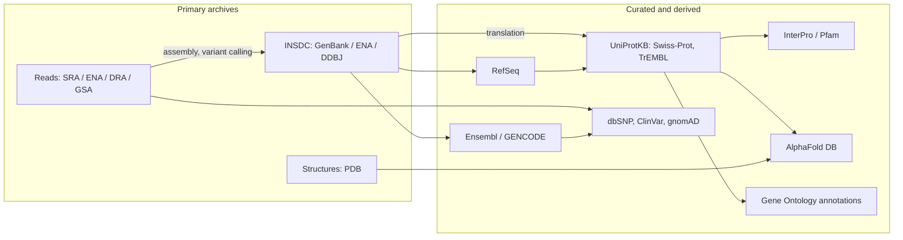

Almost every analysis in bioinformatics begins and ends in a public database: the sequences we compare were deposited by others, the reference genome we align to is a database record, and the meaning of a result (which gene, which function, which disease) is read from curated annotation. This chapter describes the main databases, how their records are identified and versioned, and how positions on a genome are named and converted between versions of the reference. The running example is the lactase persistence variant rs4988235 in *MCM6* ([7.8.1](/7.8.1)): starting from a gene symbol, we find its identifiers, its position in two assemblies of the human genome, its protein, its population frequencies and the ontology terms that describe its function. The genome of SARS-CoV-2 serves as an example of a complete database record. The organization of genomes is described in [7.2.2](/7.2.2), genome annotation as a biological problem in [7.4.14](/7.4.14#sec-14.3), and the database systems behind these resources (the **relational model**, indexes, queries) in [4.13](/4.13).

## 2.1. Kinds of Databases

### 2.1.1. Primary and Secondary Databases

**Definition 2.1.1 (Primary and Secondary Database)** A **primary database** (archive) stores data as submitted by the researchers who produced them, such as sequences, reads or structures with their metadata, and changes a record only at the request of its submitter. A **secondary database** is derived from primary data by selection, curation, computation or integration, such as a non-redundant set of reference sequences, protein families, or a collection of variants with their clinical interpretation; its records are maintained by the database's own curators or pipelines.

The distinction matters because the two kinds answer different questions. A primary archive is complete and faithful to the submitters, and therefore redundant and uneven in quality: the same gene may have been deposited hundreds of times, with errors and with annotation that is never updated. A secondary database is selective and maintained, but reflects the judgments of its curators.

**Definition 2.1.2 (INSDC)** The **International Nucleotide Sequence Database Collaboration** (INSDC) is the joint operation of the three primary nucleotide sequence archives, GenBank (NCBI, United States), the European Nucleotide Archive (ENA, EMBL-EBI) and the DNA Data Bank of Japan (DDBJ), which exchange all their records daily, so that a sequence submitted to any of them is available from all three under the same accession.

The INSDC also covers raw reads, in the Sequence Read Archive (SRA) at NCBI, the ENA, and the DDBJ Sequence Read Archive (DRA). China's National Genomics Data Center (NGDC) operates the Genome Sequence Archive (GSA), accepted by journals as an equivalent repository; its human section, like dbGaP and the European Genome-phenome Archive (EGA), holds individual human data under controlled access ([7.8.1](/7.8.1#sec-1.6)). Raw-read archives are organized in a hierarchy of records: a project (BioProject, accession `PRJNA…`, `PRJEB…`, `PRJCA…`), its biological samples (BioSample, `SAMN…`), the sequencing experiments on each sample (`SRX…`, `ERX…`) and the runs of each experiment (`SRR…`, `ERR…`, `DRR…`, `CRR…`), the last being the files of reads that are downloaded.

| Kind | Primary | Secondary |
|---|---|---|
| Nucleotide sequences | GenBank, ENA, DDBJ (INSDC) | RefSeq, Ensembl and GENCODE annotation |
| Raw reads | SRA, ENA, DRA, GSA | processed data in expression and variant resources |
| Protein sequences | translations of INSDC coding sequences | UniProtKB/Swiss-Prot, UniRef clusters, InterPro, Pfam |
| Structures | Protein Data Bank (PDB) | CATH, SCOP; AlphaFold DB (computed) |
| Variation | dbSNP submissions, dbVar | ClinVar interpretations, gnomAD frequencies |
| Expression | GEO, ArrayExpress | Expression Atlas, GTEx portal |

### 2.1.2. Records and Identifiers

Each record has an *accession*, a stable identifier that is never reused, and a version: `NC_045512.2` is version $2$ of accession `NC_045512`. The version number increases whenever the sequence itself changes; changes of the annotation alone do not change it. Citing the version makes a sequence reproducible: a position on `NC_000002.11` (chromosome 2 of GRCh37) and the same number on `NC_000002.12` (GRCh38) are different bases.

A GenBank flat-file record consists of labeled sections: `LOCUS` (name, length, molecule type, division, date), `DEFINITION` (a one-line description), `ACCESSION` and `VERSION`, `DBLINK` (links to the BioProject and BioSample), `KEYWORDS`, `SOURCE` and `ORGANISM` (with the taxonomic lineage), `REFERENCE` (publications), `COMMENT`, `FEATURES` (the feature table: the source organism and molecule, genes, coding sequences with their translations, untranslated regions and other annotated elements, each with its location in one-based closed coordinates), and `ORIGIN`, the sequence itself. The feature table is the content that GFF3 files ([7.8.1](/7.8.1#sec-1.4.2)) encode in tabular form.

**Example 2.1.1 (The SARS-CoV-2 Reference Genome)** The genome of the isolate Wuhan-Hu-1, sequenced from a patient in December 2019, was deposited as `MN908947` in GenBank; its current version `MN908947.3` is the primary record. NCBI copied it into RefSeq as `NC_045512.2`, the reference used by most analyses. The record describes a single-stranded positive-sense RNA genome of $29\,903$ nt (written, like all nucleotide records, as DNA). Its feature table lists a $5'$ untranslated region of $265$ nt, the large replicase gene `ORF1ab` at $266$–$21\,555$, translated as two polyproteins (pp1a, and pp1ab by a $-1$ ribosomal frameshift near position $13\,468$), the spike gene `S` at $21\,563$–$25\,384$, and the genes of the other structural and accessory proteins, ending with `N` (nucleocapsid) at $28\,274$–$29\,533$, `ORF10` and a $3'$ untranslated region of $229$ nt. Mutations of the virus are named relative to this sequence: the substitution that spread worldwide in 2020, A23403G, changes codon $614$ of the spike protein from aspartate to glycine (D614G), since $23\,403 - 21\,563 = 1840 = 3 \times 613 + 1$ places it at the second base of codon $614$.


### 2.1.3. Curated Reference Sets

**Definition 2.1.3 (RefSeq)** **RefSeq** (the NCBI Reference Sequence database) is a curated, non-redundant secondary database that provides one reference record for each genome, chromosome, transcript and protein of an organism, derived from INSDC records and maintained by NCBI by computation and, for a subset, by manual review.

RefSeq accessions have a two-letter prefix that states the kind of molecule and an underscore: `NC_` complete genomic molecules (chromosomes, organelle and viral genomes), `NG_` genomic regions (gene loci used as references for clinical variant names), `NT_` and `NW_` contigs and scaffolds, `NM_` and `NR_` curated messenger and non-coding RNAs, `NP_` proteins, and `XM_`, `XR_`, `XP_` the corresponding records predicted by the genome annotation pipeline without full curation. INSDC accessions have no underscore (`MN908947`).

**Definition 2.1.4 (UniProt)** **UniProt** (the Universal Protein Resource) is the central protein sequence and annotation database, maintained by EMBL-EBI, the Swiss Institute of Bioinformatics and the Protein Information Resource. Its knowledgebase UniProtKB has two sections: *Swiss-Prot*, with entries reviewed by curators who record function, domains, modifications, variants and literature, and *TrEMBL*, with unreviewed entries, mostly computational translations of INSDC coding sequences annotated automatically.

The two sections differ by a factor of several hundred in size: Swiss-Prot has about $5.7\times10^5$ entries, TrEMBL about $2.5\times10^8$ (2025). To reduce redundancy for searches, UniRef clusters UniProt sequences at $100\,\%$, $90\,\%$ and $50\,\%$ identity. A UniProt accession such as `Q14566` (the human MCM6 protein, entry name `MCM6_HUMAN`) is stable; the entry name may change.

## 2.2. Genome Resources

### 2.2.1. Reference Genomes

**Definition 2.2.1 (Reference Genome)** A **reference genome** is an assembled genome sequence of a species, released as a numbered version (an *assembly*), that serves as the common coordinate system for mapping reads, naming variants and annotating features; it represents one or a few individuals and does not contain all the sequence variation of the species.

The human reference is maintained by the Genome Reference Consortium (GRC):

| Assembly | UCSC name | Release | Notes |
|---|---|---|---|
| GRCh37 | hg19 | 2009 | still used by older data sets and some clinical pipelines; UCSC hg19 used a different mitochondrial sequence than the revised Cambridge reference of GRCh37 |
| GRCh38 | hg38 | 2013 | the current standard; updated by *patches* (GRCh38.p14, 2022) that do not change the coordinates of the primary chromosomes; includes alternative loci for highly variable regions (such as the HLA) |
| T2T-CHM13 | hs1 | 2022 | the first gapless assembly of all chromosomes, from a hydatidiform mole, with chromosome Y from HG002 added in version 2.0 ([7.4.14](/7.4.14#sec-14.2.2)) |

For alignment, the *analysis sets* of GRCh38 distributed by the major pipelines mask the duplicated copies of some regions (the pseudoautosomal regions on chromosome Y, for example) and add decoy sequences, such as the Epstein–Barr virus genome, so that reads from contaminating sources do not map to the wrong place. A file of reads aligned to one analysis set is not interchangeable with one aligned to another even within the same assembly, and every result should state the exact reference file used. Chromosome names also differ by source: `chr2` and `chrM` in UCSC files, `2` and `MT` in Ensembl and NCBI files.

The single linear reference has limits ([7.4.14](/7.4.14#sec-14.2.3)): sequence absent from it is invisible, and reads from divergent haplotypes align poorly. The Human Pangenome Reference Consortium released in 2023 a **pangenome** reference of $47$ phased diploid genomes as a graph, and graph-based alignment to it is discussed in [7.8.10](/7.8.10) and [7.8.11](/7.8.11).

### 2.2.2. Genome Browsers and Annotation Sets

The three main portals for genome sequences and their annotation are Ensembl (EMBL-EBI), the UCSC Genome Browser and NCBI (Gene, Genome Data Viewer). A genome browser draws the reference coordinate axis with *tracks* aligned to it: gene models, transcripts, conservation, variants, regulatory elements and the user's own data in BED, bigWig, BAM or VCF format ([7.8.1](/7.8.1#sec-1.4)). The UCSC Table Browser and Ensembl's BioMart export any track for a region or a list of genes.

Two **genome annotation** sets are used for the human genome: GENCODE (identical to the Ensembl annotation, combining manual curation by the HAVANA group with automatic annotation) and RefSeq (by NCBI). They agree on most protein-coding genes but differ in the number of transcripts per gene and in the exact ends of exons, which changes the names and predicted effects of variants. The MANE project (Matched Annotation from NCBI and EMBL-EBI) defines, for each protein-coding gene, one *MANE Select* transcript that is identical in both sets, down to the untranslated regions, and recommends it for reporting clinical variants.


### 2.2.3. Gene Symbols and Identifiers

A human gene has an approved symbol and name assigned by the HUGO Gene Nomenclature Committee (HGNC), and identifiers in each database:

| Symbol | Name | HGNC | NCBI Gene | Ensembl gene | UniProt | Role here |
|---|---|---|---|---|---|---|
| *MCM6* | minichromosome maintenance complex component 6 | 6949 | 4175 | ENSG00000076003 | Q14566 | contains the lactase enhancer |
| *LCT* | lactase | 6530 | 3938 | ENSG00000115850 | P09848 | target gene of the enhancer |

The identifiers have different scopes. A symbol is meant for people and can change (symbols are revised when a gene's function becomes clearer, or to remove names that spreadsheets turn into dates, [7.8.1](/7.8.1#sec-1.5.1)), and the same symbol may denote unrelated genes in different species. NCBI Gene and Ensembl gene IDs are stable machine identifiers; Ensembl IDs carry a version suffix (`ENSG00000076003.`$n$) that increases when the gene model changes. One gene has several transcripts (`ENST…`, `NM_…`) and proteins (`ENSP…`, `NP_…`), so mapping between databases is one-to-many in general, and tables of "the" protein for each gene silently choose one. For human genes, mapping through the HGNC identifier or the MANE Select transcript avoids most ambiguities.

### 2.2.4. Converting Coordinates between Assemblies

A new assembly corrects errors, fills gaps and shifts coordinates, by megabases in places. Data on one assembly must be converted before they are combined with data on another.

**Definition 2.2.2 (Liftover)** **Liftover** is the conversion of genomic coordinates from one assembly (the source) to another (the target) by means of a whole-genome alignment between them, stored as a *chain file*: a set of chains, each a sequence of gap-free aligned blocks with the offsets between them, that pair segments of the source with segments of the target, possibly on the opposite strand.

**Algorithm 2.2.1 (Liftover of a Position)** Input: a source position $p$ on chromosome $c$, and the chains on $c$, each with its list of blocks $(s_j, t_j, \ell_j)$ meaning that source bases $[s_j, s_j + \ell_j)$ are aligned to target bases $[t_j, t_j + \ell_j)$ (on the target's forward strand, or its reverse when the chain is reversed).

1. Find the blocks containing $p$, that is, with $s_j \le p < s_j + \ell_j$: blocks are sorted by $s_j$ within a chain, and the chains themselves are indexed by interval, so this takes $O(\log B)$ time for $B$ blocks by **binary search**.
2. If no block contains $p$, report failure: the base is in a gap of the alignment, a region deleted or rearranged in the target.
3. Otherwise, for each such block, the target position is $t_j + (p - s_j)$ on a forward chain, or $T - 1 - (t_j + (p - s_j))$ on a reversed chain of a target chromosome of length $T$, where the base is also complemented. If several chains contain $p$, the position maps to several places; tools report the best-scoring chain or flag the position.

An interval is converted by mapping its bases; `liftOver` (UCSC) accepts the result if at least a set fraction of the bases map (by default $95\,\%$) and reports the extent of the mapped bases. Intervals that span a gap or a strand change can be split or rejected. CrossMap and the Picard tool `LiftoverVcf` apply the same chains to BED, BAM and VCF files; for VCF, the reference allele must also be checked against the target sequence, because the two assemblies may have different bases at the same aligned position, in which case REF and ALT are swapped.

**Example 2.2.1 (rs4988235 in Two Assemblies)** In GRCh37, rs4988235 is at chromosome 2, position $136\,608\,646$; in GRCh38 at $135\,851\,076$. The chain block containing it maps the region with a shift of $-757\,570$ bases, so the whole *LCT*–*MCM6* locus moves by the same amount: *LCT*, for example, starts near $136.545\,\mathrm{Mb}$ in GRCh37 and near $135.788\,\mathrm{Mb}$ in GRCh38. Identifiers such as `rs4988235` do not depend on the assembly; this is the reason to exchange variant lists with rs identifiers (or HGVS names on versioned RefSeq records) as well as positions.

:::


```bash
# Lift a BED file from GRCh37 to GRCh38 with the UCSC chain file
liftOver variants.hg19.bed hg19ToHg38.over.chain.gz variants.hg38.bed unmapped.bed
# The same for a VCF, checking reference alleles against the target genome
CrossMap vcf GRCh37_to_GRCh38.chain.gz variants.grch37.vcf GRCh38.fa variants.grch38.vcf
```

## 2.3. Proteins and Structures

Beyond UniProt, three resources describe proteins in more depth. The **Protein Data Bank** (PDB), the archive of experimentally determined macromolecular structures run by the worldwide PDB partners (RCSB, PDBe, PDBj, BMRB), holds about $2.3\times10^5$ entries (2025), each identified by a four-character code; structures of the MCM2–7 helicase, of which MCM6 is one subunit, are among them. AlphaFold DB, built by DeepMind and EMBL-EBI, provides predicted structures for over $2\times10^8$ UniProt sequences, with per-residue confidence (pLDDT) and predicted aligned errors; the interpretation of these confidence measures is part of [7.8.17](/7.8.17). InterPro integrates the signatures of protein families, domains and sites from member databases, among them Pfam, whose families are defined by profile hidden Markov models ([7.8.5](/7.8.5)); the MCM proteins, for example, share the MCM domain, an AAA+ ATPase. Structural classifications (CATH, SCOP) group domains by fold and evolutionary relationship ([7.1.5](/7.1.5)).

## 2.4. Variation and Phenotype

| Resource | Content | Example |
|---|---|---|
| dbSNP | short variants with reference SNP identifiers (`rs`), merging submissions (`ss`); over $10^9$ `rs` identifiers | rs4988235, rs334 (the sickle-cell allele of *HBB*) |
| dbVar, DGV | structural variants ($> 50\,\mathrm{bp}$) | copy-number variants of the *AMY1* locus |
| ClinVar | submitted interpretations of variants for disease, with evidence and review status | pathogenic variants of *NGLY1* (7.8.12) |
| gnomAD | allele frequencies by population from aggregated exomes and genomes (v4: $730\,947$ exomes and $76\,215$ genomes); measures of constraint per gene | the depletion of loss-of-function variants in essential genes |
| GWAS Catalog | curated associations of variants with traits from published genome-wide association studies | association of rs4988235 with lactase persistence and related traits |
| OMIM | curated descriptions of human genes and Mendelian phenotypes; MIM numbers whose first digit encodes the locus (1, 2 and 6 autosomal, 3 X-linked, 4 Y-linked, 5 mitochondrial) | lactase persistence and adult-type hypolactasia |
| Biobanks | genotype and phenotype data of large cohorts: UK Biobank ($5\times10^5$ participants), All of Us (over $4\times10^5$ with genomic data in 2024), ChinaMAP ($10\,588$ deeply sequenced Chinese genomes in its first release) | population-specific frequencies |

**Example 2.4.1** The frequency of the T allele of rs4988235 (the derived allele, A on the forward strand) in the five continental groups of the 1000 Genomes Project is $0.52$ in Europeans, $0.22$ in admixed Americans, $0.11$ in South Asians, $0.02$ in Africans and $0.00$ in East Asians. Under Hardy–Weinberg proportions, the fraction of Europeans carrying at least one copy, and so expected to be lactase persistent (the allele is dominant), is $1 - (1 - 0.52)^2 = 0.77$. In East Asian populations lactase persistence is rare. In African and Middle Eastern pastoralist populations it is common but due to other variants in the same enhancer (such as $-14010\mathrm{G{>}C}$), an example of convergent evolution discussed in [7.4.23](/7.4.23).

## 2.5. Ontologies

Free-text annotation ("involved in replication", "DNA replication", "replication of DNA") cannot be counted or compared. Databases therefore describe function with controlled vocabularies whose terms are defined and related to each other.

**Definition 2.5.1 (Ontology)** An **ontology** in bioinformatics is a set of terms, each with an identifier, a name and a definition, together with typed relations between terms (such as *is_a*, meaning a subclass, and *part_of*), that forms a **directed acyclic graph** in which every term is more specific than the terms it points to.

**Definition 2.5.2 (Gene Ontology)** The **Gene Ontology** (GO) is the ontology of the functions of gene products, with three independent aspects, each a directed acyclic graph with its own root: *molecular function* (GO:0003674; activities of single gene products, such as DNA helicase activity, GO:0003678), *biological process* (GO:0008150; larger processes accomplished by several activities, such as DNA replication, GO:0006260) and *cellular component* (GO:0005575; locations, such as the MCM complex). A GO *annotation* links a gene product to a term with an evidence code and a reference.

GO has about $4\times10^4$ terms. Because a term may have several parents (DNA repair is a kind of DNA metabolic process and also part of the cellular response to DNA damage), the structure is a directed acyclic graph rather than a tree. Annotations obey the *true-path rule*: a gene product annotated to a term is implicitly annotated to all its ancestors along *is_a* and *part_of* relations. Annotation counts, and with them enrichment analyses ([7.9](/7.9)), must therefore propagate every annotation to the root.

Evidence codes state how an annotation was obtained: from experiments (IDA direct assay, IMP mutant phenotype, IPI physical interaction, IGI genetic interaction, IEP expression pattern), from high-throughput experiments (HTP and its subcodes), from phylogenetic inference (IBA), from sequence similarity reviewed by a curator (ISS and related codes), from author or curator statements (TAS, NAS, IC), or electronically without review (IEA). Most annotations, especially outside model organisms, are IEA, transferred by similarity; such annotations are useful but propagate errors.

**Formula 2.5.1 (Information Content of a Term)** If $n_t$ of the $N$ gene products of an annotation set are annotated to term $t$ after propagation, the information content of $t$ is

$$
\operatorname{IC}(t) = -\log_2\frac{n_t}{N}\ \text{bits}.
$$
The semantic similarity of two terms in the sense of Resnik is the information content of their most informative common ancestor.

**Example 2.5.1** In the toy annotation set of the figure below, $100$ genes are annotated to the biological-process root. After propagation $8$ genes are annotated to DNA replication initiation, $20$ to DNA replication, $20$ to DNA repair, $45$ to DNA metabolic process and $30$ to the cellular response to DNA damage stimulus. Then $\operatorname{IC}(\text{replication initiation}) = \log_2(100/8) = 3.64$ bits and $\operatorname{IC}(\text{DNA repair}) = 2.32$ bits. Their most informative common ancestor is DNA metabolic process, so their Resnik similarity is $\log_2(100/45) = 1.15$ bits; DNA repair and the response to DNA damage, which share the response term ($1.74$ bits), are more similar.


:::

Other ontologies used in this course are the Sequence Ontology (SO), whose terms name the feature types of GFF3 files and the consequences of variants (`missense_variant`, `splice_donor_variant`, [7.8.12](/7.8.12)), and the Human Phenotype Ontology (HPO), with over $1.8\times10^4$ terms for clinical abnormalities, used to describe patients and to rank candidate genes in rare-disease diagnosis.

## 2.6. Programmatic Access

Web interfaces are for exploring; analyses query databases from programs. NCBI's Entrez E-utilities (`esearch`, `efetch`, `esummary`, `elink`) are web services over all NCBI databases, limited to $3$ requests per second without and $10$ with an API key; Ensembl's REST API returns JSON for genes, sequences, variants, mappings between assemblies and variant effect predictions (up to $15$ requests per second); UniProt has a REST API with a query language. Bulk data are downloaded from FTP sites, with the NCBI `datasets` tool, or, for reads, with the SRA Toolkit.

```python
from Bio import Entrez, SeqIO
import requests

Entrez.email = "you@example.org"            # NCBI asks for a contact address
with Entrez.efetch(db="nucleotide", id="NC_045512.2", rettype="gb", retmode="text") as h:
    rec = SeqIO.read(h, "genbank")
spike = [f for f in rec.features if f.type == "CDS" and f.qualifiers.get("gene") == ["S"]][0]
print(spike.location, spike.qualifiers["protein_id"])        # [21562:25384](+) ['YP_009724390.1']

server = "https://rest.ensembl.org"
gene = requests.get(f"{server}/lookup/symbol/homo_sapiens/MCM6",
                    headers={"Content-Type": "application/json"}).json()
print(gene["id"], gene["seq_region_name"], gene["start"], gene["end"], gene["strand"])
mapping = requests.get(f"{server}/map/human/GRCh37/2:136608646..136608646/GRCh38",
                       headers={"Content-Type": "application/json"}).json()
print(mapping["mappings"][0]["mapped"]["start"])              # 135851076
```

Biopython reports the location of the spike gene as `[21562:25384](+)`, a zero-based half-open interval ([7.8.1](/7.8.1#sec-1.4.4)), although the GenBank record writes `21563..25384`.

```bash
# Gene records and sequences with the NCBI datasets tool
datasets download gene symbol MCM6 --taxon human --filename mcm6.zip
# Reads of a sequencing run from the SRA (RUN holds a run accession such as SRR...)
prefetch "$RUN" && fasterq-dump --split-files --threads 8 "$RUN"
```

Large analyses should not depend on live queries, which return different answers as databases are updated. Download the release used (a GENCODE release, a dbSNP build, a dated UniProt release), record its version, and keep the query scripts with the results ([7.8.1](/7.8.1#sec-1.6)).



## Summary

| Topic | Key points |
|---|---|
| Kinds | primary archives keep submitted data; secondary databases curate, compute and integrate (Definition 2.1.1); INSDC exchanges GenBank, ENA and DDBJ daily (Definition 2.1.2); reads in SRA/ENA/DRA/GSA, organized as project, sample, experiment, run |
| Identifiers | `accession.version`; the version changes with the sequence; RefSeq prefixes `NC_`, `NG_`, `NM_`, `NR_`, `NP_`, `XM_` (Definition 2.1.3); UniProt Swiss-Prot (reviewed) and TrEMBL (Definition 2.1.4) |
| Example record | SARS-CoV-2 `NC_045512.2`, $29\,903$ nt, `S` at $21\,563$–$25\,384$; D614G is A23403G (Example 2.1.1) |
| Reference genomes | a versioned coordinate system (Definition 2.2.1): GRCh37/hg19, GRCh38/hg38 (patches, alternative loci, analysis sets), T2T-CHM13; naming `chr2` versus `2`; pangenome graphs |
| Annotation | GENCODE/Ensembl and RefSeq; MANE Select transcripts; HGNC symbols versus stable IDs; mappings are one-to-many |
| Liftover | chain files of aligned blocks (Definition 2.2.2); a position maps by the offset of its block, found by binary search (Algorithm 2.2.1); gaps fail, reversed chains flip strand, alleles must be rechecked; rs4988235 moves by $-757\,570$ (Example 2.2.1) |
| Proteins and variants | PDB, AlphaFold DB, InterPro/Pfam; dbSNP, ClinVar, gnomAD, GWAS Catalog, OMIM, biobanks; rs4988235 T allele $0.52$ in Europeans, $0.00$ in East Asians (Example 2.4.1) |
| Ontologies | terms with is_a/part_of relations forming a DAG (Definition 2.5.1); GO's three aspects (Definition 2.5.2); true-path rule; evidence codes; information content and Resnik similarity (Formula 2.5.1); SO, HPO |
| Access | E-utilities, Ensembl REST, `datasets`, SRA Toolkit; download and record releases rather than relying on live queries |

## Questions

1. Why does the INSDC keep a record exactly as submitted, even when the annotation in it is known to be outdated? Where should a user look for current annotation of the same sequence?

   **Answer** A primary archive is the scientific record: a sequence is cited by its accession in a publication, and changing it without the submitter would make the published analyses irreproducible and would put the archive's curators in the position of judging every submitter's data. Corrections therefore come only from submitters, as new versions. Current annotation is in secondary databases that are re-annotated systematically: RefSeq and Ensembl/GENCODE for genomes and transcripts, UniProtKB for proteins.

2. The record `NM_005915.6` is cited in a clinical report. What does each part of the identifier mean, and what would a change to `NM_005915.7` imply?

   **Answer** `NM_` marks a curated RefSeq messenger RNA, `005915` is the accession of the *MCM6* transcript record and `.6` its sixth version. A new version `.7` means that the transcript's sequence has changed (for example, a corrected or extended untranslated region); positions in `c.` notation counted on version $6$ may then differ from those on version $7$, so the report must keep the version to be interpreted unambiguously.

3. Using the coordinates of Example 2.1.1, at which position of the spike protein and which base of its codon does the genomic substitution at nucleotide $23\,063$ (A23063T, the N501Y mutation of several variants of concern) lie?

   **Answer** $23\,063 - 21\,563 = 1500 = 3 \times 500 + 0$, so the base is the first base of codon $501$. The codon AAT (asparagine) becomes TAT (tyrosine): N501Y. This agrees with the known name, a check of the coordinate arithmetic.

4. A colleague lifts over a list of $10\,000$ variant positions from GRCh37 to GRCh38 and finds that $40$ fail. Give three reasons for failure, and say what should be done with the failed variants.

   **Answer** (a) The position lies in a region with no aligned block in the chain: sequence removed from or substantially rearranged in GRCh38 (errors of GRCh37 corrected in GRCh38). (b) The position maps to more than one place, as in segmental duplications, and the tool declines to choose. (c) For an interval, too small a fraction of its bases maps, or the interval spans a gap or a strand change. In VCF conversion, a variant may also be rejected because the reference base differs between assemblies. The failed variants should not be dropped silently: look them up by rs identifier (dbSNP gives GRCh38 positions directly), or re-call them from the reads aligned to GRCh38, and report how many were lost.

5. Why is it a mistake to compare a VCF file of variants called on GRCh37 with a BED file of exons from GENCODE on GRCh38, even if the chromosome names are made consistent? Estimate the size of the error at the *LCT* locus.

   **Answer** The two files use different coordinate systems: the same number denotes different bases. At the *LCT* locus the offset is $757\,570$ bases (Example 2.2.1), far larger than any gene, so overlaps between variants and exons would be essentially random. All files must be converted to one assembly first, and the assembly recorded in every file header.

6. Compute the expected fraction of lactase-persistent adults in a South Asian population with the 1000 Genomes allele frequency $0.11$ of rs4988235, assuming Hardy–Weinberg proportions and dominance. Why might the actual fraction differ?

   **Answer** $1 - (1 - 0.11)^2 = 1 - 0.7921 = 0.21$. The actual fraction may differ because other variants in the same enhancer also cause persistence in some populations, because the allele frequency varies widely among South Asian groups (the continental figure averages them), because genotype does not determine phenotype completely (lactase activity declines gradually, and symptoms depend on the gut microbiota and diet), and because mating is not random with respect to population structure.

7. In the toy annotation set of Example 2.5.1, a gene list from an experiment contains $5$ of the $8$ genes annotated to DNA replication initiation and $5$ other genes, out of $100$. Under random sampling of $10$ genes, what is the expected number in this term, and why must the count include propagated annotations?

   **Answer** Expected $10 \times 8/100 = 0.8$; observing $5$ suggests enrichment (the statistics of enrichment tests, hypergeometric probabilities and multiple testing, are in [7.9](/7.9)). Counts must include propagated annotations because a gene annotated only to the more specific term mitotic DNA replication initiation is also involved in DNA replication initiation by the true-path rule; without propagation, general terms would appear to have fewer genes than they do, and the enrichment of a general term would be underestimated.

8. Why is an annotation with evidence code IEA treated differently from one with IDA in many analyses? Give an example of how IEA annotations can propagate an error.

   **Answer** IDA means a direct experiment on this gene product; IEA means an electronic transfer, usually from a homolog or from a domain signature, that no curator has reviewed. Suppose a protein of one species was misannotated as a helicase; its homologs in hundreds of genomes receive the same annotation by IEA, and those annotations in turn support further transfers, so a single error becomes a family-wide "fact". Analyses that test hypotheses about function often restrict to experimental evidence or weight it more.

9. (Design) Write the steps of a small program that takes a list of human gene symbols from a published supplementary table and returns, for each, the Ensembl gene ID, the GRCh38 coordinates and the MANE Select transcript. Which problems should it detect?

   **Answer** Steps: (1) normalize the symbols (trim spaces, upper case) and detect values that are dates or numbers (`2-Sep`, `1-Mar`), mapping them back to SEPTIN2 or MARCHF1 where unambiguous; (2) map each symbol to an HGNC identifier with the HGNC download, checking previous symbols and aliases; report symbols that are ambiguous (an alias shared by two genes) or unknown; (3) map HGNC identifiers to Ensembl gene IDs and NCBI Gene IDs; (4) query a local copy of the GENCODE or Ensembl annotation (not the live API, for reproducibility) for the gene coordinates on GRCh38 and the transcript tagged MANE Select; (5) report genes without a MANE transcript (non-coding genes, some loci) and record the release versions used. The problems to detect are converted symbols, outdated or alias symbols, one-to-many mappings and missing records.

10. The same feature is reported by Biopython as `[21562:25384]` and by the GenBank record as `21563..25384`. Explain the discrepancy, and give the length in both conventions.

    **Answer** Biopython uses Python's zero-based half-open intervals, GenBank one-based closed coordinates; by Formula 1.4.2 of [7.8.1](/7.8.1) the start differs by one and the end is the same. The length is $25\,384 - 21\,562 = 3822$, and equally $25\,384 - 21\,563 + 1 = 3822$.
